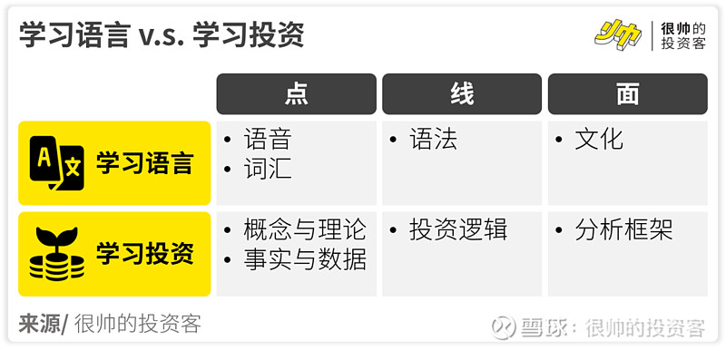
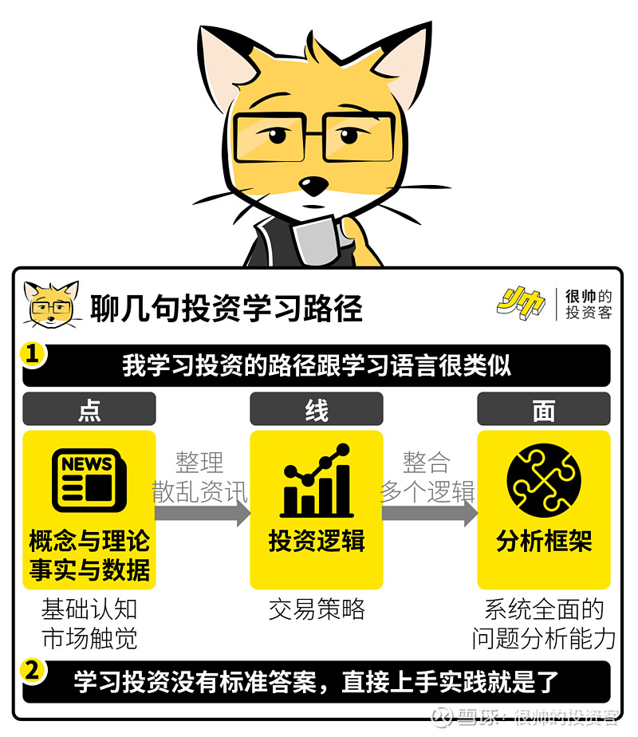

# 投资学习路径
## 1. 基础知识--**CFA（特许金融分析师）的Kaplan Notes**

- 先对概念理论有了**基础认知**，同时通过事实与数据建立**市场触觉**（market sense）。
- 然后用逻辑串联起散乱的资讯，成为可以交易的**投资逻辑**。
- 最后把所有的投资逻辑整合起来，变成你自己的**分析框架**，未来可以用这个框架去系统、全面地进行**投资分析**

## 2. 市场触觉
1. 新浪财经或华尔街见闻
2. 雪球或雪球财经
3. 读券商投行们的研究报告
4. 很帅的投资客  -- 雪球上的博客

# CFA 基础学习
## 全球投资表现标准介绍（GIPS）

## 生产要素市场  最终商品和服务的市场
- 生产要素市场：原油、工人
- 最终商品和服务的市场：汽车，服装，酒是主要向消费者提供最终商品；
- 公司是生产要素市场中的买家和产品市场中的卖家；
- 芯片：属于中间商品，因为他们用于生产最终商品。

## 
产品和服务的需求数量 取决于收入，其他商品的价格和另外一些因素