Vue3+NestJS实现权限管理系统
# 1. NestJS介绍
NestJS 是一个 NodeJS 的后端服务框架,它与传统的 NodeJS 框架不一样的是采用了**控制反转(IOC)**和**依赖注入(DI)**的模式进行开发。当然,如果你对 NestJS 不熟悉的话也没关系,看完本节相信你就能入门 NestJS。

## 1.1 安装NestJS
1. 全局安装
npm i -g @nestjs/cli
2. 查看全局安装的NestJS版本
nest --version
npm list -g --depth=0
3. 创建项目
nest new admin_test
选择 npm,等待一会就会发现我们的 nest_cli 项目创建完成了

##  src 中各种文件是干嘛的
1. app.controller.ts
这里控制层,这里主要是写**路由相关代码**以及**处理前端传来的一些参数**(后面会介绍如何接收参数)

2. app.service.ts
这里是业务层,在这里写一些与业务相关的逻辑。比如对数据库的 CRUD 就可以写到这里

3. app.module.ts
它可以**组织应用程序中的许多功能**,如控制器、服务以及可以导入其他模块等
 **app.module.ts 已经进行了依赖注入(providers)**

** 该模块用于注册当前后端项目的三个核心信息：
 定义整个后端项目的控制器（路由接口）、服务提供者、模块导入等；
 这些信息共同定义了后端项目的功能和行为；**

4. main.ts
它是应用程序的入口文件,NestJS 会从这里开始启动应用程序。

## 执行命令
1. 启动项目--package.json中有相关命令的配置： "start:dev": "nest start --watch"
npm run start:dev

就可以启动服务了,浏览器打开http://localhost:3000/即可发送一个 get 请求到app.controller.ts中的 getHello 函数,调用app.service.ts里的 getHello 函数返回Hello World!

## 装饰器巩固学习
NestJS 给我们提供了一些命令可以创建对应文件,非常方便,比如

生成一个 module (nest g mo) 。
生成一个 controller (nest g co) 。
生成一个 service (nest g s) 。

可以执行nest -h来查阅这些命令及它们的缩写

src目录下，可以执行**nest generate resource user --no-spec**生成一个 user 模块,包括它的module,controller,service,执行之前可以在 nest-cli.json 中配置：

 "generateOptions": {
    "spec": false
  }

这样就不会生成测试文件(我们这里还不需要),执行命令我们可以选择 REST API 的形式,这样我们 src 下就会出现了 user 模块,同时在 app.module.ts 也进行了自动导入,也就是说创建完毕之后直接就可以使用了

**显示禁用测试文件的命令**
nest generate resource user --no-spec
如下是配置过程，我选了CRUD的入口点
 nest generate resource user --no-spec
? What transport layer do you use? REST API
? Would you like to generate CRUD entry points? (Y/n) y

这里**后台**会**报错**，@nestjs/mapped-types 模块，需要安装
npm install @nestjs/mapped-types

**清理nest的缓存命令：**
nest cache clean

**此时src目录中的app.module.ts会自动增加导入配置**，如下：
import { UserModule } from './user/user.module';
imports: [UserModule]

### 查看user目录中的user.controller.ts文件，
 cat user.controller.ts
import { Controller, Get, Post, Body, Patch, Param, Delete } from '@nestjs/common';
import { UserService } from './user.service';
import { CreateUserDto } from './dto/create-user.dto';
import { UpdateUserDto } from './dto/update-user.dto';//已经导入

@Controller('user') //它定义的是请求路径是user。
export class UserController {
  constructor(private readonly userService: UserService) {}

  @Post()
  create(@Body() createUserDto: CreateUserDto) {//这里接收前端传来的参数,取body主体数据
    return this.userService.create(createUserDto);
  }

  @Get()
  findAll() {
    return this.userService.findAll();
  }

  @Get(':id')
  findOne(@Param('id') id: string) {
    return this.userService.findOne(+id);
  }

  @Patch(':id')
  update(@Param('id') id: string, @Body() updateUserDto: UpdateUserDto) {
    return this.userService.update(+id, updateUserDto);
  }

  @Delete(':id')
  remove(@Param('id') id: string) {
    return this.userService.remove(+id);
  }
}

其中@Controller('user')是路由装饰器,它定义的是请求路径是user。

而像@Post,@Get,@Patch等就是对应的请求方式装饰器,比如你用 POST 请求调用http://localhost:3000/user就会进入@Post()下面的 create()方法,当然你也可以这样写@Post('login'),这样请求路径就会变成/user/login了

## 创建过滤器
src目录下执行:创建统一异常处理模块
nest g filter common/filter/http-exception

### 将 http-exception.filter.ts 修改为
//这个过滤器的整体作用是 捕获并处理 HTTP 请求过程中抛出的 HttpException 异常，并将异常信息转换为统一的 JSON 响应格式返回给客户端。
//http-exception.filter.ts
import {
  ExceptionFilter,
  Catch,
  ArgumentsHost,
  HttpException,
} from '@nestjs/common';
import { Request, Response } from 'express';
// 装饰器,告诉 NestJS,HttpExceptionFilter会捕获所有 HttpException 类型的异常
@Catch(HttpException)//装饰器的作用是注册 HttpExceptionFilter 类为异常过滤器，而不是直接修饰构造函数。
//异常过滤类
export class HttpExceptionFilter implements ExceptionFilter {
  catch(exception: HttpException, host: ArgumentsHost) {
    const ctx = host.switchToHttp();// 切换到HTTP上下文,获取 HTTP 请求和响应对象
    const response = ctx.getResponse<Response>();//获取 HTTP 响应对象
    const request = ctx.getRequest<Request>();//获取 HTTP 请求对象
    const status = exception.getStatus();//获取异常的状态码

    response.status(status).json({//向客户端发送 JSON 格式的响应
      code: status,
      timestamp: new Date().toISOString(),
      path: request.url,
      describe: exception.message,
    });
  }
}

### 最后还需要在 main.ts 中将其注册为全局过滤器
import { NestFactory } from '@nestjs/core';
import { AppModule } from './app.module';
import { HttpExceptionFilter } from './common/filter/http-exception/http-exception.filter'

async function bootstrap() {
  const app = await NestFactory.create(AppModule);
  app.useGlobalFilters(new HttpExceptionFilter());
  await app.listen(process.env.PORT ?? 3000);
}
bootstrap();

### 这时候我们找个接口抛出一个错误码试一下
修改user.controller.ts中post方法
需要先导入这两个模块:HttpException,HttpStatus

## 创建拦截器 
**用于处理 HTTP 请求成功的响应数据**，并对其进行转换。

### src目录下执行:创建统一请求拦截器模块
nest g interceptor common/interceptor/transform

这样就在 common 目录下创建了一个拦截器,根据官网提供的例子修改一下transform.interceptor.ts
修改如下:

import {
  Injectable,
  NestInterceptor,
  ExecutionContext,
  CallHandler,
} from "@nestjs/common";
import { Observable } from "rxjs";
import { map } from "rxjs/operators";

export interface Response<T> {//定义响应数据接口
  data: T;
}

@Injectable()//定义拦截器
export class TransformInterceptor<T>
  implements NestInterceptor<T, Response<T>>/输入和输出参数
{
  intercept(
    context: ExecutionContext,
    next: CallHandler
  ): Observable<Response<T>> {
    return next
      .handle()
      .pipe(map((data) => ({ code: 200, data, describe: "请求成功" })));
  }
}
### 同样的在 main.ts 中进行全局注册一下
import { NestFactory } from '@nestjs/core';
import { AppModule } from './app.module';
import { HttpExceptionFilter } from './common/filter/http-exception/http-exception.filter'
import { TransformInterceptor } from './common/interceptor/transform/transform.interceptor'

async function bootstrap() {
  const app = await NestFactory.create(AppModule);
  app.useGlobalFilters(new HttpExceptionFilter());
  app.useGlobalInterceptors(new TransformInterceptor());
  await app.listen(process.env.PORT ?? 3000);
}
bootstrap();

此时我们尝试返回一个成功的请求看下结果

## 自定义**业务**异常
到这里细心的同学可能会发现,每次我们抛出异常的时候抛出的都是**请求状态码的异常**,前端只能在捕获错误 catch 中获得返回的信息。但是一般情况下除了状态码的异常之外前端还需要一些**业务的异常码**,比如以上面我们定义的 code 字段为例,用户登录时密码错误可以返回 code 为 10001,验证码错误可以返回 10002 之类的,但是这些个请求的状态码应该是正确的 200 而不是抛出异常状态码。因此我们的程序还需要能自定义业务异常

### 我们先创建 common/enums/api-error-code.enum.ts 
用于存放我们的业务状态码,这里简单写几个
export enum ApiErrorCode {
  SUCCESS = 200, // 成功
  USER_ID_INVALID = 10001, // 用户id无效
  USER_NOTEXIST = 10002, // 用户id无效
  COMMON_CODE = 20000, //通用错误码,想偷懒就返回这个
}

### 然后我们在http-exception目录下新建api.exception.ts用于处理业务异常,创建一个ApiException类继承HttpException,接受三个参数错误信息,错误码code,http状态码(默认是200)

ApiException类提供了一种机制来封装 API 错误的信息，包括错误消息、错误代码，以及 HTTP 状态码，从而使得在处理 API 错误时能够更加清晰和具体。

import { HttpException, HttpStatus } from '@nestjs/common';
import { ApiErrorCode } from '../../enums/api-error-code.enum';

export class ApiException extends HttpException {
  private errorMessage: string;
  private errorCode: ApiErrorCode;

  constructor(
    errorMessage: string,
    errorCode: ApiErrorCode,
    statusCode: HttpStatus = HttpStatus.OK,
  ) {
    super(errorMessage, statusCode);
    this.errorMessage = errorMessage;
    this.errorCode = errorCode;
  }

  getErrorCode(): ApiErrorCode {
    return this.errorCode;
  }

  getErrorMessage(): string {
    return this.errorMessage;
  }
}

### 然后修改http-exception.filter.ts
可以判断exception是否在 ApiException 原型链上来确定是调用的是 ApiException 还是 HttpException
**增加如下内容：**
if (exception instanceof ApiException){
      response.status(status).json({
        code: exception.getErrorCode(),
        timestamp: new Date().toISOString(),
        path: request.url,
        describe: exception.getErrorMessage(),
      });
      return;
    }

## ** 随后可以利用api接口工具，使用post方法请求登录接口，来测试配置情况。**
这里还是采用过滤器的那种简单粗暴的方式，直接在user.controller.ts中修改post方法的throw语句 

# docker
此处使用windows的docker-desktop
科学上网以后拉取mysql的镜像，然后运行
服务端口配置：3306
卷映射的目录为本机的F盘的MYSQLDB目录
容器内的MySQL路径：/var/lib/mysql
数据库环境变量：    MYSQL_ROOT_PASSWORD  root
**注意：root也是mysql的root用户的默认密码**
**注意：容器创建启动后，以后都从容器界面启动已经配置好的容器，不要从镜像run启动，run命令是从当前镜像启动一个容器，而容器是可以持久化的**
图例：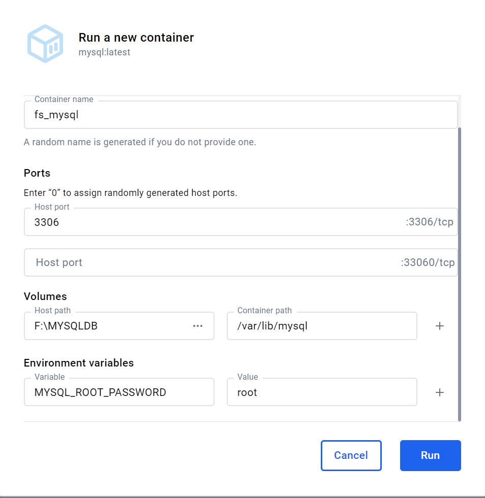

# 连接mysql
## 容器内登录：
mysql -u root -p
mysql> SELECT VERSION();
+-----------+
| VERSION() |
+-----------+
| 9.1.0     |
+-----------+
1 row in set (0.00 sec)
查看数据库字符集：
mysql> show variables like 'character%';
+--------------------------+--------------------------------+
| Variable_name            | Value                          |
+--------------------------+--------------------------------+
| character_set_client     | latin1                         |
| character_set_connection | latin1                         |
| character_set_database   | utf8mb4                        |
| character_set_filesystem | binary                         |
| character_set_results    | latin1                         |
| character_set_server     | utf8mb4                        |
| character_set_system     | utf8mb3                        |
| character_sets_dir       | /usr/share/mysql-9.1/charsets/ |
+--------------------------+--------------------------------+

## NESTJS 连接mysql
1. 安装mysql的orm模块--**这是适用于ts的orm模块**
npm install @nestjs/typeorm typeorm mysql2 
2. 引入orm模块
到 app.module.ts 中进行数据库的配置,引入 TypeOrmModule 调用 forRoot 方法配置 MySql

import { Module } from '@nestjs/common';
import { AppController } from './app.controller';
import { AppService } from './app.service';
import { UserModule } from './user/user.module';
import { TypeOrmModule } from "@nestjs/typeorm";

@Module({ // 这里的Module装饰器接收一个对象，对象中包含了三个属性：controllers、providers、imports。
  // controllers：控制器数组，用来定义路由和处理请求的控制器类。
  // providers：服务提供者数组，用来提供服务的类。
  // imports：导入其他模块，可以把其他模块的控制器、服务提供者导入到当前模块中。
  imports: [UserModule,
    TypeOrmModule.forRoot({
            type: "mysql",
            host: "localhost",
            autoLoadEntities: true,//自动加载实体文件
            port: 3306, // 端口号
            charset: 'utf8mb4',//指定utf8mb4字符集，解决中文乱码问题
            username: "root", // 用户名
            password: "root", // 密码
            database: "fs_admin", //数据库名
            entities: [], //数据库对应的Entity
            synchronize: true, //是否自动同步实体文件,生产环境建议关闭
            connectorPackage: "mysql2",
          }),
  ],
  controllers: [AppController],
  providers: [AppService],
})
export class AppModule {}

3、 创建数据库
登录mysql，手动创建数据库：fs_admin

## 配置模型
数据库创建表在entities中操作就行了,它会将一个类映射为数据库中的表。比如我们在 user 下entities/user.entity.ts导出一个 User 类,然后在app.module.ts中导入
**注意此时的user.entity.ts要配置建表语句**

import { User } from "./user/entities/user.entity";

@Module({ // 这里的Module装饰器接收一个对象，对象中包含了三个属性：controllers、providers、imports。
  // controllers：控制器数组，用来定义路由和处理请求的控制器类。
  // providers：服务提供者数组，用来提供服务的类。
  // imports：导入其他模块，可以把其他模块的控制器、服务提供者导入到当前模块中。
  imports: [UserModule,
    TypeOrmModule.forRoot({
            type: "mysql",
            autoLoadEntities: true,//自动加载实体文件
            host: "localhost",
            port: 3306, // 端口号
            username: "root", // 用户名
            password: "root", // 密码
            database: "fs_admin", //数据库名
            entities: [User], //数据库对应的Entity
            synchronize: true, //是否自动同步实体文件,生产环境建议关闭
            connectorPackage: "mysql2",
          }),
  ],
  controllers: [AppController],
  providers: [AppService],
})
export class AppModule {}

启动项目,这时候你就可以在workbench中会看到数据库中多了一张User表

## 数据库操作
**注意：API测试工具的请求头信息一定要设置 Content-Type: application/json;charset=utf-8,否则会出现中文乱码问题。因为我的电脑的字符集是GBK,所以我在请求头设置了 charset=utf-8,这样就不会出现中文乱码问题了。**
接下来我们看一下如何对数据库进行操作,还是以 User 表为例,首先需要在user.module.ts中导入 User 实体
import { Module } from '@nestjs/common';
import { UserService } from './user.service';
import { UserController } from './user.controller';
import { User } from "./entities/user.entity";
import { TypeOrmModule } from "@nestjs/typeorm";

@Module({
  controllers: [UserController],
  providers: [UserService],
  imports: [TypeOrmModule.forFeature([User])],
})
export class UserModule {}

然后就可以在user.service.ts进行注入使用了,比如在 create 函数中创建一条数据

 post   http://localhost:3000/user

{
    "username":"张",
    "password":"123456",
    "nickname":"haif",
    "mobile":"1234567890",
    "email":"541099040@qq.com"
}

delete  http://localhost:3000/user?ids=1

patch(update)  http://localhost:3000/user/4

#  配置文件
## 概念
配置文件（Configuration File）是用于存储软件、系统或应用程序的配置信息的文件。它通常包含一些参数、选项或设置，用于控制软件的行为、功能或运行环境。配置文件的作用是将软件的配置信息与代码分离，使得在不修改代码的情况下，可以通过修改配置文件来调整软件的行为。
配置文件是用来存储配置信息的，比如数据库连接信息、日志配置、第三方服务配置等。

## 配置文件的使用场景
1. 数据库连接：存储数据库的连接信息（如主机、端口、用户名、密码）。
2. API 密钥：存储第三方服务的 API 密钥或令牌。
3. 日志配置：配置日志级别、输出格式、存储路径等。
4. 功能开关：启用或禁用某些功能。
5. 环境配置：适配不同的运行环境（如开发、测试、生产）。

## 本项目情况
一般来说数据库以及其它一些包含了一些敏感信息的配置不宜写在代码中提交到远程仓库中,并且这些配置写在业务代码中也不好维护。
**查看此前的配置信息：app.module.ts,发现里面的数据库配置信息都是明文，直接写在代码中。**

## 解决方案
所以我们可以将配置写在配置文件中,然后提交代码的时候将生产环境的配置文件忽略就行了,这里我们新建.env 和.env.prod 两个文件分别存放开发与生产环境配置,以数据库为例
### 两个文件新建在项目根目录的src目录下,分别命名为.env 和.env.prod
- .env 文件中配置开发环境的数据库信息

- .env.prod 文件中配置生产环境的数据库信息

### 安装相关依赖包 **项目根目录下执行：**
1. 需要安装加载配置文件的包@nestjs/config
npm install  @nestjs/config
2. 还需要安装 cross-env来判断我们是处于什么环境从而加载不同环境配置文件
npm install cross-env -D
3. 修改 package.json 中的 script,将生产环境的 NODE_ENV 设置为 production
"start:prod": "cross-env NODE_ENV=production node dist/main"
4. 在 app.module.ts 判断是否为生产环境从而加载不同配置文件了
import { Module } from "@nestjs/common";
import { AppController } from "./app.controller";
import { AppService } from "./app.service";
import { UserModule } from "./user/user.module";
import { TypeOrmModule } from "@nestjs/typeorm";
import { User } from "./user/entities/user.entity";
import { ConfigModule, ConfigService } from "@nestjs/config";
import * as path from "path";
const isProd = process.env.NODE_ENV == "production";
@Module({
  imports: [
    UserModule,
    ConfigModule.forRoot({
      isGlobal: true,
      envFilePath: [isProd ? path.resolve(".env.prod") : path.resolve(".env")],
    }),
    TypeOrmModule.forRootAsync({
      useFactory(configService: ConfigService) {
        return {
          type: "mysql",
          host: configService.get("DB_HOST"),
          connectorPackage: "mysql2", //驱动包
          port: configService.get("DB_PORT"), // 端口号
          username: configService.get("DB_USER"), // 用户名
          password: configService.get("DB_PASSWD"), // 密码
          database: configService.get("DB_DATABASE"), //数据库名
          entities: [User], //数据库对应的Entity
          synchronize: !isProd, //是否自动同步实体文件,生产环境建议关闭
        };
      },
      inject: [ConfigService],
    }),
  ],
  controllers: [AppController],
  providers: [AppService],
})
export class AppModule {}

# redis
## 前置概念
当我们使用 MySQL 这样的关系型数据库时，数据是存储在硬盘中的，而计算机访问硬盘的速度通常相对较慢，这可能导致数据库查询数据时出现性能问题。为了解决这个问题，我们可以使用缓存技术，而其中最常用也是备受推崇的就是 Redis 了。

## docker 使用 redis
首先在 docker 中拉取 Redis 镜像，docker pull redis,
完成之后就可以使用这个镜像创建一个 redis 容器了
运行容器，配置如下：
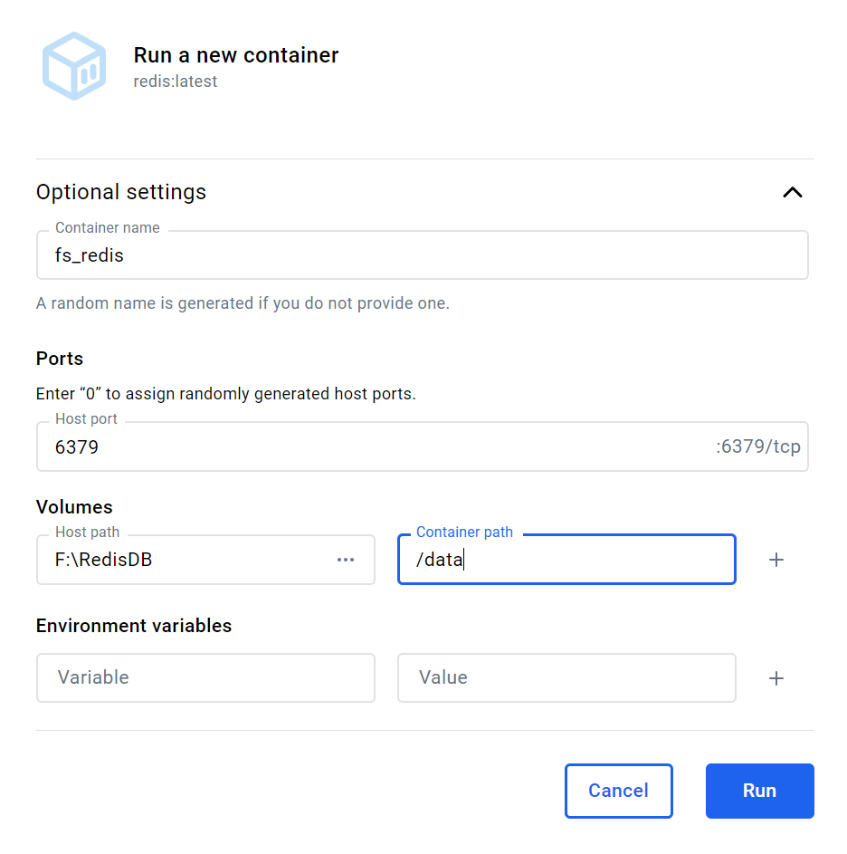

## 连接 redis
### 安装依赖包
npm install redis 

### 配置
1. 一般我们会给对 redis 的操作单独建一个模块,后面有哪些模块需要使用 redis 直接引入这个模块即可,这里我们将模块命名为 cache,使用 nestcli 命令创建，**在项目的根目录下执行**：
nest  g  res  cache
? What transport layer do you use? REST API
? Would you like to generate CRUD entry points? Yes
CREATE src/cache/cache.controller.ts (938 bytes)
CREATE src/cache/cache.module.ts (257 bytes)
CREATE src/cache/cache.service.ts (647 bytes)
CREATE src/cache/dto/create-cache.dto.ts (32 bytes)
CREATE src/cache/dto/update-cache.dto.ts (177 bytes)
CREATE src/cache/entities/cache.entity.ts (23 bytes)
UPDATE src/app.module.ts (3312 bytes)

2. 然后我们将 redis 相关配置放到配置文件.env中
  # redis配置
RD_HOST=localhost
RD_PORT=6379

3. 创建完成之后在 cache.module.ts 中引入 redis,且自定义一个 token 为'REDIS_CLIENT'的 provider,同时将 CacheService 导出,因为要给别的模块使用,和数据库连接一样，这里用到了ConfigService来获取配置文件中的参数

import { Module } from '@nestjs/common';
import { CacheService } from './cache.service';
import { CacheController } from './cache.controller';
import { createClient } from "redis";
import { ConfigService } from "@nestjs/config";

@Module({
  controllers: [CacheController],
  providers: [CacheService,
  {
          provide: "REDIS_CLIENT",//自定义的服务提供者token
          async useFactory(configService: ConfigService) {//提供者实例
            const client = createClient({
              socket: {
                host: configService.get("RD_HOST"),
                port: configService.get("RD_PORT"),
              },
            });
            await client.connect();
            return client;
          },
          inject: [ConfigService],//指定当前提供者（useFactory 函数）需要注入的依赖
        },
  ],
  exports: [CacheService], // 导出 CacheService
})
export class CacheModule {}

4. 最后在cache.service.ts通过 Inject 注入REDIS_CLIENT,然后写一下操作 redis 的方法
@Injectable()
export class CacheService {
  constructor(@Inject('REDIS_CLIENT') private redisClient: RedisClientType) {}
  //获取值
  async get(key) {
    let value = await this.redisClient.get(key);
    try {
      value = JSON.parse(value);
    } catch (error) {}
    return value;
  }
  /**
   * 设置值
   * @param key {string} key
   * @param value 值
   * @param second 过期时间 秒
   * @returns Promise<any>
   */
  async set(key: string, value: any, second?: number) {
    value = JSON.stringify(value);
    return await this.redisClient.set(key, value, { EX: second });
  }
  //删除值
  async del(key: string) {
    return await this.redisClient.del(key);
  }
  //清除缓存
  async flushall() {
    return await this.redisClient.flushAll();
  }
}

5. 由于 Redis 不能存储 JS 中的对象,所以需要转成字符串的形式,获取的时候再用 JSON.parse 转成对象(转不了的话就原样返回)

6. 接下来我们在其它模块中引入试一下,以 User 模块为例,在user.module.ts导入CacheModule,然后在user.controller.ts导入使用(一般这种操作是在 service 中操作的,这里只是做演示方便防止 controller 中操作)。

import { CacheService } from 'src/cache/cache.service';
@Controller('user')
export class UserController {
  constructor(
    private readonly userService: UserService,
    private cacheService: CacheService,
  ) {}
  @Post('/set')
  async setVal(@Body() val) {
    return await this.cacheService.set('name', 'yueyue');
  }
  @Post('/get')
  async getVal(@Body() key) {
    return await this.cacheService.get('name');
  }
}

### post  http://localhost:3000/user/set
{
  "key": "name",
  "value": "yueyue",
  "ttl": 20
}

### posthttp://localhost:3000/user/get

# Swagger
我们都知道在前后端分离开发中,后端是需要给前端提供接口文档的。接口文档中需要包含**请求类型**,**传参格式**,**响应格式**等等。而在 NestJS 中的 Swagger 可以让接口文档集成到项目之中的,并且提供了一套交互式的界面，方便开发人员测试和调试 API 接口。本节将介绍 NestJS 如何使用 Swagger 生成 RESTFUL风格接口的文档.

## 首先我们需要安装安装@nestjs/swagger,swagger-ui-express
npm install @nestjs/swagger swagger-ui-express

## 配置 Swagger
在 main.ts 进行引入配置就可以使用了
import { SwaggerModule, DocumentBuilder } from '@nestjs/swagger';

const options = new DocumentBuilder() // 配置swagger实例
    .setTitle('FS_ADMIN') // 标题
    .setDescription('后台管理系统接口文档') // 描述
    .setVersion('1.0') // 版本
    .build();
    //创建swagger文档
  const document = SwaggerModule.createDocument(app, options);
  //配置swgger地址
  SwaggerModule.setup('/fs_admin/api', app, document);

启动项目访问http://localhost:3000/fs_admin/api  就可以看到 swagger 界面了
## 设置1
它会展示我们在controller中写的所有接口,但是我们看到上面所有接口都是在一起没有分类的,并且也没有请求和返回参数格式等,所以我们需要对其再进行一些配置。我们以 User 模块为例,来到user.controller.ts中,先引入ApiOperation和ApiTags给整个模块及单个接口添加一些信息。
import {  ApiOperation,  ApiTags  }  from  '@nestjs/swagger';
@ApiTags('用户模块')

@ApiOperation({
    summary:  '添加用户',  //  接口描述信息
  })

## 设置2
接下来我们再配置一下接口入参信息以及接口返回数据信息,一般在我们开发过程中,前端传来的数据信息会放在**DTO(Data Transfer Object)**中,而返回给前端的数据则定义在**VO(Value Object)**中。
可以看到上面示例接口用的是CreateUserDto,所以我们来到create-user.dto.ts中定义前端传来的参数,再调用 swagger 中的 ApiProperty 定义文档上展示的传参内容

import { ApiProperty } from "@nestjs/swagger";

import { ApiProperty } from "@nestjs/swagger";
export class CreateUserDto {
  @ApiProperty({
    example: "admin",
    description: "用户名",
  })
  username: string;
  @ApiProperty({
    example: "123456",
    description: "密码",
  })
  password: string;
}

## 设置3
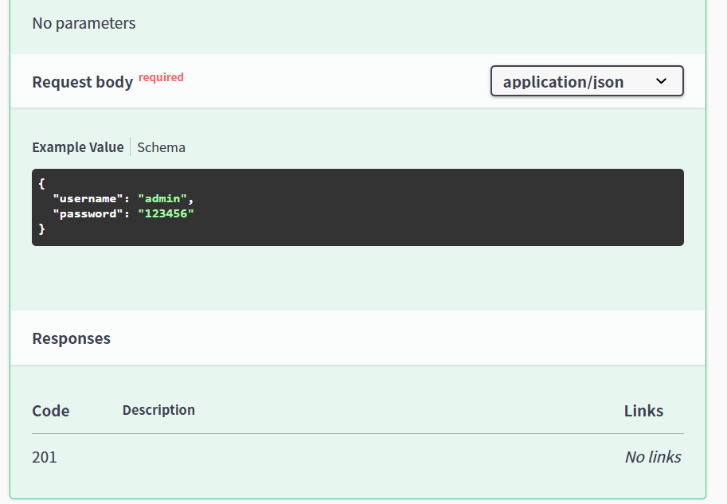
可以看到这时候示例值已经有了,接下来我们在 user 目录下新建vo/create-user.vo.ts用来描述这个接口的返回值

import { ApiProperty } from "@nestjs/swagger";
export class CreateUserVo {
  @ApiProperty({ example: 200 })
  code: number;
  @ApiProperty({ example: "xxx" })
  data: string;
  @ApiProperty({ example: "请求成功" })
  describe: string;
}

然后在user.controller.ts导入装饰器ApiOkResponse修饰一下就行了
import { CreateUserVo } from './vo/create-user.vo';

import { ApiOperation, ApiTags, ApiOkResponse } from '@nestjs/swagger';

@ApiOkResponse({
   description: '返回示例',
   type: CreateUserVo,
 })

刷新页面你就会看到有了返回示例
不仅如此,你还可以点击旁边的tryout按钮对接口进行调试,是不是非常方便!

## 设置4
因为我们要做的是权限管理系统,所以有些接口需要登录才能访问,因此需要在 swagger 中配置 token。其实很简单,只需要在 main.ts 再加个 addBearerAuth()函数即可。

 .addBearerAuth() // 开启bearer token验证

然后在需要认证的接口加上@ApiBearerAuth()装饰器,比如还是这个/user接口
import { ApiOperation, ApiTags, ApiOkResponse,ApiBearerAuth } from '@nestjs/swagger';
 @ApiBearerAuth()// 接口需要登录才能访问
  @ApiOperation({
    summary: '添加用户', //  接口描述信息
  })

这时候就会发现这个接口旁边多了一个锁,点击它,将调用登录接口取得的 token 输入进去即可调用加了权限的接口了(下一节我们就会介绍使用 JWT 实现注册与登录)

# 业务的开发阶段
## 注册

### 新建用户实体类
1. 注意：我操作的办法是在user.entity.ts中，注释掉前面学习用的 User 实体类的代码，然后新建一个新的 User 实体类。
自己手动进数据库，删除前一张user表，然后重启项目，就可以看到新的user表了。（因为app.module.ts的TypeOrmModule中做了dev环境下，可以自动创建User表的配置，所以重启开发环境以后，会自动创建新的User表）

#### 新的实体类
@Entity('user')
export class User {
  @PrimaryGeneratedColumn('uuid')
  id: number; // 标记为主键，值自动生成
  @Column({ length: 30 })
  username: string; //用户名
  @Column({ nullable: true })
  nickname: string; //昵称
  @Column()
  password: string; //密码
  @Column({ nullable: true })
  avatar: string; //头像
  @Column({ nullable: true })
  email: string; //邮箱
  @Column({ nullable: true })
  role: string; //角色
  @Column({ nullable: true })
  salt: string;
  @Column({ type: 'timestamp', default: () => 'CURRENT_TIMESTAMP' })
  create_time: Date;
  @Column({ type: 'timestamp', default: () => 'CURRENT_TIMESTAMP' })
  update_time: Date;
}

uuid：作为主键类型被定义，表示用户的唯一标识。
UUID 是一个 128 位的数字，通常以 32 位十六进制数字表示，格式为 xxxxxxxx-xxxx-xxxx-xxxx-xxxxxxxxxxxx，确保在全球范围内的唯一性。

**这里便于测试先将除了用户名和密码的其它字段都设置为可以为空的状态**

**这里的注册接口只接收用户名和密码**,至于**头像邮箱**等可以在个人中心更新,**后续会有专门的接口**。我们都知道,在调用接口的时候有些参数是不能为空的或者需要规定的格式才行,如果不符合则提示前端。

2. 接下来看一下注册基本逻辑的实现。注册无非就是新增一个用户,在user.controller.ts写一个路由为register的接口用来接收用户传来的参数

 @Post('register')

3.  NestJS 对**请求做校验其实只需要写在dto中**就行了,这里我们需要先安装两个包

npm install class-validator class-transformer

**一些个人理解：**
  实体类中已经对数据库的表进行了字段类型的约束，此处做请求的校验，就是为了保证前端传来的参数符合数据库的约束。
  **不让请求的数据在业务的crud层面报违反规则的错**，而是在业务请求过程中的 dto文件做校验，这样可以提高代码的可读性和可维护性。
  校验器可以对请求的数据进行类型校验、长度校验、格式校验等，**可以有效避免 SQL 注入**等安全问题。

**sql注入：**
SQL注入是一种安全漏洞，攻击者通过在输入字段中插入恶意的SQL代码，试图操控数据库执行非预期的操作。这种攻击通常发生在应用程序没有正确地验证或清理用户输入的情况下。
- 数据泄露：攻击者可以获取数据库中的敏感信息。
- 数据篡改：攻击者可以修改数据库中的数据。
- 数据删除：攻击者可以删除数据库中的数据。
- 权限提升：在某些情况下，攻击者可以利用SQL注入获得更高的数据库权限，执行更多恶意操作。

**防止SQL注入的方法：**
- 使用参数化查询：通过参数化查询（也称为预编译语句），应用程序可以将用户输入作为数据而不是代码来处理。
- 输入验证：对用户输入进行严格的验证，确保输入符合预期格式。
- 最小权限原则：为数据库用户分配最小必要的权限。
- 使用ORM：ORM库通常会自动处理参数化查询，减少SQL注入的风险。

4. 然后在 main.ts 中使用useGlobalPipes全局注册一下:
import { ValidationPipe } from '@nestjs/common';
app.useGlobalPipes(new ValidationPipe()); //注册全局验证管道

**解释：**
app.useGlobalPipes(new ValidationPipe()) 是 NestJS 中的一种**http请求的全局验证机制**，用于对请求进行数据验证。具体来说，ValidationPipe 是 NestJS 提供的一个管道，**用于校验传入的数据是否符合给定的规则。**

5. 之后就可以在 dto 中加校验规则了
import { IsNotEmpty, MinLength } from "class-validator";

6. **注意事项：**
如果我们在过滤器的异常请求的返回中，这样定义返回值类型：exception.getResponse()
那么我测试传1个不符合dto校验规则的错误的post请求给注册接口，返回的结果是这样的：
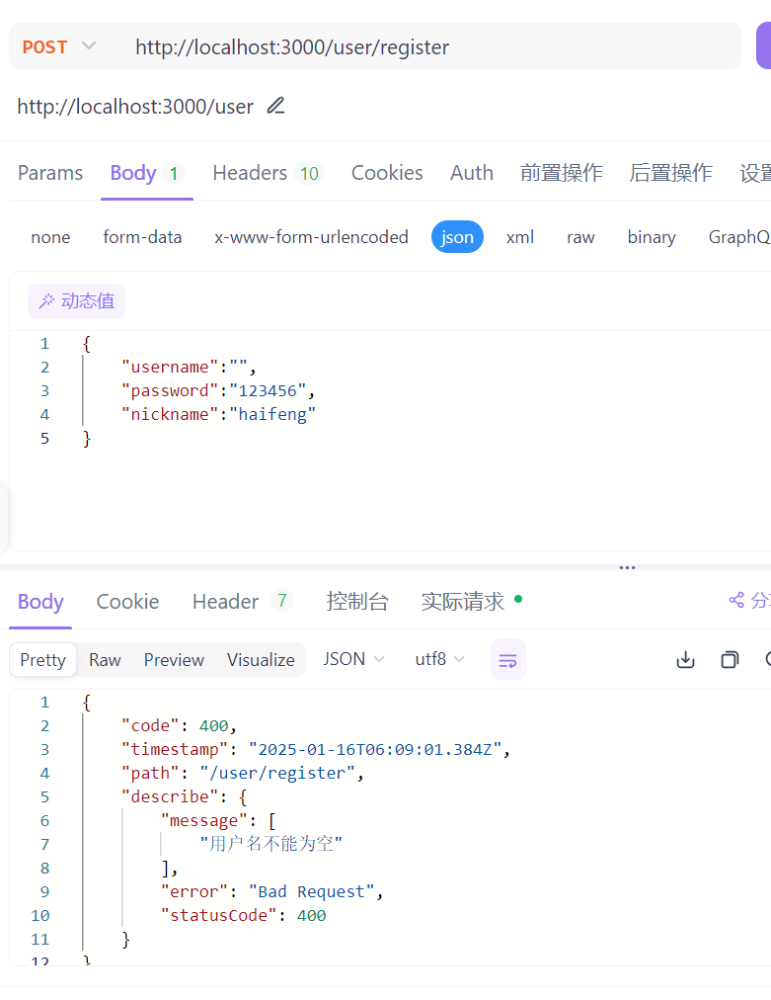

过滤器ValidationPipe内部抛出错误用的是BadRequestException
类似：throw new BadRequestException("用户名不能为空");
这样的话，在我们自定义异常过滤器http-exception.filter.ts中，作如下修改：
describe: (exception.getResponse() as any).message || exception.getResponse()
这样返回的就是**符合dto校验规则**的**错误信息**。

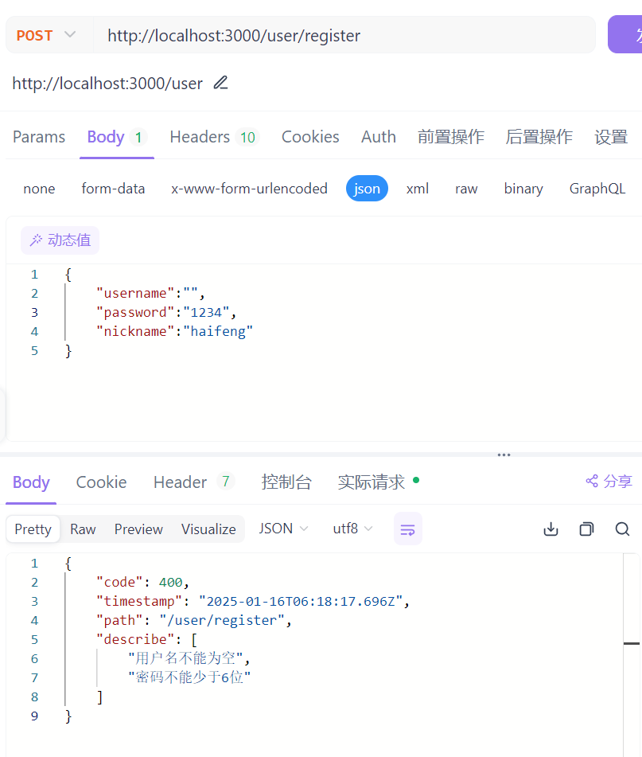

7. 接下来在user.service.ts中的create函数写一下注册的逻辑,其实很简单,拿到前端传来的用户名和密码插入数据库就行了,插入数据库之前首先需要判断用户是否存在,存在的话抛出一个业务异常返回给前端一个自定义的业务状态码ApiErrorCode.USER_EXIST,不存在的话再向数据库添加一条数据,再此之前需要先在common/enums/api-error-code.enum自定义一个异常 code

  USER_EXIST = 10003, // 用户已存在

## 用户密码加密
一般来说当用户注册的时候,我们是**不能保存用户的真实密码**的,这也是为什么很多网站在当我们忘记密码的时候不告诉我们真正的密码而是让我们选择重置密码的原因。因此我们需要先将用户密码加密后在存入数据库中,这时候我们可以使用 crypto 进行密码的加密,首先安装 crypto

我的nodejs已经内置了crypto，如果没有的，请安装：
npm i crypto 

然后新建 src/utils/crypto.ts,写一个加密的工具函数,使用 sha256 算法进行加密

import * as crypto from 'crypto';
export default (value: string, salt: string) =>
  crypto.pbkdf2Sync(value, salt, 1000, 18, 'sha256').toString('hex');

接收需要加密的值 value 和盐 salt,这个 salt 每次加密的时候都是随机的,因为所以需要存入数据库中,这也是为什么实体中会有 salt 这个字段的原因,在登录时候需要用到这个 salt 对密码加密与数据库中的密码进行对比

那么在什么时候调用这个方法加密呢? 肯定是插入数据库之前调用,我们可以写在user.service.ts注册的逻辑中
还可以写在user.entity.ts实体中,这里我们采用第二种方式,需要用到装饰器BeforeInsert即执行数据库插入之前的操作

# 登录
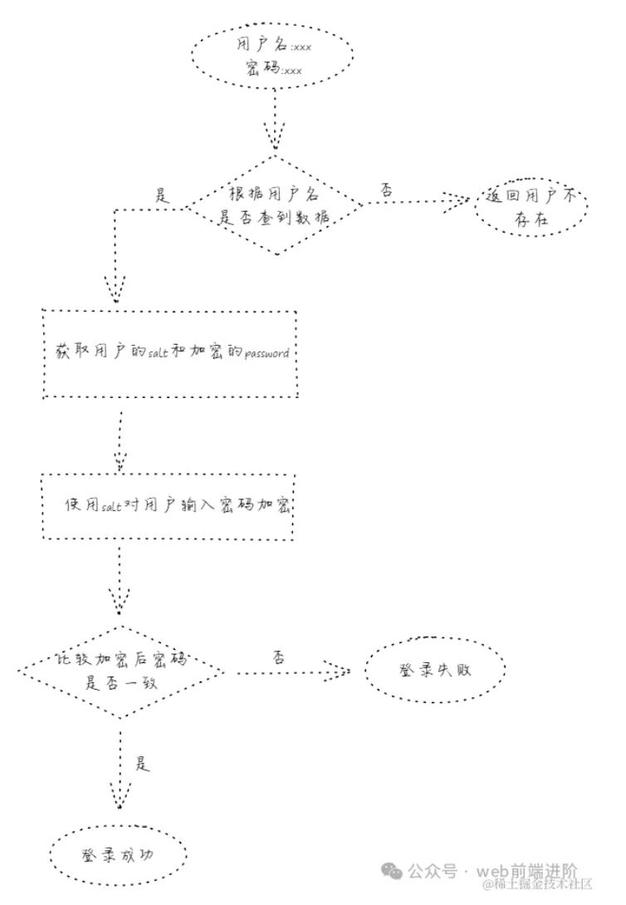

# JWT
JWT（JSON Web Token）是一种开放标准，用于在网络应用环境中以紧凑的和自包含的方式安全地传输信息。
工作流程
1. 用户登录：
用户输入用户名和密码并提交给后端。

2. 后端验证：
后端验证用户身份，如果验证成功，就生成一个 JWT。

3.返回 JWT：
**后端将生成的 JWT 返回给前端**。

4.存储和使用：
前端将 JWT 存储在本地（如浏览器的 localStorage 或 sessionStorage），后续请求中将该 JWT 包含在请求头中。

5.后端验证：
后端收到请求后，从请求头中提取 JWT，验证其有效性（例如，检查签名、检查是否过期等），然后进行相应的操作。

## 首先安装配置一下JWT

项目根目录下安装
npm i @nestjs/jwt 

然后在.env 文件中配置一下 JWT 的密钥与过期时间
JWT_SECRET = bacdefg
JWT_EXP = 2h

最后在app.module.ts导入JwtModule做一下配置就能使用了
JwtModule.registerAsync({//JwtModule 提供的一个方法，用于异步注册 JWT 模块
      global: true,
      imports: [ConfigModule],
      inject: [ConfigService],
      useFactory: async (configService: ConfigService) => {
        return {
          secret: configService.get('JWT_SECRET'),
          signOptions: {
            expiresIn: configService.get('JWT_EXP'),
          },          
        };
      },
    }),

## 传参
我们分别在 dto 和 vo 写login-dto.ts和login-vo.ts规定前端传入的参数及后端返回的参数格式
//login-dto.ts
import { ApiProperty } from '@nestjs/swagger';
import { IsNotEmpty, MinLength } from 'class-validator';
export class LoginDto {
  @IsNotEmpty({
    message: '用户名不能为空',
  })
  @ApiProperty({
    example: 'admin',
    description: '用户名',
  })
  username: string;
  @IsNotEmpty({
    message: '密码不能为空',
  })
  @MinLength(6, {
    message: '密码不能少于6位',
  })
  @ApiProperty({
    example: '123456',
    description: '密码',
  })
  password: string;
}

//login-vo.ts

import { ApiProperty } from '@nestjs/swagger';

export class LoginVo {
  @ApiProperty({ example: 200 })
  code: number;
  @ApiProperty({ example: 'eyJhbG...' })
  data: string;
  @ApiProperty({ example: '请求成功' })
  describe: string;
}

接下来就可以写登录的逻辑了,我们在user.controller.ts新增一个login接口并且调用user.service.ts种的 login 方法,然后再 login 方法种处理登录逻辑

// user.controller.ts
 @ApiOperation({
    summary: '用户登录', //  接口描述信息
  })
  @ApiOkResponse({
    description: '返回示例',
    type: LoginVo,
  })
  @Post('login')
  login(@Body() loginDto: LoginDto) {
    return this.userService.login(loginDto);
  }

// user.service.ts
 async findOne(username: string) {//登录时查询用户是否存在
    const user = await this.userRepository.findOne({
      where: { username },
    });

    if (!user)
      throw new ApiException('用户名不存在，请检查', ApiErrorCode.USER_NOTEXIST);
    return user;
    //return `This action returns a #${id} user`;
  }

  async login(loginDto: LoginDto) {
    const { username, password } = loginDto;// 解构赋值
    const user = await this.findOne(username); // 查询用户是否存在
    if (user.password !== encry(password, user.salt) ){// 校验密码是否正确
      throw new ApiException('密码错误，请检查', ApiErrorCode.USER_PASSWORD_ERROR);
    } 
    const payload = { username: user.username, sub: user.id }; // 生成 JWT 载荷
    return await this.jwtService.signAsync(payload); // 生成 JWT 并返回
  }

首先需要判断登录用户是否存在,所以我们先定义一个findOne方法根据用户名查找数据库中的数据,如果用户不存在则抛出自定义异常,存在则直接返回登录用户的token

测试一下:
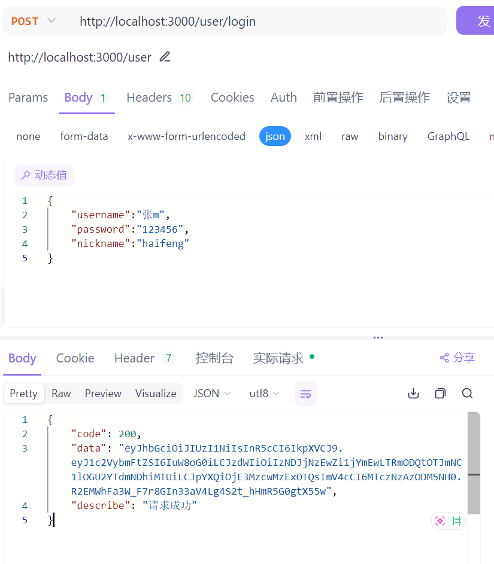
可以发现我们拿到了 token

## 导航守卫 **guard**
我们都知道,有一些接口必须登录之后才能访问,也就是说必须验证了 token 之后才能调用。当前端拿到 token 的时候,会将 token 放在后续接口的请求头上,后端要做的就是验证这个 token 是否有效,无效则让前端重新登录。

那么该如何做 token 验证呢? 有的同学就说了,在调用接口时拿到 token 直接验证不就行了? 当然可以,但是作为一个后台管理系统,几乎每个接口都要做 token 验证,难道每个接口都写一次验证吗?很显然这样做太麻烦,而在 Nest 中我们可以使用 guard 守卫进行拦截,它可以在不侵入业务逻辑的情况下进行一些通用逻辑处理,比如这里的 token 验证,如果验证通过则**返回 true** 放行否则直接抛出**权限不足的异常**。
这也是后端服务中常见的 **AOP 架构(面向切面编程)**:它允许开发者通过定义切面（Aspects）来对应用程序的各个部分添加横切关注点（Cross-Cutting Concerns）。
**横切关注点是那些不属于应用程序核心业务逻辑，但在整个应用程序中多处重复出现的功能或行为。**
这样可以让我们在不侵入业务逻辑的情况下来加入一些通用逻辑。
除了Guard(守卫)之外还有：
- Middleware(中间件)、
- Interceptor(拦截器)、
- ExceptionFilter(异常过滤器)、
- Pipe(管道)
前面我们已经使用过ExceptionFilter(异常过滤器)和Interceptor(拦截器),后面遇到其它的AOP再详细讲解。

### 安装守卫
1. 生成一个首位，项目根目录下执行
nest g guard user
显示如下内容：生成一个守卫user.guard.ts
CREATE src/user/user.guard.ts (310 bytes)

import { CanActivate, ExecutionContext, Injectable } from '@nestjs/common';
import { Observable } from 'rxjs';

@Injectable()
export class UserGuard implements CanActivate {
  canActivate(
    context: ExecutionContext,
  ): boolean | Promise<boolean> | Observable<boolean> {
    return true;
  }
}

### 修改守卫 user.guard.ts
当我们接口使用这个守卫时,如果返回 true 则代表放行,所以我们可以将 token 验证的逻辑放到这里,这里规定前端请求头字段为 authorization,并且以Bearer ${token}(约定俗称)这种形式传值,将 guard 改为
import {
  CanActivate,
  ExecutionContext,
  HttpException,
  HttpStatus,
  Injectable,
} from '@nestjs/common';
import { Request } from 'express';
import { JwtService } from '@nestjs/jwt';
import { ConfigService } from '@nestjs/config';

@Injectable()
export class UserGuard implements CanActivate {
  constructor(
    private jwtService: JwtService, // JWT服务，用于验证和解析JWT token
    private configService: ConfigService, // 配置服务，用于获取JWT_SECRET
  ) {}

  /**
   * 判断请求是否通过身份验证
   * @param context 执行上下文
   * @returns 是否通过身份验证
   */
  async canActivate(context: ExecutionContext): Promise<boolean> {
    const request = context.switchToHttp().getRequest(); // 获取请求对象
    const token = this.extractTokenFromHeader(request); // 从请求头中提取token
    if (!token) {
      throw new HttpException('验证不通过', HttpStatus.FORBIDDEN); // 如果没有token，抛出验证不通过异常
    }
    try {
      const payload = await this.jwtService.verifyAsync(token, {
        secret: this.configService.get('JWT_SECRET'), // 使用JWT_SECRET解析token
      });
      request['user'] = payload; // 将解析后的用户信息存储在请求对象中
    } catch {
      throw new HttpException('token验证失败', HttpStatus.FORBIDDEN); // token验证失败，抛出异常
    }

    return true; // 身份验证通过
  }

  /**
   * 从请求头中提取token
   * @param request 请求对象
   * @returns 提取到的token
   */
  private extractTokenFromHeader(request: Request): string | undefined {
    const [type, token] = request.headers.authorization?.split(' ') ?? []; // 从Authorization头中提取token
    return type === 'Bearer' ? token : undefined; // 如果是Bearer类型的token，返回token；否则返回undefined
  }
}

### 在路由接口文件中，使用守卫
1. 我们在user.controller.ts随便定义一个测试接口使用一下这个守卫看一下效果,这里用到了装饰器 UseGuards
import { Controller, Post, Body, UseGuards } from '@nestjs/common';
import { UserGuard } from './user.guard';
@Controller('user')

@UseGuards(UserGuard) // 登录行为的守卫
  @Post('info')
  getInfo() {
    return 'this is user info';
  }

### 测试一下
在login接口中登录一个用户，拿到token，然后在测试接口中带上这个token请求一下看看效果
login的body
{
    "username":"张m",
    "password":"123456",
    "nickname":"haifeng"
}

测试的时候，注意是header里面带上Authorization字段，格式如下：
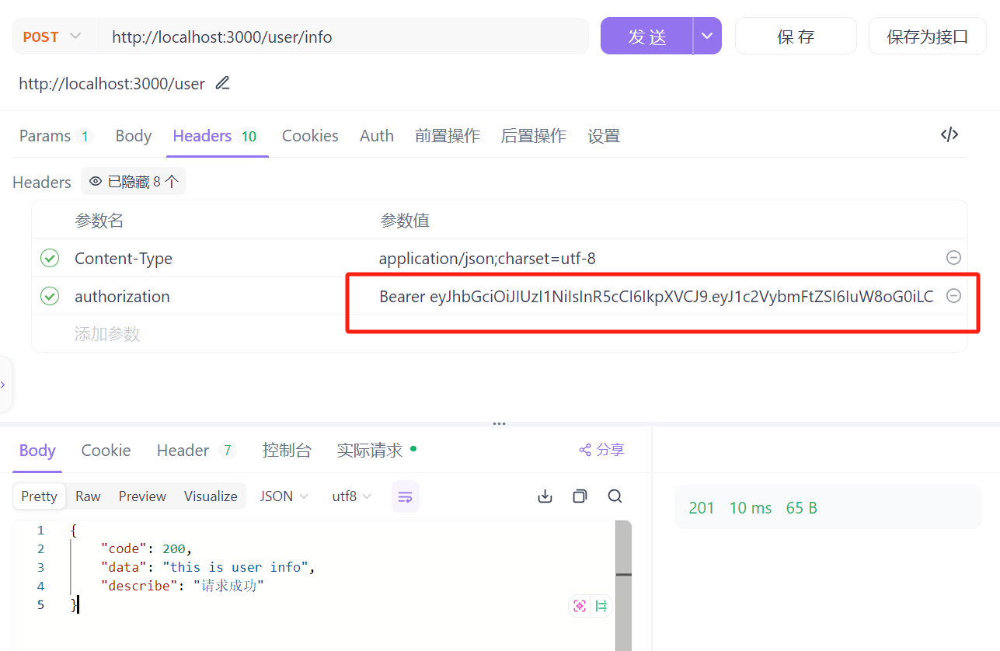

**上面固然可以实现我们所需要的结果,但是几乎所有接口都要加守卫,这样会显得很麻烦。所以我们可以将其改造为全局守卫即可解决,下面看如何将其注册成全局守卫**

在user.module.ts引入APP_GUARD并将 UserGuard注入,这样它就成为了全局守卫

import { Module } from '@nestjs/common';
import { UserService } from './user.service';
import { UserController } from './user.controller';
import { User } from './entities/user.entity';
import { TypeOrmModule } from '@nestjs/typeorm';
import { CacheModule } from 'src/cache/cache.module';
import { APP_GUARD } from '@nestjs/core';//用于全局注册守卫
import { UserGuard } from './user.guard';//自定义的守卫类

@Module({
  controllers: [UserController],
  providers: [//提供者可以是服务、守卫、拦截器、管道等
    UserService,
    {
      provide: APP_GUARD,//  与注入 token 关联起来，用于唯一标识一个提供者。
      //NestJS 会自动将注册的守卫应用到模块中的所有控制器和路由上，成为全局守卫。
      useClass: UserGuard,// 用于指定应该使用哪个类来实例化提供者
      //告诉 NestJS 使用 UserGuard 类来创建守卫的实例。
    },
  ],
  imports: [TypeOrmModule.forFeature([User]), CacheModule],
  //将实体类User注册到 TypeORM 的数据库连接中
  //这样orm才能识别User实体类，并进行数据库操作
})
export class UserModule {}

此时controller中所有接口都将使用UserGuard守卫进行验证,如果验证不通过则会返回403状态码；如果验证通过则可以正常访问接口。
把之前的 @UseGuards(UserGuard) 注释掉，再次测试一下：

测试守卫：
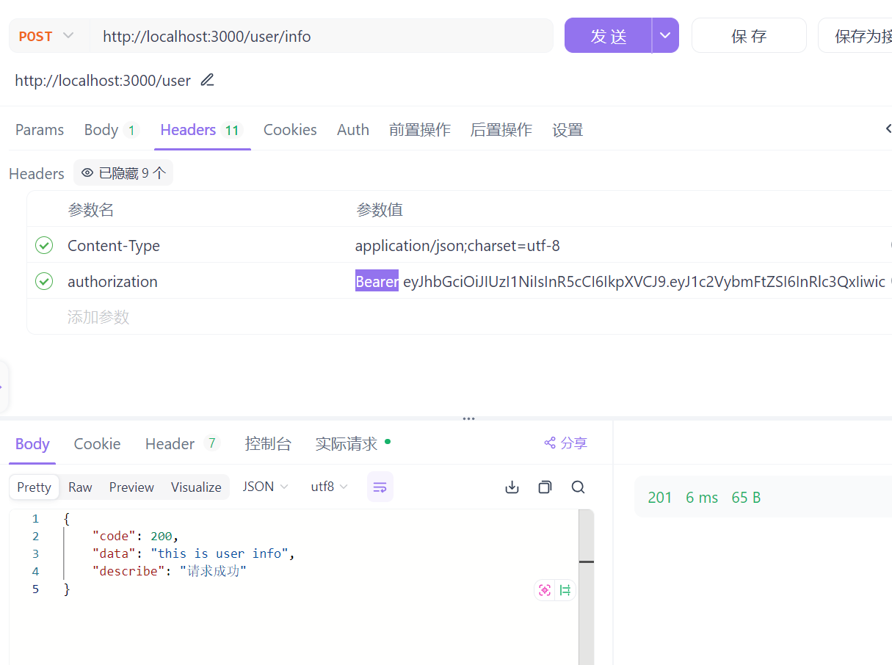

**注意**：这个在user模块中注册的全局守卫，整个应用都会生效。

### 新的问题
**那么问题又来了**,如果我们有的**接口不要验证登录怎么办**?比如注册和登录接口。我们请求一下登录接口看看
我们可以通过自定义装饰器设置元数据来处理；
#### 1.
项目根目录下执行nest g d public，在src目录中自动生成一个public目录，该目录下自动生成1个 public.decorator.ts 文件。

编辑这个装饰器文件,设置**元数据 isPublic 为 true**
//SetMetadata 是 NestJS 提供的一个函数，用于在类、方法或参数上设置元数据。
//元数据是附加在类、方法或参数上的任意数据，可以在运行时被其他部分
//（如守卫、拦截器等）读取和使用。

import { SetMetadata } from '@nestjs/common';

// 定义public装饰器
export const Public = (...args: string[]) => SetMetadata('ispublic', true);
//(...args: string[])：这个函数接受一个可变长参数列表 args，参数类型为 string[]，
//即一个字符串数组。
//SetMetadata('ispublic', true)：调用 SetMetadata 函数，将 ispublic 作为元数据键，
//将 true 作为元数据值，设置在被装饰的类、方法或参数上。

//这个public装饰器可以用于标记控制器中的某个路由或整个控制器为“公开”路由，
//**即这些路由不需要进行身份验证或授权**

**类、方法或参数上的元数据的设定，是通过装饰器来实现的。**

#### 2. 
然后在 user.guard.ts 中通过Reflector取出当前的 isPublic,如果为 true(即用了@Public 进行装饰过),则不再进行 token 判断直接放行

import { Reflector } from '@nestjs/core';

@Injectable()
export class UserGuard implements CanActivate {
  constructor(
    private jwtService: JwtService, // JWT服务，用于验证和解析JWT token
    private configService: ConfigService, // 配置服务，用于获取JWT_SECRET
    private reflector: Reflector, // 反射器，用于获取控制器方法的元数据
  ) {}
}

async canActivate(context: ExecutionContext): Promise<boolean> {
    
    const isPublic = this.reflector.getAllAndOverride<boolean>('isPublic', [
      //即将调用的方法
      context.getHandler(),
      //controller类型
      context.getClass(),
    ]);
    if (isPublic) {
      return true;
    }
}

3. 然后在不需要 token 的接口加上我们自定义的装饰器

**后续如果是不需要登录就能访问的接口只需加上这个自定义装饰器@Public即可。**
到这里我们已经基本完成了登录逻辑,但是有的时候为了防止恶意程序或机器人通过暴力破解等方式进行大规模的登录尝试,登录通常会加入图形验证码以证明其是真实的用户而不是自动化程序。同时为了防止机器批量注册我们也在注册的时候加上图形验证码

# 图形验证码
验证码验证的逻辑其实也很简单。
当用户请求获取验证码接口时,后端将一个随机字符生成一个图片,同时随机生成一个 id 与当前用户关联,然后以 id 为 key 将随机字符存入 redis 或者 session 中。
当用户注册或者登录的时候带上这个 id 和图片上的字符,后端再通过 redis 取值进行判断即可。
## 首先我们安装一个可以生成随机字符图片的包svg-captcha
1. 项目根目录下安装
npm install svg-captcha 

2. src/utils 目录下创建
 touch generateCaptcha.ts

3. 文件内容写一个生成图形验证码和随机字符 id 的函数
import { create } from "svg-captcha";
import * as crypto from "crypto";
export default () => {
  const captcha = create({
    size: 4, //生成字符数
    ignoreChars: "Il", //过滤字符
    noise: 2, //干扰线数量
    background: "#999", //背景色
    color: true, //字体颜色是否随机生成
    width: 100,
    height: 40,
  });
  const id = crypto.randomBytes(10).toString("hex");
  return { captcha, id };
};

4. 在 user.controller.ts 写1个获取验证码接口
@Public()
  @Get('captcha')
  getCaptcha() {
    return this.userService.getCaptcha();
  }

5. 在user.service.ts实现getCaptcha方法
getCaptcha() {
    const { id, captcha } = generateCaptcha();
    return { id, img: captcha.data };
  }

6. 尝试调用一下user/captcha接口

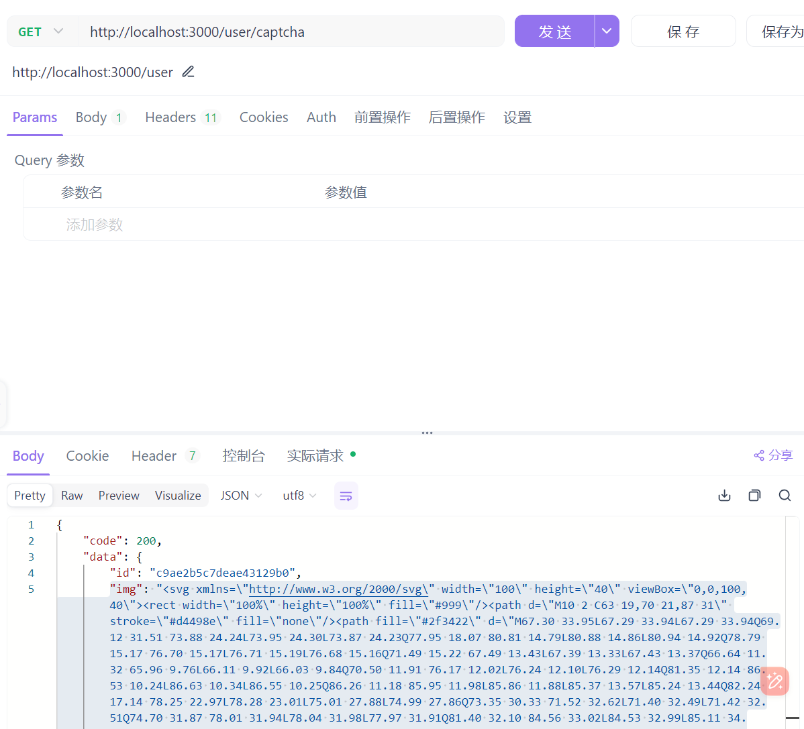

把svg部分放到html中去，可以看到验证码图片

7. 接下来我们需要将图片里的字符缓存在 redis 中,我们可以通过captcha.text拿到图片中的字符。同时需要在user.module.ts导入 redis 缓存模块
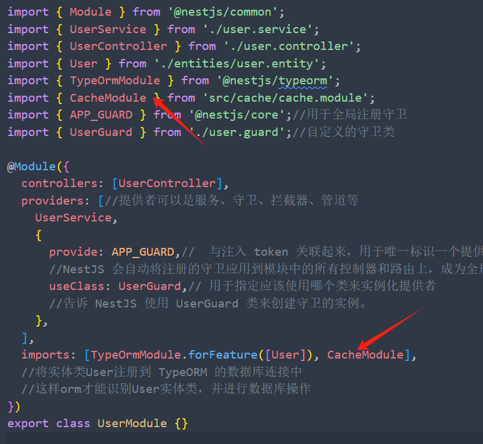

然后就可以在user.service.ts注入使用了
在我们获取图片验证码的时候进行缓存

   getCaptcha() {
    const { id, captcha } = generateCaptcha();
    this.cacheService.set(id, captcha.text, 60 * 5); // 进行redis缓存
    return { id, img: captcha.data };
  }

8. 然后在注册和登录的 dto 中加上 id 和 captcha 字段
  @IsNotEmpty({
    message: 'id不能为空',
  })
  @ApiProperty({
    example: '934e51cfff7b71ffc8ea',
    description: 'id',
  })
  id: string;

  @Length(4, 4, { message: '验证码必须4位' })
  @ApiProperty({
    example: 'dasw',
    description: '验证码',
  })
  captcha: string;

**注意：这里会出问题，因为注册的create-user.dto.ts 文件中的类：CreateUserDto， id 字段此处被我们定义为 string 类型了。这个类，已经作为父类，在别的地方被子类继承了，有可能会造成id字段类型冲突。**

9. 注册的时候判断验证码
  async create(createUserDto: CreateUserDto) {
    const { username, password, captcha, id } = createUserDto; // 对传入的对象类型的参数进行解构赋值
  //注册时，先进行验证码校验，将接口拿来的验证码和redis缓存的验证码进行对比
    const cacheCaptcha = await this.cacheService.get(id);
      if (captcha !== cacheCaptcha) {
        throw new ApiException('验证码错误', ApiErrorCode.COMMON_CODE);
  }..

10. 测试注册的验证码实现情况
- 先去验证码接口拿用户的验证码id和图片中的text
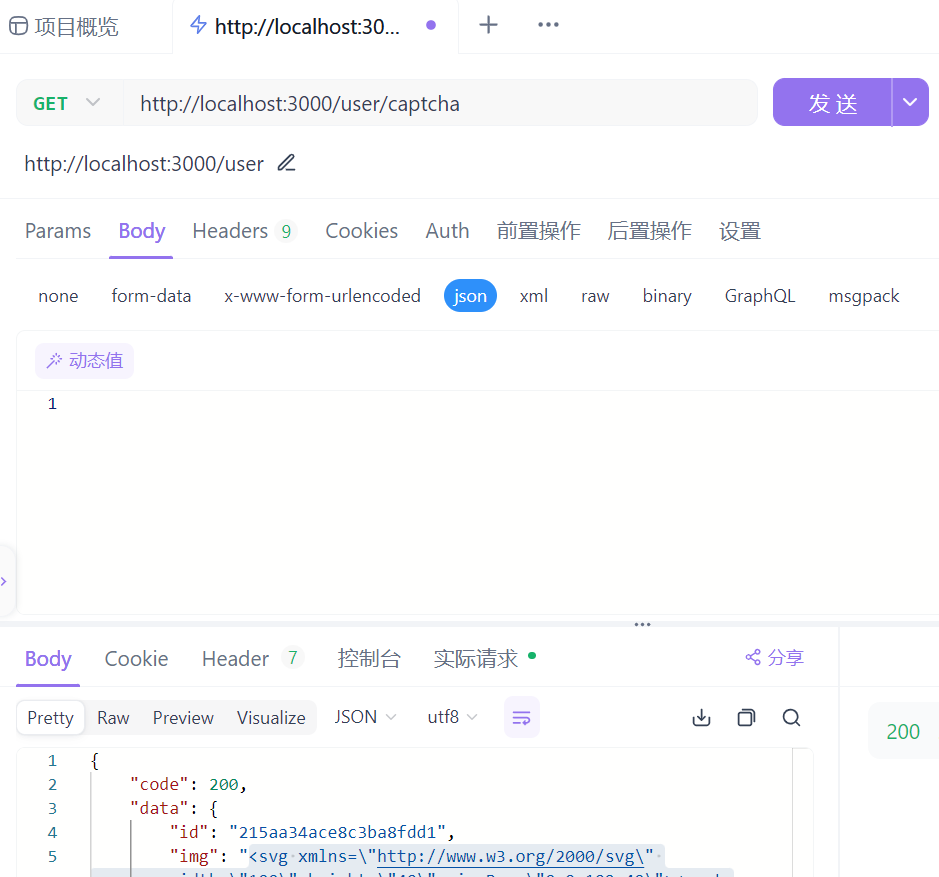

- 然后调用注册接口
{
    "username":"test13",
    "password":"123456",
    "id":"ebe91afd8d57bf636e2f",
    "captcha":"1q3k"
}

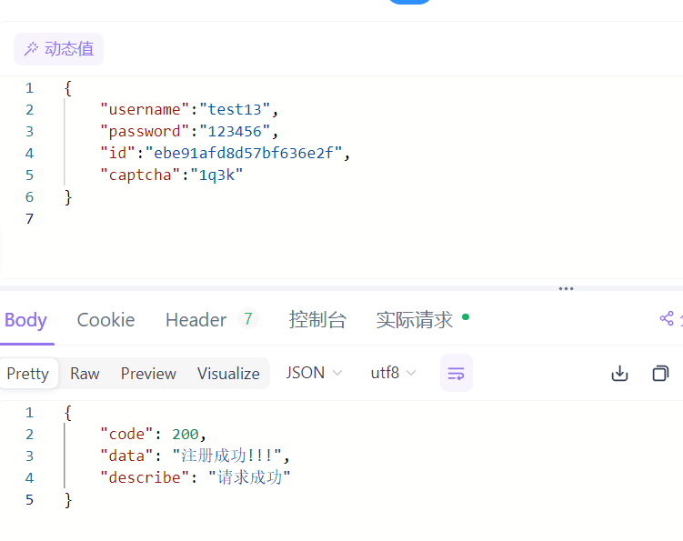

## 同样的，登录接口逻辑也一样，把代码加上去
async login(loginDto: LoginDto) {

    const { username, password, captcha, id } = loginDto; // 解构赋值
    // 登录时先进行验证码校验
    const cacheCaptcha = await this.cacheService.get(id);
    if (captcha !== cacheCaptcha) {
      throw new ApiException('验证码错误', ApiErrorCode.COMMON_CODE);
    }..}

到这里我们就完成了注册与登录。
**其实这里还有一个问题**,我们通过 JWT 给 token 设置了过期时间,假如用户没有操作页面等了一段时间过期时间到了,然后用户再调用接口返回 token 让用户登录,这没问题。

但是如果用户一直在操作页面,一直在调用我们的接口,过期时间一到突然让用户重新登录,这合理吗?显然是不合理的,那么这里就需要给 token 续期了,下一节将教大家如何给 **token 续期**。

# 在用户操作页面的过程中如何给 token 续期

## 古早的  **双 token 进行鉴权**:
用户登录成功后，生成两个不同的 token：Access Token 和 Refresh Token 返回给前端。
- Access Token 用于访问受保护的资源，通常具有较短的有效期。
- Refresh Token 用于获取新的 Access Token，通常具有较长的有效期。
- 后端可以验证 Access Token 是否有效，如果 Access Token 失效，则告诉前端使用 Refresh Token 调用刷新 token 接口获取新的 Access Token和Refresh Token。

## 新的token 续期
1. 用户登录成功后,后端生成 token 后,将 token 以{token:token}的形式存入 redis 或者 session 中并将 token 返回前端。
2. 验证 token 的时候根据前端传来的 token 从缓存中取得 token 值进行 JWT 验证并获取到 token 的过期时间。
3. 当过期时间-当前时间小于某个值的时候我们重新进行 JWT 注册生成新的 newToken 并以{token:newToken}的形式存如 redis 或者 session 中。
4. 那么只要我们在过期时间-当前时间内调用过需要鉴权的接口,那么真正的newToken就会刷新过期时间。

## 实现token续期
1. 在user.service.ts中,用户登录的时候,将 token 存入 redis,同时为了便于测试我们先将验证码逻辑注释。
2. 前面做的这一句生成jwt的语句也注释掉。
//return await this.jwtService.signAsync(payload); 

3. 增加以下代码：
    const token = await this.jwtService.signAsync(payload); // 生成 JWT
    this.cacheService.set(token,token,7200); // 进行redis缓存
    return { token };

4. 然后在user.guard.ts中 ,编写 token 验证逻辑
先从 redis 中拿到缓存的 token 值进行 token 验证,验证不同则返回验证不通过。验证通过获取到过期时间于当前时间做对比,如果小于一小时(这里便于测试先写 30 秒)就重新生成 token,并以前端传来的 token 为 key,新生成的 token 为 value 存入 redis,同时打印一下间隔时间
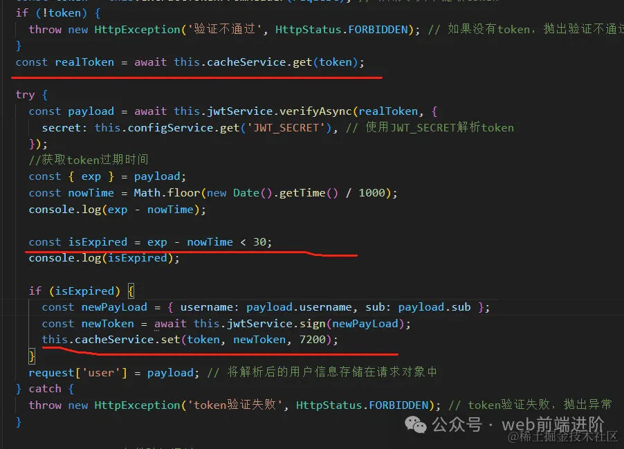

5. 同样的为了测试先将 app.module.ts 中 jwt 的过期时间改为 60 秒
JwtModule.registerAsync({//JwtModule 提供的一个方法，用于异步注册 JWT 模块
      global: true,
      imports: [ConfigModule],
      inject: [ConfigService],// 注入 ConfigService 到工厂函数
      useFactory: async (configService: ConfigService) => {
        return {
          secret: configService.get('JWT_SECRET'),
          signOptions: {
            expiresIn: configService.get('60'),
          },
        };
      },
    }),
  ],
  controllers: [AppController],//用于声明模块中定义的控制器（路由控制器）。
  providers: [AppService], //用于声明模块中定义的提供者（如服务）。
})
export class AppModule {}

6. 测试一下
- 先调用登录接口获取到 token
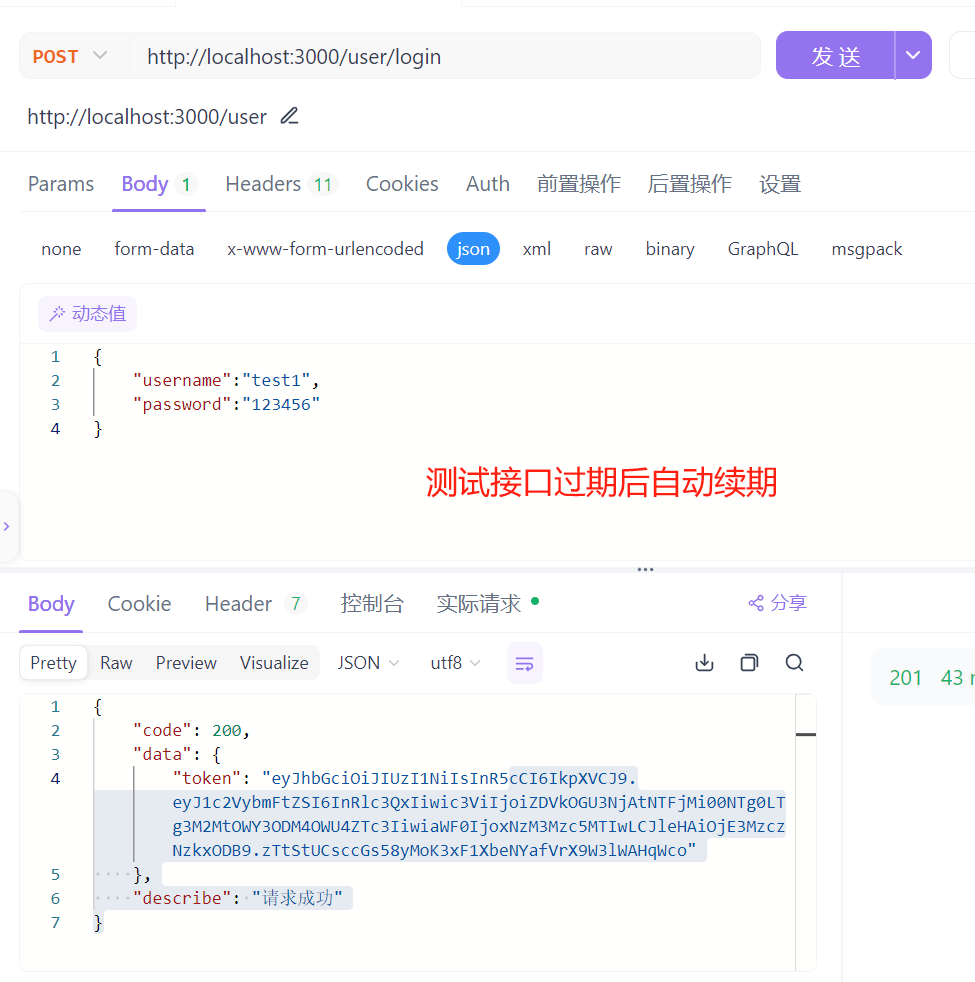
- 然后将 token 放到测试接口/user/info头里,请求一下发现 token 验证通过了
- 
**注意：**
//JWT 的过期时间会在每次请求时被检查，
//如果 JWT 已经过期（即超过60秒），verifyAsync 方法会抛出一个 TokenExpiredError 异常。
//如果没过期，且发现 JWT 即将过期（剩余时间小于30秒），
//会生成一个新的 JWT 并更新到缓存中。
//his.jwtService.verifyAsync 方法会验证 JWT 的有效性和过期时间。

//这个token续期得设计太精妙了，佩服佩服。redis存储新得token，然后再验证得时候，去验证新得token，初始token永远不变，除非用户退出登录或者过期.

# 前端基本配置
项目将使用 Vue 的最新版本 vue3.5 版本进行开发,UI 则使用ElementPlus,样式部分将采用scss和tailwindcss进行编写,状态管理使用Pinia等等,后续需要什么直接进行安装即可。

## 安装vite及其相关依赖
1. 全局安装vite
npm install -g vite
**我安装的是6.0.11版本**
 npm list -g --depth=0
D:\Program Files\nodejs\node_global
├── @nestjs/cli@10.4.9
├── @vue/cli@5.0.8
├── create-preset@0.13.1
├── express-generator@4.16.1
├── npm@11.0.0
├── pnpm@9.15.3
├── ts-node@8.5.4
├── tsconfig-paths@4.2.0
├── typescript@5.6.3
└── vite@6.0.11

2. 创建前端项目
我选择创建到FS这个目录下， 和后端项目在同一级目录下
npm create vite@latest
以下是安装过程：
Need to install the following packages:
create-vite@6.1.1
Ok to proceed? (y) y

> hello-node@1.0.0 npx
> create-vite

√ Project name: ... admin_test_frontend
√ Select a framework: » Vue
√ Select a variant: » TypeScript

Scaffolding project in D:\Program Files\Notepad++\note\FS\admin_test_frontend...

Done. Now run:

  cd admin_test_frontend
  npm install
  npm run dev

3. 安装相关依赖
cd admin_test_frontend
npm install

4. 安装element-plus
npm install element-plus 

5. 安装vue-router、axios、pinia、path
npm install vue-router axios pinia
npm install @types/axios --save-dev
npm i @types/node -D  // 解决node.js类型提示问题,path模块是nodejs的模块，node.js本身并不支持ts
6. 安装tailwindcss
npm install tailwindcss postcss autoprefixer -D

7. 安装sass-embedded
   npm install -D sass-embedded
编译 Sass 文件的高性能工具。
Sass（Syntactically Awesome Style Sheets）是一种CSS预处理器，它扩展了CSS的功能，使其更强大、更易于维护。Sass 允许开发者使用变量、嵌套规则、混合（mixins）、函数等高级特性，这些特性在原生 CSS 中是不支持的。通过这些特性，Sass 可以帮助开发者更高效地编写和管理样式代码。

8. 安装 Prettier 和 ESLint 插件？？？
我先装了eslint，prettier先用vscode的，有问题再说，先记录下来。
 npm install --save-dev  eslint
 npm install --save-dev eslint-plugin-vue

待用:？？？？
npm install --save-dev prettier 
- 配合的插件
npm install --save-dev eslint-plugin-prettier eslint-config-prettier @vue/eslint-config-typescript

9. 初始化一个新的 Tailwind CSS 配置文件，并且会自动创建必要的 PostCSS 配置文件
npx tailwindcss init -p
tailwind.config.js already exists.
Created PostCSS config file: postcss.config.js

项目中会生成postcss.config.js和tailwind.config.js两个配置文件,修改一下tailwind.config.js
/** @type {import('tailwindcss').Config} */
export default {
  //这个属性告诉 Tailwind CSS 在哪些文件中查找类名。Tailwind CSS 会根据这些文件中的类名生成相应的样式。index.html指定项目的根HTML文件。
  content: ["./index.html","./src/**/*.{vue,js,ts,jsx,tsx}"],
  theme: {
    extend: {},
  },
  plugins: [],
}

10. 在 src 下新建 index.css
cat index.css
@tailwind base;
@tailwind components;
@tailwind utilities;

11. 最后在main.ts引入index.css就大功告成了。
import { createApp } from 'vue'
//import './style.css'  // 这里注释掉了，因为我在main.ts中引入了index.css
import App from './App.vue'
import  './index.css'
import ElementPlus from 'element-plus'
import 'element-plus/dist/index.css'
import router from './router';

const app = createApp(App)
app.use(ElementPlus)
app.use(router);
app.mount('#app')

12.  修改APP.vue文件
因为我们要做的项目是一个后台管理系统，vite项目创建后自动生成的一些内容要做修改，这里修改一下APP.vue文件，修改后的内容如下：只保留了路由组件就可以了，其他内容可以删除。

<template>
  <router-view />
</template>

## tailwindcss 介绍
当我们引入了tailwindcss后,我们只需要在元素中添加class即可实现我们想要的样式。
例如：
<div class="flex items-center justify-center h-screen bg-gray-100">text

表示这个 div 为 flex 盒子,同时设置了align-items: center;justify-content: center且高度撑满整个屏幕,以及背景颜色为色调 100(色调越高,颜色越深)的 gray。

**我不熟悉 tailwind类名咋写怎么办? 很简单,你直接问gpt就行了。**

## 项目结构
1. 页面文件放在 views 目录下（**这个目录需要新建在src下**）,且命名方式为：文件夹/index.vue
2. 组件写在components目录下,命名统一采用**大驼峰**格式
3. 不含有响应式 api 的工具函数写在utils目录下（**这个目录需要新建在src下**）,命名方式为**小驼峰**。
4. 含有响应式 api 的工具则称之为hook函数,写在hooks目录下（**这个目录需要新建在src下**）,命名方式为use-xxx/index.ts,导出函数名为useXxx
5. 请求接口统一写在src/api目录下（**这个目录需要新建在src下**）,且根据使用场景区分目录
6. src下新建router目录（**这个目录需要新建在src下**）,用于存放路由相关文件

## 路径别名配置
1. 在 vite.config.ts 中配置路径别名
import { defineConfig } from 'vite'
import vue from '@vitejs/plugin-vue'
import { resolve } from 'path';

// https://vite.dev/config/
export default defineConfig({
  plugins: [vue()],
  resolve: {
    // 配置别名
    alias: {
      '@': resolve(__dirname, './src'),}
  },
})
2. 在 tsconfig.app.json  和 tsconfig.node.json 中配置路径别名
  "extends": "@vue/tsconfig/tsconfig.dom.json",
  "compilerOptions": {
    "baseUrl": ".",
    "paths": {
      "@/*": ["src/*"]
    },}

## 登录页面路由配置
在、src/router/index.ts中配置路由，新建index.ts文件
该代码是路由的配置，我们可以配置多个路由，每个路由对应一个页面。
**这里先配置了一个登录页面的路由。**

import { createRouter, createWebHashHistory} from "vue-router";
import type {RouteRecordRaw} from "vue-router";

export const routes: RouteRecordRaw[] = [
  {
    path: "/",
    name: "login",
    component: () =>
      import(/* webpackChunkName: "home" */ "@/views/login/index.vue"),
  },
];
const router = createRouter({
  history: createWebHashHistory(),
  scrollBehavior(to, from, savedPosition) {//路由切换时页面的滚动行为
    console.log(to, from);
    if (savedPosition) {
      return savedPosition;
    } else {
      return { top: 0 };
    }
  },
  routes,
});
export default router;

## localStorage 的配置
### localStorage && sessionStorage 的概念和作用学习
localStorage 和 sessionStorage 是浏览器提供的两种用于在客户端存储数据的机制。它们允许开发者在用户的浏览器中存储数据，以便在不同的页面加载之间或者同一会话的不同操作之间持久化数据。
1. localStorage
- 持久化存储：localStorage 提供了一种持久化的存储方式，存储的数据没有过期时间，除非用户手动清除浏览器缓存或开发者通过代码删除，否则数据会一直保存在用户的浏览器中。
- 存储大小：通常可以存储大约 5MB 的数据。
- 使用场景：**适用于存储不需要频繁更新的数据**，例如用户偏好设置、主题选择、用户信息等。
- 生命周期：localStorage 的数据持久化存储，除非被明确删除，否则一直存在。
- 适用场景：localStorage 适用于需要跨页面或跨会话持久化存储的数据。
2. sessionStorage
- 会话存储：sessionStorage 提供了一种会话级别的存储方式，存储的数据仅在页面会话期间可用。当页面会话结束（通常是关闭浏览器标签页或窗口）时，存储的数据会被清除。
- 存储大小：通常也可以存储大约 5MB 的数据。
- 使用场景：**适用于存储需要在同一个会话中持久化但不需要在不同会话之间共享的数据**，例如临时数据、用户在当前会话中的操作状态等。
- 生命周期：sessionStorage 的数据仅在浏览器会话期间存在，关闭页面或标签后数据会被清除。
- 适用场景：sessionStorage 适用于仅在当前会话中需要存储的数据。

### 配置Storage
在utils目录下新建storage.ts文件，用于封装localStorage的操作。

// 这个 Storage 对象提供了一套方便的方法来操作浏览器的
// localStorage 和 sessionStorage，
//支持设置值、获取值（带过期时间检查）、删除值和清空所有值。
//通过泛型 T，可以灵活地处理不同类型的值。

interface StorageItem<T> {
  value: T;
  expiry?: number; // 可选的过期时间戳
}
export const Storage = {//定义存储对象
  // 从指定的存储类型（localStorage 或 sessionStorage）中获取指定键（key）的值。
  get<T>(
    key: string,
    storageType: "localStorage" | "sessionStorage" = "localStorage"//localStorage是默认值
  ): T | null {//如果键存在且未过期，则返回对应的值，类型为 T；否则返回 null。
    const storage =
      storageType === "sessionStorage" ? sessionStorage : localStorage;
    const item = storage.getItem(key);
    if (item) {
      const { value, expiry } = JSON.parse(item) as StorageItem<T>;//类型断言
      if (expiry && Date.now() > expiry) {
        storage.removeItem(key);
        return null;
      }
      return value;
    }
    return null;
  },
  // 设置值，
  //在指定的存储类型中设置指定键的值，并可设置过期时间。
  set<T>(
    key: string,
    value: T,
    expiry?: number,
    storageType: "localStorage" | "sessionStorage" = "localStorage"
  ): void {
    const storage =
      storageType === "sessionStorage" ? sessionStorage : localStorage;
    const item: StorageItem<T> = { value };
    if (expiry) {
      item.expiry = Date.now() + expiry;
    }
    storage.setItem(key, JSON.stringify(item));
  },
  // 删除值
  // 从指定的存储类型中删除指定键的值。
  remove(
    key: string,
    storageType: "localStorage" | "sessionStorage" = "localStorage"
  ): void {
    const storage =
      storageType === "sessionStorage" ? sessionStorage : localStorage;
    storage.removeItem(key);
  },
  // 清空指定存储类型中的所有值
  clear(storageType: "localStorage" | "sessionStorage" = "localStorage"): void {
    const storage =
      storageType === "sessionStorage" ? sessionStorage : localStorage;
    storage.clear();
  },
};

## axios 请求封装
项目使用axios来发送http请求,目前大多数项目都会对其进行一次封装，进行请求和响应的拦截以及一些基本配置等。
1. 在utils目录下新建http目录，用于封装axios的实例。
创建index.ts文件，用于导出axios实例。
//创建和配置axios实例，
//实现请求和响应的拦截,
//加载动画的显示与隐藏、
//请求的去重、错误处理等功能

import axios from 'axios';
import type { AxiosInstance,AxiosResponse, InternalAxiosRequestConfig } from 'axios';

import { ElMessage, ElLoading } from 'element-plus';
import router from '@/router/index';
import { Storage } from '@/utils/storage';

//发送请求时显示加载动画（loading），并在所有请求完成时关闭加载动画的逻辑。
const loadingInstance = ElLoading.service;
let requestCount = 0;
const showLoading = () => {
  requestCount++;
  if (requestCount === 1) loadingInstance();
};
const closeLoading = () => {
  requestCount--;
  if (requestCount === 0) loadingInstance().close();
};

//创建axios实例
const service: AxiosInstance = axios.create({
  method: 'get',
  baseURL: import.meta.env.VITE_APP_API,
  headers: {
    'Content-Type': 'application/json;charset=utf-8',
  },

  timeout: 10000,
});

//请求拦截

//模块声明,用于扩展 axios 库的类型定义,为三个接口添加了自定义属性 
//declare module 'axios' 用于声明 axios 模块的扩展。
//这允许我们在不修改 axios 源代码的情况下，扩展其类型定义。
// <D = any> 表示请求体数据类型，默认值为 any。
// <T = any> 表示响应数据类型，默认值为 any。
declare module 'axios' {
  interface AxiosRequestConfig<D = any> {
    loading?: boolean;
    isToken?: boolean;
  }
  interface InternalAxiosRequestConfig<D = any, T = any> {
    loading?: boolean;
    isToken?: boolean;
  }
  interface AxiosInstance {
    (config: AxiosRequestConfig): Promise<any>;
  }
}

//配置axios请求拦截器
const requestMap = new Map();//存储请求数据
service.interceptors.request.use(//用于在发送请求之前对请求配置进行修改或添加逻辑
  (config: InternalAxiosRequestConfig<any>) => {//请求成功拦截器
    const controller = new AbortController();//用于终止一个或多个 Web 请求的对象
    const key = config.data + config.url;//请求的唯一标识符
    config.signal = controller.signal;//设置请求信号，用于终止请求
    if (requestMap.has(key)) {//检查请求是否已经存在，如果存在则终止该请求
      requestMap.get(key).abort();//终止并删除已存在的请求
      requestMap.delete(key);//终止并删除已存在的请求
    } else {
      requestMap.set(key, controller);//存储新的请求
    }

    const { loading = true, isToken = true } = config;//解构配置属性

    if (loading) showLoading();//显示加载状态
    if (Storage.get('token') && isToken) {//添加 Authorization 头
      config.headers['Authorization'] = 'Bearer ' + Storage.get('token'); // 让每个请求携带自定义token 请根据实际情况自行修改
    }

    return config;
  },
  (error) => {//请求失败拦截器,回调函数
    console.log(error);
  }
);

//配置axios响应拦截器
service.interceptors.response.use(//在接收到响应后对响应数据进行修改或添加逻辑。
  (res: AxiosResponse<any, any>) => {//响应成功拦截器,回调函数
    const { data, config } = res;//解构响应数据

    const { loading = true } = config;//解构配置属性,默认值true
    if (loading) closeLoading(); //如果加载完成，关闭加载状态

    if (data.code != 200) {//如果响应状态码不是200，则显示错误信息
      ElMessage({
        message: data.describe,
        type: 'error',
      });
      //如果响应状态码是401或400，则表示登录状态已过期，则清除token并重定向到登录页面
      if (data.code === 401 || data.code === 400) {
        //登录状态已过期.处理路由重定向
        Storage.remove('token');
        router.push('/');
      }
      // throw new Error(data.describe);
      return Error(data.describe);
    }
    return data;//如果 code 等于 200，则返回响应数据 data。
  },
  (error) => {//当响应失败时会被调用,回调函数，
    closeLoading();//关闭加载状态
    let { message } = error;//解构错误消息
    if (message == 'Network Error') {//处理特定错误消息
      message = '后端接口连接异常';
    } else if (message.includes('timeout')) {
      message = '系统接口请求超时';
    } else if (message.includes('Request failed with status code')) {
      message = '系统接口' + message.substr(message.length - 3) + '异常';
    }
    ElMessage({//显示错误消息
      message: message,
      type: 'error',
    });
    router.push('/login');//重定向到登录页面
    return Promise.reject(error);
  }
);
export default service;

### axios**举例**（**这个是穿插的不是该项目的配置，我测试成功了，便于理解吧**）
##### 访问接口的基础配置
0. 配置环境变量文件
在项目的根目录下，创建或修改环境变量文件。Vite 默认支持以下几种环境变量文件：
.env：默认环境变量，适用于所有环境。
VITE_APP_API=http://localhost:3000

##### 封装请求方法
1. 调用 aixos 的 create 方法写一些基本配置
**在http目录下新建一个request.ts文件，用于封装axios的实例。**
import axios from 'axios';
import type { AxiosResponse, InternalAxiosRequestConfig } from 'axios';
const service = axios.create({  
method: 'get',  
baseURL: import.meta.env.VITE_APP_API,//.env中的VITE_APP_API参数 
headers: {'Content-Type': 'application/json;charset=utf-8',}, 
 timeout: 10000,//超时时间
});
export default service;//导出axios实例
//request.ts 文件通常用于定义一个基础的、通用的请求函数，
//这个函数可以处理所有 HTTP 请求的基本配置，比如设置请求头、处理响应、错误处理等。
//它通常是一个封装好的函数，可以被其他模块复用。

2. 在 api 目录下创建 login.ts 
用于写登录相关请求方法,这里的/user/login我已经用 nestjs 写好了
import request from '../http/request';
export const login = (data: any) => 
  {  return request({  
      url: '/user/login',
      data,    
      method: 'post',  });
  };
3. app.vue 的配置
import { login } from './api/login';
const loginManager = async () => {
  const data = await login({
    username: 'test13',
    password: '123456',
  });
  console.log(data);
};
loginManager();

####  目录:utils/http/index.ts
import axios, {
  AxiosInstance,
  AxiosResponse,
  InternalAxiosRequestConfig,
} from "axios";
import { ElMessage, ElLoading } from "element-plus";
import router from "@/router";
import { Storage } from "@/utils/storage";
const loadingInstance = ElLoading.service;
let requestCount = 0;
const showLoading = () => {
  requestCount++;
  if (requestCount === 1) loadingInstance();
};
const closeLoading = () => {
  requestCount--;
  if (requestCount === 0) loadingInstance().close();
};

const service: AxiosInstance = axios.create({
  method: "get",
  baseURL: import.meta.env.VITE_APP_API,
  headers: {
    "Content-Type": "application/json;charset=utf-8",
  },

  timeout: 10000,
});
//请求拦截

declare module "axios" {
  interface AxiosRequestConfig<D = any> {
    loading?: boolean;
    isToken?: boolean;
  }
  interface InternalAxiosRequestConfig<D = any, T = any> {
    loading?: boolean;
    isToken?: boolean;
  }
  interface AxiosInstance {
    (config: AxiosRequestConfig): Promise<any>;
  }
}

const requestMap = new Map();
service.interceptors.request.use(
  (config: InternalAxiosRequestConfig<any>) => {
    const controller = new AbortController();
    const key = config.data + config.url;
    config.signal = controller.signal;
    if (requestMap.has(key)) {
      requestMap.get(key).abort();
      requestMap.delete(key);
    } else {
      requestMap.set(key, controller);
    }

    const { loading = true, isToken = true } = config;

    if (loading) showLoading();
    if (Storage.get("token") && isToken) {
      config.headers["Authorization"] = "Bearer " + Storage.get("token"); // 让每个请求携带自定义token 请根据实际情况自行修改
    }

    return config;
  },
  (error) => {
    console.log(error);
  }
);

service.interceptors.response.use(
  (res: AxiosResponse<any, any>) => {
    const { data, config } = res;

    const { loading = true } = config;
    if (loading) closeLoading();

    if (data.code != 200) {
      ElMessage({
        message: data.describe,
        type: "error",
      });
      if (data.code === 401 || data.code === 400) {
        //登录状态已过期.处理路由重定向
        Storage.remove("token");
        router.push("/");
      }
      throw new Error(data.describe);
    }
    return data;
  },
  (error) => {
    closeLoading();
    let { message } = error;
    if (message == "Network Error") {
      message = "后端接口连接异常";
    } else if (message.includes("timeout")) {
      message = "系统接口请求超时";
    } else if (message.includes("Request failed with status code")) {
      message = "系统接口" + message.substr(message.length - 3) + "异常";
    }
    ElMessage({
      message: message,
      type: "error",
    });
    router.push("/login");
    return Promise.reject(error);
  }
);
export default service;

#### 登录页面的api配置
 目录：api/login/request.ts
相关请求接口统一写在api目录下,以登录接口为例
import request from '@/utils/http/index';
import { LoginVo } from './types/login.vo';
export const login = (data: LoginVo) => {
  return request({
    url: '/user/login',
    data,
    isToken: false,
    method: 'post',
  });
};
**其中LoginVo类型用来描述我们需要传递给后端的参数**
export type LoginVo = {
  username: string;
  password: string;
  id: string;
  captcha: string;
};

最后页面中直接导入login即可发起请求。

# 登录页面及相关接口的调用
## 打开后端的，接口文档地址:http://localhost:3000/fs_admin/api
我们只需要用到获取验证码和用户登录两个接口即可。然后在api/login/request.ts写上这两个接口,**因为这两个接口都不需要 token**,所以我们只需要在request.ts中设置isToken:false。
import request from "@/utils/http/index";
import { LoginVo } from "./types/login.vo";
export const login = (data: LoginVo) => {
  return request({
    url: "/user/login",
    data,
    isToken: false,
    method: "post",
  });
};

//获取验证码
export const getCaptcha = () => {
  return request({
    url: "/user/captcha",
    isToken: false,
    method: "get",
  });
};

其中LoginVo是我们规定的传参格式
export type LoginVo = {
  username: string,
  password: string,
  id: string,
  captcha: string,
};

**前端index.vue的配置见源代码，先不贴上来了。**

# RBAC权限管理
## RBAC 简介RBAC 
全称为 Role Based Access Control(基于角色的权限控制)。顾名思义它是将权限分配给角色，然后将角色分配给用户，那么用户就拥有了这个角色的所有权限。
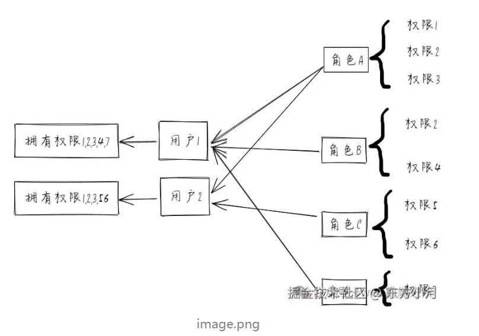

## 创建表--后端配置
了解了什么是 RBAC,接下来我们需要做到是如何将其和我们的后台管理系统相结合。
首先我们需要知道在我们的项目中权限指的是什么?
我们都知道,在后台管理系统中有很多菜单,而不同用户登录后展现的菜单可能并不一样,因为他们的**角色不同,角色不同意味着权限**不一样,所以说在我们项目中菜单就是权限。
除此之外,还有一些按钮展示也不一样,所以它们也是权限。
为了方便起见,**我们只需要创建一张菜单(Menu)表**,它包含**目录,菜单,按钮**三种类型,我们需要什么就根据什么条件查询即可。
接下来我们就生成一个菜单模块,并创建一张名为fs_menu的数据表。这里直接使用nest g res menu生成一个菜单模块,新建了entities/menu.entity.ts目录用于存放实体。

**命令执行过程如下：**
? What transport layer do you use? REST API
? Would you like to generate CRUD entry points? Yes
CREATE src/menu/menu.controller.ts (917 bytes)
CREATE src/menu/menu.module.ts (250 bytes)
CREATE src/menu/menu.service.ts (633 bytes)
CREATE src/menu/dto/create-menu.dto.ts (31 bytes)
CREATE src/menu/dto/update-menu.dto.ts (168 bytes)
CREATE src/menu/entities/menu.entity.ts (22 bytes)
UPDATE src/app.module.ts (5464 bytes)

## menu.entity.ts实体类代码
import {
  Column,
  CreateDateColumn,
  Entity,
  PrimaryGeneratedColumn,
  UpdateDateColumn,
} from 'typeorm';

@Entity('fs_menu')
export class Menu {
  @PrimaryGeneratedColumn()
  id: number;//主键id

  @Column({
    length: 20,
  })
  title: string; //标题
  
  @Column()
  order_num: number;//排序

  @Column({ nullable: true })
  parent_id: number;//父id

  @Column()
  menu_type: number;  //菜单类型 1:目录,2:菜单,3:按钮

  @Column({
    length: 50,
    nullable: true,
  })
  icon: string;   //菜单图标

  @Column({
    length: 50,
    nullable: true,
  })
component: string;   //组件路径

  @Column({
    length: 50,
    nullable: true,
  })
  permission: string; //权限标识
  
  //路由
  @Column({
    length: 50,
  })
  path: string;

  //创建人
  @Column({
    type: 'bigint',
  })
  create_by: number;

  //状态 1:启用 0:禁用
  @Column({
    default: 1,
  })
  status: number;

  @CreateDateColumn()
  create_time: Date;

  @UpdateDateColumn()
  update_time: Date;
}

## 创建可导入全部实体类
回到app.module.ts中,前面我们每创建一个表都需要导入一次实体,很麻烦。这里我们设置一下 entities: ['**/*.entity.js'],autoLoadEntities: true, 就可以帮我们自动寻找后缀为.entity.js文件自动加载创建表了。
启动项目,你就会发现fs_menu表就已经自动创建好啦同样的角色模块及角色表fs_role也一样创建

## 同样的角色模块及角色表fs_role也一样创建
nest g res role
新建了entities/role.entity.ts目录用于存放实体。

**实体类role.entity.ts代码**：

import {
  Column,
  CreateDateColumn,
  Entity,
  JoinTable,
  ManyToMany,
  PrimaryGeneratedColumn,
  UpdateDateColumn,
} from 'typeorm';
//导入菜单实体，用于多对多关系
import { Menu } from '../../menu/entities/menu.entity';
@Entity('fs_role')
export class Role {
  @PrimaryGeneratedColumn({
    type: 'bigint',
  })
  id: number;
  //角色名
  @Column({
    length: 20,
  })
  role_name: string;
  //排序
  @Column()
  role_sort: number;
  //角色状态 启用:1 关闭:0
  @Column({
    default: 1,
  })
  status: number;
  //备注
  @Column({ length: '100', nullable: true })
  remark: string;
  //创建人Id
  @Column({
    type: 'bigint',
  })
  create_by: number;
  //更新人Id
  @Column({
    type: 'bigint',
  })
  update_by: number;

  @CreateDateColumn()
  create_time: Date;

  @UpdateDateColumn()
  update_time: Date;

  @ManyToMany(() => Menu)
  @JoinTable({
    name: 'fs_role_menu_relation',
  })
  menus: Menu[];
}

这里我们使用了@ManyToMany(() => Menu)来和菜单表实现了多对多的关系,因为一个角色可以有多个菜单,同样的,一个菜单也可以有多个角色。当然我们这里暂时只用到一个角色包含多个菜单的情况。
nest 会为我们创建一个fs_role表,同时也创建了一个fs_role_menu_relation关系表,这个表的作用就是将角色和菜单关联起来。
如果你的app.module.ts中配置了自动更新实体，那么你不需要重启后端服务，实体类就会自动更新，中间表也会创建。
中间表中会包含两个外键列，分别用于存储两个实体的主键。

## 除了角色和菜单,用户和角色也是多对多的关系,所以我们需要调整一下用户表的实体(user/entities/user.entity.ts)
import { Entity, PrimaryGeneratedColumn, Column,
  BeforeInsert, ManyToMany,
   JoinTable, } from 'typeorm'; //
  import  encry  from  "../../utils/crypto";
  import  *  as  crypto  from  "crypto";// 内置模块,命名空间导入方式
  import { Role } from "src/role/entities/role.entity";
//@Entity('user')  // 表名为 user
@Entity('fs_user')
export class User {
  //@PrimaryGeneratedColumn('uuid')
  @PrimaryGeneratedColumn({type: "bigint",})
  id: number; //  标记为主键，值自动生成
  @Column({ length: 30 })
  username: string; //用户名
  @Column({ nullable: true })
  nickname: string; //昵称
  @Column()
  password: string; //密码
  @Column({ nullable: true })
  avatar: string; //头像
  @Column({ nullable: true })
  email: string; //邮箱

  @Column({ nullable: true })
  salt: string;

  @ManyToMany(() => Role, { cascade: true })
  @JoinTable({
    name: 'fs_user_role_relation',
  })
  roles: Role[];

  @Column({ type: 'timestamp', default: () => 'CURRENT_TIMESTAMP' })
  create_time: Date;
  @Column({ type: 'timestamp', default: () => 'CURRENT_TIMESTAMP' })
  update_time: Date;

  @BeforeInsert()
  beforeInsert()  {
      this.salt  =  crypto.randomBytes(4).toString("base64");
      this.password  =  encry(this.password,  this.salt);}
}

##  新增菜单
下面我们来开发一个新增菜单的接口,然后将系统管理、角色管理、菜单管理、用户管理新增到菜单表中。他们的关系结构如下:
--系统管理;
  --用户管理;
  --菜单管理;
  --角色管理;
### 首先我们需要在 menu 模块新建dto/create-menu.dto.ts来规定前端传来的参数
import { IsNotEmpty, IsOptional } from 'class-validator';
import { ApiProperty } from '@nestjs/swagger';
export class CreateMenuDto {
  @IsNotEmpty({ message: '菜单名不可为空' })
  @ApiProperty({
    example: '菜单1',
  })
  title: string;

  @ApiProperty({
    example: 1,
  })
  order_num: number;

  @ApiProperty({
    example: 1,
    required: false,
  })
  @IsOptional()
  parent_id?: number;

  @ApiProperty({
    example: 1,
  })
  menu_type: number;
  @ApiProperty({
    example: 'menu',
  })
  icon: string;

  @IsOptional()
  @ApiProperty({
    example: 'AA/BB',
    required: false,
  })
  component?: string;

  @IsNotEmpty({ message: '路由不可为空' })
  @ApiProperty({
    example: 'BB',
  })
  path: string;
  @ApiProperty({
    example: 11,
  })
  create_by: number;

  @IsOptional()
  @ApiProperty({
    example: 'sys:post:list',
    required: false,
  })
  permission?: string;
}
里面用到很多装饰器比如@IsOptional:规定参数可选,@IsNotEmpty:参数不能为空等等。
定义完后在menu.module.ts引入menu的实体并注入
import { Menu } from './entities/menu.entity'
import { TypeOrmModule } from '@nestjs/typeorm';
import { User } from '../user/entities/user.entity'
import { Module } from '@nestjs/common';
import { MenuService } from './menu.service';
import { MenuController } from './menu.controller';

@Module({
  controllers: [MenuController],
  providers: [MenuService],
  imports: [TypeOrmModule.forFeature([Menu, User])],//注册 Menu 和 User 实体类
})
export class MenuModule {}

### 然后在menu.service.ts通过@InjectRepository装饰器中注入到参数中就可以操作这个表了,最后写一个创建菜单的函数
import { Injectable } from '@nestjs/common';
import { CreateMenuDto } from './dto/create-menu.dto';
import { UpdateMenuDto } from './dto/update-menu.dto';
import { InjectRepository } from '@nestjs/typeorm';
import { Menu } from './entities/menu.entity';
import { User } from '../user/entities/user.entity';
import { In, Repository } from 'typeorm';
import { ApiException } from '../common/filter/http-exception/api.exception';

@Injectable()
export class MenuService {
  constructor(
    @InjectRepository(Menu)
    private readonly menuRepository: Repository<Menu>,
    @InjectRepository(User)
    private readonly userRepository: Repository<User>,
  ) {}

  async createMenu(createMenuDto: CreateMenuDto) {
    try {
      await this.menuRepository.save(createMenuDto);
      return '菜单新增成功';
    } 
    catch (error) {
      throw new ApiException('菜单新增失败', 20000);
    }
  }

### 在menu.controller.ts中定义一个路由调用
import {
  Controller,
  Get,
  Post,
  Body,
  Patch,
  Param,
  Delete,
} from '@nestjs/common';
import { MenuService } from './menu.service';
import { CreateMenuDto } from './dto/create-menu.dto';
import { UpdateMenuDto } from './dto/update-menu.dto';
import { Public } from 'src/public/public.decorator';
import { Request } from '@nestjs/common';
import {
  ApiOperation,
  ApiTags,
  ApiOkResponse /* ApiBearerAuth */,
  ApiParam,// ApiBody,
} from '@nestjs/swagger';

@Controller('menu')//监听路径
@ApiTags('菜单权限模块')
export class MenuController {
  constructor(private readonly menuService: MenuService) {}
  @Post('/createMenu')
  @Public()
  @ApiParam({ name: 'createMenuDto', type: CreateMenuDto })
  @ApiOperation({ summary: '新增菜单' })
  async createMenu(
    @Body()
    createMenuDto: CreateMenuDto,
  ) {
    return await this.menuService.createMenu(createMenuDto);
  }

### 
 为了方便测试,我们暂时加了@Public装饰器,这样就不会进行 token 验证了,同时像@ApiParam、 @ApiOperation等装饰器都是swagger文档相关装饰器,用于接口文档的展示,当然如果你不需要也可以不写 

###
最后我们通过工具(这里用的是apifox)直接调用http://localhost:3000/menu/createMenu并传入相关参数就能新增菜单了,比如新增用户管理菜单
{
    "title":"系统管理",
    "order_num":"1",
    "parent_id":"",
    "menu_type":"1",
    "icon":"Setting",
    "path":"sys",
    "component":"",
    "create_by":1
}
{
    "title":"角色管理",
    "order_num":"1",
    "parent_id":"1",
    "menu_type":"2",
    "icon":"User",
    "path":"user",
    "component":"Sys/User/index",
    "create_by":1
}
{
    "title":"菜单管理",
    "order_num":"2",
    "parent_id":"1",
    "menu_type":"2",
    "icon":"Menu",
    "path":"menu",
    "component":"Sys/Menu/index",
    "create_by":1
}
{
    "title":"用户管理",
    "order_num":"3",
    "parent_id":"1",
    "menu_type":"2",
    "icon":"User",
    "path":"user",
    "component":"Sys/User/index",
    "create_by":1
}

http://localhost:3000/menu/createMenu

其中parent_id是父级目录(系统管理的 id),最终我们操作完成后表是这样的
**需要注意的是最上层的目录的parent_id是为null的,因为它没有父级，比如系统管理**
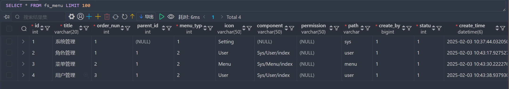

## 新增角色、用户
接下来我们再写一个新增角色的接口,并为这些角色赋予一些菜单权限。这里需要注意一个特别的角色超级管理员,我们默认这个角色拥有所有的权限和上面一样,

### 先创建dto规定前端传的参数

import { IsArray, IsNotEmpty, IsNumber, IsOptional } from 'class-validator';
import { ApiProperty } from '@nestjs/swagger';
export class CreateRoleDto {
  @IsNotEmpty({ message: '角色名不可为空' })
  @ApiProperty({
    example: '技术人员',
  })
  role_name: string;

  @ApiProperty({
    example: '备注',
    required: false,
  })
  @IsOptional()
  remark?: string;

  @IsNotEmpty({ message: '角色状态不可为空' })
  @ApiProperty({
    example: 1,
    description: '角色状态,1表示启用,0表示禁用',
  })
  status: number;

  @ApiProperty({
    example: [1],
    required: false,
  })
  @IsOptional()
  @IsArray({
    message: 'menu_ids必须是数组',
  })
  @IsNumber({}, { each: true, message: 'menu_ids必须是数字数组' })
  menu_ids?: number[];

  @IsNotEmpty({ message: '排序不可为空' })
  @ApiProperty({
    example: 1,
  })
  role_sort: number;
  @IsNotEmpty({ message: '创建人id不可为空' })
  @ApiProperty({
    example: 1,
  })
  create_by: number;
  @IsNotEmpty({ message: '更新人id不可为空' })
  @ApiProperty({
    example: 1,
  })
  update_by: number;
}

### 然后在role.module.ts导入menu和role表的实体
import { Module } from '@nestjs/common';
import { RoleService } from './role.service';
import { RoleController } from './role.controller';
import { Role } from './entities/role.entity';
import { TypeOrmModule } from '@nestjs/typeorm';
import { Menu } from '../menu/entities/menu.entity';

 
@Module({
  controllers: [RoleController],
  providers: [RoleService],
  imports: [TypeOrmModule.forFeature([Role, Menu])],
})
export class RoleModule {}

### 在role.service.ts中写创建角色逻辑
import { Injectable } from '@nestjs/common';
import { CreateRoleDto } from './dto/create-role.dto';
import { UpdateRoleDto } from './dto/update-role.dto';
import { ApiException,  } from '../common/filter/http-exception/api.exception';
import { ApiErrorCode } from '../common/enums/api-error-code.enum';
import { InjectRepository } from '@nestjs/typeorm';
import { Menu } from '../menu/entities/menu.entity';
import { Repository, In } from 'typeorm';
import { Role } from './entities/role.entity';

@Injectable()
export class RoleService {
  constructor(
    @InjectRepository(Menu)
    private readonly menuRepository: Repository<Menu>,
    @InjectRepository(Role)
    private readonly roleRepository: Repository<Role>,
  ) {}
  async create(createRoleDto: CreateRoleDto): Promise<string> {
    const row = await this.roleRepository.findOne({
      where: { role_name: createRoleDto.role_name },
    });
    if (row) {
      throw new ApiException('角色已存在', ApiErrorCode.COMMON_CODE);
    }
    const newRole = new Role();
    if (createRoleDto.menu_ids?.length) {//menu_ids 存在且长度大于 0
      //查询包含menu_ids的菜单列表
      const menuList = await this.menuRepository.find({
        where: {
          id: In(createRoleDto.menu_ids),
        },
      });
      //赋值给newRole(插入表中之后就会在关系表中生成对应关系)
      newRole.menus = menuList;
    }
    try {
      await this.roleRepository.save({ ...createRoleDto, ...newRole });
      return 'success';
    } catch (error) {
      throw new ApiException('系统异常', ApiErrorCode.FAIL);
    }
  }
  // ...  将一个对象的所有可枚举属性复制到另一个对象中  
  //如果存在同名属性，后面的对象的属性会覆盖前面对象的属性。
//TypeORM 会自动处理多对多关系，将 menus 属性写入到关系表 fs_role_menu_relation 中。
}

### 在role.controller.ts中调用createRole函数即可
import {
  Controller,
  Get,
  Post,
  Body,
  Patch,
  Param,
  Delete,
} from '@nestjs/common';
import { RoleService } from './role.service';
import { CreateRoleDto } from './dto/create-role.dto';
import { UpdateRoleDto } from './dto/update-role.dto';
import { publicDecrypt } from 'crypto';
import { Public } from '../public/public.decorator';
import { ApiTags, ApiParam } from '@nestjs/swagger';

@Controller('role')
@ApiTags('角色模块')
export class RoleController {
  constructor(private readonly roleService: RoleService) {}
  @Public()
  @Post('createRole')
  @ApiParam({
    name: 'CreateRoleDto',
    type: CreateRoleDto,
  })
  createRole(@Body() createRoleDto: CreateRoleDto) {
    return this.roleService.create(createRoleDto);
  }
}

### 最后调用role/createRole新增一个超级管理员角色和一个用于系统管理,菜单管理,角色管理的普通角色用于测试
post http://localhost:3000/role/createRole

{
    "role_name":"admin",
    "remark":"超级管理员",
    "status":"1",
    "role_sort":"1",
    "update_by":"1",
    "create_by":1
}

{
    "role_name":"角色1",
    "remark":"拥有系统管理、菜单管理，角色管理权限",
    "status":"1",
    "role_sort":"1",
    "update_by":"1",
    "create_by":1,
    "menu_ids":[1,2,3]

}

到这里我们便完成了角色的创建。
## 同样的逻辑,我们再在 user 模块写一个创建用户的接口
1. 首先在dto中增加前端传来的参数：
  @ApiProperty({
    example: [1],
    required: false,
  })
  @IsOptional()
  @IsArray({
    message: 'role_ids必须是数组',
  })
  @IsNumber({}, { each: true, message: 'role_ids必须是数字数组' })
  role_ids?: number[];

role_ids这个参数，nestjs会根据传入的参数的情况，将对应关系，自动保存到中间表中。

2. 在user.module.ts中导入role表的实体，并注册到typeorm中：
import { Role} from 'src/role/entities/role.entity';
imports: [TypeOrmModule.forFeature([User, Role]), CacheModule],
3. 在user.service.ts中写创建用户的逻辑：
- 先要导入Role实体，构造函数中注入Role实体，
-  In， 用来查询role表中的角色信息
import { Role } from 'src/role/entities/role.entity';
import { AutoEncryptionLoggerLevel, Repository, In } from 'typeorm';

@Injectable() //这个类（UserService）可以被其他类注入使用。
export class UserService {
  constructor(
    @InjectRepository(User) // 注入 User 实体
    private userRepository: Repository<User>,
    private jwtService: JwtService,
    private cacheService: CacheService,
    @InjectRepository(Role) // 注入 Role 实体
    private roleRepository: Repository<Role>,
  ) {}

async create0(createUserDto: CreateUserDto): Promise<string> {
    const userExists = await this.userRepository.findOne({
      where: { username: createUserDto.username },
    });

    if (userExists)
      throw new ApiException('用户已存在', ApiErrorCode.USER_EXIST);
    try {
      const newUser = new User();
      if (createUserDto.role_ids?.length) {
        //查询需要绑定的角色列表(自动在关联表生成关联关系)
        const roleList = await this.roleRepository.find({
          where: {
            id: In(createUserDto.role_ids),
          },
        });
        console.log(roleList);
        newUser.roles = roleList;
      }

      newUser.username = createUserDto.username;
      newUser.password = createUserDto.password;
      await this.userRepository.save(newUser);
      return 'success';
    } catch (error) {
      console.log(error);

      throw new ApiException('系统异常', ApiErrorCode.FAIL);
    }
  }

4. 在user.controller.ts中定义路由，调用create0函数：

### 同时新增两个用户并分别赋予管理员和角色1角色

post  http://localhost:3000/user/createUser
{
"username":"admin",
"password":"123456"
}

{
"username":"user1",
"password":"123456",
"role_ids":[2]
}

## 获取菜单路由接口，
接下来我们来实现不同用户，根据其对应得角色，获取不同的菜单列表（**也可以理解为用户获取自己角色所对应的菜单权限**）,并将菜单列表转换成树形结构返回给前端使用。根据上面的 RBAC 权限我们大致画一个实现流程
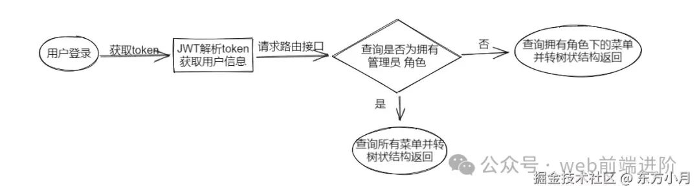

### 1. 在utils 创建一个转换菜单列表为树形结构的函数 menuTree.ts
   
 它接受两个参数：menuList 是原始的扁平菜单列表，parentId 是当前节点的父节点 ID，初始值为 null。函数首先创建了一个空数组 tree 用于存储树形结构。然后使用循环遍历 menuList，对每个菜单项进行判断，如果当前菜单项的 parent_id 等于传入的 parentId，则将其视为当前节点的子节点，继续递归调用 convertToTree 函数来构建子树。如果子节点存在，则将子节点数组赋值给当前菜单项的 children 属性，最后将当前菜单项添加到 tree 数组中。

export const convertToTree = (menuList, parentId: number | null = null) => {
  const tree = [];

  for (let i = 0; i < menuList.length; i++) {
    if (menuList[i].parent_id === parentId) {
      const children = convertToTree(menuList, menuList[i].id);
      if (children.length) {
        menuList[i].children = children;
      }
      tree.push(menuList[i]);
    }
  }

  return tree;
};
###  2. 来到我们菜单模块service中,编写一个获取路由的函数
该函数得作用如下：
// 先将传入token中user得id取出来，根据id查询user表、role表、menu表
//（需要用到多对多中间关系表进行关联），然后根据角色和菜单的关系，
// 得到用户的菜单，然后将菜单转换为树形结构，返回给前端，
// 菜单中包含了path等属性，前端根据这些path属性生成路由。

 async getRouters(req): Promise<Menu[]> {
    //user.guard中注入的解析后的JWTtoken的user
    const { user } = req;
    //根据关联关系通过userid查询user表中得信息，及对应的所有菜单和所有角色
    const userList: User = await this.userRepository
      .createQueryBuilder('fs_user')
      .leftJoinAndSelect('fs_user.roles', 'fs_role')//第1个参数，对应中间表，第2个参数是实体类名
      .leftJoinAndSelect('fs_role.menus', 'fs_menu')//一共左连接4次，对应4张表，找到userid关联的菜单和角色
      .where({ id: user.sub })//查询条件为user表的id，id为JWTtoken解析后的sub
      .orderBy('fs_menu.order_num', 'ASC')//升序排序，确保菜单按顺序排列
      .getOne();//返回一个user对象，包含roles和menus属性，roles是角色数组，menus是菜单数组

    //是否为超级管理员,是的话查询所有菜单
    const isAdmin = userList.roles?.find((item) => item.role_name === 'admin');
    let routers: Menu[] = [];

    if (isAdmin) {
      routers = await this.menuRepository.find({
        order: {
          order_num: 'ASC',
        },
        where: {
          status: 1,
        },
      });
      return convertToTree(routers);
    }
    interface MenuMap {
      [key: string]: Menu;
    }
    // console.log(userList.roles[0].menus);

    //根据id去重
    const menus: MenuMap = userList?.roles.reduce(
      (mergedMenus: MenuMap, role: Role) => {
        role.menus.forEach((menu: Menu) => {
          mergedMenus[menu.id] = menu;
        });
        return mergedMenus;
      },
      {},
    );
//将 menus 对象中的所有值提取出来，并将其存储在 routers 数组中
    routers = Object.values(menus);

    return convertToTree(routers);
  }
}

### 3. 最后在菜单模块controller中编写**接口**，调用getRouters函数，返回菜单树形结构给前端。

@Post('/getRouters')
  @ApiOperation({ summary: '获取路由' })
  async getRouters(@Request() req) {
    return await this.menuService.getRouters(req);
  }

使用如下地址测试：
post  http://localhost:3000/menu/getRouters
需要首先用上面创建得用户登录，获取到token后，使用token进行传参
{
"username":"user1",
"password":"123456"}

## 一些总结：
完成以上内容的一个逻辑思路：
### 1. 创建三个模块：user、role、menu，其中user模块已经有了，不需要再创建；
### 2. 在三个模块中分别创建实体类，并在module.ts中注册到typeorm中；
### 3. user和role实体类中，需要配置多对多关系，即用户和角色的关系，角色和菜单的关系；
不需要指定中间表的字段，建议指定中间表的名称。中间表nestjs会自动生成。
**注意**：此时中间表的内容为空。

### 4. 创建三个实体类对应的dto，对前端传入的参数进行校验，同时也能给swaggers增加参数说明。
**注意**：user和role的dto中，需要分别增加role_ids参数，用于绑定角色；
增加menu_ids参数，用于绑定菜单；最终形成多对多关系的映射关系内容。

### 5. 创建菜单，利用api接口测试，传入数据；
**注意顶级菜单的parent_id为null，其余菜单的parent_id为其父菜单的id。是为了方便后面菜单树形结构的构建。**

### 6. 创建角色，利用api接口测试，传入数据；
**注意**：角色所对应的菜单的配置，需要通过中间表进行关联，所以传入的参数中需要包含menu_ids参数。

### 7. 创建用户，利用api接口测试，传入数据；
**注意**：用户所对应的角色的配置，需要通过中间表进行关联，所以传入的参数中需要包含role_ids参数。

### 8. 菜单模块service中，编写一个获取路由的函数，该函数得作用如下：
这段代码的主要功能是，当用户登录成功后，根据用户的角色和菜单的关系，得到用户的菜单，然后将菜单转换为树形结构，返回给前端，菜单中包含了path等属性，前端根据这些path属性生成路由。
**具体流程如下：**
1- 从请求对象req中获取解析后的JWT Token中的用户信息（user）。这个用户信息包含了一个唯一标识符sub，这个sub就是用户的id，用于在数据库中查找对应的用户。
2- 使用TypeORM的查询构建器进行数据库查询。查询逻辑是：
1）从fs_user表开始，通过sub字段查找特定用户。
2）进行左连接操作，将fs_role表和fs_menu表与fs_user表关联起来，这样可以根据用户ID找到该用户所有关联的角色以及每个角色对应的菜单。
3）通过where条件，将查询结果限制为特定用户。
4）通过orderBy条件，将查询结果按菜单的order_num字段进行升序排序。
5）使用getOne()方法，返回一个User对象，包含roles和menus属性，roles是角色数组，menus是菜单数组。
先查到userid对应的user信息，然后通过中间表找到user对应的roles，在用中间表通过roles找到对应的menus信息。
**类似这种形式：**
{
  "id": 1,
  "name": "张三",
  "sub": "1",
  "roles": [
    {
      "id": 1,
      "role_name": "user",
      "menus": [
        {
          "id": "1",
          "menu_name": "首页",
          "path": "/home",
          "order_num": 1,
          "status": 1
        },
        {
          "id": "2",
          "menu_name": "用户管理",
          "path": "/user-management",
          "order_num": 2,
          "status": 1
        }
      ]
    },
    {
      "id": 2,
      "role_name": "editor",
      "menus": [
        {
          "id": "2",
          "menu_name": "用户管理",
          "path": "/user-management",
          "order_num": 2,
          "status": 1
        },
        {
          "id": "3",
          "menu_name": "内容编辑",
          "path": "/content-edit",
          "order_num": 3,
          "status": 1
        }
      ]
    }
  ]
}

3- 判断查询到的用户是否拥有名为'admin'的角色。如果是，则忽略用户的角色限制，查询所有状态为1的菜单，并将这些菜单按order_num字段进行升序排序后转换成树形结构返回。

4- **如果用户不是超级管理员**，则通过reduce方法对每个角色的菜单进行合并，确保每个菜单只出现一次（即去重操作）。合并后的菜单会被存储在一个名为menus的对象中，其中键是菜单ID，值是菜单对象本身。

userList: 这是一个用户对象，包含了用户的基本信息以及关联的角色和菜单。
roles: 这是 userList 对象中的一个属性，表示该用户关联的所有角色。roles 是一个数组，其中每个元素都是一个 Role 对象。
userList?.roles: 使用可选链操作符 ?. 来安全地访问 userList 对象的 roles 属性。如果 userList 为 undefined 或 null，则不会执行 reduce 方法，而是返回 undefined。

**reduce 方法 执行过程**：
这是 JavaScript 数组的一个方法，用于将数组中的每个元素按照一定的规则进行累积，最终返回一个单一的值。
1）、 userList?.roles.reduce(...): 这里的 userList?.roles 是一个数组，reduce 方法会遍历这个数组中的每个元素。
2）、 回调函数接受两个参数：
mergedMenus: 累加器，用于存储合并后的菜单。每次回调函数执行后，mergedMenus 的值会被更新。初始状态mergedMenus = {}，表示一个空对象。
role: 当前迭代的角色对象。reduce 方法会依次遍历 userList.roles 数组中的每个角色对象，并将**每个角色对象作为 role 参数传递给回调函数**。
通过查看reduce的源码，可以看到reduce中回调函数的第2个参数对应的就是userList.roles这个数组。

3）、第一次遍历：针对user角色

role 参数是 userList.roles 数组中的第一个角色对象：
{
  "id": 1,
  "role_name": "user",
  "menus": [
    {
      "id": "1",
      "menu_name": "首页",
      "path": "/home",
      "order_num": 1,
      "status": 1
    },
    {
      "id": "2",
      "menu_name": "用户管理",
      "path": "/user-management",
      "order_num": 2,
      "status": 1
    }
  ]
}

处理 role.menus:
role.menus 是该角色关联的菜单数组：
[
  {
    "id": "1",
    "menu_name": "首页",
    "path": "/home",
    "order_num": 1,
    "status": 1
  },
  {
    "id": "2",
    "menu_name": "用户管理",
    "path": "/user-management",
    "order_num": 2,
    "status": 1
  }
]

遍历 role.menus 数组中的每个菜单对象，得到以下结果：
mergedMenus = { "1": { "id": "1", "menu_name": "首页", "path": "/home", "order_num": 1, "status": 1 }, "2": { "id": "2", "menu_name": "用户管理", "path": "/user-management", "order_num": 2, "status": 1 } }

4）、 第二次遍历：针对editor角色
role 参数是 userList.roles 数组中的第二个角色对象：
{
  "id": 2,
  "role_name": "editor",
  "menus": [
    {
      "id": "2",
      "menu_name": "用户管理",
      "path": "/user-management",
      "order_num": 2,
      "status": 1
    },
    {
      "id": "3",
      "menu_name": "内容编辑",
      "path": "/content-edit",
      "order_num": 3,
      "status": 1
    }
  ]
}

处理 role.menus:
role.menus 是该角色关联的菜单数组：
[
  {
    "id": "2",
    "menu_name": "用户管理",
    "path": "/user-management",
    "order_num": 2,
    "status": 1
  },
  {
    "id": "3",
    "menu_name": "内容编辑",
    "path": "/content-edit",
    "order_num": 3,
    "status": 1
  }
]

 遍历 role.menus 数组中的每个菜单对象，得到以下结果：
**由于 id 为 "2" 的菜单已经存在于 mergedMenus 中，所以不会被覆盖**
mergedMenus = { "1": { "id": "1", "menu_name": "首页", "path": "/home", "order_num": 1, "status": 1 }, "2": { "id": "2", "menu_name": "用户管理", "path": "/user-management", "order_num": 2, "status": 1 }, "3": { "id": "3", "menu_name": "内容编辑", "path": "/content-edit", "order_num": 3, "status": 1 } }

将 mergedMenus 对象中的所有值提取出来，并将其存储在 routers 数组中：//routers = Object.values(menus);
1、在 reduce 方法执行完毕后，mergedMenus 对象是一个以菜单ID为键，菜单对象为值的映射对象；
2、Object.values 方法用于**提取对象中的所有值**，并将其返回为一个数组。它会遍历 mergedMenus 对象的每个键值对，并将所有的值（即菜单对象）提取出来，形成一个数组。
如下：
[
  {
    "id": "1",
    "menu_name": "首页",
    "path": "/home",
    "order_num": 1,
    "status": 1
  },
  {
    "id": "2",
    "menu_name": "用户管理",
    "path": "/user-management",
    "order_num": 2,
    "status": 1
  },
  {
    "id": "3",
    "menu_name": "内容编辑",
    "path": "/content-edit",
    "order_num": 3,
    "status": 1
  }
]
**注意，这个例子中没有parentid的值，**，实际中是要有的，因为菜单的层级关系是有父子关系的。
因为接下来要将菜单转换为树形结构，里面判断的依据就是parent_id。
最后  return convertToTree(routers); 返回菜单树形结构给前端。

5- convertToTree 函数的作用是将菜单列表转换为树形结构。
export const convertToTree = (menuList, parentId: number | null = null) => {
  const tree = [];

  for (let i = 0; i < menuList.length; i++) {
    if (menuList[i].parent_id === parentId) {
      const children = convertToTree(menuList, menuList[i].id);
      if (children.length) {
        menuList[i].children = children;
      }
      tree.push(menuList[i]);
    }
  }

  return tree;
};

这个是个递归函数，用于将菜单列表转换为树形结构。
1、首先定义一个空数组 tree，用于存储树形结构的菜单。
2、遍历 menuList 数组，判断每个菜单的 parent_id 是否等于 parentId。如果相等，则表示该菜单是父菜单，需要递归调用 convertToTree 函数，将该菜单的子菜单添加到 children 属性中，然后将该菜单添加到 tree 数组中。
3、如果该菜单的 parent_id 不等于 parentId，则表示该菜单不是父菜单，不需要递归调用，直接将该菜单添加到 tree 数组中。
4、最后返回 tree 数组。

至此，菜单模块的创建、配置、测试、接口编写、权限管理等内容全部完成。

# 按钮权限控制
上一篇文章我们已经知道了什么是 RBAC 权限管理并且完成了菜单相关权限的处理。当然,一个管理系统仅仅对菜单做权限管理很显然是不够的,除此之外我们在前端还需要对一些按钮进行权限管理,而对应的后端则是对这些按钮调用的接口进行权限验证。
前端通过登录获取该用户所有权限字段,然后在按钮中**通过自定义指令的方式，传入这个按钮所需要的权限字段**,通过判断这个用户的权限是否包含这个按钮的权限来控制按钮的显示与隐藏.
对于按钮来说,我们也将其视为一个菜单,所以添加按钮权限只需要插入一条类型为 3(按钮)的菜单和一个自定义权限字符串permission即可。

## 自定义装饰器
**注意**：**自定义装饰器，不需要使用nest 的cli命令方式去创建，手动创建目录和装饰器文件即可。**
在src/common/decorator目录下新建permissions.decorator.ts文件,写一个自定义装饰器设置一些元数据
import { SetMetadata } from "@nestjs/common";

export const Permissions = (...permissions: string[]) =>
  SetMetadata("permissions", permissions);
这样当我们使用这个装饰器，如@Permissions('system:user:add'),就可以在导航守卫中获取到这个装饰器的元数据从而做一些**权限判断**

## 自定义导航守卫
在src/common/guard目录下新建permissions.guard.ts文件,写一个导航守卫
import {
  Injectable,
  CanActivate,
  ExecutionContext,
  Inject,
} from '@nestjs/common';
import { Reflector } from '@nestjs/core';
import { Observable } from 'rxjs';
import { CacheService } from 'src/cache/cache.service';
@Injectable()
export class PermissionsGuard implements CanActivate {
  constructor(
    private reflector: Reflector,
    private cacheService: CacheService,//引入缓存服务,需要使用REDIS 
  ) {}
  
// 权限验证,判断用户是否有权限访问
  async canActivate(context: ExecutionContext): Promise<boolean> {
    //获取**自定义装饰器**配置的元数据`permissions`
    const requiredPermissions = this.reflector.get<string[]>(
      'permissions',
      context.getHandler(),
    );

    // 如果没有配置则不需要验证权限的路由，直接放行
    if (!requiredPermissions) {
      return true;
    }
    // 从request拿到当前用户登录信息(全局守卫UserGuard已经将用户信息挂载到request上)
    const request = context.switchToHttp().getRequest();
    const { user } = request;//解构出用户信息
    // 从缓存中获取用户的权限列表
    const userPermissions = await this.cacheService.get(
      `${user.sub}_permissions`,
    );
    // 用户未登录或未设置权限，拒绝访问
    if (!user || !userPermissions) {
      return false;
    }
  //**判断用户在缓存中的权限是否包含所有在装饰器中配置的必需权限**。
    //确保了只有当用户具有所有必需的权限时，才会允许访问该路由。
    const hasPermission = requiredPermissions.every((permission) =>
      userPermissions.includes(permission),
    );
    return hasPermission;
  }
}

数组得every方法，可以利用其提供得回调函数，传入数组中的每一项，如果回调函数返回false，则立即返回false，否则继续遍历，直到遍历完所有项，如果遍历完所有项，则返回true。
这里遍历得逻辑是：用缓存中得用户权限列表userPermissions去判断，当前登录用户是否有权限访问**当前页面按钮**得路由。

**注意：** 这个权限守卫，我们也需要注册为全局守卫，之前token验证的userguard守卫已经在user模块的module.ts中注册过了，我们再去到这个文件中，讲权限守卫用同样的方法见笑注册，此时**权限守卫就全局生效了**。
    {
      provide: APP_GUARD,
      useClass: PermissionsGuard,
    },

## redis服务的全局模块化,
这里用到了cacheService,在守卫中使用其它模块的service我们需要在每个用到这个守卫的地方都导入一下他的模块(CacheModule),这样显得很麻烦。所以我们可以将Redis模块改成全局模块,这样就不用再导入了
//src/cache/cache.module.ts
import { Global, Module } from "@nestjs/common";
import { CacheService } from "./cache.service";
import { createClient } from "redis";
import { ConfigService } from "@nestjs/config";
// 使用 @Global() 装饰器将模块设置为全局模块
@Global()

**注意：** 我目前测试得情况是，这个配置redis缓存模块得全局化，代码不会报错，但是不会生效
其他模块中还是需要导入这个模块才能使用缓存服务

## 获取用户信息接口

其中用户的权限列表userPermissions是在 Redis 中存储的,所以我们需要修改一下获取路由的接口,将其存储当前用户权限,并且把接口调整为获取用户信息的接口返回给前端路由和权限列表。

在menu.service.ts文件中,调整接口名为getInfo,同时返回权限列表和路由列表：
  async getInfo(req): Promise<GetInfoVo> {
    //user.guard中注入的解析后的JWTtoken的user
    const { user } = req;
    //根据关联关系通过userid查询user表中得信息，及对应的所有菜单和所有角色
    const userList: User = await this.userRepository
      .createQueryBuilder('fs_user')
      .leftJoinAndSelect('fs_user.roles', 'fs_role') //第1个参数，对应中间表，第2个参数是实体类名
      .leftJoinAndSelect('fs_role.menus', 'fs_menu') //一共左连接4次，对应4张表，找到userid关联的菜单和角色
      .where({ id: user.sub }) //查询条件为user表的id，id为JWTtoken解析后的sub
      .orderBy('fs_menu.order_num', 'ASC') //升序排序，确保菜单按顺序排列
      .getOne(); //返回一个user对象，包含roles和menus属性，roles是角色数组，menus是菜单数组

    //是否为超级管理员,是的话查询所有菜单，item是1则是超级管理员，item就是userList.roles的第一个元素
    const isAdmin = userList.roles?.find((item) => item.role_name === 'admin');
    let routers: Menu[] = [];
    let permissions: string[] = [];
    if (isAdmin) {
      routers = await this.menuRepository.find({
        order: {
          order_num: 'ASC',
        },
        where: {
          status: 1,
        },
      });
      //return convertToTree(routers);
      //获取菜单所拥有的权限  
      permissions = filterPermissions(routers);
            //存储当前用户的权限
      await this.cacheService.set(`${user.sub}_permissions`, permissions, 7200);
      return {
        routers: convertToTree(routers),
        permissions: permissions,

            };
     }
    interface MenuMap {
      [key: string]: Menu;
    }

    //根据id去重
    const menus: MenuMap = userList?.roles.reduce(//回调函数接受两个参数,role：当前的角色对象
      (mergedMenus: MenuMap, role: Role) => {//mergedMenus：累加器，用于存储合并后的菜单
        role.menus.forEach((menu: Menu) => {
          mergedMenus[menu.id] = menu;
        });
        return mergedMenus;
      },
      {},
    );
//将 menus 对象中的所有值提取出来，并将其存储在 routers 数组中
    routers = Object.values(menus);
    permissions = filterPermissions(routers);
     await this.cacheService.set(`${user.sub}_permissions`, permissions, 7200);
    //return convertToTree(routers);
    return {
      routers: convertToTree(routers),
      permissions,
    };
  }
}

## filterPermissions函数处理权限列表
其中filterPermissions函数是处理权限列表的函数,将菜单列表的 permissions 字段提取到数组中并去重；
//utils/filterPermissions.ts
//filterPermissions 函数的作用是从传入的 Menu 对象数组中提取所有非空的权限标识符，
//并去除重复的权限标识符，返回一个包含唯一权限标识符的字符串数组。
import { Menu } from 'src/menu/entities/menu.entity';

export const filterPermissions = (routers: Menu[]): string[] => {
  return [
    ...new Set(//展开运算符 ... 用于将 Set 对象中的唯一权限标识符转换回数组。
      routers
        .map((router) => router.permission)
        .filter((permission) => permission != null),
    ),
  ];
};

//最终的结果数组为：举例
//['system:user:add', 'system:user:edit', 'system:user:delete']

## 最后修改一下menu.controller.ts中的接口名 @Post('/getInfo')
  @ApiOperation({ summary: '获取路由' })
  async getInfo(@Request() req) {
    return await this.menuService.getInfo(req);
  }

## 给这些菜单插入几个权限字段
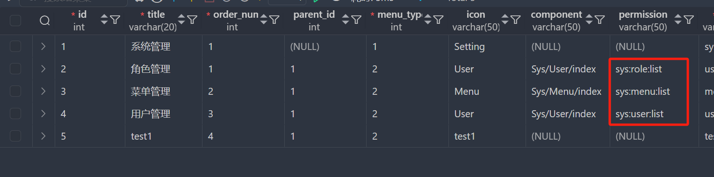

然后使用user1用户登录获取到它的 token 调用menu/getInfo接口就拿到了他拥有的菜单权限及按钮权限字段
//拿到user1的token
post  http://localhost:3000/user/login
{
"username":"user1",
"password":"123456"}

//将token放入headers中
post http://localhost:3000/menu/getInfo

**返回结果如下：**
{
    "code": 200,
    "data": {
        "routers": [
            {
                "id": 1,
                "title": "系统管理",
                "order_num": 1,
                "parent_id": null,
                "menu_type": 1,
                "icon": "Setting",
                "component": null,
                "permission": null,
                "path": "sys",
                "create_by": "1",
                "status": 1,
                "create_time": "2025-02-03T02:37:44.032Z",
                "update_time": "2025-02-03T02:45:14.479Z",
                "children": [
                    {
                        "id": 2,
                        "title": "角色管理",
                        "order_num": 1,
                        "parent_id": 1,
                        "menu_type": 2,
                        "icon": "User",
                        "component": "Sys/User/index",
                        "permission": "sys:role:list",
                        "path": "user",
                        "create_by": "1",
                        "status": 1,
                        "create_time": "2025-02-03T02:43:17.927Z",
                        "update_time": "2025-02-07T04:44:12.688Z"
                    },
                    {
                        "id": 3,
                        "title": "菜单管理",
                        "order_num": 2,
                        "parent_id": 1,
                        "menu_type": 2,
                        "icon": "Menu",
                        "component": "Sys/Menu/index",
                        "permission": "sys:menu:list",
                        "path": "menu",
                        "create_by": "1",
                        "status": 1,
                        "create_time": "2025-02-03T02:43:30.222Z",
                        "update_time": "2025-02-07T04:44:12.698Z"
                    }
                ]
            }
        ],
        "permissions": [
            "sys:role:list",
            "sys:menu:list"
        ]
    },
    "describe": "请求成功"
}

## 在menu.controller.ts写一个测试接口看一下我们的权限验证是否准确,先试一下sys:menu:list
  @UseGuards(PermissionsGuard)
  @Permissions('sys:menu:list')
  @Post('/test')
  async test(@Request() req) {
    return 'success';
  }

调用接口看一下结果是通过的,因为 user1 用户是有这个权限的(注意 token 和上面接口一致)
post  http://localhost:3000/menu/test
headers还是配置登录用户user1的token，
**返回结果如下：**
{
    "code": 200,
    "data": "success",
    "describe": "请求成功"
}
因为装饰器的 @Permissions('sys:menu:list')这个定义，实际上user1用户是有这个权限的，所以接口返回了success。

如果把这个装饰器权限换成 @Permissions('sys:user:list')，接口就会返回403，因为user1用户没有这个权限。
**返回结果如下**：
{
    "code": 403,
    "timestamp": "2025-02-07T13:24:36.371Z",
    "path": "/menu/test",
    "describe": "Forbidden resource"
}

如果menu.controller.ts中**没有定义装饰器去约束权限**，那么默认是允许访问的。
**返回结果如下**：
{
    "code": 200,
    "data": "success",
    "describe": "请求成功"
}

## 总结
关于RBAC权限管理，菜单权限管理，按钮权限管理，我们已经完成了菜单权限的配置，按钮权限的配置，以及按钮权限的验证。
### 按钮权限
通过判断这个用户的权限是否包含这个按钮的权限来控制按钮的显示与隐藏,
### 按钮权限的配置思路
1. 定义一个自定义装饰器Permissions，用于在路由中设置按钮权限，如@Permissions('sys:user:add')
2. 在按钮的路由中，使用这个装饰器，可以结合导航守卫，判断用户是否有权限访问这个导航按钮；
3. 自定义1个导航守卫PermissionsGuard，用于验证用户是否有权限访问某个按钮，根据按钮的权限标识符，从缓存中获取用户的权限列表，判断用户是否有权限访问这个按钮；
4. 在菜单的service中，根据登录用户的id，查询出用户拥有的菜单列表，并将菜单列表转换为树形结构；同时，将菜单列表的 permissions 字段提取到数组中，这就是按钮权限的标识符；
5. 然后将权限列表存储到 Redis 中，并设置过期时间，这样就能在导航守卫中，直接从缓存中获取用户的权限列表，进行权限验证。

# 路由动态加载及菜单侧边栏
在菜单权限管理开发中，通常需要**根据后端返回的菜单列表**，**递归渲染左侧菜单栏以及动态加载路由**，这样可以确保用户无法访问没有权限的菜单。
## 为了实现这个功能，我们需要进行以下步骤：
1.  **获取菜单列表数据**：调用菜单接口/getInfo获取路由列表数据。
2.  **渲染左侧菜单栏**：使用递归的方式根据菜单列表数据格式来渲染左侧菜单栏（sidebar）。递归可以遍历菜单数据，根据数据的嵌套结构来递归渲染菜单的子菜单。
3.  **将菜单列表转换为 Vue 路由格式**：在渲染菜单的过程中，需要将菜单列表数据转换为符合 Vue 路由的格式。**Vue 路由需要包含路径（path）和组件（component）等信息。**
根据菜单列表的数据结构，进行适当的转换来生成 Vue 路由格式的数据。
4.  **动态添加路由**：将菜单列表转换为 Vue 路由格式的数据后，**可以使用 router.addRoute 方法动态添加路由。**

## 步骤1：main.ts的配置
main.ts中引入**pinia状态管理和路由**,同时将element-plus的 Icon 全局注册(**后续就能直接使用图标了**)
**代码如下：**
import { createApp } from 'vue';
//import './style.css'
import App from './App.vue';
import './index.css';
import ElementPlus from 'element-plus';
import 'element-plus/dist/index.css';
import { createPinia } from 'pinia';
import router from './router';
import * as ElementPlusIconsVue from '@element-plus/icons-vue';

const app = createApp(App);
//将element-plus的图标注册到app中
for (const [key, component] of Object.entries(ElementPlusIconsVue)) {
  app.component(key, component);
}
const pinia = createPinia();
app.use(ElementPlus);//注册element-plus
app.use(router);//注册和初始化路由
app.use(pinia);//注册和初始化pinia状态管理
//等待路由初始化完成后再挂载,**确保守卫beforeach可以使用pinia**
await router.isReady();
app.mount('#app');

## 步骤2：布局
看一下页面布局,分为顶部导航栏(navbar)+左侧菜单栏(sidebar)+主要内容(appmain)
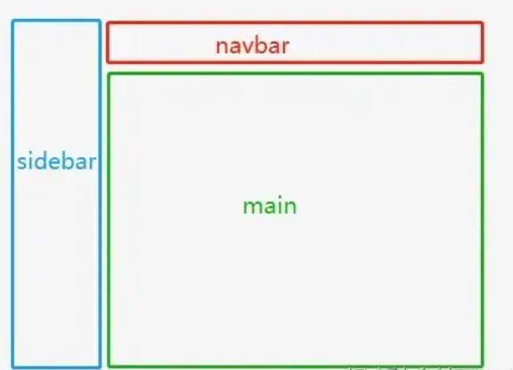

### 项目新建layout文件夹来存放**布局组件**
在src下新建layout文件夹，目录解构如下：
-- layout
   -- components
      -- AppMain
         -- index.vue
      -- NavBar
         -- index.vue
      -- SideBar
         -- index.vue
      -- index.ts
   -- index.vue

### 在index.vue 中引入布局组件
配置如下：
<template>
  

    

      <SideBar />
    

    

      <NavBar />
      <AppMain />
    

  

</template>

### 配置index.ts
该文件作为布局组件的入口文件，导出了NavBar、AppMain、SideBar组件
配置如下：
export { default as NavBar } from "./NavBar/index.vue"
export { default as AppMain } from "./AppMain/index.vue"
export { default as SideBar } from "./SideBar/index.vue"

### 配置 AppMain/index.vue
**这里加了动画与组件缓存,后续会根据后端返回的catch字段进行缓存控制**
配置如下：
<template>
  

    <router-view v-slot="{ Component, route }">//用于动态渲染当前路由对应的组件。当前路由就是重定向后的views/index.vue
    获取当前路由对应的组件（Component）和路由对象（route）信息
      <transition name="fade" mode="out-in">//定义路由切换动画效果
        <keep-alive>//缓存动态组件实例，减少组件渲染次数
          <component :is="Component" :key="route.path" />
        </keep-alive>
      </transition>
    </router-view>
  

</template>

### 配置 AppMain/index.scss
.app_main{
     padding: 10px;
    .fade-enter-active {//定义路由切换动画效果的入场动画
        transition: all 0.3s;
      }
      
      .fade-leave-active {//定义路由切换动画效果的离场动画
        transition: all 0.3s;
      }
      
      .fade-enter-from {//定义路由切换动画效果的入场动画的起始状态
        opacity: 0;
      }
      
      .fade-leave-to {//定义路由切换动画效果的离场动画的结束状态
        transform: translateX(20px);
        opacity: 0;
      } 
}

## 步骤3：全局状态管理:**存放全局数据,菜单列表数据,权限列表数据,以及是否折叠菜单**
在api/menu/index.ts中配置：调用获取路由及权限的接口
1. 在api目录下新建menu目录；
2. index.ts的配置如下：
import request from '@/utils/http/index';
import { MenuDto } from './types/menu.dto';
//获取路由及权限
export const getInfo = (data: MenuDto) => {
  return request({
    url: '/menu/getInfo',
    data,
    method: 'post',
  });
};

3. 其中的MenuDto是用来接收后端返回的菜单列表数据的,在types中新建menu.dto.ts
export type MenuDto = {};
这里什么都不用传

4. src下，新建store/index.ts，用来**存放全局数据,菜单列表数据,权限列表数据,以及是否折叠菜单**等等,同时调用getInfo接口获取数据
配置如下：
import { defineStore } from 'pinia';
import { getInfo } from '../api/menu/index';
import type { AppStoreState } from './types';

export default defineStore('appStore', {
  state: (): AppStoreState => {//定义仓库的初始状态
    return {
      menuList: [],
      isCollapse: false,
      permissions: [],
    };
  },
  actions: {//定义仓库的操作方法,用于改变状态
    async getInfo() {
      const { data } = await getInfo({});
      this.menuList = data.routers;
      this.permissions = data.permissions;
    },
  },
});

**其中types 是store目录下的新建的ts文件，用来存放全局数据类型**
配置如下：
export type MenuList = {
  id: number;
  parent_id: number;
  title: string;
  path: string;
  component: string;
  icon: string;
  order_num: number;
  status: boolean;
  menu_type: 1 | 2 | 3;
  children: MenuList[];
  meta: {
    title?: string;
    catch?: number;
    hidden?: boolean;
  };
};

export type AppStoreState = {
  menuList: MenuList[];
  isCollapse: boolean;
  permissions: string[];
};

## 步骤4：获取组件路径和动态加载路由
**提示**：路由在前端开发中指的是URL与视图之间的映射关系。
URL来自菜单中配置的path字段，视图则是由菜单中的component字段值对应的实际组件文件。

### 创建可被路由的组件，将后端菜单中的component字段值设置为所对应的**实际组件的路径**
这里我们需要根据后端返回的组件component字段来创建目录,比如字段值是system/role/index，就在views目录下新建system/role/index.vue
1. 我先修改了fs_menu表中组件字段的值，修改后的结果如下：
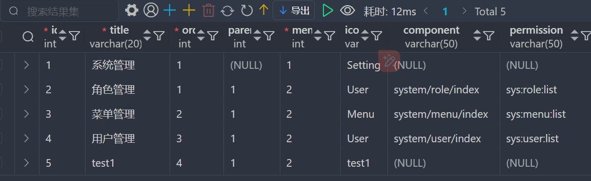

2. 修改了fs_menu表中path字段的值，修改后的结果如下：
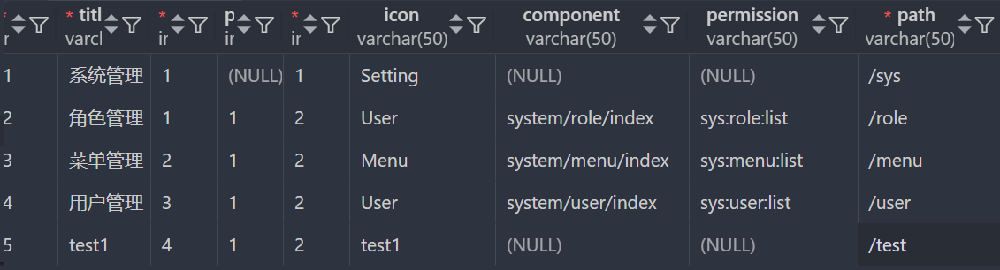

3. 在views目录下新建system目录，目录结构如下：创建对应的vue文件
-- views
   -- system
      -- role
         -- index.vue
      -- user
         -- index.vue
      -- menu
         -- index.vue

每个文件对应的内容如下：
<template>
  
角色管理

</template>

<template>
    
用户管理

</template>

<template>
    
菜单管理

</template>

这些用于后续测试

### 将后端返回的菜单类型数组中的component字段值，转换为符合 RouteRecordRaw 中组件路径的格式,
因为**后端返回的组件路径是个字符串**,RouteRecordRaw的component是**不能直接使用**的

1. **实现前端组件路径的获取，与后端返回的组件路径数据的匹配。**
  这里我们在utils文件夹新建filterRouters.ts

// 实现前端路由的动态加载，和与后端返回的路由数据的匹配。
//import.meta.glob是用于动态导入模块的函数，它返回一个对象
//把本地目录中的所有vue文件都记录到modules对象中
const modules = import.meta.glob('../views/**/*.vue'); 

//将本地的路由与后端返回的路由进行匹配
export const loadView = (view: any) => {
  let res;
  for (const path in modules) {
    const normalizedPath = path.replace(/\\/g, '/'); // 处理 Windows 路径分隔符问题
    const dir = normalizedPath.split('views/')[1].split('.vue')[0];
    if (dir === view) {
      res =  modules[path];//动态加载1个与后端返回的路由匹配的vue组件
      break;
    }//通过使用箭头函数,可以确保只有在调用 res 函数时，才会真正执行模块的导入操作
  //}//该函数在被调用时会执行类似 import('@/views/home.vue')，从而动态加载 home.vue 组件。
  }
  if (!res) {
    console.error(`Component for view '${view}' not found.`);
  }
  else {
    console.log(`Component for view '${view}' loaded.`);
    console.log('Loaded Component:', res); // 打印res的结果
  }
  return res;
};

//动态加载的modules对象举例：
/* {
  '@/views/path/to/ComponentA.vue' : () => import('@/views/path/to/ComponentA.vue'),
  '@/views/another/path/ComponentB.vue': () => import('@/views/another/path/ComponentB.vue'),
  // 其他.vue文件...
}
*/

//用于处理后端返回的路由数据，使其符合前端 Vue Router 的格式。
//过滤路由数据，将component属性替换为loadView函数返回的组件

export const filterRoute = (data: any) => { 
  data.forEach((item: any) => {
    if (item.children?.length > 0) {
      delete item.component;

      filterRoute(item.children);
    } else  if (item.component) {
      item.component = loadView(item.component);
      // item.redirect = "/404";
      console.log(`Component set for '${item.path}':`, item.component);
    }
  });

  console.log('Filtered Route:', JSON.stringify(data, null, 2)); // 打印处理后的路由数据
  return data;
};

//forEach 是一个数组方法，用于遍历数组中的每一个元素，并对每个元素执行提供的函数。
//data是数组，对 data 数组中的每一个元素（即 item）执行大括号中的操作。

/* 处理逻辑:
如果路由项有子路由（即 item.children.length > 0），则删除该路由项的 component 属性，并对子路由进行递归处理。
如果路由项没有子路由，则调用 loadView(item.component) 来动态加载该路由项对应的 Vue 组件，并将其赋值给 item.component。
这样处理后，data 数组中的每个路由项的 component 属性都会被替换为一个加载该组件的函数。 */

/* 处理后的data数据样式-举例：
[
  {
    "path": "/dashboard",
    "name": "Dashboard",
    "component": () => modules['@/views/dashboard/index.vue']()
  },
  {
    "path": "/users",
    "name": "Users",
    "children": [
      {
        "path": "list",
        "name": "UserList",
        "component": () => modules['@/views/users/list.vue']()
      },
      {
        "path": "profile",
        "name": "UserProfile",
        "component": () => modules['@/views/users/profile.vue']()
      }
    ]
  }
] */
###  然后再新建hooks/useHandleRouter.ts,这是用来处理动态加载路由的逻辑
我们可以通过router.addRoute方式动态添加子路由,
**提示：** **这是个自定义钩子函数，**

import type { RouteRecordRaw, Router } from 'vue-router';
import useAppStore from '@/store/index';
import { filterRoute } from '@/utils/filterRouters';
export const useHandleRouter = (router:Router) => {
  console.log('useHandleRouter is called1');
  //设置白名单,直接放行
  const writeLists = ['Login'];
  //路由拦截（路由守卫）,每次导航（路由跳转）之前执行
  //to 是即将进入的目标路由对象，_from 是当前导航正要离开的路由对象,next用于决定导航如何进行。
  router.beforeEach(async (to, _from, next) => {
    console.log('useHandleRouter is called2');
    console.log('to.path:', to.path, 'to.name:', to.name,'_from.path:', _from.path,'_from.name:', _from.name);
    if (writeLists.includes(to.name as string)) {//as 是类型断言
      next();
      return;
    }
    const appStore = useAppStore();

    //已经获取菜单路由直接放行
    if (appStore.menuList.length) {
      console.log('已经获取菜单数据，直接放行');
      next();
      return;
    }
    //获取菜单路由列表
    try {
      console.log('开始获取菜单数据');
      await appStore.getInfo();
             // 处理菜单数据，添加 meta 属性
       const addMetaToMenu = (menuList: any[]) => {
        menuList.forEach((menu) => {
          if (!menu.meta) {
            menu.meta = {};
          }
          menu.meta.title = menu.title; // 将 title 赋值给 meta.title
          if (menu.children?.length > 0) {
            addMetaToMenu(menu.children);
          }
        });
      };
      addMetaToMenu(appStore.menuList);
      console.log('菜单数据获取成功:', JSON.stringify(appStore.menuList, null, 2));
      //处理成符合vue路由格式的路由
      const routers = filterRoute(appStore.menuList);
      console.log('格式化后的路由:', routers /* JSON.stringify(routers,null,2) */);
      //循环添加路由到父路由Index下
      routers.forEach((route: RouteRecordRaw) => {
        router.addRoute('Index', route);
        console.log('路由添加成功:', routers);
      });
      ////添加完路由需要重新执行一次路由跳转，否则会出现空白页面
      console.log('动态路由添加完成，重新执行跳转');
      next({ ...to, replace: true });
    } catch (error) {
      console.error('获取菜单数据失败:', error);
      //如果接口出错 比如token过期继续往下走
      next();
    }
  });
};

以上代码的序列图如下：
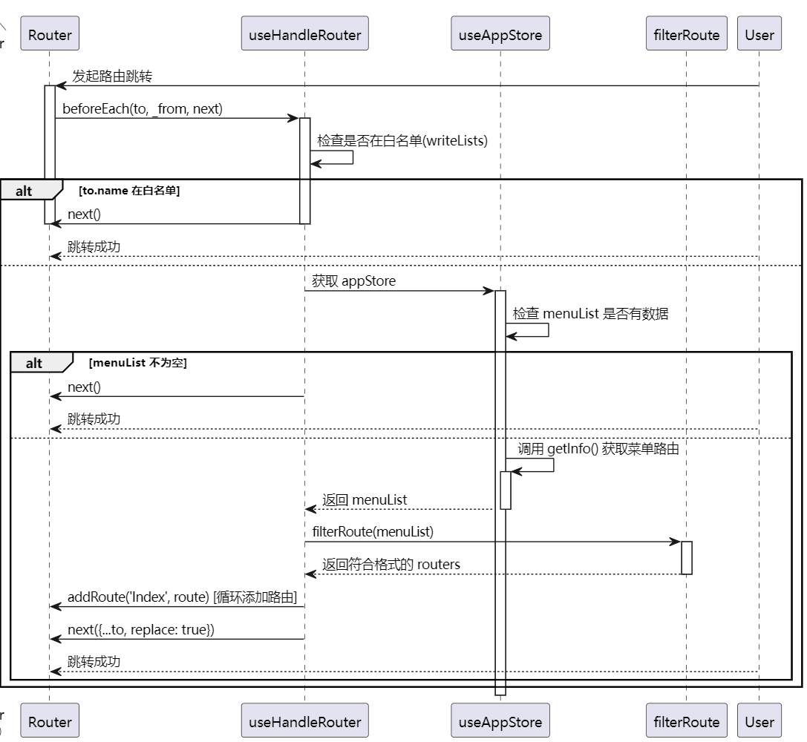

### 最后在修改router/index,同时添加一个/404的路由,当用户访问的路由不存在时,会跳转到/404路由
import { createRouter, createWebHashHistory } from 'vue-router';
import type { RouteRecordRaw } from 'vue-router';

export const routes: RouteRecordRaw[] = [
  {
    path: '/',
    name: 'Index',
    redirect: '/index',//自动重定向到子路由 /index
    component: () =>
      import(/*  webpackChunkName:  "index"  */ '@/layout/index.vue'),
    children: [
      {
        path: '/index',
        component: () => import('@/views/index.vue'),
        name: 'Home',
        meta: { title: '首页' },
      },
    ],
  },
  {
    path: '/login',
    name: 'Login',
    component: () =>
      import(/* webpackChunkName: "home" */ '@/views/login/index.vue'),
  },
  {
    path: '/:pathMatch(.*)*',//路由不存在时跳转到404页面
    component: () => import('@/views/error/404.vue'),
  },
];
const router = createRouter({
  history: createWebHashHistory(),
  scrollBehavior(to, from, savedPosition) {
    //路由切换时页面的滚动行为
    console.log(to, from);
    if (savedPosition) {
      return savedPosition;
    } else {
      return { top: 0 };
    }
  },
  routes,
});
export default router;

## 步骤5：菜单侧边栏
接下来我们来完成菜单侧边栏（SideBar）部分，这里我们使用element-plus中的菜单组件el-menu,然后通过判断后端返回的路由类型是菜单还是目录来分别使用el-menu-item和el-menu-sub。
### 1.新建layout/components/SideBar/index.vue来编写侧边栏的代码
<template>
  

    

      FS权限管理系统
    

    <el-scrollbar class="wrap-scroll">可滚动区域
      <el-menu //垂直菜单组件
        @select="getPath" //当用户选择菜单项时触发的事件
        :collapse="homeStore.isCollapse"
        :unique-opened="true"
        active-text-color="#ffd04b"
        background-color="#545c64"//
        class="el-menu-vertical-demo w-[223px] !border-r-0"// 定义菜单为垂直模式，定义宽度同时移除右侧边框。
        text-color="#fff"
        :default-active="dealRoutePath($route.path)"//根据当前路由路径设置默认激活的菜单项。
      >
        <el-menu-item index="index"> //菜单项，用于显示当前导航项的信息，路由为index首页，**必须项**
          <component class="w-[15px] mr-2 ml-1" is="House" /> 首页//名为House的组件，宽度为15像素，右边距为2像素
        </el-menu-item>
        <SideBarItem
          v-for="item in homeStore.menuList"//根据后端返回的菜单列表数据渲染菜单项
          :key="item.id!"
          :item="item"
        />
      </el-menu>
    </el-scrollbar>
  

</template>

### 2.新建layout/SideBar/components/SideBarItem.vue来编写侧边栏的每一项的代码
SideBarItem组件用于判断路由类型是菜单还是目录，然后渲染对应的组件。
<template>
  <el-sub-menu
    class="grid"
    v-if="controlSubView(props.item)"
    :index="props.item.path"
  >
    <template #title>
      <component class="w-[20px] mr-2 ml-1" :is="props.item.icon" />
      {{ props.item.title }}
    </template>
    <SideBarItem v-for="i in props.item.children" :key="i.id" :item="i" />
  </el-sub-menu>
  <el-menu-item
  v-else-if="controlMenuView(props.item)"
    :index="dealRoutePath(props.item.path)"
  >
    <component class="w-[20px] mr-2 ml-1" :is="props.item.icon" />
    {{ props.item.title }}
  </el-menu-item>
</template>

其中index属性类似于给菜单一个 key 值,方便后续的路由跳转。我们这里通过dealRoutePath函数取得/最后一个作为index值。同时为el-menu组件属性default-active设置为当前路由路径/的最后一个dealRoutePath($route.path),这样就能保证页面刷新或路由跳转后左侧菜单还是选中当前路由对应菜单状态,其中dealRoutePath方法为

### 3.再utils/routeUtils.ts中编写dealRoutePath方法
新建routeUtils.ts，配置如下：
//将一个完整的路由路径（$route.path）处理成一个简化的字符串

export const dealRoutePath = (path: string) => {
  if (!path) return '';
  const pathArr: string[] = path.split('/');// 按 / 分割成一个字符串数组
  return pathArr.slice(-1)[0]; // 返回最后一个元素
};

除此之外,SideBarItem组件中引入了自身SideBarItem实现了组件的递归,这样就可以保证无论菜单层级多少都可以对应展示到这里我们便完成了菜单侧边栏的开发。

# 面包屑与导航标签菜单

## 面包屑
面包屑导航在后台管理系统中是一个非常常见的功能,它用于显示用户当前所在页面的位置路径。
通常以层次结构的方式呈现，从首页或主目录开始，逐级显示用户所访问的页面的父级页面，直到当前页面。
通过面包屑导航，用户可以清楚地知道当前所在页面的位置，并且可以方便地返回到上一级或其他父级页面,大大提高了用户体验。本篇文章最终要实现的面包屑导航如下图示

### 概述
1. 在element plus已经为我们提供了面包屑组件Breadcrumb,我们可以在项目中直接使用在element plus已经为我们提供了面包屑组件Breadcrumb,我们可以在项目中直接使用

2. 它的用法很简单,separator 属性来规定分隔符,el-breadcrumb-item的 to 属性中的 path 可以配置要跳转的路由。

3. 因此我们可以**定义一个专门存放面包屑的数组**,然后根据这个数组遍历el-breadcrumb-item组件即可

### store中的工作
来到 store/index.ts 中，修改如下：
import { defineStore } from 'pinia';
import { getInfo } from '../api/menu/index';
import type { AppStoreState,NavTags } from './types';

export default defineStore('appStore', {//定义名为 appStore 的 Pinia 仓库
  state: (): AppStoreState => {//定义仓库的初始状态
    return {
     menuList: [],
      isCollapse: false,
      permissions: [],
      breadcrumbs: [],
    };
  },
  actions: {
    async getInfo() {//定义仓库的操作方法,用于改变状态
      const { data } = await getInfo({});
      this.menuList = data.routers;
      this.permissions = data.permissions;
    },
    
  },
});

在 store/types.ts 中定义面包屑数据类型，修改的内容如下：
export type Breadcrumbs = {
  name: string;
  path?: string;
};

export type NavTags = {
  name: string;
  path: string;
  fullPath?: string;
};

export type AppStoreState = {
  navTags: NavTags[];
  breadcrumbs: Breadcrumbs[];
  menuList: MenuList[];
  isCollapse: boolean;
  permissions: string[];
};

## 面包屑数据的获取和处理
1. 新建目录
src/layout/components/NavBar/components

2. 新建文件
src/layout/components/NavBar/index.vue
配置如下：
<template>
  
 //组件的根元素
    
//盒子边框模型
      
//当点击时会切换appStore.isCollapse的值。
        <Fold v-if="!appStore.isCollapse" class="w-6 cursor-pointer" />//折叠图标
        <Expand v-else class="w-6 cursor-pointer" />//展开图标,鼠标悬停时显示为指针样式
      

      <el-breadcrumb separator="/">//定义面包屑导航栏,分隔符为斜杠
        <el-breadcrumb-item :to="{ path: '/' }">首页</el-breadcrumb-item>//一个固定的指向首页
        <el-breadcrumb-item v-for="item in appStore.breadcrumbs"//渲染每个面包屑项
        :key="item.name">//提供每个面包屑项的唯一标识
          {{ item.name }}
        </el-breadcrumb-item>
      </el-breadcrumb>
  

  

</template>

3. 接下我们需要在路由跳转的时候为**面包屑数组**，根据跳转的信息添加一些数据,来到hooks，修改usehandleRouter函数,

    if (appStore.menuList.length) {
      appStore.$patch({//更新面包屑数据，$patch 方法会用传入的对象的属性值直接替换仓库中对应的状态属性。
        breadcrumbs:filterBreadCrumb(to.path, appStore.menuList)
      })
      console.log('已经获取菜单数据，直接放行');
      next();
      return;
    }

当路由切换时如果有路由权限数组,我们需要将当前路由的 name 和 path 存到面包屑数组中
因为面包屑组件是一级一级的,比如在 vue 中我们可以获取到当前页面路由的 path,比如/dd/child_1_1

其中dd对应的是父菜单,child_1_1对应的是子菜单,那么 breadcrumbs 应该是这样的

[
  {
    name: "父菜单1",
    path: "dd",
  },
  {
    name: "子菜单1",
    path: "child_1_1",
  },
];

4. 因此我们需要写一个utils/filterBreadCrumb.ts对其进行处理,将 path 按照/拆成一个数组,然后找到数组中元素(path)对应的菜单名称(name)。想要找到 path 对应的菜单名则需要遍历菜单列表,先找外层有没有,找不到再找它的 children,所以这里又用到了经典的递归写法
import type { Breadcrumbs, MenuList } from '@/store/types';
export const filterBreadCrumb = (path: string, menuList: MenuList[]) => {
  //将路由路径拆分成数组,例如：路径 /user/profile 会被分割成 ['user', 'profile']
  let paths = path.split('/');
  //会过滤掉数组中的空字符串元素。
  paths = paths.filter((item) => item);
  //初始化一个空数组 breadCrumbs，用于存储最终生成的面包屑导航项
  const breadCrumbs: Breadcrumbs[] = [];
  paths.forEach((item) => {//paths每一个元素执行一次回调函数
    const breadName = getMenuTitle(item, menuList)
    if (!breadName) 
      return
    breadCrumbs.push({
      name: breadName,
    });
  });
  return breadCrumbs;
};

export const getMenuTitle = (path: string, menuList: MenuList[]): string => {
  for (let i in menuList) {
    if (menuList[i].path === path) {//如果相同，说明找到了对应的菜单项。
      return menuList[i].meta.title!;//！非空断言运算符
    }
    if (menuList[i].menu_type === 1) {//如果是目录，则递归查找子菜单
      return getMenuTitle(path, menuList[i].children) || '';
    }
  }
  return '';
};

**这样我们便完成了面包屑的导航功能**

## Tag标签
除了面包屑导航,在后台管理系统页面中一般都会有导航栏标签这一功能,它可以让我们点击过的菜单以 tab 标签栏的形式展现出来

1. 同样的先定义一个全局变量来存放标签数据
来到 store/index.ts 中，修改如下：
import { defineStore } from 'pinia';
import { getInfo } from '../api/menu/index';
import type { AppStoreState,NavTags } from './types';

export default defineStore('appStore', {//定义名为 appStore 的 Pinia 仓库
  state: (): AppStoreState => {//定义仓库的初始状态
    return {
     menuList: [],
      isCollapse: false,
      permissions: [],
      breadcrumbs: [],
      navTags: [],
    };
  },
  actions: {
    async getInfo() {//定义仓库的操作方法,用于改变状态
      const { data } = await getInfo({});
      this.menuList = data.routers;
      this.permissions = data.permissions;
    },
    addTags(tag: NavTags) {
      const isRepeat = this.navTags.find((item) => item.name === tag.name);
      const isRed = tag.path.includes('redirect');
      isRepeat || isRed || !tag.name || //使用逻辑或运算符 || 来检查三个条件是否有一个为真,如果为真执行下一句
      this.navTags.push({ name: tag.name as string, path: tag.path, fullPath: tag.fullPath });
  },
  },
});

2. types文件中定义类型
export type Breadcrumbs = {
  name: string;
  path?: string;
};

export type NavTags = {
  name: string;
  path: string;
  fullPath?: string;
};

export type AppStoreState = {
  navTags: NavTags[];
  breadcrumbs: Breadcrumbs[];
  menuList: MenuList[];
  isCollapse: boolean;
  permissions: string[];
};

3. 在路由跳转的时候调用addTags,在usehandleRouter函数中修改如下：
    if (appStore.menuList.length) {
      appStore.$patch({//更新面包屑数据
        breadcrumbs:filterBreadCrumb(to.path, appStore.menuList)
      })
      console.log('已经获取菜单数据，直接放行');
      appStore.addTags({name:to.meta.title as string ,path:to.path,fullPath:to.fullPath})
      next();
      return;
    }

4. 新建一个组件NavBar/components/Tags.vue来实现标签导航,这里使用element-plus提供的tag组件

**定义了一个标签组件，用于显示导航标签，支持点击跳转、右键点击弹出菜单和关闭标签等功能。**

<template>
  <el-scrollbar>//滚动条组件
    
//flex 使子元素可以灵活地排列
      <el-tag
        @contextmenu.prevent="tagsEmits('openMenu', $event, index)" //事件监听，监听右键点击事件，并且阻止默认的右键菜单弹出
        v-for="(item, index) in tagsProps.navTags"
        @click="handelTo(item)"//当点击标签时，调用 handelTo 函数
        :key="item.name"//为每个 el-tag 组件设置一个唯一的 key 属性
        class="ml-2 cursor-pointer flex-shrink-0"
        :effect="currentPath === item.path ? 'dark' : undefined"
        type="primary"
        :closable="item.path != '/'" //如果 item.path 不等于 '/'，则标签可以关闭
        //当标签被关闭时，调用 handleClose 函数
        @close="handleClose(index, item.path, currentPath)"
      >
        {{ item.name }} //显示标签名
//插槽用于在组件中定义可被替换的内容
//将 item、currentPath 和 index 作为插槽的 props 传递给使用该插槽的父组件NavBar/index.vue。
//这样父组件就可以访问这些数据，并根据这些数据来渲染内容或执行逻辑。
        <slot :item="item" :currentPath="currentPath" :index="index" />
      </el-tag>
    

  </el-scrollbar>
</template>

5. 在NavBar/index.vue引入Tags组件,同时实现关闭标签逻辑

<template>
  

    

      

        <Fold v-if="!appStore.isCollapse" class="w-6 cursor-pointer" />
        <Expand v-else class="w-6 cursor-pointer" />
      

      <el-breadcrumb separator="/">
        <el-breadcrumb-item :to="{ path: '/' }">首页</el-breadcrumb-item>
        <el-breadcrumb-item
          v-for="item in appStore.breadcrumbs"
          :key="item.name">
          {{ item.name }}
        </el-breadcrumb-item>
      </el-breadcrumb>
    

      

        <Tags 
        @open-menu="openMenu"  //监听子组件的openMenu事件，调用自身定义的 openMenu 方法来处理这个事件
        :nav-tags="appStore.navTags" 
         @close="closeTag"/>
      
 
    

  

</template>

至此便完成了导航标签的功能

## 标签右键刷新关闭菜单
### 1. 接下来我们来实现右键标签可以展示刷新页面,关闭当前,关闭其它,全部关闭选项

同样的我们将其封装到一个组件中NavBar/components/TagView.vue,同时将对应事件发送出去

<template>
  

    

      <el-icon> <Refresh /> </el-icon>刷新页面
    

    

      <el-icon> <CloseBold /> </el-icon>关闭当前
    

    

      <el-icon> <Close /> </el-icon>关闭其它
    

    

      <el-icon> <Close /> </el-icon>全部关闭
    

  

</template>

### 2. 在NavBar/index.vue中引入TagView组件,并实现对应事件的处理
      

        <Tags
          @openMenu="openMenu"
          :nav-tags="appStore.navTags"
          @close="closeTag"
          #default="{ item, currentPath, index }">
          <teleport to="body">
          <TagView v-if="isTagView && nowClickIndex == index" :style="tagViewStyle"
            @close-cur="closeCur(index, item.path, currentPath)" @close-all-tags="closeAllTags"
            @close-other-tags="closeOtherTags(item)" @refreshTag="refreshTag(item)" />
          </teleport> 
        </Tags> 
      

    

#### **注意**：
1. 使用 <teleport> 标签将 TagView 组件的内容渲染到 body 标签内。
这意味着 TagView 组件的内容不会被渲染在 Tags 组件内部，而是会被提升到 body 标签内。
2. 条件渲染：
v-if="isTagView && nowClickIndex == index"：仅当 isTagView 为 true 且 nowClickIndex 等于 index 时， TagView 组件渲染渲染到 body标签内。
3. 样式传递：
:style="tagViewStyle"：将 tagViewStyle 样式传递给 TagView 组件。
4. 事件监听：
@close-cur="closeCur(index, item.path, currentPath)"：监听 TagView 组件触发的 close-cur 事件，并调用 closeCur 方法。
@close-all-tags="closeAllTags"：监听 TagView 组件触发的 close-all-tags 事件，并调用 closeAllTags 方法。
@close-other-tags="closeOtherTags(item)"：监听 TagView 组件触发的 close-other-tags 事件，并调用 closeOtherTags 方法。
@refreshTag="refreshTag(item)"：监听 TagView 组件触发的 refreshTag 事件，并调用 refreshTag 方法。

**为什么使用 <teleport>？**
0. <teleport to="body">：
这行代码将 TagView 组件的内容渲染到 body 标签内。
body 标签是 index.html 文件中定义的，确保 TagView 组件的内容不会被限制在 Tags 组件或其他容器内部。

1. 避免样式冲突：
将 TagView 组件的内容提升到 body 标签内可以避免父组件或其他容器的样式对 TagView 组件的影响。
例如，如果 TagView 是一个模态框或右键菜单，将其渲染到 body 标签内可以确保它不受其他容器的样式限制，从而正确显示和定位。
2. 更好的定位和布局：
模态框或右键菜单通常需要固定在页面的某个位置（例如屏幕中央或鼠标点击位置），将其渲染到 body 标签内可以更容易地实现这一点。
如果 TagView 组件的内容在 Tags 组件内部渲染，可能会受到 Tags 组件的布局限制，导致显示位置不准确或样式问题。
3. 确保模态框在其他内容之上：
模态框通常需要显示在其他内容之上，将其渲染到 body 标签内可以确保它位于其他所有内容的最外层，从而覆盖其他内容。
这对于确保模态框的可见性和交互性非常重要。

### 3. 其中刷新的功能实现方式为跳转到一个新的路由传入 path 和 query,然后在新的路由中再跳转回来
1. 在views/redirect/index.vue中实现
<template>
  
1111

</template>

- 这段代码的主要功能是实现一个路由重定向的功能。当用户访问某个特定路径时，代码会根据路径参数将用户重定向到相应的页面。

2. 还需要在路由router/index.ts中加一个配置
export const routes: RouteRecordRaw[] = [
  {
    path: '/redirect',
    component: import(/*  webpackChunkName:  "index"  */ '@/layout/index.vue'),
    children: [
      {
        path: '/redirect/:path(.*)',
        component: () =>
          import(/*  webpackChunkName:  "redirect"  */ '@/views/redirect/index.vue'),
      },
    ],
  },

**解释**：
当用户访问 /redirect 时，会加载 @/layout/index.vue 组件。
当用户访问 /redirect/ 后面的任意路径时会加载 @/views/redirect/index.vue 组件，并且这个组件会被渲染到 @/layout/index.vue 组件中。

3. 然后添加标签将其忽略掉,不然会出现一个空标签
前面的代码已经添加了。上面已经实现
const isRed = tag.path.includes('redirect');

至此，刷新页面,关闭当前,关闭其它,全部关闭选项的功能就实现了。 

#  自定义指令
<template>
  <input v-focus />
</template>

其中钩子中的参数表示的含义如下:
- el：指令绑定到的元素。这可以用于直接操作 DOM。
- binding：一个对象，包含以下属性。
- value：传递给指令的值。例如在  v-my-directive="1 + 1"  中，值是  2。
- oldValue：之前的值，仅在  beforeUpdate  和  updated  中可用。无论值是否更改，它都可用。
- arg：传递给指令的参数 (如果有的话)。例如在  v-my-directive:foo  中，参数是  "foo"
- modifiers：一个包含修饰符的对象 (如果有的话)。例如在  v-my-directive.foo.bar  中，修饰符对象是  { foo: true, bar: true }。
- instance：使用该指令的组件实例。dir：指令的定义对象。
- vnode：代表绑定元素的底层 VNode。
- prevVnode：代表之前的渲染中指令所绑定元素的 VNode。仅在  beforeUpdate  和  updated  钩子中可用。其中el和binding是我们最常用的两个参数

## 举例
<template>
  

    This is a custom directive example.
  

</template>

v-example:foo.bar="baz"：这是一个自定义指令的使用。
v-example 是自定义指令的名称，foo 是指令的参数，bar 是指令的修饰符，baz 是绑定的值。
const vExample = { ... }：定义了一个自定义指令 vExample，
其中 mounted 钩子函数会在指令绑定的元素挂载到 DOM 后执行。

binding 参数会是一个这样的对象：{
  arg: 'foo',
  modifiers: { bar: true },
  value: '123'/* `baz` 的值 */,
  oldValue: /* 上一次更新时 `baz` 的值 */
}

## 用法
### 通常情况下我们使用自定义指令的时候只会用到mounted和updated这两个生命周期,
因此 Vue 给我们提供了一个简化的写法,可以直接用一个函数来定义

<template>
  <input v-focus />
</template>

### 除了在一个组件中定义之外,我们还可以在**全局注册自定义指令**,
如在main.js中全局注册vFocus指令：
app.directive("focus", (el, binding) => {
  el.focus();
});
"focus" 是自定义指令的名称，模板中使用时可以通过 v-focus 来调用这个指令。

## 实现权限v-hasPerm指令
### 为了便于维护,我们新建src/directive来存放自定义指令,然后再新建一个permisson/hasPerm.ts来写我们的指令逻辑。

import type { DirectiveBinding } from 'vue';//是 Vue.js 中定义直接指令参数类型的接口。
import useAppStore from '@/store/index';
export function hasPerm(el: Element, binding: DirectiveBinding) {
  const appStore = useAppStore();
  const { value } = binding;

  if (!value) throw new Error('请传入权限标识');
  if (typeof value == 'string') {
    //没有权限就移除当前元素
    if (!appStore.permissions.includes(value)) {
      el.parentNode?.removeChild(el);
    }
    return;
  }
  if (Array.isArray(value)) {判断value是否是数组
    //用户权限是否拥有数组中的任意一个权限
    const hasPerm = value.some((item) => appStore.permissions.includes(item));
    if (!hasPerm) {
      el.parentNode?.removeChild(el);
    }
    return;
  }

  throw new Error('权限标识格式不正确');
}

这里我们支持传入字符串和数组两种格式,如果传入的是字符串,则直接判断当前用户是否拥有该权限,如果传入的是数组,则判断当前用户是否拥有数组中的任意一个权限。如果没有就移除当前元素。

### 最后新建directive/index.ts统一注册我们的指令

import type { App } from 'vue';
import { hasPerm } from './permission/hasPerm';
export default function directive(app: App<Element>) {
  app.directive('hasPerm', hasPerm);
  //如果有其它的指令可以继续添加
}

### 然后在main.ts引入即可
import directive from '@/directive';

directive(app);

### 最后我们在角色管理中测试一下我们的指令是否生效,看一下有没有sys:user:list权限;
(当前登录用户拥有的权限标识为sys:role:list和sys:menu:list)
我当前的登录用户，还是使用user1
<template>
  

    
角色管理

    

      <el-button @click="count++">{{ count }}</el-button>
      <el-button v-hasPerm="['sys:role:list']">按钮</el-button>
    

  

</template>

**通过自定义指令的方式，传入这个按钮所需要的权限字段**，如果当前用户没有这个权限，则该按钮会被移除。
当前按钮已经被被加载，看下图：
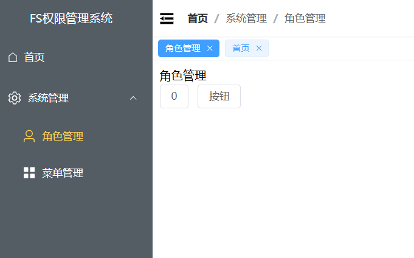

如果我们把v-hasPerm="['sys:role:list']" 换成 v-hasPerm="['sys:user:list']"，则当前用户没有sys:user:list权限，按钮会被移除。看下图：
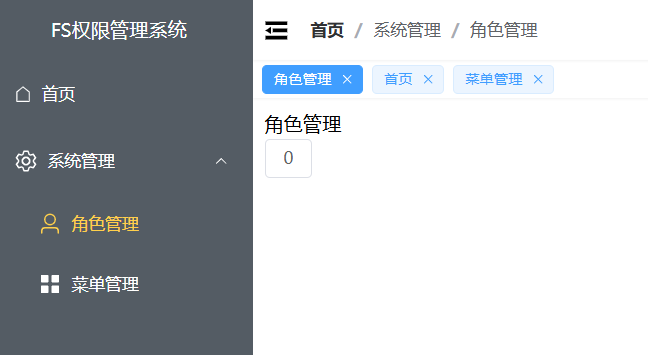

### 总结 
本篇文章详细介绍了自定义指令的使用方法以及它的常用简写方式。
同时展示了如何在实际项目中定义和注册自定义指令，以及如何在组件中应用这些指令来实现按钮权限控制。
通过传入权限标识，根据用户所拥有的按钮权限，决定是否显示或隐藏元素。
通过这种方式，我们可以更好地管理前端页面按钮的权限控制，提高系统的安全性和可维护性。

### 菜单管理增删改查接口
前面的文章已经完成了登录、路由以及权限等相关的通用接口逻辑的开发。接下来，我们将开始正式开发一些常用的业务接口提供给前端使用。本篇文章将带领大家完成菜单管理和角色管理页面增删改查接口的开发。

#### 菜单新增
菜单新增很简单,只需要将前端传来的字段插入数据库中即可
在controller的请求方式上加接口的权限字段
 @Permissions('system:menu:add')

我们还需要在权限守卫中(guards/permissions.guard.ts)给管理员用户放行
 // 从request拿到当前用户登录信息(全局守卫UserGuard已经将用户信息挂载到request上)
    const request = context.switchToHttp().getRequest();
    const { user } = request;//解构出用户信息

    //解析出的是超级管理员，则直接通过
    if (user.username === 'admin') {
      return true;
    }
    // 从缓存中获取用户的权限列表
    const userPermissions = await this.cacheService.get(
      `${user.sub}_permissions`,
    );
这样管理员就拥有所有接口权限了,方便后续添加菜单及权限的操作。到这里,菜单新增接口就开发完成了。

#### 菜单查询
菜单查询一般会返回给前端一个树状结构给前端渲染,前面文章中我们已经完成了菜单树的查询,这里也是一样的逻辑,直接复用即可。这里需要注意的是我们返回给前端的菜单是当前登录用户所拥有的菜单权限。

1. 在menu.service.ts中定义一个方法findMenuTree

  //菜单列表查询
async findMenuList(findMenuListDto: FindMenuListDto, req) {
    //user.guard中注入的解析后的JWTtoken的user
    const { user } = req;
    console.log('用户守卫对token解析后得到的user信息:',user,findMenuListDto);
    let menuList
    //根据关联关系通过user查询user下的菜单和角色,并根据findMenuListDto条件查询,条件字段为空默认匹配所有
    if (user.username === 'admin') {
      //超级管理员查询所有菜单
      const condition = {}
      if (findMenuListDto.status || findMenuListDto.status === 0) {
        condition['status'] = findMenuListDto.status
      }
      if (findMenuListDto.title) {
        condition['title'] = Like(`%${findMenuListDto.title}%`)
      }
      menuList = await this.menuRepository.find({
        order: {
          order_num: 'ASC',
        },
        where: condition,
      });
    } else {
      const userList: User = await this.getUser(user, findMenuListDto);
      menuList = rolesToMenus(userList?.roles);
    };
    const treeMenuList = convertToTree(menuList);
    //是否显示树形菜单     没有传title且菜单状态为开启时候才显示树形菜单
    const isShowTreeMenu =
      !findMenuListDto.title &&
      (findMenuListDto.status == 1 || !findMenuListDto.status);
    return isShowTreeMenu ? treeMenuList : menuList;
  }

2. 在menu.service.ts中定义getUser方法。
async getUser(user, condition?) {
    try {
      const queryBuilder = this.userRepository
        .createQueryBuilder('fs_user')
        .leftJoinAndSelect('fs_user.roles', 'fs_role')
        .leftJoinAndSelect('fs_role.menus', 'fs_menu')
        .where({ id: user.sub })
      if (condition?.title) {
        //根据菜单title模糊查询
        queryBuilder.andWhere('fs_menu.title LIKE :title', { title: `%${condition.title}%` })
      }
      if (condition?.status) {
        //根据菜单状态查询
        queryBuilder.andWhere('fs_menu.status = :status', { status: condition.status })
      }
      queryBuilder.orderBy('fs_menu.order_num', 'ASC')
      queryBuilder.getOne();
      const User = await queryBuilder.getOne();
      return User
    } catch (error) {
      console.log(error);
      throw new ApiException('查询失败', ApiErrorCode.COMMON_CODE);
    }
  }

3. 在menu模块的dto文件夹下新建findMenuList.dto.ts,定义菜单查询条件的dto。
export class FindMenuListDto {
    title: string;
    status: number
}

4. 在utils文件夹下新建rolesToMenus.ts,将角色和菜单的关系转化为菜单树。
import { Menu } from "src/menu/entities/menu.entity";
import { Role } from "src/role/entities/role.entity";

export const  rolesToMenus = (roles: Role[] = []) => {
    interface MenuMap {
      [key: string]: Menu;
    }
    // console.log(userList.roles[0].menus);

    //根据id去重
    const menus: MenuMap = roles.reduce((mergedMenus: MenuMap, role: Role) => {
      role.menus.forEach((menu: Menu) => {
        mergedMenus[menu.id] = menu;
      });
      return mergedMenus;
    }, {});
    return Object.values(menus);
  };

5. 最后在controller中定义请求方式以及一些关于swagger相关的装饰器,同时加上这个接口的权限字段system:menu:list,注意这里因为是查询,所以使用get请求方式(我们尽量遵循 Restful 风格)
 @Get('/list')
  @ApiParam({ name: 'findMenuListDto', type: FindMenuListDto })
  @ApiOperation({ summary: '获取菜单列表' })
  async list(@Query() findMenuListDto: FindMenuListDto, @Request() req) {
    return await this.menuService.findMenuList(findMenuListDto, req);
  }

#### 菜单修改
菜单修改和菜单新增的逻辑差不多,只需要将前端传来的字段根据菜单 id 更新到数据库中即可。
1. menu.service.ts中定义一个方法updateMenu
  //修改菜单
  async updateMenu(updateMenuDto: UpdateMenuDto) {
    try {
      await this.menuRepository.update(updateMenuDto.id, updateMenuDto);
      return '菜单更新成功';
    } catch (error) {
      throw new ApiException('菜单更新失败', ApiErrorCode.COMMON_CODE);
    }
  }

2. UpdateMenuDto中除了 id 都是可选参数
import { IsNotEmpty, IsOptional } from 'class-validator';
import { ApiProperty } from '@nestjs/swagger';
export class UpdateMenuDto {
  @IsOptional()
  @ApiProperty({
    example: '菜单1',
    required: false,
  })
  title: string;

  @IsNotEmpty({ message: 'id不可为空' })
  @ApiProperty({
    example: 1,
  })
  id: number;
  @IsOptional()
  @ApiProperty({
    example: 1,
    required: false,
  })
  order_num: number;

  @ApiProperty({
    example: 1,
    required: false,
  })
  @IsOptional()
  parent_id?: number;

  @IsOptional()
  @ApiProperty({
    example: 1,
    required: false,
  })
  menu_type: number;

  @ApiProperty({
    example: 'menu',
    required: false,
  })
  @IsOptional()
  icon: string;

  @IsOptional()
  @ApiProperty({
    example: 'AA/BB',
    required: false,
  })
  component?: string;

  @IsOptional()
  @ApiProperty({
    example: 'BB',
    required: false,
  })
  path: string;

  @ApiProperty({
    example: 11,
  })
  update_by: number;

  @IsOptional()
  @ApiProperty({
    example: 'sys:post:list',
    required: false,
  })
  permission?: string;
}

3. 在controller中定义请求方式以及一些关于swagger相关的装饰器,同时加上这个接口的权限字段system:menu:edit,这里注意用Put请求方式

 //更新菜单
  @Put('/updateMenu')
  @Permissions('system:menu:edit')
  @ApiParam({ name: 'updateMenu', type: UpdateMenuDto })
  @ApiOperation({ summary: '菜单管理-更新' })
  async updateMenu(
    @Body()
    updateMenuDto: UpdateMenuDto,
  ) {
    return await this.menuService.updateMenu(updateMenuDto);
  }

#### 菜单删除
菜单删除就很简单了,只需要将前端传来的 id 根据菜单 id 删除即可。

1. menu.service.ts中定义一个方法deleteMenu
  //删除菜单
  async deleteMenu(id: number) {
    try {
      await this.menuRepository.delete(id);
      return '菜单删除成功';
    } catch (error) {
      throw new ApiException('菜单删除失败', 20000);
    }
  }

2. 在controller中定义请求方式以及一些关于swagger相关的装饰器,同时加上这个接口的权限字段system:menu:delete,这里注意用Delete请求方式

  //删除菜单
  @Delete('/deleteMenu/:menuId')
  @ApiOperation({
    summary: '菜单管理-删除',
  })
  @Permissions('system:menu:delete')
  deleteMenu(@Param('menuId') menuId: string) {
    return this.menuService.deleteMenu(+menuId);
  }

### 角色管理增删改查接口
新增角色和新增菜单不同的是,新增角色前端需要传入它所拥有的菜单权限列表menu_ids,然后根据这些 id 查到到菜单列表,再将菜单列表和角色关联即可。

#### 1. 新增角色 **前面已经写了创建角色的代码，这里完善contorller中的内容**
@Controller('role')
@ApiTags('角色模块')
export class RoleController {
  constructor(private readonly roleService: RoleService) {}
  @Public()
  @Post('createRole')
  @Permissions('system:role:create')
  @ApiOperation({
    summary: '角色管理-新增',
  })
  @ApiParam({
    name: 'CreateRoleDto',
    type: CreateRoleDto,
  })
  createRole(@Body() createRoleDto: CreateRoleDto) {
    return this.roleService.create(createRoleDto);
  }
}

其中CreateRoleDto中定义了前端需要传的字段和字段类型

#### 2. 角色查询
1. 角色查询需要根据前端传来的一些字段如角色名,字段,时间段等条件查询,如果没有传默认就查询所有角色。**同时加入分页功能。**

async findRoleList(findMenuListDto: FindRoleListDto) {
    let queryBuilder = this.roleRepository.createQueryBuilder();
    if (findMenuListDto.role_name) {
      queryBuilder.andWhere('role_name    like    :role_name', {
        role_name: `%${findMenuListDto?.role_name}%`,
      });
    }
    if (findMenuListDto.status) {
      queryBuilder.andWhere('status    =    :status', {
        status: findMenuListDto.status,
      });
    }
    if (findMenuListDto.begin_time && findMenuListDto.end_time) {
      queryBuilder.andWhere('create_time    BETWEEN    :start    AND    :end', {
        start: findMenuListDto.begin_time,
        end: findMenuListDto.end_time,
      });
    }
    handlePage(
      queryBuilder,
      findMenuListDto.page_num,
      findMenuListDto.page_size,
    );
    const [list, count] = await queryBuilder.getManyAndCount();
    return { list, count };
  }

2. 其中的handlePage是一个分页的方法,这里使用typeorm的queryBuilder的skip和take方法来实现分页。skip表示跳过多少条数据,take表示取多少条数据。

在utils目录下新建handlePage.ts,定义分页方法
import { SelectQueryBuilder } from "typeorm";
/**
 *
 * @param queryBuilder 查询器
 * @param pageNum 页数
 * @param pageSize 每页条数
 * @returns queryBuilder
 */
export const handlePage = (
    queryBuilder: SelectQueryBuilder<any>,
    pageNum = 1,
    pageSize = 10
) => {
    return queryBuilder.skip((pageNum - 1) * pageSize).take(pageSize);
};

3. dto目录中创建FindRoleListDto
dto目录中创建find-role.dto.ts
import { ApiProperty } from '@nestjs/swagger';
import { IsOptional } from 'class-validator';

export class FindRoleListDto {
  @ApiProperty({
    example: '角色名称',
    required: false,
  })
  @IsOptional()
  role_name?: string;

  @ApiProperty({
    example: '状态:0禁用,1启用',
    required: false,
  })
  status: number;
  @ApiProperty({
    example: '结束时间',
    required: false,
  })
  end_time: string;
  @ApiProperty({
    example: '开始时间',
    required: false,
  })
  begin_time: string;
  @ApiProperty({
    example: '当前页',

    required: false,
  })
  page_num: number;
  @ApiProperty({
    example: '每页条数',
    required: false,
  })
  page_size: number;
}

4. 在controller中定义请求方式以及一些关于swagger相关的装饰器,同时加上这个接口的权限字段system:role:list,这里注意用Get请求方式

//查询
  @Get('findRoleList')
  @Permissions('system:role:list')
  @ApiOperation({
    summary: '角色管理-查询',
  })
  @ApiParam({
    name: 'CreateRoleDto',
    type: FindRoleListDto,
  })
  findRoleList(@Query() findRoleListDto: FindRoleListDto) {
    return this.roleService.findRoleList(findRoleListDto);
  }

#### 3. 角色修改
角色更新和菜单更新基本逻辑一致
1. 继续role.service.ts中定义一个方法updateRole
  //修改角色
  async updateRole(updateRoleDto: UpdateRoleDto) {
    try {
      await this.menuRepository.update(updateRoleDto.id, updateRoleDto);
      return '角色更新成功';
    } catch (error) {
      throw new ApiException('角色更新失败', 20000);
    }
  }

2. dto中创建update-role.dto.ts
import { ApiProperty } from '@nestjs/swagger';
import { IsNotEmpty, IsOptional } from 'class-validator';

export class UpdateRoleDto {
  @IsNotEmpty({ message: 'id不可为空' })
  @ApiProperty({
    example: 1,
  })
  id: number;
  @ApiProperty({
    example: '角色名称',
    required: false,
  })
  @IsOptional()
  role_name?: string;

  @ApiProperty({
    example: '角色描述',
    required: false,
  })
  @IsOptional()
  description?: string;

  @ApiProperty({
    example: '角色排序',
    required: false,
  })
  @IsOptional()
  order_num?: number;
}

3.controller.ts中内容
//更新角色
  @Put('/updateRole')
  @Public()
  @Permissions('system:role:edit')
  @ApiParam({ name: 'updateRole', type: UpdateRoleDto })
  @ApiOperation({ summary: '角色管理-更新' })
  async updateMenu(
    @Body()
    updateRoleDto: UpdateRoleDto,
  ) {
    return await this.roleService.updateRole(updateRoleDto);
  }

#### 4. 角色删除
角色删除和菜单删除一样只需要 id 就行
1. role.service.ts中定义一个方法deleteRole

  //删除角色
  async deleteRole(id): Promise<string> {
    try {
      await this.roleRepository.delete(id);
      return '删除成功';
    } catch (error) {
      throw new ApiException('删除失败', ApiErrorCode.COMMON_CODE);
    }
  }
2. 在controller中定义请求方式以及一些关于swagger相关的装饰器,同时加上这个接口的权限字段system:role:delete,这里注意用Delete请求方式
   
  //删除角色
  @ApiOperation({
    summary: '角色管理-删除',
  })
  @Permissions('system:role:delete')
  @Delete('deleteRole/:roleId')
  deleteRole(@Param('roleId') roleId: string) {
    return this.roleService.deleteRole(+roleId);
  }

# 真正的页面开发阶段
## 实现菜单管理功能
### 条件查询部分使用elementplus的el-form组件,先定义一下查询的参数
1. 前端 views/system/menu/index.vue中编写

</script>

2. 然后模板中使用el-form组件,并绑定相关参数,同时为搜索按钮加上权限system:menu:list,如果没有权限则隐藏该按钮。
 <el-form :model="queryParams" ref="queryRef" :inline="true">
      <el-form-item label="菜单名称" prop="menuName">
        <el-input
          v-model="queryParams.title"
          placeholder="请输入菜单名称"
          clearable
        />
      </el-form-item>
      <el-form-item label="状态" prop="status" class="w-[150px]">
        <el-select
          v-model="queryParams.status"
          placeholder="菜单状态"
          clearable
        >
          <el-option
            v-for="dict in dickStatus"
            :key="dict.value"
            :label="dict.label"
            :value="dict.value"
          />
        </el-select>
      </el-form-item>
      <el-form-item>
        <el-button
          type="primary"
          v-hasPerm="['sys:menu:list']"
          icon="Search"
          @click="handleQuery"
          >搜索</el-button
        >
      </el-form-item>
</el-form>

3. 同样的,表格使用el-table组件,它是支持树类型的数据的显示, 当 row 中包含 children 字段时，被视为树形数据。

<el-table
      :data="tableData"
      style="width: 100%; margin-bottom: 20px"
      row-key="id"
      :default-expand-all="isExpandAll"
    >
      <el-table-column prop="title" label="菜单名" />
      <el-table-column prop="order_num" label="排序" />
      <el-table-column prop="path" label="路由" />
      <el-table-column prop="permission" label="权限字段" />
      <el-table-column prop="component" label="组件路径" />
      <el-table-column label="图标" width="80">
        <template #default="scope">
          <component
            v-if="scope.row.icon"
            class="w-[20px] mr-2 ml-1"
            :is="scope.row.icon"
          />
        </template>
      </el-table-column>
      <el-table-column prop="create_time" label="创建时间" />
      <el-table-column prop="status" label="状态" width="80">
        <template #default="scope">
          <el-switch
            @change="changeStatus(scope.row)"
            :model-value="!!scope.row.status"
          ></el-switch>
        </template>
      </el-table-column>
      <el-table-column
        label="操作"
        align="center"
        width="200"
        class-name="small-padding fixed-width"
      >
        <template #default="scope">
          <el-link
            type="primary"
            icon="Plus"
            class="mr-1"
            @click="handleAdd(scope.row)"
            v-hasPerm="['sys:menu:add']"
            >新增</el-link
          >
          <el-link
            type="primary"
            icon="Edit"
            class="mr-1"
            @click="handleUpdate(scope.row)"
            v-hasPerm="['sys:menu:edit']"
            >修改</el-link
          >
          <el-link
            type="danger"
            icon="Delete"
            @click="handleDelete(scope.row)"
            v-hasPerm="['sys:menu:delete']"
            >删除</el-link
          >
        </template>
      </el-table-column>
    </el-table>

 同时**为新增,修改,删除按钮加上权限**,如果没有权限则隐藏该按钮。
 
 ### 然后我们需要在api/menu/index.ts**定义一下这些接口**
import request from '@/utils/http/index';

//新增菜单
export const addMenu = (data: any) => {
  return request({
    url: '/menu/createMenu',
    data,
    method: 'post',
  });
};

//获取菜单列表
export const getMenuList = (query: any) => {
  return request({
    url: '/menu/list',
    method: 'get',
    params: query,
  });
};

//删除菜单
export const deleteMenu = (menuId: number | number[]) => {
  return request({
    url: `/menu/deleteMenu/${menuId}`,
    method: 'delete',
  });
};
//更新菜单
export const updateMenu = (data: any) => {
  return request({
    url: `/menu/updateMenu`,
    method: 'put',
    data,
  });
};

### 接下来我们就来实现这些增删改查功能。
#### 查询菜单
查询功能很简单直接调用查询接口然后给表格数据赋值即可

const tableData = ref<MenuList[]>([]);
const getList = async () => {
  const { data } = await getMenuList(queryParams);
  tableData.value = data;
};

这里查询条件为空默认是查询所有的菜单,如果有条件则查询符合条件的菜单。其中菜单名的查询是模糊查询。我们用管理员账户登录测试一下。注意测试之前需要将按钮的权限添加到菜单表中,或者先先把指令去掉。如sys:menu:list按钮权限,这里后面会实现

1. 查询菜单功能函数如下：放入脚本标签内
const handleQuery = () => {
  getList();
};

2. 此处要非常注意，我就只说问题，看源代码吧，这里不复制粘贴了
本次查询功能对应的是页面的搜索按钮，点击搜索按钮后，会触发handleQuery函数，该函数会调用getList函数，该函数会发送请求，请求的url为/menu/list，请求的method为get，请求的params为queryParams，queryParams是页面的查询条件，queryParams.title是菜单名，queryParams.status是菜单状态，如果queryParams.title为空，则查询所有菜单，queryParams.status为空，则查询所有状态的菜单，queryParams.status为1，则查询所有启用状态的菜单，queryParams.status为0，则查询所有禁用状态的菜单。
**问题1：** 教程提供的源代码没有包含登录用户为admin的情况下，菜单列表的查询，我从作者的github上下载了源代码，已经更新了，这段代码已经完善了，在本文档中有对应描述。
**问题2：** 搜索功能可以使用后，发现返回的数据中没有最后一列“操作”列，仔细分析问题后，发现是由于admin用户的权限，不包含当前页面组件中为按钮配置的权限。
**解决方案：** 在菜单表中的permissions列中添加按钮权限信息，如下：
sys:role:list|sys:role:add,sys:role:edit,sys:role:delete
sys:menu:list|sys:menu:add,sys:menu:edit,sys:menu:delete
sys:user:list|sys:user:add,sys:user:edit,sys:user:delete
因为用户的权限信息是由用户登录后，通过动态路由加载的方式，利用pinia的状态管理，从后端获取
的登录用户的permission字段信息，由于修改了permissions字段的内容，所以要想获得菜单中对应的按钮权限，需要继续修改后端menuservice.ts中的getInfo函数的内容，同时修改了获取permissions字段信息的方法filterpermission，此处不再粘贴修改的代码，**以源代码为准。**

#### 新增和修改菜单
新增和修改菜单需要用弹出一个对话框,这里使用Dialog组件,同时根据菜单类型来显示不同的字段。并且使用rules规定了其中一些字段的规则

1- 继续在前端src\views\system\menu\index.vue中做修改

**见：<!-- 新增菜单修改对话框 --> 这个注释后的<el-dialog> </el-dialog>代码**

2- 图标选择的时候需要使用selectIcon组件,这是一个自定义的组件
src\components下创建selectIcon.vue

<template>
  

    

      <component class="w-5" :is="item.name" />
    

  

</template>

然后将该组件，在index.vue中进行导入：
import selectIcon from "@/components/selectIcon.vue";

3- 其中每次新增和修改菜单的时候需要将form表单重置一下,然后根据isUpdate的值来判断是新增还是修改。

**代码查看源文件获取**

#### 删除菜单
最后看一下删除菜单,这里实现的逻辑是:如果删除的菜单有子菜单则会将其下的所有子菜单删除,所以我们传入的是一些 id 的数组。这时候当我们删除的菜单有子菜单的时候就需要将子菜单的 id 和自身的 id 都传入删除接口。因此我们用递归的方式先实现一个获取自身及子菜单 id 的函数

1.需要得额外工具
import { deepClone } from "@/utils/common";
在utils目录中创建common.ts文件，并在里面定义deepClone函数，该函数的作用是深拷贝一个对象。

/**
 * 
 * @param obj 需要深拷贝对象
 * @param exclues 需要排除的字段
 * @returns 
 */
export function deepClone(obj: any, exclues?: string[]): any {
  if (obj === null || typeof obj !== 'object') {
      return obj;
  }

  const clone: any = Array.isArray(obj) ? [] : {};

  for (let key in obj) {
      if (exclues?.includes(key)) continue
      if (Object.prototype.hasOwnProperty.call(obj, key)) {
          clone[key] = deepClone(obj[key]);
      }
  }

  return clone;
}

/**
* 处理时间范围查询
* @param dateRange 选择的时间范围 
* @param params 查询参数 
* @returns 
*/

export function handleDateRangeChange(dateRange: any, params: any) {
  if (typeof params !== 'object' || params === null || Array.isArray(params)) {
      params = {};
  }
  if (Array.isArray(dateRange) && dateRange.length === 2) {
      params.begin_time = dateRange[0];
      params.end_time = dateRange[1];
      return
  }

  params.begin_time = '';
  params.end_time = '';
}

2. 需要完善接口配置中得menu.dto.ts文件
admin_test_frontend\src\api\menu\types\menu.dto.ts

export type MenuDto = {};

export type QueryMenuParams = {
    title?: string;
    status?: string
}

export type MenuForm = {
    title: string;
    path: string;
    parent_id: any;
    component: string;
    order_num: number;
    icon: string;
    id: number | null;
    menu_type: number;
    permission: string;
    status: number;
    catch: number;
    hidden?: number;
}

## 实现角色管理功能
在权限管理系统中,角色管理是一个非常重要的功能,它可以让管理员为不同的用户分配不同的权限,从而使拥有这些角色的用户拥有这些权限。

### 接口定义
首先我们在api/role/index.ts定义一下需要调用的接口。

import request from "@/utils/http/index";
import { QueryRoleParams, RoleForm } from "./types/role.dto";

//获取角色列表
export const getRoleList = (query: QueryRoleParams) => {
  return request({
    url: "/role/list",
    method: "get",
    params: query,
  });
};

//新增
export const addRole = (data: RoleForm) => {
  return request({
    url: "/role/createRole",
    data,
    method: "post",
  });
};

//新增
export const updateRole = (data: RoleForm) => {
  return request({
    url: "/role/updateRole",
    data,
    method: "put",
  });
};

//删除角色
export const deleteRole = (menuId: number | number[]) => {
  return request({
    url: `/role/deleteRole/${menuId}`,
    method: "delete",
  });
};

### 其中传参类型定义在api/role/types/role.dto.ts中
export type RoleList = {
  id: number;
  role_name?: string;
  description?: string;
  order_num?: number;
  create_time: Date;
  update_time: Date;
  status: number;
};

export type QueryRoleParams = {
  role_name?: string;
  status?: number | '';
  end_time?: string;
  begin_time?: string;
  page_num?: number;
  page_size?: number;
};

export type RoleForm = {
  id?: number;
  role_name: string;
  remark?: string;
  role_sort?: number;
  order_num?: number;
  menu_ids?: number[];
  status: number;
};

### 然后我们在src/views/system/role/index.vue中实现一下页面。
见源代码

#### 角色查询，修改，增加，删除功能
这部分不在详细赘述，自行看源代码

## 用户管理功能
在权限管理系统中,用户管理是一个非常重要的功能,它可以让管理员对系统中的用户进行添加、修改、删除、禁用和查询等操作,从而实现对系统的安全管理和用户的权限控制。本篇文章将详细介绍前端如何实现用户管理功能。

### 接口定义
首先我们在api/user/index.ts定义一下需要调用的接口。
import request from '@/utils/http/index';
import { Form, QueryParams } from './types/user.dto';

//获取用户列表
export const getDataList = (query: QueryParams) => {
  return request({
    url: '/user/list',
    method: 'get',
    params: query,
  });
};

//新增
export const addData = (data: Form) => {
  return request({
    url: '/user/createUser',
    data,
    method: 'post',
  });
};

//更新
export const updateData = (data: Form) => {
  return request({
    url: '/user/updateUser',
    data,
    method: 'put',
  });
};

//删除
export const deleteData = (id: number | number[]) => {
  return request({
    url: `/user/deleteUser/${id}`,
    method: 'delete',
  });
};

### 其中传参类型定义在api/user/types/user.dto.ts中
export type QueryParams = {
    username?: string;
    status?: number | '';
    telephone?: string;
    end_time?: string;
    begin_time?: string;
    page_num?: number;
    page_size?: number;
}

export type DataItem = {
    id: number;
    username: string;
    nickname: string;
    avatar: string;
    telephone: string;
    email: string;
    status: number;
    is_admin: number;
    create_time: Date;
    update_time: Date;
}

export type Form = {
    id?: number;
    username?: string;
    nickname?: string;
    avatar?: string;
    telephone?: string;
    email?: string;
    status?: number;
    role_ids?: number[];
    password?: string;
}

### 然后我们在src/views/system/user/index.vue中实现一下页面。
源代码，见项目中对应文件

# excel导入导出功能
在后台管理系统中，导出和导入数据是常见的需求。我们经常需要将查询到的表格数据导出为 Excel 文件，以便于用户查看和分析。同时，有时我们也需要将 Excel 文件批量导入到数据库中，以便快速更新或添加数据。导入、导出数据为 Excel 文件可以通过使用库如 xlsx 或 exceljs 来实现。这些库允许我们将数据库中的数据格式化为 Excel 文件或者将 Excel 文件解析为数据库中的数据插入数据库中,从而实现了数据的导入导出功能。

## xslx 库的使用
### 首先,我们需要安装xlsx库:
npm install xlsx

**安装到了后端 Nest 项目中**
导入导出功能我们需要用到xlsx库中**read, utils, write**这三个模块。

xlsx是：
将excel文件解析为json格式的数据；
将json格式的数据格式化为excel文件的；

### 示例：JSON 格式的数据格式化为 Excel 文件
import { read, utils, write } from "xlsx";
//要转为为excel的数据
export const exportData = () => {
  const data = [
    { name: "张三", email: "zhangsan@example.com" },
    { name: "李四", email: "lisi@example.com" },
  ];
  const worksheet = utils.json_to_sheet(data);
  // 创建一个新的工作簿
  const workbook = utils.book_new();
  //sheet的名称
  const sheetName = "Sheet1";
  utils.book_append_sheet(workbook, worksheet, sheetName);
  const excelBuffer: any = write(workbook, {
    bookType: "xlsx",
    type: "buffer",
  });
  return excelBuffer;
};

### 示例：Excel 文件解析为 JSON 格式的数据
同样的,如果我们想要将excel文件解析为json格式的数据,也很简单,**只需要使用read模块即可**。
注意因为 excel 会有多个工作表,所以我们需要遍历每个工作表,将每个工作表的数据合并起来再返回。

export const uploadExcel = (file) => {
  // 使用 read 方法读取 Excel 文件的缓冲区，返回工作簿对象
  const workbook = read(file.buffer, { type: "buffer" });

  // 获取工作簿中的所有工作表名称
  const sheetNames = workbook.SheetNames;

  // 初始化一个数组，用于存储所有工作表的数据
  const sheetData = [];

  // 遍历每个工作表名称
  sheetNames.forEach((sheetName) => {
    // 获取当前工作表对象
    const worksheet = workbook.Sheets[sheetName];

    // 将工作表转换为 JSON 格式的数据
    const sheetJson = utils.sheet_to_json(worksheet);

    // 将当前工作表的数据添加到 sheetData 数组中
    sheetData.push(...sheetJson);
  });

  // 返回所有工作表的合并数据
  return sheetData;
};

## 用户导出
**用户导出的流程是这样的:**
1. 前端点击导出按钮，
2. 后台根据前端传来的条件查询数据库中的用户数据，
3. 后台将查询到的数据格式化为所需格式，
4. 后台将格式化后的数据格式化为excel文件并返回给前端，
5. 我们**需要在user.service.ts中实现导出功能**,通过查询用户表中的数据然后将数据格式化为excel文件并返回给前端。

### 前端页面配置
请查看源代码 admin_test_frontend\src\views\system\user\index.vue

### 前端api配置
admin_test_frontend\src\utils\http\index.ts

// 需要在前端安装生产环境依赖 
// npm install file-saver
// npm i --save-dev @types/file-saver

import { saveAs } from "file-saver";
//为该文件增加导出得对应api接口
//下载
//downLoad 的异步函数，用于从指定的 URL 下载文件并保存到本地。
//定义了一个常量 res，用于存储从服务器返回的响应数据。
//responseType: "blob": 指定响应的数据类型为二进制大对象（Blob），适用于下载文件。
export const downLoad = async (url: string, params: any, filename: string) => {
  try {
    // 创建独立的axios实例，避免拦截器影响
    const instance = axios.create({
      baseURL: import.meta.env.VITE_APP_API,
      responseType: 'blob',
      headers: {
        'Authorization': 'Bearer ' + Storage.get('token')
      }
    });

    const response = await instance.get(url, { params });
    
    // 验证响应数据
    if (!response.data || !(response.data instanceof Blob)) {
      throw new Error('无效的文件数据格式');
    }

    // 获取正确的Content-Type
    const contentType = response.headers['content-type'] || 
                       'application/vnd.openxmlformats-officedocument.spreadsheetml.sheet';

    // 创建Blob对象
    const blob = new Blob([response.data], { type: contentType });

    // 验证文件大小
    if (blob.size <= 0) {
      throw new Error('下载的文件内容为空');
    }

    // 使用文件保存库保存
    saveAs(blob, filename.endsWith('.xlsx') ? filename : `${filename}.xlsx`);
    
  } catch (error) {
    console.error('文件下载失败:', {
      error: error.message,
      url,
      params
    });
    
    ElMessage({
      message: `文件下载失败: ${error.message}`,
      type: 'error',
      duration: 5000
    });
    
    throw error;
  }
};

### 后端路由接口配置
admin_test\src\user\user.controller.ts  
**operationlog.decorator';//装饰器得配置请查看源代码**

import { Response, Request } from 'express';

//导出
  @Get('/export')
  @Permissions('system:user:export')
  @LogOperationTitle('用户管理-导出')
  @ApiOperation({ summary: '用户管理-导出' })
  async export(
    @Query() findUserListDto: FindUserListDto,
    @Res() res: Response,
  ) {
    const data = await this.userService.export(findUserListDto);
    console.log("后端导出数据3:",data);
    res.setHeader('Content-Type', 'application/vnd.openxmlformats-officedocument.spreadsheetml.sheet');
    res.setHeader('Content-Disposition', `attachment; filename=users_${new Date().getTime()}.xlsx`);
    res.send(data);
  }

### 后端user模块中得userservice.ts文件中实现导出功能
//导出
  async export(findUserListDto: FindUserListDto) {
    try {
      const { list } = await this.findUserList(findUserListDto);
      console.log('导出的数据1', list);
      const excelBuffer = await exportExcel(list, mapUserZh);
      console.log('导出的数据2', excelBuffer);
      return excelBuffer;
    } catch (error) {
      throw new ApiException('导出失败', ApiErrorCode.FAIL);
    }
  }
**文档没办法写了，太复杂了，内容缺少得，直接看源码吧**
总体流程：
1. 前端配置导出按钮，配置api接口，将查询数据通过接口推送到后端得export导出路由接口；
2. 后端在utils/common.ts中定义一个exportExcel函数工具，实现将查询到得数据格式转化为excel文件并返回；
3. 前端接收到excel文件后，将文件下载到本地；

过程中有1个问题,我们查询到的数据是类似这样的:
{
    "id": 1,
    "username": "admin",
    "password": "123456", 
    "nickname": "管理
    ...
}

这样的话导出的excel表头是英文的如username,password,nickname等,所以我们需要将其转为中文格式的表头。

### 这里我们新建一个文件admin_test/src/config/excelHeader.ts用于存放各个表头的中文格式。
//用户表
export const mapUserZh = {
  id: 'id',
  username: '用户名',
  nickname: '昵称',
  telephone: '手机号',
  email: '邮箱',
  status: '状态',
  create_time: '创建时间',
  update_time: '更新时间',
}

### 然后我们在utils/common.ts中实现导出的通用方法

//数据转excel
export function exportExcel(
  data: any[],
  mapZh: any = {},
  sheetName: string = "sheet1"
) {
  const worksheet = utils.json_to_sheet([mapZh, ...data], {
    // 字段显示顺序
    header: Object.keys(mapZh),
    //隐藏表头
    skipHeader: true,
  });
  // 创建一个新的工作簿
  const workbook = utils.book_new();
  utils.book_append_sheet(workbook, worksheet, sheetName);
  const excelBuffer: any = write(workbook, {
    bookType: "xlsx",
    type: "buffer",
  });
  return excelBuffer;
}

通过将原始表头隐藏,然后将我们的映射对象作为第一行数据插入到excel文件中,就实现了中文表头的功能。

### 然后我们在user.service.ts中实现导出功能。  

//导出
  async export(findUserListDto: FindUserListDto) {

    try {
      const { list } = await this.findUserList(findUserListDto)

      const excelBuffer = await exportExcel(list, mapUserZh);
      return excelBuffer;

    } catch (error) {
      throw new ApiException('导出失败', ApiErrorCode.FAIL);
    }
  }

这里我们返回的是一个excel文件的buffer,

### user.controller.ts中可以这样写。 
//导出
  @Get('/export')
  @Permissions('system:user:export')
  @ApiOperation({ summary: '用户管理-导出' })
  async export(@Query() findUserListDto: FindUserListDto, @Res() res: Response) {
    const data = await this.userService.export(findUserListDto);
    res.send(data)
  }

**这里不再使用常规的响应方式,而是直接使用express中的res.send方法直接将文件返回给前端,这样前端就能接收到一个blob类型的文件,然后通过相关处理就能下载下来了。**

## 用户导入
### 用户导入的流程是这样的:
1. 前端选择需要导入的excel文件,并上传到后台；
2. 后台接收到这个file文件判断是否符合要求；
3. 后台将file文件解析为json格式的数据，并转换为数据库所需格式的数据；
4. 后台将转换后的数据插入到数据库中。

### 前端配置代码
见源文件，此处不详述

### 前端API配置
此处不需要配置前端得API接口,因为前端上传文件后,会自动调用后台的API接口：/user/upload

### 同样的我们在common.ts中实现导入的通用方法。
admin_test\src\utils\common.ts

/**
* 导入Excel文件并将其转换为JSON格式
* @param file - 要导入的Excel文件
* @returns 包含所有工作表名称和数据的对象
*/
export const importExcel = (file: File & { buffer: Buffer }) => {

  try {
      const workbook = read(file.buffer, { type: 'buffer' });
      const sheetNames = workbook.SheetNames;
      const sheetData = [];

      sheetNames.forEach(sheetName => {
          const worksheet = workbook.Sheets[sheetName];
          const sheetJson = utils.sheet_to_json(worksheet);
          sheetData.push(...sheetJson)
      });

      return sheetData;
  } catch (error) {
      throw new ApiException('文件解析失败,请检查格式是否正确', 20000);
  }
};

//生成随机字符串
export const generateRandomString = (length: number, charset: string = 'ABCDEFGHIJKLMNOPQRSTUVWXYZabcdefghijklmnopqrstuvwxyz0123456789'): string => {
  let result = '';
  const charsetLength = charset.length;

  for (let i = 0; i < length; i++) {
      const randomIndex = Math.floor(Math.random() * charsetLength);
      result += charset[randomIndex];
  }

  return result;}

  ### 因为前端上传的excel表头是中文的,所以我们需要将其转换为数据库所需的格式
 admin_test\src\config\excelHeader.ts 文件中继续配置：

  export const transformZnToEn = (data, mapZn) => {
  const mapEn = {};
  try {
     //将mapZh中的key和value交换位置
    Object.keys(mapZn).forEach((key) => {
      mapEn[mapZn[key]] = key;
    });
    //将data中的中文key转换为mapEn中的英文key
    const result = data.map((item) => {
      const newItem = {};
      for (const key in item) {
        if (mapEn.hasOwnProperty(key)) {
          newItem[mapEn[key]] = item[key];
        }
      }
      return newItem;
    });

    return result;
  } catch (error) {
    return [];
  }
};

### 然后我们在user.service.ts中实现导入功能。
//导入
  async upload(file) {
    //判断文件类型是否为xlsx或xls
    const fileSplitArr = file.originalname.split('.');
    const fileType = fileSplitArr[fileSplitArr.length - 1];
    if (fileType !== 'xlsx' && fileType !== 'xls')
      throw new ApiException(
        '请上传xlsx或xls格式的文件',
        ApiErrorCode.COMMON_CODE,
      );

    //解析后的数据
    const excelData = importExcel(file.buffer);
    //转换为数据库需要的格式
    const importData = transformZnToEn(excelData, mapUserZh);

    const hasUseName = importData.map((item) => item.username);
    //判断是否有重复的用户名
    const isExist = await this.userRepository.findOne({
      where: {
        username: In(hasUseName),
      },
    });
    if (isExist) {
      throw new ApiException(
        '导入用户包含已存在的用户,请核对后再进行导入',
        ApiErrorCode.COMMON_CODE,
      );
    }
    try {
      await this.userRepository.save(importData);
    } catch (error) {
      throw new ApiException('导入数据库失败', ApiErrorCode.FAIL);
    }
    return '导入成功';
  }

### 在user.controller.ts中
可以通过@UploadedFile接收前端上传的文件,同时使用@UseInterceptors(FileInterceptor('file'))拦截获取前端上传的文件字段名。

import {
  Controller,
  Put,
  Get,
  Post,
  Body,
  Patch,
  Param,
  Delete,
  HttpException,
  HttpStatus,
  Query,
  UseGuards,
  Res,UploadedFile, UseInterceptors
} from '@nestjs/common';

import { FileInterceptor } from '@nestjs/platform-express';

//导入
  @Post('/upload')
  @Permissions('system:user:import')
  @LogOperationTitle('用户管理-导入')
  @ApiOperation({ summary: '用户管理-导入' })
  @ApiConsumes('multipart/form-data')
  @UseInterceptors(FileInterceptor('file'))
  async upload(@UploadedFile() file: Multer.File, @Body() _body: UploadFileDto) {
    return await this.userService.upload(file);
  }

### 注意事项
导入用户时,excel 中是没有password和salt的,所以默认导入的用户密码和盐值都是固定的,后续由用户自己修改密码即可。所以我们需要在用户实体中(user.entity.ts)给password和salt添加默认值。
import { Entity, PrimaryGeneratedColumn, Column,
  BeforeInsert, ManyToMany,
   JoinTable, } from 'typeorm'; //
  import  encry  from  "../../utils/crypto";
  import  *  as  crypto  from  "crypto";// 内置模块,命名空间导入方式
  import { Role } from "src/role/entities/role.entity";
/* @Entity('user1') // 表名为 user
export class User1 {
  @PrimaryGeneratedColumn({ type: 'int', name: 'id', unsigned: true }) // id 字段，自增，从 1 开始
  id: number; //  标记为主键，值自动生成

  @Column({ type: 'varchar', length: 10 }) // username，最大1,0个字符
  username: string;

  @Column({ type: 'varchar', length: 12 }) // password，最大12个字符
  password: string;

  @Column({ type: 'varchar', length: 5 }) // nickname，最大5个字符
  nickname: string;

  @Column({ type: 'varchar', length: 15, nullable: true }) // mobile，移动电话，长度可根据需要调整
  mobile: string;

  @Column({ type: 'varchar', length: 255, nullable: true }) // email，邮箱，长度可根据需要调整
  email: string;
} */

@Entity('fs_user')
export class User {
  //@PrimaryGeneratedColumn('uuid')
  @PrimaryGeneratedColumn({type: "bigint",})
  id: number; //  标记为主键，值自动生成
  
  @Column({ length: 30 })
  username: string; //用户名

  @Column({ nullable: true })
  nickname: string; //昵称

  //默认密码 123456
  @Column({
    default: '20989eb67e13fdee0a42504dd0b3cf65358b'
  })
  password: string; //密码

  @Column({ nullable: true })
  avatar: string; //头像

  @Column({ nullable: true })
  email: string; //邮箱
/*   @Column({ nullable: true })
  role: string; //角色 */

  @Column({ nullable: true })
  telephone: string; //手机号

  @Column({
    default: 1,
  })
  status: number; //状态 0:禁用 1:启用

  @Column({ nullable: true, default: 'q5+Kdg=='  })
  salt: string;

  @Column({ nullable: true, default: 0 })
  is_admin: number; //是否为管理员 1:是 0:否

  @ManyToMany(() => Role, { cascade: true })
  @JoinTable({
    name: 'fs_user_role_relation',
/*     joinColumn: { name: 'user_id', referencedColumnName: 'id' },
    inverseJoinColumn: { name: 'role_id', referencedColumnName: 'id' }, */
  })
  roles: Role[];

  @Column({ type: 'timestamp', default: () => 'CURRENT_TIMESTAMP' })
  create_time: Date;
  @Column({ type: 'timestamp', default: () => 'CURRENT_TIMESTAMP' })
  update_time: Date;

  @BeforeInsert()
  beforeInsert()  {
      this.salt  =  crypto.randomBytes(4).toString("base64");
      if (this.password) {
        this.password  =  encry(this.password,  this.salt);
      }
  }
}

# 实现个人中心页面
在后台管理系统中,一般都会有个人中心页面用于修改查看我们的账户信息、修改密码等。

## 前端页面配置、接口引入
这个页面需要四个接口,分别是获取当前用户信息、头像上传、修改密码、修改基本信息接口。
其中头像上传接口需要使用到文件上传功能,所以使用upload组件上传头像。

### 前端接口配置
在src/api/user/index.ts导出这三个接口

//获取用户信息
export const getProfile = () => {
   return request({
     url: "/user/profile",
     method: "get",
     loading: false,
   });
 };
 
 //修改密码
 export const updatePassword = (data: {
   oldPassword: string,
   newPassword: string,
 }) => {
   return request({
     url: "/user/updatePassword",
     method: "put",
     data,
   });
 };
 
 //修改个人信息
 export const updateUserInfo = (data: Form) => {
   return request({
     url: "/user/updateUserInfo",
     method: "put",
     data,
   });
 };

### 前端页面配置
1. src/views下新建profile/index.vue来实现这个页面。
2. 头像上传使用element-plus的el-upload组件,配置上传接口。

**源码见源文件**

1. 在src/views/profile/下
新建index.scss文件来实现页面的样式。

### 信息查询
在src/views/profile/下
配置types目录和index.ts，用来创建所需的类型。

信息查询功能，调用接口获取用户信息,然后将数据绑定到页面上即可

### 基本信息修改
前端页面中，包含了：userInfo和resetPassWord两个子组件
分别用来实现修改基本信息和修改密码的功能

在src/views/profile/下
新建components目录和两个组件文件
resetPassWord.vue
userInfo.vue

**源码见源文件**

### 修改密码
修改密码需要输入旧密码、新密码、确认密码。我们先来看子组件resetPassWord。
**源码见源文件**
这里使用了element-plus的表单验证功能,验证规则在rules中,定义了新旧密码不能为空及两次输入的密码一不一致等情况。比如如果不满足页面就会有所提示。
验证通过将会给父组件发送一个submit事件同时传入修改后的用户信息。父组件拿到这些信息调用修改密码接口即可。

### 头像上传
头像上传使用了element-plus的upload组件
<el-upload
  class="avatar-uploader"
  :action="uploadParams.uploadUrl"
  :headers="uploadParams.headers"
  :on-success="handleAvatarSuccess"
  :show-file-list="false"
></el-upload>

其中action是上传地址,headers是上传接口的请求头,这里我们需要和其它接口一样加上token不然是禁止请求的。
handleAvatarSuccess是上传成功后的回调函数,可以接收到成功后的返回信息,show-file-list是  是否显示文件列表。

## 后端接口实现
### 个人信息查询
在user.controller.ts中添加一个getUserInfo方法,从Request中获取当前用户id，然后在user.service.ts中实现这个方法根据id查询用户表即可。

**源码见源文件**

注意：user.service.ts中，需要配置file文件，并导入import fileconfig from 'src/config/file';

### 新建保存用户头像的目录和文件
在项目根目录下创建static/upload 目录

### 个人信息修改
只需要在user.controller.ts中添加一个updateUserInfo方法,从Request中获取当前用户id，然后在user.service.ts中实现这个方法根据id及前端传来的需要修改的信息更新用户表即可。
**源码见源文件**

### 修改密码
需要在user.controller.ts中添加一个updatePassword方法,从Request中获取当前用户id，

其中的UpdateUserPasswordDto定义前端需要传递的参数
在user模块的dto的update-userdto.ts中定义。
export class UpdateUserPasswordDto {
  @IsNotEmpty({
      message: '原密码不能为空',
  })
  @ApiProperty({
      example: '123456',
      description: '原密码',
  })
  oldPassword: string;

  
  @IsNotEmpty({
      message: '新密码不能为空',
  })
  @ApiProperty({
      example: '1234567',
      description: '新密码',
  })
  newPassword: string;
}

然后在user.service.ts中实现对应逻辑。第一步 根据id查询用户表，获取到用户加密后的密码第二步 将前端传来的原密码进行加密，然后与用户加密后的密码进行比较，如果不一致则抛出异常第三步 将前端传来的新密码进行加密，然后更新用户表

**这样就完成了密码修改的接口实现。这里需要注意的是我们数据库保存的密码都是加密后的,我们并不知道用户的真实密码。这也是为什么很多系统忘记密码要重置而不是告诉你原密码,因为他也不知道你的原密码是什么**

### 头像上传
头像上传接口的实现相对于前几个接口要复杂一些,因为涉及到了文件的保存及相关的一些处理。
**见源码**

# NestJS中如何优雅的实现接口日志记录
在我们系统开发中，通常会需要对接口的请求情况做一些日志记录，通过详细的日志记录，我们可以获取每个接口请求的关键信息，包括请求时间、请求参数、请求主机、以及用户身份等。这些信息将为后续的性能优化、故障排查和用户行为分析提供重要依据。本篇文章将介绍如何在 NestJS 中优雅的实现接口日志记录。

## 什么是 AOP
### 在开始之前,我们需要了解一下什么是 AOP 架构?

我们首先了解一下 NestJS 对一个请求的处理过程。在 NestJS 中,一个请求首先会先经过控制器（Controller）,然后 Controller 调用服务 (Service)中的方法,在 Service 中可能还会进行数据库的访问(Repository)等操作,最后返回结果。但是如果我们想在这个过程中加入一些通用逻辑,比如日志记录,权限控制等该如何做呢?

这时候就需要用到 AOP(Aspect-Oriented Programming，面向切面编程)了,它允许开发者通过定义切面（Aspects）来对应用程序的各个部分添加横切关注点（Cross-Cutting Concerns）。
**横切关注点是那些不属于应用程序核心业务逻辑，但在整个应用程序中多处重复出现的功能或行为。**
这样可以让我们在不侵入业务逻辑的情况下来加入一些通用逻辑。
也就是说 **AOP 架构允许我们在请求的不同阶段插入代码,而不需要修改业务逻辑的代码。**

NestJS 中的**五种实现 AOP 的方式**
1. Middleware(中间件)、
2. Guard(导航守卫)、
3. Pipe(管道)、
4. Interceptor(拦截器)、
5. ExceptionFilter(异常过滤器),
感兴趣的可以查看相关资料了解这些AOP。

**接下来将介绍如何使用Interceptor(拦截器)来实现接口日志记录。**

然后看一下我们的需求,我们需要记录每个接口的请求情况,包括请求时间、请求参数、请求主机、以及用户身份等。
我们肯定是不能在每个接口中都去手动的去添加日志记录的,这样会非常的麻烦,而且也不优雅。所以这时候我们就可以**使用 AOP 架构中的Interceptor(拦截器)来实现接口日志记录**。
拦截器可以在请求到达控制器之前或之后执行一些操作,我们可以在拦截器中记录接口的请求情况,这样就可以实现接口日志记录了。

### 日志记录模块构建

#### 首先我们需要生成一个日志记录模块,用于记录接口的请求情况。
**注意，要先安装moment库**：npm install moment

在NestJS中执行**nest g res log**就可以自动生成一个log模块。
然后**新建log/entities/operationLog.entity.ts文件**,用于定义日志记录的实体类。

import * as moment from 'moment';
import {
  Column,
  CreateDateColumn,
  Entity,
  PrimaryGeneratedColumn,
  UpdateDateColumn,
} from 'typeorm';
//操作日志表
@Entity('fs_operation_log')
export class OperationLog {
  @PrimaryGeneratedColumn()
  id: number; // 标记为主键，值自动生成
  @Column({ length: 100, nullable: true })
  title: string; //系统模块
  @Column({ length: 20, nullable: true })
  operation_type: string; //操作类型
  @Column({ length: 20, nullable: true })
  method: string; //请求方式
  @Column({ type: 'text', nullable: true })
  params: string; //参数
  @Column({ nullable: true })
  ip: string; //ip
  @Column({ type: 'text', nullable: true })
  url: string; //地址
  @Column({ nullable: true })
  user_agent: string; //浏览器
  @Column({ nullable: true })
  username: string; //操作人员
  @CreateDateColumn({
    transformer: {
      to: (value) => {
        return value;
      },
      from: (value) => {
        return moment(value).format('YYYY-MM-DD HH:mm:ss');
      },
    },
  })
  create_time: Date;

  @UpdateDateColumn({
    transformer: {
      to: (value) => {
        return value;
      },
      from: (value) => {
        return moment(value).format('YYYY-MM-DD HH:mm:ss');
      },
    },
  })
  update_time: Date;
}

**重启后端项目后,在数据库中就会自动生成fs_operation_log表了。**

#### 然后在log/log.module.ts文件中
通过@Global，将这个模块注册为全局模块,并导入这个实体类,同时将LogService导出,这样就可以在其它模块中使用了。

import { Global, Module } from '@nestjs/common';
import { LogService } from './log.service';
import { LogController } from './log.controller';
import { OperationLog } from './entities/operationLog.entity';
import { TypeOrmModule } from '@nestjs/typeorm';

//全局模块
@Global()
@Module({
  controllers: [LogController],
  providers: [LogService],
  imports: [TypeOrmModule.forFeature([OperationLog])],
  exports: [LogService],
})
export class LogModule {}

### 最后在log/log.service.ts文件中定义一个saveLog方法,用于保存日志记录。
import { Injectable } from '@nestjs/common';
import { CreateLogDto } from './dto/create-log.dto';
import { UpdateLogDto } from './dto/update-log.dto';
import { OperationLog } from './entities/operationLog.entity';
import { Repository } from 'typeorm';
import { InjectRepository } from '@nestjs/typeorm';
import { ApiException } from 'src/common/filter/http-exception/api.exception';
import { ApiErrorCode } from 'src/common/enums/api-error-code.enum';

@Injectable()
export class LogService {
  constructor(
    @InjectRepository(OperationLog)
    private readonly operationLog: Repository<OperationLog>,
  ) {}
  // 保存操作日志
  async saveOperationLog(operationLog: OperationLog) {
    await this.operationLog.save(operationLog);
  }
}

这样我们就完成了日志记录模块的实现了。后面我们会**在拦截器中调用这个方法来实现接口日志的记录**

### 拦截器实现

1. 自定义装饰器@LogOperationTitle。
**简单来说就是使用@LogOperationTitle装饰器可以定义模块名称(logOperationTitle),然后在拦截器中获取到这个模块名称。**

在src/common/decorator/oprertionlog.decorator.ts文件中定义了一个@LogOperationTitle装饰器,用于标记当前控制器的模块名。

import { SetMetadata } from '@nestjs/common';

// 操作日志装饰器,设置操作日志模块名
export const LogOperationTitle = (title: string) =>
    SetMetadata('logOperationTitle', title);

// 这个装饰器用于在NestJS应用程序中设置操作日志的模块名。
// 具体来说，LogOperationTitle是一个自定义装饰器，它接受一个字符串参数title，
// 并通过SetMetadata函数将这个字符串与键'logOperationTitle'关联起来。
// 这样，在应用中使用这个装饰器的控制器方法或服务方法会被标记上这个操作日志模块名，
// 方便在日志记录时识别和分类这些操作。
// 例如，你可以在需要记录操作日志的某个方法上使用@LogOperationTitle('用户管理')
// 来指定该操作属于“用户管理”模块。

2. 新建src/common/interceptor/log.interceptor.ts文件,用于实现拦截器。
在拦截器中可以通过context.switchToHttp().getRequest()获取到请求相关信息。同时我们可以通过context.getHandler()获取到当前控制器的元数据,从而获取到控制器中自定义装饰器定义的模块名。

import {
  Injectable,
  NestInterceptor,
  ExecutionContext,
  CallHandler,
} from '@nestjs/common';
import { Observable } from 'rxjs';//用于处理 HTTP 请求和响应流，用于处理异步事件的库
import { tap } from 'rxjs/operators';
import { LogService } from 'src/log/log.service';
import { OperationLog } from 'src/log/entities/operationLog.entity';
import { Reflector } from '@nestjs/core';
export interface Response<T> {
  data: T;
}

@Injectable()
export class OperationLogInterceptor<T>
  implements NestInterceptor<T, Response<T>> {
  constructor(
      private readonly logService: LogService,
      private readonly reflactor: Reflector,
  ) { }
  intercept(
      context: ExecutionContext,
      next: CallHandler,
  ): Observable<Response<T>> {
      const request = context.switchToHttp().getRequest();
      //获取当前控制器元数据中的日志logOperationTitle
      const title = this.reflactor.get<string>('logOperationTitle', context.getHandler());
      return next
          .handle().pipe(tap((res) => {
              const log = new OperationLog();
              log.title = title;
              log.method = request.method;
              log.url = request.url;
              log.ip = request.ip;
              const paramsText = JSON.stringify({ ...request.query, ...request.params, ...request.body });
              log.params = paramsText.length > 1000 ? paramsText.slice(0, 1000) : paramsText;
              log.user_agent = request.headers['user-agent'];
              log.username = request.user?.username;
              this.logService.saveOperationLog(log).catch((err) => {
                  console.log(err);
              });
          }
          ));
  }
}

### 日志记录的拦截器  全局注册
因为我们需要在每个请求中都用到这个拦截器,所以我们可**将其定义为全局拦截器**。
前面文章中我们介绍过可以在main.ts文件中通过app.useGlobalInterceptors(new OperationLogInterceptor())将拦截器注册为全局拦截器;
但是这样会出现一个问题,就是我们在log/log.module.ts文件中定义的LogService服务无法在拦截器中使用,因为拦截器是没有依赖注入的,
所以我们需要在app.module.ts文件中通过APP_INTERCEPTOR提供者将拦截器注册为全局拦截器,这样才可以在拦截器中使用LogService服务了。

**拦截器的全局注册，见源码app.module.ts文件。**

### 使用拦截器
需要在控制器中使用@LogOperationTitle装饰器来定义模块名。
admin_test\src\menu\menu.controller.ts
@Get('/list')
  @LogOperationTitle('获取菜单列表')
  @ApiParam({ name: 'findMenuListDto', type: FindMenuListDto })
  @ApiOperation({ summary: '获取菜单列表' })

查看数据库表，就能看到接口日志记录了。

### 提供查询日志接口
需要提供一个查询和导出日志接口给前端使用,用于查询日志记录。在log/log.controller.ts文件中定义一个查询和导出日志接口。

1. log.controller.ts文件
新增路由接口，**源码见源文件；**

2. 早log模块的DTO中，增加find-list.dto.ts文件
用于接收查询日志列表的请求参数。**源码见源文件；**

3. log.service.ts文件中实现findList方法和export方法。
  **源码见源文件；**
   
### 前端实现
**请查看前端源码**
新建log目录和页面文件：src/system/log/index.vue

# 用户退出
## 前端&后端配置
1. 前端在navbar的index.vue文件中，新增退出的配置；
2. 配置store中的types.ts文件，新增UserInfo对象,并配置导出：
export type UserInfo = {
  username: string;
  avatar: string;
  telephone: string;
};

export type AppStoreState = {
  navTags: NavTags[];
  breadcrumbs: Breadcrumbs[];
  menuList: MenuList[];
  isCollapse: boolean;
  permissions: string[];
  catchList: string[]
  userInfo: UserInfo;
};

3. 配置store中的index.ts文件，在state中新增userInfo字段，getInfo方法中，调用接口获取用户信息，并赋值给state中的userInfo字段；

4. 此时，去后端配置getInfo方法对应的menu.servie.ts文件，在getInfo方法中，调用接口获取用户信息，并返回给前端；

5. 再去后端的user.controller.ts文件，在logout方法中，调用接口，清除redis中的token，并返回结果状态给前端；

6. 配置前端接口：
src/api/login/request.ts 文件
增加退出登录信息：
/退出登录
export const logout = () => {
  return request({
    url: "/user/logout",
    method: "post",
  });
};

7. 配置前端的admin_test_frontend\src\layout\components\NavBar\index.vue 文件

增加当前用户头像缩略图的显示，下拉菜单显示：跳转到个人中心，退出登录，两个功能；

用户退出登录脚本配置：
import { logout } from '@/api/login/request';
//退出登录
const handelLogOut = async () => {
  await ElMessageBox.confirm('确认退出吗?', '提示', {
    confirmButtonText: '确定',
    cancelButtonText: '取消',
  });
  // 调用退出API
  await logout();
  Storage.remove('token');
  // 重置用户信息
  appStore.userInfo = { username: '', avatar: '' };
  router.push('/login');
};

# 部署
后台管理系统基本功能大致已经完成了，接下来我们要做的就是把它部署到服务器上，让用户可以访问到我们的后台管理系统。

如何使用 docker 部署我们系统的后端Node服务到服务器上。

## Dockerfile
### 什么时Dockerfile
1. 简单来说 Dockerfile 是一个文本文件，包含了一系列指令，用于**自动化创建 Docker 镜像**的过程。
2. 它定义了镜像的基础环境、所需的依赖、应用程序的代码以及如何运行该应用程序等等。
 
3. **比如一个简单的前端项目Dockerfile，内容如下：**

#使用官方的 Node.js 镜像作为基础镜像
FROM node:14-alpine
#设置工作目录
WORKDIR /app
#复制 package.json 和 package-lock.json 到工作目录
COPY package*.json .
#安装项目依赖
RUN npm install
#复制项目代码到工作目录
COPY . .
#构建生产环境的应用程序
RUN npm run build
#暴露应用程序的端口
EXPOSE3000
#启动应用程序
CMD ["node", "dist/main.js"]   

然后我们就可以通过docker build -t <镜像名称>:<标签> .将我们的项目打包成一个镜像，就可以通过docker run [OPTIONS] <镜像名称>:<标签>这个镜像在任何地方运行我们的项目了。

### docker-compose
除了Dockerfile之外，我们还可以使用docker-compose来管理我们的项目。我们的后台管理系统的后端服务有很多依赖，比如数据库、redis 等等，我们需要一个个拉取镜像然后一个个的去构建启动容器，有点麻烦。

所以我们可以使用docker-compose来定义和**管理多个Docker 容器**,我们可以在一个docker-compose.yml文件中定义多个容器的配置，然后通过docker-compose up来启动所有的容器。

比如一个简单的docker-compose.yml文件如下：
version: "1.0"# 指定 Docker Compose 文件的版本

services:# 定义服务部分
nest-app:# 服务名称，表示 Nest.js 应用
    build:# 构建配置
      context:./# 构建上下文，指定 Dockerfile 所在的目录
      dockerfile:./Dockerfile# 指定 Dockerfile 的路径
    depends_on:# 指定依赖关系，确保在启动此服务之前启动依赖的服务
      -mysql-container# 依赖 MySQL 容器
      -redis-container# 依赖 Redis 容器
    ports:# 端口映射
      -3000:3000# 将宿主机的 3000 端口映射到容器的 3000 端口
    networks:# 指定服务连接的网络
      -common-network# 连接到名为 common-network 的网络

mysql-container:# 服务名称，表示 MySQL 数据库
    image:mysql# 使用官方 MySQL 镜像
    volumes:# 数据卷配置，用于持久化数据
      -E:/mysqlData:/var/lib/mysql# 将宿主机的 E:/mysqlData 目录挂载到容器的 /var/lib/mysql 目录
    environment:# 环境变量配置
      MYSQL_DATABASE:fs_admin# 创建的数据库名称
      MYSQL_ROOT_PASSWORD:123456# MySQL 根用户的密码
    networks:# 指定服务连接的网络
      -common-network# 连接到名为 common-network 的网络
    ports:# 端口映射
      -3306:3306# 将宿主机的 3307 端口映射到容器的 3306 端口

redis-container:# 服务名称，表示 Redis 数据库
    image:redis# 使用官方 Redis 镜像
    networks:# 指定服务连接的网络
      -common-network# 连接到名为 common-network 的网络
    ports:# 端口映射
      -6379:6379# 将宿主机的 6379 端口映射到容器的 6379 端口

networks:# 定义网络部分
common-network:# 自定义网络名称
    driver:bridge# 使用桥接网络驱动

然后我们就可以通过docker-compose up来启动所有的容器了,之后将我们的项目部署到服务器上也可以直接执行docker-compose up就把所有的容器都启动部署了。

**注意：这里的服务器，通常指代的是linux服务器，通常不将docker服务部署到windows服务器上，再1个现在公有云和私有云全部都是linux服务器，所以我们可以直接使用linux服务器来部署我们的项目。**

关于docker和docker-file，docker-compose的相关基础知识，可以查阅我的文档
D:\Program Files\Notepad++\note\docker

## 编写后端项目 Dockerfile
接下来看一下我们的后台管理系统的后端服务的Dockerfile如何写:

1. 要拉取node镜像,因为我们的后端服务是基于node的。
2. 我们需要设置在 docker 中的工作目录。(/app)
3. 将项目的package.json复制到工作目录中。
4. 执行npm install安装项目的依赖。
5. 将项目的代码复制到工作目录中。
6. 执行npm run build构建生产环境的应用程序。
7. 暴露应用程序的端口。
8. 启动应用程序。

**node环境详细版本信息查看命令：node -p "process.versions"**

**使用Docker的多阶段构建**

FROM node:20-bookworm-slim AS build-stage

WORKDIR /app

COPY package*.json ./
COPY ./src/.env.prod ./
COPY package-lock.json ./
COPY ecosystem.config.js ./

# ===== 2025-04-04 优化npm配置 =====
# 原始配置（已注释保留）
# RUN npm config set registry https://registry.npmmirror.com/

# 新配置（淘宝源+重试参数）
RUN npm config set registry https://registry.npmmirror.com/

# ===== 2025-04-04 优化安装流程 ===== 
# 原始安装命令（已注释保留）
# RUN npm install

# 新安装命令（生产模式+详细日志）
RUN npm install 

COPY . .

RUN npm run build

# production-stage
# FROM node:20-alpine3.19 AS production-stage

FROM node:20-bookworm-slim AS production-stage

# 1. 设置工作目录
WORKDIR /app

# 2. 复制必要文件（最小化复制）
COPY --from=build-stage /app/dist /app/dist
COPY --from=build-stage /app/package.json  /app/package.json
COPY --from=build-stage /app/package-lock.json  /app/package-lock.json
COPY --from=build-stage /app/.env.prod /app/.env.prod
COPY --from=build-stage /app/ecosystem.config.js /app/ecosystem.config.js

# 1. 显示复制的文件结构（调试用）
RUN ls -la && cat package.json

# 2. 测试网络连接
# RUN curl -v https://registry.npmmirror.com/

#3.设置-环境变量
ENV NODE_ENV=production

# 4. 安装依赖（推荐使用 npm ci）
RUN npm config set registry https://registry.npmmirror.com/
RUN npm cache clean --force 

# 4. 显示npm配置（调试用）
RUN npm config list

# 5. 尝试安装（捕获错误输出）
RUN npm ci --only=production --no-optional  --loglevel=verbose 2>&1 | tee npm_install.log || (cat npm_install.log && exit 1)

# 5.清理缓存（减小镜像体积）
RUN npm cache clean --force && \
    rm -rf /tmp/*

# 6. 运行应用
EXPOSE 3000

CMD ["npm", "run","prod"]

1. 将前面一部分构建作为第一阶段命名为build-stage,
2. 第一阶段构建完后我们将其dist、package.json、以及我们生产环境所需的.env.prod复制到第二阶段production-stage中,
3. 然后设置工作目录、环境变量、安装依赖、暴露端口等即可

**这样我们就完成了我们的后端服务的Dockerfile的编写了。**
编写的文件放置于后端项目的根目录下,文件名为Dockerfile。

## 构建Docker镜像
在项目的根目录下执行命令:

### 构建镜像的命令1：使用缓存的中间镜像层。
docker build -t fs-admin-app .

### 构建镜像的命令2:构建镜像的每一步都重新执行命令，而不是使用之前缓存的中间镜像层。
docker build --no-cache --progress=plain -t fs-admin-app .

**注意：此处先不要执行构建镜像得操作，后面将负载均衡配置完，再进行构建镜像操作。**

## docker-compose 配置
项目的镜像构建完成后,我们还需要配置docker-compose.yml文件来管理我们的项目。
在docker-compose.yml我们可以通过${环境变量}来获取环境变量的值,默认取的是.env文件中的值。
生产环境中我们可以通过--env-file来指定环境变量的文件,
比如我们的项目的环境变量文件是.env.prod,
我们就可以通过docker compose --env-file .env.prod up来启动我们的项目。

在项目得根目录下，创建docker-compose.yml文件，内容如下：
**配置如下：**

services:
  fs-admin-app:
    image: crpi-xba14jgpnj0gzek7.cn-shenzhen.personal.cr.aliyuncs.com/dphf/fs-admin-backend:v1.0
    depends_on:
      - mysql-container
      - redis-container
    ports:
      - 3000:3000
    networks:
      - common-network
    volumes:
      - ${APP_PATH}:/app/static
    env_file:
      - .env.prod

  mysql-container:
    image: crpi-xba14jgpnj0gzek7.cn-shenzhen.personal.cr.aliyuncs.com/dphf/mysql:9.2
    volumes:
      - ${MYSQL_DATA_PATH}:/var/lib/mysql
    environment:
      MYSQL_DATABASE: ${DB_DATABASE}
      MYSQL_ROOT_PASSWORD: ${DB_PASSWD}
    networks:
      - common-network
    ports:
      - 3306:${DB_PORT}

  redis-container:
    image: crpi-xba14jgpnj0gzek7.cn-shenzhen.personal.cr.aliyuncs.com/dphf/redis:hftestdb1
    volumes:
      - ${REDIS_DATA_PATH}:/data
    networks:
      - common-network
    ports:
      - 6379:${RD_PORT}

networks:
  common-network:
    driver: bridge

**其中volumes是配置挂载的目录**,可以将宿主机的目录挂载到容器的目录中,这样容器重新启动后,容器中的目录中的文件不会丢失。比如mysql的数据、redis的数据、nest上传的静态文件等等。
这些变量我们可以在.env.prod文件中配置。

# 数据库配置 

# 数据库地址 
DB_HOST=mysql-container 
# 数据库端口 
DB_PORT=3306 
# 数据库登录名 
DB_USER=root 
# 数据库名称 
DB_DATABASE=fs_admin 
# 数据库登录密码 
DB_PASSWD=root 
# 数据库Data保存路径 
MYSQL_DATA_PATH=/fsAdmin/mysqlData 

# redis配置 
RD_HOST=redis-container 
# redis端口 
RD_PORT=6379 
# redis Data保存路径 
REDIS_DATA_PATH=/fsAdmin/redisData 
# JWT配置 
JWT_SECRET=bacdefg 
# JWT过期时间 
JWT_EXP=2h 

# 上传文件域名配置 
FILESAVEURL=http://localhost:3000/ 
# 上传文件保存路径 
APP_PATH=/fsAdmin/files

其中，数据库 DB_HOST 和 redis 的 RD_HOST 都是容器的名称,这是因为我们的容器是通过docker-compose.yml文件来管理的,我们将其配置在了同一个桥接网络,所以我们可以通过容器的名称来访问容器的服务。

**注意:**如果我们的项目是开源项目,就比如我这个项目,我们是不能将.env.prod 上传到 git 上的,不然生产环境得数据库密码等私密信息就会被别人获取到,所以这个文件我会在服务器上进行配置

# 负载均衡
nodejs 是单线程的,所以我们需要使用负载均衡的工具来提高我们的服务的并发能力。
这里我们选择pm2为我们的服务开启多个进程。
## pm2介绍
### pm2 是什么
pm2 是一个守护进程管理工具,它能帮你守护和管理你的应用程序。通常一般会在服务上线的时候使用 pm2 进行管理。pm2 能做的其实有很多,比如监听文件改动自动重启,统一管理多个进程,内置的负载均衡,日志系统等等。

## pm2用法其实很简单,首先在项目中安装pm2。
npm i pm2 

## 使用配置文件的形式来配置pm2
### **在nest项目的根目录下,可以通过命令  pm2 init simple，生成一个配置文件ecosystem.config.js文件,用来配置pm2。**
如下：
 pm2 init simple
File D:\Program Files\Notepad++\note\FS\admin_test\ecosystem.config.js generated successfully.

### **然后我们修改配置文件,修改内容如下:**
module.exports = {
  apps: [
    {
      name: 'fs-admin-app', //应用名称
      log_date_format: 'YYYY-MM-DD HH:mm:ss', //日志格式
      script: 'dist/main.js', //启动文件
      out_file: './log/file.log', //日志文件
      error_file: './log/file_error.log', //错误日志文件
      autorestart: true, //是否自动重启
      instances: 'max', //要启动实例的数量即负载数量,max表示根据cpu的进程数来设置
    },
  ],
};

### 然后在package.json中修改
修改一下npm run prod的脚本,同时添加pm2的几个命令用于测试使用

  {
  "name": "admin_test",
  "version": "0.0.1",
  "description": "",
  "author": "",
  "private": true,
  "license": "UNLICENSED",
  "scripts": {
    "build": "nest build",
    "format": "prettier --write \"src/**/*.ts\" \"test/**/*.ts\"",
    "start": "nest start",
    "start:dev": "cross-env NODE_ENV=dev nest start --watch",
    "start:debug": "nest start --debug --watch",
    "lint": "eslint \"{src,apps,libs,test}/**/*.ts\" --fix",
    "test": "jest",
    "test:watch": "jest --watch",
    "test:cov": "jest --coverage",
    "test:debug": "node --inspect-brk -r tsconfig-paths/register -r ts-node/register node_modules/.bin/jest --runInBand",
    "test:e2e": "jest --config ./test/jest-e2e.json",
    "prod": "pm2 start ./ecosystem.config.js && pm2 logs",
    "pm2:delete": "pm2 delete all",
    "pm2:stop": "pm2 stop all",
    "pm2:restart": "pm2 restart all"
  },
  "dependencies": {
    "@nestjs/common": "^10.0.0",
    "@nestjs/config": "^3.3.0",
    "@nestjs/core": "^10.0.0",
    "@nestjs/jwt": "^10.2.0",
    "@nestjs/mapped-types": "^2.0.6",
    "@nestjs/platform-express": "^10.0.0",
    "@nestjs/swagger": "^8.1.1",
    "@nestjs/typeorm": "^10.0.2",
    "class-transformer": "^0.5.1",
    "class-validator": "^0.14.1",
    "moment": "^2.30.1",
    "mysql2": "^3.12.0",
    "pm2": "^6.0.5",
    "redis": "^4.7.0",
    "reflect-metadata": "^0.2.0",
    "rxjs": "^7.8.1",
    "svg-captcha": "^1.4.0",
    "swagger-ui-express": "^5.0.1",
    "typeorm": "^0.3.20",
    "xlsx": "^0.18.5"
  },
  "devDependencies": {
    "@nestjs/cli": "^10.0.0",
    "@nestjs/schematics": "^10.0.0",
    "@nestjs/testing": "^10.0.0",
    "@types/express": "^5.0.0",
    "@types/jest": "^29.5.2",
    "@types/node": "^20.3.1",
    "@types/supertest": "^6.0.0",
    "@typescript-eslint/eslint-plugin": "^8.0.0",
    "@typescript-eslint/parser": "^8.0.0",
    "cross-env": "^7.0.3",
    "eslint": "^8.0.0",
    "eslint-config-prettier": "^9.0.0",
    "eslint-plugin-prettier": "^5.0.0",
    "jest": "^29.5.0",
    "prettier": "^3.0.0",
    "source-map-support": "^0.5.21",
    "supertest": "^7.0.0",
    "ts-jest": "^29.1.0",
    "ts-loader": "^9.4.3",
    "ts-node": "^10.9.1",
    "tsconfig-paths": "^4.2.0",
    "typescript": "^5.1.3"
  },
  "jest": {
    "moduleFileExtensions": [
      "js",
      "json",
      "ts"
    ],
    "rootDir": "src",
    "testRegex": ".*\\.spec\\.ts$",
    "transform": {
      "^.+\\.(t|j)s$": "ts-jest"
    },
    "collectCoverageFrom": [
      "**/*.(t|j)s"
    ],
    "coverageDirectory": "../coverage",
    "testEnvironment": "node"
  }
}

  **注意**:
  启动时加了一个命令 pm2 logs 是因为:docker 部署 pm2 启动的程序时不能直接让 pm2 后台运行,因为 docker 需要一个阻塞控制台的进程，才可以持续运行,否则会关闭,所以执行的时候加一条输出日志的命令用于阻塞控制台进程,docker 容器才不会关闭

### 最后修改一下Dockerfile,将 pm2 配置文件也复制到容器

此时我们就完成了 pm2 负载均衡的配置了。

**此时可以构建镜像**

# 本地部署
这种情况不测试，有点混乱，
我的办法是直接在阿里的容器仓库创建命名空间和镜像仓库，然后将镜像推送到仓库，然后在测试服务器上拉取镜像，然后启动容器。

docker compose --env-file .env.prod up

关闭容器：
docker compose --env-file .env.prod down

# 前端自动化部署--阿里云
前端部署到服务器，只需要将前端打包后的静态文件放到服务器即可。
**这里我们使用的是 nginx 做静态资源托管。**

## nginx 配置
### 创建配置文件
新建文件：admin_test_frontend\nginx.conf
配置如下：

这里我们直接把打包后的静态文件放到/usr/share/nginx/html目录下即可,这样就可以通过 80 端口直接访问了。

### Dockerfile
配置文件写好之后,我们需要将其打包成镜像,然后运行运行在服务器端的 docker 容器中。

新建一个Dockerfile文件,内容如下:

### 构建镜像
docker build -t fs-admin-vue .

### docker-compose 配置

### 运行容器
docker compose -f docker-compose.yml up -d

第一步：检查容器基础状态
# 1.1 查看容器状态（确认STATUS是Up）
docker ps -a | grep frontend

# 1.2 查看容器资源占用（确认没有异常退出）
docker stats admin-frontend-prod

# 1.3 查看完整日志（重点看最后20行）
docker logs admin-frontend-prod --tail 100

