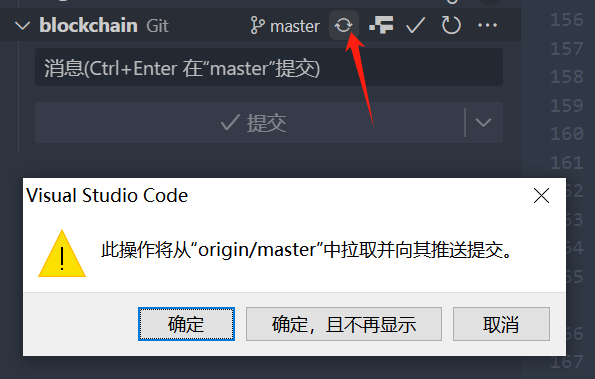

# 0.一些基本概念

## -暂存区（Index/Staging Area）：

暂存区是Git中的一个临时存储区域，用于准备下一次提交（commit）。当你修改了文件或添加了新文件后，你需要先将它们添加到暂存区，然后才能进行提交。
使用git add `<file>`命令可以将文件的变化（修改、新增、删除）添加到暂存区。
暂存区的作用是提供一个中间区域，让你在进行提交之前有机会审查和组织你的更改。

## -仓库（Repository）：

仓库是Git用来存储项目元数据和文件历史记录的地方。它包含了所有的版本历史（通过提交对象）、分支、标签等。
仓库中的内容是持久化的，即一旦你将更改提交到仓库，这些更改就会成为项目历史的一部分。
使用git commit命令可以将暂存区中的内容提交到仓库中。

## -关系：

暂存区是工作目录和仓库之间的桥梁。它允许你逐步构建你的提交，选择性地包括或排除某些更改。
每次提交实际上是将暂存区中的快照记录到仓库中。这意味着只有通过git add添加到暂存区的内容才会被包含在下一次提交中。
一旦提交，暂存区中的内容就被清空，准备下一次提交。

# 1.配置Git：

## 设置用户名称和电子邮件地址：

git config --global user.name "Your Name"
git config --global user.email "youremail@example.com"

设置这个的目的是为 Git 配置全局用户名和电子邮件地址。这些配置有以下几个用途：

识别提交者：每次你在 Git 中提交更改时，Git 会使用这些配置的信息将你的用户名和电子邮件包含在提交记录中。这样，其他人可以知道是你进行了哪些更改。

协作管理：在多个开发者协作的项目中，清楚地标识每个提交的作者非常重要。通过设置用户名和邮箱，团队成员可以方便地识别贡献者。

全局配置：使用 --global 标志意味着这些配置适用于你计算机上的所有 Git 仓库。如果你希望在某个特定的仓库中使用不同的用户名和邮箱，可以在该仓库的根目录中运行不带 --global 的相应命令。

**注意**：
1、 请不要在公共仓库中使用 --global 标志，因为它会将你的用户名和电子邮件暴露给其他人。
2、 请不要在 Windows 系统上使用 --global 标志，因为它会在系统的全局环境变量中存储用户名和密码。
3、 如果你使用了 --global 标志，请确保你在命令行中输入的密码是安全的，因为它会被存储在你的系统中。
4、 如果你使用了 --global 标志，请不要在公共仓库中使用，因为它会将你的用户名和密码暴露给其他人。
5、 设置会保存在本地的git配置文件中，位于用户目录下的.gitconfig 文件中。
关键是密码是明文，请不要在公共仓库中使用。

# 2.初始化仓库：

在现有目录中初始化一个新的Git仓库，目录通常是本地计算机上的目录， 这个目录就是你要开始版本控制的目录。
git init
举例： $git init
Initialized empty Git repository in D:/blockchain/.git/

初始化后，会出现 一个.git 目录，这个目录是Git用来存放元数据和对象数据库的地方。
如果你看到一个名为 .git 的文件夹，这表明该目录是一个 Git 仓库，因为这是 Git 用来存储版本信息的隐藏文件夹。

查看本地仓库的基本信息：git config --list  q 鍵退出
查看本地仓库的名称（路径）**需要在仓库的目录中执行**：git rev-parse --show-toplevel

**注意**，初始化完成后使用git status命令可以查看仓库的状态。

会得到如下的一些提示：表示仓库中没有任何文件。
 git status
On branch master
No commits yet
Untracked files:
  (use "git add <file>..." to include in what will be committed)
        1733279981760.png.md
        1733452530574.png.md
        "AI\347\237\245\350\

当前情况下，仓库中没有任何文件，所以仓库是空的，master分支上没有任何提交，为跟踪任何文件，需要使用git add命令。

# 3.添加文件到暂存区：

git add `<file>`
该命令的解释：use "git add `<file>`..." to update what will be committed
                    使用该命令，可以在提交之前进行修改。
查看暂存区的内容：
       git ls-files 命令用于列出当前Git仓库中被跟踪的所有文件。
这个命令会显示所有已经被添加到仓库中（即在版本控制之下）的文件名。
它不会显示那些未被跟踪的新文件或被忽略的文件。
git ls-files --others   显示所有未被跟踪的文件。
git ls-files --cached   仅显示暂存区中的文件，不包括工作目录中的未暂存文件。
git ls-files --exclude-standard   除了忽略标准Git排除模式（如.gitignore文件中定义的）的文件外，还显示其他文件。

## 可以添加目录
git add note/

## 
**git add .   添加所有未跟踪的文件和目录**

**注意**：如果是通过git的命令行去操作，那么，文档修改后，需要将修改的文档放到暂存区，然后再提交到仓库。
# 4.删除文件：

  使用 git rm 命令删除文件，并将其添加到暂存区。
  git rm `<file>`

# 5.重命名文件：

  使用 git mv 命令重命名文件，并将其添加到暂存区。
  git mv `<old-file>` `<new-file>`

# 4.提交更改：

git commit -m "Commit message"   --修改后提交的命令，引号内表示提交的信息
git commit -m "Update config_manual.md with new changes"  --修改后提交的命令，引号内表示提交的信息

# 5.查看仓库的状态：

git status

# 6.查看提交历史：

git log

# 7.分支管理：
## 概念
1. 在 Git 中，分支是一种用于开发和管理代码的强大工具，它允许开发者在同一个项目中同时进行多个不同的开发工作。理解分支的概念，对于高效地使用 Git 和进行团队协作是非常重要的。
2.  分支的主要用途：
- 独立开发：分支允许你在一个独立的环境中进行开发。比如，你可以创建一个新分支来添加新功能，而不影响主分支（通常是 master 或 main）上的代码。

- 实验性工作：如果你想试验某个新特性或技术，可以在新的分支上进行实验，如果结果不如预期，可以轻松地删除该分支，不会对主分支造成任何影响。

- 协作开发：在团队项目中，每个开发者可以在自己的分支上工作，完成后再将更改合并回主分支。这样可以减少冲突，并让团队成员之间的工作更加独立。

- 管理版本：通过创建不同的分支，可以轻松管理项目的不同版本，比如为每个版本发布创建一个分支，从而保持代码的清晰和组织。

3. 如何理解分支：
分支可以被视为代码的“快照”，它们记录了某个特定时间点的代码状态。你可以在不同的分支上开发，而后再选择合适的分支合并更改。

在工作流程上，一个项目的主要开发通常在主分支上进行，而新特性的开发和修复工作可以在其他分支上进行。

当一个功能完成并经过测试后，通常会将其合并回主分支，这个过程称为 合并（Merge）。这样，新的功能就可以在主分支上发布。

## 相关操作
创建新分支：git branch `<branch-name>`
切换分支：git checkout `<branch-name>`
查看分支信息：**注意新创建的仓库默认只有一个分支master，且仓库不能为空，以下命令才可用。**
git branch -a     命令会列出本地的所有分支，星号项表示当前所在的分支。
git branch -r   会列出远程跟踪的分支。
git branch -vv  查看当前分支及其对应的远程分支
查看特定分支的提交历史：
git log `<branch-name>` 命令会显示特定分支的提交历史。

# 8.合并分支：

将一个分支的更改合并到当前分支：git merge `<branch-name>`

# 9.远程仓库：

  ## 1.添加远程仓库：git remote add origin `<repository-url>`
举例：git remote add origin  https://gitee.com/zhang-haifeng0918/BlockChains_For_Peter.git

origin 表示本地git 对应远程仓库的名称定义。
  ## 2.推送到远程仓库：git push -u origin `<branch-name>`
举例：git push origin master
 git push -u origin master
Enumerating objects: 164, done.
Counting objects: 100% (164/164), done.
Delta compression using up to 16 threads
Compressing objects: 100% (135/135), done.
Writing objects: 100% (145/145), 2.96 MiB | 1.54 MiB/s, done.
Total 145 (delta 59), reused 0 (delta 0), pack-reused 0 (from 0)
remote: Resolving deltas: 100% (59/59), completed with 13 local objects.
remote: Powered by GITEE.COM [1.1.5]
remote: Set trace flag 364afd9f
To https://gitee.com/zhang-haifeng0918/personal-study-notes.git
   ca28bed..184eca9  master -> master
branch 'master' set up to track 'origin/master'.

  ## 3.从远程仓库拉取：git pull origin `<branch-name>` 分支名称最好要写明
举例：git pull origin master
**这个命令包含两个步骤**：
1. 获取最新更改： git fetch origin 
它会从 origin 远程仓库获取所有更新的分支和提交信息，但不会自动合并。
2. 合并更改： git merge origin/master
它会将从 origin/master 拉取到的更新合并到当前分支（假设当前分支是 master）

  ## 4.查看远程仓库的状态：
  git remote -v
   命令会显示远程仓库的信息，包括远程仓库的名称和URL。
  ## 5.删除远程仓库：g
  it remote remove origin

  ## 6.克隆远程仓库：
  git clone `<repository-url>` \克隆远程仓库的作用：克隆远程仓库到本地，并自动关联远程仓库和本地仓库。

  ## 7. **如果**使用从远程仓库中拉取内容中，提示：

 fatal: refusing to merge unrelated histories
 **报错解释**：
  1.本地和远程仓库的历史记录不匹配：本地仓库和远程仓库的提交历史没有共同的祖先，
即它们是完全独立的两个项目。
  2.仓库被重新初始化：远程仓库可能被重新初始化，导致历史记录丢失，而本地仓库仍然保留着旧的历史记录。
  **注意**：我这里这个测试环境中的远程git仓库，是很早前建立的，里面除了系统给的默认文档，只有零星的1
、2个测试文件，本地git配置了远程仓库后，进行拉取，会上面的错误。
  **解决方案**：
  1、强制合并：git pull origin master --allow-unrelated-histories
执行这个命令后，本地的git仓库中的文件就有了远程仓库中的文件了

# 10.撤销操作：

撤销最近的提交：git reset --hard HEAD~1
撤销工作目录的更改：git checkout -- `<file>`

# 11.查看工作目录和暂存区的差异：

git diff

# 12.在合并时解决冲突：

手动编辑冲突文件，然后
git add `<file>`
git commit

# 13.标签管理：

创建标签：git tag `<tag-name>`
推送标签到远程仓库：git push origin `<tag-name>`

# 14.查看特定文件的历史：

git log -p `<file>` 命令会显示特定文件的提交历史和内容变化。

# 15.退出git  show 命令的产生内容的界面，按：q键

新的内容提交到仓库后，使用git show命令，可以查看提交的hash值，和相关信息，并且能看到
修改内容的显示：**红色**表示修改前，**绿色**表示修改后。

# 16.查看仓库中的文件内容

-首先使用：git ls-files 查看被跟踪的文件；
-然后使用：git status  查看仓库状态，被跟踪文件是否已经提交仓库；
-然后使用：git log命令，也可以查看文件提交的hash值；
--最后使用如下命令：冒号前面是hash值，冒号后面是文件名；
 git  cat-file -p  cb3e25c12cc65f5ce088e830c7ea3c35cb684516:config_manual.md

# 17.git的GUI模式

    建议完成以上操作的了解和熟悉后，可以打开本地git的GUI，自行学习理解，
个人感觉，有些操作，图形界面更友好。

# 18.刪除本地仓库

关闭所有与仓库相关的进程：

确保没有程序正在使用仓库中的文件，比如文本编辑器、IDE或者其他工具。
删除仓库文件夹：

直接删除包含.git目录的文件夹。这可以通过文件管理器手动完成，或者使用命令行。
使用文件管理器：

导航到包含仓库的文件夹。
选中该文件夹，然后将其拖到回收站或按Delete键。
使用命令行：

打开命令行工具（如终端、命令提示符、PowerShell等）。
使用cd命令导航到包含仓库的父目录。
使用rm -rf命令在Unix-like系统（如Linux或macOS）上删除仓库，或者使用rmdir /s /q命令在Windows上删除仓库。

 git remote add block_chain    https://github.com/zhanghaifeng9988/block_chain.git
 block_chain 是你为远程仓库指定的本地别名（自定义名称）