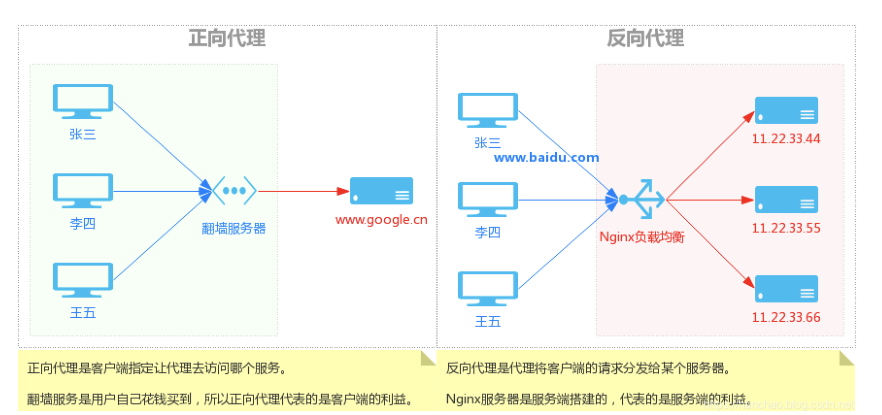
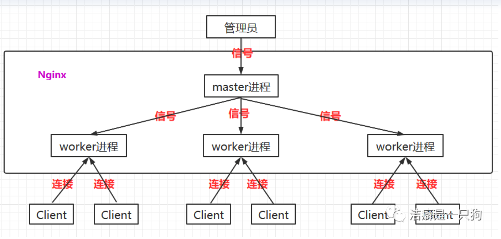

                           nginx

一、基本概念

1.什么是Nginx

Nginx是一个高性能的HTTP和反向代理服务器，也是一个IMAP/POP3/SMTP代理server。其特点是占有内存少。
并发能力强，其并发能力确实在同类型的网页server中表现较好。

--http服务器

Web服务器是指驻留于因特网上某种类型计算机的程序。当Web浏览器（客户端）连到服务器上并请求文件时，
服务器将处理该请求并将文件反馈到该浏览器上，附带的信息会告诉浏览器如何查看该文件（即文件类型）。
服务器使用HTTP（超文本传输协议）与客户机浏览器进行信息交流，这就是人们常把它们称为HTTP服务器的原因。

--代理服务器

通常是指局域网内部的机器通过代理服务器发送请求到互联网上的服务器，代理服务器一般作用在客户端。

-- 正向代理：用于代理内部网络对 Internet 的连接请求，客户端指定代理服务器，
将要给web服务器发送的请求先发送到代理服务器，由代理服务器访问web服务器，
web服务器将回应返回给代理，代理将回应返回给客户端。

--反向代理

客户端向反向代理的命名空间中的内容发送普通请求，接着反向代理将推断向何处（原始服务器）转交请求，
并将获得的内容返回给客户端。

1.保护网站安全：来自互联网的任何请求都必须经过代理服务器

2.缓存web服务器上的某些静态资源，减轻web服务器的负载压力，当代理服务器没有缓存会到web服务器上拉取数据（穿透缓存）在响应客户端，如代理有缓存则直接响应给客户端（缓存命中）。

3.实现负载均衡：充当负载均衡算法均衡的分发请求到各个集群中的web服务器

# 同步和异步
1. 同步机制，是指发送方发送请求后，需要等待接收到接收方发回的响应后，才接着发送下一个请求；
2. 异步机制，和同步机制正好相反，在异步机制中，发送方发出一个请求后，不等待接收响应这个请求，就继续发送下个请求。
3. 在同步机制中，所有的请求在服务器端得到同步，发送方和接收方对请求的处理步调是一致的；
4. 在异步机制中，所有来自发送方的请求形成一个队列，接收方处理完成后通知发送方。

# 阻塞和非阻塞
1. 同步阻塞方式： 发送方向接收方发送请求后，一直等待响应；接收方处理请求时进行的io操作如果不能马上得到结果，就一直等到返回结果后，才响应发送方，期间不能进行其他工作。比如，在超市排队付账时，客户（发送方）向收款员（接收方）付款（发送请求）后需要等待收款员找零，期间不能做其他的事情；而收款员要等待收款机返回结果（io操作）后才能把零钱取出来交给客户（响应请求），期间也只能等待，不能做其他事情。这种方式实现简单，但是效率不高。

2. 异步非阻塞方式：发送方向接收方发送请求后，不用等待响应，可以继续其他工作；接收方处理请求时进行的io操作如果不能马上得到结果，也不等待，而是马上返回去做其他事情。当io操作完成以后，将完成状态和结果通知接收方，接收方再响应发送方。继续使用在超市排队付账的例子。客户（发送方）向收款员（接收方）付款（发送请求）后在等待收款员找零的过程中，还可以做其他事情，比如打电话、聊天等；而收款员在等待收款机处理交易（io操作）的过程中可以帮助客户将商品打包，当收款机产生结果后，收款员给客户结账（响应请求）。在四种方式中，这种方式是发送方和接收方通信效率最高的一种。

# Nginx服务器如何处理请求/Nginx实现高并发原理？

nginx服务器的一个显著优势是能够同时处理大量并发请求。它结合多进程机制和异步机制对外提供服务。异步机制使用的是异步非阻塞方式。

nginx服务器启动后，会产生一个主进程（master process）和多个工作进程（worker process），可以在配置文件中指定产生的工作进程数量。
nginx服务器的所有工作进程都用于接收和处理客户端的请求。这就类似于Apache使用的改进的多进程机制，预先生成多个工作进程，等待处理客户端请求。

**每个工作进程使用了异步非阻塞方式**，可以处理多个客户端请求。当某个工作进程接收到客户端的请求以后，调用io进行处理，如果不能立即得到结果，就去处理其他的请求而非阻塞；而客户端在此期间也无需等待响应，可以去处理其他的事情；当io调用返回结果时，就会通知此工作进程；该进程得到通知，暂时挂起当前处理的事物，去响应客户端请求。

客户端请求数量增长、网络负载繁重时，nginx服务器使用多进程机制能保证不增长对系统资源的压力；同时使用异步非阻塞方式减小了工作进程在io调用上的阻塞延迟，保证了不降低对请求的处理能力。

3. 多进程的工作模式:

 Nginx在启动后，会有一个master进程和多个相互独立的worker进程。
master进程接受来自外界的信号，向各个worker进程发送信号，每个worker进程都有可能来处理这个连接。
master进程能监控worker进程的运行状态，当worker进程退出后（异常情况下），会自动启动新的worker进程。不会造成业务的中断。

master进程主要用来管理worker进程，具体包括如下4个主要功能：

1）接收来自外界的信号。

2）向各worker进程发送信号。

3）监控woker进程的运行状态。

4）当woker进程退出后（异常情况下），会自动重新启动新的woker进程。

woker进程主要用来处理基本的网络事件：

1）多个worker进程之间是对等且相互独立的，他们同等竞争来自客户端的请求。

2）一个请求，只可能在一个worker进程中处理，一个worker进程，不可能处理其它进程的请求。

3）worker进程的个数是可以设置的，一般我们会设置与机器cpu核数一致。同时，nginx为了更好的利用多核特性，具有cpu绑定选项，我们可以将某一个进程绑定在某一个核上，这样就不会因为进程的切换带来cache的失效。

二、Nginx静态处理优势

Nginx处理静态页面的效率远高于Tomcat的处理能力
若Tomcat的请求量为1000次，则Nginx的请求量为6000次
Tomcat每秒的吞吐量为0.6M，Nginx的每秒吞吐量为3 .6M
Nginx处理静态资源的能力是Tomcat处理的6倍

三、并发量和吞吐量计算
并发量：以10分钟有5000万用户平均每人访问2次为例，并发量为每秒(5000w2)/(6010)=16.7万，再double下，
就说每秒25万并发量

吞吐量可以理解成带宽流量，以每个请求0.5KB大小，并发每秒25万，0.5/1024MB250000=122MB8bit=977Mbps

四、学习文档
https://cloud.tencent.com/developer/article/1644888?policyId=1004
**含：正向代理，反向代理解释** **静态网页服务器、负载均衡**

下载资源：
wget -c https://nginx.org/download/nginx-1.12.0.tar.gz

wget -c https://nginx.org/download/nginx-1.6.3.tar.gz

安装配置文档：1.6.3版本
https://zhuanlan.zhihu.com/p/629607990?utm_id=0

systemctl enable nginx.service   设置开机自动启动  

systemctl start nginx.service  启动
systemctl status nginx.service  状态查看
systemctl stop nginx.service   停止
systemctl reload nginx.service  重新加载

#启动  /usr/local/nginx/sbin
./nginx

#停止，此方式相当于先查出nginx进程id再使用kill命令强制杀掉进程
./nginx -s stop

#停止，此方式停止步骤是待nginx进程处理任务完毕进行停止
./nginx -s quit

#重新加载配置文件，Nginx服务不会中断
./nginx -s reload

netstat -anp |grep 80   默认端口是80

