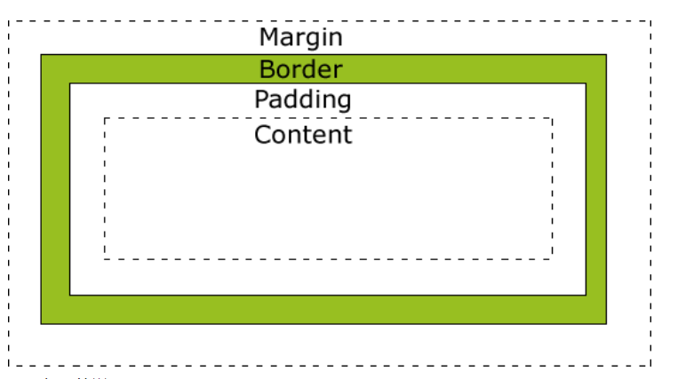
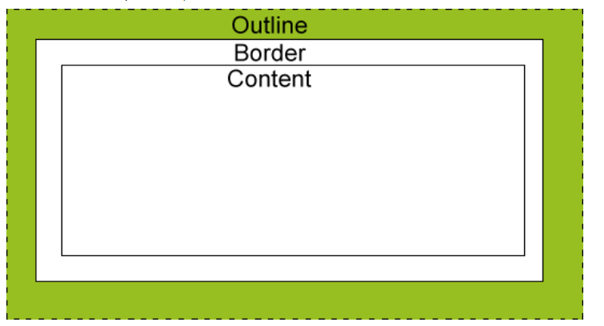

  
!*css3教程网址：[CSS3](https://www.runoob.com/css3/css3-tutorial.html )
  
# HTML 样式- CSS
## 1. CSS 简介
CSS (Cascading Style Sheets) 用于渲染HTML元素标签的样式。
CSS 是在 HTML4 开始使用的,是为了更好的渲染HTML元素而引入的.
- CSS（Cascading Style Sheets，层叠样式表）是一种用来表现 HTML 或者 XML 文档样式的语言。CSS 用来控制网页的布局，字体，颜色，背景等。CSS 定义了网页的外观，网页的版式，网页的字体，颜色，背景等。
- CSS 语法简单，学习起来也比较容易。CSS 3 已经成为 W3C 推荐标准，CSS 3 新增了很多特性，使得 CSS 的应用更加广泛。
- CSS 可以通过以下方式添加到HTML中:
    内联样式：在HTML元素中使用"style" 属性；
    内部样式表：在HTML文档头部 \<head> 区域使用 \<style> 元素 来包含CSS；
    外部样式表：在单独的 CSS 文件中定义 CSS 代码，然后在 HTML 文档中通过 \<link> 标签链接到该 CSS 文件。
  
- 最好的方法是：外部引用，使用外部 CSS 文件
- CSS 样式优先级: 内联样式 > 内部样式表 > 外部样式表
- CSS 样式的继承: 子元素继承父元素的样式，子孙元素也会继承父元素的样式。
- CSS 样式的层叠: 后面的样式会覆盖前面的样式。
- CSS 样式的单位: 长度单位包括px、em、pt、pc、in、cm、mm。
- CSS 样式的选择器: **标签/元素选择器**、**类选择器**、**ID选择器**、**属性选择器**、**伪类选择器**、**伪元素选择器**。
- CSS 样式的盒模型: 盒模型包括内容、填充、边框、边界。
- CSS 样式的布局: 常见的布局方式有: 块级元素、行内元素、浮动、绝对定位、固定定位、Flexbox、Grid。
- CSS 样式的动画: CSS3 新增了动画属性，可以实现元素的平滑过渡。
- CSS 样式的预处理器: Sass、Less、Stylus 等。
- CSS 样式的浏览器兼容性: CSS3 兼容性较好，但仍有部分浏览器不支持。
- CSS 样式的调试: 使用浏览器的开发者工具可以调试 CSS 样式。
  
## 2. CSS 规则由两个主要的部分构成：选择器，以及一条或多条声明:
CSS 规则由两个主要的部分构成：选择器，以及一条或多条声明
- 选择器: 用于指定 HTML 元素、class、ID 等的样式。
- 声明: 用于设置 HTML 元素的样式属性和值。
- 属性（property）是您希望设置的样式属性（style attribute）。每个属性有一个值。属性和值被冒号分开。
- 值（value）是属性的具体设置。
  
  
## 3. CSS 注释
CSS 注释以 /* 和 */ 包围，可以用来添加注释。
  
## CSS id 和 class
### id 和 class 选择器
如果你要在HTML元素中设置CSS样式，你可以选在在元素中设置"id" 和 "class"选择器。
1. id 选择器--内部样式表
id 选择器可以为标有特定 id 的 HTML 元素指定特定的样式。
HTML元素以id属性来设置id选择器,CSS 中 id 选择器以 "#" 来定义。
2. class 选择器--内部样式表
class 选择器用于描述一组元素的样式，class 选择器有别于id选择器，class可以在多个元素中使用。
class 选择器在 HTML 中以 class 属性表示, 在 CSS 中，类选择器以一个点 . 号显示。
  
# CSS创建
## 外部样式表
当样式需要应用于很多页面时，外部样式表将是理想的选择。在使用外部样式表的情况下，你可以通过改变一个文件来改变整个站点的外观。每个页面使用 <link> 标签链接到样式表。 <link> 标签在（文档的）头部：
## 多重样式
1. 如果某些属性在不同的样式表中被同样的选择器定义，那么属性值将从更具体的样式表中被继承过来。 
2. 样式表的加载顺序是（优先级）：（内联样式）Inline style > （内部样式）Internal style sheet >（外部样式）External style sheet > 浏览器默认样式。
  
## CSS 背景
CSS 属性定义背景效果:
background-color：定义了元素的背景颜色.
background-image：描述了元素的背景图像.默认情况下 background-image 属性会在页面的水平或者垂直方向平铺。
background-repeat：设置定位与不平铺，让背景图像不影响文本的排版
                    如果你不想让图像平铺，你可以使用 background-repeat 属性
background-attachment：背景图像是否固定或者随着页面的其余部分滚动。
background-position：改变图像在背景中的位置
background-clip：决定背景的绘制区域。
background-origin：决定背景的定位区域。
background-size：设置背景图像的尺寸。
  
## CSS 文本
1.文本颜色
颜色属性被用来设置文字的颜色。颜色是通过CSS最经常的指定：
- 十六进制值 - 如: ＃FF0000
- 一个RGB值 - 如: RGB(255,0,0)
- 颜色的名称 - 如: red
- [CSS颜色值](https://www.runoob.com/cssref/css-colors-legal.html )
2. 文本的对齐方式
文本排列属性是用来设置文本的水平对齐方式。
文本可居中或对齐到左或右,两端对齐.
当text-align设置为"justify"，每一行被展开为宽度相等，左，右外边距是对齐（如杂志和报纸）。
3. 文本装饰
4. 文本转换
文本转换属性是用来指定在一个文本中的大写和小写字母。
可用于所有字句变成大写或小写字母，或每个单词的首字母大写。
p.uppercase {text-transform:uppercase;}
p.lowercase {text-transform:lowercase;}
p.capitalize {text-transform:capitalize;}
5. 文本缩进
文本缩进属性是用来指定文本的第一行的缩进。p {text-indent:50px;}
6. 常用文本属性
  
| 属性              | 描述                     |
|-------------------|--------------------------|
| color             | 设置文本颜色             |
| direction         | 设置文本方向             |
| letter-spacing    | 设置字符间距             |
| line-height       | 设置行高                 |
| text-align        | 对齐文本                 |
| text-decoration    | 添加文本修饰             |
| text-indent       | 缩进文本首行             |
| text-shadow       | 设置文本阴影             |
| text-transform    | 控制文本字母格式         |
| unicode-bidi      | 设置文本是否重写         | 
| vertical-align    | 设置元素的垂直对齐       |
| white-space       | 设置空白处理方式         |
| word-spacing      | 设置字间距               |
  
## CSS 字体
字体属性用来设置字体的各种属性。
CSS字体属性定义字体，加粗，大小，文字样式。
在计算机屏幕上，sans-serif字体被认为是比serif字体容易阅读
### 1. CSS字型
在CSS中，有两种类型的字体系列名称：
- 通用字体系列：拥有相似外观的字体系统组合（如 "Serif" 或 "Monospace"）
- 特定字体系列： 一个特定的字体系列（如 "Times" 或 "Courier"）
### 2. 字体风格
font-family 属性设置文本的字体系列。
font-family 属性应该设置几个字体名称作为一种"后备"机制，如果浏览器不支持第一种字体，他将尝试下一种字体。
注意: 如果字体系列的名称超过一个字，它必须用引号，如Font Family："宋体"。
多个字体系列是用一个逗号分隔指明：
- 实例：
p{font-family:"Times New Roman", Times, serif;}
### 3. 字体样式
主要是用于指定斜体文字的字体样式属性。
这个属性有三个值：
- 正常：正常显示文本
- 斜体：以斜体字显示的文字
- 倾斜的文字：文字向一边倾斜（和斜体非常类似，但不太支持）
- 实例：
p.normal {font-style:normal;}
p.italic {font-style:italic;}
p.oblique {font-style:oblique;}
### 4. 字体大小
- 设置文字的大小与像素，让您完全控制文字大小：
- 实例
h1 {font-size:40px;}
h2 {font-size:30px;}
p {font-size:14px;}
### 5. 字体粗细
font-weight 属性用来设置字体的粗细。
font-weight 属性有四个值：
- normal：正常显示
- bold：加粗显示
- bolder：比正常粗
- lighter：比正常细
- 实例：
p.normal {font-weight:normal;}
p.bold {font-weight:bold;}
p.bolder {font-weight:bolder;}
p.lighter {font-weight:lighter;}
### 6. 字体变体
font-variant 属性用来设置字体的变体。
font-variant 属性有两个值：
- normal：正常显示
- small-caps：小型大写字母
- 实例：
p.normal {font-variant:normal;}
p.small-caps {font-variant:small-caps;}
  
## CSS 链接
1. 链接的样式，可以用任何CSS属性（如颜色，字体，背景等）。
2. 特别的链接，可以有不同的样式，这取决于他们是什么状态。
3. 这四个链接状态是：
- a:link - 正常，未访问过的链接
- a:visited - 用户已访问过的链接
- a:hover - 当用户鼠标放在链接上时
- a:active - 链接被点击的那一刻
- 实例
a:link {color:#000000;}      /* 未访问链接*/
a:visited {color:#00FF00;}  /* 已访问链接 */
a:hover {color:#FF00FF;}  /* 鼠标移动到链接上 */
a:active {color:#0000FF;}  /* 鼠标点击时 */
-当设置为若干链路状态的样式，也有一些顺序规则：
a:hover 必须跟在 a:link 和 a:visited后面
a:active 必须跟在 a:hover后面
  
4.常见的链接样式
- 文本修饰：text-decoration 属性主要用于删除链接中的下划线
- 实例
a:link {text-decoration:none;}
a:visited {text-decoration:none;}
a:hover {text-decoration:underline;}
a:active {text-decoration:underline;}
- 背景色：background-color 属性用于设置链接的背景色
- 实例
a:link {background-color:#FFFFFF;}
a:visited {background-color:#FFFF85;}
a:hover {background-color:#FF704D;}
a:active {background-color:#FF704D;}
  
## CSS 列表
list-style-type属性指定列表项标记的类型是：
- 实例
ul.a {list-style-type: circle;}
ul.b {list-style-type: square;}
  
ol.c {list-style-type: upper-roman;}
ol.d {list-style-type: lower-alpha;}
- 列表项标记的图像:
  要指定列表项标记的图像，使用列表样式图像属性：
- 实例:
ul{ list-style-image: url('sqpurple.gif');}
  
## CSS 表格
CSS 表格属性用于控制表格的外观和布局。
CSS 表格属性包括：
1. 边框：border-collapse、border-spacing、border、border-top、border-right、border-bottom、border-left
2. 背景：background-color、background-image、background-repeat、background-attachment、background-position
3. 宽度：width、min-width、max-width
4. 高度：height、min-height、max-height
5. 外边距：margin、margin-top、margin-right、margin-bottom、margin-left
6. 内边距：padding、padding-top、padding-right、padding-bottom、padding-left
7. 布局：display、float、clear、vertical-align、text-align、text-indent、line-height、white-space、word-spacing、letter-spacing
8. 轮廓：outline、outline-color、outline-style、outline-width
9.  轮廓：border-collapse、border-spacing、border、border-top、border-right、border-bottom、border-left
10. 单元格：border-collapse、border-spacing、border、border-top、border-right、border-bottom、border-left、width、height、padding、padding-top、padding-right、padding-bottom、padding-left、vertical-align、text-align、text-indent、line-height、white-space、word-spacing、letter-spacing
11. 实例：
table {
  border-collapse: collapse;
  border-spacing: 0;
  width: 100%;
}
th, td {
  border: 1px solid black;
  padding: 8px;
  text-align: left;
}
th {
  background-color: #f2f2f2;
}
  
## CSS 盒子模型
1. CSS 盒子模型(Box Model)
所有HTML**元素**可以看作**盒子**，在CSS中，"box model"这一术语是用来设计和布局时使用。
CSS盒模型本质上是一个盒子，封装周围的HTML元素，它包括：**边距**，**边框**，**填充**，和**实际内容**。
盒模型允许我们在其它元素和周围元素边框之间的空间放置元素。
2. 盒子的构成
**Margin(外边距)** - 清除边框外的区域，外边距是透明的。
**Border(边框)** - 围绕在内边距和内容外的边框。
**Padding(内边距)** - 清除内容周围的区域，内边距是透明的。
**Content(内容)** - 盒子的内容，显示文本和图像。

3.元素的宽度和高度
当您指定一个 CSS 元素的宽度和高度属性时，你只是设置内容区域的宽度和高度。要知道，完整大小的元素，你还必须添加内边距，边框和外边距。
- 实例：此处的div是对应的HTML元素
\
这里是盒子内的实际内容。有 25px 内间距，25px 外间距、25px 绿色边框。
,通过这种方式可以为元素提供盒式样式
div {
    width: 300px;
    border: 25px solid green;
    padding: 25px;
    margin: 25px;
}
  
## CSS border（边框）
CSS border属性用于设置元素的边框。
border属性可以设置元素的边框宽度、样式和颜色。
border属性有以下属性值：
- border-width：设置边框的宽度。
- border-style：设置边框的样式。
- border-color：设置边框的颜色。
- 实例：
div {
  border-width: 2px;
  border-style: solid;
  border-color: red;
}

## CSS outline（轮廓）
轮廓（outline）是绘制于元素周围的一条线，位于边框边缘的外围，可起到突出元素的作用。
轮廓（outline）属性指定元素轮廓的样式、颜色和宽度。
outline属性有以下属性值：
- outline-width：设置轮廓的宽度。
- outline-style：设置轮廓的样式。
- outline-color：设置轮廓的颜色。
- 实例：
div {
  outline-width: 2px;
  outline-style: solid;
  outline-color: red;
}   
## CSS margin(外边距)
margin属性设置元素的外边距。
margin属性可以设置元素四个方向的外边距。
margin属性有以下属性值：
- margin-top：设置元素上外边距。
- margin-right：设置元素右外边距。  
- margin-bottom：设置元素下外边距。
- margin-left：设置元素左外边距。
- 实例：
div {
  margin-top: 20px;
  margin-right: 20px;
  margin-bottom: 20px;
  margin-left: 20px;
}
## CSS padding(内边距/填充)
padding属性设置元素的内边距。
padding属性可以设置元素四个方向的内边距。
padding属性有以下属性值：
- padding-top：设置元素上内边距。
- padding-right：设置元素右内边距。
- padding-bottom：设置元素下内边距。
- padding-left：设置元素左内边距。
- 实例：
div {
  padding-top: 20px;
  padding-right: 20px;
  padding-bottom: 20px;
  padding-left: 20px;
  }
## CSS 分组和嵌套
1. 在样式表中有很多具有相同样式的元素。
- 例如，你可能有多个标题元素，它们都需要相同的颜色。
h1 {
    color:green;
}
h2 {
    color:green;
}
p {
    color:green;
}
为了尽量减少代码，你可以使用分组选择器。
每个选择器用逗号分隔。
在下面的例子中，我们对以上代码使用分组选择器：
h1, h2, p {
    color:green;
}
2. 嵌套选择器
CSS允许你将选择器嵌套在另一个选择器中。
- 例如，你可能有一个包含多个列表的div元素。
div ul {
    list-style-type: square;
}
div ol {
    list-style-type: decimal;
}
div li {
    margin-left: 20px;
}
为了使代码更简洁，你可以使用嵌套选择器。
div {
    ul {
        list-style-type: square;
    }
    ol {
        list-style-type: decimal;
    }
    li {
        margin-left: 20px;
    }
    }
## CSS 尺寸
CSS 尺寸 (Dimension) 属性允许你控制元素的高度和宽度。同样，它允许你增加行间距。
| 属性         | 描述                   |
|--------------|------------------------|
| height       | 设置元素的高度。       |
| line-height  | 设置行高。             |
| max-height   | 设置元素的最大高度。   |
| max-width    | 设置元素的最大宽度。   |
| min-height   | 设置元素的最小高度。   |
| min-width    | 设置元素的最小宽度。   |
| width        | 设置元素的宽度。       |
  
错误处理机制：
在使用 CSS 属性时，请确保所有值的单位（如 px, %, em 等）是有效的。 
如果设置的值无效，某些浏览器可能会忽略这些样式，这可能导致界面表现不一致。
## CSS Display(显示) 与 Visibility（可见性）
display属性设置一个元素应如何显示，visibility属性指定一个元素应可见还是隐藏。
1.隐藏元素 - display:none或visibility:hidden
display:none属性将元素从渲染树中完全删除，因此不会占用任何空间。
visibility:hidden属性将元素隐藏，但仍占用空间。
  
## CSS Position(位置)
position属性设置元素的定位类型。
position属性可以设置元素的定位方式。
position属性有以下属性值：
- static：默认值。没有定位，元素出现在正常的流中。
- relative：相对定位。元素的位置相对于其正常位置。
- absolute：绝对定位。元素的位置相对于最近的已定位祖先元素。
- fixed：固定定位。元素的位置相对于浏览器窗口。
- sticky：粘性定位。元素的位置根据用户的滚动而相对其正常位置。
  
## CSS Overflow（溢出）
CSS overflow 属性可以控制内容溢出元素框时在对应的元素区间内添加滚动条。
overflow属性可以设置元素溢出内容区时发生的事情。
overflow属性有以下属性值：
- visible：默认值。内容不会被修剪，会呈现在元素框之外。
- hidden：内容会被修剪，并且其余内容会显示在元素框之外。            
- scroll：内容会被修剪，但是浏览器会显示滚动条以便查看其余内容。
- auto：如果内容溢出元素框，则浏览器会自动显示滚动条。
- inherit：规定应该从父元素继承 overflow 属性的值。
  
## CSS 布局 - Float（浮动）
float属性可以使元素向左或向右浮动。
float属性可以设置元素的浮动方式。
Float（浮动），往往是用于图像，但它在布局时一样非常有用。
float属性有以下属性值：
- left：元素向左浮动。
- right：元素向右浮动。 
- clear：元素左右两边不允许其他浮动元素。
  
## CSS布局 - 水平 & 垂直对齐
1. 元素居中对齐
要水平居中对齐一个元素(如 
), 可以使用 margin: auto;。
设置到元素的宽度将防止它溢出到容器的边缘。
元素通过指定宽度，并将两边的空外边距平均分配.
2. 文本居中对齐
如果仅仅是为了文本在元素内居中对齐，可以使用 text-align: center;
3. 图片居中对齐
如果需要图片在元素内居中对齐，可以使用 margin:  auto;
4. 左右对齐 - 使用定位方式
可以使用 position: absolute; 属性来对齐元素:
5. 左右对齐 - 使用 float 方式
可以使用 float: left; 或 float: right; 属性来对齐元素。
6. 垂直居中对齐 - 使用 padding
  
##  选择器之组合选择符
1. 后代选择器
- 后代选择器用于选取某元素的后代元素。
- 后代选择器以空格分隔两个选择器，并选择作为其父元素的后代元素。
- 例如，选择 ul 元素的后代 li 元素，可以写成 ul li。
- 实例：
ul li {
  background-color: yellow;
}   
2. 子元素选择器
- 子元素选择器用于选取某元素的直接子元素。
- 子元素选择器以大于号(>)开头，并选择作为其父元素的直接子元素。
- 例如，选择 div 元素的直接子元素 p 元素，可以写成 div > p。
- 实例：
div > p {
  background-color: yellow;
}   
3. 相邻兄弟选择器
- 相邻兄弟选择器用于选取某元素的相邻的兄弟元素。
- 相邻兄弟选择器以加号(+)开头，并选择作为其父元素的相邻的兄弟元素。
- 例如，选择 div 元素的第一个兄弟元素 p 元素，可以写成 div + p。
- 实例：
div + p {
  background-color: yellow;
}   
4. 后续兄弟选择器
- 后续兄弟选择器用于选取某元素之后的所有兄弟元素。
- 后续兄弟选择器以加号(+)和大于号(>)结合使用，并选择作为其父元素之后的所有兄弟元素。
- 例如，选择 div 元素之后的所有兄弟元素 p 元素，可以写成 div + p ~ p。
- 实例：
div + p ~ p {
  background-color: yellow;
}     
4. 通用选择器
- 通用选择器用于选取页面上所有元素。
- 通用选择器以星号(*)开头，并选择页面上所有元素。
- 例如，选择页面上所有元素的背景颜色，可以写成 * { background-color: yellow; }。
- 实例：
* {
  background-color: yellow;
}     
  
## CSS 伪类(Pseudo-classes)
1. CSS伪类是用来添加一些选择器的特殊效果。
2. CSS伪类可以为链接、输入框、按钮、表单控件等添加特殊的效果。
3. 伪类用于描述元素在特定状态下的样式。例如，当鼠标悬停在元素上、元素获得焦点时等。
4. 伪类的语法通常以冒号（:）开头。
5. CSS伪类有以下属性值：
- :active：鼠标点击激活元素时。
- :checked：单选框或复选框被选中时。
- :disabled：元素不可用时。
- :empty：元素没有任何内容时。
- :enabled：元素可用时。
- :first-child：元素是其父元素的第一个子元素时。
- :first-of-type：元素是其父元素的第一个指定类型的子元素时。
- :focus：元素获得焦点时。
- :hover：鼠标悬停在元素上时。
- :indeterminate：元素的状态不确定时。
- :last-child：元素是其父元素的最后一个子元素时。
- :last-of-type：元素是其父元素的最后一个指定类型的子元素时。
- :link：未被访问的链接时。
- :not()：否定伪类，选择不匹配的元素。
- :nth-child()：选择父元素的第 n 个子元素。
- :nth-last-child()：选择父元素的倒数第 n 个子元素。
- :nth-last-of-type()：选择父元素的倒数第 n 个指定类型的子元素。
- :nth-of-type()：选择父元素的第 n 个指定类型的子元素。
- :only-child：元素是其父元素的唯一子元素时。
- :only-of-type：元素是其父元素的唯一指定类型的子元素时。
- :root：选择文档的根元素时。
- :target：当前活动的目标元素时。
- :valid：输入字段有效时。
- :visited：已被访问的链接时。  
- 实例：
a:hover {
  color: red;
} 
### CSS :first-child 伪类
first-child 伪类用于选择元素的第一个子元素。
1. 匹配第一个 \
 元素
举例：ul中通常有多个li元素，我们想为第一个li元素添加背景颜色，可以用:first-child伪类。
ul li:first-child {
  background-color: yellow;
} 
2. 匹配所有\
 元素中的第一个 \<i> 元素
举例：div中有多个p元素，每个p元素中也有多个i元素，我们想为第一个i元素添加背景颜色，可以用:first-child伪类。
div p >i:first-child {
  background-color: yellow;
} 
3. 匹配所有作为第一个子元素的 \
 元素中的所有 \<i> 元素
举例：div中有多个p元素，每个p元素中也有多个i元素，我们想为第一个p元素中的所有i元素添加背景颜色，可以用:first-child伪类。
div p:first-child i {
  background-color: yellow;
} 
### CSS - :lang 伪类
:lang 伪类用于选择带有指定语言的元素。
:lang 伪类使你有能力为不同的语言定义特殊的规则
举例：我们想为页面中带有 lang 属性的元素设置不同的字体，可以用:lang 伪类。
:lang(en) {
  font-family: Arial, sans-serif;
} 
  
## CSS 伪元素 (Pseudo-elements)
1. 伪元素用于选取并样式化元素的一部分，或创建虚拟的元素。
2. 它可以用于指定首行、首字母或者在元素之前或之后插入内容。
3. 伪元素的语法通常以双冒号（::）开头（在CSS2中也可以用单冒号表示，因兼容性原因仍可用）。
CSS 伪元素有以下属性值：  
- ::after：在元素内容之后插入内容。
- ::before：在元素内容之前插入内容。
- ::first-letter：选择元素的第一个字母。
- ::first-line：选择元素的第一行。
- ::selection：选择用户选取的元素内容。
- ::backdrop：选择背景区域。
- ::marker：选择列表标记。
- ::placeholder：选择输入框的占位符。
- ::content：选择 ::before 和 ::after 内容。
- ::first-line-pseudo：选择 ::first-line 伪元素。
- ::first-letter-pseudo：选择 ::first-letter 伪元素。
- ::before-pseudo：选择 ::before 伪元素。
- ::after-pseudo：选择 ::after 伪元素。
- ::marker-pseudo：选择 ::marker 伪元素。
- ::backdrop-pseudo：选择 ::backdrop 伪元素。
- ::selection-pseudo：选择 ::selection 伪元素。
- ::placeholder-pseudo：选择 ::placeholder 伪元素。
- ::content-pseudo：选择 ::content 伪元素。  
- 实例：
p::first-line {
  font-weight: bold;
 } <!--这是选择所有 \
 元素的第一行并加粗的例子。 -->
p::first-letter {
  font-size: 2em;
} <!-- 这是选择所有 \
 元素的第一个字母并将字体大小设置为 2em 的例子。 -->
p::before {
  content: "Hello, ";
 } <!--这是选择所有 \
 元素的 ::before 伪元素并插入内容 "Hello, " 的例子。 -->
p::after {
  content: "!";
} 
p::selection {
  background-color: yellow;
} 
p::marker {
  color: red;
} 
input::placeholder {
  color: gray;
} 
input::selection {
  background-color: yellow;
} 
input::marker {
  color: red;
} 
  
## 伪类和伪元素差异
1. 伪类主要关注元素的状态和用户的操作，而伪元素用于操作元素的结构和内容。
2. 两者结合使用，可以使web页面的样式更加丰富和动态。
  
## CSS 导航栏
1. CSS 导航栏是指页面上通常包含的导航栏，通常包括 logo、链接、搜索框、登录/注册按钮等。
2. CSS 导航栏的样式可以使导航栏更加美观、整齐、易于使用。
3. CSS 导航栏的样式可以分为以下几类：
- 固定导航栏：固定在页面顶部或底部的导航栏。
- 弹性导航栏：随着页面的滚动而移动的导航栏。
- 响应式导航栏：根据不同设备的屏幕大小调整导航栏的样式。
- 多级导航栏：具有多级菜单的导航栏。
4. 固定导航栏
固定导航栏是指导航栏始终固定在页面顶部或底部，不会随着页面的滚动而移动。
固定导航栏的样式可以分为以下几类：
- 顶部固定导航栏：固定在页面顶部的导航栏。
- 底部固定导航栏：固定在页面底部的导航栏。
- 固定导航栏的宽度：固定导航栏的宽度可以根据页面的宽度进行调整。  
- 固定导航栏的背景色：固定导航栏的背景色可以根据页面的背景色进行调整。
- 固定导航栏的高度：固定导航栏的高度可以根据导航栏的高度进行调整。
  
## 下拉菜单
  
  
<h2>下拉菜单</h2>

鼠标移动到按钮上打开下拉菜单。

  

  <button class="dropbtn">下拉菜单</button>
  

    <a href="http://www.runoob.com">菜鸟教程 1</a>
    <a href="http://www.runoob.com">菜鸟教程 2</a>
    <a href="http://www.runoob.com">菜鸟教程 3</a>
  

  
## 提示工具(Tooltip)
提示工具在鼠标移动到指定元素后触发
  
## 图片廊
图片廊是指在一个页面上显示多张图片，并提供相应的图片标题、描述、链接等信息。
  
<h2>图片廊</h2>

鼠标移动到图片上显示图片标题、描述、链接等信息。

  

  <a target="_blank" href="https://picsum.photos/id/1018/200/300">
    
    
Random image 1
    
  </a>
  <a target="_blank" href="https://picsum.photos/id/1015/200/300">
    
    
Random image 2
    
  </a>
  <a target="_blank" href="https://picsum.photos/id/1019/200/300">
    
    
Random image 3
    
  </a>

  
## 图像透明、半透明、不透明
1. 图像透明：图像的颜色透过背景色，显示为透明的效果。
2. 图像半透明：图像的颜色透过背景色，显示为半透明的效果。
3. 图像不透明：图像的颜色不透过背景色，显示为不透明的效果。
CSS3中属性的透明度是 opacity。
  
## CSS 图像拼合技术
图像拼合就是单个图像的集合。
有许多图像的网页可能需要很长的时间来加载和生成多个服务器的请求。
使用图像拼合会降低服务器的请求数量，并节省带宽。
CSS3中提供了多种图像拼合技术，包括：
  
## CSS 属性 选择器
具有特定属性的HTML元素样式,不仅仅是class和id。
CSS属性选择器可以选择具有特定属性的HTML元素样式。
CSS属性选择器的语法如下：
1. 属性选择器
[attribute] {
  property: value;
}
attribute：属性名，如：class、id、name等。
value：属性值，如：red、blue、yellow等。
2. 属性和值选择器
[attribute=value]{
   property: value;}
3. 属性和值的选择器 - 多值:包含指定值的属性的元素样式
[attribute~=value]{
   property: value;}
4. 表单样式属性选择器：表单样式使用这种方式
[element][attribute=value] {
  property: value;
}
  
## CSS 计数器
CSS计数器是一种CSS技术，它可以为HTML元素或其他元素创建计数器，并在文档中使用它们。
CSS计数器可以帮助我们创建具有重复性的元素，并对它们进行编号。
CSS计数器的语法如下：
1. 计数器声明
counter-reset: counter-name;
2. 计数器递增
counter-increment: counter-name;
3. 计数器使用
counter(counter-name);
4. 计数器样式
counter-style: counter-style-name;
  
## CSS 网页布局
网页布局有很多种方式，一般分为以下几个部分：头部区域、菜单导航区域、内容区域、底部区域。
1. 头部区域
头部区域通常包括网站的logo、搜索框、导航栏等。
2. 菜单导航区域
  
  