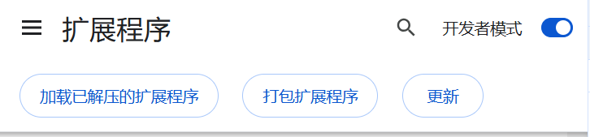
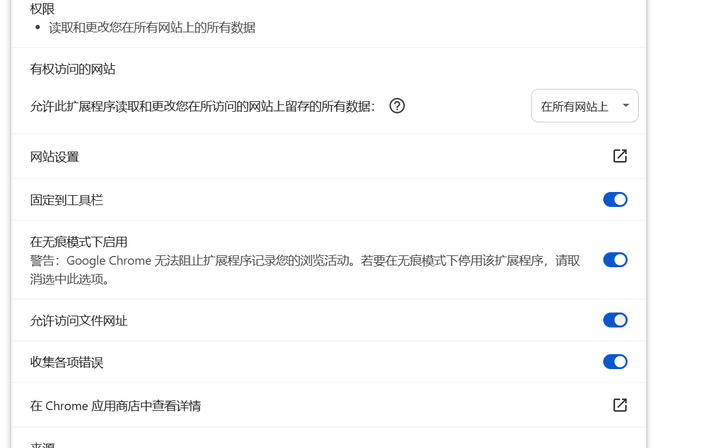
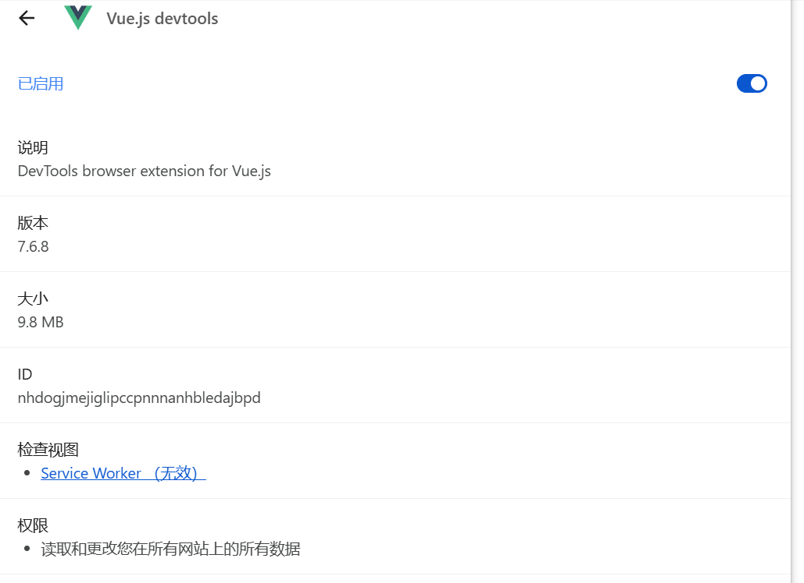

# 先理解什么是DOM、BOM、事件模型
# 一、什么是DOM？
## 总结
1. HTML 到 DOM 的转换：当浏览器加载 HTML 文档时，它会将其解析成 DOM 结构，使得开发者可以通过 JavaScript 以编程方式与网页进行交互。
2. 直观理解：可以把 DOM 想象成一个**可编程的网页树**，你可以**通过 JavaScript 访问和操作这棵树的每一个节点**，从而动态地**更改网页的内容和结构**。
## 详细解释
1.  **DOM（Document Object Model）**是W3C组织推荐的处理可扩展置标语言的**标准编程接口**。它定义了处理网页内容的模型，并提供了对文档内容的各种操作方法。
2.  DOM模型是一个**树形结构**，树的根节点是Document对象，它**包含了HTML文档的所有节点**。每个节点都可以拥有自己的**属性、方法和子节点。**
- 树形结构
树状结构：把整个 HTML 文档看作一棵树。**文档的每个部分（元素、属性和文本、注释等）都是树的一个节点**。例如，一个 HTML 文档中的 <html> 标签是根节点，<head> 和 <body> 是它的子节点，<p>、<div> 等又是 <body> 的子节点。
可视化：
HTML
├── HEAD
└── BODY
    ├── DIV
    └── P
3. 节点类型
节点：包含**元素节点**（表示 HTML 标签）、**文本节点**（标签内的文本）、**属性节点**（标签中的属性）。每个节点都可以通过 JavaScript 进行访问和操作。
示例类型：
- 文档节点：整个 HTML 文档，根节点。
- 元素节点：<html>、<head>、<body>、<p>、<div> 等。
- 文本节点：这是文本内容。
- 属性节点：class="example" id="content" 。
- 注释节点：<!-- 这是注释 -->

4. 编程接口
编程接口：DOM 不仅仅是一个结构，它还提供了编程接口，通过这些接口，开发者可以通过 JavaScript 动态访问和修改网页内容。
示例操作：
获取元素：使用 document.getElementById() 或 document.querySelector() 获取某个元素。
修改内容：使用 element.innerHTML 修改元素的内容。
添加事件：使用 element.addEventListener() 添加事件处理程序。


# 什么是BOM?
## 概述
BOM（**浏览器对象模型**，Browser Object Model）是一个用于与浏览器进行交互的 JavaScript API，它使得开发者能够访问和操作浏览器的特性和功能，而不仅仅是网页的内容。**BOM 主要关注浏览器窗口、框架和浏览器本身的一些功能。**
## 主要组成部分
1. window 对象：
BOM 的核心是 window 对象，它代表了浏览器窗口。通过 window 对象，开发者可以访问浏览器提供的许多功能，例如：
- 访问窗口大小：window.innerWidth 和 window.innerHeight。
- 显示弹出对话框：使用 alert()、confirm() 和 prompt() 方法。
- 访问定时器：使用 setTimeout() 和 setInterval()。
- 访问浏览器导航：使用 window.history 和 window.location。
2. document 对象：
**虽然 document 对象通常与 DOM 相关，但它也是 BOM 的一部分。**
document 代表当前加载的文档，可以用来访问和操作页面内容。
3. navigator 对象：
navigator 提供有关浏览器的信息，例如浏览器的名称、版本、操作系统等。可以通过 navigator.userAgent 获取用户代理字符串。
4. location 对象：
location 对象是 window 对象的一部分，表示当前文档 URL，并提供了一些方法和属性来获取和修改这个 URL，例如 window.location.href、window.location.reload()。
5. history 对象：
history 对象用于访问用户的浏览历史。开发者可以使用 history.back()、history.forward() 和 history.go() 来控制用户的浏览行为。
6. screen 对象：
screen 对象提供了关于用户屏幕分辨率和色彩的一些信息。

# 什么是事件模型？
## 概述
在前端开发中，事件模型是指**浏览器**如何**处理用户与网页交互的操作**（即事件）以及如何在这些事件发生时进行处理的机制。**理解事件模型**对于创建交互性强的网页或应用**非常重要。**
事件模型是指**事件驱动模型**，它是一种**基于事件的编程模型**，它使得开发者可以**监听和响应浏览器或网页的各种事件**。
## 事件定义
是用户在浏览器中与页面**交互**的动作，比如**点击、键入、悬停、滚动**等。事件可以来自用户（例如鼠标点击、键盘输入），也可以来自程序（例如定时器、网络请求等）。

## 事件模型的组成
事件模型主要由以下几个部分组成：
1. 事件源：触发事件的对象，通常是 DOM 元素。例如，用户点击的按钮或输入框都是事件源。
2. 事件类型：表示特定的用户操作。例如，click、keydown、mouseover 等。
3. 事件处理程序（事件监听器）：是响应特定事件时要执行的函数，可以通过 addEventListener 添加。这些函数会在事件发生时被调用。

## 事件流
事件流描述的是**事件在网页中的传播顺序**。
事件流分为三个阶段：
1. 捕获阶段：事件从 document 节点开始，沿着 DOM 树向下传播到目标节点。
2. 目标阶段：事件到达目标节点，触发事件处理程序。
3. 冒泡阶段：事件从目标节点开始，沿着 DOM 树向上传播到 document 节点。
举例解释：查看event示例
click 事件是冒泡阶段的事件，它会在目标节点和所有其外层的父节点直至document根节点，**由内而外顺序触发**。前提是同样类型的事件在每一层中被定义，且没有被stop阻止。
click.capture 事件是捕获阶段的事件，它会在 document 根节点、中间所有父节点、目标节点触发上，**由外而内顺序触发**。前提是同样类型的事件在每一层中被定义，且没有被stop阻止。
click.stop  事件可以阻止事件在 DOM 树中的传播，例如 event.stopPropagation() 。可以阻止冒泡和捕获阶段的事件。

## 事件监听
在 JavaScript 中，可以使用 addEventListener 方法来为某个元素注册事件监听器：

const button = document.getElementById('myButton');
button.addEventListener('click', function() {
    alert('按钮被点击了！');
});
addEventListener 方法的第一个参数是事件类型，第二个参数是事件处理程序，它是一个函数，在事件发生时会被调用。

vue中一般使用watch函数来监听数据变化，当数据变化时，会触发相应的函数。

# 一、Vue.js介绍
- **简介：**是一个流行的前端框架基于Javascript，用于构建用户界面和单页应用程序（SPA）
尽管vue2已经停止了更新维护，但相对的他算是一个成熟的框架，而且相较于vue3简单易上手，前期建议通过vue2来了解vue的模式，后期在转入Vue3的时候也会更加丝滑易上手;


# 二、特点与核心
1. 响应式数据绑定
- ①简介：
Vue 2 的响应式系统是vue中最基础和核心的特性之一，它通过数据劫持和发布-订阅模式实现，使得数据的变化能够自动更新视图。
- ②关键点：
数据劫持：主要使用 Object.defineProperty 拦截对数据的访问和修改。
自动更新：当数据产生变化时，Vue 会自动触发视图更新。
2. 组件化
- ①简介：
组件是 Vue 应用的基本构建模块。组件化开发使得应用结构更清晰，代码更容易维护和重用。
（类似你定制了一个积木件，具备自己功能的同时可以和其他工具结合使用）
- ②关键点：
可复用：每个组件都具有独立的逻辑、样式和模板
嵌套：组件可以互相嵌套，构建复杂的用户界面。
3. 指令
- ①简介：
指令是一种特殊的标记，用于在模板中对 DOM（文档对象模型） 元素进行特定的行为处理。Vue 提供了一系列内置指令，如 v-bind、v-if、v-for 和 v-model。
- ②关键点：
简化 DOM 操作：通过指令直接在模板中操作 DOM 元素，不需要编写繁杂的js代码实现
扩展性：可以自定义指令，以满足特定需求。

***标准的vue页面结构***
- 模板（Template）部分：
- 用于定义页面的 HTML 结构和内容。通常在 <template> 标签内编写。
- 脚本（Script）部分：
- 用于定义 Vue 组件的逻辑，包括数据、方法、生命周期钩子等。通常在 <script> 标签内编写。
- 样式（Style）部分：
- 用于定义组件的 CSS 样式。通常在 <style> 标签内编写，可以选择作用于当前组件的局部样式。
- 标准的 Vue 组件结构示例如下：

\<template>
\  <div>
    <!-- 组件的 HTML 结构 -->
\  </div>
\</template>

\<script>
export default {
  data() {
    return {
      // 定义组件的数据
    };
  },
  methods: {
    // 定义组件的方法
  },
  // 其他组件选项，如生命周期钩子等
};
\</script>

\<style scoped>
/* 组件的 CSS 样式 */
\</style>

- 在这个标准结构中：
\<template> 部分是用户在浏览器中看到的内容。
\<script> 部分包含了组件的逻辑，控制数据的处理和用户的交互。
\<style> 部分定义了该组件的样式，可以使用 scoped 属性使样式仅适用于该组件，避免样式冲突。
这种结构使得 Vue 组件具有清晰的分离，可以更好地组织和管理代码。


# 使用 @vue/cli 创建项目
## 安装vue及相关的依赖包
npm install vue   //安装vue
npm install vuex  //状态管理
npm install vue-router  //
npm install --save-dev @vue/test-utils  //
npm install --save-dev vue-loader  //
npm install -g @vue/cli //全局安装vue脚手架

## 使用 CLI 创建 3.x 项目
Vue CLI 全局安装后，可以在命令行输入 vue 进行操作，创建项目使用的是 create 命令：
vue create hello-vue3

- 由于要使用 TypeScript ，所以需要选择最后一个选项来进行自定义搭配，通过键盘的上下箭头进行切换选择：

Vue CLI v5.0.4
? Please pick a preset:
  Default ([Vue 3] babel, eslint)
  Default ([Vue 2] babel, eslint)
> Manually select features

- 多选菜单可以按空格选中需要的依赖，总共选择了下面这些选项：
Vue CLI v5.0.4
? Please pick a preset: Manually select features
? Check the features needed for your project: (Press <space> to select,
<a> to toggle all, <i> to invert selection, and <enter> to proceed)
 (*) Babel
 (*) TypeScript
 ( ) Progressive Web App (PWA) Support
 (*) Router
 (*) Vuex
 (*) CSS Pre-processors
>(*) Linter / Formatter
 ( ) Unit Testing
 ( ) E2E Testing

- 选择 Vue 版本，要用 Vue 3 所以需要选择 3.x ：
? Choose a version of Vue.js that you want to start the project with
  (Use arrow keys)
> 3.x
  2.x

- 是否选择 Class 语法的模板，在 Vue 2 版本为了更好的支持 TypeScript ，通常需要使用 Class 语法，由于 Vue 3 有了对 TypeScript 支持度更高的 Composition API ，因此选择 n ，也就是 “否” ：
? Please pick a preset: Manually select features
? Check the features needed for your project: Babel, TS, Router, Vuex, CSS
Pre-processors, Linter
? Choose a version of Vue.js that you want to start the project with 3.x
? Use class-style component syntax? (y/N) n

- Babel 可以把新版本的 JavaScript 语句转换为兼容性更好的低版本 Polyfill 写法，所以选 y 确认使用：
? Use Babel alongside TypeScript
  (required for modern mode, auto-detected polyfills, transpiling JSX)?
  (Y/n) y

- 接下来是选择路由模式，选 y 启用 History 模式，选 n 使用 Hash 模式，可根据项目情况选择。
建议先选 y 确认，如果遇到部署的问题可以在 “路由” 一章的 部署问题与服务端配置 小节查看如何处理。

? Use history mode for router?
  (Requires proper server setup for index fallback in production)
  (Y/n) y

- 选择一个 CSS 预处理器，可以根据自己的喜好选择，不过鉴于目前开源社区组件常用的都是 Less ，所以也建议选择 Less 作为入门的预处理器工具。

? Pick a CSS pre-processor (PostCSS, Autoprefixer and CSS Modules are supported
 by default):
  Sass/SCSS (with dart-sass)
> Less
  Stylus


- Lint 规则，用来代码检查，写 TypeScript 离不开 Lint ，可以根据自己喜好选择，也可以先选择默认，后面在 添加协作规范 一节也有说明如何配置规则，这里先默认第一个：
? Pick a linter / formatter config: (Use arrow keys)
> ESLint with error prevention only
  ESLint + Airbnb config
  ESLint + Standard config
  ESLint + Prettier


- Lint 的校验时机，一个是在保存时校验，一个是在提交 commit 的时候才校验，这里也选默认：

? Pick additional lint features: (Press <space> to select,
 <a> to toggle all, <i> to invert selection, and <enter> to proceed)
>(*) Lint on save
 ( ) Lint and fix on commit


- 项目配置文件，笔者更习惯保存为独立文件：

? Where do you prefer placing config for Babel, ESLint, etc.?
  (Use arrow keys)
> In dedicated config files
  In package.json

- 是否保存为未来的项目配置，存起来方便以后快速创建：

? Save this as a preset for future projects? Yes
? Save preset as: vue-3-ts-config

**至此**，项目创建完成！可以通过 npm run serve 开启热更进行开发调试，通过 npm run build 构建打包上线。

**对服务指定端口**   $ npm run serve -- --port 9001

## VUE/CLI 的可视化工具
Vue CLI 提供了一个图形用户界面（GUI），称为 Vue CLI UI。通过这个界面，你可以更方便地创建、管理、配置 Vue 项目。
**运行 Vue CLI UI 命令：vue ui**
- 可以将已经创建的项目的根目录直接导入，然后就可以在界面上进行配置、管理。
- 也可以创建新的项目


# 添加协作规范
考虑到后续可能会有团队协作，最好是能够统一编码风格。

Editor Config
在项目根目录下再增加一个名为 .editorconfig 的文件。

这个文件的作用是强制编辑器以该配置来进行编码，比如缩进统一为空格而不是 Tab ，每次缩进都是 2 个空格而不是 4 个等等。

TIP:
部分编辑器可能需要安装对应的插件才可以支持该配置。
例如 VSCode 需要安装 EditorConfig for VSCode 扩展。

文件内容如下：
\ # http://editorconfig.org
root = true

[*]
charset = utf-8
end_of_line = lf
indent_size = 2
indent_style = space
insert_final_newline = true
max_line_length = 80
trim_trailing_whitespace = true

[*.md]
max_line_length = 0
trim_trailing_whitespace = false


## 详解
团队协作，或者有时候你从 GitHub 或者其他地方拷贝人家的组件插件下来，想修改，发现代码风格不一致，比如自己习惯 2 个空格的缩进，但别人是 4 个空格，或者直接用 tab，这就 emmm 了不是…
分享一个神器，只需要命名为 .editorconfig ，保存到自己的项目根目录下，即可让项目下所有文件都统一代码风格，非常棒！

## 官网 https://editorconfig.org/

## 常用配置：
附上我常用的一个 config 文件：

\# http://editorconfig.org
root = true

[*]
charset = utf-8
end_of_line = lf 
indent_size = 2       // 缩进大小
indent_style = space  // 缩进风格
insert_final_newline = true  // 末尾自动添加换行符
max_line_length = 80  // 最大行长度
trim_trailing_whitespace = true  // 去掉行尾空格

[*.md]
max_line_length = 0 // 禁止 md 文件的行长度限制
trim_trailing_whitespace = false // 禁止 md 文件的行尾空格

配置基本都是语义化，一看就知道是什么意思，可根据自己的习惯调整！

## 更多配置：
当然也支持更多的配置，具体的配置说明如下：
一、常用属性配置
1、root <boolean>

是否是顶级配置文件，设置为 true 的时候才会停止搜索.editorconfig 文件

2、charset <"latin" | "utf-8" | "utf-8-bom" | "utf-16be" | "utf-16le">

编码格式

3、indent_style <"tab" | "space">

缩进方式

4、indent_size <number>

缩进大小

5、end_of_line<"lf" | "cr" | "crlf">

换行符类型

6、insert_final_newline <boolean>

是否让文件以空行结束

7、trim_trailing_whitespace <boolean>

是否删除行尾空格

8、max_line_length <number>

最大行宽。

二、常用文件名匹配
1、*

匹配除/之外的任意字符

2、**

匹配任意字符串

3、?

匹配任意单个字符

4、[name]

匹配 name 字符

5、[!name]

不匹配 name 字符

6、[s1,s2,s3]

匹配给定的字符串

7、[num1..num2]

匹配 num1 到 mun2 直接的整数

# Prettier
Prettier 是目前最流行的代码格式化工具，可以约束的代码风格不会乱七八糟，目前所知道的知名项目（如 Vue 、 Vite 、 React 等）和大厂团队（谷歌、微软、阿里、腾讯等）都在使用 Prettier 格式化代码。

通过脚手架创建的项目很多都内置了 Prettier 功能集成（例如 Create Preset ，参考了主流的格式化规范，比如 2 个空格的缩进、无需写分号结尾、数组 / 对象每一项都带有尾逗号等等）。

如果需要手动增加功能支持，请在项目根目录下创建一个名为 .prettierrc 的文件，写入以下内容：
{
  "semi": false,
  "singleQuote": true
  "prettier.useEditorConfig": true
}
这代表 JavaScript / TypeScript 代码一般情况下不需要加 ; 分号结尾，然后使用 '' 单引号来定义字符串等变量。

这里只需要写入与默认配置不同的选项即可，如果和默认配置一致，可以省略，完整的配置选项以及默认值可以在 Prettier 官网的 Options Docs 查看。

配合 VSCode 的 VSCode Prettier 扩展，可以在编辑器里使用该规则格式化文件（**此时无需在项目下安装 Prettier 依赖**）。
**不管用不用先安装，插件也安装**  vscode编辑的话，可能不需要安装该依赖，只需要在vscode中安装第三方插件即可。如果不再IDE中编辑，可能则需要安装这个依赖，我没有测试过：
 npm install --save-dev prettier

**目前已知的方式是这样：**
在前端或者后端项目的根目录中，配置.editorconfig 文件，配置好编码格式、缩进风格、缩进大小、换行符类型、末尾自动添加换行符、去掉行尾空格、最大行宽等规则。
vscode编辑器下载安装prettier插件prettier-Code formatter，配置该插件，Prettier: Use Editor Config为true，这样就可以自动读取.editorconfig文件中的配置了。
prettier-Code formatter 插件的配置，还有其他很多配置选项，可以根据需要选择配置。

# ESLint
ESLint 是一个查找 JavaScript / TypeScript 代码问题并提供修复建议的工具，换句话说就是可以约束的代码不会写出一堆 BUG ，它是代码健壮性的重要保障。

# vutur
Vetur 是一个为 VS Code 开发的 Vue 工具扩展，旨在提供全面的 Vue 开发支持。它包括语法高亮、语义高亮、代码片段、Emmet 支持、代码检查、格式化、智能感知和调试等功能。Vetur 的目标是提高 Vue 开发者在 VS Code 中的开发效率和体验。

# 可视化创建vue项目
 执行：vue ui，可以打开浏览器如图：
 
 这里我没有选用可视化的方式进行创建操作，先留着看看后期有什么有价值的使用场景没有

# 项目初始化

至此，通过脚手架已经搭好了一个可直接运行的基础项目，已经可以正常的 npm run dev 和 npm run build 了（ **具体命令取决于的项目脚本命令的配置** ），项目配置和编辑器也都弄好了，是不是可以开始写代码了呢？

请不要着急，还需要了解一点东西，就是如何初始化一个 Vue 3 项目。

因为在实际开发过程中，还会用到各种 npm 包，像很多 UI 框架、功能插件的引入都是需要在 Vue 初始化阶段处理。

甚至有时候还要脱离脚手架，采用 CDN 引入的方式来开发，所以开始写组件之前，还需要了解一下在 Vue 3 项目中，初始化阶段对比 Vue 2 的一些变化。

## 入口文件
- 项目的初始化都是在入口文件集中处理，Vue 3 的目录结构对比 Vue 2 没有变化，入口文件依然还是 main.ts 这个文件。
- 但是 Vue 3 在初始化的时候，做了不少的调整，代码写法和 Vue 2 完全不同。对于这次大改动，笔者认为是好的，因为统一了相关生态的启用方式，不再像 Vue 2 时期那样多方式共存，显得比较杂乱。

## 了解 Vue 3
在 Vue 3 ，使用 createApp 执行 Vue 的初始化，创建vue的实例。
另外不管是 Vue 生态里的东西，还是外部插件、 UI 框架，统一都是由** use() **进行激活，非常统一和简洁：

## Vue Devtools
Vue Devtools 是一个浏览器扩展，支持 Chrome 、 Firefox 等浏览器，需要先安装才能使用。
下载地址：https://www.jb51.net/softs/836487.html
我自己通过科学上网，使用google的app市场，下载安装了这个插件，记住，插件的配置中的那些选项最好都打开
我的版本是7.6.8



**注意：**
如果要开始使用，则需要启动你的本地开发环境，
**举例1：**我的vue-cli项目，在终端执行：npm run serve，然后在浏览器中访问：http://localhost:8080/，打开浏览器，f12打开浏览器调试工具，在最上面的导航栏里面新增了一个 Vue 选项，点击进入，就可以看到 Vue Devtools 的界面了。
**举例2：**我的vite项目，在终端执行：npm run dev，然后在浏览器中访问：http://localhost:5173/，打开浏览器，f12打开浏览器调试工具，在最上面的导航栏里面新增了一个 Vue 选项，点击进入，就可以看到 Vue Devtools 的界面了。


## 启动服务
npm run serve   //这个服务是vue-cli-service提供的，可以快速启动一个本地服务，并且支持热更新。命令在项目的package.json中配置。

 hello-vue3@0.1.0 serve
 vue-cli-service serve

 INFO  Starting development server...


 DONE  Compiled successfully in 4562ms                                  14:53:25


  App running at:
  - Local:   http://localhost:8080/
  - Network: http://192.168.0.104:8080/

  Note that the development build is not optimized.
  To create a production build, run npm run build.

No issues found.

# 在html中直接将js代码，写到HTML文件的script标签中的几种方式和理解：

  **这部分内容，是我安装了vue3以后，初始学习vue的一些总结，源代码都在hello-vue3
项目的public文件中，算是从vue2开始学习vue3的一种方式。**

1. 首先需要在head标签中引入vuejs文件,类似：<script src="vue.js"></script>，也可以替换为CDN模式，我的这个文件，是从vue cli项目hello-vue3中，复制过去改名字的，我的源文件的路径：\hello-vue3\node_modules\vue\dist\vue.global.js

2. 创建vue实例、组件、挂载的几种情况
-  **第一种方式** **不含组件创建**
a. 创建对象：   const App = {}
b. 对象的花括号内写： data(){return{}},methods:{},computed:{} 
c. 创建vue实例：const app = Vue.createApp(App);
d. 挂载实例：   app.mount('#app')
e. 更多方式：也可以在对象外部，script标签中，定义变量和函数，然后在对象中使用
f. 我没有这种方式创建过组件，不想思考了，暂时没用。

-  **第二种方式** **含组件创建**  **这应该是vue2的常规写法**
a. 创建vue实例：   const App = Vue.createApp({})
花括号中，可以写父组件定义的响应式变量、v-model、v-on、v-bind等外部传入的输入框值的绑定变量、属性的绑定变量、子组件方法传递到父组件中的方法等。  响应式变量/绑定变量和方法，还是要写成这样的形式：data(){return{绑定变量}},methods:{子组件传递的方法},computed:{计算属性} 
b. 创建组件对象：   const alertComponent = {}
c. 对象的花括号内写： data(){return{}},methods:{},computed:{} 
d. 花括号内还包含：template模：可以写html语句，但需要使用` `符号包裹，不能使用单引号。对象中需要定义props外部属性，props属性是父组件向子组件传递属性的值的方式。
e. 注册全局组件：   App.component('alert-component',alertComponent)
f. 挂载实例：       App.mount('#Application')

- 第三种方式 **含组件创建**  **setup函数，这应该是vue3的常规写法**
a. 创建vue实例：const App = Vue.createApp({})
b. 创建组件对象：const com = {}
花括号中包含：**setup函数**，和**template组件模板**，根据需要可以添加**CSS样式**。
c. 使用setup函数，处理数据、方法、计算属性等。
使用setup(props,context)函数，props是外部父组件传入的属性，
context是上下文对象，可以获取父组件的属性、方法、数据等。
setup函数体内包含：data(){return{}},methods:{},computed:{} 这是**一种vue2时代的写法**。
**另一种写法**：就是面向对象编程语言的写法，直接定义变量和方法，变量如果是响应式变量，需要用Vue.ref或者Vue.reactive这两个方法来定义。
**两者的区别是**：在template模板中，ref定义的响应式变量，直接引用变量名称就可以，reactive定义的响应式变量，需要用变量名称.value 这种方式来引用。
记住数据和方法都写好了，**一定要全部return出去，不然不会渲染。**
d. 创建template组件模板：写html语句，但需要使用` `符号包裹，不能使用单引号。
e. 创建组件：      App.component("com",com)
f. 挂载实例：      App.mount('#Application')

## 初期接触的粗浅总结
1. option API：**vue2的主要写法**
data(){return{}},methods:{},computed:{},watch

当然，同时也包括生命周期函数：beforeCreate、created、beforeMount、mounted、beforeUpdate、updated、beforeDestroy、destroyed、errorCaptured

2. Composition API： **vue3的主要写法**
- 每个组件都可以定义一个 setup 函数，该函数在组件实例被创建之前执行。开发者可以在该函数中声明响应式状态、计算属性和方法。返回的内容会在模板中可用。 
setup(props,context){return{}}}

- 响应式 API：
Composition API 提供了新的响应式 API（如 ref 和 reactive）来创建响应式数据。

- **生命周期函数**：
生命周期钩子可以在 setup 函数中使用，比如 onMounted、onUpdated、onBeforeUnmount 等，允许开发者在组件的不同生命周期阶段执行特定逻辑。


# 全新的 setup 函数
在开始编写 Vue 组件之前，需要了解两个全新的前置知识点：
- 全新的 setup 函数，关系到组件的生命周期和渲染等问题
- 写 TypeScript 组件离不开的 defineComponent API

## setup 的含义
Vue 3 的 Composition API 系列里，推出了一个全新的 setup 函数，它是一个组件选项，在创建组件之前执行，一旦 props 被解析，便作为组合式 API 的入口点。
说的通俗一点，就是在使用 Vue 3 生命周期的情况下，**整个组件相关的业务代码，都可以放在 setup 里**执行。
因为在 setup 之后，其他的生命周期才会被启用。
基本语法：
// 这是一个基于 TypeScript 的 Vue 组件
import { defineComponent } from 'vue'

export default defineComponent({
  setup(props, context) {
    // 在这里声明数据，或者编写函数并在这里执行它

    return {
      // 需要给 `<template />` 用的数据或函数，在这里 `return` 出去
    }
  },
})

## setup 的参数使用
setup 函数包含了两个入参：
|参数	|类型|	含义	|是否必传|
|-------|-------|-------|-------|
|props	|object	|由父组件传递下来的数据	|否|
|context	|object	|组件的执行上下文	|否|

1. props
它是响应式的，当父组件传入新的数据时，它将被更新。
请不要解构它，这样会让数据失去响应性，一旦父组件发生数据变化，解构后的变量将无法同步更新为最新的值。
可以使用 Vue 3 全新的响应式 API toRef / toRefs 进行响应式数据转换，下文将会介绍全新的响应式 API 的用法。

2. context
context 只是一个普通的对象，它暴露组件的3个 Property ：
它包含了一些属性和方法，可以帮助我们操作组件的状态、渲染等。
|属性|	类型|	作用|
|-------|-------|-------|
|attrs	|非响应式对象|未在 Props 里定义的属性都将变成 Attrs|
|slots	|非响应式对象	|组件插槽，用于接收父组件传递进来的模板内容|
|emit	|方法	|触发父组件绑定下来的事件|
- 因为 context 只是一个普通对象，所以可以直接使用 ES6 解构。
- 平时使用可以通过直接传入 { emit } ，即可用 emit('xxx') 来代替使用 context.emit('xxx')，另外两个功能也是如此。
- 但是 attrs 和 slots 请保持 attrs.xxx、slots.xxx 的方式来使用其数据，不要进行解构，虽然这两个属性不是响应式对象，但对应的数据会随组件本身的更新而更新。

# defineComponent 的作用
defineComponent 是 Vue 3 推出的一个全新 API ，**可用于对 TypeScript 代码的类型推导**，帮助开发者简化掉很多编码过程中的类型声明。

- 比如，原本需要这样才可以使用 setup 函数：

import { Slots } from 'vue'

// 声明 `props` 和 `return` 的数据类型
interface Data {
  [key: string]: unknown
}

// 声明 `context` 的类型
interface SetupContext {
  attrs: Data
  slots: Slots
  emit: (event: string, ...args: unknown[]) => void
}

// 使用的时候入参要加上声明， `return` 也要加上声明
export default {
  setup(props: Data, context: SetupContext): Data {
    // ...

    return {
      // ...
    }
  },
}


- 每个组件都这样进行类型声明，**会非常繁琐**
- 如果使用了 **defineComponent** ，就可以省略这些类型声明：

import { defineComponent } from 'vue'

// 使用 `defineComponent` 包裹组件的内部逻辑
export default defineComponent({
  setup(props, context) {
    // ...

    return {
      // ...
    }
  },
})
代码量瞬间大幅度减少，只要是 Vue 本身的 API ， defineComponent 都可以自动推导其类型，这样开发者在编写组件的过程中，只需要维护自己定义的数据类型就可以了，可专注于业务。

# 组件的生命周期
在了解了 Vue 3 组件的两个前置知识点后，不着急写组件，还需要先了解组件的生命周期，**这个知识点非常重要**，只有理解并记住组件的生命周期，才能够灵活地把控好每一处代码的执行，使程序的运行结果可以达到预期。

## 关于 Vue 生命周期的变化，可以从下表直观地了解：
|Options API （选项式 API ）	|Composition API|	执行时间说明|
|-------|-------|-------|
|beforeCreate	|setup	|组件创建前执行|
|created	|setup	|组件创建后执行|
|beforeMount	|onBeforeMount	|组件挂载到节点上之前执行|
|mounted|	onMounted	|组件挂载完成后执行|
|beforeUpdate|	onBeforeUpdate|	组件更新之前执行|
|updated	|onUpdated|组件更新完成之后执行|
|beforeDestroy	|onBeforeUnmount	|组件卸载之前执行|
|destroyed	|onUnmounted	|组件卸载完成后执行|
|errorCaptured	|onErrorCaptured	|当捕获一个来自子孙组件的异常时激活钩子函数|

# 使用 3.x 的生命周期
在 Vue 3 的 Composition API 写法里，每个生命周期函数都要先导入才可以使用，
并且所有生命周期函数统一放在 setup 里运行。

- 以下是几个生命周期的执行顺序对比：
import { defineComponent, onBeforeMount, onMounted } from 'vue'

export default defineComponent({
  setup() {
    console.log(1)

    onBeforeMount(() => {
      console.log(2)
    })

    onMounted(() => {
      console.log(3)
    })

    console.log(4)
  },
})

最终将按照生命周期的顺序输出：
// 1
// 4
// 2
// 3

# 组件的基本写法
Vue 3 在保留对 Class Component 支持的同时，推出了全新的 Function-based Component ，更贴合 JavaScript 的函数式编程风格，这也是接下来要讲解并贯穿全文使用的 Composition API 新写法。

# 了解 Vue 3
Vue 3 从设计初期就考虑了 TypeScript 的支持，其中 defineComponent 这个 API 就是为了解决 Vue 2 对 TypeScript 类型推导不完善等问题而推出的。
以下组合是 Vue 官方最为推荐的组件声明方式：
defineComponent + Composition API + Template

- 下面看看如何使用 Composition API 编写一个最简单的 Hello World 组件：
<!-- Template 代码和 Vue 2 一样 -->
<template>
  <p class="msg">{{ msg }}</p>
</template>

<!-- Script 代码需要使用 Vue 3 的新写法-->
<script lang="ts">
// Vue 3 的 API 需要导入才能使用
import { defineComponent } from 'vue'

// 使用 `defineComponent` 包裹组件代码
// 即可获得完善的 TypeScript 类型推导支持
export default defineComponent({
  setup() {
    // 在 `setup` 方法里声明变量
    const msg = 'Hello World!'

    // 将需要在 `<template />` 里使用的变量 `return` 出去
    return {
      msg,
    }
  },
})
</script>

<!-- CSS 代码和 Vue 2 一样 -->
<style scoped>
.msg {
  font-size: 14px;
}
</style>


# 响应式数据的变化
响应式数据是 MVVM 数据驱动编程的特色， Vue 的设计也是受 MVVM 模型的启发，相信大部分开发者选择 MVVM 框架都是因为数据驱动编程比传统的事件驱动编程要来得方便，而选择 Vue ，则是方便中的方便。

Model-View-View-Model （简称 MVVM ） 是一种软件架构模式，将视图 UI 和业务逻辑分开，通过对逻辑数据的修改即可驱动视图 UI 的更新，因此常将这种编程方式称为 “数据驱动” ，与之对应的需要操作 DOM 才能完成视图更新的编程方式则称为 “事件驱动” 。


举例：vue2中的是使用了 Object.defineProperty API 的 getter/setter 来实现数据的响应性，
使用 Object.defineProperty 实现一个简单的双向绑定 demo 

<!DOCTYPE html>
<html lang="en">
  <head>
    <meta charset="UTF-8" />
    <meta http-equiv="X-UA-Compatible" content="IE=edge" />
    <meta name="viewport" content="width=device-width, initial-scale=1.0" />
    <title>DefineProperty Demo</title>
  </head>
  <body>
    <!-- 输入框和按钮 -->
    <div>
      <input type="text" id="input" />
      <button onclick="vm.text = 'Hello World'">设置为 Hello World</button>
    </div>
    <!-- 输入框和按钮 -->

    <!-- 文本展示 -->
    <div id="output"></div>
    <!-- 文本展示 -->

    <script>
      // 声明一个响应式数据
      const vm = {}
      Object.defineProperty(vm, 'text', {
        set(value) {
          document.querySelector('#input').value = value
          document.querySelector('#output').innerText = value
        },
      })

      // 处理输入行为
      document.querySelector('#input').oninput = function (e) {
        vm.text = e.target.value
      }
    </script>
  </body>
</html>

vue3 是使用了 Proxy API 的 getter/setter 来实现数据的响应性，这个方法的具体用法可以参考 MDN 的文档： Proxy - MDN 。
同样的，也来实现一个简单的双向绑定 demo ，这次使用 Proxy 来实现：
<!DOCTYPE html>
<html lang="en">
  <head>
    <meta charset="UTF-8" />
    <meta http-equiv="X-UA-Compatible" content="IE=edge" />
    <meta name="viewport" content="width=device-width, initial-scale=1.0" />
    <title>Proxy Demo</title>
  </head>
  <body>
    <!-- 输入框和按钮 -->
    <div>
      <input type="text" id="input" />
      <button onclick="vm.text = 'Hello World'">设置为 Hello World</button>
    </div>
    <!-- 输入框和按钮 -->

    <!-- 文本展示 -->
    <div id="output"></div>
    <!-- 文本展示 -->

    <script>
      // 声明一个响应式数据
      const vm = new Proxy(
        {},
        {
          set(obj, key, value) {
            document.querySelector('#input').value = value
            document.querySelector('#output').innerText = value
          },
        }
      )

      // 处理输入行为
      document.querySelector('#input').oninput = function (e) {
        vm.text = e.target.value
      }
    </script>
  </body>
</html>


# 使用 Composition API 编写组件，这是使用 Vue 3 的最大优势。
# 响应式 API 之 ref
ref 是最常用的一个响应式 API，它可以用来定义所有类型的数据，包括 Node 节点和组件。

## 类型声明
在开始使用 API 之前，需要先了解在 TypeScript 中如何声明 Ref 变量的类型。

### API 本身的类型
- 先看 API 本身， ref API 是一个函数，通过接受一个泛型入参，返回一个响应式对象，所有的值都通过 .value 属性获取，这是 API 本身的 TS 类型：
`ref` API 的 TS 类型
function ref<T>(value: T): Ref<UnwrapRef<T>>

解释：T 是一个泛型参数，代表传入的值的类型。
value: T 表示你传入的初始值。
Ref<UnwrapRef<T>> 是这个函数的返回值类型，表明返回的对象是一个包含 value 属性的 Ref 类型。
UnwrapRef<T> 是一个用于解包响应式对象的类型工具，确保你在使用 ref 创建的对象时不需要一直使用 .value 来访问原始值。

`ref` API 的返回值的 TS 类型
interface Ref<T> {
  value: T
}

两段代码，个人理解的意思是：ref是泛型函数，返回值是一个泛型对象，这个泛型对象是用接口形式定义的

###  这里导入的 `ref` 是一个响应式 API
import { defineComponent, ref } from 'vue'

export default defineComponent({
  setup() {
    // 通过响应式 API 创建的变量具备了响应性
    const msg = ref<string>('Hello World!')
  },
})

- 如果在开发过程中需要在函数里返回一个 Ref 类型的变量，那么其 TypeScript 类型就可以这样写（请留意 Calculator 里的 num 变量的类型）：

// 导入 `ref` API
import { ref } from 'vue'
// 导入 `ref` API 的返回值类型，**注意type是导入类型，不是实际的值**
import type { Ref } from 'vue'

// 声明 `useCalculator` 函数的返回值类型
interface Calculator {
  // 这里包含了一个 Ref 变量
  num: Ref<number>
  add: () => void
}

// 声明一个 “使用计算器” 的函数
function useCalculator(): Calculator {
  const num = ref<number>(0)

  function add() {
    num.value++
  }

  return {
    num,
    add,
  }
}

// 在执行使用计算器函数时，可以获取到一个 Ref 变量和其他方法
const { num, add } = useCalculator()
add()
console.log(num.value) // 1

**上面这个简单的例子**演示了如何手动指定 Ref 变量的类型，对于逻辑复用时的函数代码抽离、插件开发等场景**非常有用**！

## 变量的定义
###  基本类型
对字符串、布尔值等基本类型的定义方式，比较简单：

// 字符串
const msg = ref<string>('Hello World!')

// 数值
const count = ref<number>(1)

// 布尔值
const isVip = ref<boolean>(false)

### 引用类型
对于对象、数组等引用类型也适用，比如要定义一个对象：

// 先声明对象的格式
interface Member {
  id: number
  name: string
}

// 在定义对象时指定该类型
const userInfo = ref<Member>({
  id: 1,
  name: 'Tom',
})

- 定义一个普通数组：

// 数值数组
const uids = ref<number[]>([1, 2, 3])

// 字符串数组
const names = ref<string[]>(['Tom', 'Petter', 'Andy'])

### DOM 元素与子组件
除了可以定义数据，ref 也有熟悉的用途，就是用来挂载节点，也可以挂在子组件上

- 举例：
// 导入 Vue 相关函数和子组件
import { defineComponent, onMounted, ref } from 'vue'
import Child from '@cp/Child.vue'
 
// 定义一个 Vue 组件
export default defineComponent({
  // 注册子组件
  components: {
    Child,
  },
  // 组件的 setup 函数
  setup() {
    // 定义挂载节点，声明的类型详见下方附表
    //在 Js 和 Ts 中，HTMLElement 是一个接口，表示任何 HTML 元素（例如 <div>, <span>, <p> 等）的基本类型，通过将变量的响应式类型定义为该接口类型，就可以访问和操作 HTML 元素的属性和方法。当你定义一个变量为 HTMLElement 类型时，TypeScript 会确保你只能访问该元素支持的属性和方法。
    const msg = ref<HTMLElement>()
    const child = ref<InstanceType<typeof Child>>()
 
    // 请保证视图渲染完毕后再执行节点操作 e.g. `onMounted` / `nextTick`
    onMounted(() => {
      // 比如获取 DOM 的文本
      console.log(msg.value.innerText)
 
      // 或者操作子组件里的数据
      child.value.isShowDialog = true
    })
 
    // 必须 `return` 出去才可以给到 `<template />` 使用
    return {
      msg,
      child,
    }
  },
})

// 说明：
// 此代码定义了一个 Vue 组件，并在组件内使用 `setup` 函数进行状态管理和生命周期管理。
// 组件注册了一个子组件，通过 `onMounted` 生命周期钩子确保 DOM 操作在视图渲染后进行。

## 变量的读取与赋值
前面在介绍 API 类型的时候已经了解，通过 ref 声明的变量会全部变成对象，不管定义的是什么类型的值，都会转化为一个 Ref 对象，其中 Ref 对象具有指向内部值的单个 Property .value。

也就是说，任何 Ref 对象的值都必须通过 xxx.value 才可以正确获取。

请牢记上面这句话，初用 Vue 3 的开发者很多 BUG 都是由这个问题引起的（包括笔者刚开始使用 Vue 3 的那段时间，嘿嘿）。

## 为变量赋值
普通变量需要使用 let 声明才可以修改其值，由于 Ref 对象是个引用类型，所以可以使用 const 声明，直接通过 .value 修改。
- 举例：
// 声明一个字符串变量
const msg = ref<string>('Hi!')

// 等待 1s 后修改它的值
setTimeout(() => {
  msg.value = 'Hello!'
}, 1000)


# 响应式 API 之 reactive
reactive 是继 ref 之后最常用的一个响应式 API 了，相对于 ref ，它的局限性在于只适合对象、数组。

举例：
const data = ref<string[]>([])

// 提取接口的数据
data.value = api.data.map((item: any) => item.text)

// 重置数组
data.value = []
## 类型声明与定义
reactive 变量的声明方式没有 ref 的变化那么大，基本上和普通变量一样，它的 TS 类型如下：

ts
function reactive<T extends object>(target: T): UnwrapNestedRefs<T>


#VUE的一些指令
## 模板指令
vue中的模板指令也是HTML标签的属性，请通常以v-开头，后面跟上指令名称，再加上冒号和指令参数。

## v-if
v-if 指令可以用来控制元素是否渲染，其语法如下：

v-if="condition"   // 条件为 true 时渲染该元素

v-if="!condition"  // 条件为 false 时渲染该元素

v-if 指令的优先级高于 v-show，当 v-if 指令和 v-show 指令同时出现时，v-if 指令的优先级更高。

## v-show
v-show 指令用来控制元素的显示与隐藏，其语法如下：

v-show="condition"   // 条件为 true 时渲染该元素，false 时隐藏该元素

v-show 指令的优先级低于 v-if，当 v-if 指令和 v-show 指令同时出现时，v-if 指令的优先级更高。

## v-for
v-for 指令用来遍历数组或对象，其语法如下：

v-for="(item, index) in items"   // 遍历数组 items，将当前项 item 和索引 index 赋值给变量 item 和 index

v-for="(key, value) in object"   // 遍历对象 object，将当前键 key 和值 value 赋值给变量 key 和 value

v-for 指令的优先级高于 v-if，当 v-if 指令和 v-for 指令同时出现时，v-for 指令的优先级更高。

## v-text
v-text 指令用来设置元素的文本内容，其语法如下：

v-text="message"   // 将变量 message 的值作为元素的文本内容

v-text 指令的优先级低于 v-html，当 v-text 指令和 v-html 指令同时出现时，v-text 指令的优先级更高。

## v-html
v-html 指令用来设置元素的 HTML 内容，其语法如下：

v-html="html"   // 将变量 html 的值作为元素的 HTML 内容

v-html 指令的优先级高于 v-text，当 v-text 指令和 v-html 指令同时出现时，v-text 指令的优先级更高。

## v-on
v-on 指令用来绑定事件，其语法如下：

v-on:click="handleClick"   // 绑定点击事件，触发 handleClick 方法

v-on 指令的优先级高于 v-model，当 v-on 指令和 v-model 指令同时出现时，v-on 指令的优先级更高。


# v-once
v-once 指令用来控制元素是否只渲染一次，其语法如下：

v-once   // 元素只渲染一次，之后的更新都不会触发重新渲染

v-once 指令的优先级低于 v-show，当 v-once 指令和 v-show 指令同时出现时，v-once 指令的优先级更高。 

# v-bind
v-bind 指令用来绑定元素的属性，其语法如下：

v-bind:class="classObject"   // 绑定元素的 class 属性

v-bind:style="styleObject"   // 绑定元素的 style 属性

v-bind 指令的优先级低于 v-if，当 v-if 指令和 v-bind 指令同时出现时，v-if 指令的优先级更高。 

## v-model
v-model 指令用来实现表单的双向绑定，其语法如下：

v-model="value"   // 将表单元素的值绑定到变量 value

v-model 指令的优先级低于 v-on，当 v-on 指令和 v-model 指令同时出现时，v-on 指令的优先级更高。 

### v-model 指令的用法
v-model 指令可以实现表单的双向绑定，其语法如下：

v-model="value"   // 将表单元素的值绑定到变量 value

v-model 指令的优先级低于 v-on，当 v-on 指令和 v-model 指令同时出现时，v-on 指令的优先级更高。   

v-model 指令的用法如下：

```html
<input type="text" v-model="message">
```

```javascript
export default {
  data() {
    return {
      message: 'Hello Vue!'
    }
  }
}
```

上面的代码中，input 元素的 value 属性和 data 里的 message 变量绑定了，当用户在 input 元素输入内容时，message 变量的值也会实时更新。

v-model 指令的原理是：

- 当用户在表单元素输入内容时，会触发 input 事件，此时会调用绑定的方法，将输入的内容赋值给 data 里的 message 变量。
- 当 data 里的 message 变量的值发生变化时，会触发 change 事件，此时会调用绑定的方法，将 data 里的 message 变量的值赋值给表单元素的 value 属性。 

## v-model 指令的限制
v-model 指令的限制主要是：

1. 只能绑定到表单元素上。
2. 只能绑定到简单类型的数据上。
3. 不能绑定到对象或数组上。
4. 不能绑定到自定义组件上。

# 事件修饰符
1. 首先回顾一下DOM事件的传播机制：个人理解是嵌套的HTML元素中的规则机制

- 事件捕获阶段：事件从 document 开始向下传播，直到事件目标元素。
- 事件目标阶段：事件到达事件目标元素，触发事件。
- 事件冒泡阶段：事件从事件目标元素开始向上传播，直到 document。
2. 在vue中，使用@click的方式绑定事件时，默认监听的是DOM事件的冒泡阶段。
3. 如果要监听捕获阶段的事件，就需要使用事件修饰符，事件修饰符capture 可以将监听事件的时机设置未捕获阶段。

在DOM事件传播机制中，事件的捕获和冒泡阶段确实是与多个嵌套的DOM元素相关的。当你对某个事件进行监听时，如果该元素的上层（父层）元素也有事件监听，那么就需要考虑事件传播的顺序。

单个DOM对象：如果你只对一个简单的DOM对象进行事件监听，通常不需要担心事件捕获和冒泡的顺序，因为只有这个对象会响应该事件。

多层嵌套的DOM对象：在多层嵌套的情况下，事件会从最外层（文档）开始传播到目标元素（事件目标），并在事件目标能够处理事件后，向上传播到最外层。因此，如果在事件目标的父层或祖先元素上也有相关的事件监听，那么这些事件的处理顺序就会依赖于事件传播的机制。

使用事件修饰符，如capture，可以让你在捕获阶段处理事件，这在有多个嵌套元素时尤其重要，可以帮助你控制事件的先后处理顺序。

4. 很多场景不希望事件进行传递，使用vue中另一个非常重要的事件修饰符
.stop
.stop 修饰符可以阻止事件继续传播到父元素。

5. 常用修饰符
|事件修饰符 |    作用  |  
|--------|--------|
|.stop   |  阻止事件继续传播到父元素 |
|.prevent|  阻止默认事件 |
|.capture|  事件捕获 |
|.self   |  只触发当前元素的事件 |
|.once   |  只触发一次事件 |
|.passive|  不禁止默认的事件 |

# 组件基础
Vue框架将常规的网页页面开发，以面向对象的方式进行了抽象。
一个网页甚至一个网站再Vue中被抽象未一个应用程序。
一个应用程序中可以定义和使用很多组件，但是需要配置一个根组件，
当应用程序被挂在渲染到页面时，此根组件会作为初始元素进行渲染。

**VUE2中，不要使用箭头函数来定义methods中的方法，其会影响内部this关键字的指向。**

所有的vue2和vue3的基础学习，组件基础学习的内容，
请看heloo-vue3 项目中的public目录中的所有学习和练习笔记，最后能配合教材先看第一遍，
第二遍，第三遍自己复习，加深印象，理解细节。

## vue-class-component
vue-class-component是vue官方提供的类组件库，它可以让我们更方便的定义和使用vue组件。
允许我们以类的语法风格来定义组件，并且可以自动绑定数据，监听事件等。
使用规则：
1. Vue组件data中定义的数据，可以直接定义成类的实例属性
需要注意：属性必须赋初始值，且不能是undefined，否则会失去响应性。
2. Vue组件methods中定义的方法，可以直接定义成类的实例方法
3. Vue组件computed中定义的计算属性，可以直接定义成类实例的Setter和Getter方法
4. Vue组件的外部属性、子组件挂载等其他选项，可以直接对应地定义在修饰组件的@Options装饰器中
npm install vue-class-component

**他是vue2时代的产物，vue3时代**，推荐使用：组合式 API（Composition API）
- **举例-1**：**使用CreateApp函数，函数内包含了一个组件的定义内容**，直接将这个组件进行了vue实例的创建，组件定义采用compostion api的方式
  
const App = Vue.createApp({
  setup() {
    // 使用 ref 创建响应式变量
    let a = Vue.ref(1);
    let b = Vue.ref(2);

    // 使用 computed 创建计算属性
    let sum = Vue.computed({
      set(value) {
        a.value = value;
        b.value = value;
      },
      get() {
        return a.value + b.value;
      }
    });

    // 定义一个方法
    function click() {
      a.value += 1;
      b.value += 2;
      alert(a.value);
      alert(b.value);
      if (sum.value > 10) {
        sum.value = 0; // 对 sum 计算变量的赋值也会影响 a 和 b 的值，a 和 b 会成为 0
      }
    }

    // 返回需要在模板中使用的变量和方法
    return {
      a,
      b,
      sum,
      click
    };
  },
  template: `
    <h1>测试数据：{{a}}+{{b}}={{sum}}</h1>
    <button @click='click'>单击测试</button>`
});

- **举例0：vue2 的 Option API风格** 
<template>
  <div>
    <p>{{ message }}</p>
    <button @click="greet">Greet</button>
  </div>
</template>

<script>
import { defineComponent } from 'vue';

export default defineComponent({
  data() {
    return {
      message: 'Hello, Vue 3 using Options API!'
    };
  },
  methods: {
    greet() {
      alert(this.message);
    }
  }
});
</script>

- **举例1：组合式 Composition API 风格**
<script>
import { defineComponent, ref, computed } from 'vue';

export default defineComponent({
  setup() {
    const count = ref(0);
    const doubleCount = computed(() => count.value * 2);

    function increment() {
      count.value++;
    }

    return {
      count,
      doubleCount,
      increment
    };
  }
});
</script>

- 举例2：**Vue 3 中组合式 API 的一种简化写法**
，结合了 **script setup** 语法糖，使得代码更加简洁和易读。

<script setup>
import { ref, computed } from 'vue';

const count = ref(0);
const doubleCount = computed(() => count.value * 2);

function increment() {
  count.value++;
}
</script>

<template>
  <div>
    <p>Count: {{ count }}</p>
    <p>Double Count: {{ doubleCount }}</p>
    <button @click="increment">Increment</button>
  </div>
</template>

## 组合式 API（Composition API）
1. 关于组件内部的代码块的顺序：
- 在Vue2中，我们需要在data、methods、computed、template等代码块中，按照顺序书写。
- 在Vue3中，我们可以直接在setup函数中书写，顺序情况如下：
<template>、<script> 和 <style> 是 Vue 3 中 .vue 文件的常见块。
这些块的顺序没有严格要求，但推荐的顺序是 <template> 在前，<script> 在中间，<style> 在后，以保持代码的可读性和一致性。
你可以在文件中按照任意顺序排列这些块，但为了团队协作和代码维护，建议遵循某种一致的顺序。

## 在项目中使用依赖
在Vue项目开发中，额外插件的使用必不可少，诸如：网络插件、路由插件、状态管理插件等。
1. 举例：安装vue-axios插件，实现网络请求功能
npm install --save axios vue-axios
- axios: 这是一个用于发起 HTTP 请求的库。
- vue-axios: 这是一个 Vue.js 的插件，用于将 axios 集成到 Vue 实例中，方便在 Vue 组件中使用。
- 依赖关系: vue-axios 依赖于 axios，它会将 axios 实例绑定到 Vue 实例上。

# 工程构建
开发完一个项目后，需要构建项目，将项目打包成可以部署的静态资源。
## 构建命令
**使用命令如下**，可以直接将项目代码编译构建成生产包：
npm run build

构建完成后，项目的根目录下，会生成1个叫dist的新目录，这个目录就是要发布的软件包。
里面包含：index.html、静态资源文件、js和css文件等。
这些文件中的代码都是被压缩完成的。

如果使用上述命令进行项目构建，那么会按照默认的配置进行构建，默认的构建环境就是生产环境。
也可以在构建时，通过配置参数来修改构建的配置。

GUI中也可以构建项目


# VUE CLI 的个人测试和解读，**很重要，一定要看**
1. 目录：public          **文件**：index.html  **作用：**定义网页的标题内容，是整个网页的入口，里面定义了根组件的挂载位置，以及其他一些全局的配置。
2. 目录：src             **文件**：App.vue **作用**：该目录是项目的核心目录，里面包含了项目的主要代码文件，包括：根组件，路由，Vuex状态管理，自定义组件，静态资源文件等。
3. 目录：src             **文件**：main.ts  **作用**：是整个项目的入口文件，导入了必要的库：createApp，router，store等等，使用use函数激活导入的所有模块，创建VUE实例，并将根组件挂载到指定的index.html文件中元素上。
4. 目录：src             **文件**：App.vue **作用**：这是根组件，定义导航栏（侧边栏、顶部菜单）等，定义全局默认样式、导航样式等。
5. 目录：src/router      **作用**：该目录是项目的路由层，可以创建路由对象，定义路由实例，定义组件加载方式，定义路由跳转方式等。
6. 目录：src/views       **作用**：该目录是项目的视图层，里面包含了导航栏中对应的所有组件
7. 目录：src/components  **作用**：该目录是项目的组件层，里面包含了项目中所有的自定义组件，即views层中调用的组件。
8. 目录：src/assets      **作用**：该目录是项目的静态资源层，里面包含了项目中所有的静态资源文件，如图片、字体、样式文件等。
9. 目录：src/store       **作用**：该目录是项目的状态管理层，里面包含了Vuex状态管理的相关代码。


# 新一代构建工具vite
  Vue CLI 适合大型商业项目的开发，他是构建大型Vue项目的最佳实践，不可或缺的工具。 
Vue CLI主要包括：
- 工程脚手架
- 带热重载模块的开发服务器
- 插件系统、用户界面等

它是一个基于 Webpack 的前端项目脚手架工具，它提供了一系列的功能，如：
- 项目初始化
- 项目依赖管理
- 项目构建
- 项目本地调试
- 项目部署

但是，Vue CLI 存在一些问题：
- 项目配置繁琐
- 项目构建速度慢
- 项目体积过大

**为了解决这些问题，Vue 官方推出了 Vite 项目，它是一个基于原生 ES 模块的快速开发工具**

# 使用 **Vite** 创建项目：发音 /vit/
Vite 是由 Vue 作者尤雨溪先生带领团队开发的一个构建工具，它利用浏览器原生支持 ES 模块的特点，极大提升了开发体验。
**vite不是基于webpack的**，它是原生ES模块的编译器，并不像Vue CLI那样功能完善和强大，他只专注提供基本构建的功能和开发服务器。

**它的特点是：**
- 快速启动：Vite 启动速度快，它的热更新机制可以实现在几乎不重启开发服务器的情况下，更新代码并看到更新效果。比Vue CLI快上10倍。
- 原生支持：Vite 基于原生 ES 模块，可以直接导入和导出模块，无需打包，无需配置。
- 轻量级：Vite 启动时只需要几秒钟，并且代码体积很小，只有几十KB。
- 零配置：Vite 无需配置，它会自动检测项目依赖，并自动安装所需的插件。
- 一个开发服务器，它基于 原生 ES 模块 提供了 丰富的内建功能，如速度快到惊人的 模块热替换（HMR）。
- 一套构建指令，它使用 Rollup 打包你的代码，并且它是预配置的，可输出用于生产环境的高度优化过的静态资源。
**不足之处：**
- 没有用户图形界面
- 没有提供插件管理系统
- 对初学者不是特别友好

**官方中文文档：**
https://cn.vite.dev/guide/

几种创建 Vite 项目的方式：Create Vite 、 Create Vue 和 Create Preset 。

## Create Vite
- create-vite 是 Vite 官方推荐的一个脚手架工具，可以创建基于 Vite 的不同技术栈基础模板。
- 运行以下命令创建模板项目，再按照命令行的提示操作（选择 vue 技术栈进入），即可创建一个基于 Vite 的基础空项目。（**暂时不需要测试，依据个人兴趣**，**了解就好**）

npm create vite // 创建项目
npm create vite@latest // 创建最新版本的项目，**推荐使用的命令**


## **12月16日填写创建过程：**
npm create vite@latest
Need to install the following packages:
create-vite@6.0.1
Ok to proceed? (y) y


 hello-node@1.0.0 npx
 create-vite

√ Project name: ... hello-vite
√ Select a framework: » Vue
√ Select a variant: » TypeScript

Scaffolding project in D:\Program Files\Notepad++\note\hello-node\hello-vite...

Done. Now run:

  cd hello-vite
  npm install
  npm run dev

配置了三个选项，分别是：
- Project name：项目名称，这里输入 hello-vite
- Select a framework：选择框架，这里选择 Vue
- Select a variant：选择模板，这里选择 TypeScript
- **不过这个方式创建的项目非常基础**，如果需要用到 Router 、 Vuex 、 ESLint 等程序，都需要再**单独安装和配置**，所以推荐使用 **Create Preset**。

## 安装vite命令行工具，并运行项目 
1. 在项目根目录中，运行以下命令，安装 vite 命令行工具，采用开发依赖方式安装：
npm install -D vite
2. 安全完成后，运行以下命令，启动项目：
npm run dev

 hello-vite@0.0.0 dev
 vite

  VITE v6.0.3  ready in 231 ms

  ➜  Local:   http://localhost:5173/
  ➜  Network: use --host to expose
  ➜  press h + enter to show help

看到如上的提示，就可以打开网页，输入地址，登录到项目中了。


## Create Vue
- create-vue 是 Vue 官方推荐的一个脚手架工具，用以代替基于 Webpack 的 Vue CLI ，可以创建基于 Vue 3 的不同技术栈基础模板。**专门用于创建基于 Vite 的 Vue 项目。**
- 是为 Vue 3 提供的轻量级脚手架工具，旨在简化项目初始化过程，强调快速启动和现代化的开发体验，基于 Vite 而不是 Webpack。
这是官网介绍： https://cli.vuejs.org/#getting-started 

- **运行以下命令**创建模板项目，然后根据命令行的提示操作即可。

npm create vue@latest  //创建vue3项目
npm create vue@legacy

### 安装过程如下：
 npm create vue@latest
Need to install the following packages:
create-vue@3.12.2
Ok to proceed? (y) y
 hello-node@1.0.0 npx
 create-vue

Vue.js - The Progressive JavaScript Framework

√ 请输入项目名称： ... hello-create_vite
√ 是否使用 TypeScript 语法？ ... 否 / 是
√ 是否启用 JSX 支持？ ... 否 / 是
√ 是否引入 Vue Router 进行单页面应用开发？ ... 否 / 是
√ 是否引入 Pinia 用于状态管理？ ... 否 / 是
√ 是否引入 Vitest 用于单元测试？ ... 否 / 是
? 是否要引入一款端到端（End to End）测试工具？ » - 使用箭头切换按Enter确认
? 是否要引入一款端到端（End to End）测试工具？ » - 使用箭头切换按Enter确认
? 是否要引入一款端到端（End to End）测试工具？ » - 使用箭头切换按Enter确认
? 是否要引入一款端到端（End to End）测试工具？ » - 使用箭头切换按Enter确认
√ 是否要引入一款端到端（End to End）测试工具？ » Cypress
√ 是否引入 ESLint 用于代码质量检测？ » 是
√ 是否引入 Prettier 用于代码格式化？ ... 否 / 是

正在初始化项目 D:\Program Files\Notepad++\note\hello-node\hello-create_vit
e...

项目初始化完成，可执行以下命令：

  cd hello-create_vite
  npm install
  npm run format
  npm run dev

### 项目创建完成后，进入项目目录，运行以下命令：

npm install  // 安装package.json中所有的依赖
npm run format  // 运行在 package.json 文件中定义的名为 format 的脚本
npm run dev  // 启动项目,按照package.json中配置的命令启动项目
 hello-create_vite@0.0.0 dev
 vite
  VITE v6.0.3  ready in 588 ms
  ➜  Local:   http://localhost:5173/
  ➜  Network: use --host to expose
  ➜  Vue DevTools: Open http://localhost:5173/__devtools__/ as a separate
window
  ➜  Vue DevTools: Press Alt(⌥)+Shift(⇧)+D in App to toggle the Vue DevToo
ls

  ➜  press h + enter to show help

项目启动成功，打开浏览器，输入 http://localhost:5173/ 访问项目。


## Create Preset
- create-preset 是 Awesome Starter **（由社区或个人开发和维护的开源项目，不属于某一特定公司）** 的 CLI 脚手架，可以创建基于 Vite 的不同技术栈基础模板，可以创建一些有趣实用的项目启动模板，也可以用来管理的常用项目配置。

### 简单使用  **不去测试，了解就好，按照下面的内容，进行测试**
可以通过包管理器直接创建配置，然后按照命令行的提示操作，即可创建开箱即用的模板项目。

npm create preset
**选择 vue 技术栈进入**，选择 vue3-ts-vite 创建一个基于 Vite + Vue 3 + TypeScript 的项目启动模板。
如果下载失败，可以通过 npm create preset proxy on 开启加速镜像代理下载。

### 全局安装
也可以像使用 @vue/cli 一样，全局安装到本地，通过 preset init 命令来创建项目。
推荐全局安装它，用起来更方便，请先全局安装：

npm install -g create-preset

可以通过下面这个命令来检查安装是否成功，如果成功，将会得到一个版本号：

preset -v

然后可以通过 --template 选项直接指定一个模板创建项目，在这里使用 vue3-ts-vite 模板创建一个名为 hello-vue3 的项目：

preset init 1-hello-vue3 --template vue3-ts-vite
**如果提示× Download failed.**：请注意执行命令后的画面中的提示：
---------------------------------------------------------------
   ____                _         ____                     _
  / ___|_ __ ___  __ _| |_ ___  |  _ \ _ __ ___  ___  ___| |_
 | |   | '__/ _ \/ _` | __/ _ \ | |_) | '__/ _ \/ __|/ _ \ __|
 | |___| | |  __/ (_| | ||  __/ |  __/| | |  __/\__ \  __/ |_
  \____|_|  \___|\__,_|\__\___| |_|   |_|  \___||___/\___|\__|

                    https://preset.js.org
---------------------------------------------------------------


* If requests are slow, proxy download can be enabled:
  1. Run "npm i -g create-preset" to install globally
  2. Run "preset proxy on" to turn on proxy downloads
  3. Run "preset i" to create preset, it should be very fast now

**只需要输入：preset proxy on，设置代理，就可以正常下载了。**
这里安装完成的提示：
Done. Now run:

  cd 1-hello-vue3
  npm install
  npm run dev


