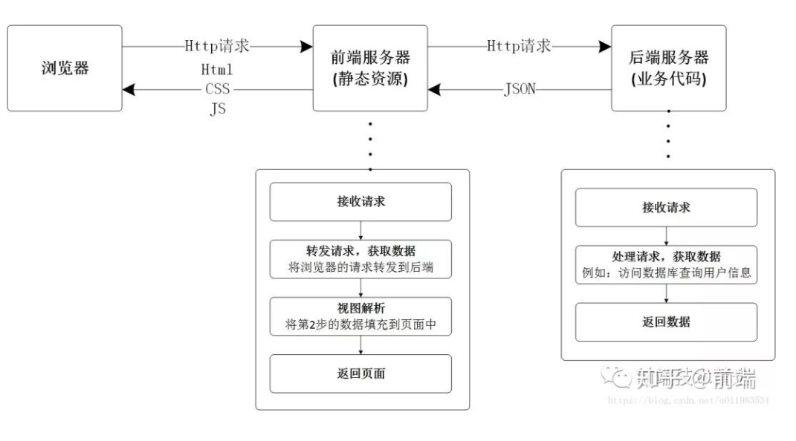
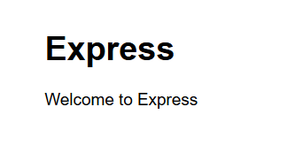

# vue cli 创建项目
按照我自己的vue文档中的**create vue** 的配置，安装项目

# 安装其他依赖包
npm install element-plus
npm install vue-axios
npm install axios
npm install @element-plus/icons-vue

# 安装express-generator
1、项目中安装express：**可以类比vue cli，都是个工具**
npm install express-generator -g

## 查看全局安装的包
 npm list -g --depth=0
D:\Program Files\nodejs\node_global
├── @vue/cli@5.0.8
├── create-preset@0.13.1
├── express-generator@4.16.1
├── ts-node@8.5.4
├── tsconfig-paths@4.2.0
└── typescript@5.6.3

## 创建后端工程,与前端工程分开
1. 创建在和前端项目根目录同级的目录中，执行以下命令：
express tech_forum_backend

 warning: the default view engine will not be jade in future releases
  warning: use `--view=jade' or `--help' for additional options
   create : tech_forum_backend\
   create : tech_forum_backend\public\
   create : tech_forum_backend\public\javascripts\
   create : tech_forum_backend\public\images\
   create : tech_forum_backend\public\stylesheets\
   create : tech_forum_backend\public\stylesheets\style.css
   create : tech_forum_backend\routes\
   create : tech_forum_backend\routes\index.js
   create : tech_forum_backend\routes\users.js
   create : tech_forum_backend\views\
   create : tech_forum_backend\views\error.jade
   create : tech_forum_backend\views\index.jade
   create : tech_forum_backend\views\layout.jade
   create : tech_forum_backend\app.js
   create : tech_forum_backend\package.json
   create : tech_forum_backend\bin\
   create : tech_forum_backend\bin\www

   change directory:
     > cd tech_forum_backend

   install dependencies:
     > npm install

   run the app:
     > SET DEBUG=tech-forum-backend:* & npm start

**注意**：上面最后的两步骤，在下面的数据库相关操作结束后，就可以执行了。**必须执行！！！**
**注意：暂时关注tech_forum_backend目中的 routes目录**

## 定义是数据模型
1. 创建数据库和表结构
在tech_forum_backend工程的根目录下，创建一个名为db的目录，
用来存放数据库文件与数据库操作相关的代码模块，并在db目录中，创建新的数据库
 sqlite3  forum.db
SQLite version 3.41.2 2023-03-22 11:56:21
Enter ".help" for usage hints.
sqlite>
create table if not exists user (id integer primary key autoincrement,nickname varchar(32) not null,account varchar(32) unique not null,password varchar(32) not null);

insert into user (nickname,account,password) values('张三','zhangsan','123456');

## 安装sqlite模块
后端工程项目中安装
npm install sqlite3 
 cat package.json
{
  "name": "tech-forum-backend",
  "version": "0.0.0",
  "private": true,
  "scripts": {
    "start": "node ./bin/www"
  },
  "dependencies": {
    "cookie-parser": "~1.4.4",
    "debug": "~2.6.9",
    "express": "~4.16.1",
    "http-errors": "~1.6.3",
    "jade": "~1.11.0",
    "morgan": "~1.9.1",
    "sqlite3": "^5.1.7"
  }
}

# 后端的路由
## 概念
路由（Route）是指客户端向服务器端发送请求的路径，路由决定了服务器端响应的行为。
例如：论坛帖子数据获取和评论数据获取，就可以通过不同的路由来实现。

## 路由的作用
- 实现前后端分离
- 实现RESTful API
- 实现URL的可读性
- 实现请求参数的校验
- 实现请求的过滤和权限控制

## 前后端分离的示意图

## 路由的分类
- **静态路由**：静态路由就是指在服务器端配置好的路由，客户端请求的路径与服务器端配置的路由匹配，则执行对应的处理函数。
- **动态路由**：动态路由就是指客户端请求的路径与服务器端代码中的路由匹配，但是路由参数需要在服务器端代码中获取。

## RESTful API
RESTful API（Representational State Transfer）是一种基于HTTP协议的设计风格，它定义了客户端和服务器端的交互方式。

RESTful API的设计理念是：
- 客户端和服务器端之间，通信的双方都遵循同一种接口规范。
- 客户端通过统一的接口规范，向服务器端发送请求，服务器端根据请求的不同，返回不同的响应。
- 服务器端的资源通过URI来标识，客户端通过HTTP方法来操作资源。

### 

## 运行后端项目  **前面有提到的内容**
cd tech_forum_backend
 npm install
SET DEBUG=tech-forum-backend:* & npm start

[1] 2179
bash: SET: command not found

> tech-forum-backend@0.0.0 start
> node ./bin/www

**以上是执行过程**
执行成功后，系统会开启一个端口号为3000的服务，可以在浏览器中输入如下地址来进行访问：
http://localhost:3000/
登陆成功后，浏览器显示内容是这样：

## 路由实现的过程
在后端目录中进行相关操作配置。cd tech_forum_backend
1. 在db目录中创建db.js文件，用来**连接数据库，查询数据**。**这是个数据库操作的工具模块**，**主要用于定义对数据库的操作方法。**
//引入sqlite3模块
const  sqlite3 = require('sqlite3').verbose();
//工程中的数据库文件路径，以根目录为参照
const dbName = './db/forum.db';
//此方法为操作方法，将查询到库中所有用户信息
function queryAllUsersInfoFromDB(callback){
        //打开数据库
        const  db = new sqlite3.Database(dbName);//打开数据库
        //定义SQL语句
        const  sql = 'select * from user';
        //查询所有数据,是1个异步方法
        db.all(sql,[],(err,rows)=>{
                callback(err,rows)
        });
        //关闭数据库
        db.close();
}
module.exports = {
        queryAllUsersInfoFromDB
}
//db.all用于查询所有数据，并返回所有结果。他是异步方法，当查询完成后，会调用回调函数。
//第一个参数为SQL语句，第二个参数为参数数组用于参数化查询，第三个参数为回调函数，回调函数有两个参数，第一个参数为错误信息，第二个参数为查询结果。

2. 在routes目录中，修改完善users.js文件中的**路由方法实现**，用来处理用户相关的请求。
var express = require('express');//引入express模块
var router = express.Router();//创建路由实例

// 引入数据库操作模块，提供数据库操作方法
var dbManager = require('../db/db')
// 定义路由方法,用于响应对根路径 / 的 HTTP GET 请求
router.get('/', function(req, res, next) {
// 调用数据库操作方法，查询所有用户信息
dbManager.queryAllUsersInfoFromDB((err,data)=>{
// 定义response的结果，设置response code并将数据进行JSON化返回
  res.status(200).json(data);
})
});
module.exports = router;

重新启动后端项目，刷新浏览器，可以看到页面显示的用户信息如下：
http://localhost:3000/users/

**详细解释 router.get('/', function(req, res, next) )函数**
第一个参数是路径，用于响应对根路径 / 的 HTTP GET 请求
//function(req, res, next) 是回调函数，路由匹配时被调用
/* 从数据库中读取数据，**req**：请求对象，包含了客户端的所有请求信息（如参数、查询字符串、HTTP 头部等）。
**res**：响应对象，用于构造对客户端的响应。
**next**：一个函数，用于将控制权传递给路由堆栈中的下一个路由处理函数。如果当前函数不是最后一个处理请求的函数，应该调用 next()。 */

## 测试用户注册--纯后端测试
curl -H "Content-Type: application/json" -X POST -d '{"nickname":"李四","account":"lisi","password":"123456"}' "http://localhost:3000/users/create"
curl -H "Content-Type: application/json" -X POST -d '{"nickname":"王五","account":"wangwu","password":"123456"}' "http://localhost:3000/users/create"

## 测试用户登录--纯后端测试
http://localhost:3000/users/login?account=lisi&password=123456

## 给后端的主文件配置跨域
在后端目录的app.js文件中，做配置。
### 一些概念解释
PUT：这是一个用于更新资源的HTTP方法。当客户端需要更新服务器上某个现有的资源时，通常使用 PUT 方法。

POST：此方法用于向服务器发送数据，例如提交表单或上传文件。POST 通常用于创建新资源。与 PUT 不同，POST 不会替代现有资源，而是根据数据的内容在服务器上进行处理。

GET：GET 方法用于请求获取某个资源的表示。它请求服务器提供指定的资源，一般用于查询数据。GET 请求通常是安全的，即它不会对服务器上的数据产生副作用。**--select**

DELETE：DELETE 方法用于请求删除服务器上特定的资源。客户端向服务器发送请求后，服务器将删除对应的资源。

OPTIONS：这个方法用于描述目标资源的通信选项。一般用于CORS预检请求，浏览器会使用OPTIONS方法先询问服务器，获取允许的HTTP方法和请求头，以决定实际的请求是否可以执行。

**简单粗暴的理解：
get就是select ，
put是update，
post是insert，
delete是delete，
options是获取服务器的一些信息。**