# 概念
## 概述
网络编程是指编写能够在网络中进行通信和数据交换的计算机程序的过程。这涉及到理解网络协议、套接字（sockets）、数据传输、客户端-服务器架构等概念。网络编程是构建现代软件系统的基础，尤其是在分布式系统、云计算和互联网应用中。

## 网络编程的关键概念包括：
1. 网络协议：定义了电子设备如何在网络上进行通信的规则，如TCP/IP、HTTP、FTP等。
2. 套接字（Sockets）：网络编程中的一个基本接口，允许程序发送和接收数据。
3. 客户端-服务器模型：一种网络架构，其中一个服务器程序提供服务，而客户端程序请求服务。
4. 数据传输：通过网络发送和接收数据的过程，包括数据的序列化和反序列化。
5. 并发和多线程：处理多个网络请求和响应的技术，以提高程序的效率和响应能力。

## 网络编程与后端开发的关系：
1. 后端开发是指构建应用程序的服务器端或后台逻辑，它处理数据存储、业务逻辑、服务器和数据库的交互等。网络编程是后端开发的核心部分，因为：
2. 服务交互：后端服务需要通过网络与客户端（如Web浏览器或移动应用）进行数据交换，这需要使用网络编程技术。
3. API开发：后端开发者经常需要创建和维护API（应用程序编程接口），这些API允许前端或其他服务通过网络请求数据或触发业务逻辑。
4. 数据库交互：后端系统经常需要通过网络与数据库服务器通信，以存储和检索数据。
5. 性能优化：后端开发者需要理解网络延迟、带宽限制等网络编程问题，以优化系统性能。
6. 安全性：网络编程中的安全问题（如加密、认证和授权）对于保护后端系统免受攻击至关重要。
7. 分布式系统：在构建跨多个服务器或服务的系统时，后端开发者需要使用网络编程来实现服务之间的通信。
总之，网络编程为后端开发提供了构建和维护网络通信的基础，是现代后端系统不可或缺的一部分。掌握网络编程技术对于后端开发者来说至关重要，因为它直接影响到应用程序的可扩展性、性能和安全性。

## TCP/IP
TCP（Transmission Control Protocol，传输控制协议, 位于网络层）和IP（Internet Protocol，网际协议, 位于链路层）是TCP/IP协议族的核心协议。）TCP是一种面向连接的、可靠的、基于字节流的传输层通信协议。它提供可靠的服务，保证数据包按序到达，不丢失，不重复，并且按时到达。TCP协议是一种端到端的协议，它规定了数据如何在网络中传输，以及数据如何在两个应用程序之间传递。
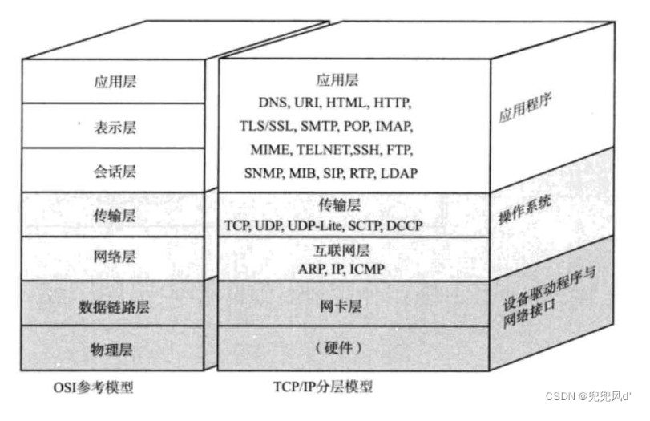
1. 连接建立：TCP协议是面向连接的协议，在通信开始之前，需要建立连接。连接建立时，客户端和服务器都必须完成三次握手。
2. 数据传输：TCP协议是可靠的协议，它通过校验和、序列号、确认应答等机制确保数据传输的可靠性。
3. 连接释放：TCP协议是面向连接的协议，通信结束后，需要释放连接。释放连接时，客户端和服务器都必须完成四次挥手。
4. 拥塞控制：TCP协议通过拥塞控制来防止网络拥塞，使网络更加顺畅。
5. 超时重传：TCP协议通过超时重传来保证数据传输的可靠性。
6. 流量控制：TCP协议通过流量控制来控制网络的发送速度，防止网络负载过大。
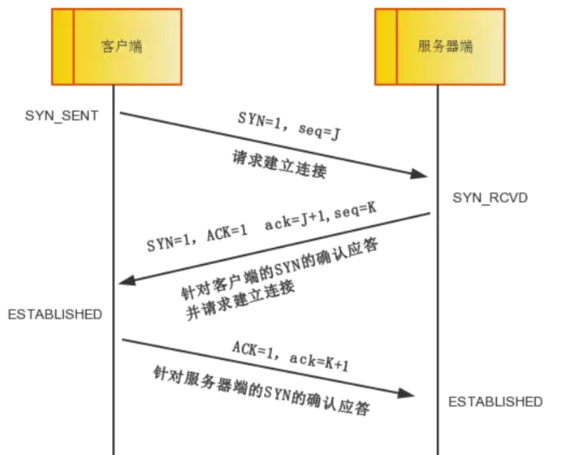

## 客户和服务器网络

### 1. SSL
**SSL**（Secure Socket Layer）是一种**安全协议**，它建立在传输层之上，提供对网络通信的加密和身份验证。SSL通过对网络通信进行加密，可以防止中间人攻击、数据篡改、重放攻击等安全风险。SSL协议由两部分组成：SSL记录协议和SSL握手协议。SSL记录协议负责加密数据，SSL握手协议负责建立安全连接。

### Socket
Socket 用于实现进程间通信的一种机制，**它是一组接口**，应用程序可以通过它与另一个应用程序进行通信。Socket 最主要的功能是**两端点之间的数据传输**。**Socket 允许应用程序通过网络进行通信。**
Socket **由 IP 地址和端口号组合所标识的**，应用程序可以绑定到一个端口，然后就可以通过这个端口与其他应用程序通信。
Socket **是应用程序与TCP/IP协议栈之间的接口**。Socket可以基于TCP或UDP等协议进行工作。

1. **组成部分：**
IP地址：标识网络中的一台机器。
端口号：标识机器中运行的特定服务或应用程序。

1. **类型：**
流式套接字（TCP Socket）：基于TCP协议，提供可靠的、顺序的、面向连接的服务。
数据报套接字（UDP Socket）：基于UDP协议，提供不可靠的、不顺序的、无连接的服务。

1. **创建和使用：**
服务器端：通常首先创建一个socket，并绑定到一个IP地址和端口号，然后监听客户端的连接请求。
客户端：创建socket并连接到服务器的IP地址和端口号。

### 2. 服务器端口号
端口号范围：0~65535
常用服务的默认端口号：
- 21：FTP
- 22：SSH
- 23：Telnet 
- 25：SMTP
- 53：DNS
- 80：HTTP
- 443：HTTPS
- 3306：MySQL
- 3389：远程桌面
- 8080：Tomcat 
注意：常规下，1024以下的端口不开放给非特权用户使用。是系统管理员管理的特定服务端口，不能随意指定给用户使用。

### 3. 客户端端口

### 4.为什么需要端口
1. 进程间通讯(IPC)interprocess communication
你在浏览器地址栏输入某个网站的域名, 然后回车, 就生成了一次请求, 然后服务器响应你的请求, 浏览器再把结果渲染出来, 你就能最终看到到一个网页.
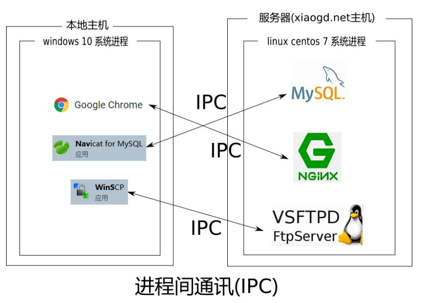
2. **所谓的端口**, 其实可以简单地视作为**进程 ID的映射机制**；
3. 端口, 是一个间接层，如果没有这个间接层, 客户端要与服务端通讯, 就要知道服务端对应进程的 ID, 即客户端是依赖于服务端的
4. 而有了端口这一间接层, 对于 web 的情形, 这种依赖被倒置了, 客户端总是把请求发送到 80(或443) 端口, 这些成为标准的一部分, 并要求服务端反过来去适应, 服务端去监听端口的通讯并处理, 变成了一种反向依赖.
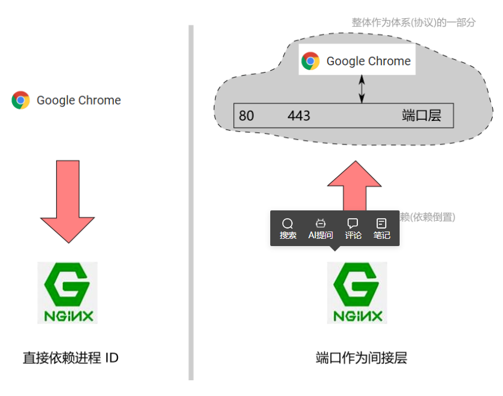
5. 如果一个进程想要提供 web 服务, 它启动之后就要去绑定(binding) web 相关的端口,并在其上持续的监听(listen), 同时在有请求到来的时候去响应(response). 这样一来, 进程 ID 的问题就消解了.
6. 端口这一间接层的存在解耦(decouple)了客户端与服务端之间的强依赖, 整个体系变得很灵活.
7. 可以把端口视作一般编程概念中的接口(interface), 而像 Nginx, apache, tomcat 等等可以认为是这个接口的不同实现(Implementation).
8. 端口层也可以视作一个 naming service(名称服务), 这与比如 spring cloud 中的 eureka 里的机制本质上是一样的, 只是这个 name 就是一个抽象的数字, 比如 80. 80 就代表了一个 web 服务, Nginx 之类的 web server 绑定并监听就相当于把自身提供的 web 服务注册于其上.
9. 端口与 IoC(控制反转)
广义上, 端口的上述机制也是控制反转(Ioc: Inversion of Control)思想的一种体现, 如果客户端需要知道服务端的进程 ID, 实际上就被服务端控制了, 毕竟我服务端在哪个 ID 上提供服务, 你就得把你的请求发到相应的 ID 上来;
10. 端口与 TCP/UDP 协议
前面一直在说, 什么 3306 端口, 80 端口, 443 端口, 其实严格来说, 端口是分 TCP 端口和 UDP 端口的, 不过多数时候遇到的都是 TCP 端口, 但 TCP 80 端口和 UDP 80 端口是不同的端口.
11.  目前的 http 协议只构建在 TCP 协议之上
## UDP
- 他用来从1个系统向其他系统传送非常短的消息。
- 它只提供一个保证，那就是您收到的数据是完整的。
- 它既不保证数据是否真的能被收到，也不保证数据是不是只接收一次。
- UDP（User Datagram Protocol，用户数据报协议）是一种无连接的、不可靠的、基于数据报的传输层通信协议。它不保证数据包按序到达，也不保证数据包完整，只保证数据包能到达。

通常 UDP  会用在客户端向服务器申请一个比特的信息，如果没有收到答复会继续申请。用
得最广的 UDP 应用软件是 DNS 系统。因为客户端通常只需要发送一个非常简短的请求，并收到 一个同样简短的回答，UDP  非常适合这种任务 。
UDP  还常被用在流式的音频和视频应用软件， 因为 UDP 只是偶尔丢弃 1个信息包，而 TCP 会过于严格地处理那些被丢弃的信息包，这样音频效果就差很多。许多游戏和网络文件系统，例如 NFS  ( N四d for  Speed ，极品飞车）)和 Samba 也 大量地用到了 UDP。

这里有一些在选择协议的时候，该用 TCP 还是 UDP 的指导方针。这些方针可能不会涵盖所 有的情况，但是可以作为一个很好的参考 。

### 您应该用 TCP，如果:
．您需要一个可靠的数据传输，以确保您的数据完整无缺地到达目的地。
．您的协议需要不止一个请求和服务器 的回答。
．您要发送较多的数据。
．初始连接出现短暂的延迟是可以容忍的。
### 您应该用 UDP ，如果：
．您不太关心信息包是否到达或者不太在意信息包到达的顺序是否正确，再或者您可以自
己察觉这些问题并自己解决。
．您的协议只包括基本请求和回答。
．您只需要尽快建立网络会话。
．**只传送很少一部分数据。UDP 的限制是一个信息包不超过 64.KB 的数据**，通常人们**只用UDP  传送 1KB  以下的数据。**

# 前后端交互的原理
## 基本概念
一旦TCP连接建立，浏览器可以发送HTTP请求（如GET或POST）。
请求包含了所需的信息，例如请求方法、URL、头部信息等。
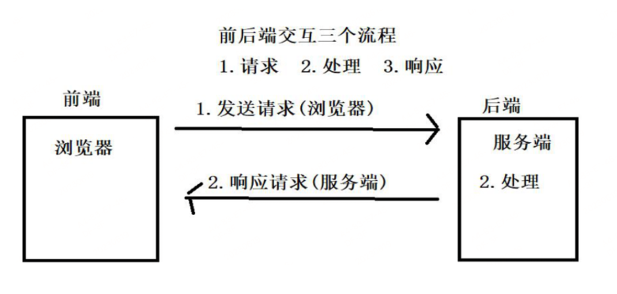

### HTTP协议
在前后端交互中，HTTP（Hypertext Transfer Protocol）协议是最常用的协议之一。**HTTP是一种应用层协议**，用于在Web应用程序之间传输数据。它定义了客户端和服务器之间的通信规则和约定。
以下是HTTP协议的一些关键概念和要点：

1. 请求和响应：HTTP通信是通过请求和响应进行的。客户端发送HTTP请求给服务器，服务器处理请求并返回HTTP响应给客户端。

2. 方法：HTTP定义了几种请求方法，常见的有**GET、POST、PUT、DELETE**等。不同的方法用于执行不同的操作，如获取资源、提交数据、更新资源和删除资源。对应理解：**select、insert/create、update、delete**等。

**GET和POST得区别**
GET：用于获取资源，请求的数据会附在URL后面，以?分割URL和请求数据，如：http://www.example.com/getData?name=zhangsan。

POST：用于提交数据，请求的数据不会附在URL后面，而是作为请求体发送。如：http://www.example.com/submitData。  
**GET和POST的使用场景**
GET：适用于数据不敏感的场景，如搜索、获取数据。

POST：适用于数据敏感的场景，如注册、购物、评论等。

1. URL：URL（Uniform Resource Locator）用于标识要访问的资源的位置。它由协议类型、服务器地址、路径和可选的查询参数组成。

2. **请求头：**HTTP请求包括一个请求头，用于传递关于**请求的元数据**，如请求的方法、请求的资源、请求的内容类型等。
2.1 请求头是一些键值对，对请求的属性进行描述，主要包括：
Content-Type：表示请求体的内容类型，例如 application/json、application/x-www-form-urlencoded 等。
Authorization：用于身份验证的凭证，如 JWT 令牌。
Accept：浏览器能够处理的内容类型，如 application/json。
User-Agent：发送请求的客户端信息（如浏览器类型、版本等）。

2.1 示例请求头：
Content-Type: application/json
Authorization: Bearer <token>
Accept: application/json
User-Agent: Mozilla/5.0

3. **请求体：**某些请求，如POST请求，可以包含请求体。请求体用于传递数据给服务器，如表单数据、JSON数据等。
请求体包含要发送到服务器的数据，数据的格式通常取决于 Content-Type 请求头的值。对于 POST 请求，请求体通常是必要的，并包含与所请求资源相关的数据。
3.1 JSON 格式示例：
{
  "name": "Alice",
  "age": 30
}
3.2 表单格式示例：（application/x-www-form-urlencoded 类型）
name=Alice&age=30
3.3  格式示例：（multipart/form-data 类型）
--boundary
Content-Disposition: form-data; name="name"

Alice
--boundary
Content-Disposition: form-data; name="file"; filename="file.txt"
Content-Type: text/plain

<file content here>
--boundary--

4. 响应状态码：HTTP响应包括一个状态码，用于指示请求的处理结果。常见的状态码有**200表示成功**，**404表示资源未找到**，**500表示服务器内部错误**等。**包含在响应头中**

5. **响应头：**HTTP响应还包括响应头，用于传递关于响应的元数据，如响应的内容类型、响应的长度等。响应头是服务器**返回**的**元数据信息**，用于**描述响应的属性和状态**。它包含了**一系列键值对**，每个键值对提供了关于响应的详细信息。

5.1 常见的响应头字段包括：
Status Code（状态码）：表示请求的处理结果，例如 200 OK、404 Not Found、500 Internal Server Error 等。
Content-Type：指示响应体的数据类型，例如 application/json、text/html 等。
Content-Length：表示响应体的长度（以字节为单位）。
Cache-Control：指示客户端是否可以缓存响应内容。
Set-Cookie：服务器通过此字段向客户端设置Cookie。
Location：在重定向响应中（如 301 或 302），此字段指示客户端应跳转的新URL。
Server：指示服务器的软件信息（如 Apache、Nginx 等）。

5.2 示例响应头：
HTTP/1.1 200 OK
Content-Type: application/json
Content-Length: 123
Server: Apache
Set-Cookie: sessionId=abc123; Path=/
Cache-Control: no-cache

6. **响应体：**响应体是服务器返回给客户端的实际数据内容，可以是HTML、JSON、图片等不同类型的数据。
6.1 响应体示例：
JSON：用于API接口返回结构化数据。
{
  "status": "success",
  "message": "Resource created",
  "id": 456
}

HTML：用于Web页面的渲染。
<html>
  <head><title>Example</title></head>
  <body><h1>Hello, World!</h1></body>
</html>

XML：用于结构化数据。

<response>
  <status>success</status>
  <data>
    <id>123</id>
    <name>example</name>
  </data>
</response>

纯文本：用于简单的文本内容。

Request processed successfully.

## Cookie和Session
Cookie和Session：HTTP协议支持使用Cookie和Session来维持状态。服务器可以通过在响应中设置Cookie来存储一些客户端状态信息，客户端将Cookie保存并在后续请求中发送给服务器。
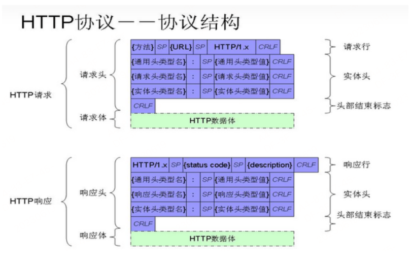

1.  HTTP协议是一种无状态的协议，每个请求和响应之间是相互独立的，服务器不会保留关于客户端的状态信息。为了解决这个问题，常常使用Cookie、Session、Token等机制来实现用户认证和会话管理。
- **无状态的理解：**
  
HTTP的**无状态**意味着**每个请求都是独立**的，服务器**不会记住之前的请求状态**。这种特性可以通过以下几个方面理解：

**请求独立性：**每一次客户端向服务器发出的请求，服务器都不会依赖于之前的请求。服务器不会保存任何关于客户端的上下文信息。

**简化设计：**由于服务器不需要存储状态信息，设计和实现變得更简单，并且有助于提高系统的可伸缩性。

**每次请求都包含所有必要信息：**客户端在每次请求中需包含所有必要的信息，以便服务器能够理解并处理该请求。

**容易实现负载均衡：**由于不同请求不依赖于特定的服务器，可以轻松实现请求分散到不同的服务器上，促进高效的负载均衡。

虽然HTTP是无状态的，**但通常会结合使用Cookie、Session、Token等等机制来维护一些状态信息**，以便根据需要提供更好的用户体验

- **使用Cookie、Session等机制来维护一些状态信息**
1. **Cookie：**
定义：小的文本文件，**存储在用户的浏览器中**。
作用：可以**用来存储用户的首选项、登录状态等信息**。当用户再次访问该网站时，浏览器会自动将相应的Cookie发送给服务器，服务器可以读取这些信息，从而知道这个用户是什么身份。
示例：当一个用户登录后，服务器可能会将一个标识其身份的Cookie发送给浏览器，浏览器在随后的请求中自动携带该Cookie，从而使用户不必每次都重新登录。
2. **Session：**
定义：**在服务器端储存的用户会话信息，与特定用户相关联**。
作用：通过Session ID将用户的状态信息保存在服务器上。在用户每次发起请求时，浏览器通过Cookie或URL传递Session ID，服务器可以根据Session ID找到对应的会话数据。
示例：在购物网站上，用户添加的商品可以存储在Session中。即使用户在多次请求中浏览不同页面，服务器仍然能记住用户的购物车内容。

## 异步通信-AJAX技术
AJAX（Asynchronous JavaScript and XML）是一种用于在Web应用程序中进行异步数据交互的技术。它通过在不刷新整个页面的情况下，通过后台与服务器进行数据交换，更新部分页面内容。
以下是AJAX技术的关键要点：

1. **异步通信**：AJAX使用异步通信机制，即在后台发送和接收数据的过程中，不会阻塞用户界面或整个页面的加载。这使得页面可以保持响应性，同时允许在后台处理数据。

2. **XMLHttpRequest对象**：AJAX使用XMLHttpRequest对象来实现与服务器的数据交互。它允许通过JavaScript代码向服务器发送请求，并接收和处理服务器返回的数据。

3. **数据格式**：AJAX并不局限于使用XML格式的数据交换，尽管XML在早期的AJAX应用中常用。现在，常见的数据格式有**JSON（JavaScript Object Notation）和XML**，根据应用的需求选择合适的数据格式。

4.**事件驱动编程**：AJAX基于事件驱动编程模型。通过监听XMLHttpRequest对象的各种事件（如请求完成、状态改变等），可以在适当的时机执行相应的操作，如更新页面内容、处理返回的数据等。

5.**跨域请求**：由于浏览器的同源策略限制，AJAX通常不能跨域请求数据。为了解决这个问题，可以使用跨域资源共享（CORS）或JSONP等技术来允许跨域请求。

6.**安全性考虑**：由于AJAX请求是在后台进行的，需要注意安全性方面的考虑。特别是在处理用户输入或发送敏感数据时，需要进行合适的验证和保护措施，以防止安全漏洞

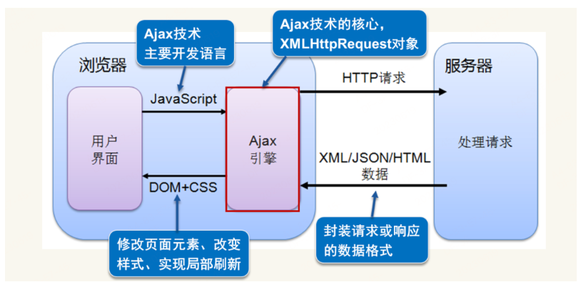
AJAX技术的应用可以改善用户体验，提高Web应用程序的性能和效率。通过局部更新页面内容，可以减少网络带宽的使用，提升页面的加载速度，并实现实时更新数据的功能。AJAX常用于实现无刷新的表单提交、实时搜索、动态加载内容等场景。

**现代前端框架和库如React、Angular和Vue等也提供了更高级的工具和技术来简化和优化AJAX操作，使前端开发人员能够更方便地处理异步数据交互。**

## 数据格式和传输
在前后端交互中，数据格式和传输方式是非常重要的方面，它们决定了数据的结构和如何在不同系统之间传递。
### 数据格式
1. JSON（JavaScript Object Notation）：
JSON是一种轻量级的数据交换格式，广泛用于前后端数据交互。它基于JavaScript的对象字面量表示法，易于阅读和编写，同时也易于解析和生成。JSON支持基本数据类型（字符串、数字、布尔值、null）、对象和数组的表示。

2. XML（Extensible Markup Language）：XML是一种通用的标记语言，用于表示结构化数据。它可以描述复杂的数据结构和层次关系，并且具有良好的扩展性。XML的格式严格，需要使用标签来定义数据的结构和语义。
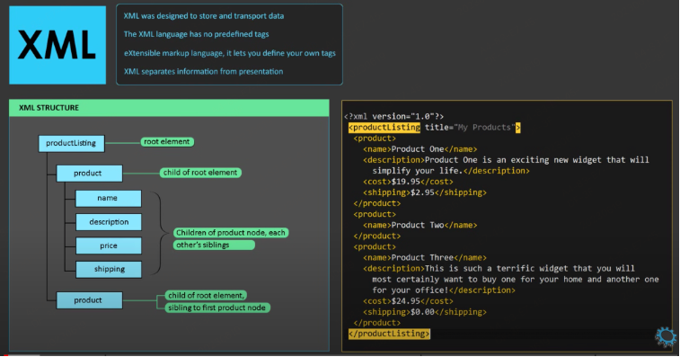

### 传输方式/传输协议/前后端通信方式
1. **HTTP（Hypertext Transfer Protocol）**：
HTTP是最常用的传输协议，用于在Web应用程序之间传输数据。通过HTTP协议，可以使用GET和POST等方法发送请求和接收响应。
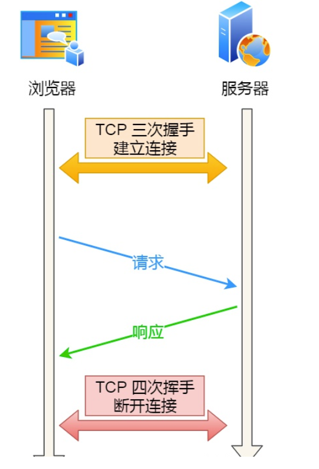

2. **WebSocket：**
WebSocket是一种全双工通信协议，允许在客户端和服务器之间建立持久的连接，并进行实时的双向通信。相对于HTTP请求，WebSocket提供了更低的延迟和更高的性能，适用于需要实时通信的场景。
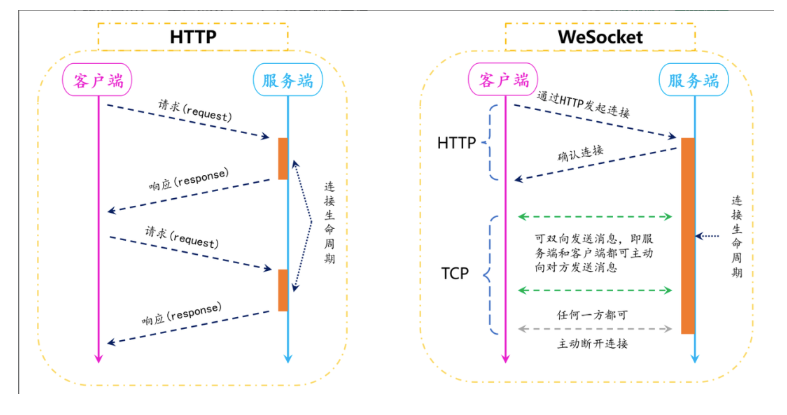

3. **RESTful API：** **使用HTTP协议**
REST（Representational State Transfer）是一种设计风格，用于构建可扩展的Web服务。**RESTful API使用HTTP协议**，并遵循一组统一的原则和约定，使得前后端之间的通信更加简单和可靠。
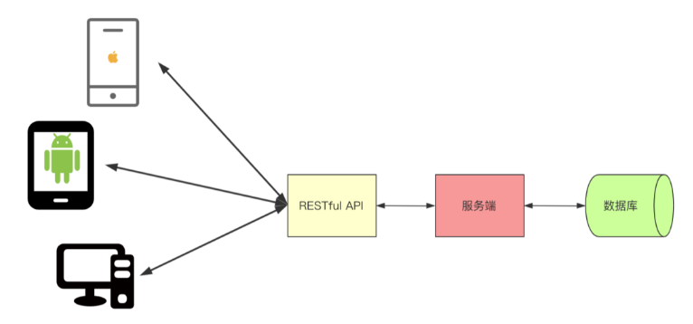

4. **GraphQL** **使用HTTP协议**
GraphQL是一种用于API的查询语言和运行时环境，允许客户端明确请求其所需的数据。与传统的RESTful API相比，GraphQL可以避免过度获取或缺少数据的问题，提供更精确的数据传输。
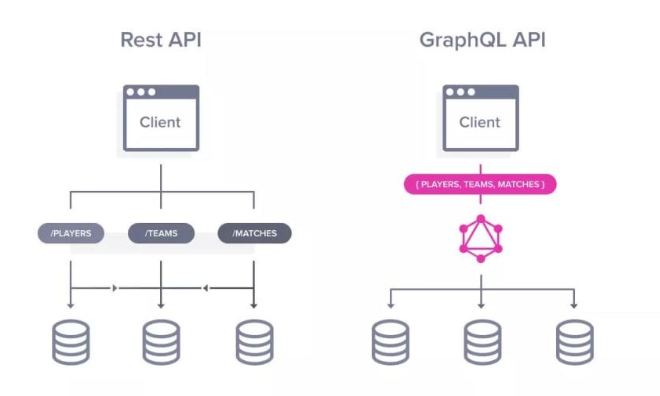

5. **Server-Sent Events (SSE)**   **使用HTTP协议**
Server-Sent Events是一种基于HTTP的单向通信技术，允许服务器向客户端推送数据。客户端通过建立一个持久的HTTP连接来接收来自服务器的事件流，实现了服务器主动向客户端发送数据的能力。
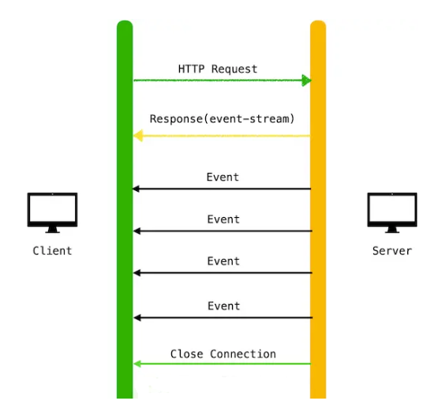

6. **Messaging Queue** 
消息队列是一种异步通信机制，允许前后端通过发布和订阅消息来进行数据交换。常见的消息队列系统有RabbitMQ和Apache Kafka等，它们可以用于解耦前后端的通信，实现可靠的消息传递。

**选择合适的数据格式和传输方式**取决于具体的**应用需求和技术栈**。**JSON通常是前后端交互中的首选数据格式**，而**HTTP是最常用的传输方式**。 然而，对于实时通信或高度可扩展的场景，可能需要考虑其他的传输方式和协议。

# JWT（JSON Web Token）
## 1. 什么是无状态性？
在计算机科学中，无状态性（Statelessness）指的是系统在处理请求时，不会保存请求之间的任何上下文信息。换句话说，**每次请求都是独立的，服务器不会存储任何关于请求的历史信息**。
## 2. 传统Web应用中的状态管理
在传统的Web开发中，状态管理通常依赖于服务器端的会话（Session）。例如，当用户登录后，服务器会创建一个会话，并将用户的登录信息存储在服务器的内存或数据库中。每次用户发起请求时，服务器需要通过会话ID（通常存储在Cookie中）来查找对应的会话信息，以验证用户的身份。
这种状态管理方式的缺点是：
服务器需要存储会话信息：这增加了服务器的存储负担，尤其是在高并发场景下。
扩展性受限：由于会话信息存储在服务器端，水平扩展（增加更多服务器）会变得复杂，因为需要同步会话信息。
单点故障风险：如果存储会话信息的服务器宕机，用户可能需要重新登录。
## 3. JWT的无状态性
JWT通过将用户的身份信息编码到Token中，解决了传统会话管理的这些问题。JWT的无状态性体现在以下几个方面：
(1) 自包含（Self-Contained）
JWT是一个自包含的字符串，它包含了用户的身份信息（如用户名、用户ID、权限等）和签名信息。这意味着服务器在验证JWT时，不需要查询数据库或内存中的会话信息，只需解析Token并验证其签名即可。
例如，一个典型的JWT可能包含以下部分：
Header：定义了Token的类型和签名算法。
Payload：包含用户的身份信息，如用户名、用户ID、权限等。
Signature：用于验证Token的完整性和真实性。
(2) 无服务器端存储
由于JWT是自包含的，服务器不需要存储用户的会话信息。每次请求时，客户端只需将JWT发送给服务器，服务器解析并验证JWT即可。这种机制使得JWT完全独立于服务器的状态，因此被称为无状态。
(3) 无状态的扩展性优势
JWT的无状态性使得系统更容易扩展。因为服务器不需要存储会话信息，所以可以轻松地增加更多的服务器来处理请求，而不用担心会话同步问题。这种特性非常适合现代的分布式系统和微服务架构。
## 4. 无状态性的实际意义
减轻服务器负担：服务器不需要存储会话信息，减少了内存和数据库的使用。
提高性能：每次请求的验证过程更快，因为不需要查询数据库。
易于扩展：可以轻松地水平扩展服务器，而不用担心会话同步问题。
分布式友好：适合微服务架构和分布式系统，因为每个服务都可以独立验证JWT。
## 5. 无状态性的局限性
虽然JWT的无状态性带来了很多优势，但它也有一些局限性：
Token无法撤销：一旦JWT被生成，服务器无法直接撤销它，除非等待它过期。
安全性依赖于密钥管理：JWT的安全性依赖于密钥的安全性，如果密钥泄露，所有JWT都可能被伪造。
Token大小：JWT包含用户信息，因此可能比传统Cookie更大，可能会增加网络传输的开销。

## jwt得密钥
1. 在 JWT（JSON Web Token）中，密钥（Key）是一个非常重要的概念，它用于对 JWT 进行签名（Signature），以确保 JWT 的完整性和安全性。密钥的选择和管理直接影响 JWT 的安全性和可靠性。
2. 签名的生成方式是：将 Header 和 Payload 进行 Base64 编码后拼接，然后使用密钥和指定的算法进行加密，生成签名。
3. 密钥在 JWT 中的主要作用是：
签名 JWT：在生成 JWT 时，使用密钥对 JWT 的头部和载荷进行签名，确保 JWT 的内容在传输过程中未被篡改。
验证 JWT：在接收 JWT 时，使用相同的密钥和算法验证 JWT 的签名是否正确，从而确认 JWT 的真实性和完整性。

### Base64 编码
Base64 编码是一种常用的编码方式，它可以将任意二进制数据编码为 ASCII 字符。在 JWT 中，Base64 编码用于对 Header 和 Payload 进行编码。

# Session（会话） 的作用。
## 1. 什么是 Session？
Session 是一种用于跟踪用户状态的机制，它允许服务器在多次 HTTP 请求之间保存和管理用户的状态信息。Session 的核心思想是通过一个 唯一标识符（Session ID） 来关联用户的请求和服务器端存储的状态信息。
## 2. Session 的工作原理
Session 的实现通常涉及以下几个步骤：
(1) 用户登录
用户通过用户名和密码登录。
服务器验证用户身份后，创建一个 Session，并生成一个 Session ID。
服务器将 Session ID 发送给客户端（通常存储在 Cookie 中）。
(2) 服务器端存储 Session 信息
服务器将用户的登录状态、权限等信息存储在服务器端的内存、数据库或缓存中。
这些信息与 Session ID 关联，以便后续请求时可以快速查找。
(3) 后续请求
客户端在每次请求时，将 Session ID（存储在 Cookie 中）发送给服务器。
服务器通过 Session ID 查找对应的 Session 信息，从而恢复用户的状态。
服务器根据 Session 中的状态信息处理请求。
(4) 会话结束
用户注销登录时，服务器会销毁对应的 Session。
如果用户长时间不活动，Session 也会自动过期。
## 3. Session 的存储方式
Session 的存储方式可以有多种，常见的包括：
(1)内存存储：将 Session 信息存储在服务器的内存中。这种方式简单高效，但不适合分布式系统。
(2)数据库存储：将 Session 信息存储在数据库中。这种方式适合分布式系统，但可能会增加数据库的负担。
(3)缓存存储：将 Session 信息存储在 Redis 等缓存系统中。这种方式结合了内存存储和数据库存储的优点，适合高并发场景。
4. Session 的特点
(1)状态持久化：Session 允许服务器在多次请求之间保存用户的状态信息。
(2)安全性：Session ID 是唯一的，服务器可以通过它验证用户的身份。
(3)依赖服务器：Session 的信息存储在服务器端，客户端只需要存储 Session ID（通常通过 Cookie）。
(4)可扩展性受限：如果使用内存存储，Session 的扩展性较差。分布式系统中需要额外的机制来同步 Session 信息。

# Session 和 JWT 的区别
|特性|	Session|	JWT|
|----|----|----|
|自包含|	是|	是|
|无状态|	是|	是|
| 存储位置	|服务器端	|客户端|
|状态管理	|依赖服务器存储状态	|自包含，状态存储在 Token 中|
|安全性	|依赖 Session ID 的安全性	|依赖密钥的安全性|
|扩展性	|分布式系统中需要同步机制	|无状态，适合分布式系统|
|性能	|需要查询服务器存储	|解析 Token 即可验证|
|适用场景	|需要频繁更新状态的场景	|需要无状态、高并发的场景|

# 接口设计和规范
接口设计和规范涵盖了多个方面，以下是一些常见的接口设计和规范要点：

1. **输入和输出：**
明确定义接口的输入和输出，包括参数的类型、格式和限制，以及返回值的结构和格式。指定清晰的输入和输出有助于接口的正确使用和数据的准确传递。

2. **方法和操作：**
定义接口支持的方法和操作，包括获取数据、创建资源、更新资源、删除资源等。每个方法应该具有明确的目的和行为，使调用者能够清楚地了解何时使用何种方法。

3. **错误处理：**
定义接口在发生错误或异常情况时的行为。包括指定错误码、错误信息的格式和内容，以及建议的错误处理方式，以便调用者能够正确处理错误情况。

4. **认证和权限：**
如果接口需要认证和权限控制，明确规定认证方式、令牌传递方式和访问权限要求。确保只有授权用户能够访问受保护的接口，并提供相应的认证和授权机制。

5. **安全性和加密：**
指定接口的安全要求和加密机制，如使用HTTPS协议进行数据传输、加密敏感信息、防止跨站脚本攻击等。确保接口和数据的安全性和保密性。

6. **版本控制：**
如果接口可能发生变化，考虑使用版本控制机制来管理接口的演化和向后兼容性。通过在URL或请求头中添加版本号，确保不同版本的接口可以共存并提供向后兼容的方式。

7. **接口文档：**
编写详细的接口文档，包括接口的描述、用法示例、参数说明、返回值说明、错误码定义等。接口文档帮助开发人员了解和正确使用接口，提供了接口的参考和指导。

8.**性能和优化：**
优化接口的性能和效率，考虑请求和响应的数据量、网络延迟、并发处理能力等。合理设计接口的数据传输方式和数据结构，以提供高效的接口服务。

9. **一致性和标准化：**
在接口设计中保持一致性和标准化，遵循行业和团队的最佳实践。统一命名规范、参数传递方式、响应结构等，提高接口的可理解性和易用性。

异常处理：定义接口在发生异常情况时的处理方式，如网络错误、数据库错误等。合理处理异常，给出明确的错误信息，以便调用者能够准确理解问题和采取相应的处理措施。

根据具体的应用场景和需求，还可能涉及其他方面的设计和规范。重要的是确保接口设计清晰、一致，并与相关团队进行充分的沟通和协商，以确保接口的有效使用和成功交互。

# 前后端接口开发工作流程
## 前端和后端之间的接口开发通常是由以下角色共同承担的：

1. 前端开发人员：
- 负责设计和实现用户界面，编写与后端 API 交互的代码。
- 需要理解后端提供的接口文档，以正确使用 API 获取数据并在界面上展示。

2.后端开发人员：
- 负责设计和实现服务器端的 API，处理业务逻辑和数据库操作。
- 需要为前端开发人员提供接口文档，明确每个 API 的请求格式、响应格式及错误处理机制。

## 具体责任
1. 前端：
确定需要哪些数据，并与后端沟通。
实现接口调用，处理接口返回的数据。

2. 后端：
根据业务需求设计 API，确保数据的安全性和完整性。
开发 API 并测试以确保其正确性。

## 合作流程
需求沟通：前后端开发人员就项目需求进行讨论，明确接口的功能和数据格式。
接口文档：协作生成接口文档，记录每个接口的细节。
开发与测试：前端和后端同时进行开发，前端在后端开发完成后进行接口测试。

# 后端业务逻辑开发
## 业务逻辑开发的主要工作内容：
1. 定义：
业务逻辑是指系统中与特定业务需求相关的规则和过程。这些规则决定了如何处理请求、管理数据、执行操作等。

2. 主要任务
- 数据处理：接收和处理来自前端的请求，验证输入的数据是否合法，然后进行相应的操作。
- 计算与决策：根据业务需求进行各种计算，例如价格计算、库存检查等，以及实施条件判断和决策逻辑。
- 与数据库交互：通过查询数据库获取所需的数据，或将处理后的数据存储到数据库中。
- 协调服务：与其他后端服务（如微服务、第三方API等）进行交互，以实现复杂的业务需求。

3. 开发流程
- 需求分析：与产品经理或业务方沟通，理解业务需求，定义功能。
- 设计：设计系统的架构，确定数据模型、API接口及业务处理流程。
- 编码：使用后台编程语言（如Java、Python、Node.js等）实现业务逻辑，并确保代- 码的可维护性和可扩展性。
- 测试：通过单元测试和集成测试，确保业务逻辑的正确性和稳定性。

# 前后端内容及服务器

## 前端服务器（客户端服务器）：
1. Web服务器： Nginx--高性能的HTTP和反向代理服务器。
## 后端服务器（应用服务器/数据库服务器）：
1. 应用服务器：
Tomcat：开源的Servlet和JSP容器。
JBoss/WildFly：Java EE应用服务器。
Node.js：基于Chrome V8引擎的JavaScript运行环境，用于构建高性能的后端服务。
2. 数据库服务器：
MySQL：流行的关系型数据库管理系统。
PostgreSQL：高度可扩展的开源对象关系型数据库系统。
MongoDB：基于文档的NoSQL数据库。
Redis：开源的键值存储，常用作数据库、缓存和消息代理。
3. 消息队列和中间件：
RabbitMQ：开源的消息代理软件。
Kafka：分布式流处理平台。
ActiveMQ：Apache消息服务和集成模式服务器。
4. 缓存服务器：
Memcached：高性能的分布式内存对象缓存系统。
Redis：高性能的键值对数据库。
5. 容器和微服务平台：
Docker：开源的应用容器引擎。
Kubernetes：自动化部署、扩展和管理容器化应用程序的平台。

# URLEncode
## 概述
函数的主要作用是将字符串转换为URL编码格式，确保特殊字符在URL中正确传输。‌ URL编码（也称为百分比编码）是一种将非ASCII字符**转换为百分比符号（%）后跟两位十六进制数的编码机制**，用于在URL中嵌入特定字符。由于URL只允许包含一定范围内的字符，URL编码将非法字符转换为合法字符，以便在URL中**安全传输‌**

## URL编码的具体应用场景
0c9b55e3fa0bf6758aa59bc7673d0a05  **聚合数据中，我得key**
1. ‌HTML表单数据‌：在提交HTML表单时，表单数据需要通过HTTP请求操作提交，URL编码确保特殊字符被正确编码，从而避免传输错误‌；
2. ‌爬虫程序‌：在爬虫程序中，urlencode函数用于将参数添加到URL中，确保特殊字符被正确编码，以便向服务器发送请求‌
3. ‌C#编程‌：在C#中，urlencode函数用于将字符串转换为URL编码格式，确保特殊字符在HTTP请求中安全传输‌

**curl 是一个强大的命令行工具，用于从服务器传输数据或向服务器传输数据。它支持多种协议，包括 HTTP、HTTPS、FTP、SMTP 等。curl 常用于脚本编写、自动化任务以及在终端中进行网络请求。**
curl -k -i "http://apis.juhe.cn/simpleWeather/query?key=0c9b55e3fa0bf6758aa59bc7673d0a05&city=%E5%A4%AA%E5%8E%9F"

city=%E5%A4%AA%E5%8E%9F 就是URL编码后的字符串，%E5%A4%AA%E5%8E%9F 就是太原的UTF-8编码。

## **nodejs**接口配置示例

const axios = require('axios'); // npm install axios

// 基本参数配置
const apiUrl = 'http://apis.juhe.cn/simpleWeather/query';  // 接口请求URL
const apiKey = '您申请的调用APIkey';  // 在个人中心->我的数据,接口名称上方查看

// 接口请求入参配置 
const requestParams = {
    key: apiKey,
    city: '苏州',
};

// 发起接口网络请求
axios.get(apiUrl, {params: requestParams})
    .then(response => {
        // 解析响应结果
        if (response.status === 200) {
            const responseResult = response.data;
            // 网络请求成功。可依据业务逻辑和接口文档说明自行处理。
            console.log(responseResult);
        } else {
            // 网络异常等因素，解析结果异常。可依据业务逻辑自行处理。
            console.log('请求异常');
        }
    })
    .catch(error => {
        // 网络请求失败，可以根据实际情况进行处理
        console.log('网络请求失败:', error);
    });

# 跨域请求
## 概述
跨域（Cross-Origin Resource Sharing，简称 CORS）是一种基于浏览器的安全策略，通过允许服务器指定哪些跨域请求可以访问来保护用户隐私信息和数据安全。

## 跨域请求的原因
1. 同源策略（Same-Origin Policy，SOP）：SOP 是一种约束机制，它规定了两个页面只能通信互相信任的文档。如果两个页面的协议、域名、端口号不同，则它们之间就无法通信。

2. 跨域请求的原因：
- 不同源：不同源指的是协议、域名、端口号不同。
- 跨域请求：跨域请求指的是不同源的页面之间进行通信。

## 跨域请求的解决方案
$ cat vue.config.js
const { defineConfig } = require('@vue/cli-service')
module.exports = defineConfig({
  transpileDependencies: true,
devServer:{
proxy:{
//对以/myApi开头的请求进行代理
'/myApi':{
//将请求目标指定到接口服务地址
target:'http://apis.juhe.cn/',
//设置允许跨域
changeOrigin: true,
//设置非HTTPS请求
secure:false,
//重写路径，将/myApi 即之前的内容清除
pathRewrite:{
'^/myApi':''}
      }
    }
  }
})

测试以后发现，网络请求得实际地址是：**需要结合测试得vue文件的代码**

http://localhost:8080/myApihttp://apis.juhe.cn/simpleWeather/query?key=0c9b55e3fa0bf6758aa59bc7673d0a05&city=%E5%A4%AA%E5%8E%9F

这个地址看起来是由两部分组成，第一部分是 http://localhost:8080/myApi，这通常是一个本地开发服务器上的API路径。第二部分是 http://apis.juhe.cn/simpleWeather/query?key=0c9b55e3fa0bf6758aa59bc7673d0a05&city=%E5%A4%AA%E5%8E%9F，这是一个指向外部天气API服务的请求，其中包含了API密钥和要查询的城市名称（这里是“太原”）

