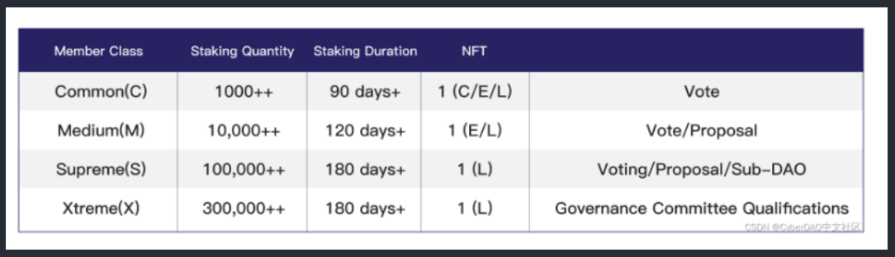
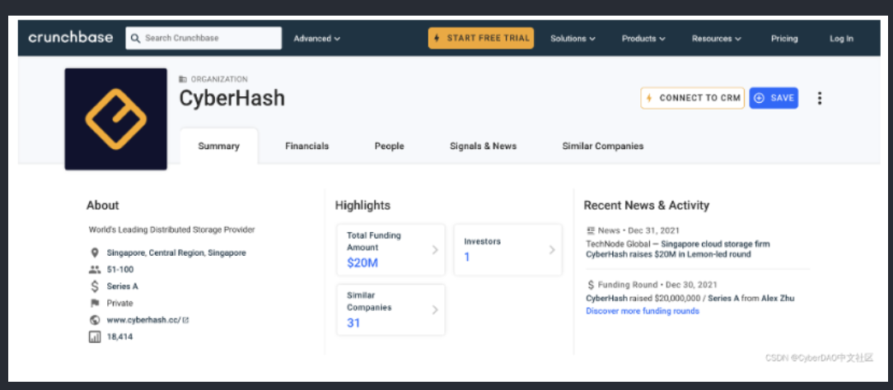
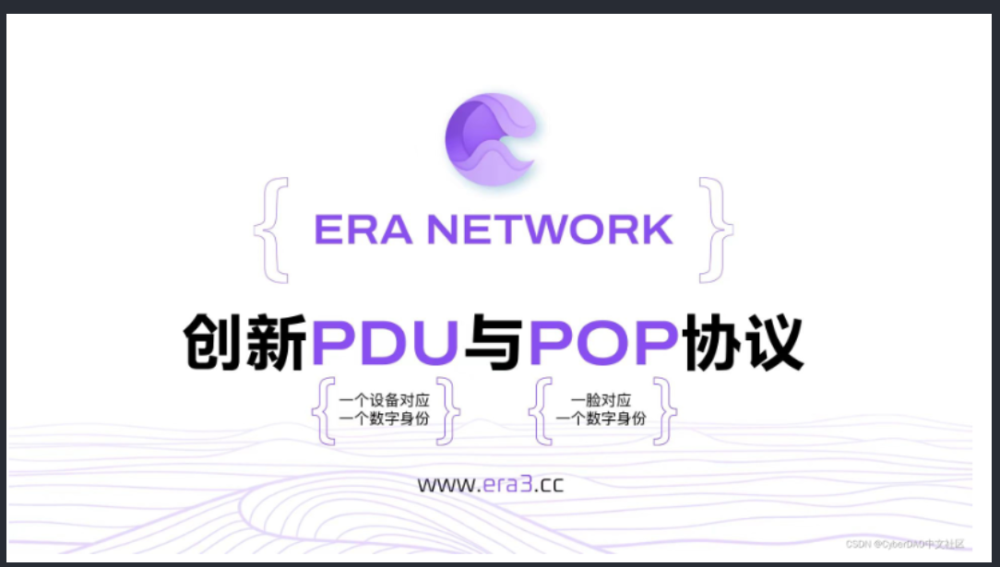
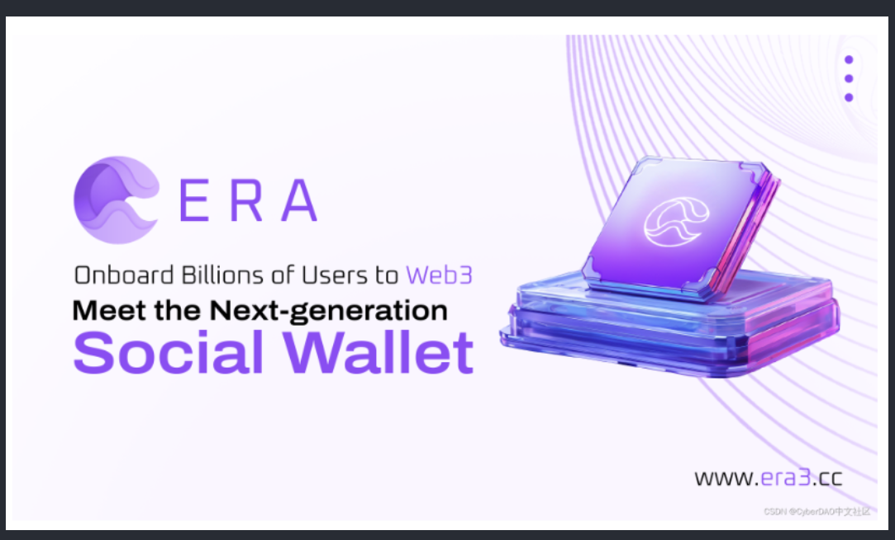
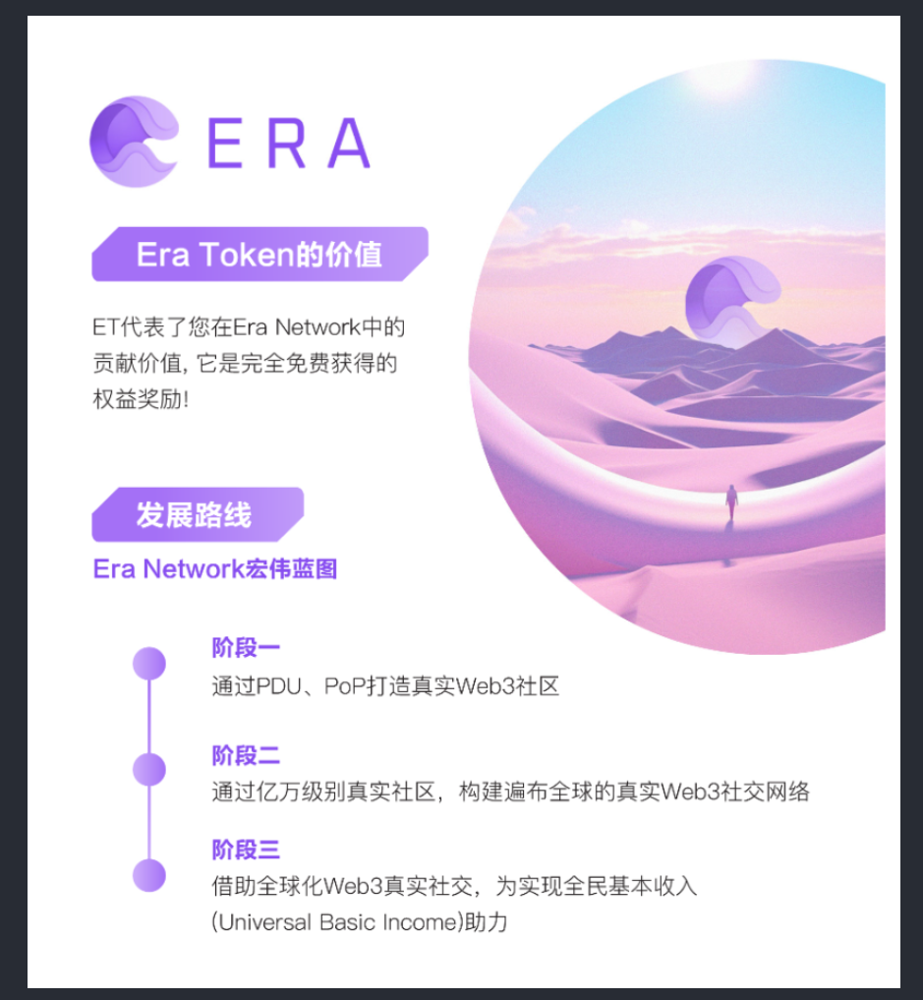
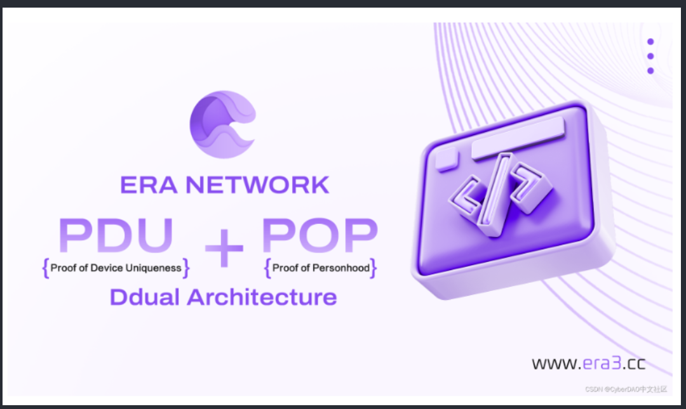

# CyberDAO
## web3.0的DAO概述
- Web3.0正在改写着世界运行的规则，AGI将为人类未来的生产效率、工作方式与目标带来改变，区块链经过十余年发展开启了去中心化新格局，带来生产关系的变革。人类正在从过往以时间换取收入、听命完成工作，转变为以个性化、自主追求人生价值为目标。
- 由此诞生的DAO分布式自治组织正在引领这场变革，它是公司这一组织形态的升级版，DAO提倡灵活高效协作模式，塑造未来组织新范式，通过一个宏伟的愿景，重构人与人之间的信任和协作，让互不相识的人能够因为共识而贡献和努力。

## CyberDAO介绍
1. 网址：www.era.cc
CyberDAO，一个致力于推动Web3.0行业发展的分布式自治组织。汇聚了世界级互联网人才的力量，其创始团队来自于TikTok早期领军成员，更有众多业内顶级技术专家的加入组成了研发小组TechDAO。秉持着为行业和用户创造价值的理念，CyberDAO专注于采用去中心化创新技术与商业模式的原则来构建一个开放式的商业生态。

1. 简介：CyberDAO是一个基于区块链的去中心化自治组织，致力于通过区块链技术来促进价值共享和价值流动。
2. 发展历史：
- 起源：
CyberDAO主体Cyber Hash在2021年成立于新加坡，并在创立初期获得Musically联合创始人朱骏（Alex Zhu）领投的2000万美元A轮融资。经过三年的发展，CyberDAO已经吸引了上千名对Web3充满热忱的成员参与。

- 发展：
在2021年到2024年期间，CyberDAO不断积累行业资源，与Web3投资机构A16Z、美国斯坦福大学、多位国际经济学家、Web3行业学者等专业团队和行业大咖合作，孵化了多个行业项目，包括去中心化分布式存储、Web3社交钱包、Web3投资基金、Web3游戏（GameFi）等。未来，CyberDAO将持续孵化更多优质项目，为成员创收。

- 为实现引领亿级用户向Web3迁移的使命，CyberDAO与TechDAO共同孵化了以社交为核心的社交钱包《ERA》，ERA集合了加密聊天、AI应用、社群管理、应用市场、资产交易等为一体的去中心化应用（DAPP），用户在ERA所产生的一切数据都归属于个人，即使是平台方也无法获取，充分保护用户的权益与隐私。

- 经过三年的发展，目前已 有上千名对Web3充满热忱与付出实践的DAO成员参与其中，涵盖包括： 技术、资本、商业、应用与流量等领域的建设者，为社区带来多元的 Web3产品、服务与商业机会，真正做到触达行业核心，助力DAO成员捕获Web3.0时代的发展红利。

- ERA是行业领先实现POP（PoorfofPersonhood）人格证明协议的社交应用，用户仅通过手机进行面部扫描，即可创建完全去中心化的数字身份EID，从而实现一人一账号的真实用户网络。POP协议中采用了零知识证明与全同态加密技术等创新解决方案，在绝对保护用户隐私的基础上完成验证，并达到了CCPA和EUGDPR的监管要求。

1. 加入条件：
通过CC质押数量，以及持有CyberZodiac NFT来定义DAO成员等级。

1. 使命和愿景

CyberDAO致力于在快速变化的时代，构建全球化的Web3商业生态。作为一个推动Web3行业的投研孵化DAO组织，CyberDAO的起源、使命和愿景在这一过程中发挥了重要作用。通过整合来自技术、资本、商业、应用与流量等多个领域的建设者，CyberDAO为社区带来了多元的Web3产品、服务与商业机会，帮助DAO成员捕获Web3.0时代的发展红利。

**目标**：孕育10万名Web3优质精英;
**使命**：助力Web3爱好者捕获行业价值;
**愿景**：构建全球化开放的Web3商业生态

5. Era Network在行业中的价值
Era Network最大的不同之处在于，它是一个可识别真实用户的社交网络。Era Network采用了创新的PDU与POP协议，确保DID和数据与用户本人完全绑定。ERA认为，只有成功构建去中心化的真实用户网络，Web3应用和通证经济模型（UBI）才能够真正实现大规模的发展。

6. PDU&POP双重架构
- PDU （Proof of Device Uniqueness）
ERA Network首创PDU设备独特性证明机制，通过“1设备，1DID”的理念和前沿加密算法，为每个终端设备生成唯一性标识。这确保在同一设备上创建多个钱包账号时，只有首个钱包账户能够参与Era Network。

- POP （Proof of Personhood）
在PDU的基础上，POP采用面部识别来实现ZKP零知识证明技术支持的生物人格证明，以“1脸，1DID”机制，证明每个数字身份对应一个独一无二的真实人类，POP协议并不会保存用户的生物信息，特征值只是一串加密符号，这样可以解决隐私性和安全性问题，并同时满足了CCPA和EUGDPR的监管要求，在合规的基础上做到了公平构建。

Era network产品，可以快速建立真实用户网络，掌握线上流量端口。作为私域流量的孵化器，帮助每个人建立属于自己的私域社群。因此，选择Era network产品，可以在Web3行业发展中立于不败之地。

1. 宏伟蓝图
空投是一种通过参与认证来获得持续的奖励和福利的方式。在Web3时代，每个项目都有可能获得空投，这使得用户可以轻松地赚取收益。通过认证，用户可以获得更多的项目，从而获取更高的收益。Web3行业的发展使得用户可以在自己的账户中享受到更多的数据权益，如推荐优质项目、精准匹配项目和流量等。持有ETH、BNB、CC、MATIC等其中一种代币，通过Era network可免费获得ET积分，让推广者建立真实好友网络和打造私域社群，帮助用户实现短、中、长期收益，为KOL和项目方多方面极致赋能，最终为实现全民基本收入（UBI）助力。

CyberDAO能成为推动万亿级数字经济生态繁荣的重要力量。展望未来，CyberDAO将持续扩大全球合作，汇聚人才与资源，致力于打造一个权力下放、共识驱动、利益共享的Web3组织典范。我们期待与全球每一位有识之士携手，共同推动人类进入更开放、高效、自治的未来!

1. 参与者如何放大在Era Network的价值

通过免费发放ET积分的方式吸引更多的用户参与，ET积分将会分配给真实社交网络的建设者，让参与者能够实现更大的价值。同时通过减产机制，让早鸟期用户获得双倍的收益。

除此之外，用户除了可获得ET积分，还能够在平台上获取源源不断的优质项目空投奖励。这意味Era Network将为Web3世界带来海量的真实用户，杜绝过去行业所面临的女巫攻击，真正发挥Web3企业的代币激励作用，为参与贡献的用户带来正向的价值回报。越多用户参与，越多项目入驻，越多空投，ET价值越高，越赋能行业。目前阶段做好分享获得更多用户、扩大好友网络、成为大使。
