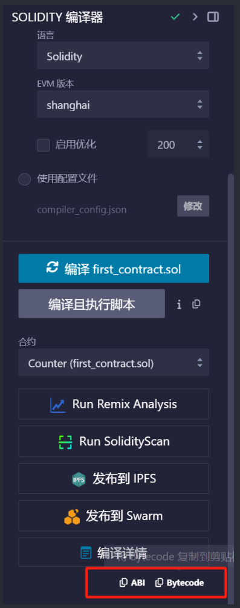

# ETH私有链部署学习测试2  ----POA(单主机)
## 安装过程记录
分别记录了Ubuntu测试没有通过的操作过程记录，和centos成功的操作过程
这里面有个特殊的情况，要记清楚，centos这一版的geth中有pupeth，Ubuntu这一版的pupeth是单独下载的。
ubuntu和centos都是用的非root用户，这个用户都有sudo权限
### 预备条件 
1. Go 语言 
- 手动下载可登录官网按需下载 https://golang.google.cn/dl/
sudo wget https://golang.google.cn/dl/go1.22.9.linux-amd64.tar.gz
- 下载后解压目录
sudo tar -zxvf go1.22.9.linux-amd64.tar.gz
- 将其移动到合适的位置
​sudo mv go /usr/local​
- 配置环境变量ubuntu
echo "export PATH=$PATH:/usr/local/go/bin" | sudo tee -a /etc/bash.bashrc
echo "export GOROOT=/usr/local/go" | sudo tee -a /etc/bash.bashrc
echo "export GOPATH=/usr/local/go/bin" | sudo tee -a /etc/bash.bashrc
source /etc/bash.bashrc

- 配置环境变量centos
echo "export GOROOT=/usr/local/go" >> ~/.bashrc
echo "export GOPATH=/usr/local/go/bin" >> ~/.bashrc
echo 'export PATH=$PATH:/usr/local/go/bin' >> ~/.bashrc
- 验证安装
go version

2. Geth 客户端
- 创建目录:
**ubuntu：**  
在soft目录下，创建poachain2目录，并切换到该目录下：
cd poachain2/

**centos:**
创建到系统根目录下，要使用 sudo 
 sudo mkdir /poachain2
 chown -R $hfblock:chain /poachain2
 cd poachain2/

- 下载geth并配置（最好下载geth&tool版本）
官网： https://geth.ethereum.org/downloads  

**这个版本没有puppeth，不要用** **ubuntu用的版本**
wget https://gethstore.blob.core.windows.net/builds/geth-alltools-linux-amd64-1.14.11-f3c696fa.tar.gz

**要使用这个版本** centos用的版本  /soft目录下执行命令
sudo wget https://gethstore.blob.core.windows.net/builds/geth-alltools-linux-amd64-1.10.17-25c9b49f.tar.gz

- 解压并移动到指定目录 **ubuntu**
sudo tar -zxvf geth-alltools-linux-amd64-1.14.11-f3c696fa.tar.gz -C /usr/local

- 解压并移动到制定目录 **centos**
tar -zxvf geth-alltools-linux-amd64-1.10.17-25c9b49f.tar.gz -C /poachain2/

- 修改名称 **ubuntu**
sudo mv geth-alltools-linux-amd64-1.14.11-f3c696fa/ geth

- 修改名称 **centos**
mv geth-alltools-linux-amd64-1.10.17-25c9b49f geth

- 配置geth的环境变量：**ubuntu**
echo "export PATH=$PATH:/usr/local/geth/​geth" | sudo tee -a /etc/bash.bashrc
source /etc/bash.bashrc

- 配置geth的环境变量：**centos**
echo "export PATH=$PATH:/soft/geth" >> ~/.bashrc
source ~/.bashrc

- 验证安装
[hfblock@node1 poachain2]$ geth version
Geth
Version: 1.10.17-stable
Git Commit: 25c9b49fdb74931137431c24cf28d3c65f9420d2
Git Commit Date: 20220329
Architecture: amd64
Go Version: go1.18
Operating System: linux
GOPATH=/usr/local/go/bin
GOROOT=/usr/local/go

### 搭建POA私有链步骤如下：以下不再记载Ubuntu的操作过程，只记录centos的操作过程。
项目根目录poachain2下创建节点目录
mkdir  node1 node2

1. 创建账户
在node1 node2 目录下创建账户

[hfblock@node1 node1]$ geth account new --datadir ./data
INFO [11-19|14:16:53.470] Maximum peer count                       ETH=50 LES=0 total=50
INFO [11-19|14:16:53.471] Smartcard socket not found, disabling    err="stat /run/pcscd/pcscd.comm: no such file or directory"
Your new account is locked with a password. Please give a password. Do not forget this password.
Password:
Repeat password:

Your new key was generated

Public address of the key:   0xFF505910D7B4fD75E4E7Ef69C7b2aD9Fa2F6aaC0
Path of the secret key file: data/keystore/UTC--2024-11-19T06-19-41.007111650Z--ff505910d7b4fd75e4e7ef69c7b2ad9fa2f6aac0

- You can share your public address with anyone. Others need it to interact with you.
- You must NEVER share the secret key with anyone! The key controls access to your funds!
- You must BACKUP your key file! Without the key, it's impossible to access account funds!
- You must REMEMBER your password! Without the password, it's impossible to decrypt the key!

**注意**：这里提示Smartcard socket not found，先不管，看看后面会不会有问题
**注意**：两个节点的 Public address of the key和Path of the secret key file要单独记下来，千万不能遗失，后面要用到。可以记到poachain2目录中的info.txt文件中。把配置的密码也记下来。

- 验证账户创建：
在node1和node2目录下分别运行geth account list命令，查看账户列表。
进入目录查看keystore目录中是否有一个UTC--开头的文件，如果有，说明账户创建成功。
[hfblock@node1 keystore]$ pwd
/poachain2/node2/data/keystore
[hfblock@node1 keystore]$ ll
总用量 4
-rw------- 1 hfblock chain 491 11月 19 14:21 UTC--2024-11-19T06-21-04.100893695Z--14f79155187216ac28296d90aa00f8cca98e8de9

- node2的账户， 创建同node1
Public address of the key:   0x14F79155187216aC28296d90Aa00F8Cca98e8de9
Path of the secret key file: data/keystore/UTC--2024-11-19T06-21-04.100893695Z--14f79155187216ac28296d90aa00f8cca98e8de9

- 记录创建的账户信息到info.txt文件中，以便后续使用。
在项目根目录下创建info.txt文件，并记录两个节点的账户信息。
[hfblock@node1 poachain2]$ touch info.txt
[hfblock@node1 poachain2]$ echo "node1 account: 0xFF505910D7B4fD75E4E7Ef69C7b2aD9Fa2F6aaC0" >> info.txt
[hfblock@node1 poachain2]$ echo "node2 account: 0x14F79155187216aC28296d90Aa00F8Cca98e8de9" >> info.txt
[hfblock@node1 poachain2]$ cat info.txt
node1 account: 0xFF505910D7B4fD75E4E7Ef69C7b2aD9Fa2F6aaC0
node2 account: 0x14F79155187216aC28296d90Aa00F8Cca98e8de9

2. 产生创世块
使用puppeth​来产生创世文件. puppeth是geth自带的程序，可以引导用户创建geth的创世文件。
运行puppeth在poachain2目录产生创世块配置相关的json文件

- 在当前用户的家目录下操作 - **centos不需要看，略过！！！** **这部分内容是ubuntu的**
mkdir puppeth-install
cd puppeth-install
go mod init puppeth-install 

- **centos不需要看，略过！！！直接看‘运行puppeth’这部分，** **这部分内容是ubuntu的**
下载puppeth，**新版本的geth没有puppeth，要用这个版本**，**本次测试用的是2022年3月份的版本**
export GOPROXY=https://goproxy.cn,direct
go install github.com/ethereum/go-ethereum/cmd/puppeth@v1.10.0
下载位置通常在go的GOPATH目录下，下面是我的位置
zhf@MS-CEVXSRKPSHOI:/usr/local/go/bin$ cd bin
zhf@MS-CEVXSRKPSHOI:/usr/local/go/bin/bin$ ll
total 15496
drwxrwxr-x 2 zhf zhf     4096 Nov 16 19:14 ./
drwxr-xr-x 4 zhf zhf     4096 Nov 16 19:14 ../
-rwxrwxr-x 1 zhf zhf 15856608 Nov 16 19:14 puppeth*
zhf@MS-CEVXSRKPSHOI:/usr/local/go/bin/bin$ pwd
/usr/local/go/bin/bin

添加环境变量
echo "export PATH=$PATH:/usr/local/go/bin/bin" | sudo tee -a /etc/bash.bashrc
source /etc/bash.bashrc

- 运行puppeth
puppeth
这个连接有详细的解释：https://www.learnblockchain.cn/article/3844
**注意建议是在项目根目录下执行，后面就可以直接回车指定生成文件的目录就是这个根目录**
[hfblock@node1 poachain2]$ puppeth
+-----------------------------------------------------------+
| Welcome to puppeth, your Ethereum private network manager |
|                                                           |
| This tool lets you create a new Ethereum network down to  |
| the genesis block, bootnodes, miners and ethstats servers |
| without the hassle that it would normally entail.         |
|                                                           |
| Puppeth uses SSH to dial in to remote servers, and builds |
| its network components out of Docker containers using the |
| docker-compose toolset.                                   |
+-----------------------------------------------------------+

Please specify a network name to administer (no spaces, hyphens or capital letters please)
> poa2

Sweet, you can set this via --network=poa2 next time!

INFO [11-19|14:48:26.031] Administering Ethereum network           name=poa2
WARN [11-19|14:48:26.031] No previous configurations found         path=/home/hfblock/.puppeth/poa2

What would you like to do? (default = stats)
 1. Show network stats
 2. Configure new genesis
 3. Track new remote server
 4. Deploy network components
> 2

What would you like to do? (default = create)
 1. Create new genesis from scratch
 2. Import already existing genesis
> 1

Which consensus engine to use? (default = clique)
 1. Ethash - proof-of-work
 2. Clique - proof-of-authority  **只有被授权的账户才能生成区块**
> 2

How many seconds should blocks take? (default = 15)
> 15

Which accounts are allowed to seal? (mandatory at least one)
> 0xFF505910D7B4fD75E4E7Ef69C7b2aD9Fa2F6aaC0
> 0x14F79155187216aC28296d90Aa00F8Cca98e8de9
> 0x

Which accounts should be pre-funded? (advisable at least one)
> 0xFF505910D7B4fD75E4E7Ef69C7b2aD9Fa2F6aaC0
> 0x14F79155187216aC28296d90Aa00F8Cca98e8de9
> 0x

Should the precompile-addresses (0x1 .. 0xff) be pre-funded with 1 wei? (advisable yes)
> yes

Specify your chain/network ID if you want an explicit one (default = random)
> 1501
INFO [11-19|14:51:42.249] Configured new genesis block

What would you like to do? (default = stats)
 1. Show network stats
 2. Manage existing genesis
 3. Track new remote server
 4. Deploy network components
> 2

 1. Modify existing configurations
 2. Export genesis configurations
 3. Remove genesis configuration
> 2

Which folder to save the genesis specs into? (default = current)
  Will create poa2.json, poa2-aleth.json, poa2-harmony.json, poa2-parity.json
>
INFO [11-19|14:52:37.303] Saved native genesis chain spec          path=poa2.json
ERROR[11-19|14:52:37.305] Failed to create Aleth chain spec        err="unsupported consensus engine"
ERROR[11-19|14:52:37.306] Failed to create Parity chain spec       err="unsupported consensus engine"
INFO [11-19|14:52:37.307] Saved genesis chain spec                 client=harmony path=poa2-harmony.json

What would you like to do? (default = stats)
 1. Show network stats
 2. Manage existing genesis
 3. Track new remote server
 4. Deploy network components

做到这里ctrl+c退出puppeth，不能正常退出的话，那就ctrl+d退出。然后我们可以继续下一步操作。看一下根目录下生成目录和文件情况
[hfblock@node1 poachain2]$ ls
bootdir  info.txt  node1  node2  poa2-harmony.json  poa2.json

3.  配置密码文件
cd node1
vi password.txt  或者 echo 'zhf@4933807' >> password.txt
将账户的密码写进去，方便启动节点时调用这个文件
cd node2
vi password.txt
将账户的密码写进去，方便启动节点时调用这个文件

4. 初始化节点，分别在node1 和node2 目录下执行
- 命令：geth --datadir data init  ../poa2.json
[hfblock@node1 node1]$ geth --datadir data init  ../poa2.json
INFO [11-19|16:32:58.475] Maximum peer count                       ETH=50 LES=0 total=50
INFO [11-19|16:32:58.476] Smartcard socket not found, disabling    err="stat /run/pcscd/pcscd.comm: no such file or directory"
INFO [11-19|16:32:58.476] Set global gas cap                       cap=50,000,000
INFO [11-19|16:32:58.476] Allocated cache and file handles         database=/poachain2/node1/data/geth/chaindata cache=16.00MiB handles=16
INFO [11-19|16:32:58.491] Writing custom genesis block
INFO [11-19|16:32:58.494] Persisted trie from memory database      nodes=357 size=50.70KiB time="514.719µs" gcnodes=0 gcsize=0.00B gctime=0s livenodes=1 livesize=0.00B
INFO [11-19|16:32:58.494] Successfully wrote genesis state         database=chaindata                            hash=63e9af..cbf209
INFO [11-19|16:32:58.494] Allocated cache and file handles         database=/poachain2/node1/data/geth/lightchaindata cache=16.00MiB handles=16
INFO [11-19|16:32:58.510] Writing custom genesis block
INFO [11-19|16:32:58.513] Persisted trie from memory database      nodes=357 size=50.70KiB time="510.159µs" gcnodes=0 gcsize=0.00B gctime=0s livenodes=1 livesize=0.00B
INFO [11-19|16:32:58.514] Successfully wrote genesis state         database=lightchaindata                       hash=63e9af..cbf209

- 命令：geth --datadir data init ../poa2.json

5. 引导节点的配置及启动 
- bootnode配置
bootnode用于节点间通信和管理,我的目录创建在/poachain2 下；
- 在poachain2目录下建立1个目录，bootdir

mkdir bootdir 

- 在bootdir文件夹中配置bootnode节点用来做p2p网络路由；
bootnode -genkey boot.key #创建名为boot.key的key文件。

- #后台运行bootnode（节点通信时需要处于运行状态，建议一直运行）
nohup bootnode -nodekey boot.key -verbosity 9 -addr :30301 2>> bootnode_output.log &
**注意** ：也可以去掉nohup & 不后台运行 #启动bootnode路由节点。

- 启动节点时会用到enode://，记录下来
[hfblock@node1 bootdir]$ bootnode -nodekey boot.key -verbosity 9 -addr :30301
enode://9f07539eba2704175a0c67300cb621d54d03c036ba8ab9415a65398fd43b12cf8b0aa26028fd96e320a5230438e31981ff7aa3598164227879b71061157940e5@127.0.0.1:0?discport=30301
Note: you're using cmd/bootnode, a developer tool.
We recommend using a regular node as bootstrap node for production deployments.
INFO [11-19|16:52:54.600] New local node record                    seq=1,732,006,374,599 id=ac74c59833473030 ip=<nil> udp=0 tcp=0

6. 启动成员节点（需确认bootnode开启），分别在node1和node2目录下执行

#节点1  
node1 启动一个签名账户。我们将使用适当的参数自定义脚本，例如 enode、网络 ID（chainId）、签名节点地址、密码和签名地址。以下未示例：
geth --datadir "./data"  --port 30304 --bootnodes enode://{ YOUR_VALUE } --authrpc.port 8547 --ipcdisable --allow-insecure-unlock  --http --http.corsdomain="https://remix.ethereum.org" --http.api web3,eth,debug,personal,net --networkid { NETWORK_ID } --unlock { ADDRESS_NODE1 } --password { PASSWORD_FILE_NAME_EXTENSION }  --mine --miner.etherbase= { SIGNER_ADDRESS }

**注意：networkid要和poa2.json文件中的chainId保持一致。**  mine.etherbase是设置挖矿收益地址，可以设置为任意地址。
- node1的命令
geth --datadir "./data"  --port 30304 --bootnodes enode://9f07539eba2704175a0c67300cb621d54d03c036ba8ab9415a65398fd43b12cf8b0aa26028fd96e320a5230438e31981ff7aa3598164227879b71061157940e5@127.0.0.1:0?discport=30301 --authrpc.port 8546 --ipcdisable --allow-insecure-unlock  --http --http.corsdomain="https://remix.ethereum.org, http://127.0.0.1:8000" --http.api web3,eth,debug,personal,net --networkid 1501 --unlock 0xFF505910D7B4fD75E4E7Ef69C7b2aD9Fa2F6aaC0 --password password.txt  --mine console --miner.etherbase=0xFF505910D7B4fD75E4E7Ef69C7b2aD9Fa2F6aaC0  2>> node1_output.log

参数含义：
--datadir：指定数据存储目录，这里是./data
--port：指定和其他节点通信的端口，这里是30304
--bootnodes：指定bootnode的enode地址，这里是上面获取到的enode地址
--authrpc.port：指定rpc端口，这里是8546
--ipcdisable：禁用ipc
--allow-insecure-unlock：允许解锁
--http：开启http服务
--http.corsdomain：设置跨域访问
--http.api：开启web3 api
--networkid：指定网络ID
--unlock：指定解锁账户
--password：指定密码文件
--mine：开启挖矿
--miner.etherbase：设置挖矿收益地址
console：启动控制台，可以输入命令进行操作

**当节点1启动节点2未启动时，日志会打印looking for peer，等待节点2的接入**

INFO [11-19|18:03:26.770] Looking for peers                        peercount=0 tried=0 static=0
INFO [11-19|18:03:36.787] Looking for peers                        peercount=0 tried=0 static=0

#节点2
我们可以使用下面的脚本命令运行签名节点（node1）以外的节点，示例如下：

geth --datadir "./data"  --port 30306 --bootnodes enode://{ YOUR_VALUE }  -authrpc.port 8546 --networkid { NETWORK_ID } --unlock { ADDRESS_NODE2 } --password { PASSWORD_FILE_WITH_EXTENSION }

-node2的启动命令：
geth --datadir "./data"  --port 30305 --bootnodes enode://9f07539eba2704175a0c67300cb621d54d03c036ba8ab9415a65398fd43b12cf8b0aa26028fd96e320a5230438e31981ff7aa3598164227879b71061157940e5@127.0.0.1:0?discport=30301 --authrpc.port 8547  --networkid 1501 --unlock 0x14F79155187216aC28296d90Aa00F8Cca98e8de9 --password password.txt --mine console 2>> node2_output.log

 **如果关掉终端之后需要重启网络的话，直接执行上面两个命令即可，不用再启用引导节点**

# 节点console模式下，geth常用命令
- Geth Console 是一个交互式的 JavaScript 执行环境，其中 > 是命令提示符,里面内置了一些用来操作以太坊的 JavaScript对象，我们可以直接调用这些对象来获取区块链上的相关信息。
- 这些对象主要包括：

eth：主要包含对区块链进行访问和交互相关的方法；
net：主要包含查看 p2p 网络状态的方法；
admin：主要包含与管理节点相关的方法；
miner：主要包含挖矿相关的一些方法；
personal：包含账户管理的方法；
txpool：包含查看交易内存池的方法；
web3：包含以上所有对象，还包含一些通用方法。

- 常用命令：
1. 查看节点信息：网络和区块链的设置信息
 admin.nodeInfo.protocols.eth
{
  config: {
    byzantiumBlock: 0,
    chainId: 1501,
    clique: {
      epoch: 30000,
      period: 15
    },
    constantinopleBlock: 0,
    eip150Block: 0,
    eip150Hash: "0x0000000000000000000000000000000000000000000000000000000000000000",
    eip155Block: 0,
    eip158Block: 0,
    homesteadBlock: 0,
    istanbulBlock: 0,
    petersburgBlock: 0
  },
  difficulty: 387,
  genesis: "0x63e9af7d06a4690d92f1f44dca06d82d6576450cad4d5fe758a7954418cbf209",
  head: "0x74ffac34275c96acbf29689a71adc1fb4d9f8587811146ce4c7470081b757d36",
  network: 1501
}
- 解释：
difficulty: 表示当前网络的难度水平，这里是 387，难度越高，挖矿所需的计算资源就越多。
genesis: 表示创世区块的哈希，创世区块是区块链的第一个区块。
head: 当前链的最新区块哈希，表示区块链的顶部区块。
network: 表示该网络的标识符，这里是 1501，通常用于区分不同的链和网络。

2. 一些个人理解
- 以太坊**节点**上产生区块；节点既是本例中的**node1和node2**，也是区块链网络中的参与者；
- 运行节点需要以太坊客户端，如 Geth、Parity、Nethermind 等；
- 节点可以连接到其他节点，形成一个分布式网络；
- 节点可以接收、验证、打包、执行交易；
- 节点可以存储、查询区块链数据；
- 节点可以参与共识，产生新区块；
- 节点可以设置账户，并通过私钥进行签名和验证；
- 节点可以设置挖矿的难度，以提高挖矿效率；
- 节点可以设置交易池，并根据交易池的状态进行交易的选择；
- 节点可以设置交易的最大上限，防止交易过多导致网络拥堵；
- 节点可以设置网络的出块奖励，以鼓励节点的维护；
- 节点可以设置网络的停机时间，以防止网络拥堵；
- 节点可以设置网络的 gas 价格，以控制交易的成本；
- 节点可以设置网络的 gas 限制，以防止交易过大导致网络拥堵；
- 节点可以设置网络的白名单，以限制访问；
- 节点可以设置网络的黑名单，以限制访问；
- 节点可以设置网络的插件，以扩展功能；
- 节点可以设置网络的 RPC 接口，以与其他程序集成；

3. 以太坊节点的类型分类
- **以太坊全节点**
  全节点是整个主链的一个副本，存储并维护链上的所有数据，并随时验证新区块的合法性。
区块链的健康和扩展弹性，取决于具有许多独立操作和地理上分散的全节点。每个全节点都可以帮助其他新节点获取区块数据，并提供所有交易和合约的独立验证。
运行全节点将耗费巨大的成本，包括硬件资源和带宽。
以太坊开发不需要在实时网络（主网）上运行的全节点。我们可以使用测试网络的节点来代替，也可以用本地私链，或者使用服务商提供的基于云的以太坊客户端；这些几乎都可以执行所有操作。
**全节点的优缺点**
**优点**
为以太坊网络的灵活性和抗审查性提供有力支持
权威地验证所有交易
可以直接与公众区块链上的任何合约交互
可以离线查询区块链状态（账户、合约等）
可以直接把自己的合约部署到公共区块链中

**缺点**
需要巨大的硬件和带宽资源，而且会不断增长
第一次下载往往需要几天才能完全同步
必须及时维护、升级并保持在线状态以同步区块

- **以太坊远程客户端和轻节点**
**远程客户端**
不存储区块链的本地副本或验证块和交易。这些客户端一般只提供钱包的功能，可以创建和广播交易。远程客户端可用于连接到现有网络，MetaMask 就是一个这样的客户端。
**轻节点**
不保存链上的区块历史数据，只保存区块链当前的状态。轻节点可以对块和交易进行验证。

- **公共测试网络节点**
公共测试网络节点是公开可用的以太坊网络，供开发者测试和开发使用。这些节点的运行方式与主网节点相同，但不保证持续运行。
**优点**
一个testnet节点需要同步和存储更少的数据，大约10GB，具体取决于不同的网络
一个testnet节点一般可以在几个小时内完成同步
部署合约或进行交易只需要发送测试以太，可以从”水龙头“免费获得
测试网络是公共区块链，有许多其他用户和合约运行（区别于私链）

**缺点**
测试网络上使用测试以太没有价值。因此无法测试交易对手的安全性，因为没有任何利害关系
测试网络上的测试无法涵盖所有真实主网特性。例如：交易费用虽然是发送交易所必需的，但由于gas免费，因此 testnet上往往不会考虑。而且一般来说，测试网络不会像主网一样经常拥堵

4. 节点配置账户的理解
以太坊中有两种主要类型的账户：
**外部账户**（Externally Owned Accounts，EOA）：由用户私钥控制，通常用来进行交易和存储以太币（ETH）。
**合约账户**（Contract Accounts）：由智能合约代码控制，合约通过部署在以太坊网络中创建，具有执行逻辑。

- **本次私链测试环境中，节点配置的账户类型为外部账户，即用户私钥控制的账户。**
- 如果再次使用 geth account new --datadir ./data 命令，在节点中创建账户，将能够创建节点中的多个外部账户类型的账户。

- 启动节点的命令中，**包含了已经创建的外部节点的账户信息**
解释：如果您希望节点能够执行交易、生成区块（在采用矿工模式时）或者部署智能合约，那么节点需要有一个或多个外部账户，并在启动时配置这些账户信息。这样，节点才能在网络上进行资金转账和合约交互。

- 启动节点的命令中，**不包含外部账户的情况**
如果节点仅用作数据同步或者不需要进行任何交易或区块生成，您可以启动节点而不配置账户信息。在这种情况下，**节点仍然可以参与网络，接收区块和交易信息，但不能自己生成区块或发送交易。**

- 节点可以创建**多个外部账户**，每个账户都能来做什么？
1）**执行交易**：每个账户可以用于发送和接收以太币（ETH）或其他代币，使其在网络中能够参与资金转移。

2）**部署智能合约**：每个账户可以用来部署智能合约。每当账户发送交易以调用合约功能时，合约的逻辑会被执行。

3）**代表不同用户或应用**：多个账户可以用来代表不同的用户或应用程序。例如，一个节点可以有多个账户用于不同目的，如个人转账、合约交互、测试等。

4）**风险隔离**：使用多个账户可以帮助将不同的资金和交易活动分开，从而在某个账户发生错误或攻击时降低风险。

每次为节点创建新账户时，都会生成一个唯一的公钥和私钥对，使得每个账户在网络中具有唯一的身份。使用账户进行不同的操作可以增加灵活性和安全性。

5. **测试**在node1节点，**新增1个外部账户**
[hfblock@node1 node1]$ geth account new --datadir ./data
INFO [11-21|14:40:55.936] Maximum peer count                       ETH=50 LES=0 total=50
INFO [11-21|14:40:55.938] Smartcard socket not found, disabling    err="stat /run/pcscd/pcscd.comm: no such file or directory"
Your new account is locked with a password. Please give a password. Do not forget this password.
Password:
Repeat password:

Your new key was generated

Public address of the key:   0xcbC5f22aaFA85Cc6cB988f329f699E625d87E50A
Path of the secret key file: data/keystore/UTC--2024-11-21T06-41-07.231883685Z--cbc5f22aafa85cc6cb988f329f699e625d87e50a

查看kestore目录，发现多了1个文件：
[hfblock@node1 keystore]$ pwd
/poachain2/node1/data/keystore
[hfblock@node1 keystore]$ ll
总用量 8
-rw------- 1 hfblock chain 491 11月 19 14:19 UTC--2024-11-19T06-19-41.007111650Z--ff505910d7b4fd75e4e7ef69c7b2ad9fa2f6aac0
-rw------- 1 hfblock chain 491 11月 21 14:41 UTC--2024-11-21T06-41-07.231883685Z--cbc5f22aafa85cc6cb988f329f699e625d87e50a

- 此时在node1的控制台查看当前节点的账户信息：**发现已经多了1个账户**
eth.accounts
["0xff505910d7b4fd75e4e7ef69c7b2ad9fa2f6aac0", "0xcbc5f22aafa85cc6cb988f329f699e625d87e50a"]

- 解锁账号：**因为账号创建后的默认状态是锁定状态，需要解锁才能进行交易**。
personal.unlockAccount('0xcbc5f22aafa85cc6cb988f329f699e625d87e50a','zhf@4933807')

6. 常用命令有：

personal.newAccount()     创建账户；
personal.unlockAccount()  解锁账户；
eth.accounts              查看当前节点中的账户；
eth.getBalance("0xff505910d7b4fd75e4e7ef69c7b2ad9fa2f6aac0")          查看账户余额，返回值的单位是 Wei（Wei 是以太坊中最小货币面额单位，类似比特币中的聪，1 ether = 10^18 Wei）；
eth.blockNumber           列出区块总数即序号；
eth.getTransaction()      获取交易；
eth.getBlock()          获取区块；函数中写区块的序号，返回值中包含区块的详细信息；
eth.coinbase              查看当前节点的 coinbase 账户；挖矿接收奖励的账户
miner.start()           开始挖矿；
miner.stop()            停止挖矿；
web3.fromWei()          Wei 换算成以太币；
web3.toWei()           以太币换算成 Wei；
txpool.status           查看交易池中的状态；
admin.addPeer()         连接到其他节点
admin.nodeInfo.enode    查看节点信息；
admin.peers             查看节点连接信息；
txpool.content          查看交易池中的内容；
txpool.inspect          查看交易池中的详细信息；
txpool.status           查看交易池中的状态；
web3.fromWei(eth.getBalance(eth.coinbase), "ether")

# 目前测试环境中发现的一些情况
1. - 两个节点的账户中，**这个账户是用来启动节点脚本中，配置的那个账户**，被初始化了大量的以太币
node1：
eth.accounts
["0xff505910d7b4fd75e4e7ef69c7b2ad9fa2f6aac0", "0xcbc5f22aafa85cc6cb988f329f699e625d87e50a"]
eth.getBalance("0xff505910d7b4fd75e4e7ef69c7b2ad9fa2f6aac0")
9.04625697166532776746648320380374280103671755200316906558262375061821325312e+74

node2：
eth.accounts
["0x14f79155187216ac28296d90aa00f8cca98e8de9"]
eth.getBalance("0x14f79155187216ac28296d90aa00f8cca98e8de9")
9.04625697166532776746648320380374280103671755200316906558262375061821325312e+74

回溯配置过程中，在使用puppeth进行创世块配置的时候，有这样的配置：
Which accounts should be pre-funded? (advisable at least one)
0xFF505910D7B4fD75E4E7Ef69C7b2aD9Fa2F6aaC0
0x14F79155187216aC28296d90Aa00F8Cca98e8de9

2. 两个节点会**不断的产生区块**，但是**两个节点的账户余额是相同的**，
说明**可能**在创世块初始化阶段配置的pre-funded，给两个账户分配了如此之多的以太币。

此时，**使用：miner.stop()**  可以停止挖矿，停止产生区块。

3. 命令的一些写法
eth.getBalance(eth.accounts[1])
0
eth.getBalance(eth.accounts[0])
9.04625697166532776746648320380374280103671755200316906558262375061821325312e+74

上面的两行命令可以看出来，获取账户余额的命令的参数，**可以是账户地址，也可以是账户索引。**

4. 测试从node1的第一个账户，向第2个账户进行转账
amount = web3.toWei(5,'ether')
"5000000000000000000"
eth.sendTransaction({from:eth.accounts[0],to:eth.accounts[1],value:amount})
"0x342e7364fae4e2ddd48e222918734d94a1ec3ad70a5211cf254e0355561d0e91"

此时如果没有挖矿，用 txpool.status 命令可以看到本地交易池中有一个待确认的交易，可以使用 eth.getBlock("pending", true).transactions查看当前待确认交易。

txpool.status  //交易池查看
{
  pending: 1,
  queued: 0
}

eth.getBlock("pending", true).transactions
[{
    blockHash: "0x8ef5df09a9abfb1c04bf197a8656c86a9ee6904e44a4b2de869589dd2cf1e21d",
    blockNumber: 1489,
    from: "0xff505910d7b4fd75e4e7ef69c7b2ad9fa2f6aac0",
    gas: 21000,
    gasPrice: 1000000000,
    hash: "0x342e7364fae4e2ddd48e222918734d94a1ec3ad70a5211cf254e0355561d0e91",
    input: "0x",
    nonce: 0,
    r: "0xfc023a9024051086cd448b090290239d67b9c7addce4ba71dbb21ca433ad62e4",
    s: "0x69ad5413035db39155b479c9879ad43ba5bf34e5af0cdb34af5db283efec173a",
    to: "0xcbc5f22aafa85cc6cb988f329f699e625d87e50a",
    transactionIndex: 0,
    type: "0x0",
    v: "0xbde",
    value: 5000000000000000000
}]

使用下面命令开始挖矿。该命令表示：当新区块挖出后，挖矿即可结束。
miner.start(1);admin.sleepBlocks(1);miner.stop();

新区块挖出后，挖矿结束，查看账户 1 的余额是5个以太币，已经收到了账户 0 的以太币
web3.fromWei(eth.getBalance(eth.accounts[1]),'ether')
5

这是日志记录的交易信息：
INFO [11-21|16:44:32.148] Commit new sealing work                  number=1490 sealhash=a8f                          f61..4502b5 uncles=0 txs=1 gas=21000 fees=2.1e-05 elapsed="648.981µs"

通过区块号查看本次挖矿完成交易的区块详情：
eth.getBlock(1490)
{
  difficulty: 2,
  extraData: "0xd683010a11846765746886676f312e3138856c696e7578000000000000000000b7eb782a6f4afb6de75dd6fcdbcaa5348d1226925bc8184629aab8e304f5aab97cda636daa19e38108c3cad4c3790a26444134a731bfcdfd951c767b0d2e307b01",
  gasLimit: 8000000,
  gasUsed: 21000,
  hash: "0x9c6237873432316811f54ff2a619085d7b8b73818fed47221746d7f8cdcf50d2",
  logsBloom: "0x00000000000000000000000000000000000000000000000000000000000000000000000000000000000000000000000000000000000000000000000000000000000000000000000000000000000000000000000000000000000000000000000000000000000000000000000000000000000000000000000000000000000000000000000000000000000000000000000000000000000000000000000000000000000000000000000000000000000000000000000000000000000000000000000000000000000000000000000000000000000000000000000000000000000000000000000000000000000000000000000000000000000000000000000000000000",
  miner: "0x0000000000000000000000000000000000000000",
  mixHash: "0x0000000000000000000000000000000000000000000000000000000000000000",
  nonce: "0x0000000000000000",
  number: 1490,
  parentHash: "0x8ab6d883438a606f8d364664d653494c7438a06b7cbffdce9d0928774f4b8c0a",
  receiptsRoot: "0x056b23fbba480696b65fe5a59b8f2148a1299103c4f57df839233af2cf4ca2d2",
  sha3Uncles: "0x1dcc4de8dec75d7aab85b567b6ccd41ad312451b948a7413f0a142fd40d49347",
  size: 722,
  stateRoot: "0xb4fe370764c3a0d2e843f32efc6bacc347111b3f65a28d24780adcab171e607c",
  timestamp: 1732178687,
  totalDifficulty: 2981,
  transactions: ["0x342e7364fae4e2ddd48e222918734d94a1ec3ad70a5211cf254e0355561d0e91"],
  transactionsRoot: "0x875c7c3098ce41d0be758a7a55549aa5c4d7d84e340638296453c3b643aa9421",
  uncles: []
}

通过交易 Hash 查看交易详情：
eth.getTransaction("0x342e7364fae4e2ddd48e222918734d94a1ec3ad70a5211cf254e0355561d0e91")
{
  blockHash: "0x9c6237873432316811f54ff2a619085d7b8b73818fed47221746d7f8cdcf50d2",
  blockNumber: 1490,
  from: "0xff505910d7b4fd75e4e7ef69c7b2ad9fa2f6aac0",
  gas: 21000,
  gasPrice: 1000000000,
  hash: "0x342e7364fae4e2ddd48e222918734d94a1ec3ad70a5211cf254e0355561d0e91",
  input: "0x",
  nonce: 0,
  r: "0xfc023a9024051086cd448b090290239d67b9c7addce4ba71dbb21ca433ad62e4",
  s: "0x69ad5413035db39155b479c9879ad43ba5bf34e5af0cdb34af5db283efec173a",
  to: "0xcbc5f22aafa85cc6cb988f329f699e625d87e50a",
  transactionIndex: 0,
  type: "0x0",
  v: "0xbde",
  value: 5000000000000000000
}

查看节点1的 enode 信息
admin.nodeInfo.enode
"enode://8ea37d00f9f0e607f615b06324d328c41ca597440e487d2cc808189199dec83019c1c9892e0efd75c13f65e9c9dc8a39705598e6596d7279ac2a1711151d4201@127.0.0.1:30304"

查看节点2的enode的信息
 admin.nodeInfo.enode
"enode://0bc780d53ef89466646773c9765a15e70827be51021db6a4170aed32a37fd069627fb314e5237650008ffa0d648756214438c543d6fd44dbed05e3d950b398cf@127.0.0.1:30305"

# 智能合约测试
1.安装Remix客户端；
2.写入solidity代码，并编译；编译后，可以得到二进制码和ABI 
看图：
2.另一种编译方法
在linux中安装solc程序，可以编译二进制码和ABI；
将solidity代码保存为testContract文成的文件， 然后执行
solc --bin testContract.sol
solc --abi testContract.sol

1. 回到 Geth 的控制台，用变量 code 和 abi 记录上面两个值：
code = "608060405234801561000f575f80fd5b505f8081905550610144806100235f395ff3fe608060405234801561000f575f80fd5b5060043610610034575f3560e01c806306661abd146100385780636d4ce63c14610042575b5f80fd5b610040610060565b005b61004a610075565b6040516100579190610095565b60405180910390f35b60015f5461006e91906100db565b5f81905550565b5f8054905090565b5f819050919050565b61008f8161007d565b82525050565b5f6020820190506100a85f830184610086565b92915050565b7f4e487b71000000000000000000000000000000000000000000000000000000005f52601160045260245ffd5b5f6100e58261007d565b91506100f08361007d565b9250828201905080821115610108576101076100ae565b5b9291505056fea26469706673582212207f2f00dca46fa6c809ded6d2d76ac8cd9f0811030410d15ab8b0a7eacd4e21c664736f6c63430008150033"

abi = [{"inputs":[],"stateMutability":"nonpayable","type":"constructor"},{"inputs":[],"name":"count","outputs":[],"stateMutability":"nonpayable","type":"function"},{"inputs":[],"name":"get","outputs":[{"internalType":"uint256","name":"","type":"uint256"}],"stateMutability":"view","type":"function"}]

abi = 
[{"0xee22e7a14e1f70aea71a52e78c4e00a2fdce812f24c345b009b03f714a19246f":[{"inputs":[],"stateMutability":"nonpayable","type":"constructor"},{"inputs":[],"name":"count","outputs":[],"stateMutability":"nonpayable","type":"function"},{"inputs":[],"name":"get","outputs":[{"internalType":"uint256","name":"","type":"uint256"}],"stateMutability":"view","type":"function"}]}]

创建合约实例，发送部署合约的交易：
myContract = eth.contract(abi)   
contract = myContract.new({from:eth.accounts[0],data:code,gas:1000000}) 

我现在的情况是，在一台物理机的一个操作系统中，有两个节点，node1和node2，分别在30304和30305端口运行。两个节点中分别创建了1个账户。
在puppeth中，对两个节点进行了如下设置：
Which accounts are allowed to seal? (mandatory at least one)
> 0xFF505910D7B4fD75E4E7Ef69C7b2aD9Fa2F6aaC0
> 0x14F79155187216aC28296d90Aa00F8Cca98e8de9
> 0x

Which accounts should be pre-funded? (advisable at least one)
> 0xFF505910D7B4fD75E4E7Ef69C7b2aD9Fa2F6aaC0
> 0x14F79155187216aC28296d90Aa00F8Cca98e8de9
> 0x
两个节点的启动命令是这样：
node1：
geth --datadir "./data"  --port 30304 --bootnodes enode://9f07539eba2704175a0c67300cb621d54d03c036ba8ab9415a65398fd43b12cf8b0aa26028fd96e320a5230438e31981ff7aa3598164227879b71061157940e5@127.0.0.1:0?discport=30301 --authrpc.port 8546 --ipcdisable --allow-insecure-unlock  --http --http.corsdomain="https://remix.ethereum.org, http://127.0.0.1:8000" --http.api web3,eth,debug,personal,net --networkid 1501 --unlock 0xFF505910D7B4fD75E4E7Ef69C7b2aD9Fa2F6aaC0 --password password.txt  --mine console --miner.etherbase=0xFF505910D7B4fD75E4E7Ef69C7b2aD9Fa2F6aaC0  2>> node1_output.log

node2：
geth --datadir "./data"  --port 30305 --bootnodes enode://9f07539eba2704175a0c67300cb621d54d03c036ba8ab9415a65398fd43b12cf8b0aa26028fd96e320a5230438e31981ff7aa3598164227879b71061157940e5@127.0.0.1:0?discport=30301 --authrpc.port 8547  --networkid 1501 --unlock 0x14F79155187216aC28296d90Aa00F8Cca98e8de9 --password password.txt --mine console 2>> node2_output.log

启动以后发现，两个节点的账户都在挖矿，而且通过命令：
> eth.blockNumber
得到的结果是一样的，此时在任意一个节点的console中，输入miner.stop(),
即可停止两个节点的挖矿行为。
我的问题是：为什么停止挖矿会两个节点都停止呢？