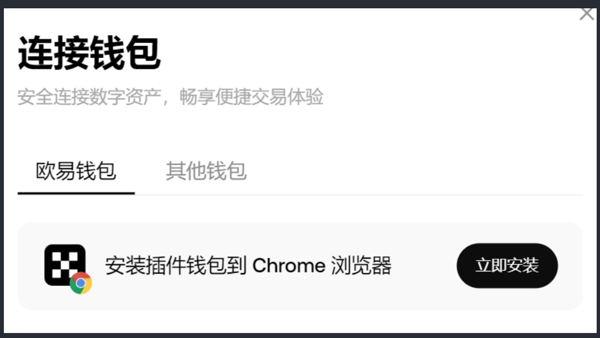
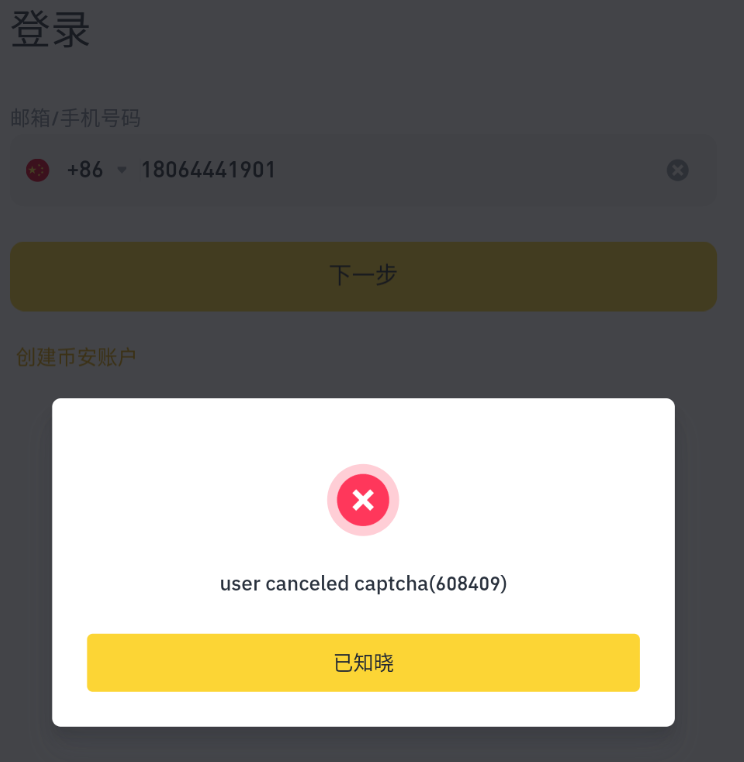
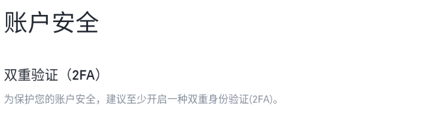
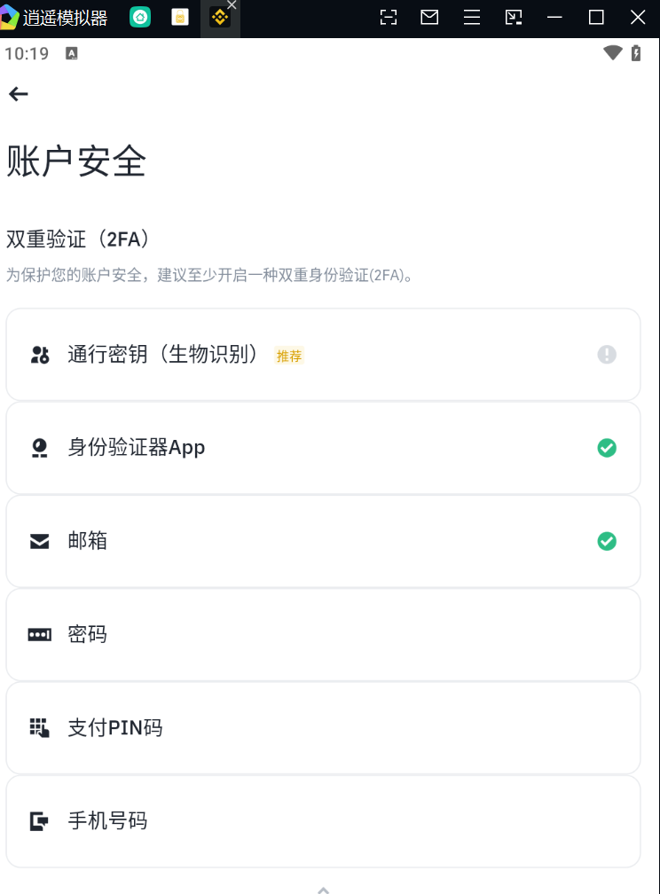
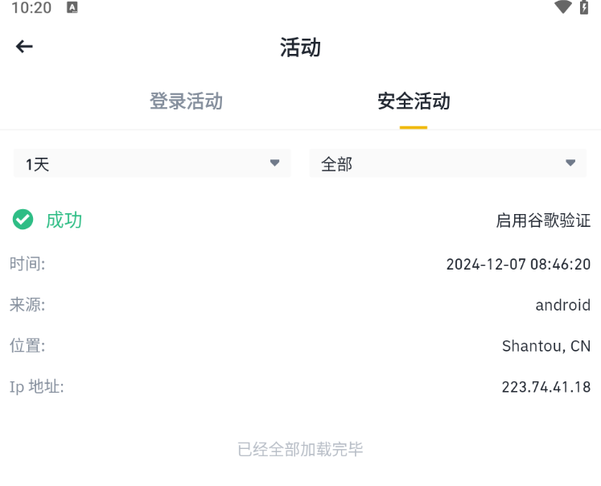

# 欧易--交易所
https://www.vqhmhfreurvc.com/zh-hans/join/go2web3

# OKX--钱包
1. 安装插件钱包到 Chrome 浏览器

???**如果能科学上网，则无法下载插件**

1. 可以将钱包的插件安装在edge上
edge浏览器打开：https://microsoftedge.microsoft.com/addons/detail/%E6%AC%A7%E6%98%93-web3-%E9%92%B1%E5%8C%85/pbpjkcldjiffchgbbndmhojiacbgflha
然后安装插件
通过浏览器edge，访问插件
如果没有科学上网，www.okx.com 是无法访问的，经测试，需要科学上网注册后才能在交易所上进行交易
1. 创建OKX钱包
2. 备份OKX钱包
3. 备份钱包，会提示助记词，一定要牢记，不能丢失
4. 确认助记词是否记牢，按照提示的序号选择对应的正确助记词
5. 左上角选择你的账户，然后点击编辑钱包，
里面可以看到账户的地址和私钥
1. 购买USDT和交易USDT
注意：交易所购买虚拟货币，**需要认证身份，OKX认证需要手机端**
**android客户端的下载地址，科学上网都无法打开**，
**先不试IOS这一端了**，可能也需要苹果手机有非大陆的苹果ID才能下载app

# 币安--交易所
##  币安中的一些操作记录，币安身份认证不需要手机端，可以直接登录交易所进行交易，但是只能进行买入的交易，卖出的交易需要安全认证，安全认证需要手机端来认证。
**注意：**币安C2C交易，如果只是用微信或者支付宝购买USDT,不需要科学上网，可以直接在交易所购买，如果需要卖出USDT，需要移动端认证，移动端必须能够科学上网。且安卓手机需要下载币安的APP，然后登录交易所进行交易。苹果手机必须有非大陆的苹果ID才能下载币安的APP，然后登录交易所进行交易。
我没有andriod手机，所以用电脑模拟器下载了币安的APP，然后登录交易所进行交易。安全认证通过手机端app进行认证，提示需要从谷歌下载
**需要认证后登录交易所，然后进行提币操作。**
1. 下载了币安的APP，利用模拟器安装打开，尝试登录，报错

多试几次，实在不行可以尝试在科学上网的情况下登录，正常情况下锅内网络可以登录
从网上找了下载地址：
下载地址：https://download-1306379396.file.myqcloud.com/pack/BNApp.apk
也可以登录币安的网站https://www.suitechsui.red/zh-CN  下载币安的APP,下载需要科学上网

## 币安购买USDT
买10个，要写11个USDT，通过C2C方式微信支付
做任务获取USDT的返回，需要科学上网
如何用币安进行10USDT的交易？注意是卖出，通过C2C方式微信支付
1.我交易是选的c2c，买入，第一次搞这个，卖家没有提示细节和注意事项，买入后发现t+1模式，
已经迈入的USDT的额度只能等待买入后的24小时，才能进行其他交易。
2. 币安提币到钱包的流程
在交易所中【资产】→【钱包总览】→【提现】→【提取数字货币】→【ETH】→【链上提币】→【输入公钥等信息】→【等待接收】
### tips:
参加活动领取奖励，需要使用闪兑或者现货交易
我通过闪兑，兑换了10USDT的ETH,

## 重点：为什么要搞定安全认证
**tips&ps：**
1. 币安的安全认证必须是双重身份认证2FA，我的模拟器目前没办法支持**通行密钥（生物识别）**的方式，所以只能用谷歌身份验证器。
2. 如果不做安全认证，卖出USDT的交易最后的确认环节将无法完成

## 重点：如何进行安全认证的操作
1. 通过手机端app进行认证，提示需要从谷歌下载，需要科学上网
2. 可能需要下载谷歌浏览器（记不清了），然后找到用户的安全认证中的身份认证器，按照提示操作，可以下载谷歌身份验证器，下载好了后，按照币安app的提示，进行绑定验证。验证后的状态如下：

查询用户的安全活动记录：

## 测试卖出USDT的交易模式
我感觉这次可以了，条件具备了，我今天去测试一下，看看能不能卖出USDT，如果可以，我就去买点USDT，看看能不能赚点。

