以太坊——为所有人而生

# 二层网络 为实现以太坊的大规模采用而扩容

# 什么是二层网络？
二层网络 (L2) 是一种统称，用来描述一系列特定的以太坊扩容解决方案。**二层网络是一条独立的区块链**，它扩展了以太坊并继承了其安全保证。

## 什么是一层网络？
一层网络是底层区块链。以太坊和比特币都是一层网络区块链，因为它们是基石，各种二层网络都构建于其上。二层网络项目的示例包括以太坊上的“卷叠”和基于比特币的闪电网络。所有这些二层网络项目上的用户交易活动最终都可以回到一层网络区块链。

以太坊还充当二层网络的数据可用性层。二层网络项目将它们的交易数据发布到以太坊上，依赖以太坊实现数据可用性。这些数据可以用来确定二层网络的状态，或对二层网络上的交易提出争议。

**以太坊作为一层网络的情况包括：**

1. 节点运营商网络用于保障安全并验证网络
2. 区块生产者网络
3. 区块链本身以及交易数据历史记录
4. 网络的共识机制

# 为什么我们需要二层网络？
区块链的三个目标属性是**去中心化**、**安全**和**可扩展**。
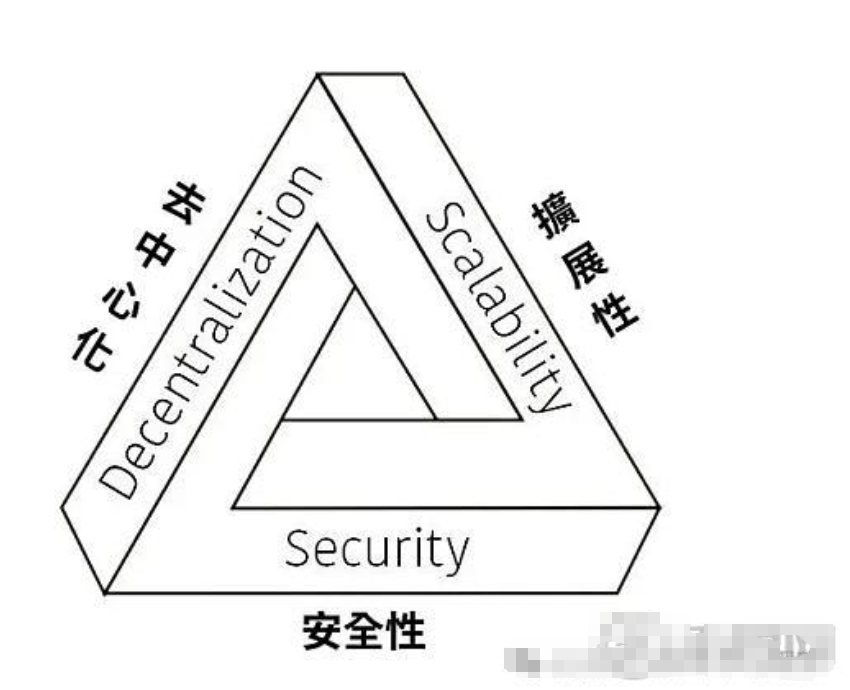
区块链三难困境中指出，简单的区块链架构只能实现三个属性中的两个。想要安全的去中心化区块链吗？这意味着你需要牺牲可扩展性。
**以太坊当前每天处理 100 多万笔交易。以太坊的使用需求可能会导致交易费用价格居高不下。这就是二层网络的用武之地。**
例如我们的TBC和以太坊主链都是安全性和去中心化这两个维度拉满，但是可拓展性拉跨，每秒交易数 (transactions per second，TPS)是人尽皆知的差。

以太坊主网的TPS是20左右，比特币的主网TPS只有7。

一些开发者就通过Layer2的解决方案来打补丁，牺牲一部分安全性和去中心化，— — 将主链处理的交易数据尝试迁移到主链之外，以提高交易速度及负载。目前大部分layer2的TPS都有几千，考虑到现在大规模应用场景有限，大部分链上交互都是炒币交易，这个TPS应该是完全够用的。

# 二层网络的优势
## 可扩展性
二层网络的主要目标是在不牺牲去中心化和安全性的情况下提高交易吞吐量（每秒交易数量）。
以太坊主网（一层网络）只能大约每秒处理 15 笔交易。当使用以太坊的需求较高时，网络会出现拥堵，这会提高交易费，那些承担不起这些费用的用户就会被“挤出”。
二层网络是通过在一层网络区块链之外处理交易来降低这些费用的解决方案。

## 二层网络的好处
1. 降低费用
通过将多笔脱链交易合并成一笔单独的一层网络交易，交易费将大幅降低，从而使所有人都能更容易地参与以太坊。
2. 维护安全
二层网络区块链在以太坊主网上结算交易，使用户能够受益于以太坊网络的安全性。
3. 拓展用例
随着每秒交易量的增加、交易费的降低和新技术的发展，项目将拓展到新的应用，并改进用户体验。
# Layer2技术路线回顾
和大家科普一下Layer2的技术路径，目前大部分的二层链使用的技术包括以下三种：

## 1.状态通道（State Channels）
这种方法允许两方或多方在链下进行多次交易，只在交易结束时将最终状态提交到区块链。一个**典型的例子**是**闪电网络（Lightning Network），主要用于比特币。**
这个方案有点像打白条，假设你是开饭店的，有个卖猪肉的每天来你这边吃一顿饭，同时你每天要向他买猪肉，正常情况下你们每天要发生两笔交易。但是如果你每天记账，月底再结账，那你们一个月下来就只要一笔交易。

这个方案尤其适用于长期、重复、小额支付的情形，但是不适合临时增加或者减少参与方。因此目前闪电网络也在交易所账户转账用得比较多，其他场景限制较大。

## 2. 侧链（Sidechains）
侧链是一条独立的区块链，使用其自身的共识机制，但通过双向锚定与主链（母链）连接。侧链可以自由地实现不同的功能和优化，同时主链依旧保持其主要的安全和稳定性。
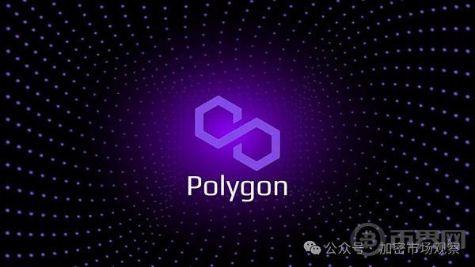
大名鼎鼎的Polygon就是使用的这个方案，用户将以太坊从主网发送到 Polygon 的时候，其实转移从未真正发生过。真实发生的事件是将转移的金额锁定在主网上，并在Polygon上铸造出资产的镜像版本。这就是为什么发送到 Polygon 的以太坊可以作为 wETH （ Wrapped Ethereum）来使用。

## 3. 卷叠（rollups）
这第三种技术方案就是卷叠（rollups）了，这种方案的原理是把多笔交易卷到一条数据里面上主链。
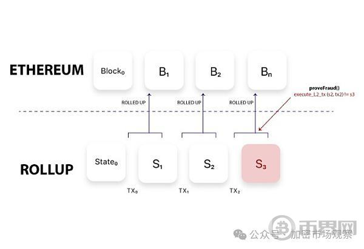
就好像你去饭店点菜，一下子点了50道菜，而你并不需要支付五十次，只需要支付一次就可以了。

而这种技术方案也有**两种路径：**

分别是OP和ZK，**也就是Optimism 乐观**和**Zero Knowledge零知识证明。**

1. OP rollup很乐观，假设所有卷叠进去的数据都是有效的，就像你去饭店买单，相信饭店的账单都是正确的。为了防止欺诈交易，OP rollup 协议允许人们对虚假交易提交挑战。欺诈交易直接在以太坊网络上提交，以检查其是否合法，并解决争议。
我们熟悉的 Arbitrum/Base链都是用的OP rollups。
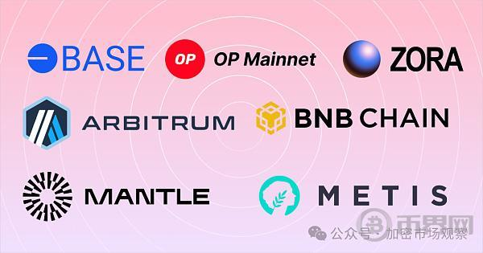

2. zk-rollups则依靠一种称为零知识证明的密码学来工作，它允许某人在数学上证明一个陈述是正确的，而无需披露有关该陈述的其他信息。有点把你点的每道菜都加密，最后生成一个独一无二的密码，最后这个密码只要能对上，那店家是不可能纂改你的菜单的。
最近争议很大的zkSync就是用的zk rollups。
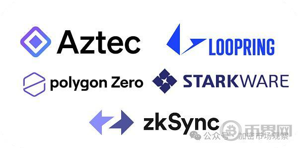

## 那OP和ZK到底哪个更先进呢？

V神曾多次表示“短期 OP，长期 ZK”，OP 门槛低，现在也形成了规模效应，但在安全性上却不如ZK。因此也有一种说法是ZK技术是Layer2的终局。
ZK的缺点呢，就是消耗算力太多。

# 二层网络是如何工作的？
二层网络是以太坊扩容解决方案的统称，这些解决方案在处理以太坊一层网络以外的交易的同时，还能利用以太坊一层网络强有力的去中心化安全性。**二层网络是一个对以太坊之类的公链进行扩展的单独区块链**。那么它是如何运作的呢？
二层网络有几种不同类型，各有自己的权衡取舍和安全模型。二层网络减轻了一层网络的交易负担，使其拥塞情况得以改善，并增强了整体可扩展性。
## 卷叠
卷叠将数百笔交易打包（或“卷叠”）到一层网络的一项交易中。这会将一层网络的交易费分散到整个卷叠中的所有用户，降低每个用户的费用。

卷叠中的交易数据会提交到一层网络，但执行由卷叠独立进行。通过将交易数据提交到一层网络，卷叠可以继承以太坊的安全性。这是因为在数据上传到一层网络后，回滚卷叠交易需要回滚以太坊。
**卷叠**有**两种**形式：**乐观卷叠和零知识卷叠** - 它们的主要区别在于交易数据提交到一层网络的方式。
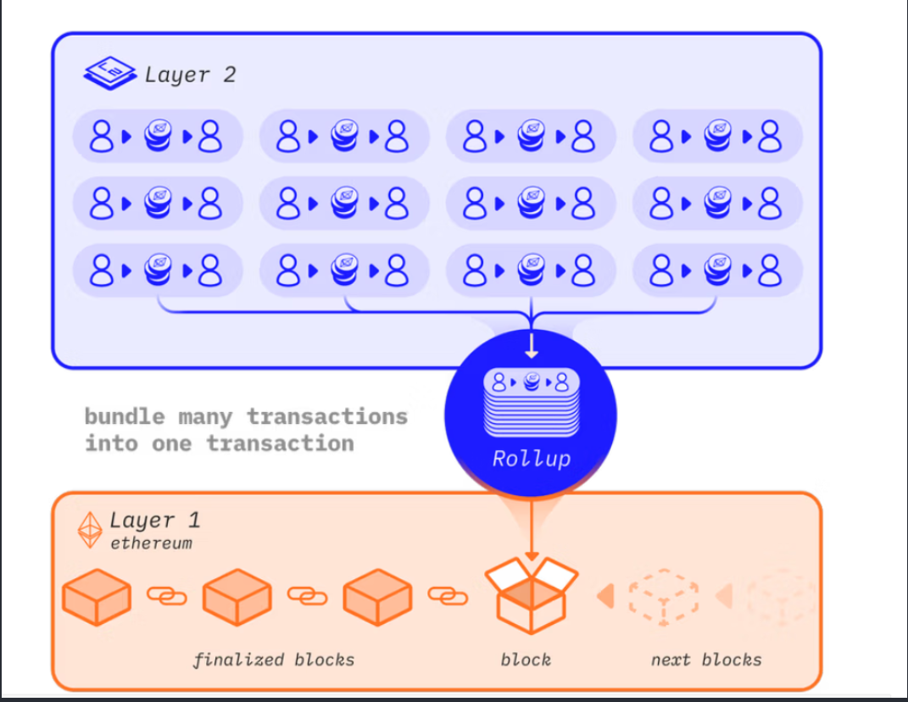

1. **乐观卷叠** Optimistic Rollup
乐观卷叠的“乐观”体现在其假定交易是有效的，但可以在必要时提出质疑。如果交易被怀疑无效，则会运行一项错误性证明，验证是否已经发生无效交易。
1. **零知识卷叠** ZKROLLUP
零知识卷叠使用有效性证明，其中的交易是脱链计算的，然后将压缩数据提供给以太坊主网，以证明其有效性。

## 使用二层网络
现在你知道二层网络为什么存在以及它是如何工作的，下面让我们开始运行起来吧！

如果你正在使用 Safe 或 Argent 等智能合约钱包，那么你在二层网络上重新将你的合约帐户部署到此地址之前，你将无法在二层网络上控制此地址。具有助记词的传统帐户将自动在所有二层网络上拥有相同帐户。

### 广义二层网络
广义二层网络的行为与以太坊别无二致，但成本更低。你在以太坊一层网络能做的任何事，在二层网络也能做到。许多去中心化应用程序已经开始迁移到这类网络，或者完全跳过主网，直接部署在二层网络上。

# 二层网络产品

## Linea Mainnet 
是由 ConsenSys 开发的一个以太坊等效的 zkEVM 卷积网络，旨在提高以太坊的可扩展性和降低交易成本。以下是关于 Linea Mainnet 的一些关键信息：

1. 技术特点：

- Linea 是一个基于零知识（ZK）证明的二层网络，保持了以太坊虚拟机（EVM）的完全兼容性，提供了快速的交易终结、稳健的安全性和完全的 EVM 等效性。
- Linea 利用零知识（Zero-Knowledge，ZK）卷积技术，允许开发者在无需对智能合约进行重大修改的情况下转移他们的项目，降低了入门门槛并改善了开发流程。
- Linea 采用基于 Vortex 的 SNARK（零知识可验证的非交互式参数）证明技术，确保交易的隐私和保密性，同时实现高效的验证，提高整个系统的效率。

2. 用户体验：

- Linea Mainnet Alpha 提供了突破性的用户体验，集成了超过100个协议、合作伙伴和DApp，并且与领先的Web3产品如MetaMask用户友好集成，使用户能够访问精选的Web3功能。
- Linea 的主网默认内置在MetaMask里，用户可以跳过手动添加网络的复杂流程，直接在MetaMask中切换到Linea网络。

3. 安全性和性能：
- Linea 参与以太坊的安全机制，同时优化执行，允许用户进行大量交易、运行复杂程序、部署合约、铸造NFT等，然后将所有的这些执行报告给以太坊网络。
- Linea 利用零知识证明向以太坊网络证明并发送 Linea 链上的活动报告，网络可以优化执行且不受安全性的限制。
- Linea 的交易费用比以太坊主网便宜15到20倍，提供了更快的吞吐量和更低的交易费用。

4.生态和合作：
- Linea 生态系统目前包括了多个项目，如LayerZero、Galxe、Orbiter Finance等，支持的DApp已经超过100个。
- Linea 与 ConsenSys 的其他产品如 MetaMask、Infura、Truffle 等工具深度集成，为 Linea 吸引更多的用户，并形成一个完整的 ConsenSys 商业闭环。

5.未来发展：
- Linea 团队已经发布了去中心化路线图，讨论未来产品更新和计划。
- Linea Mainnet 作为以太坊 Layer 2 解决方案，通过其技术创新和深度集成，为以太坊生态系统带来了更高的可扩展性和更低的交易成本，同时也为用户提供了更好的体验。

6. 2023 年 7 月 19 号，NFTScan 团队正式对外发布了 Linea NFTScan 浏览器 
https://linea.nftscan.com/

7. linea的浏览器
https://explorer.linea.build/

## 技术升级太快，ZK也变标配
模块化能填补上消耗算力过多的短板。

从技术原理上来看，一个 Rollup 至少分为 3 个模块：

数据可用性（DA）、序列化器（Sequencer）、证明者（Prover）。

总体来说数据可用性（DA）是指区块生产者将区块的所有交易数据都发布到网络中，以便使验证者可以进行下载。

序列化器（Sequencer）负责将 Layer 2 网络中的交易排序、组织、打包并提交到 Layer 1 网络。

证明者（Prover）则需要通过密码学的方式证明Layer 2的数据和上传到 Layer 1 网络的数据一致。

在这些模块中，DA 和 Sequencer 领域已经有项目取得了显著成就，比如几百亿市值的 Celestia、EigenDA 等都为区块链模块化发展树立了榜样。然而，在 ZK-Rollup 领域中，Prover 模块的成本甚至高于 DA，且目前尚未出现强有力的竞争对手。Lumoz 目前是该领域唯一的算力提供者。
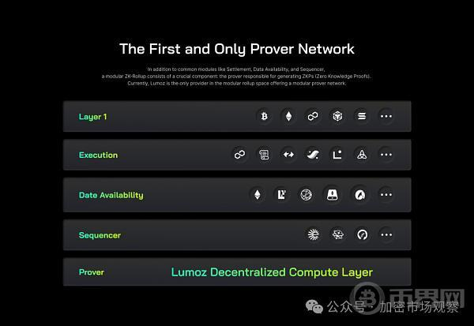
这个Lumoz 团队技术实力不错的，他们改进了 ZKP 算法，显著提高了集群中机器资源的利用率，进一步加快了 ZKP 计算。成功将平均交易确认时间从大约 5-6 分钟缩短到约 3 分钟，将 ZKP 生成效率提高了约 80% 。

Lumoz 还引入了 ZK-PoW 的概念，邀请矿工参与维护 zkEVM 并计算 ZKP。Lumoz 的目标是简化 ZK-Rollup 的使用，并促进其更广泛的采用，从而促进基于 zkEVM 的应用链的大规模部署。

说到这里大家是不是感觉Lumoz这个项目很厉害呢？

没错，他们的实力在加密行业也是很受认可的，据说目前已经支持了Merlin Chain、Hashkey Chain、Ultiverse、Matr1x等20多个Layer2链
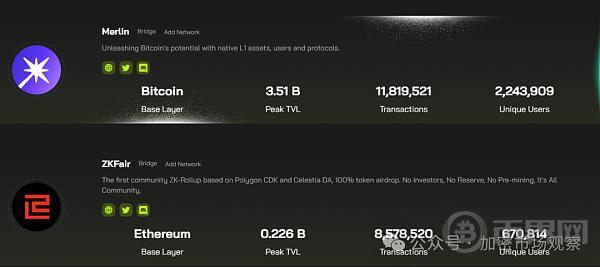
要知道，现在市面上绝大多少Raas服务商都只能提供OP roll ups服务，而Lumoz的横空出世，竟然让zk rollups也可以一键发链了。

**如果你撸空投被zkSync伤到了，这个lumoz就可以帮你报仇雪恨，十分钟就能复制一个zkSync出来。**

# 原来发链也可以“一键生成”
那做一条layer2的链是不是很难呢？

其实完全不难，有一个赛道叫RAAS(Rollups-as-a-Service)，**这种服务商支持“一键发链”**，据说10分钟就可以创建好一条链。（展示官网录视频）
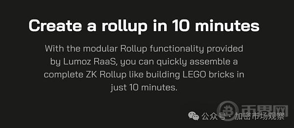
而且各种生态随便选：什么比特/以太坊/solana都不在话下
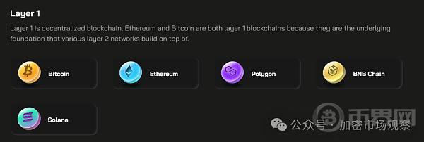
用的还是最先进的zk-rollup
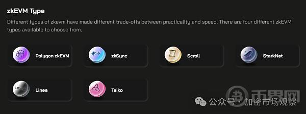
你就说，牛逼不牛逼吧！
刚刚我举的这个例子就是**Lumoz。**
这个赛道也还有很多其他的知名选手，例如AltLaye这个项目就是RAAS赛道的佼佼者，今年一月底的时候上线币安，目前FDV有二十几亿。
