# 以太坊
以太坊是一个支持智能合约的去中心化区块链。与比特币只支持比特币代币在网络上的转移不同，以太坊更通用。开发人员可以构建 **dApp 或去中心化应用程序**，这些应用程序可以在以太坊虚拟机 (EVM) 上的以太坊网络上执行。因此，以太坊的全球状态不仅包括每个账户的余额，还包括每个 dApp 的状态。dApp 使用以太坊的编程语言 Solidity 构建在以太坊上。您可以使用 Solidity 编写智能合约并将智能合约部署到以太坊网络。它通过工作证明 (PoW) 在其网络中的所有计算机之间保持共识。在不久的将来，随着 Serenity 补丁，以太坊将转向权益证明 (PoS) 机制。

# 什么是以太币?
以太坊有一种本地货币，称为“以太”或“Eth”。该代币需要为在以太坊网络上进行的交易支付交易费用。

# 什么是智能合约?
智能合约是小型计算机程序，无需中央协调器即可在以太坊网络上的所有计算机上复制和处理。
智能合约允许您编写可以由计算机代码自动执行的合约。
以太坊的通用性允许在其之上构建任意数量的可能应用程序，这些应用程序都继承了在以太坊区块链上运行所带来的安全性和去中心化优势。

# ERC20 代币
除了以太币，人们还可以在以太坊上创建和使用自己的货币。最常见的货币形式是 ERC20 代币。ERC20 代币是符合特定标准的智能合约。开发人员可以超越标准，但在制作自己的代币时应满足最低要求。标准化允许数字钱包轻松支持所有类型的代币，而无需为创建的每个代币使用专门的代码。

# ERC721 和 ERC1155 代币这些也称为 NF-- Non-Fungible Token（非同质化代币）
这两个标准类似于 ERC20，为创建 NFT 时应满足的要求提供了基准。它们也提供类似的好处，允许钱包和 NFT 市场立即与所有 NFT 集合兼容，因为它们都遵循这两个标准之一。

# 智能合约
智能合约是以太坊应用程序层的基石。 
它们是存储在区块链上的计算机程序，遵循“如果...那么...”(IFTTT) 逻辑，并且保证按照其代码定义的规则执行，智能合约一旦创建就无法更改。
Nick Szabo 创造了“智能合约”这一术语。 1994 年，他撰写了智能合约简介；1996 年，他撰写了对智能合约潜在功能的探索。
Szabo 构想了一个数字市场，在这个市场中，交易和商业功能可在不需要受信任中介的情况下通过加密学保证安全的自动化流程进行。 以太坊上的智能合约将这一设想付诸实践。

## 1. 传统合约中的信任问题
传统合约的最大问题之一是需要可信的个人来执行合约的结果。
下面是一个例子：
Alice 和 Bob 要进行一场自行车比赛。 假设 Alice 和 Bob 打赌 $10 元她会赢得比赛。 Bob 相信自己会成为赢家并同意下注。 最后，Alice 远远领先 Bob 完成了比赛，并且毫无疑问是赢家。 但 Bob 拒绝支付赌注，声称 Alice 一定是作弊了。
这个荒唐的例子说明了所有非智能协议存在的问题。 即使协议条件得到满足（即你是比赛的获胜者），你仍然必须要信任对方会履行协议（即支付赌注）。

## 2. 自动执行
智能合约的主要优点是在满足特定条件时确定地执行清晰的代码。 无需等待人来执行或商量结果。 
这消除了对可信中介的需求。
例如，你可以编写一个智能合约为孩子托管资金，并允许他们在特定日期后提取资金。 如果他们试图在指定日期前提取资金，智能合约将无法执行。 或者你可以编写一份合约，在你向经销商付款后它会自动授予你汽车的数字化所有权。

## 3. 可预测的结果
传统合约比较含糊，因为它们依赖于人来解释和执行。 例如，两位法官可能会对合同有不同的解释，这可能会导致不一致的判决和不公平的结果。 智能合约消除了这种可能性。 然而，智能合约会根据合约代码中写入的条件精确执行。 这种精确性意味着在相同情况下，智能合约将产生相同的结果。

## 4. 公开的记录
智能合约可用于审计和跟踪。 
由于以太坊智能合约位于公共区块链上，任何人都可以立即跟踪资产转移和其他相关信息。 
例如，你可以检查是否有人向自己的地址发送了资金。

## 5. 隐私保护
智能合约还可以保护你的隐私。 由于以太坊是匿名网络（你的交易公开绑定到唯一的加密地址，而不是你的身份），你可以保护你的隐私不受观察者窥探。

## 6. 可查看的条款
最后一点，与传统合约一样，你可以在签署（或以其他方式与之交互）之前检查智能合约的内容。
智能合约的透明性保证了任何人都可以进行审查。

## 7. 智能合约用例
其他计算机程序可以做的事情，智能合约基本上都可以做。
它们可以执行计算、创建货币、存储数据、铸造非同质化代币、发送通信甚至生成图形。
以下是一些常见的真实示例：
- 稳定币
- 创建和分发独特的数字资产
- 自动、开放的货币交易所
- 去中心化游戏
- 自动赔付的保单
- 允许创建定制、可互操作货币的标准

# 钱包：掌握通向数字未来的钥匙
钱包是用来存储以太币和管理密钥的应用程序。
钱包可以帮助你访问数字资产并登录应用程序。
## 什么是以太坊钱包？
**以太坊钱包**是让你可以**对账户进行控制的应用程序**。
1. 就像你的物理钱包一样，它包含验证你的身份和处理资产所需的一切信息。
2. 通过钱包，你可以登录应用程序、查看余额、发送交易和验证身份。
3. 钱包是大多数人用来管理其数字资产和身份的工具。
4. 你的钱包会展示你的余额、交易记录并帮助你发送/接收资金。有的还能提供更多功能。
5. 钱包是你用来与以太坊账户交互的工具。这意味着你可以随时更换你的钱包提供商。
6. 许多钱包应用都支持同时管理多个以太坊账户。
7. 钱包提供商并不保管你的资金。他们只是为你提供查看以太坊上的资产的窗口和管理这些资产的工具。
8. 你的钱包可以让你使用以太坊账户连接应用。它是许多应用的登录入口。

## 钱包、账户、密钥和地址
1. **以太坊账户**是一对**密钥**。一个密钥用于创建你可以随意共享的地址，另一个密钥需要你保密，因为它用于签名。结合使用这两个密钥，你就可以持有资产和进行交易。

2. **以太坊账户有一个地址**，就像收件箱有电子邮件地址一样。它用于识别你的数字资产。
- 在你下载钱包的时候它会为你**创建一个公开的地址**
- 把它想像成你的电子邮箱地址，只是它用来接收的是ETH。
- 如果你想从一个交易所发送ETH到你的钱包，这个地址就是目的地。
- 在发送前一定要多次检查，确保地址正确！

3. **钱包是一种能让你使用密钥和账户互动的工具**。通过钱包，你可以查看账户余额、发送交易等。

4. 绝大多数钱包都能为你生成以太坊地址，因此你不必在下载钱包前先生成一个。

##  钱包种类
有一些方法可以与你的账户连接和交互：
1. 物理硬件钱包是能够线下保存加密资产的设备 — 非常安全
2. 手机应用程序，让你随时随地访问你的资金
3. 浏览器钱包是一种让你可以直接在浏览器中与账户交互的网络应用程序
4. 浏览器扩展钱包是一种需要下载的扩展程序，让你可以通过浏览器与你的账户和应用程序交互
5. 桌面应用程序，如果你更喜欢在 MacOS、Windows 或 Linux 系统上管理你的资金，可以使用它们。

##  钱包的安全保证
财务自由以及不受地域限制访问和使用资金伴随着责任 — 加密货币中没有客户支持。**你对你的密钥安全负责。**
✅为你自己的资金负责

中心化交易所将会将你的钱包与用户名和密码关联起来，以便你可以按照传统的方式找回它们。但请记住，你将委托该交易所保管你的资金。如果该交易所出现财务问题，你的资金将面临风险。

✅写下你的助记词

**钱包会提供给你一系列助记词**，你必须把它们写下来并保存在安全的地方。这是当你丢失钱包时找回它的唯一方法。
下面是一个示例：
there aeroplane curve vent formation doge possible product distinct under spirit lamp
**不要把它保存在电脑里。写下来并确保它的安全。**

✅将你的钱包页面加入浏览器的书签项
如果你使用的是一个网页版的钱包，请将这个站点加入书签以防范网络钓鱼从而保护自身安全。
✅小心谨慎
记住，**交易不可逆且钱包不能被轻易找回**，请做好备份并妥善保管。

## 钱包助记词
钱包助记词是一组单词，用于备份区块链钱包的私钥信息。它们的主要作用包括：

1. 备份和恢复：助记词是钱包私钥的人类可读形式，允许用户在丢失原始设备或需要在新设备上恢复钱包时，通过这些单词来恢复钱包和访问其中的资产。

2. 安全性：由于私钥是一串难以记忆的随机字符，助记词提供了一种更安全的方式来存储和传输私钥信息，因为它们更易于记忆和书写。

3. 去中心化：助记词允许用户完全控制自己的资金，不需要依赖任何中心化的服务或第三方机构来管理私钥。

4. 便携性：用户可以轻松地在不同的钱包软件或硬件之间转移资金，只需输入助记词即可。

5. 防止丢失：如果用户丢失了他们的钱包文件或硬件设备，助记词提供了一种恢复资金的方式，只要他们记得这些单词并能够安全地使用它们。

6. 多签名钱包：在多签名钱包中，助记词可以被分成多个部分，由不同的人持有，以增加安全性，只有当一定数量的签名者同意时才能访问资金。

7. 非技术用户的友好性：对于那些不熟悉技术或加密细节的用户来说，助记词提供了一种简单的方式来管理他们的加密货币资产。

助记词通常由12、15、18、21或24个单词组成，这些单词是从固定词汇表中随机选择的，如BIP39（Bitcoin Improvement Proposal 39）所定义的。重要的是，助记词必须保密，因为任何拥有助记词的人都可以访问和控制钱包中的资金。因此，用户需要确保助记词的安全存储，避免泄露给未经授权的人。

# GAS
## 网络费用
以太坊上的网络费用称为燃料。燃料为以太坊提供动力。
**以太坊上的每一笔交易都需要支付少量处理费用**；
这类费用称为“燃料”费；
燃料费并非固定，它们随网络拥塞状况变化；

## 什么是GAS费？
可以把以太坊看成一个大型计算机网络，人们可以在以太坊上进行发送信息或运行程序等任务。正如现实世界中一样，完成这些任务需要能量。
**在以太坊中，每个计算操作都设定有“燃料”价格。**
燃料费是指在交易中所执行操作的总费用。
发送交易或运行智能合约时，需要支付燃料费才能处理。

## 为何需要燃料？
燃料是保障以太坊安全和处理交易的关键要素。燃料在许多方面发挥作用：
1. 燃料可帮助以太坊防范女巫攻击，阻止恶意行为者通过欺诈活动压垮网络。
2. 因为计算耗费燃料，通过进行昂贵的交易，无意间或恶意对以太坊进行垃圾邮件攻击在经济上都是不值得的。
3. 对任何时间可执行的计算量设定硬性限制可避免以太坊被压垮，有助于确保网络始终可访问。

- 女巫攻击（Sybil Attack） 
- 是指攻击者在网络或系统中伪造大量虚假身份（节点、账户或设备），以操纵共识机制、投票系统或资源分配，从而破坏系统的安全性和去中心化特性。

## 如何计算燃料？
支付的总燃料费由以下几部分组成：

- 基础费：由网络设定，必须支付才能进行交易
- 优先费：可选择支付的小费，目的是激励节点运营者添加你的交易
- 使用的燃料单位*：记得我们说过燃料代表计算吗？复杂操作（例如与智能合约交互）比简单操作（例如发送交易）使用更多燃料。
燃料费计算公式：使用的燃料单位 *（基础费 + 优先费）。大多数钱包计算燃料用量并以更直观的方式显示。
|交易类型|	使用的燃料单位|
|-------|--------|
|发送以太币|	21,000|
|发送 ERC-20 代币|	65,000|
|转移非同质化代币|	84,904|
|在 Uniswap 兑换代币|	184,523|

## 谁获得了我的交易的燃料费
大部分燃料费（基础费）会被协议销毁（烧毁）。如果交易中包含优先费，会付给提交你的交易的验证者。

## 我是否需要用以太币支付燃料费用
**是的。以太坊上的所有燃料费都必须用原生货币以太币支付。**

## 如何支付GAS费？
1. 直接发送以太币
你可以直接发送以太币作为燃料费。这通常是最简单的支付方式。
2. 使用钱包
许多钱包都可以帮助你支付燃料费。它们会自动计算并支付费用。
3. 交易所
交易所也提供支付燃料费的服务。他们通常会收取一定的费用，但比直接发送以太币更划算。

## 如何支付较少GAS费？
1. 安排交易时间
就像错峰出行不太拥堵且更实惠一样，在北美睡眠时间使用以太坊往往更优惠。
2. 等待费用下降
根据以太坊的拥塞程度，燃料价格每 12 秒上下波动一次。燃料价格高时，只需在交易前等待几分钟可能会看到支付的费用显著下降。
3. 使用二层网络
二层网络链在以太坊上构建，费用更低且处理的交易更多。对于无需在以太坊主网进行的交易，它们是节省费用的不错选择。

## 是什么造成了高昂的GAS费？
1. 只要以太坊上的计算量（燃料）超过一个特定阈值，燃料费就开始上涨。超过阈值的燃料越多，燃料费增加越快。
2. 较高的费用可能由以下因素造成：热门去中心化应用程序 (dapp) 或非同质化代币、去中心化交易所周期性增加的交易量，或者高峰时段的海量用户活动等。
3. 在部署前，以太坊上的开发者应谨慎优化其智能合约的用法。如果许多人都在使用一个编写拙劣的智能合约，将消耗更多燃料并可能无意中造成网络拥塞。

# 去中心化交易所（DEX）
## 什么是去中心化交易所？
1. 去中心化交易所是用于交易ETH或者其他货币的开放的自由市场，它可以让买卖双方点对点直接交易，避免中间商赚差价。

2. 他们通过使用一段程序代码，而不是委托第三方来保证一笔订单的资金安全。只有当这次支付被确定时，以太币才会从支付方转出。**这种程序代码称为“智能合约”**。 

# DApp:去中心化应用程序
## 什么是DApp？
**DApps** 是基于以太坊的分布式应用程序。它们是**基于智能合约的应用程序**，可以让用户在不离开浏览器的情况下与智能合约进行交互。
1. 没有所有者
一旦部署到以太坊上，去中心化应用程序代码就无法删除。而且任何人都可以使用去中心化应用程序的功能。即使去中心化应用程序背后的团队解散了，你仍然可以使用它。一旦在以太坊上，它就会留在那里
2. 免审查
你不能被阻止使用去中心化应用程序或提交交易。例如，如果Twitter是在以太坊上，没有人可以屏蔽你的账户或阻止你发推特。
3. 内置付款
因为以太坊有以太币可以直接用于支付。开发者不需要花时间去集成第三方的支付。
4. 即插即用
去中心化应用程序的代码通常是开源和默认互相兼容的。开发团队之间通常情况下都可以互相引用。例如：想要让用户在你的去中心化应用程序中交易代币，你只需要引入支持交易代币的合约代码并使用即可。
5. 匿名登录
在使用大部分去中心化应用程序时，你不需要分享你的真实身份，只需要一个以太坊账户与付款账户即可进行登录。
6. 加密保护
密码学可以保证攻击者无法伪造交易和去中心化应用程序交互行为。你可以授权去中心化应用程序来操作你的以太坊账户，通常是通过你的钱包程序，因此你需要确保证书的安全。
7. 无需下载
一旦去中心化应用程序在以太坊上线就无法单独下线，它只能随着以太坊一起下线，以太坊的规模大到难以攻击。
## 去中心化应用程序工作原理
1. 去中心化应用程序的**后端代码（智能合约）**运行在去中心化网络而非中心化的服务器上。它们使用以太坊区块链作为数据存储端，并且用智能合约实现应用程序中的逻辑。
2. 一个智能合约像是一套设立在区块链上的规则，所有人都可以准确地观察和运行这套规则。设想一下，有一台自动贩卖机：如果向它提供足够的资金和正确的选择，你将得到你想要的货品。正如自动贩卖机一样，智能合约可以像你的以太坊账户一样存储持有资金。这允许代码之间协议和交易。
3. 一旦去中心化应用程序部署到以太坊网络，你将无法更改他们。去中心化应用程序之所以可以被去中心化就是因为他们被合约中的逻辑所控制，而不是公司或者个人。

## 其他人的更多解读：
去中心化应用程序 (dapp) 是在去中心化网络上构建的应用程序，结合了智能合约和前端用户界面。 请注意，就像开放 API 一样，以太坊智能合约具有可访问性和透明性，所以你的 dapp 里甚至可以包含其他人写过的智能合约。

### DAPP 的定义
一个 dapp 的后端代码在一个去中心化 P2P 网络上运行。 与此相对应的，是在中心化服务器上运行后端代码的应用程序。

dapp 可以用任何语言编写（就像是一个 app）。它有前端代码和用户界面，能调用其后端。 此外，它的前端可以托管在去中心化存储上，例如 IPFS。

1. 去中心化 - dapp 在以太坊上运行，这是一个开放的公共去中心化平台，没有任何一个人或团体可以控制
2. 确定性 ，无论执行的环境如何，都执行相同的功能
3. 图灵完备 - dapp 可以根据所需资源执行任何操作
4. 隔离性 - 它们在称为 EVM 的虚拟环境中执行。即使智能合约出现问题，也不会妨碍区块链网络的正常运行

### 智能合约
要引入 dapp，我们需要引入智能合约 —— dapp 的后端；
智能合约是一种在以太坊网络上的计算机程序，它严格按照事先编写的代码来运行。 智能合约一旦部署到以太坊网络中，就无法更改。 Dapps 可以是去中心化的，就是由于它们受智能合约的既定逻辑控制，而不是个人或公司。 这也意味着你需要非常仔细地设计合约，并进行全面测试。

### DAPP 开发的好处
1. 零停机时间 – 一旦将某 dapp 的智能合约部署到区块链上，整个网络都能为那些希望与合约互动的客户提供服务。 因此，恶意参与者无法针对单个 dapp 发起 DoS 攻击。
2. 隐私 – 你不需要提供真实世界的身份来部署或与 dapp 进行交互。
3. 抵制审查 – 网络上没有任何一个实体可以阻止用户提交交易、部署 dapp 或读取区块链上的数据。
4. 数据完整性 – 由于采用了加密基元，存储在区块链上的数据是不可更改和无可争议的。 恶意行为者无法伪造已经公开的交易或其他数据。
5. 去信任的计算/可验证的行为 – 智能合约可以分析并保证以可预测的方式执行，而去信任中心化组织。 这在传统模式下是不存在的，比如我们使用网上银行系统时，我们要相信金融机构不会滥用我们的金融数据，不会篡改记录，也不会被黑客攻击。

### DAPP 开发的缺陷
1. 维护 – dapp 可能更难维护，因为发布到区块链的代码和数据更难修改。 在部署后，开发人员很难对去中心化应用程序（或其存储的底层数据）进行更新，即使在旧版本中发现了漏洞或安全风险。
2. 性能开销 – 巨大的性能开销，而且难以扩展更多性能。 为了达到以太坊所追求的安全、完整、透明和可靠的水平，每个节点都会运行和存储每一笔交易。 除此之外，达成权益证明共识也需要时间。
3. 网络拥塞 – 至少在当前模型中，如果一个 dapp 使用了太多的计算资源，整个网络都会承担影响。 目前，该网络每秒只能处理约 10-15 笔交易；如果交易发送的速度超过这个速度，未确认的交易池会迅速膨胀。
4. 用户体验 – 设计用户友好的体验可能更难。普通终端用户可能会发现，很难以真正安全的方式设置与区块链互动所需的工具堆栈。
5.集中化 — 无论如何，建立在以太坊基础层之上的用户友好型和开发人员友好型解决方案最终看起来都像集中式服务。 
例如，这种服务可以在服务器端存储密钥或其他敏感信息，使用中心化服务器为前端服务，或在写到区块链之前在中心化服务器上运行重要的业务逻辑。 这消除了区块链与传统模式相比的许多（并不是全部）优势。

# IPFS
IPFS诞生于2014年，他是一个点对点的超媒体协议，他可以让互联网更快、更安全、更开放，业界称之为“下一代”互联网标准。
## 什么是IPFS
星际文件系统(InterPlanetary File System)。
IPFS，是点到点的超媒体协议，它让网络更快、更安全、更开放。说简单一点，它就是一个去中心化互联网。说技术一点，它是一个基于分布式哈希表DHT进行内容寻址的，基于git模型版本管理的，基于默克尔对象关联的，基于点对点技术的，基于全球化命名空间IPNS的，基于各种技术的，一种**分布式文件系统**。
从技术角度看，IPFS是一个协议，它借鉴了许多技术，（P2P+BitTorrent+Git+Hash+kademlia DHT+SFS+Merkel DAG等等）。通过这些技术，IPFS能将网站、应用、文件和各种数据，建立在点对点分布式网络上，并且高效的索引，这种高效的核心在于它是基于内容寻址的。

# 稳定COIN
稳定coin是币值稳定的以太坊代币，即使以太坊的价值存在波动。
## 什么是稳定币？
稳定币是一种加密货币，其价值与以太坊的价值保持一致，即使以太坊的价值存在波动。
稳定币是不具有波动性的加密货币。它们具有很多和ETH相同的能力，同时它们的价值稳定，更像传统货币。因此你可以在以太坊上像使用传统货币一样使用它们。
🌎 稳定币是全球化的，可以在互联网上发送。只要你有以太坊账户，就可以轻易地发送或接收它们。

📈 对稳定币的需求很大，因此你可以通过出借赚取利息。但是请确保你明确其中的风险。

🤝 稳定币可以和以太币以及其他以太坊代币兑换。大量去中心化应用程序依赖稳定币。

🔑 稳定币由加密技术保证安全。没有人能够以你的身份伪造交易。
## 为什么要有稳定币？
稳定币的出现是为了解决以太坊的两个问题：
1. 波动性：以太坊的价值波动，这会导致用户的资产价值波动。
2. 稀缺性：以太坊的供应量有限，这会导致用户的资产稀缺。
稳定币的出现就是为了解决这两个问题。
## 如何使用稳定币？
1. 购买稳定币：稳定币的购买方式和以太坊一样，都是通过交易。
2. 兑换稳定币：稳定币的兑换方式和以太坊一样，也是通过交易。
3. 存储稳定币：稳定币的存储方式和以太坊一样，也是通过交易。
4. 交易稳定币：稳定币的交易方式和以太坊一样，也是通过交易。
## 稳定币的原理
稳定币的原理是通过算法来确保代币的价值稳定。算法的核心是预言机。预言机是一个智能合约，它会根据以太坊的价格来决定代币的价格。
## 如何创建稳定币？
1. 代币发行：代币发行是稳定币的基础。任何人都可以发行自己的稳定币。
2. 代币销毁：代币销毁是稳定币的销毁方式。任何人都可以销毁自己的稳定币。
3. 代币流通：代币流通是稳定币的流通方式。任何人都可以将自己的稳定币流通起来。
4. 代币定价：代币定价是稳定币的定价方式。任何人都可以定价自己的稳定币。
5. 代币流动性：代币流动性是稳定币的流动性方式。任何人都可以将自己的稳定币流动起来。
6. 代币流通量：代币流通量是稳定币的流通量方式。任何人都可以查看自己的稳定币的流通量。

##  Dai
Dai 可能是最著名的分布式稳定币。它和 1 美元等价并被去中心化应用程序广泛接受。
Dai（DAI）是一种去中心化的稳定币，由以太坊上的去中心化自治组织 MakerDAO 发行和管理。与 USDT、USDC 等中心化稳定币不同，Dai 不依赖传统银行储备或单一机构背书，而是通过超额抵押加密资产和智能合约机制维持与美元 1:1 的锚定。
## USDC&&USDT
USDT 可能是最著名的以美元支持的稳定币，大约等值于一美元，由 Tether 发行。
USDC 可能是最著名的以法币支持的稳定币，大约等值于一美元，由 Circle 和 Coinbase 发行。

# 非同质化代币 (NFT)
## 什么是非同质化代币？
- 一种用以太坊资产**表示任何独特事物的方法**。
- 非同质化代币正在前所未有地向内容创作人赋予更多权利。
- 由以太坊区块链上的智能合约提供支持
每个非同质化代币都是独一无二的。 每个非同质化代币都有不同的属性（非同质化），并且可证明其稀缺性。 这一点不同于以太币和 USDC 等其他基于以太坊的代币，在这类代币中，每个代币都是相同的且具有相同的属性（“同质化”）。 你不会关心钱包中的具体某一张钞票（或以太币），因为它们完全相同且具有同样的价值。 然而，你需要关心你拥有具体哪一个非同质化代币，因为它们都有区分于其他非同质化代币的独特属性（“非同质化”）。
每个非同质化代币的独特性使其能够实现艺术品、收藏品甚至房地产等资产的代币化，一个特定的独特非同质化代币可以代表一个特定的独特实体或数字物品。 资产的所有权可以在以太坊区块链上公开验证。

## 资产互联网
非同质化代币和以太坊解决了当前互联网上存在的一些问题。 随着数字化程度的提升，需要以一种不受中心化组织控制的方式复制实体物品的属性，如稀缺性、独特性和所有权证明。 例如，利用非同质化代币，你可以在所有以太坊应用程序中拥有一个音乐 mp3 文件的所有权，而不必局限于某一家公司的特定音乐应用程序（如 Spotify 或 Apple Music）。 你可以拥有一个社交媒体账号，你自己可以出售或交换它，但平台提供商不能任意收回。

## 非同质化代币互联网与我们今天大多数人使用的互联网的对比如下……
|非同质化代币互联网	|当今互联网|
|-------|-------|
|你拥有自己的资产！ 只有你能出售或交换它们。|	你租用某个组织的资产，它可以被收回。|
|非同质化代币在数字世界里是独一无二的，没有两个相同的非同质化代币。	|复制品通常无法与原件区分。|
|非同质化代币的所有权储存在区块链上，任何人都可以公开验证。	|数字物品所有权记录的访问权限由机构控制— 你必须相信他们的话。|
|非同质化代币是以太坊上的智能合约。 这意味着它们可以方便地在以太坊的其他智能合约和应用程序中使用！|	拥有数字物品的公司通常需要自己的“围墙花园”基础设施。|
|内容创作者可以在任何地方出售他们的作品，并可以进入全球市场。	|创建人依靠所用平台的基础设施和分布。 这些通常受使用条款和地理限制的制约。|
|非同质化代币创建者可以保留自己作品的所有权，并直接在非同质化代币合约中设置版税。	|音乐流媒体服务这样的平台扣留大部分销售利润。|

## 非同质化代币有哪些用武之地？
非同质化代币有多种用途，包括：
1. **证明你参加过某个活动；**
2. **证明你完成了某个课程；**
3. **在游戏中拥有的物品；**
4. **数字艺术；**
5. **将实体资产代币化；**
6. **证明你的线上身份；**
7. **限制内容访问权限；**
8. **发放凭据；**
9. **分布式互联网域名；**
10.  ** 在去中心化金融中作为抵押品 **
    
假设你是一位艺术家，希望使用非同质化代币分享自己的作品，同时不想失去对作品的控制，也不想中间商分走利润。 你可以创建一个新合约，指定非同质化代币的数量、属性和特定艺术品的链接。 作为艺术家，你可以在智能合约中设置你应该收取的版税（例如，每次转让非同质化代币时，将销售价格的 5% 转给合约所有人）。 因为你拥有部署合约的钱包，所以你始终可以证明是你是非同质化代币的创建者。 你的买家也可以轻松地证明他们拥有代表你的系列艺术品的真正的非同质化代币，因为他们的钱包地址与你的智能合约中的一个代币相关联。 他们可以在整个以太坊生态系统中使用该非同质化代币，因为其真实性能得到保证。

## 非同质化代币的工作原理是什么？
1. 非同质化代币与以太坊区块链上的任何数字物品一样，都是通过一种**称为“智能合约”的**特殊以太坊**计算机程序创建的**。 这些合约遵循某些规则，例如 ERC-721 或 ERC-1155 标准，这些规则决定了合约的功能。
2. **非同质化代币智能合约**可以做一些重要事情：
- 创建非同质化代币：它可以创建新的非同质化代币。
- 分配所有权：通过将非同质化代币链接到特定的以太坊地址来跟踪谁拥有哪些非同质化代币。
- 为每个非同质化代币提供 ID：每个非同质化代币都有一个独一无二的编号。 此外，通常还会附加一些信息（元数据），描述非同质化代币所代表的内容。
当有人“创建”或“铸造”非同质化代币时，本质上是告诉智能合约赋予他们特定非同质化代币的所有权。 该信息安全且公开地存储在区块链中。

此外，合约的创建人可以添加额外的规则。 他们可能会限制某种非同质化代币的创建数量，或者决定在非同质化代币易手时他们应该获得少量版税。

## 非同质化代币安全性
以太坊的安全性来自权益证明。 该机制旨在通过经济手段遏制恶意行为，使以太坊防篡改。 这便是非同质化代币的由来。 一旦包含你的非同质化代币交易的区块最终确定，攻击者需要花费数百万个以太币才能更改它。 运行以太坊软件的任何人都能立即检测到对非同质化代币的不诚实篡改，并且不良行为者将受到经济处罚并被驱逐出网络。

非同质化代币的安全问题通常与网络钓鱼诈骗、智能合约漏洞或用户错误（例如无意中暴露私钥）有关，因此非同质化代币所有者务必保障钱包的安全性。

# 去中心化金融 (DeFi)
去中心化金融是专为互联网时代构建的开放式全球金融系统，可替代不透明、控制严格并由几十年前的基础设施和流程支撑的系统。 让你可以控制和了解自己的资金。 让你有机会接触全球市场，并可以替代当地货币或银行业务。 去中心化金融产品向任何有互联网连接的人开放金融服务，产品主要由用户创造和维护。 迄今为止，价值数百亿美元的加密货币已经通过去中心化金融应用程序流动，而且每天都在增长。

## 什么是去中心化金融？
去中心化金融是金融产品和服务的统称，任何可以使用以太坊（具有互联网连接）的人都可以访问这些产品和服务。 有了去中心化金融，市场始终开放，没有集中管理机构可以阻止付款或拒绝访问任何内容。 以前有可能出现人为错误的缓慢服务，替代为由任何人都可以检查和审查的代码来处理，变得自动和安全。

这是一个蓬勃发展的加密经济，你可以在那里放贷、借款、做多/做空、赚取利息等等。 精通加密技术的阿根廷人已经使用去中心化金融来逃避严重的通货膨胀。 公司已经开始实时向员工发放工资。 有些人甚至在不需要任何个人身份证明的情况下，就已经获得或偿还了价值数百万美元的贷款。

## 去中心化金融与传统金融
了解去中心化金融潜力的最佳方法是了解目前存在的问题。

有些人无法设立银行账户或使用金融服务。
无法获得金融服务会阻碍人们就业。
金融机构可能会阻止你获得报酬。
金融服务的一个隐性收费就是个人数据。
政府和中央机构可以随意关闭市场。
交易时间通常受特定时区的营业时间限制。
由于内部的人工流程，资金转移可能需要几天时间。
金融服务存在溢价，因为中介机构需要分成。

## 对比
|去中心化金融	|传统金融|
|-------|--------|
|你持有你的钱。|	资金由机构持有。|
|你可以控制自己的资金流向和使用方式。|	你必须相信机构不会出现资金管理不善问题，比如不会将钱借给高风险借款人。|
|资金转移在几分钟内完成。|	如果人工处理，支付可能需要几天时间。|
|匿名交易。|	金融活动与你的身份紧密相连。|
|去中心化金融对任何人开放。|	你必须申请使用金融服务。|
|交易时间 24 小时不间断。|	根据人工作息时间制定交易时间。|
|建立在透明基础上 - 任何人都可以查看产品数据并检查系统运行状况。|	金融机构是闭门造车：你不能要求查看他们的贷款历史，管理资产的记录，等等。|

## 可编程货币
这听起来很奇怪……“我为什么会想对钱进行编程”？ 然而，这只是以太坊代币的一个默认功能。 任何人都可以对逻辑编程，以生成支付。 这样，你就可以将比特币的控制权和安全性与传统金融机构提供的服务相结合。 然后，你就可以用加密货币做一些比特币做不到的事情，比如借贷、预约付款、投资指数基金等等。

## 你可以用去中心化金融做什么？
大多数金融服务都有去中心化的替代方案。 但以太坊也为打造全新的金融产品开辟了机会。 这个清单还在不断增长。
- 向世界各地汇款
- 在全球范围内流转资金
- 获取稳定货币
- 抵押借款
- 无抵押借款
- 开始加密货币存款
- 交易代币
- 扩充你的投资组合
- 为你的想法提供资金
- 购买保险
- 管理你的投资组合

**具体可以查看以太坊的官网上的一些解释，对金融比较陌生，先不去做具体了解**
网址：https://ethereum.org/zh/defi/

# 什么是去中心化自治组织？DAO
1. 去中心化自治组织 (DAO) 是指为一个共同的使命而奋斗的集体所有组织。
2. 去中心化自治组织让全世界志同道合之士开展合作，而无需信赖一位宅心仁厚的领导来管理资金和运营。 没有可以随意花钱的首席执行官，也没有能够做假账的首席财务官。 取而代之的是，融入代码的基于区块链的规则规定组织如何运作以及资金如何使用。
3. 去中心化自治组织拥有内部资产，未经该组织批准，任何人都无权动用。 决策通过提案和投票监管，确保组织中的每位成员都有发言权，并且一切都发生在链上，公开透明。

## 我们为什么需要去中心化自治组织？
1. 与他人创办涉及资金和金钱的组织，需要对与合作对象高度信任。 
2. 不过，显然很难相信互联网上素不相识的人。 
3. 通过去中心化自治组织，你不需要相信组织中的其他人，只需要相信去中心化自治组织的代码就够了，它是 100% 公开透明的，任何人都可以验证。
4. 这为全球合作和协调提供了许多新机会。

## 对比
|去中心化自治组织|	传统组织|
|-------|--------|
|通常是平等的，并且完全民主。|	通常等级鲜明。|
|需要成员投票才能实施任何更改。|	可能部分人就能进行决策，也可能投票表决，具体取决于组织结构。|
|不需要可信的中间人就可以自动计算投票、执行结果。|	如果允许投票，则在内部计票，投票结果必须由人工处理。|
|以去中心化方式自动提供服务（例如慈善基金的分配）。|	需要人工处理或自动集中控制，易受操纵。|
|所有活动公开透明。|	活动通常是私密进行，不向公众开放。|

## 去中心化自治组织示例
为了帮助你更好地理解，这里有一些去中心化自治组织的应用示例：

1. 慈善机构 – 可以接受全世界任何人的捐赠，并投票决定要资助的项目。
2. 集体所有权 – 可以购买实体或数字资产，组织成员可以投票决定如何使用它们。
3. 风险投资和赠款 – 可以成立一个风险基金，汇集投资资本并投票进行商业投资。 后续收益可以分配给相应 DAO 成员。

参考学习网址：https://news.qq.com/rain/a/20240814A09IL500

# 去中心化身份
- 传统身份系统有权对你的身份标识进行发布、维护和控制。
- 去中心化身份消除了对中心化第三方的依赖。
- 多亏了加密技术，用户现在拥有了再次发布、持有和控制其自身身份标识和身份证明的工具。
1. 传统身份管理系统长期以来一直依赖于中心化中间机构，这种机构发布、持有和控制你的**身份标识**和**身份证明**。 这意味着你无法掌控你的身份相关信息，也无法决定谁能够访问你的可识别个人信息 (PII)，以及这些人有多大的访问权限。

2. 为了解决这些问题，我们在以太坊等公链上构建了**去中心化身份系统**。 去中心化身份允许每个人管理他们的身份相关信息。 借助去中心化身份解决方案，你可以创建身份标识，以及声明和持有身份证明，无需依赖于中心化机构，如服务提供方或政府。

## 1. 什么是身份？
**身份是指由一些独特特征定义的一个人的自我意识**。 身份表示一个个体，即一个独立的人类实体。 身份也可以指其他非人实体，比如组织或行政机构。

## 2. 什么是身份标识
身份标识是一条信息，用来指向一个特定身份或多个身份。 常见的身份标识包括：
- **姓名**
- **社会保障号/税号**
- **手机号码**
- **出生日期和出生地点**
- **数字身份凭证，例如电子邮件地址、用户名、头像**

这些传统身份标识示例均由中心化实体发布、持有和控制。 你需要获得政府的许可才能变更自己的姓名，或者需要获得社交媒体平台的许可才能更改自己的昵称。

## 3. 什么是身份证明？
身份证明是**一个实体对另一个实体****提出的所有权声明**。 如果你在美国生活，你的驾驶执照会由美国车辆管理局（一个实体）颁发，它证明你（另一个实体）依法可驾驶汽车。
**身份证明与身份标识不同** 
**身份证明包含用于指向特定身份的身份标识**，**并声明与此身份相关的属性**。 因此，你的驾驶执照具有身份标识（姓名、出生日期、地址），但也是你具有合法驾驶权利的证明。

## 4. 什么是去中心化身份标识？
诸如你的法定姓名或电子邮件地址等传统身份标识依赖于第三方——政府和电子邮件提供商。 
**去中心化身份标识 (DID)** 则不同——它们不由任何中心实体发布、管理或控制。

去中心化身份标识由个人发行、持有和控制。 以太坊账户是去中心化身份标识的一个示例。 你可以根据需要创建任意数量的账户，无需任何人的许可，也无需将它们存储在一个中心注册系统中。

去中心化身份标识存储在分布式账本（区块链）或对等网络上。 这使得去中心化身份标识 (DID) 具有全局唯一性、可解析性、高可用性，并可加密验证(opens in a new tab)。 去中心化身份标识可与不同的实体相关联，包括个人、组织或政府机构。

## 5. 去中心化身份的好处
1. 去中心化身份增加了个人对识别信息的控制度。 可以在不依赖中心化机构和第三方服务的情况下验证去中心化身份标识和身份证明。
2. 去中心化身份解决方案为验证和管理用户身份提供一种可保护隐私的去信任无缝方法。
3. 去中心化身份利用区块链技术，在不同方之间建立信任，并提供加密保证来证实身份证明的有效性。
4. 去中心化身份使身份数据可移植。 用户将身份证明和身份标识存储在移动钱包中，并可以与他们选择的任何一方共享。 去中心化身份标识和身份证明不会被锁在签发组织的数据库中。
5. 去中心化身份应与新兴的零知识技术充分配合，这将使个人在无需透露具体细节的情况下，能够证明他们拥有过某物或做过某事。 这可以成为一种将信任和隐私结合在一起的强有力方式，适用于投票等应用。
6. 去中心化身份使防女巫机制能够识别一人假扮多人操控某个系统或发起垃圾邮件攻击的情况。

### 女巫攻击
- 女巫攻击是指恶意行为者通过创建和控制大量虚假身份(女巫节点),试图主导网络共识或影响网络决策的攻击方式。
- 防女巫机制的目的是确保网络中的参与者都是真实且唯一的,从而维护网络的安全性和公平性。

- 常见的防女巫机制包括:

1. PoW(Proof of Work)工作量证明:
要求参与者完成一定的计算工作才能加入网络,恶意行为者需要投入大量的算力才能创建多个虚假身份,成本很高。比特币和以太坊早期采用了PoW机制。

2. PoS(Proof of Stake)权益证明:
要求参与者锁定一定数量的代币作为抵押,抵押的代币数量越多,获得记账权的概率越大。恶意行为者需要投入大量的资金才能控制网络,风险很高。以太坊2.0采用了PoS机制。

3. DPoS(Delegated Proof of Stake)委托权益证明:
通过持币人投票选举出一定数量的代表(见证人),由这些代表轮流生成区块。恶意行为者需要说服大多数持币人投票给他们控制的节点,难度很大。EOS和Tron采用了DPoS机制。

4. 身份认证:
要求参与者提供真实身份信息,如护照、驾照等,经过验证后才能加入网络。这种方式可以有效防止虚假身份,但可能会影响用户隐私。

5. 社交图谱分析:
通过分析参与者之间的社交关系,识别出可能的女巫节点。真实用户之间通常有一定的社交连接,而女巫节点之间的连接往往较少且随机。

6. 信誉机制:
根据参与者在网络中的行为和贡献,给予不同的信誉分数。信誉度高的节点可以获得更多的权重和激励,而信誉度低的节点可能受到限制或惩罚。

防女巫机制的选择取决于具体的区块链网络和应用场景。好的防女巫机制应该在安全性、去中心化和可扩展性之间取得平衡,同时尽量减少对用户体验的影响。随着区块链技术的不断发展,也会出现更多创新的防女巫机制。

## 6. 去中心化身份用例
1. 通用登录
去中心化身份有助于实现去中心化身份验证替代密码登录。 服务提供商可以向用户发布认证，这些认证可以存储在以太坊钱包中。 身份证明的一个示例是非同质化代币，可授予持有者访问在线社区的权限。

然后，使用以太坊登录(opens in a new tab)功能将使服务器能够确认用户的以太坊账户，并从他们的账户地址获取所需的身份证明。 这意味着用户无需记住冗长的密码即可访问平台和网站，从而改善用户的线上体验。

2. “了解你的客户”身份验证
许多在线服务的使用需要个人提供身份证明和凭证，例如驾驶执照或国家护照。 
但这种方法是有问题的，因为私人用户信息可能会被泄露，并且服务提供商无法验证身份证明的真实性。
去中心化身份使公司能够跳过传统的了解你的客户 (KYC)(opens in a new tab) 流程，通过可验证凭据验证用户身份。 这降低了身份管理的成本，并防止使用伪造证件。

3. 投票和在线社区
在线投票和社交媒体是去中心化身份的两个新应用。
在线投票方案容易受到操控，尤其当恶意行为者创建虚假身份进行投票时。 要求个人提供链上身份证明可以提高在线投票流程的公平性。

去中心化身份可以帮助创建没有虚假账户的在线社区。 例如，每位用户可能必须使用链上身份系统（如以太坊域名服务）来验证他们的身份，从而减少是机器人的可能性。

4. 防女巫保护
使用二次方投票的资助应用程序容易受到女巫攻击，因为当有更多人参与投票时，资助的价值就会增加，这会促使用户将他们的捐赠分散到多个身份。 通过增加每位参与者证明他们是真人的负担，去中心化身份有助于防止这种情况发生，尽管通常不必透露具体的私人信息。

## 7. 是什么让去中心化身份标识成为可能？
1. 公钥加密
公钥加密是一种为实体生成公钥和私钥的信息安全措施。 公钥加密在区块链网络中用于验证用户身份和证明数字资产的所有权。

一些去中心化身份标识，如以太坊账户，都有公钥和私钥。 公钥用于识别账户的操控者，而私钥可以签名和解密此账户的消息。 公钥加密提供验证实体身份、防止冒充身份和使用假身份所需的证明，它使用加密签名来验证所有声明。

2. 去中心化数据存储
区块链是一个可验证数据注册系统：一个开放的去信任去中心化信息库。 公链的存在使得不再需要将身份标识存储在中心化注册系统。

如有任何人需要**确认**  **去中心化身份标识** 的**有效性**，他们可以在区块链上查找相关公钥。 这与需要第三方进行身份认证的传统身份标识不同。

## 8. 去中心化身份标识和身份证明如何实现去中心化身份？
1. 诸如你的法定姓名或电子邮件地址等传统身份标识依赖于第三方——政府和电子邮件提供商。 去中心化身份标识 (DID) 则不同——**它们不由任何中心实体发布、管理或控制。**
2. **去中心化身份标识由个人发行、持有和控制**。 **以太坊账户**是去中心化身份标识的**一个示例**。 你可以根据需要创建任意数量的账户，无需任何人的许可，也无需将它们存储在一个中心注册系统中。
3. **去中心化身份标识存储在分布式账本（区块链）或对等网络上**。 这使得去中心化身份标识 (DID) 具有全局唯一性、可解析性、高可用性，并可加密验证。 去中心化身份标识可与不同的实体相关联，包括个人、组织或政府机构。

## 9. 去中心化身份中身份证明的类型
在基于太坊的身份生态系统中，如何存储和检索身份证明信息与传统身份管理系统不同。 下文概括了一些在去中心化身份系统中签发、存储和验证身份证明的方法。

### 1. 链下身份证明
1. 将身份证明存储在链上的一个问题是，**其中可能包含个人想要保密的信息**。 **以太坊区块**链具有开放性，因此**不适合用于存储此类身份证明**。

2. 解决方法是：
- **签发身份证明**至**用户的数字钱包**，**由用户链下持有**，但使用签发者链上存储的去中心化身份标识进行签名。 
- 这些身份证明被编码为 JSON Web 令牌，其中包含签发者的数字签名，从而可以轻松验证链下声明。

3. 以下是用于解释链下身份证明的假设场景：

大学（签发者）生成身份证明（数字学术证书），用其密钥签名，然后将其颁发给 Bob（身份所有者）。

Bob 申请了一份工作并想向雇主证明他的学历，因此他分享了移动钱包中的身份证明。 然后，公司（验证者）可以通过检查签发者的去中心化身份（**即其在以太坊上的公钥**）来确认身份证明的有效性。

### 2. 可以随时访问的链下身份证明
在这种协议下，身份证明将被转变为 JSON 文件并存储在链下（理想情况下存储在去中心化云存储平台上，例如 IPFS 或 Swarm）。 但是，JSON 文件的哈希值存储在链上，并通过链上注册系统链接至去中心化身份。 所关联的去中心化身份可以是身份证明的签发者或接收者。
这种方法使身份证明能够基于区块链长期存在，同时使声明信息保持加密并维持其可验证性。 它还允许选择性披露，因为私钥的持有者可以解密信息。

### 3. 链上身份证明
链上身份证明保存在以太坊区块链上的智能合约中。 智能合约（充当注册系统）将身份证明映射到相应的链上去中心化身份标识（公钥）。
以下示例展示了链上身份证明在实践中的使用方式：

一家公司（XYZ 公司）计划使用智能合约出售所有权份额，但只想卖给那些已完成背景调查的买家。

XYZ 公司可以让执行背景调查的公司在以太坊上发布链上身份证明。 此身份证明可以证实某人已通过背景调查，但不会暴露任何个人信息。

出售股份的智能合约可以核查注册合约中筛选出的买家的身份，从而使智能合约确定哪些人可以购买股份。

## 使用去中心化身份
有许多雄心勃勃的项目使用以太坊作为去中心化身份解决方案的基础：

1. 以太坊域名服务 (ENS) - 用于链上机器可读标识（例如以太坊钱包地址、内容哈希和元数据）的去中心化命名系统。
2. SpruceID - 去中心化身份项目允许用户使用以太坊账户和以太坊域名服务配置文件来控制数字身份，而不是依赖第三方服务。
3. 以太坊认证服务 (EAS) - 一个去中心化的账本/协议，用于进行各类链上或链下认证。
非机器人证明 - 非机器人证明 (PoH) 是在以太坊上建立的社会身份验证系统。
4. BrightID - 一个去中心化的开源社交身份网络，旨在通过创建和分析社交图谱来改进身份验证。
5. walt.id — 开源去中心化身份和钱包基础架构，使开发人员和组织能够利用自主主权身份和非同质化代币/灵魂绑定代币。
6. Veramo - 一个 JavaScript 框架，使任何人都能轻松地在其应用程序中使用可用加密方法验证的数据。

# 质押ETH
## 什么是质押？
质押是指存入 32 个以太币以激活验证者软件的行为。作为验证者，你将负责存储数据，处理交易并向区块链添加新的区块。这将为每个人保证以太坊的安全，并在此过程中为你赚取新以太币。

## 为什么要质押你的以太币？
1. 赚取奖励
有助于网络达成共识的行为会获得奖励。运行将交易正确打包到新区块中并检查其他验证者工作的软件，你便会获得奖励，因为这些行为会使区块链保持安全运行。

2. 更加安全
随着越来越多以太币被质押，网络会越来越强大，因为需要非常多的以太币才能控制大部分网络。为了攻击网络，你需要控制大多数验证者，这就意味着你需要控制系统中的大部分以太币，那真的太多了！

3. 更加可持续
质押者无需进行耗费能量的工作量证明计算即可参与保护网络，这意味着质押节点可以在相对简单的硬件上运行，并且耗能很少。

# 二层网络
二层网络 (L2) 是一种统称，用来描述一系列特定的以太坊扩容解决方案。二层网络是一条独立的区块链，它扩展了以太坊并继承了其安全保证。

现在让我们来深入地了解一下它。为此，我们需要解释一层网络 (L1)。
## 什么是一层网络？
1. 一层网络是底层区块链。以太坊和比特币都是一层网络区块链，因为它们是基石，各种二层网络都构建于其上。
2. 二层网络项目的示例包括以太坊上的“卷叠”和基于比特币的闪电网络。所有这些二层网络项目上的用户交易活动最终都可以回到一层网络区块链。
3. 以太坊还充当二层网络的数据可用性层。二层网络项目将它们的交易数据发布到以太坊上，依赖以太坊实现数据可用性。这些数据可以用来确定二层网络的状态，或对二层网络上的交易提出争议。
## 以太坊作为一层网络的情况包括：
1. 节点运营商网络用于保障安全并验证网络
2. 区块生产者网络
3. 区块链本身以及交易数据历史记录
4. 网络的共识机制
## 为什么我们需要二层网络？
1. 区块链的三个目标属性是去中心化、安全和可扩展。
2. 区块链三难困境中指出，简单的区块链架构只能实现三个属性中的两个。想要安全的去中心化区块链吗？这意味着你需要牺牲可扩展性。
以太坊当前每天处理 100 多万笔交易。以太坊的使用需求可能会导致交易费用价格居高不下。这就是二层网络的用武之地。
### 可扩展性
二层网络的主要目标是在不牺牲去中心化和安全性的情况下提高交易吞吐量（每秒交易数量）。
以太坊主网（一层网络）只能大约每秒处理 15 笔交易。当使用以太坊的需求较高时，网络会出现拥堵，这会提高交易费，那些承担不起这些费用的用户就会被“挤出”。
**二层网络是通过在一层网络区块链之外处理交易来降低这些费用的解决方案。**
### 二层网络的好处
1. 降低费用
通过将多笔脱链交易合并成一笔单独的一层网络交易，交易费将大幅降低，从而使所有人都能更容易地参与以太坊。
2. 维护安全
二层网络区块链在以太坊主网上结算交易，使用户能够受益于以太坊网络的安全性。
3. 拓展用例
随着每秒交易量的增加、交易费的降低和新技术的发展，项目将拓展到新的应用，并改进用户体验。

## 二层网络是如何工作的？
正如我们在上面所提到，二层网络是以太坊扩容解决方案的统称，这些解决方案在处理以太坊一层网络以外的交易的同时，还能利用以太坊一层网络强有力的去中心化安全性。二层网络是一个对以太坊进行扩展的单独区块链。那么它是如何运作的呢？

二层网络有几种不同类型，各有自己的权衡取舍和安全模型。二层网络减轻了一层网络的交易负担，使其拥塞情况得以改善，并增强了整体可扩展性。

### 卷叠
卷叠将数百笔交易打包（或“卷叠”）到一层网络的一项交易中。这会将一层网络的交易费分散到整个卷叠中的所有用户，降低每个用户的费用。

卷叠中的交易数据会提交到一层网络，但执行由卷叠独立进行。通过将交易数据提交到一层网络，卷叠可以继承以太坊的安全性。这是因为在数据上传到一层网络后，回滚卷叠交易需要回滚以太坊。卷叠有两种形式：乐观卷叠和零知识卷叠 - 它们的主要区别在于交易数据提交到一层网络的方式。

# 以太坊虚拟机 (EVM)
1. 以太坊虚拟机 (EVM) 是一个去中心化虚拟环境，它在所有以太坊节点上，用一种安全一致地方式执行代码。
2. 节点运行以太坊虚拟机，以执行智能合约，利用“燃料”度量执行操作所需的计算工作，从而确保高效的资源分配和网络安全性。
## 前提条件
对计算机科学中常见术语的基本了解，如字节、内存和堆栈是理解 EVM 的前提。 熟悉哈希函数和默克尔树等密码学/区块链概念也会很有帮助。

## 从账本到状态机
- 通常使用“分布式账本”的类比来描述像比特币这样的区块链，它使用密码学的基本工具来实现去中心化的货币。 账本保存着活动记录，而活动必须遵守一套规则，这些规则限制用户在修改账本时可以做什么和不可以做什么。 例如，比特币地址不能花费比之前收到的更多的比特币。 这些规则是比特币和许多其他区块链上所有交易的基础。
- 以太坊不是分布式账本，而是分布式状态机器;
- 以太坊的状态是一个大型数据结构，它不仅保存所有账户和余额，而且还保存一个机器状态，它可以根据预定义的一组规则在不同的区块之间进行更改，并且可以执行任意的机器代码。
- 在区块中更改状态的具体规则由 EVM 定义。
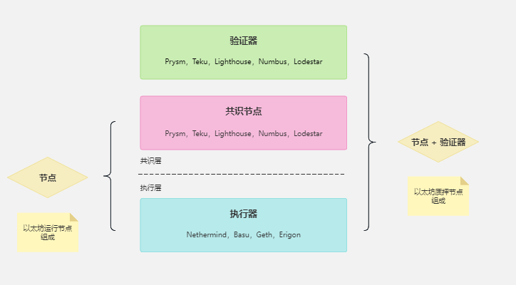

1. 以太坊状态转换函数
EVM 的行为就像一个数学函数：在给定输入的情况下，它会产生确定性的输出。 因此，将以太坊更正式地描述为具有状态转换函数非常有帮助：

Y(S, T)= S'
给定一个旧的有效状态 （S） 和一组新的有效交易 （T），以太坊状态转换函数 Y（S，T） 产生新的有效输出状态 S'

2. 状态
在以太坊环境中，状态是一种称为改进版默克尔帕特里夏树的巨大数据结构，它保存所有通过哈希关联在一起的账户并可回溯到存储在区块链上的单个根哈希。

3. 交易
交易是来自账户的密码学签名指令。 交易分为两种：一种是消息调用交易，另一种是合约创建交易。
合约创建交易会创建一个新的合约账户，其中包含已编译的 智能合约 字节码。 每当另一个账户对该合约进行消息调用时，它都会执行其字节码。

## EVM 说明
EVM 作为一个堆栈机运行，其栈的深度为 1024 个项。 每个项目都是 256 位字，为了便于使用，选择了 256 位加密技术（如 Keccak-256 哈希或 secp256k1 签名）。
在执行期间，EVM 会维护一个瞬态内存（作为字可寻址的字节数组），该内存不会在交易之间持久存在。
然而，合约确实包含一个 Merkle Patricia 存储 trie（作为可字寻址的字数组），该 trie 与账户和部分全局状态关联。
已编译的智能合约字节码作为许多 EVM opcodes执行，它们执行标准的堆栈操作，例如 XOR、AND、ADD、SUB等。 EVM 还实现了一些区块链特定的堆栈操作，如 ADDRESS、BALANCE、BLOCKHASH 等。
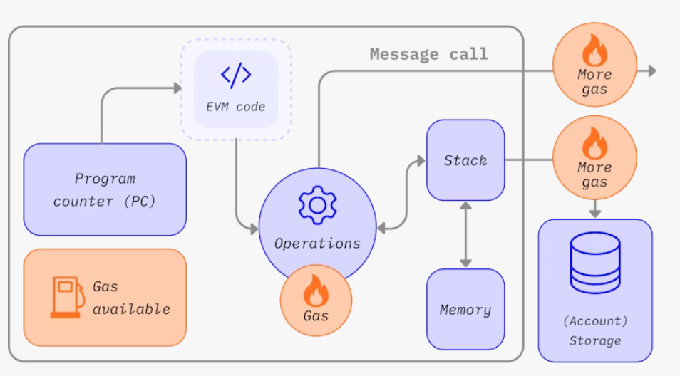
## EVM 实现
EVM 的所有实现都必须遵守以太坊黄皮书中描述的规范。
在以太坊九年的历程中，以太坊虚拟机经过了几次修订，并且存在不同编程语言实现的以太坊虚拟机版本。
以太坊执行客户端都包含一个以太坊虚拟机实现。 此外，还有多个独立的实现，包括：

Py-EVM - Python
evmone - C++
ethereumjs-vm - JavaScript
revm - Rust

# 节点和客户端
以太坊是一个由计算机组成的分布式网络，这些计算机**运行可验证区块和交易数据的软件，称为节点**。 该软件必须在你的计算机上运行，才能将其转化为以太坊节点。 一个节点由两个独立的软件（名为“客户端”）构成。
## 什么是节点和客户端？
1. “节点”是指任何以太坊客户端软件的实例，它连接到其他也运行以太坊软件的计算机，形成一个网络。
2.  “客户端”是以太坊的实现，它根据协议规则验证数据并保持网络安全。 
3.  一个节点需要运行两种客户端软件：**共识客户端**和**执行客户端**。
- 执行客户端（也称为执行引擎、EL 客户端或旧称“以太坊 1”客户端）侦听网络中广播的新交易，并在以太坊虚拟机中执行它们，并保存所有当前以太坊数据的最新状态和数据库。
- 共识客户端（也称为信标节点、CL 客户端或旧称“以太坊 2”客户端）实现权益证明共识算法，使网络能够根据来自执行客户端的经验证数据达成一致。
- 此外还有名为**验证者**的第三种软件，它们可被添加到共识客户端中，使节点能参与保护网络安全。
4. 这些客户端软件相互协作，以追踪以太坊的链头，并允许用户与以太坊网络进行交互。 这种模块化设计称为封装复杂性，包含多个协同运作的软件。 此方法让无缝实施合并变得更简单，客户端软件更易于维护和开发，并且还能重复利用各个客户端（例如在二层网络生态系统当中）。

# 共识机制
1. “共识机制”一词常常泛指“权益证明”、“工作量证明”或“权威证明”协议。 不过，这些协议只是共识机制的组成部分，用于防范女巫攻击。
2. 共识机制是由一整套想法、协议和激励构成的体系，使得一系列分布式节点能够就区块链状态达成一致。

## 什么是共识？
我们所说的共识，是指达成了广泛的一致。 比如，一群人去看电影， 如果他们对于提议“看某部电影”没有任何异议，那么就可以说共识达成了。 如果存在异议，那么他们就必须通过某种方法决定看哪一部电影。 在极端情况下，这群人就会分开。
对于以太坊区块链来说，达成共识的过程是标准化的，达成共识意味着全网络中至少 66% 的节点就网络的全局状态达成一致。

## 什么是共识机制？
共识机制是一整套由协议、激励和想法构成的体系，使得整个网络的节点能够就区块链状态达成一致。
以太坊采用基于权益证明的共识机制，其加密经济的安全性来自于对质押人的锁定资本实施的一系列奖励和罚没措施。 这种激励体系鼓励各个质押人诚信运行验证者节点，并惩罚那些有不良行为的质押人，让攻击网络的行为付出极其高昂的代价。

# 共识机制类型
## 基于工作量证明
和比特币类似，以太坊也曾经使用基于工作量证明 (PoW) 的共识协议。
1. 区块创建
矿工相互竞争以创建新的包括已处理交易的区块。 优胜者将与网络中的其他矿工分享该新区块，获得新铸造的以太币。 数学问题解决速度最快的计算机可以在比赛中获胜。 这将生成当前区块和前的区块之间的加密链接。 解决此问题就是要在“工作量证明”中开展的工作了。 规范链随后由一叉选择规则确定，该规则选择了一组区块，这些区块在挖矿方面做得最多。
2. 安全性
因为用户需要拥有网络中 51% 的算力才能够欺骗整条链，因此网络的安全得以保证。 这将需要巨大的设备与能源投入，支出很有可能超过收益。

## 基于权益证明
以太坊目前使用基于权益证明 (PoS) 的共识协议。
1. 区块创建
验证者创建区块。 每个时隙中都会随机选择一个验证者成为区块提议者。 
区块提议者的共识客户端请求配对执行客户端对交易打包，作为“执行负载”。 
然后它们将“执行负载”包装成共识数据并形成一个区块，再把这个区块发送给以太坊网络上的其他节点。 这样的区块生产会得到以太币奖励。 
在极少数情况下，一个时隙中产生了多个可能的区块，或节点在不同时间收到区块，分叉选择算法就会选择使形成的链具有最大认证权重的那个区块（认证权重是指为该区块提供认证的验证者数量，并根据验证者质押的以太币余额调整）。
2. 安全性
权益证明体系保障加密经济的安全，因为攻击者若试图控制整条链，就必须销毁大量以太币。 奖励机制会奖励诚实的质押人，而惩罚机制则阻止质押人作出恶意行为。

# 权益证明
## 什么是权益证明？
权益证明是一种证明验证者已经将有价值物品质押到网络上的方法。如果验证者有失信行为，这些物品可能会被销毁。 在以太坊的权益证明机制下，验证者明确地通过以太币将资产质押到以太坊上的智能合约中。 之后，**验证者负责检查在网络上传播的新区块是否有效**，**偶尔自己也创建和传播新区块**。 当他们试图欺骗网络（例如，在应该发送一个区块时提出多个区块，或者发送冲突的认证）时，他们质押的部分或全部以太币可能会被销毁。

## 验证者
- 要想作为验证者参与，用户必须向存款合约中存入 32 以太币并运行三种独立的软件：执行客户端、共识客户端和验证者客户端。 
- 存入以太币时，用户会进入一个激活队列，限制新验证者加入网络的速度。 
- 激活后，验证者将从以太坊网络上的对等节点接收新区块。 
- 区块中的交易会被重新执行，以检查提议的以太坊状态变更是否有效，并检查区块的签名。 
- 然后验证者在整个网络上发送支持该区块的投票（称为认证）。

1. **在工作量证明中，生成区块的时间是由挖矿难度决定的，而在权益证明中，节奏是固定的。**
2. 权益证明以太坊中的时间分为**时隙（12 秒）**和**时段（32 个时隙）**。
3. **在每个时隙中随机选择一位验证者作为区块提议者。**
4. 另外在每个时隙中，都会随机选择一个**验证者委员会**，通过他们的投票确定所提出区块的有效性。
5. 将验证者集合划分为若干个委员会对于保持网络负荷易于管理非常重要。
6. 委员会将验证者集合分成不同部分，以便每个活跃的验证者在每个时段都会出示证明，但并不在每个时隙都这样做。

# 节点架构
- 以太坊节点由**执行客户端**和**共识客户端**这两种客户端构成。
- 当以太坊使用工作量证明时，执行客户端足以运行以太坊全节点。 然而，在实施权益证明以后，**执行客户端需要与另一种名为“共识客户端”的软件搭配使用。**
- 以下图表显示了两种以太坊客户端之间的关系。 这两种客户端与其各自的点对点（对等）网络连接。 分离对等网络是有必要的，因为执行客户端通过它们的对等网络广播交易，确保它们能够管理自己的本地交易池，同时共识客户端通过它们的对等网络广播区块，保证共识和链增长。
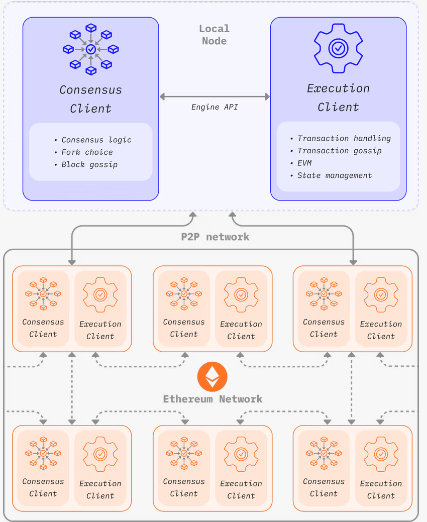

- 要使这种双客户端结构发挥作用，共识客户端必须能够将大量交易传递给执行客户端。 在本地执行交易是客户端验证交易未违反任何以太坊规则的方式，并确保提议的以太坊状态更新是正确的。 同样，当节点被选为区块生产者时，共识客户端必须能够从 Geth 请求各种交易，以便将它们添加到新的区块，并通过执行它们来更新全局状态。 本地远程过程调用连接使用引擎应用程序接口(opens in a new tab)处理这种跨客户端通信。

## 执行客户端的作用是什么？
- 执行客户端负责交易处理、交易广播、状态管理和支持以太坊虚拟机（以太坊虚拟机）。 然而，它不负责区块构建、区块广播或处理共识逻辑。 这些都是共识客户端的责任。
- 执行客户端会创建执行有效负载——交易列表、更新状态树和其他与执行相关的数据。 共识客户端在每个区块中添加执行有效负载。
- 执行客户端还要在新的区块中重新执行交易，以确保其有效性。 执行交易在执行客户端的嵌入式计算机中完成，这些计算机被称为以太坊虚拟机 (EVM)。
- 执行客户端还通过远程过程调用方法提供用户界面，让用户可以查询以太坊区块链、提交交易和部署智能合约。 远程过程调用通常由 Web3js(opens in a new tab)、Web3py(opens in a new tab) 这样的库处理，或者由浏览器钱包等用户界面处理。
- 简而言之，执行客户端是：
以太坊的用户网关；
托管以太坊虚拟机、以太坊状态和交易池的地方。

## 共识客户端的作用是什么？
- 共识客户端处理使节点与以太坊网络保持同步的全部逻辑。 这包括从对等节点接收区块并运行分叉选择算法，从而确保节点始终遵循累积证明最多的链（由验证者有效余额加权计算而得）。 
- 与执行客户端相似，共识客户端拥有自己的对等网络并通过该网络共享区块和认证。
- 共识客户端**不参与对区块的证明或提议**——这是由验证者完成的，而验证者是共识客户端的一种可选附加组件。 没有验证者的共识客户端只会追踪链头，使节点保持同步。 因此，用户可以使用其执行客户端与以太坊进行交易，并确信它们在正确的链上。

## 验证者
节点运营商可以在存款合约中存入 32 个以太币来为其共识客户端添加一个验证者。 验证者客户端与共识客户端捆绑在一起，并且可随时添加到节点中。 验证者会处理认证和区块提议。 它们使节点能够累积奖励或因为惩罚而丢失以太币。 运行验证者软件还使节点有资格被选中来提议一个新区块。

## 节点组件比较
|执行客户端	                    |共识客户端|                	验证者|
|-------|-------|-------|
|通过其对等网络广播交易	|  通过其对等网络广播区块和认证	     |    提议区块|
|执行/重新执行交易	   |  运行分叉选择算法	                |  累积奖励/惩罚|
|验证传入的状态更改	   |  追踪链头	                        |      认证   |
|管理状态和收据树	   |  管理信标状态（包含共识和执行信息）   |需要质押 32 个以太币|
|创建执行有效负载	   |  跟踪 RanDAO 中累积的随机性	     | 可被罚没 |
|公开 JSON-RPC        |  应用程序接口以便与以太坊交互	     |  追踪合理化和最终确定 |	

## 如何在以太坊权益证明中执行交易
1.用户使用他们的私钥创建并签署交易。 
这通常由钱包或库处理，例如 ether.js、web3js、web3py 等，但本质上是用户在使用以太坊 JSON-RPC 应用程序接口向节点发出请求。 
用户定义他们准备支付一定量的燃料作为给验证者的小费，以鼓励他们将交易纳入在一个区块中。 
小费支付给验证者，而基础费被销毁。
2. 交易被提交给以太坊执行客户端验证有效性。 
这意味着确保发送人有足够的以太币来完成交易，并且他们已经使用正确的密钥来签名交易。
3. 如果交易有效，执行客户端将其添加到其本地内存池（待处理交易列表），并通过执行层广播网络将其广播到其他节点。当其他节点听到关于交易的消息时，它们也将其添加到本地内存池中。 
高级用户可能会避免广播他们的交易，而是将其转发给专门的区块构建器，例如 Flashbots Auction。 
这使他们能够在即将到来的区块中组织交易以获得最大利润（最大可提取价值）。
4. 网络上的验证节点之一是当前时隙的区块提议者（之前已使用 RANDAO 以伪随机方式选择）。 
该节点负责构建和广播下一个要添加到以太坊区块链的区块并更新全局状态。 
该节点由三部分组成：执行客户端、共识客户端和验证者客户端。
- 执行客户端将来自本地内存池的交易捆绑到“执行负载”中，并在本地执行它们以生成状态更改。
- 此信息被传递到共识客户端。在该客户端，执行有效载荷被包装为“信标区块”的一部分。
- 该信标区块还包含有关奖励、惩罚、罚没、认证等的信息，从而使网络能够就链头的区块顺序达成一致。 连接共识客户端和执行客户端中更详细地描述了执行客户端和共识客户端之间的通信。
5. 其他节点在共识层广播网络上接收新的信标区块， 并将其传递给它们的执行客户端。
- 在执行客户端上，交易在本地重新执行以确保提议的状态更改有效。
- 然后，验证者客户端证明该区块是有效的，并且根据他们对链的看法，这是逻辑上的下一个区块（这意味着它建立在具有最大认证权重的链上，如分叉选择规则所定义）。
- 该块被添加到证明它的每个节点的本地数据库中。
6. 如果一笔交易已经成为两个检查点之间具有“绝对多数链接”的链的一部分，那么可以认为该交易已经“最终确定”。
- 检查点发生在每个时段的开始，并且它们的存在是为了考虑到只有活跃验证者的子集在每个时隙中提供证明，但所有活跃验证者在每个时段内都会提供证明。
-  因此，只有在时段之间才能证明“超过半数链接”（这是指网络上总质押以太币的 66％ 同意两个检查点的情况）。

## 区块发生了什么？
区块被添加到区块提议者的本地数据库，并通过共识层广播网络广播给对等者。 当一个验证者接收到区块时，它会验证其中的数据，包括检查区块是否有正确的父区块、是否对应正确的时隙、提议者索引是否符合预期、RANDAO 揭示是否有效以及提议者是否被罚没。 execution_payload 被解包，验证者的执行客户端重新执行列表中的交易，以检查所提议的状态变化。 假设区块通过了所有这些检查，每个验证者将区块添加到自己的规范链中。 然后，在下一个时隙中重新开始这个过程。

## 区块奖励
区块提议者会收到他们工作的报酬。 有一个 base_reward，它是根据活跃验证者的数量和他们的有效余额来计算的。 然后，区块提议者会收到区块中包含的每个有效认证的 base_reward 的一部分；认证区块的验证者越多，区块提议者获得的奖励就越高。 还有一个奖励是报告应该被罚没的验证者，数额等于每个被罚没的验证者的 1/512 * effective balance。

## 最终确定性
交易在分布式网络中具有“最终确定性”是指，该交易是区块的一部分，而且除非销毁大量以太币，否则便无法改变。 在权益证明以太坊上，通过“检查点”区块来管理最终确定性。 每个时段中的第一个区块是检查点。 验证者为其认为有效的“检查点对”投票。 如果一对检查点获得了质押以太币总数中三分之二以上的投票，那么这对检查点将被升级。 这两个（目标）中较新的一个会变成“合理”状态。 较旧的一个检查点已经是合理状态，因为它是上一个时段中的“目标”。 现在，这个检查点会升级为“最终确定”状态。

要回滚最终确定的区块，攻击者将承担至少相当于质押以太币总数三分之一的损失。 这篇以太坊基金会博文(opens in a new tab)解释了其确切原因。 因为最终确定性需要获得三分之二多数投票，攻击者可以用质押以太币总数的三分之一投票来阻止网络实现最终确定性。 有一种可以防御这种攻击行为的机制：怠惰惩罚(opens in a new tab)。 当链超过四个时段无法最终确定时，这项机制会触发。 怠惰惩罚逐渐消耗与其投票与大多数投票相反的验证者的质押以太币，使得大多数验证者重新获得三分之二多数投票并最终确定链。

## 层级架构图

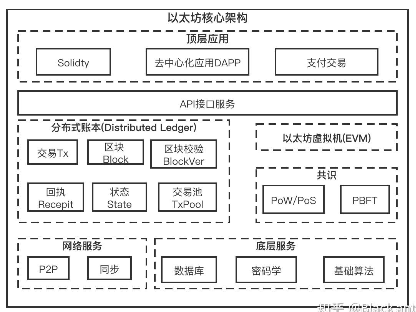
以下图的网址出处：https://www.processon.com/view/62773c16f346fb18e7c50d35
# 以太坊架构

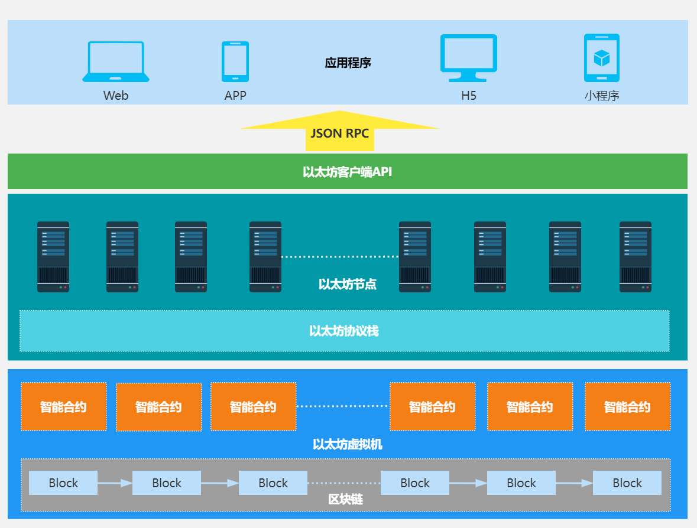
# 以太坊节点组成图

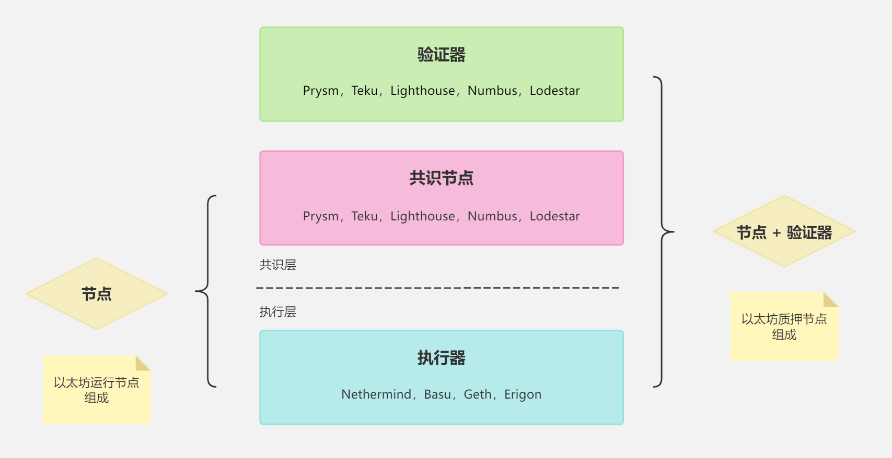
# 以太坊开发概念关系图
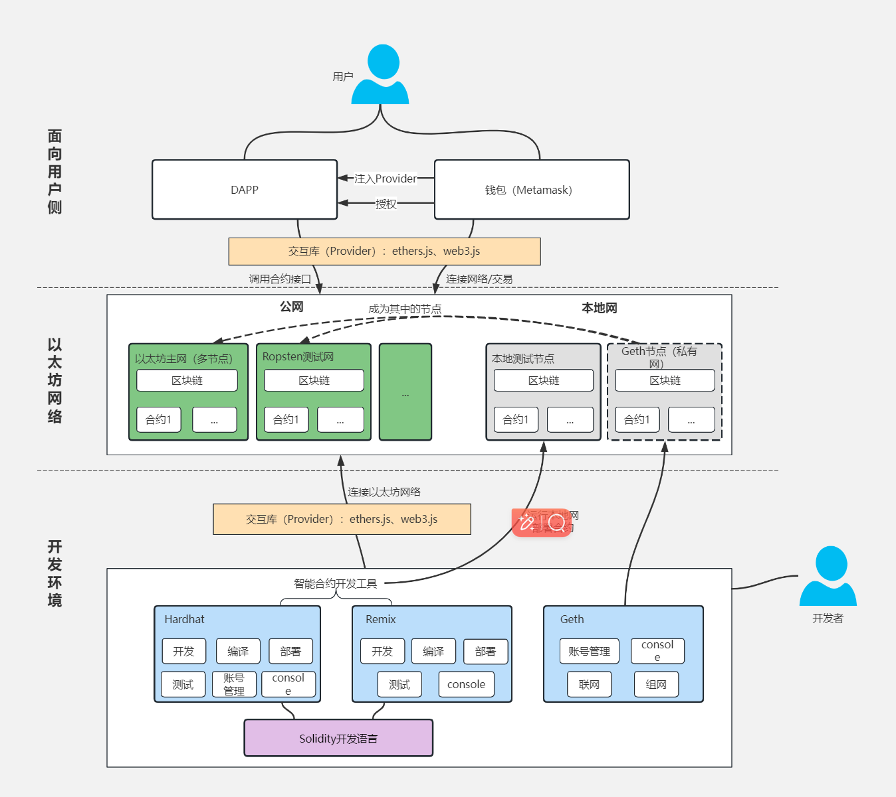
# 以太坊数据结构图
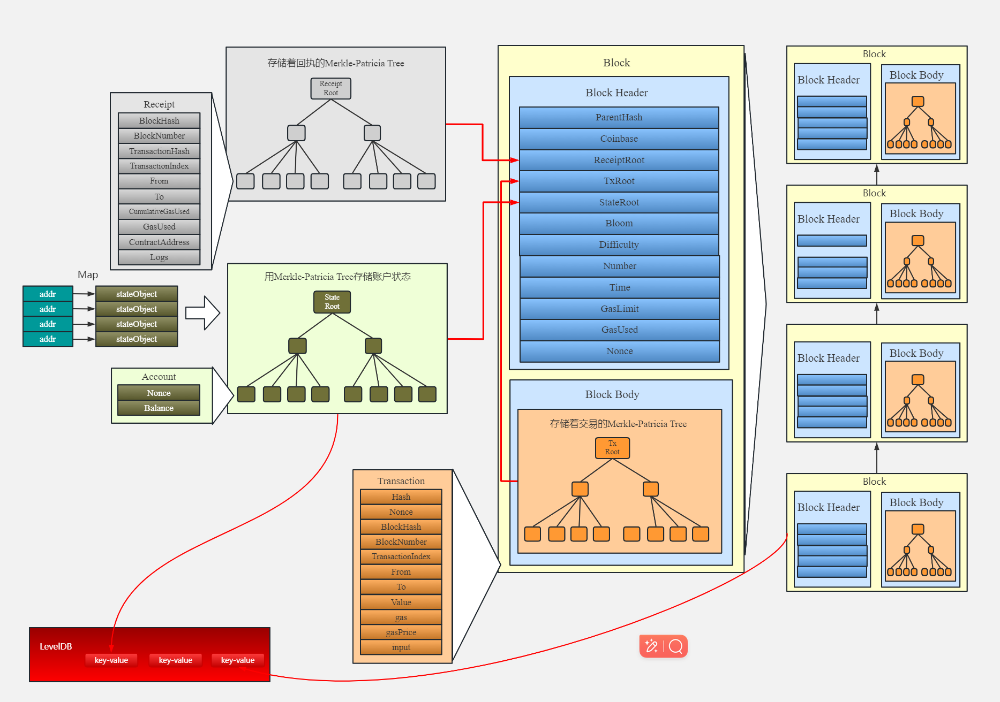
# 以太坊技术栈
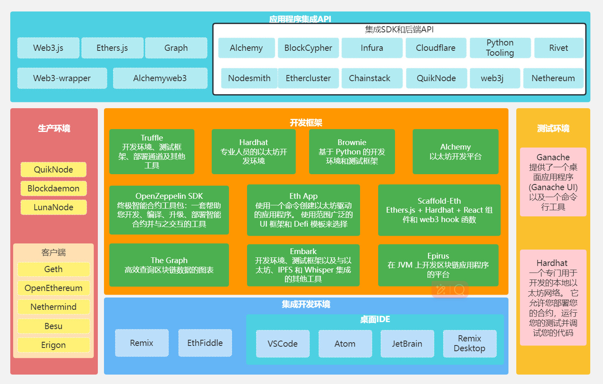
# 以太坊智能合约部署流程
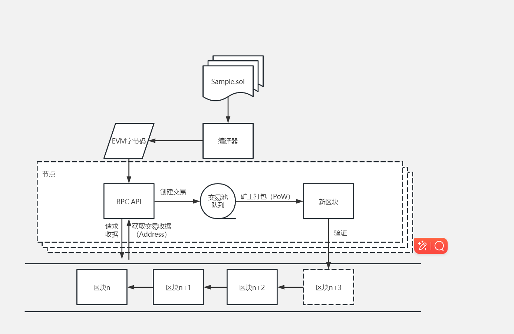
# 以太坊文档
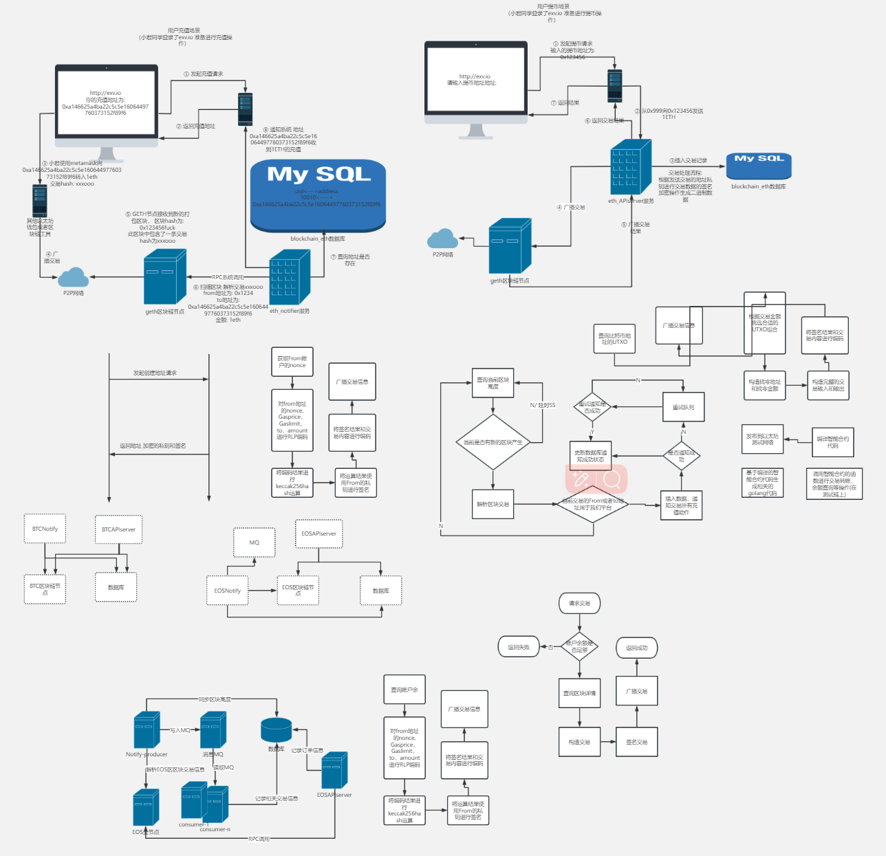

# Remix IDE
1. Remix 是用于以太坊开发的开源、Web 和桌面集成开发环境 (IDE)。它是开始在以太坊上构建的最简单的开发工具，并且拥有大量插件来扩展其体验。
2. Remix 可帮助您直接在浏览器中编写 Solidity 代码，并提供用于测试、调试和将智能合约部署到区块链的工具。
3.无需下载，在线使用
https://remix.ethereum.org/#lang=en&optimize=false&runs=200&evmVersion=null&version=soljson-v0.8.26+commit.8a97fa7a.js

