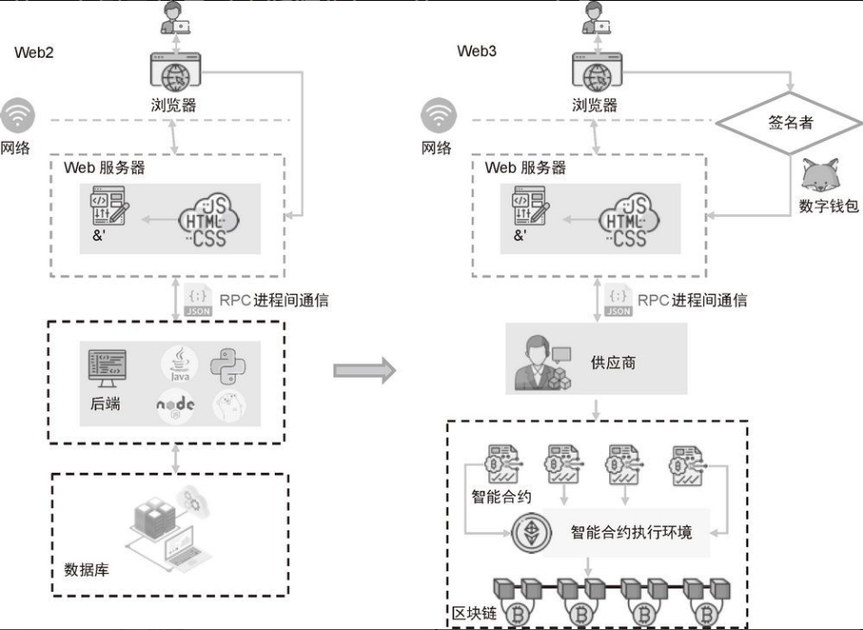
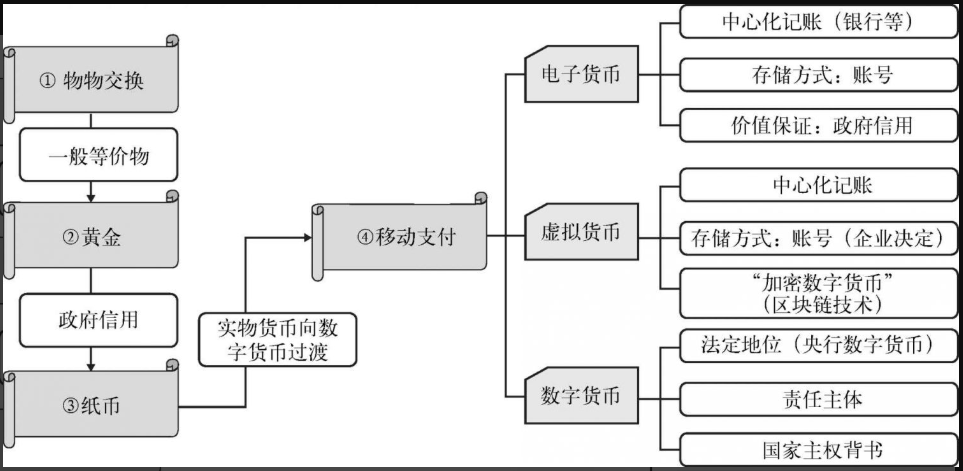
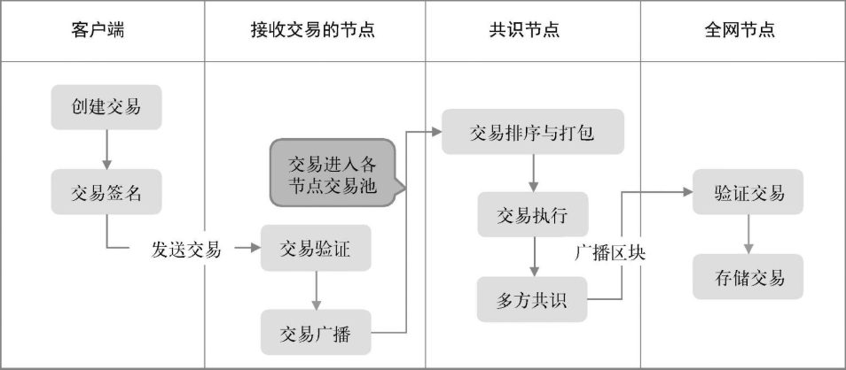
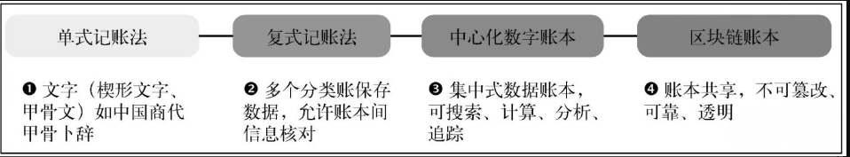
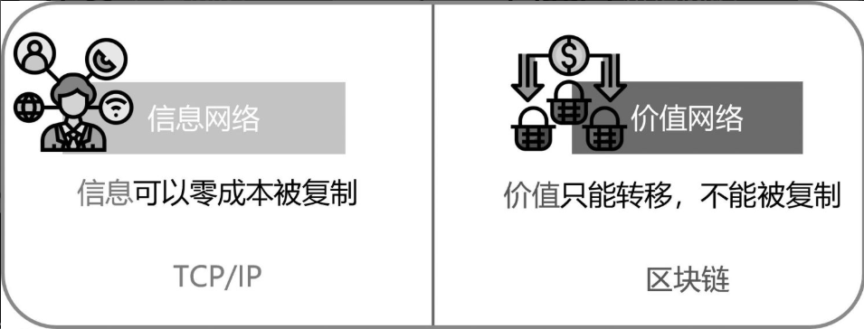
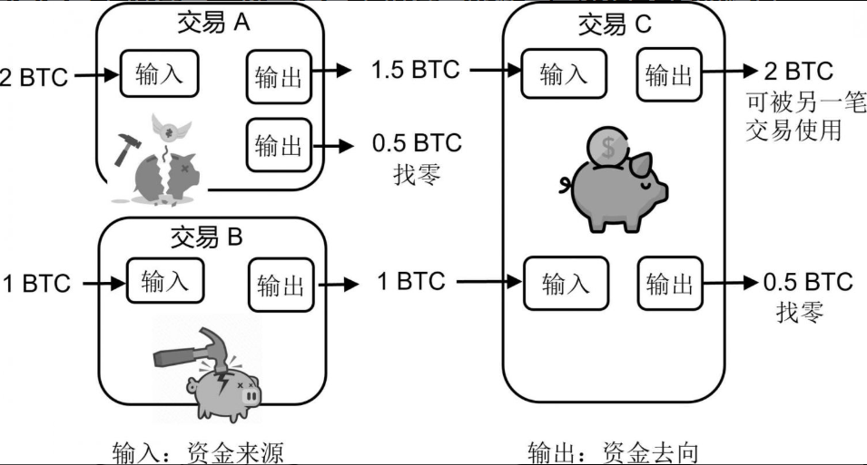
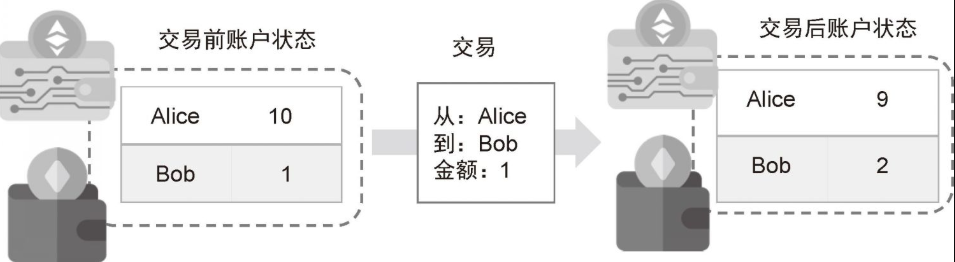

# 该书主旨
探讨理清：区块链、web3、元宇宙的关系，以及区块链技术的发展趋势和未来展望。
**数字货币**也仅仅是区块链技术的众多应用之一。
web3技术位互联网用户提供隐私保护和权益保障，元宇宙可以改变人与虚拟世界的交互体验，DAO可以改变社会的运作方式。
本书也深入思考了区块链技术应该为元宇宙解决哪些关键问题
本书从区块链技术开始，深入探讨了去中心化自治组织、分布式存储、非同质化通证、去中心化金融等相关的概念，同时帮助读者清晰地梳理了这些概念之间的关联。

# web3
## 从web1到web3
1. 加文·伍德所定义的Web3是指一种区块链技术，它可以基于无须信任的交互系统，在各方之间实现创新的交互模式。这里所说的“无需信任的交互系统”​，其实就是指区块链技术支撑之上的一种系统。
2. Web1与Web2被视为信息互联网，而Web3则可以被看作一个价值互联网。Web1与Web2本质是在传递信息，侧重数据或者信息的消费，而**Web3则是在传递价值以及创造财富**。
3. 因此，一些热切拥抱Web3的开发者认为，当前所有的Web2的应用都值得在Web3的背景下重新做一遍，从而升级为对应的去中心化应用(Decentralized Application，Dapp)。
## Web3的流派
5个圈子，分别是
- “数据所有权派”：这一派秉承打破数据垄断与数据独裁的理念，保护Web3应用生态中用户的权益。
- ​“币圈 & 链圈派”：他们更多的时候所关注的是价值网络，即依靠各种“数字货币”进行投资与投机的金融市场。
- ​“极客技术派”​：一部分Web3的技术爱好者（即极客）想要建立一些去中心化的社区，比如去中心化的知乎。
- “概念炒作派”​：他们主要的诉求就是炒作各种与Web3相关的新概念，然后从中获取一些利益。
- “政商界的Web3人士”：政商界人士所期待的Web3业态如果发展到极客技术派所期望的程度，国内Web3的生态便会迸发出勃勃生机。
## web3的技术栈
Web3的开发技术栈的前端跟传统的Web2的“客户端 – 服务器”形式的开发技术栈的前端是一样的，只是后端从传统的数据库变成了区块链。
中间还会有一个Web3的供应商，提供与Web3相关的一些功能，比如说Web3的钱包与身份管理工具。这个钱包的一个例子就是以小狐狸为logo的MetaMask

# Web3的意义
## 满足Web3需求的区块链特性
- •首先，区块链支持数据的去中心化分布式存储。用户在互联网上的数据不再被互联网巨头占有。
- •其次，区块链赋予链上数据的不可篡改性。链式仅增的数据结构可防止对链上数据的删除与篡改。
- •再次，区块链保障用户个人隐私。用户在密码学技术的支撑下，根据自己的意愿，可以将部分可公开信息在链上共享。
- •最后，区块链支持对数据资产的确权。借助区块链技术，用户可以将自己生产的有价值资源转化为收益。

# 区块链技术概述
## 从货币起源到区块链技术的出现
### 货币的起源
- 货币是商品生产和商品交换长期发展的产物。
- 在世界各地，货物交换都经历了两个发展阶段：物物交换与通过媒介进行交换。
- 媒介物品就是货币。货币出现以后，不仅削弱或消除了物物交换的缺点与交易成本，而且拓宽了人们生产、消费、贸易等活动的范围，极大地提高了社会运行的效率。
- 从货币演化过程理解区块链技术

### 区块链技术的出现
1. 区块链技术起源于20世纪70年代末，当时一位名为拉尔夫·C. 梅克尔(Ralph Charles Merkle)的计算机科学家提出了“梅克尔树”(Merkle Tree)的数据结构和相应的算法。梅克尔树通过使用加密算法将数据以树形结构链接起来。
2. 20世纪90年代末，斯图尔特·哈伯(Stuart Haber)和斯科特·斯托内塔(W. Scott Stornetta)使用梅克尔树实现了一个无法篡改文档时间戳的系统。
3. 纽约时间2008年10月31日下午2点10分，一个名为中本聪(Satoshi Nakamoto)的匿名个人或团体，发表了比特币白皮书《比特币：一种点对点的电子现金系统》(Bitcoin: A Peer-to-Peer Electronic Cash System)，概述了比特币区块链的技术与理论。
4. 2009年1月比特币上线，随之开源比特币客户端软件出现。比特币的问世标示了区块链技术开始被应用于现实世界中的去中心化支付场景。
5. 区块链技术是：
- **运用“块链式”数据结构来验证和存储数据**，
- **通过分布式节点共识算法来生成和更新数据**，
- **通过密码学的算法来保证数据传输和访问的安全**，
- **使用自动化脚本来操作数据的一种全新的分布式系统。**
6. 用户可以使用区块链技术**创建不易被改变的分类账**，以便**跟踪订单、付款、账户和其他多种类型的交易**。区块链系统内置的各种机制可以**阻止未经授权的交易条目**，从而在这些交易组成的共享视图中构建账本一致性。
7. 以太坊的开发者引入了**智能合约**
8. 各行业的区块链应用还是彼此独立，价值只能在相互隔离的区块链生态内流转，形成了一座座“数据孤岛”与“价值孤岛”​。
9. **区块链技术的目标仍然是打破数据孤岛**，并构建一个赋能各个行业协同互联、支持人物可信互联、实现价值高效流通的**智能网络**。

## 对区块链账本的解读
1. 区块链是一种**分布式账本**，它的主要作用与银行账户数据库一样，用于记录用户的余额及交易记录。
图3-2展示了区块链交易从客户端创建到上链的整个流程

2. 区块链产生区块的共识机制，争取记账权的节点获得奖励
- 假设区块链中的两个客户端之间产生了一次交易，该交易提交到区块链网络后，第一个接收到这条交易的节点会将此次交易的广播到全网，即传送给网络中的所有节点。其他节点收到这条交易之后，就对此次交易进行一次记账，这就是“全民记账”​。值得注意的是，区块链的全民记账是以某种预定的周期“一轮一轮”地进行的。
- 在某一轮记账持续了一段时间之后的某个时刻，几乎每个区块链节点都积攒了一些系统新生成的账目，那么该以谁的账目为准呢？这时就需要全网达成一个共识。全部区块链节点随后会基于某一种共识机制进行“协商”​，最终全网会选择一个记账记得最好的节点，该节点就获取了此次记账的记账权。
- 当一个新区块中的所有交易被全网节点记账后，就相当于全网都对这些新交易进行了“见证”​，这就使得上链存储的这些账目几乎无法被篡改。
- 一个区块通常可以存储上千条交易记录，每一轮共识产生的新区块按照时序顺序连接起来，就组成了“区块链”​。**可见，区块链的账本具有极强的可靠性与不可抵赖的特性。**
  
### **我个人的总结**
：在比特币网络中，哪个网络中的节点（由存储、算力和软件组成），能够最快的，在共识机制（比特币是POW的共识机制）的条件约束下，将交易打包成区块，并将区块广播到网络中，那么该节点就获得记账权，并将区块上链，这就是区块链的基本工作原理。
得到记账权的节点获得比特币的奖励，记录交易信息的节点也获得奖励。

## 区块链与中心化的数据库有何不同
**1. 个人的理解和经验总结**：
- 中心的化数据库，也能存储交易数据，但是除了数据备份和容灾，或者大数据平台的CDC实时/定时数据同步的副本（实时/定时同步数据有可能人为进行过滤或者转换以适应业务需求，所以这里的数据并不是完全的数据副本，是有针对性的转换过滤后的，适应业务端数据需求的数据副本），其他环境是没有实时数据副本的；
- 就算有完全的数据副本，数据副本本身也是中心化管理的，中心化管理的数据库，也会存在多点同时故障、数据不一致等问题；
- 中心化管理，就存在管理人员权限集中、数据安全问题、数据泄露问题、数据被篡改、数据完整性等问题；
- 中心化管理，容易受到饱和攻击，导致所有节点瘫痪，从而导致系统崩溃无法提供服务。
**区块链的分布式存储，可以解决中心化管理的以上全部问题。**

**2. 区块链的典型缺点**
就是数据从提交系统到上链达到共识是一个漫长的过程；
这是因为区块链没有一个中心化的角色可以在后台对一份数据进行中心化地存储与同步。因此，区块链不得不依靠共识机制，对需要进行上链存储的数据达到全网一致共识。

## 区块链技术为人类社会提供了信任
- 首先是账本的演化，
- 其次是区块链建立的价值网络，
- 最后是从信任机器的角度来看待区块链技术。

### 账本的演化过程
中国最早有文字记载的单式记账法是商代甲骨卜辞，通俗而言就是流水账，对经济收支事项的记录采用文字叙述方式。描述的就是一种钱财贡赋的统计方式。

### 价值传递网络
区块链为人类建立的一个价值传递网络。**注意，这里用的是“传递”​，因为价值只能被转移而不能被复制。**

### 信任机器
- 首先，信任是人类协作以及经济社会的核心。
- 通常来讲，两个陌生人之间想要达成协作，必须要依靠可靠的第三方。
- 区块链就是一种能取代中介机构的技术协议，而且它是一个能够解决信任问题的安全可靠的网络。
- 区块链为我们的社会提供了一台信任机器。

## “数字货币”是什么

早期出现的中心化的数字黄金货币，以及后来兴起的密码学通证都属于“数字货币”​。
依托于区块链技术的分布式记账方式，不仅能够实现交易的匿名性，还可以避免集中存储可能带来的种种风险；但是另一方面，密码学通证的不可追溯性不仅带来洗钱的风险，同时给政府监管带来了极大的挑战。

## 为什么需要“数字货币”
1. 世界上大多数国家发行了自己的法定货币，即政府承认的具有购买力的货币，其本身并没有价值，只是承载了国家背书之后的价值。
2. 以纸币为代表的流通货币，由于无法准确确定当前流动资金的体量，造成通货膨胀率难以估计，从而使得政府很难实现有效的调控来应对通胀。
3. 数字货币”可由发行方精确追踪，因此降低了应对危机、实施调控的难度。
4. 数字货币”在反洗钱和反逃税方面也存在诸多优势，因为发行方可追踪交易流水和货币去向，通过技术分析手段可确定被追踪对象是否具有洗钱和逃税的嫌疑。

## “数字货币”的发展
1. 1996年，第一个基于实物黄金的数字黄金货币e-gold诞生，也是早期的数码货币，其购买力随黄金价格的浮动而变化。
2. 2005年，瑞波(Ripple)币作为一款典型的非加密“数字货币”出现，它流通于一个开放支付网络ripple网络，并常被用于不同货币间的兑换和汇款。
3. 2008年，中本聪提出了比特币的概念。比特币是一种去中心化的密码学通证，以区块链作为底层技术进行发币和对交易进行记账。
4. 2011年之后，又相继出现了莱特币、以太坊的以太币，夸克币、狗狗币等其他几千种密码学通证。
5. 随着元宇宙等技术的兴起，可以预见，​“数字货币”也将成为元宇宙中主要流通的货币。

## 从比特币的转账脚本到以太坊的智能合约
###  比特币的UTXO交易模型/脚本
执行比特币的脚本。这个脚本我们可以将其理解为一段很简单的代码，逻辑很简单，只有一句话：交易的发送者从一个地址向另外一个地址（交易接收者的地址）转了多少数量的通证。
实现这个脚本也是不容易的，它背后的原理是基于一个叫作未花费交易输出的交易模型(Unspent Transaction Outputs，UTXO)

比特币交易中的UTXO模型（在图中，即将被花费的“交易的输出”就像被打破的存钱罐，从中“取出”未花费的“交易的输出”用来构建另一笔新交易）

### 以太坊的交易：以太坊上执行的代码跟比特币的脚本不一样。
1. 以太坊底层交易的数据结构是一种基于“账户”的交易模型；
2. 以太坊系统的每个用户也有一个电子钱包，但是，这个钱包里面装的是类似于我们现实世界中使用的银行账户。
3. 可以理解为该电子钱包里面塞的就是一张张电子银行卡，每一张电子银行卡就代表一个以太坊的账户。

### 以太坊还有另外一个重要的特点，就是支持智能合约
1. 在智能合约的支持之下，以太坊底层的区块链功能就不只是转账了，还可以支持多种场景内的实体经济相关的业务流程。
2. 智能合约是1994年由计算机科学家尼克·萨博(Nick Szabo)提出。智能合约一般被认为是能够自由自动执行合约条款的计算机程序。
3. 智能合约是依靠代码来实现的，部署在区块链上，而且是触发式地执行。由于智能合约是事先编写好并部署的区块链上的代码，那么当条件被触发时，它就会被无情地执行。保证了智能合约是事件驱动的。通过执行智能合约，可以实现价值的转移。

## 区块链从传统共识向“链下计算”的演进
我个人理解就是：链上保存交易数据，链下执行计算。
1. 当前区块链典型的共识算法包括工作量证明(Proof of Work, PoW)、权益证明(Proof of Stake, PoS)、代理权益证明(Delegated Proof of Stake, DPoS)和实用拜占庭容错(Practical Byzantine Fault Tolerance,PBFT)协议等。
2. 2021年，阿尔约曼迪·内扎德(Arjomandi Nezhad)提出的PoH(Proof of History)共识算法，将PoW算法中基于计算能力的记账权竞争机制改为基于节点的贡献决定记账权的机制，即用户对整个链的历史贡献越大，就越容易获得记账权。
3. 莫斯特法·卡拉(Mostefa Kara)提出的CW-PoW算法10将PoW算法的单轮工作量证明变为多轮工作量证明的问题进行求解，逐轮淘汰未解出的节点，增强了共识算法的鲁棒性，而且可以抵御攻击并显著降低网络资源消耗。
4. **由于Web3承载了大量的数据以及复杂的运算，仅仅通过对共识算法的创新和改进，并不能解决区块链性能低下的问题。**
在这样的方式中，数据的运算并不牵涉到区块链的主链，而是通过Layer2区块链模块执行复杂的计算，再通过**可信执行环境**(Trust Execution Environment，TEE)，**零知识证明**等技术手段对计算结果进行验证，最后通过共识机制达成全网一致共识。

