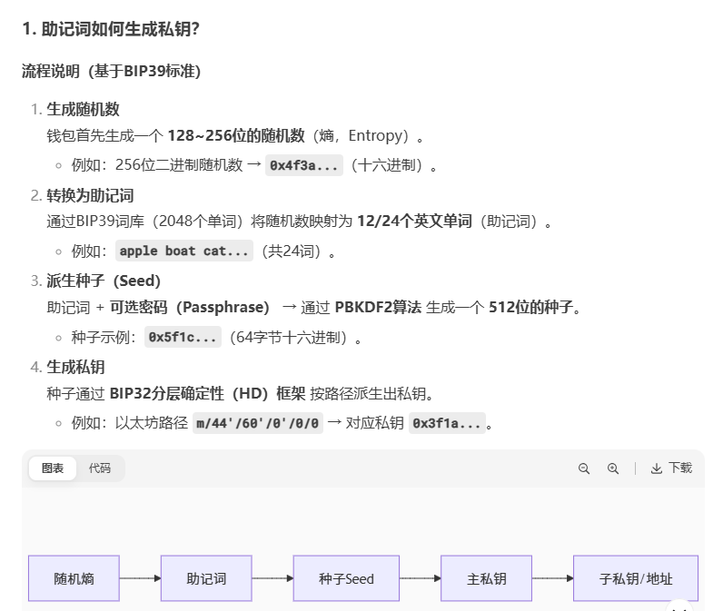
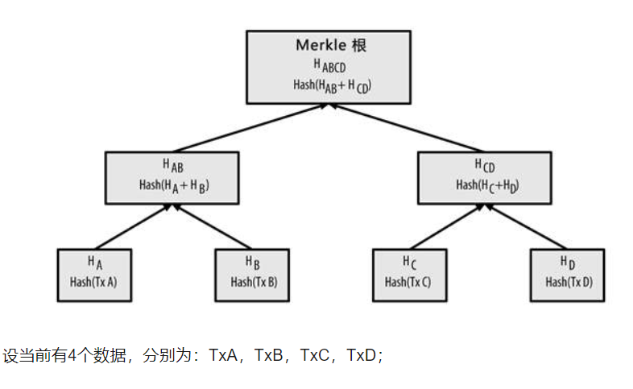

# 哈希（hash）算法（哈希函数）：
是一种将任意长度的输入数据（通常称为“消息”）转换为固定长度输出的算法。
  
## 哈希算法的主要特点是：
确定性1：输入任意长度，输出的数值都是固定长度
确定性2：相同的输入总是产生相同的输出。
快速计算：对于给定的输入，可以快速计算出哈希值。
抗碰撞性：对于不同的输入，很难找到具有相同输出的两个不同输入。
不可逆性：从哈希值几乎不可能逆向推导出原始输入。

## 各种哈希算法输出的长度：
MD5：输出长度为128位（16字节）。
SHA-1：输出长度为160位（20字节）。
SHA-256：输出长度为256位（32字节）。
SHA-512：输出长度为512位（64字节）。
  
## 以下是一些常见的哈希算法：

- MD5（Message-Digest Algorithm 5）：
   MD5是一种广泛使用的哈希算法，产生一个128位（16字节）的哈希值。
尽管MD5已不再推荐用于密码学应用，因为它存在安全漏洞，但它仍然用于其他非安全敏感的场合。

- SHA（Secure Hash Algorithm）：
SHA家族包括多个版本，如SHA-1、SHA-256、SHA-512等，它们分别产生不同长度的哈希值。
SHA-1产生160位的输出，而SHA-256和SHA-512分别产生256位和512位的输出。
SHA-2和SHA-3是当前推荐的更安全的版本。

- Keccak：  
Keccak是SHA-3算法的基础，它设计用于多种安全应用。

- BLAKE2： 
BLAKE2是一种高性能的哈希函数，适用于多种场景。

# 加密算法：
1. 加密算法是将明文（原始数据）转换为密文（加密数据）的算法。
2. **常见的加密算法：对称加密算法，非对称加密算法**。

## 对称加密算法DES、AES： 
   如果使用对称加密算法，**加解密使用同一个密钥**，除了自己保存外，
对方也要知道这个密钥，才能对数据进行解密。
加密和解密使用相同的密钥，或是使用两个可以简单地互相推算的密钥
如凯撒密码
**优点：** 简单易理解，加密解密速度快
**缺点：** 密钥分发不方便，需要提前有安全地方式分发密钥；更改密钥也不方便

## 非对称加密算法RSA、 ECC、ECDSA等：
非对称加密算法通过**公钥**和**私钥**的配对实现**加密与解密**操作。

### 公钥和私钥的定义
1. 提供一个公钥一个私钥。加密方式：采用公钥加密、私钥解密的方式。
2. 公钥可对会话进行加密、验证数字签名，只有使用对应的私钥才能解密会话数据，
从而保证数据传输的安全性。
3. 公钥是密钥对外公开的部分，私钥则是非公开的部分，由用户自行保管。

所以我们使用非对称算法进行信息加密，大致概况过程如下：
- 首先 接收方 生成一对密钥，即私钥和公钥；
- 然后，接收方 将公钥发送给 发送方；
- 发送方用收到的公钥对数据加密，再发送给接收方；
- 接收方收到数据后，使用自己的私钥解密。

### RSA双向加解密，包含两种方式：
**RSA**：其名称来源于其发明者Ron Rivest、Adi Shamir和Leonard Adleman
1. 公钥加密-（信息加密）：通常用于**信息加密**，发送方使用接收方的公钥加密数据，接收方使用其私钥解密。
2. 私钥加密-（数字签名）：通常用于**数字签名**，发送方使用自己的私钥对数据进行签名，任何人都可以使用该发送方的公钥来验证签名。

### 数字签名：
使用公钥解密私钥加密，得到的结果就是签名。
一个发送者 A 想要传些资料给大家，用自己的私钥对资料加密，即签名。
这样一来，所有收到资料的人都可以用发送者的公钥进行验证，
便可确认资料是由 A 发出来的了。（因为只有Ａ使用私钥签名得到的信息，
才能用这个公钥来解） 采用数字签名，可以确认两点：
保证信息是由签名者自己签名发送的，签名者不能否认或难以否认。
保证信息自签发后到收到为止未曾作过任何修改。

### 公钥和私钥的形成
1. 私钥
私钥是一个随机数，可以抛硬币256次获得，也可以使用编程语言获得，使用**SHA256算法**对某个数据求其哈希值**获得**；
如果私钥的产生有好的随机源，则产生相同私钥的概率极低，所以为了账户的安全性，最好选择好的随机源；
2. 公钥
公钥**由私钥**经**非对称加密算法产生**。对于给定的私钥，ECC算法可产生一个椭圆曲线上的一个点，该店的坐标(x,y)就是对应的公钥。
3. 公钥的两种表示形式：
非压缩形式（前缀04表示是非压缩形式，占用字节较多，采用较少）、压缩形式（椭圆曲线关于x轴对称，所以每个x对应两个可能的y，用不同的前缀表示不同的y）

## 区块链中的非对称加密
比特币区块链中的非对称加密算法（如ECDSA）与其他形式的非对称加密算法（如RSA、ECC等）在基本逻辑上是一致的。

在比特币网络中，非对称加密算法用于确保交易的安全性和不可篡改性。
用户使用自己的私钥对交易进行签名，其他人可以使用对应的公钥来验证签名的有效性，确保交易的真实性和不可篡改性。
发送消息或者支付货币时，用对方的公钥加密；接收消息或者货币时，用自己的私钥解密。
	
### 椭圆曲线加密算法ECC-这个是以太坊的加密算法，它是一种基于椭圆曲线的公钥加密算法。
例子（假设不会除法）：私钥d456 基点G123 公钥Q=d*G=56088
A想要传输消息67给B：
①先用B的公钥对67进行加密：123222（未知随机数）=27306
56088222+67=12451603
②B开始解密：2式-1式*456=消息

### ECDSA（Elliptic Curve Digital Signature Algorithm）：

比特币使用椭圆曲线数字签名算法（ECDSA）来验证交易的签名。每个比特币地址都与一对密钥（公钥和私钥）相关联。用私钥签名的交易可以使用公钥进行验证，从而确保只有持有私钥的用户才能支配其对应的比特币。

1. 数字签名
在区块链中，数字签名用于验证交易的真实性和不可篡改性。RSA的数字签名逻辑如下：

密钥对生成：

用户生成一对RSA密钥，包括公钥和私钥。
公钥可以分享给所有用户，私钥需要安全保管。
签名过程：

发送者在发起交易时，首先对交易信息生成一个哈希值（使用哈希算法如SHA-256）。
然后，发送者使用自己的私钥对这个哈希值进行加密，生成数字签名。
交易信息和数字签名一同发送到区块链网络。
验证过程：

接收方或网络节点在收到交易时，使用发送者的公钥对数字签名解密，得到签名的哈希值。
然后，他们对接收到的交易信息再次生成哈希值，并与解密得到的哈希值进行比较。
如果两个哈希值相同，说明交易未被篡改且确实是由发送者发出的。
2. 加密通信
在某些区块链应用中，RSA还可以用于安全通信：

使用RSA公钥加密消息或交易数据，只有拥有相应私钥的接收方才能解密。
这保证了消息在传输过程中的安全性，防止中间人攻击等安全隐患。
3. 密钥交换
在某些情况下，RSA可以用于安全的密钥交换过程：

一方生成一个对称密钥（如AES），然后使用接收方的RSA公钥加密这个对称密钥。
接收方使用自己的RSA私钥解密获得对称密钥，之后可以使用对称密钥进行高效的数据加密和解密。

## 公钥加密算法的缺点：
  公钥机制也有它的缺点，那就是效率非常低，比常用的私钥算法（如 DES 和 AES）
慢上一两个数量级都有可能。所以它不适合为大量的原始信息进行加密。
为了同时兼顾安全和效率，我们通常结合使用公钥算法和私钥算法：
  
通常在实际应用中，**采用“混合加密”方式**，即利用非对称加密来安全地交换对称密钥，然后使用对称加密对大量数据进行加密，以兼顾安全性和效率。

## 账户地址
**账户地址**由公钥产生  **注意：以太坊私链中注册帐户时候，系统反馈的publickey不是公钥，而是公钥的Keccak-256 hash值。**
由于**公钥较长**，可以将其**压缩成更短的形式**，该形式称为**地址**。地址中一般去掉相似的字母，如0OIl.
**账户地址是由公钥压缩得到的**，所以**无法从地址逆推出公钥**。

### 比特币地址生成的过程
1. 公钥哈希：
首先，产生一个随机数作为私钥，由私钥经ECC加密算法，生成公钥。
然后，对公钥应用 SHA-256 哈希算法，得到一个长度为 256 位（32 字节）的哈希值。
接着，对得到的 SHA-256 哈希值再应用 RIPEMD-160 哈希算法。这一步将结果缩短为 160 位（20 字节），这个值就是公钥哈希。

2. 版本号：
在公钥哈希的前面添加一个版本号。对于比特币主网，版本号通常是 0x00，表示这是一个普通的比特币地址。

3.校验码：
使用双重 SHA-256 对版本号和公钥哈希的组合进行哈希处理，得到一个 32 字节的哈希值。取其前 4 字节作为校验码，用于检测地址的有效性。

4.Base58编码：
将版本号、公钥哈希和校验码组合在一起，形成最终的地址数据。
然后，使用 Base58 编码将该数据转化为比特币地址。Base58 编码选择了一种避免视觉混淆的字符集，排除了数字 0、字母 O、小写字母 l 和大写字母 I 等。

①公钥哈希：更短更易传输，更安全，没有直接给出原始公钥
②版本号：用于表明具体采用的是哪一种锁定脚本
③校验码：数据中的一小部分，可用于检测剩余数据是否正确
④Base58编码：用于产生比特币的**钱包的地址**（避免混淆、没有标点符号、大部分软件支持双击选择整个字符串）
**公钥和地址本质上都是由私钥得到**，所以只需要记住私钥就可以，但是在日常使用中，为了方便**一般记住私钥和地址。**

### 助记词如何生成私钥

#  Merkle树
学习网址：https://www.sohu.com/a/434249826_120924874
- Merkle树，也称为哈希树（Hash Tree），是一种在计算机科学领域实现的数据结构，由Ralph Merkle在1979年提出。
- 它主要用于**高效验证大量数据的完整性和内容**，广泛应用于区块链、数字签名、分布式存储系统等多个领域。
Merkle树是区块链技术的基本组成部分。它是由不同数据块的散列组成的数学数据结构，用作块中所有交易的摘要。
- 它还允许对大量数据中的内容进行有效和安全的验证。此结构有助于验证数据的一致性和内容。比特币和以太坊都使用Merkle树结构。Merkle树也被称为哈希树。

- 根节点（root node）
根节点：树的最顶端的节点。（根节点只有一个）
- 子节点（child node）
子节点：除根节点之外，并且本身下面还连接有节点的节点。
- 叶子节点（leaf node）
叶子结点：自己下面不再连接有节点的节点（即末端），称为叶子节点（又称为终端结点）。度为0

1. Merkle树是怎么形成的呢？

(1)、TxA，TxB分别进行一次Hash计算，分别得到了HA和HB两个；TxC，TxD同理，分别得到HC和HD。

(2)、之后HA和HB、HC和HD两两进行结合再进行一次Hash计算，分别得到HAB和HCD。

(3)、最后，HAB和HCD结合后再进行一次Hash计算就得到了最终的一个树根，就是我们所说的Merkle根，整个结构呈现出一个树状，即Merkle树。

2. Merkle树优越的特点，为什么会成为区块链技术的核心技术之一？
(1)、形成方式——Hash计算：树种的每个节点都记录了一个Hash值，父节点的Hash值由所有子节点经过Hash计算所得。
(2)、防篡改：树中任意叶子节点发生改变，都会导致最终树根的改变，因此可以通过树根唯一对应的一组叶子节点。

Merkle根是经过TxA，TxB，TxC，TxD的Hash计算得到的，过程环环相扣。假如，我们将TxA的数值进行了篡改，那么根据Merkle根的计算过程，最终得到的Merkle根自然也是不一样的。所以当我们知道Merkle根和源数据（TxA，TxB，TxC，TxD），任何人想要篡改其中的任意数据，那么篡改后得到的Merkle根是无法对应的。

(3) 存在性证明：可以使用少量数据快速证明一个节点的存在性。
比如，证明HD存在于Merkle树中，只需要提供HC、HAB、Merkle根，他人就可以通过计算进行快速验证HD的存在。

3. 总结原理

区块链中每个区块都会有一个 Merkle 树，它从叶子节点（树的底部）开始，一个叶子节点就是一个交易哈希。叶子节点的数量必须是双数，但是并非每个块都包含了双数的交易。如果一个块里面的交易数为单数，那么就将最后一个叶子节点（也就是 Merkle 树的最后一个交易，不是区块的最后一笔交易）复制一份凑成双数。

从下往上，两两成对，连接两个节点哈希，将组合哈希作为新的哈希。新的哈希就成为新的树节点。重复该过程，直到仅有一个节点，也就是树根。根哈希然后就会当作是整个块交易的唯一标示，将它保存到区块头，然后用于工作量证明。