**BlockChains**

# 1.区块链价值
1.从基于人或者组织的信任，改变为基于代码的信任：代码开源+分布式执行；
2.do not trust,verify.

# 2.如何实现基于代码的信任
## 1.前提：代码开源；
## 2.核心：去中心化；
    1.同一个代码（规则）在N个不相关节点上运行；
    2.某个节点的数据修改不被其他节点认可；
    3.没有任何特权节点；

## 3.去中心化的两个问题：
     1.无中心，如何确权？
     2.如何让独立的个体达成一致的行动？
    独立：不依附他人决策；与他们没有利益关系。

# 3.比特币核心
## 1.所有权：个人私钥控制资产（非对称加密）;
     1.私钥（只有自己知道） 签名交易（用钱包管理）；
     2.任何人通过公钥公开校验；
     3.类比银行模式的不同：账号+密码，系统后台核对真否正确；
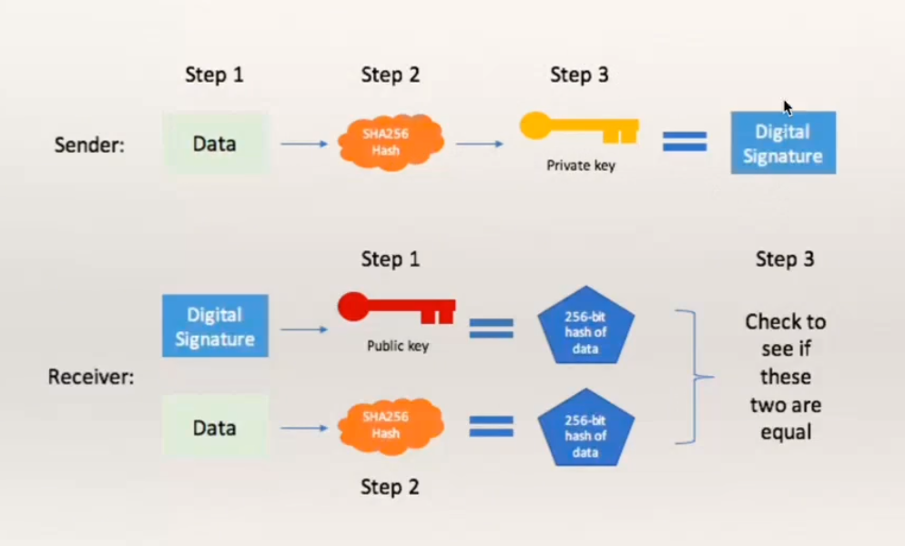

## 2.链式结构，防篡改、好验证（区块链名称来历）
1.​​区块链是一种链式数据结构，hash 函数（又称哈希函数）加密数据，从数据结构层
确保了区块链数据的不可篡改等特性，在区块链中占据了很重要的地位。
哈希函数的做法是将繁杂的交易信息加密压缩成固定字节的简单哈希值，并成为该区块的标识，保证区块链中交易信息不被篡改。
不管是连接相邻区块，还是构建 merkle 树，以及交易验证、数字签名等等重要环节都用到了这个算法。
1.1. 在比特币网络中的计算机上都保留着一条区块链表，每个区块的生成要填写 hash 值。
1.2. 区块头（Block Header）：
    包含元数据，如：
- 版本号（int32_t nVersion）--4字节、
- 父区块哈希值（uint256 hashPrevBlock）--32字节、
- Merkle根（uint256 hashMerkleRoot）--32字节、
- 时间戳（uint32_t nTime）--4字节、
- 难度目标（uint32_t nBits）--4字节、
- Nonce（uint32_t nNonce）--随机数，4字节。

**区块头的数据需要转换成哈希值，这个哈希值是区块链中用于链接区块的关键。**
**如上**，比特币每一次挖矿就是对这80个字节连续进行两次SHA256运算(SHA256D)，运算结果是固定的32字节(二进制256位)。

以上6个字段情况又各不相同：
- nVersion，区块版本号，只有在升级时候才会改变。
- hashPrevBlock，由前一个区块决定。
- nBits，由全网决定，每2016个区块重新调整，调整算法固定。

**因此**以上3个字段可以理解为是固定的，对于每个矿工来说都一样。矿工可以自由调整的地方是剩下的3个字段：
1. *nNonce*，提供2^32种可能取值；
2. *nTime*，其实本字段能提供的值空间非常有限，因为合理的区块时间有一个范围，这个范围是根据前一个块时间来定，比前一个区块时间太早或者太超前都会被其他节点拒绝。
值得一提的是，后一个区块的区块时间略早于前一个区块时间，这是允许的。一般来说，矿工会直接使用机器当时间戳。
3. *hashMerkleRoot*，理论上提供2^256种可能，本字段的变化来自于对包含进区块的交易进行增删，或改顺序，或者修改Coinbase交易的输入字段。

- 一些名词解释和概念定义
1.3. 交易列表（Transaction List）：
包含区块内所有交易的列表。
交易数据本身不需要转换成哈希值，但每笔交易在Merkle树中会被转换成哈希值.
1.4. Merkle树（Merkle Tree）：
用于有效地总结区块中所有交易的数据结构。
Merkle树的每个节点（包括根节点）都是由交易数据的哈希值构成的。
1.5. 父区块哈希值（Previous Block Hash）：
指向前一个区块的哈希值，用于保持区块链的连续性。
父区块哈希值本身是一个哈希值，不需要再次转换。
1.6. 时间戳（Timestamp）：
记录区块被创建的时间。
时间戳通常不转换成哈希值，但它是区块头的一部分，会影响区块头的哈希值。
1.7. 难度目标（Difficulty Target）：
用于工作量证明算法，指示找到有效区块所需的计算难度。
难度目标本身是一个数值，不需要转换成哈希值。
1.8. Nonce（Number Used Once）：  
用于工作量证明算法，是一个随机数，用于找到满足特定哈希条件的区块。
Nonce本身是一个数值，不需要转换成哈希值。
用于加密货币挖矿过程中的哈希算法，在挖矿过程中，矿工需要找到一个特定的哈希值，使其低于网络设定的难度值（Difficulty Target）。
Nonce是区块头数据的一部分，矿工通过不断变化Nonce的值来重新计算区块的哈希值，直到找到一个有效的哈值。
1.9. 交易计数器（Transaction Counter）：
记录区块中交易的数量。
交易计数器是一个数值，不需要转换成哈希值。
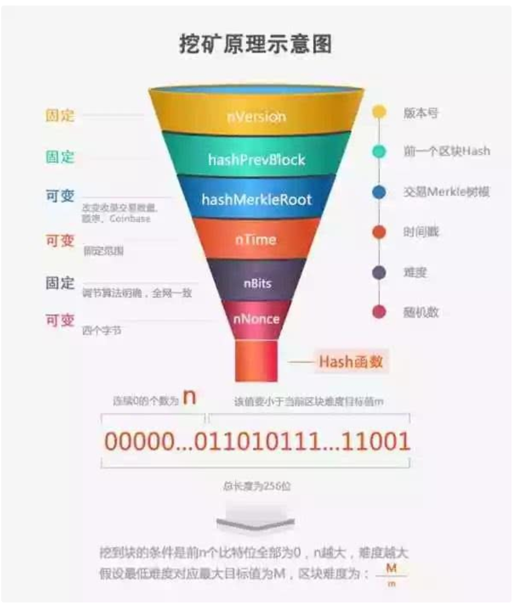

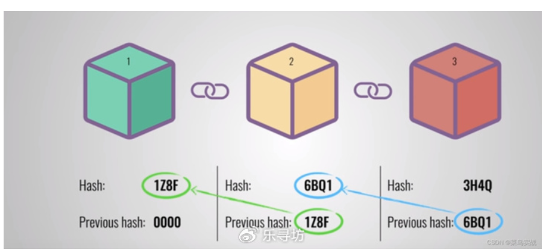

2.1. 哈希指针(Hash Pointer)是指该变量的值是通过实际数据计算出来的，且指向实际的数据所在位置。即哈指针既可以表示实际数据的存储位置，又可以表示实际数据内容（某个时间戳下该数据的哈希值）。
2.2. 从哈希指针的角度来看区块链的结构，可以说区块链就是按时间顺序将数据区块通过哈希指针的方式连接来的一个链表。
哈希指针其实就是一串数据的哈希值，一串数据的哈希值就是这串数据的“指纹”、摘要，因此就可以用这个哈希来指向这串数据。
2.3 区块链里的每一个区块都有对应本区块的哈希指针，而除了创世区块(即第一个区块)之外，其他每个区块都储了前一个区块的哈希指针，从而形成如下所示的一个链条，即区块链。
这样的数据结构可以保证数据无法篡改，因为一旦篡改了任何区块的数据，对应的哈希指针就会出错，那么它后的那个区块的哈希指针，
就不能够和篡改数据后的区块生成的哈希指针匹配，因此一旦有恶意篡改就能校验到。

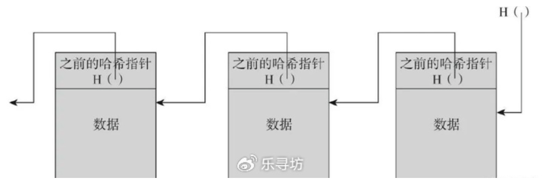

1. 对每一页的数据去计算一个哈希值，如果页面中的数据发生变化，哈希值也会变化；
2. 每一页的数据都包含很多交易信息，
3. 下一页的数据的哈希值，会把上一页数据的哈希值加上一起计算哈希值，形成手拉手串联的结构
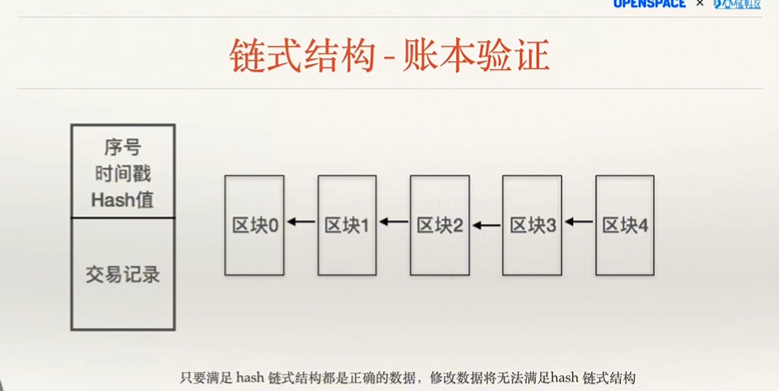
    
## 3.哈希算法在区块链中的应用
1. 用户地址的生成
第一步：生成私钥（private key）
第二步：生成公钥（public key）
2. 默克尔哈希树（Merkle Tree）
3. 挖矿难度的设置计算，符合给定目标的一个哈希值的困难程度。给定当前块的目标哈希，先经过压缩然后存储区块中，区块的哈希值比较小于给定的目标哈希值，表示挖矿成功。
4. 数字签名利用私钥签名进行加锁，用公钥签名进行解锁，从而实现数字货币的交易。
演示地址：[https://andersbrownworth.com/blockchain/blockchain]

## 4.POW共识（Proof of Work, PoW 工作量证明）：谁先完成计算，谁获奖励。
1. 问题：**如何激励大家参与？**   **可能会出现多个数据链？**
2. 共识机制：**激励参与者**   **并解决谁的记账有效**
3. 谁先完成POW难度计算，谁获奖励；
4. 规则写在开源的代码里面；
5. 任何人都可以运行验证（利用非对称加密算法、hash区块链式结构）；
挖矿的行为只是区块链网络中，用来竞争记账权的方式；
得到记账权后，会创建新的区块，这个新区块包含了一系列经过验证的交易，并且会被广播到整个网络。得到相应的“挖矿奖励”，即人所共知的“比特币”。
此外，矿工还可以获得区块中所有交易的手续费。

**记账权如何获得：** 竞争获得，谁先计算完成，谁就获得。
1. 收集交易：矿工从网络中收集未被记录的交易。
2. 构建候选区块：矿工将这些交易组织成一个区块，这个区块包括了一个区块头和一系列交易。区块头包了前一个区块的哈希值、时间戳、难度目标等信息。
3. 工作量证明：矿工尝试找到一个满足特定条件的哈希值，这个哈希值必须小于网络设置的难度目标。这过程需要大量的计算能力和时间，因为找到这个哈希值是随机的，不可预测的。
4. 广播新区块：一旦矿工成功找到了满足条件的哈希值，它会将新区块广播到整个网络。其他节点会验证个新区块的有效性，包括检查区块中的交易和工作量证明的正确性。
5. 区块添加到区块链：如果大多数网络节点接受了这个新区块，它会被添加到区块链上，成为最新的一块这个过程确保了区块链的连续性和不可篡改性。

## 5.交易的过程
每笔交易分别存储，需要的时候把它们整合到一起。
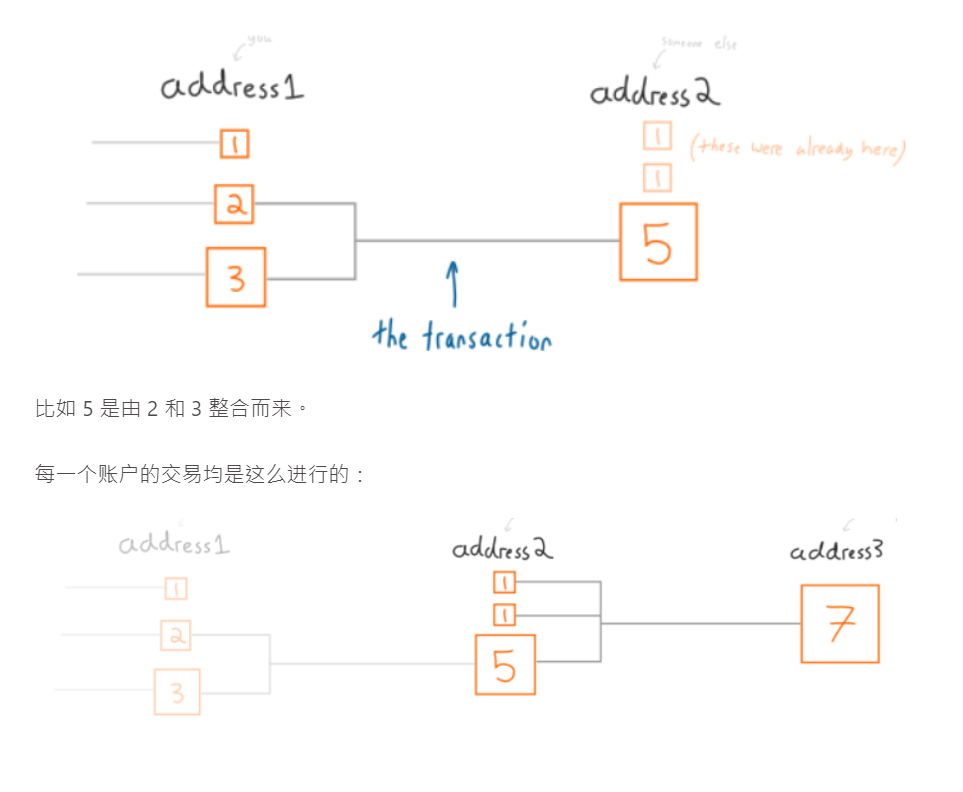    
但是问题来了，如果我不能刚好凑出来需要的金额呢？
那么它就会返回一个差值。
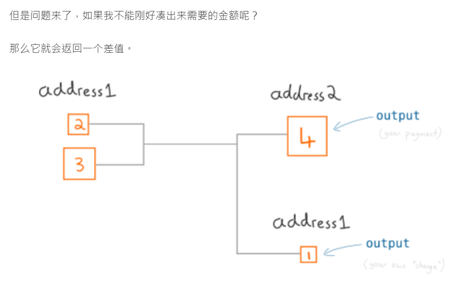

下面是稍微详细的过程：

如果你有10个比特币，但是需要花 8 个，找零两个。那么，就会在 8 个的那个 Output 里加入接收者的公钥，接收者用它的私钥就可以解锁，接下来的两个的 Outputs 则只有你自己可以解锁。
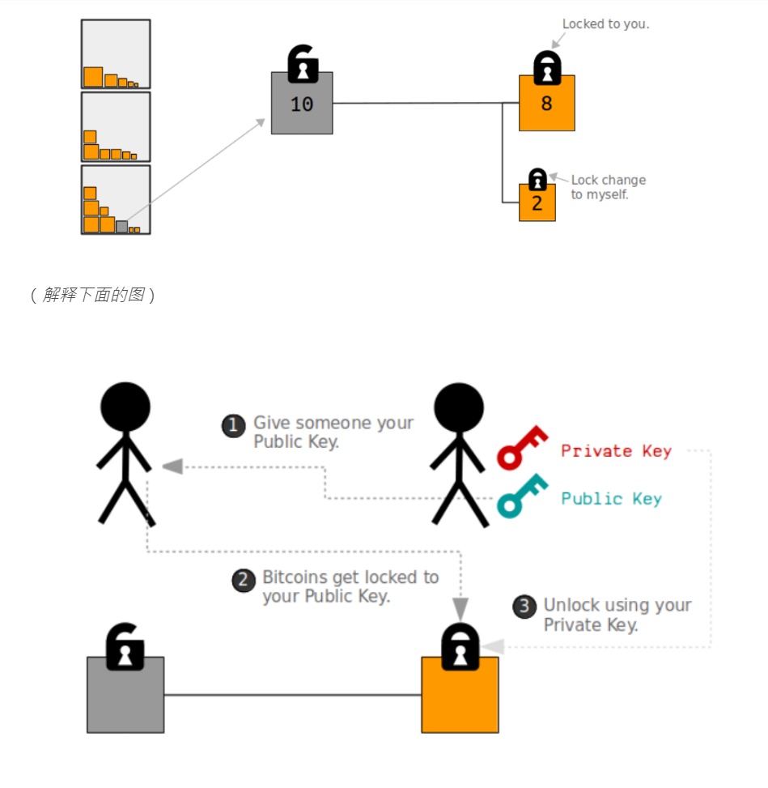
公钥是基于私钥产生的，但是不能通过公钥推算出私钥
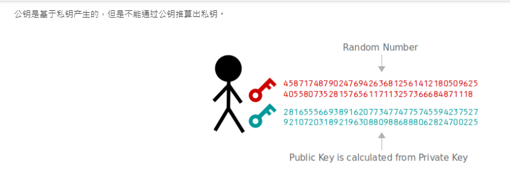
总的过程图：
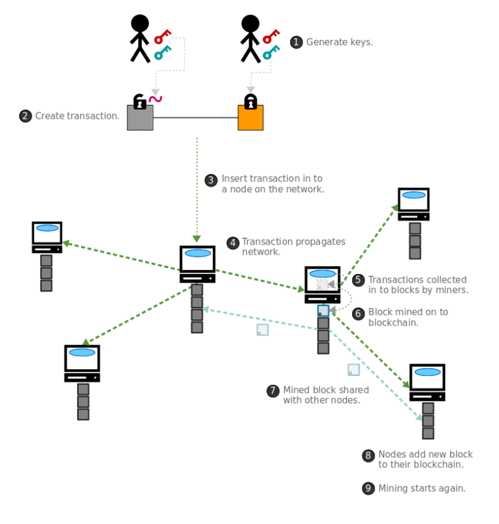

## 6.Difficulty
网络的平均块时间是在 n 个块数后评估的，如果大于预期块时间，则工作证明算法的难度会降低，如果小于预期块时间，则难度会增加。比特币以 10min 为标准，并且每隔 2016 个区块（即大约每 2 周）重新评估一次难度级别。

计算公式如下：new_difficulty = old_difficulty X（2016 块 X 10 分钟）/（挖掘最后 2016 块所需的时间（分钟））

一般设置创世区块的难度为 1。为了保持相对稳定，每次调整的范围在原来的 1/4 到 4 倍，下面是变化曲线：
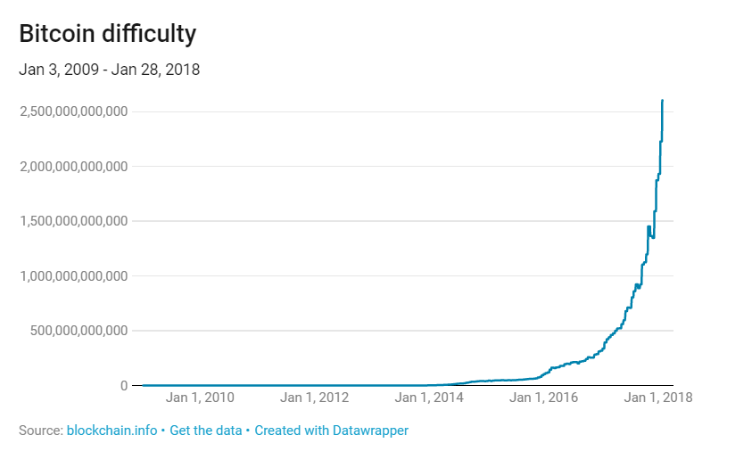
17 年 1 月 12 号的难度是 678 亿，2018 年 1 月 24 号是 2208 亿，到了 20 年 7 月的难度大约是 17345 亿，计算机发展非常块。（* 不要小瞧指数，* 它们都还不到 4^24^

## 7. Target
刚刚提到了挖矿的过程，它并不轻松，块头被哈希加密后的值必须小于等于某一个值，才被算作成功。
也就是**Target目标值越大越容易**（可以想象为一个洞，洞口越小越不容易通过）
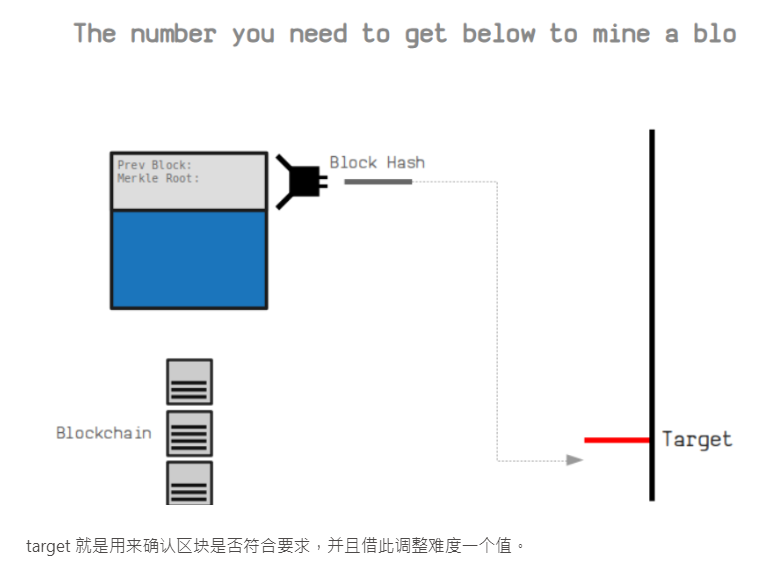
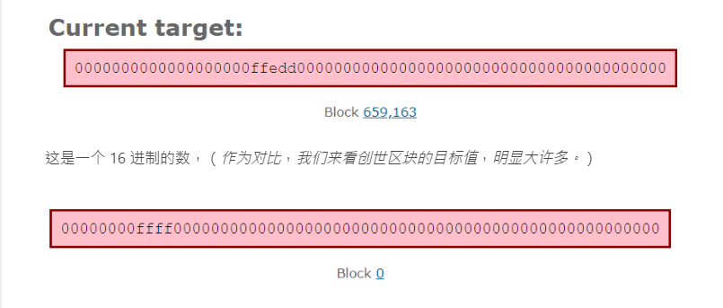
比如发现 0-2016 的区块建立的速度很快，那么我们就把目标值调大，增大后面 2017-4032 难度：
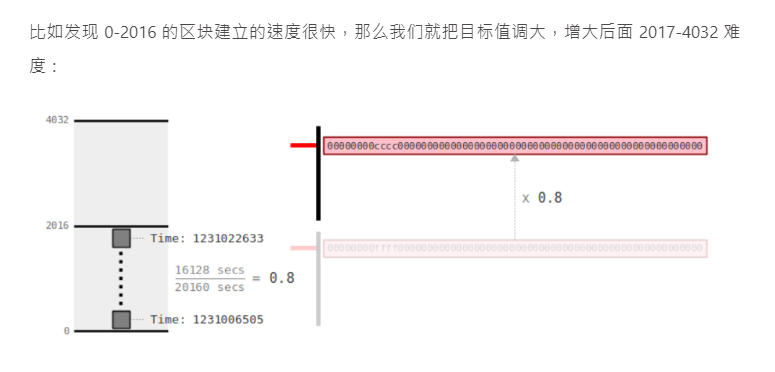
相反，如果之后发现 2017-4032 个区块用的时间很长，那么增大目标值，第 4033-6048 个区块生成的速度就会快一点。
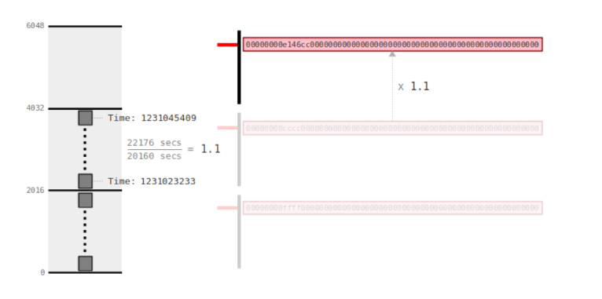

## 8. 所有的节点都共用同一个 target
因为所有的节点都是采纳最长链构成的区块，当第一次运行客户端时，计算机会自动接受初始区块的数据，并且和其他节点保持一致，所以最终它们会共用相同的 target。
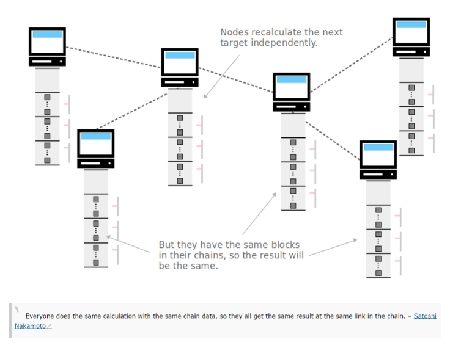

## 9.为什么要设置 target 来调控时间间隔？
为了让区块链能拓展下去（挖矿），需要让刚产生的区块广播 (propagate) 到网络中的其他节点，避免重复无用的挖矿造成资源浪费和标准混乱。
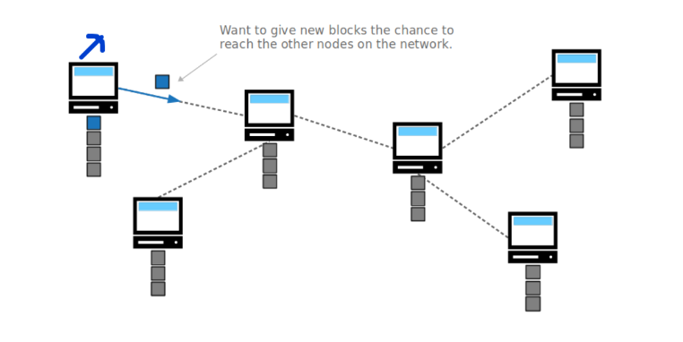

**因为区块链必须遵循最长链原则（longest chain）**
如果区块之间没有间隔，那么当一个矿工完成了一个区块之后，其它没有收到消息的矿工还在挖原来的那一层，等他完成了就会产生竞争链（competing chains），发生链重组（chain reorganization，也叫 reorg），只有一条能够保留，其余全部作废。
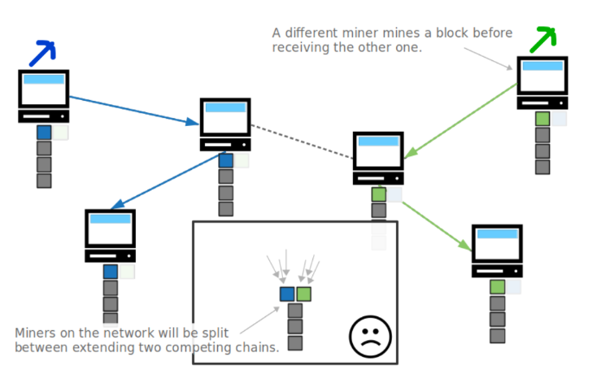
重组之后，矿工就能集中算力来做有用功了。
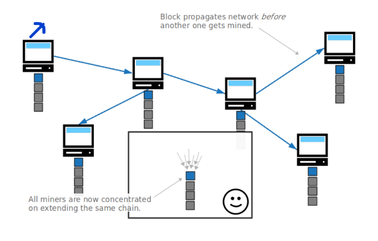

## 10. 以恒定的速率发行货币
比特币是一种虚拟货币，他必须保持稀缺性而且需要发行，设定好目标值就能让比特币以可预料的方式发行。
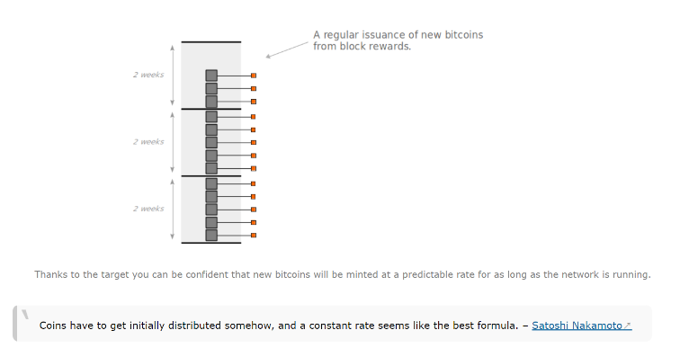

## 11.Longest Chain 最长链原则
区块链必须遵循最长链原则，也就是说，只有一条链是有效的，其他的链都是无效的。
最长链是节点采用的作为区块链的那一条链
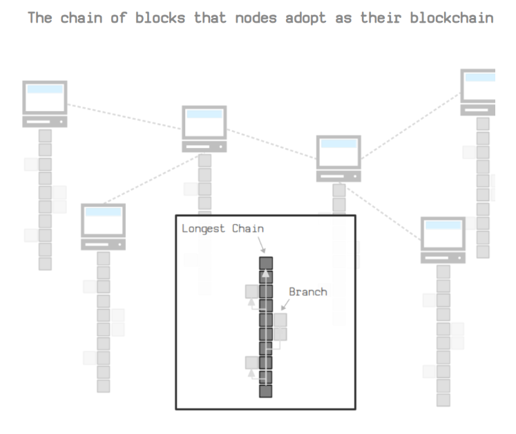
其余的支链或者分叉会被视为无效。

## 12.**最长链**判定标准
我们知道，不同的难度需要的算力不一样，目标值越小，难度越高，工作量越大。
因此，它的判定标准不是区块的个数，而工作量（work）。但是一般而言拥有更多的区块的链消耗的工作量越大。
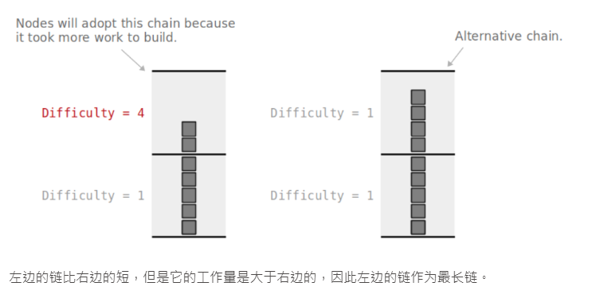
那条短的链一般会被废弃，实际上，从来没有出现含有三个连续的孤块（orphan blocks）。
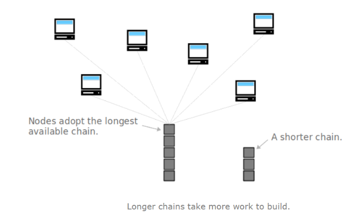
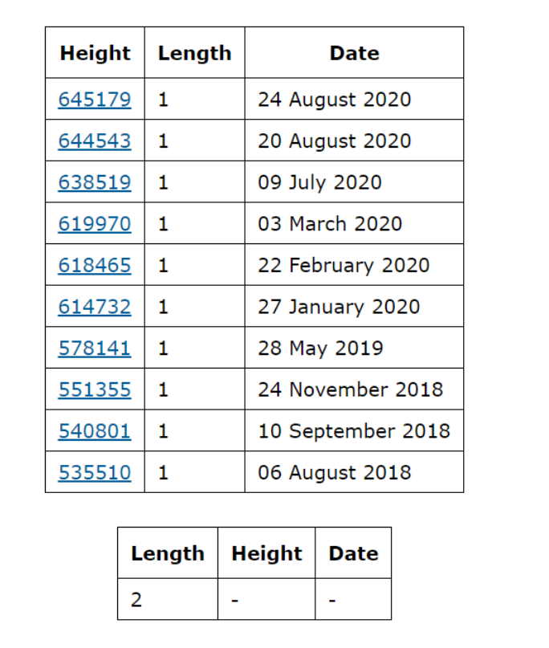

## 13.难度目标值计算方法：
把每一层挖矿的哈希数累加。
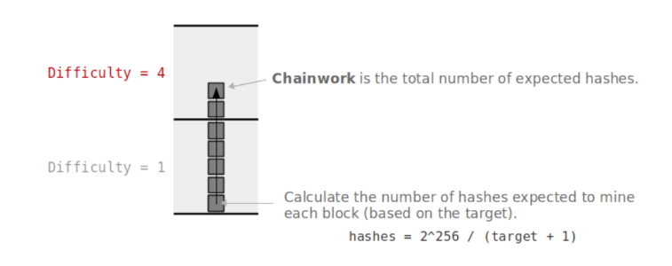
由图可知，哈希数取决于目标值的大小，和难度正相关，和工作量是正相关。

## 14.节点为什么要采用最长链
1. 解决同时产生两个区块造成的分歧
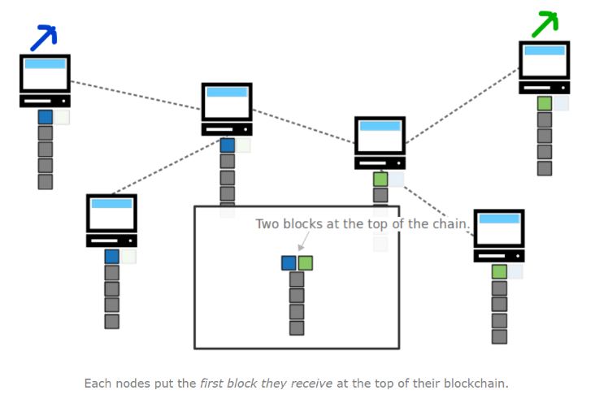
虽然这两个块的起始数据是一样的，但是必须要有一个可信的有效的最长链，确保一致性（consensus）。
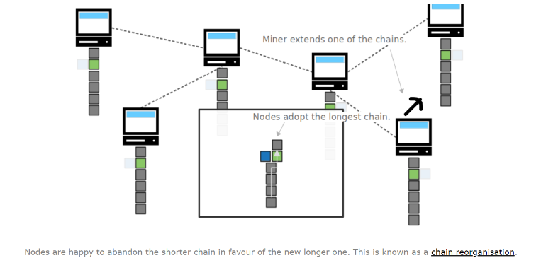
那么，接下来形成的区块最先建立在哪一个区块上，它就会被确认为最长链的一部分。

2. 保护已添加到区块链中的区块
采用最长链，会让每一个块变得不可代替，进而保护的一致的、真是的分布式账本。如果有人想覆盖某一个交易，那么他需要重新建立最长链，但是不仅区块的高度已经非常大了，而且还有非常多的矿工在延申最长链，单个算力是几乎不可能完成的。即使是巨大算力的攻击，也需要付出高昂的代价。
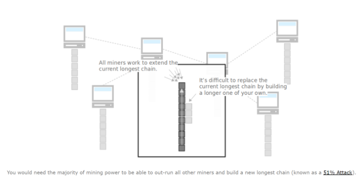
需要一个比所有其他矿工的算力之和还强的算力才可能实现（51% 攻击）。

##  15.为什么矿工们要在最长链上下功夫
比特币区块链有一个变态的设定，每个矿工必须在最长链挖矿才能获得收益（block reward），如果链重组被废了，就亏大了。也就是说建立新的最长链是不成功则成仁的行为。
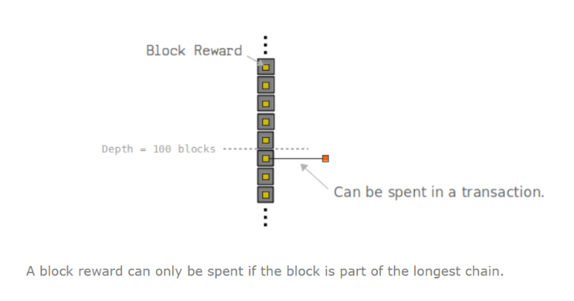
此外，挖矿的收益也必须要等到它后面又 100 个区块形成后才能用。。。。如果最长链被试图篡改，非常多挖矿的收益都不能用，按照市值来算，钱包里少了几千万美元。。要拼命的。

## 16. 不在最长链上的交易会发生什么？
在竞争块里面的交易会无效，被所有节点拒绝，无法存档。不在竞争链的交易会被重新送回内存池，等待机会通过挖矿重新进入新的区块中。
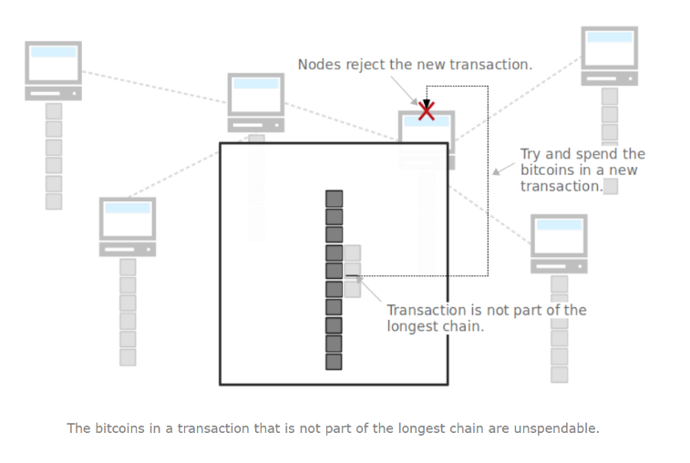

## 17. 交易确认
图中 block confirmation 可以简单的理解为后面的区块数。
一般指交易确认数，每当一个块完成就加一，而且对于需要达到一定的数量才被视为可信，超过 6 个就能防止百分之 40 的算力的攻击（攻击成功率小于 1%）。它在在交易中，比特币是 6，以太坊是 12。但是有时候实在太便宜不在乎或者是不可替代的物品，可以跳过这个审查。
这是每一个区块确认的时间间隔
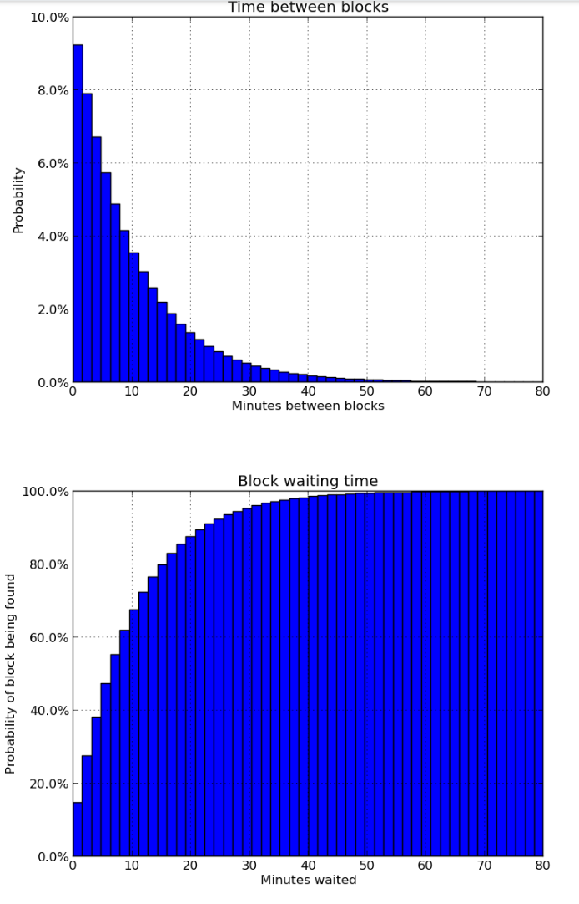
这就是交易被确认的时间，大概在 10min 内有 66.3% 的概率找到一个区块，有 99.7% 在一个小时内找到。

## 18.不足：
     1.较慢；
     2.较贵；
     3.代码安全问题；
     4.门槛高；

# 4.区块链基础设施 
## ***数字菁英(公众号)解读：区块链基础设施在现代数字经济中占据着重要地位。***
## 4.1. 区块链开源底层技术平台
- 区块链开源底层技术平台为开发者提供了强大的工具和基础架构，促进了区块链技术的创新和发展。
- 这些平台通常具有高度的安全性、可扩展性和灵活性，允许开发者构建各种类型的区块链应用。
- 通过开源的方式，开发者可以共同参与平台的改进和完善，推动区块链技术的不断进步。
1. ChainWeaver   --上海浦芯未来互联网技术研究院正式发布 2024-09-10;
相关介绍：[https://baijiahao.baidu.com/s?id=1809857596809513628&wfr=spider&for=pc]
2. 国内区块链底层技术平台[https://baijiahao.baidu.com/s?id=1747081638126682479&wfr=spider&for=pc]
   
## 4.2. 网络服务设施
- 公共链网：公共链网是区块链基础设施的重要组成部分，它为用户提供了一个开放、透明、去中心化的网络环境。在公共链网上，任何人都可以参与交易和验证，确保了数据的安全性和可信度。公共链网的出现，为区块链技术的广泛应用奠定了基础。
- 跨链系统：跨链系统解决了不同区块链之间的互操作性问题，使得不同的区块链可以相互通信和交换价值。
跨链系统的出现，打破了区块链之间的孤岛效应，促进了区块链生态的协同发展。
## 4.3. 区块链公共服务平台。
- 面向区域或行业应用的区块链公共服务平台为特定领域的用户提供了定制化的区块链解决方案。
- 这些平台通常结合了行业特点和需求，提供了丰富的功能和服务，如供应链管理、金融服务、政务服务等。
- 区块链公共服务平台的出现，为行业的数字化转型和创新发展提供了新的动力。
- 区块链基础设施的不断完善和发展，将为区块链技术的广泛应用和数字经济的繁荣发展提供坚实的支撑。

## ***kimi(AI)解读：区块链基础设施在现代数字经济中占据着重要地位。***

# 5.区块链平台相关
## 5.1. 概念
- 通常指的是一套技术基础设施，它提供了创建、部署和管理区块链应用（DApps）的工具和服务。
- 这些平台支持区块链网络的运行，包括但不限于:
1. **智能合约的执行**
2. **数据存储**
3. **网络共识机制**
4. 以及与外部系统的交互

## 5.2. 区块链平台详解
**理解区块链平台的关键点：**
- 底层技术：区块链平台提供了区块链网络运行所需的底层技术，如:**分布式账本**、**共识算法**、**加密技术**等。
- 开发工具：平台通常提供**SDK**、**API**、**智能合约语言**等，以便开发者构建和部署**DApps**。
- 网络治理：平台可能包括网络治理机制，如**投票系统**、**链上治理**等，允许社区成员参与网络的管理和决策。
- 互操作性：一些区块链平台支持与其他区块链网络的互操作性，允许**跨链通信**和**资产转移**。
- 安全性：平台需要确保网络的**安全性**，包括**防止欺诈**、**篡改**和**其他安全威胁**。
- 可扩展性：为了支持大量用户和交易，平台需要具备**良好的可扩展性**。
- 生态系统：成功的区块链平台往往拥有一个**强大的开发者社区**、**合作伙伴网络**和**用户基础**。
### 5.2.1.  国内区块链平台(绝大部分都是联盟链)
- 蚂蚁链（AntChain）：由蚂蚁集团开发，支持多种区块链应用。
- 腾讯云区块链服务（TBaaS）：腾讯提供，支持企业级区块链应用。
- 百度超级链（Baidu XuperChain）：百度推出的区块链平台，支持智能合约和DApps。
- 趣链科技：提供企业级的区块链解决方案。
- FISCO BCOS：由金链盟推出的开源区块链平台。
  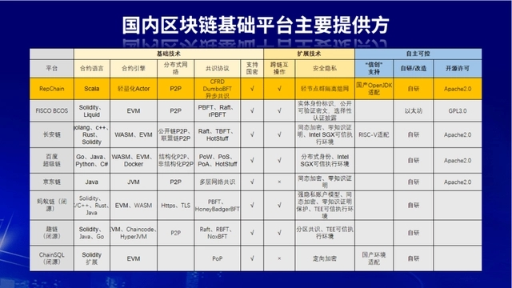
### 5.2.2. 国外主流区块链平台：
- 以太坊（Ethereum）：支持智能合约和DApps的区块链平台。
- 比特币（Bitcoin）：首个区块链平台，主要用于加密货币交易。
- Cardano：一个去中心化的区块链平台，支持智能合约和DApps。
- Polkadot：旨在实现不同区块链之间的互操作性。
- Solana：一个高性能的区块链平台，支持大规模的DApps。
- EOS：旨在实现高性能的区块链应用。
- Binance Smart Chain：由Binance推出的区块链平台，支持智能合约和DApps。
- Tezos：一个支持自我修正的区块链平台。
### 5.2.3 公链、联盟链、私链的概念
#### 1.**公链**：
- **定义**：公链是一种完全去中心化的区块链，任何人都可以参与网络的任何方面，包括交易、验证、记录保存等。
公链对所有人开放，没有权限限制。
- **特点**：公链的典型例子是比特币和以太坊。它们完全透明，任何人都可以查看交易历史。公链通常通过加密货币激励
机制来奖励参与者（如矿工）维护网络安全。
- **应用**：公链适用于需要高度透明和去中心化的应用场景，如加密货币交易、去中心化金融（DeFi）等。
#### 2.**联盟链**：
- **定义**：联盟链是一种由预先选定的多个组织共同管理和维护的区块链。
这些组织通常有共同的业务目标或需要在一定范围内共享数据。
- **特点**：联盟链的参与者是有限的，通常需要权限才能加入网络。它结合了公链的分布式特性与私有链的控制特性，
提供了一种介于两者之间的解决方案。
- **应用**：联盟链适用于需要在多个组织间共享数据但又不希望完全开放的场景，如供应链管理、银行间清算等。
#### 3.**私链**：
- **定义**：私链是一种由单一组织控制和管理的区块链。它通常不对外开放，只有内部成员才能参与网络的维护和交易。
- **特点**：私链的访问权限受到严格控制，只有被授权的参与者才能访问和修改区块链上的数据。
由于参与者较少，私链的处理速度通常比公链和联盟链快。
- **应用**：私链适用于需要高度控制和隐私保护的场景，如企业内部的数据管理、审计等。

# 6. 状态管理
区块链在启动时以创世纪状态开始。比特币的创世状态发生在 2009 年公共网络启动时。以太坊的创世纪状态发生在 2015 年推出时。
区块链上的每笔交易都会修改跨所有节点复制的全局状态。
由于有数百万笔交易，交易被组合成块。由此得名。这些块以可加密验证的方式链接在一起，因此它们在历史上是可追溯的。网络的当前状态可以随时重新计算，从创世块开始，根据每个块的信息转换状态，直到现在。

# 7.节点
区块链的使用证实了每个价值单位只转移一次，中本聪提出的巧妙机制解决了长期存在的去中心化双花[4]问题。
## 计算机节点
区块链网络通过计算机节点的点对点分布式网络[2]自主管理。无需过多详细说明，您可以简单地将网络中的每个节点视为保存全局交易分类帐的副本。因此，每个节点都可以单独验证和审计网络上发生的交易，并确保没有非法行为。

## 挖掘节点
负责将网络上进行的新交易组合成一个区块，对其进行验证，并提议将该区块包含在其他所有人的全球分类账中。挖矿在计算上是困难的，并且安全地进行非常重要，因此区块被接受的矿工会因其辛勤工作而获得代币奖励。

# 8.权力下放
通过将数据存储在节点的对等网络中，区块链是一个去中心化的网络。与以集中方式存储数据的传统方法相比，这具有显着优势。有很多集中化问题的重要例子——我们将在这里列出其中的一些：• 集中式系统中的数据泄露会暴露大量数据• 中心集权管理可以审查和关闭言论• 对中心化权威的依赖意味着上游问题会影响下游消费者（例如，AWS 宕机意味着大部分互联网也随之宕机）另一方面，去中心化带来了相反的好处。• 没有审查制度，因为没有单一的权威或中间人可以审查你• 由于整个网络在全球 1000 个节点上运行，因此无需停机• 高度抗攻击性使其无法操纵或破坏数据

# 9. 区块链的应用
• 加密货币
• 智能合约
• 去中心化金融
• 游戏
• 供应链追踪
• 防伪保护
• 数据隐私
• 去中心化治理
• 可验证的资产所有权

