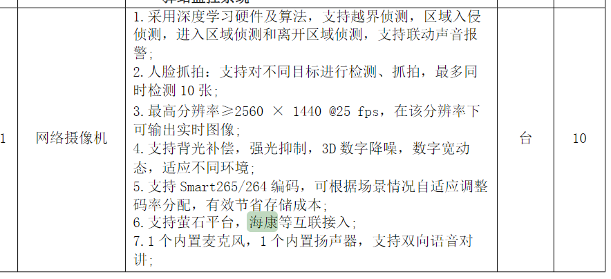
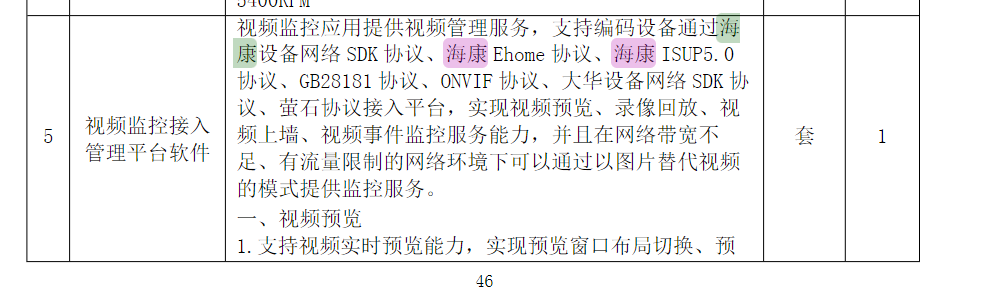

# 本项目由采购人委托 福建采信采购招标有限公司 开展竞争性磋商活动。
采购包1：
采购包预算金额（元）: 1930000.00
采购包最高限价（元）: 1930000.00
采购包保证金金额（元）: 38000.00

# 采购项目需要落实的政府采购政策：**产品不得进口**
1.  **节能产品：**
按照《关于调整优化节能产品、环境标志产品政府采购执行机制的通知》（财库〔2019〕9号）以及**最新的《节能产品政府采购品目清单》的规定执行**。

2. **环境标志产品：**
按照《关于调整优化节能产品、环境标志产品政府采购执行机制的通知》（财库〔2019〕9号）以及**最新的《环境标志产品政府采购品目清单》的规定执行**。

政府采购节能产品、环境标志产品实施品目清单管理。
依据品目清单和认证证书实施政府优先采购和强制采购。
**采购人拟采购的产品属于品目清单范围的，采购人及其委托的采购代理机构应当依据国家确定的认证机构出具的、处于有效期之内的节能产品、环境标志产品认证证书，对获得证书的产品实施政府优先采购或强制采购。**

3. 促进中小企业发展的相关政策：**不专门面向中小企业采购。**

# 供应商资格
1. 单位负责人授权书；
2. 营业执照等证明文件；
3. 经审计的上一年度的年度财务报告，包括资产负债表、利润表、现金流量表、所有者权益变动表（若有）及其附注（若有）或银行出具的资信证明或磋商担保函。
4. 磋商截止时间前六个月（不含磋商截止时间的当月）中任一月份依法缴纳税收的证明复印件证明材料。
5. 磋商截止时间前六个月（不含磋商截止时间的当月）中任一月份依法缴纳社会保障资金的证明复印件证明材料；
6. 具备履行合同所必需的设备和专业技术能力专项证明或书面声明。**有固定格式，没有指定资料**
7. 参加采购活动前三年内在经营活动中没有重大违法记录的书面声明。**有固定格式，没有指定资料**
8. 信用记录查询结果：①信用记录查询的截止时点：信用记录查询的截止时点为本项目提交响应文件截止当日。
9. **特定资格条件：**   **有固定格式，不需要特定资料**
**本项目允许供应商采用资格承诺制**，①采用**资格承诺制的供应商**，须根据响应格式文件要求**提供资格承诺函**，**否则**，视为未按照采购文件规定提交供应商的资格及资信文件，**按资格审查不合格处理**。
10. 是否接受联合体形式的响应磋商：采购包1：不接受；
11. 磋商保证金缴纳凭证；

# 递交截止时间：
2024年12月18日下午15点00分（北京时间）
# 递交地点：
厦门市思明区莲岳路221-1号公交大厦A栋2201单元福建采信采购招标有限公司前台并在签到表上签到，逾期递交的或不符合规定的磋商响应文件将被拒绝。

# 响应文件的份数
（1）纸质响应文件正本 1 份、副本 2 份。
（2）可读介质：电子版响应文件（U盘）1份（与正本一致）。

# 商务评分要点：**共计15分**
## 供应商体系认证
1. 供应商具有**质量管理体系认证**得1分，须提供证书复印件或全国认证认可信息公共服务平台（cx.cnca.cn）的证书信息查询截图（处于有效状态），否则不得分。 **分值： 1**
2. 供应商具证书信息查询截图（处于有效状态），否则不得分。**分值： 1**
4. 供应商具有**信息技术服务管理体系认证**得1分，须提供证书复印件或全国认证认可信息公共服务平台（cx.cnca.cn）的证书信息查询截图（处于有效状态），否则不得分。 **分值： 1**
## 项目总负责人
1、供应商拟配备于本项目的总负责人(1人)：具备①信息系统项目管理师(高级)证书，②中级通信专业职称（终端与业务）证书，③注册信息安全工程师(CISP）证书，同时具备上述证书的得3分，须提供证书复印件及上述人员磋商截止时间前六个月任意一个月(不含磋商截止时间当月)在供应商处缴交社保证明材料，否则不得分【涉及人员评分条款均不重复计分】。
**分值： 3**
## 项目团队
供应商拟配备于本项目的项目团队成员具备:**①信息系统项目管理师(高级)证书**，**②物联网高级工程师证书**，**③网络工程师证书**，**④注册信息安全工程师(CISP)证书**，**⑤IT服务工程师证书**，**⑥软件测评师**。项目团队成员每具备上述一类证书得0.5分，满分3分，须提供证书复印件及上述人员磋商截止时间前六个月任意一个月(不含磋商截止时间当月)在**供应商处缴交社保证明材料**，否则不得分【涉及人员评分条款均不重复计分】。
**分值： 3**
## 售后服务要求
1. 供应商承诺：成交后提供7×24小时服务（至少安排7×24小时电话服务，需提供服务电话号码），接到采购人通知2小时内予以响应并到达现场的得2分。须提供书面承诺函（格式自拟），否则不得分。
**分值： 2**
2. 供应商可提供本地化服务的得2分，否则不得分。供应商可提供合作单位或者自身机构的营业执照证明，也可以提供在本地设立的项目部、办公室、办事处等机构，或者承诺成交后提供本地化服务。
**分值： 2**
3. 供应商承诺对于本次采购清单内的硬件设备在采购文件要求的提供3年原厂维保服务的基础上，每增加1年原厂维保服务，可得0.5分，最高可得1分。
**分值： 1**有**环境管理体系认证**得1分，须提供证书复印件或全国认证认可信息公共服务平台（cx.cnca.cn）的证书信息查询截图（处于有效状态），否则不得分。 **分值： 1**
3. 供应商具有**职业健康安全体系认证**得1分，须提供证书复印件或全国认证认可信息公共服务平台（cx.cnca.cn）的

# 技术评分要点： 分值55分
## 业务管理平台 **分值： 5**
1. 供应商承诺响应的业务管理平台采用国产自主的处理芯片、操作系统和数据库软件，提供书面承诺函（格式自拟），满足得1分，否则不得分。**分值： 1**
2. 采用独立硬件部署（非MCU内置模块），基于容器的服务化架构，支持将不同功能的业务部署在不同的容器内运行，避免应用对资源抢占和相互影响【提供具有CMA或CNAS认证标志的检测机构出具的有效检验（检测）报告佐证】。满足的得2分，否则不得分。 **分值： 2**
3. 支持将多台MCU 组成资源池，实现MCU 资源统一管理，系统可根据MCU 资源使用情况，动态分配 MCU资源，实现 MCU 资源负载均衡【提供具有CMA或CNAS认证标志的检测机构出具的有效检验（检测）报告佐证】。满足的得1分，否则不得分。  **分值： 1**
4. 支持许可资源集中管理、按需分配、浮动共享，授权许可不与硬件设备绑定，可通过软件许可和计算资源平滑扩容系统容量【提供具有CMA或CNAS认证标志的检测机构出具的有效检验（检测）报告佐证】。满足的得1分，否则不得分。
**分值： 1**

## 多点控制单元  **分值： 6**
1. 供应商承诺响应的业务管理平台采用国产自主的编解码芯片和操作系统，提供书面承诺函（格式自拟），满足得1分，否则不得分。 **分值： 1**
2. 支持ITU-T H.263、H.264BP、H.264HP、H.265、H.264 SVC、H.265 SVC、H.265 SCC等视频协议。满足得1分，否则不得分。**分值： 1**
3. 支持全编全解技术，确保每个接入的会场均能以任意不同的协议、带宽、格式、帧率参加同一组会议，会议中任何一个参会终端出现丢包仅影响该会场，不会影响整个会议效果【提供具有CMA或CNAS认证标志的检测机构出具的有效检验（检测）报告佐证】。满足的得2分，否则不得分。**分值： 2**
4. 支持电子白板功能，支持白板批注、缩放、保存、多方互动等功能，支持不少于64方同时协作。满足得1分，否则不得分。**分值： 1**
5. 支持80%网络丢包下，声音清晰，不影响会议正常进行。满足得1分，否则不得分。**分值： 1**

## 录播服务器 **分值： 5**
1. 供应商承诺响应的录播服务器采用采用一体化架构设计，基于国产自主的媒体处理芯片、操作系统和数据库软件，提供书面承诺函（格式自拟），满足得1分，否则不得分。**分值： 1**
2. 支持H.264 HP、H.264 BP等视频编解码协议，支持1080p60、1080p30、720p30、4CIF等视频格式。满足得1分，否则不得分。**分值： 1**
3. 支持20%网络丢包下，语音清晰连续，视频清晰流畅，无卡顿、无马赛克【提供具有CMA或CNAS认证标志的检测机构出具的有效检验（检测）报告佐证】。满足的得2分，否则不得分。**分值： 2**
4. 支持30%的网络丢包情况下，语音清晰连续，视频清晰流畅，无卡顿、无马赛克。满足得1分，否则不得分。**分值： 1**

## 视频会议终端 **分值： 7**
1. 采用分体式结构，嵌入式操作系统，非PC、非工控机架构。满足得1分，否则不得分。  **分值： 1**
2. 终端操作系统及编解码处理芯片为国产自主【提供具有CMA或CNAS认证标志的检测机构出具的有效检验（检测）报告佐证】。满足的得1分，否则不得分。   **分值： 1**
3. 支持30%网络丢包时，语音清晰连续，视频清晰流畅，无卡顿、无马赛克。满足得1分，否则不得分。  **分值： 1**
4. 支持512Kbps会议带宽下，实现1080P60帧图像格式编解码；384Kbps会议带宽下，实现1080P30帧图像格式编解码。满足得1分，否则不得分。  **分值： 1**
5. 支持按组织层级和权限级别设置不同呼叫等级，呼叫等级按数值大小排序，处于通话状态的视频会议终端，收到高呼叫等级的呼叫请求后，可强制结束当前的通话，并接听新的呼叫【提供具有CMA或CNAS认证标志的检测机构出具的有效检验（检测）报告佐证】。满足的得1分，否则不得分。  **分值： 1**
6. 视频画面经过本地采集、编码、网络传输、解码、显示输出后整体时延不超过120ms【提供具有CMA或CNAS认证标志的检测机构出具的有效检验（检测）报告佐证】满足的得2分，否则不得分。  **分值： 2**

## LED高清大屏  **分值： 13**
1. 点间距≤1.25mm；采用SMD金线灯封装方式。满足得1分，否则不得分。  **分值： 1**
2. 模组和HUB采用三防工艺，有效防潮、防盐雾、防霉。满足得2分，否则不得分。  **分值： 2**
3. 连接方式：模组与主板采用硬连接，板对板设计，无排线，支持直接热拔插，采用浮动式接插件，接插件镀金≥50u厚度，具有嵌合纠偏功能，使连接更稳定，电源输出DC通过pogopin转给信号电源二合一接口，AC输入通过注塑一体IEC连接，实现箱体内部无线，箱体间电源及信号采用分离式传输，可实现免拆箱连接。满足得1分，否则不得分。**分值： 1**
4. 主板设计：模组与HUB板采用硬接口设计，板对板设计，无排线，支持直接拔插。接收卡、HUB板二合一全集成设计。满足得2分，否则不得分。**分值： 2**
5. 电源安全设计：内部电源采用注塑一体IEC连接，外部电源输入至箱体电源无内部走线。接触端子具有保护盖板，支持模组级DC供电方式。满足得1分，否则不得分。**分值： 1**
6. 专业级连接器：模组采用电源和信号分开方式的一体式连接器，电源和信号使用的pin针类型不同，电源采用专用电源pin针，有效避免多信号pin针走电源的方式造成连接器短路和异常，【须提供具有CMA或ilAC-MRA或CNAS认证标志的检测机构出具的有效检验（检测）报告佐证】。满足得1分，否则不得分。**分值： 1**
7. 模组边缘采用专业PET片，极大的提高了模组显示效果均匀性。模组安装具有防呆设计，通过箱体上的定位柱和模组上的连接器实现防呆。保证安装过程中不会因安装错误而引起异常，LED显示屏。满足得1分，否则不得分。**分值： 1**
8. LED 显示屏产品对 LED 显示屏外壳防护等级、拼装精度及节能等级进行国家SJ/T11141-2017 标准测试。满足得1分，否则不得分。**分值： 1**
9. LED显示屏具有防摩尔纹膜技术，用摄像机对显示装置进行拍摄时，能避免摩尔纹现象的产生。满足得1分，否则不得分。**分值： 1**
10. 供应商承诺响应的LED显示屏具有芯片级封装LED结构技术，在镀覆区域设置黑色并且绝缘的覆盖层，可以增强LED结构的对比度，有利于降低LED结构的发热量和功耗，从而提高其可靠性和使用寿命。提供书面承诺函（格式自拟）满足得2分，否则不得分。**分值： 2**

## 显示专用播放器  **分值： 10**
1. 播控器WIFI性能参数，采用单WIFI天线设计，信号稳定可靠,符合标准：IEEE 802.11a/b/g/n/ac/ax。WIFI频率范围：ISM2.4G(2.400GHz～2.483GHz)和ISM5G(5.150GHz～5.845GHz)，支持设备WiFi开关设置，安全等级高。支持设备AP（WiFi热点）名称和密码通过APP进行修改。支持设备连接无线WiFi，WiFi连接自动记忆，开机重启自动回连。支持通过APP进行热点信道修改，可在无线环境较差的条件下，保证投屏、控制网络信道优良。支持WiFi和AP同时开启【需提供具有CMA或ilAC-MRA或CNAS认证标志的检测机构出具的有效检验（检测）报告佐证】。满足得2分，否则不得分。 **分值： 2**
2. 支持多功能水晶按键，按键指示灯一体化设计，红绿双色灯指示通电状态，该多功能按键除了上述功能以外，还可实现通过这个按键就可实现节目切换、遥控器配对、快速显示软件下载二维码及当前版本等信息多项功能。满足得1分，否则不得分。**分值： 1**
3. 支持蓝牙遥控器；支持虚拟遥控器，即在APP界面下的虚拟遥控器功能，虚拟和物理遥控器完全相同的功能，即使在遥控器丢失的情况下，可以通过虚拟遥控器使用和操作设备。满足得1分，否则不得分。**分值： 1**
4. 支持亮度控制与管理，支持播放亮度一键调节，亮度可按时间计划排程控制和管理。满足得1分，否则不得分。**分值： 1**
5. 可拓展支持更多场景，可选支持会议版本、多功能版本、以及拓展应用场景到展厅等众多场景应用，内容可视化，操作便捷。满足得1分，否则不得分。**分值： 1**
6. 投屏可融合显示，投屏画面可与其它类型窗同屏组合显示，投屏画面大小可以任意调节，可与其它类型图层同屏组合叠加显示。融合显示，包括在投屏画面悬浮到其他画面之上，并支持增加会标。满足得1分，否则不得分。**分值： 1**
7. 支持各种图层组合编排播放，支持多视频窗口同步解码播放，支持视频、图片、音乐、流媒体、网页、时钟、天气、字幕等多组件、丰富画面编排，支持多图层声音独立控制。满足得1分，否则不得分。**分值： 1**
8. 多种方案支持文档播放、切换和播控翻页，支持通过遥控器、手机、平板控制PPT/PDF播放，切换，翻页播控。同样U盘下的文档播放也支持上述功能。文档即可导入播控器，也可在U盘下进行播放和显示。满足得2分，否则不得分。**分值： 2**

## 项目实施方案  **分值： 3**
根据供应商的项目实施方案进行评价：①提供的实施方案基于本项目的图纸、清单制定，具有相对的针对性，能够满足本项目的建设需求得2分；②在满足①的基础上，制定的施工方案内容完善、突出重点，施工技术可靠，描述详尽，人员部署完整，岗位职责明确，工序安排合理，能够达到建设要求的得3分。③未按要求完整提供或实施方案不可行的得0分。
**是否组织现场考察或召开磋商前答疑会： 采购包 1：不组织**
11、现状调研：供应商可自行对现有情况进行调研，以便获取有关编制方案所涉及的现状资料，采购人向供应商提供的有关现状的资料和数据,是采购人现有的能被供应商利用的资料,采购人对供应商做出的任何推论、理解和结论均不负责任，现状调研所发生的所有费用和所有事项均由供应商自行承担。

## 安全施工情况  **分值： 3**
供应商承诺：成交后，在服务期内，对拟投入的所有项目组工作人员安全负全部责任，若项目组工作人员发生安全事故，供应商承担全部责任。供应商须提供书面承诺函（格式自拟），完全满足得3分，未提供或不满足不得分。

## 环境保护情况  **分值： 3**
供应商承诺：成交后，在服务期内，垃圾及时清运、不会产生二次垃圾或二次污染的得3分。供应商须提供书面承诺函（格式自拟），完全满足得3分，未提供或不满足不得分。

#  需要响应的内容
**55页（二）页磋商要求**
**56页（三）报价要求**
**56页（四）质量要求**
**57页（五）人员培训要求**
**57页（六）售后服务要求**
**57页（七）知识产权**
**58页 三、商务条件**

# 1个特殊需要响应的地方 **该项目是货物类**
1.3 若项目为货物类采购项目，且涉及货物品目较多，磋商响应供应商应从货物制造商处获得充分、准确的信息，**并在《中小企业声明函》中填写项目所有货物（不含辅材）制造商的相应信息**，若制造商不全或信息不完整或信息不真实或不符合“工信部联企业｛2011｝300号”《关于印发中小企业划型标准规定的通知》要求的中小企业划型标准（工业），均视为不符合（涉及资格的按无效响应处理；涉及价格评审优惠的，不予认定）。

（3）供应商应当按照磋商文件明确的采购标的对应行业的划分标准出具中小企业声明函。
在项目属性为货物类采购项目中，**货物应当由中小企业制造**，不对其中涉及的服务的承接商作出要求；

8.首次响应文件的组成：
8.1首次响应文件包括但不限于下列部分：
（1）响应函
（2）报价一览表（含响应报价明细表）
（3）资格证明文件
（4）磋商保证金凭证
（5）技术和商务偏离表
（6）相关技术、商务、服务响应承诺及资料
（7）供应商提交的其他资料
（8）要求作为响应文件组成部分的其他内容（若有）

供应商应当将响应文件密封包装提交，并在外封套上标识项目名称、项目编号、供应商单位名称以及“于 之前（指首次响应文件递交截止日期及时间）不准启封响应文件”的字样

# 1、写标书的客观困难：
## 距离开标时间过短，招标要求的工作无法按时完成：
18号开标，12号才拿到招标文件，时间不足，无法保证能够联系到匹配的厂家，
项目规模较大，建设内容复杂，招标人不组织踏勘现场，无法完成招标所要求的**项目建设方案**的书写；
## 招标的采购货物**多达128项**，问厂家索取产品资料，汇总资料的时间不足，无法完成资料搜集工作
# 2、采购货物的指向性问题
## 2个主要货物的招标参数有写明了**海康**的供应商字眼：
1、本项目核心是采购视频会议系统、视频监控及会议室系统 

今日查询相关厂家以后，发现视频监控确实是海康的产品，该产品已经报备；厂家无法支持我们参与项目。
# 3、我司的公司资质和人员证书条件与招标不符，此两项会丢掉10分
# **综合以上情况，放弃此次投标活动。**