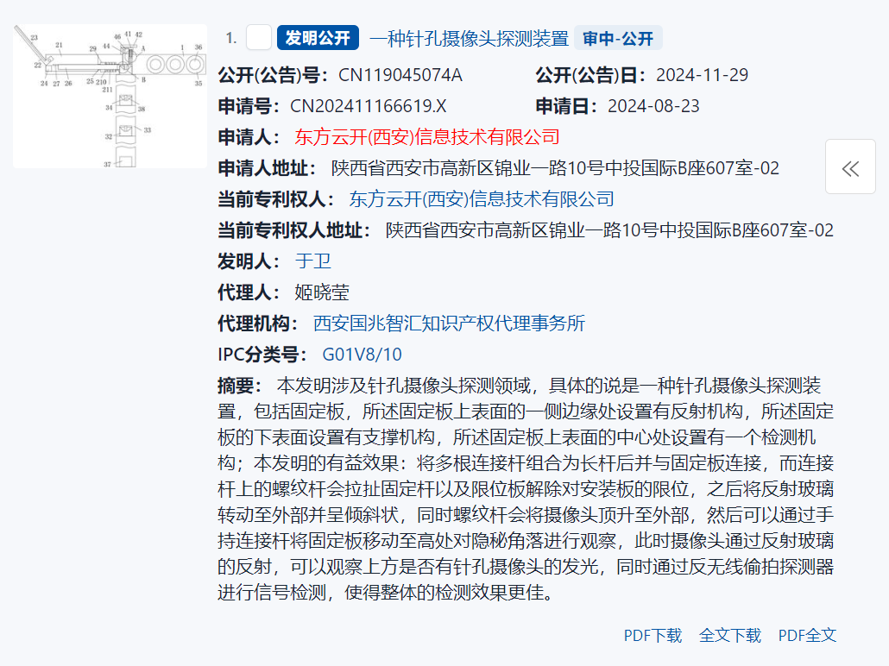
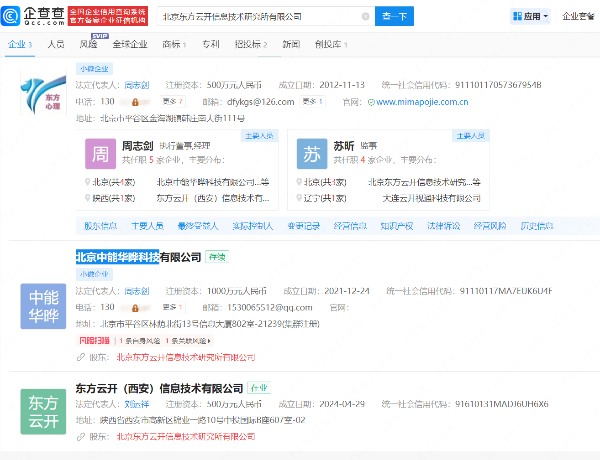
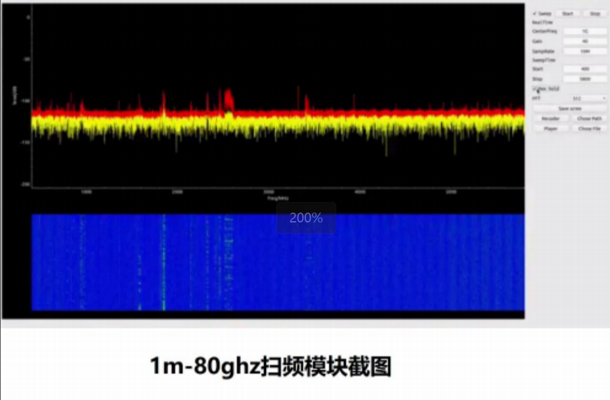
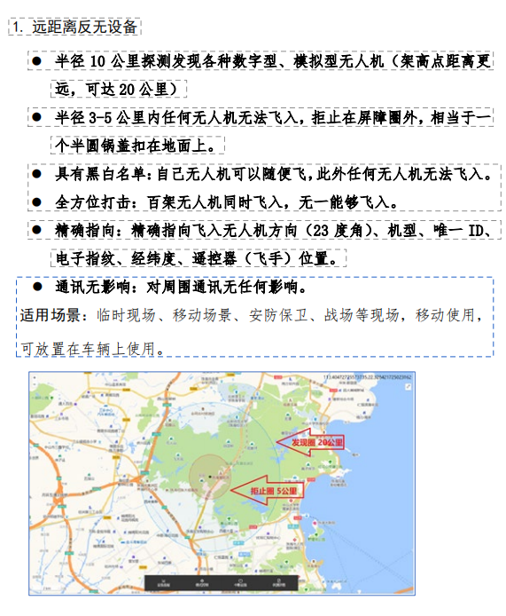
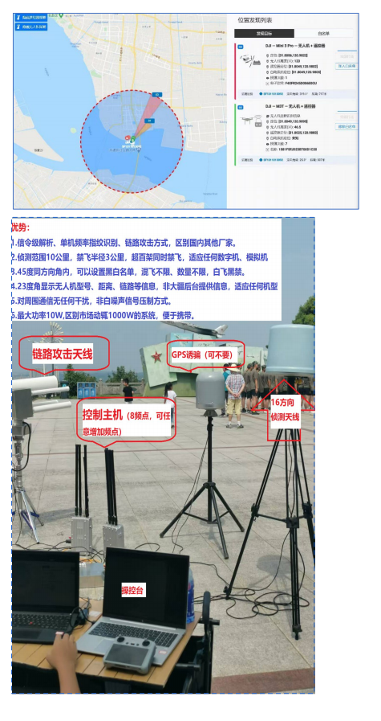
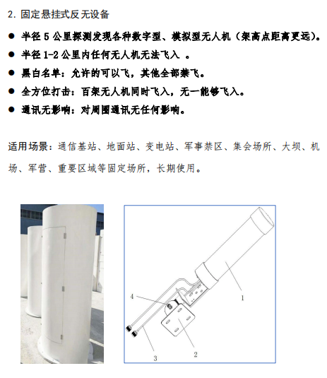
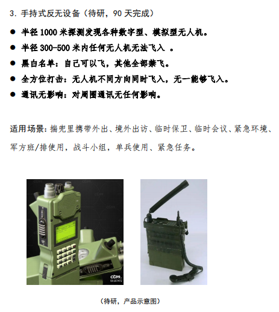

# 一、 防泄密安全检测系统
## 1、厂家信息
|公司名称|性质|注册资本|公司资质|成立时间|人员规模|业务范围|产品特点、特色、优势|用户群体|
|----|--------|--------|--------|---------|--------|---------|-----------------|--------|
|北京东方云开信息技术研究所有限公司|民营|2000万元|国家BM资质|2012年|中学术带头人、核心技术人员、研发团队属于SM人员|国家安全系统所需要的相关产品：1.手机通信协议反向研究  2.无线信号发现与监测  3.物理空间安全检测  4.网络空间安全  5.无人机反制|手机信令解析、无线信号跟踪、网络安全、空间安全、无人机反制方面，有自己区别于其它厂家的独到技术|在国安、公安、总参三部等侦察技术领域|
## 2、产品介绍
### 1、无线信号检测系统
1. 核心技术：**包络检波技术**
归属该公司的专利，只查到一项，正在申请中，**非“包络检波技术”**相关的无线信号检测产品

2. tips&ps：

### 2、防偷录系列产品
1.产品名称：
- 防拍照显示器；
- 防拍照大屏显示器；
- 空间防拍照产品
2.产品特点：
从声学，光学角度彻底解决偷拍/偷录问题，其中有的产品是国内唯一的

### 3、文档中的其他关键内容
此外，我们**研发了一款更为核心的芯片**，可以在20秒内扫描80G带宽频率的技术，任何无线电通讯设备只要有信号发射，都无法逃脱它的眼睛！一秒可以扫描到4g的带宽频率，从1Mhz—80Ghz都可以秒级扫描，不仅可以应用到窃密信号的发现，也可以应用到无人机反制、超远距离信号探测、万米高空信号探测、超远距离电磁干扰、高速精准跟踪瞄准系统……,在通信领域、军事领域有极高的实用价值。

- tips&ps：上述内容，需要专业人员和业内权威组织确认。

# 二、无人机反制项目
发现无人机的技术相对容易解决，
但如何禁飞、如何拒止、如何击落又是一个难点，通常的激光烧毁、信号压制、GPS/北斗诱骗、蜂群攻击、网捕技术仅仅在几百米的区域内有效，无法解决大范围的击落。
## 1、目前国际国内的现有技术基本存在以下问题
1. **激光打击方式：**打击效果极差、漂移不定，无法精准瞄准，大型激光发生器体积庞大笨重，耗能极高。
2. **信号压制方式：**干扰周围正常无线通信，同时距离太近，200-500 米范围。
3. **没有黑白名单：**自己无人机也无法起飞。
4. **GPS 诱骗方式：**干扰周围正常 GPS/北斗使用者。
5. **蜂群攻击方式：**需要多架无人机，成本太高。
6. **机关枪击落：**非常费弹药，而且不适合民用。
7. **网捕方式：**无论飞弹网捕，枪网捕，效率低下，对方飞手操控水平高，无法捕获，大风情况下，自己的设备被捕获。同时，还有体积笨重、耗能高的问题，更无法解决军事上使用的自主飞控攻击型无人机的反制问题。
## 2、产品介绍
### 技术原理
**通过信令解析、频率指纹、链路攻击等技术可以有效解决以上问题**
### 产品现状
不仅**解决**了国内无人机反制效果差的**痛点**，而且在禁飞、拒止、击落的有效距离和效率上远**远超过**所有国内厂家的产品，属于国内**颠覆性技术**。
目前在空军、出入境、公安、民航、电网等行业正在**试用**，**效果非常好**。
### 产品分类介绍

- tips&ps：上述内容，需要专业人员和业内权威组织确认。