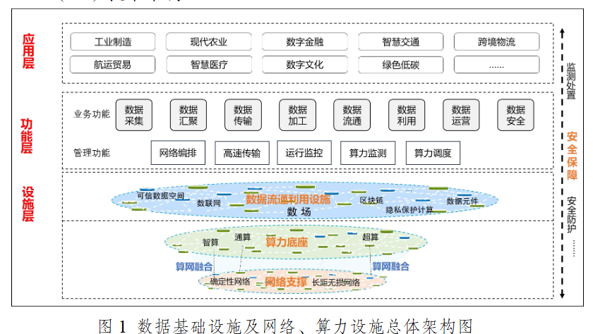
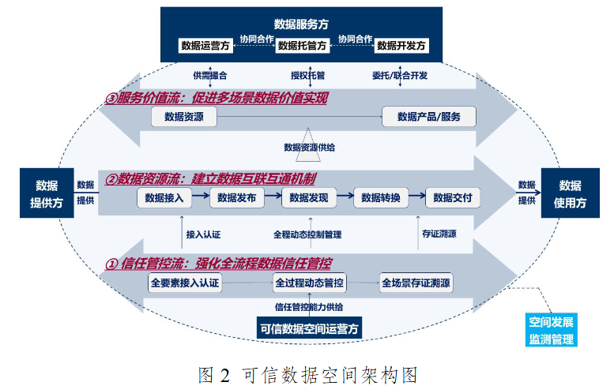
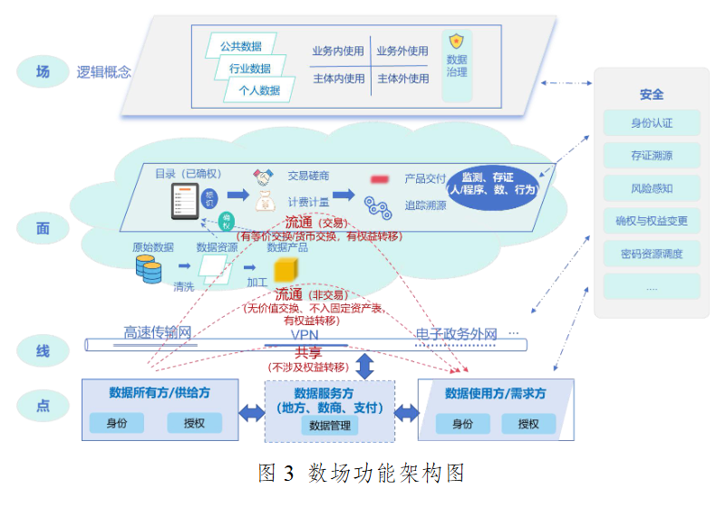
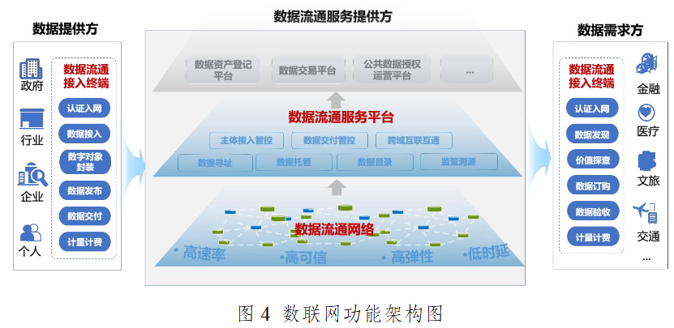

# 数据基础设施

## 概念

1. 国家数据基础设施是从数据要素价值释放的角度出发，面向社会提供**数据采集**、**汇聚**、**传输**、**加工**、**流通**、**利用**、**运营**、**安全服务**的一类新型基础设施，是集成硬件、软件、模型算法、标准规范、机制设计等在内的有机整体。
2. 国家数据基础设施在国家统筹下，由区域、行业、企业等各类数据基础设施共同构成。
3. 网络设施、算力设施与国家数据基础设施紧密相关，并通过迭代升级，不断支撑数据的流通和利用。

## 主要目标

- 国家数据基础设施是数据基础制度和先进技术落地的重要载体。
- 在数据流通利用方面，建成支持全国一体化数据市场、保障数据安全自由流动的流通利用设施，形成协同联动、规模流通、高效利用、规范可信的数据流通利用公共服务体系。
- 在算力底座方面，构建多元异构、高效调度、智能随需、绿色安全的高质量算力供给体系。
- 在网络支撑方面，构建泛在灵活接入、高速可靠传输、动态弹性调度的数据高速传输网络。
- 在安全方面，构建整体、动态、内生的安全防护体系。在应用方面，支持传统行业转型升级，赋能人工智能等新兴产业发展。
- 总体实现“汇通海量数据、惠及千行百业、慧见数字未来”的美好愿景。

## 总体功能

国家数据基础设施围绕打造可信流通、高效调度、高速互联、安全可靠的体系化能力，持续赋能各行业数据融合与智能化发展。

1. 数据可信流通：开放普惠的数据流通

- 国家数据基础设施需要打造低成本、高效率、可信赖的流通环境，便于人、物、平台、智能体等快速接入，在符合统一目录标识、统一身份登记、统一接口要求的基础上，实现数据在不同组织、行业之间安全有序流动，精准匹配数据供需关系。
- 面向电子商务、金融支付、跨境物流、航运贸易、绿色低碳、气象服务等典型场景，创新融合数据应用，同时符合相关法律法规、社会伦理、个人隐私保护等要求。

2. 高效算力供给：多元异构的算力协同
3. 数据高速传输：高效弹性的数据传输网络
4. 全程安全可靠：动态全面的安全保障
5. 全程安全可靠：动态全面的安全保障

## 总体架构

其中，数据流通利用设施是国家数据基础设施的重要组成部分，为跨层级、跨地域、跨系统、跨部门、跨业务数据流通利用提供安全可信环境，包括可信数据空间、数场、数据元件、数联网、区块链网络、隐私保护计算平台等技术设施。

## 重点方向

### （一）建设数据流通利用设施底座

1. 按照统一目录标识、统一身份登记、统一接口要求，建设数据流通利用设施底座。
2. 建立覆盖政府、行业、企业等主体及国家、省、市、县等层级的全国一体化的分布式数据目录
3. 形成全国数据“一本账”，支撑跨层级、跨地域、跨系统、跨部门、跨业务的数据有序流通和共享应用
4. 建立全国一体化的分布式数字身份体系，规范身份标识生成、身份注册和认证机制。
5. 建立统一的数据资产凭证、交易凭证结构、生成与验证机制，支持利用区块链、加密技术、智能合约等手段提高凭证的可溯性和信任性。
6. 构建标准化、规范化的交互接口，实现数据基础设施的互联互通。

### （二）建设数据高效供给体系

1. 研究制定高质量数据集建设相关标准，从数据生成、注释定义到数据管理的全过程，确保数据标注的准确性和数据模型的专业性。
2. 研究制定高质量数据集建设相关标准，从数据生成、注释定义到数据管理的全过程，确保数据标注的准确性和数据模型的专业性。制定高质量数据标注与交付规则，提高训练数据质量。
3. 支持农业、工业、交通、金融、自然资源、卫生健康、教育、科技、民航、气象等行业领域打造高质量数据集。
4. 因地制宜推进公共数据运营平台集约化、标准化建设，推进公共数据的规模化、常态化供给。
5. 推进数据资源管理服务平台互联互通，完善平台标准，促进平台间互操作，实现全国数据资源的跨领域、跨层级、跨区域流通利用。
6. 构建集成数据采集、存储、清洗、标注、管理、应用等功能的一体化数据基础通用工具平台，提升数据加工效率，保证数据质量。
7. **支持各地积极建设政务服务大模型，推动政务服务智能化。**

### （三）建设数据可信流通体系

建立高效便利可信的数据流通机制，促进数据大规模、低成本、安全自由流通。

1. **支持建设**企业可信数据空间、行业**可信数据空间**、城市可信数据空间，探索建设个人可信数据空间、跨境可信数据空间。
2. 支持基础好、有条件、意愿强的行业和城市，先行先试**数场建设**。
3. 鼓励行业、地方积极探索建设**区块链网络、隐私保护计算平台**等新技术设施。
4. 支持建设**数据流通交易公共服务平台**。
5. 支持探索建设数据跨境流动基础设施。
6. 建立数据流通准入标准规则，鼓励探索数据流通安全保障技术、标准、方案。
7. 支持因地制宜，探索数联网、数据元件等数据流通利用设施建设。

### （四）建设数据便捷交付体系

1. 加强数据交易场所体系设计，统筹数据交易场所优化布局。支持数据交易场所创新发展，鼓励各类数据进场交易。
2. 构建集约、高效的数据交付基础设施，为场内集中交易和场外分散交易提供低成本、高效率、可信赖的数据交付环境。
3. 促进各类数据交易所、交易平台互联互通。
4. 推动数据价值贡献度评估、数据集推荐匹配、数据产品差异性分析等技术创新，实现供需精准匹配和便捷交付。
5. 鼓励各地提升数据加工、测试、建模验证、安全实验等社会化服务能力，打造产学研用“一公里”工作圈。

### （五）建设行业数据应用体系

建设面向工业制造、现代农业、数字金融、智慧医疗、智慧交通、跨境物流、航运贸易、卫生健康、绿色低碳、气象服务、数字文化等重点行业领域的数据应用体系，发挥企业主体作用，促进行业数据应用创新。

## 安全防护

- 在国家数据基础设施安全保障层面，实现可信接入、安全互联、跨域管控和全栈防护等安全管理，建立网络安全风险和威胁的动态发现、实时告警、全面分析、协同处置、跨域追溯和态势掌控能力，提供应对芯片、软件、硬件、协议等内置后门、漏洞安全威胁的内生防护能力。加强对合作伙伴、运维人员、平台用户等数据安全内部风险的防范应对。加强对入侵渗透、拒绝服务、数据窃取、勒索投毒等外部威胁的应急响应。
- 在数据流通利用安全层面，综合利用隐私保护计算、区块链、数据使用控制等技术手段，保证数据的可信采集、加密传输、可靠存储、受控交换共享、销毁确认及存证溯源等，规避数据隐私泄露、违规滥用等风险。加强算法、模型、数据的安全审计，增强模型鲁棒性和安全性，保证高价值、高敏感数据“可用不可见”“可控可计量”“可溯可审计”，确保贯穿数据全生命周期各环节安全。

# 数据流通利用实践方案

## 1.可信数据空间

可信数据空间是基于共识规则，联接多方主体，实现数据资源共享共用的**一种数据流通利用设施，是数据要素价值共创的应用生态，是支撑构建全国一体化数据市场的重要载体。**

可信数据空间须具备数据可信管控、资源交互、价值共创三类核心能力。

## 2.数场

数场是依托开放性网络、算力和隐私保护计算、区块链等各类关联功能设施，面向数据要素提供线上线下资源登记、供需匹配、交易流通、开发利用、存证溯源等功能，支持多场景应用的一种综合性数据流通利用设施。数场以高效流通、价值释放、繁荣生态为目标，具备实现数据可见、可达、可用、可控、可追溯等能力，具有开放性、融合性、扩展性等特点。

数场从点、线、面、场、安全五个维度构建标准化技术框架。点是数据主体进入数场的接入点。线是数场内连接各主体、各平台的高速数据传输网，实现数场内各主体之间的互联互通。面是数场中数据主体、传输网络的集合，是实现数据大规模流通、高效安全利用的核心。由点到线、由线到面构成数场基础设施。场是基于数场基础设施构建的数据应用、场景化创新，以及相关能力、流程、规范的统称。安全是覆盖点、线、面、场的动态全流程保护措施。数场在技术架构上包括接入点、功能平台、管理平台、安全保障、网络传输等基础服务平台。

## 3.数联网

数联网由数据流通接入终端、数据流通网络、数据流通服务平台构成，提供一点接入、广泛连接、标准交付、安全可信、合规监管、开放兼容的数据流通服务。

## 4.数据元件

数据元件提供统一标准、自主可控、安全可靠、全程监管的数据存储和加工服务，支持采用标准化工序完成数据产品规模化加工、生产和再利用，适用于大规模数据加工和生产场景。数据元件作为连接数据供需两端的“中间态”，将原始数据与数据应用“解耦”，基于数据元件相关组件，实现从数据归集到数据元件加工交易全生命周期的数据要素开发和管控。

## 5.数据安全

技术数据安全技术为数据收集、存储、处理、传输、共享和销毁等全生命周期提供安全保障，包括数据备份与恢复、应用数据加密、数据泄露检测、流转监测、身份认证与访问控制、数据脱敏、数据水印、数据安全态势感知等。
