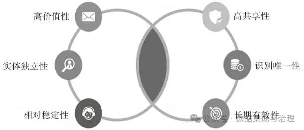
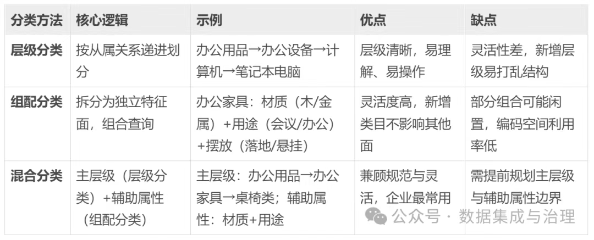

# 一、主数据和普通数据到底有啥区别？ 
主数据不是某一类特定数据，而是企业里最核心、最通用、最关键的数据集合，判断它就看这6个关键点，少一个都不算真正的主数据：

## 1、高价值
核心业务离不了它。客户的统一信用代码，签合同、收付款、合规审计都得用；产品的规格参数，从生产到销售再到售后，全流程都依赖，数据错了就会出乱子。
## 2、高共享
跨部门、跨系统共用。不是销售部门自己的客户台账，也不是生产部门独有的物料清单，而是财务、采购、库存等多个部门，ERP、CRM等多个系统都要调用的数据。
## 3、相对稳定
不会频繁变动。和订单、交易这类天天更新的数据不一样，主数据的核心属性（比如供应商名称、产品编码）可能半年甚至一年才调整一次，变动频率极低。
## 4、实体独立
不能拆分。主数据都是完整的业务对象，比如客户、产品、供应商，没法拆成更小的独立数据单元，是所有业务行为的基础。
## 5、识别唯一
一个数据一个标识。在整个企业范围内，同一个客户、同一个产品，只能有一个编码、一个标准名称，不能出现同名不同码或同码不同名。
## 6、长期有效
贯穿业务全生命周期。你看一个产品从上市到退市，它的主数据要一直有效；一个客户从合作开始到终止，相关核心数据要长期留存。

- 可以对照着看看，你企业里的客户、产品、供应商、组织架构数据，是不是符合这些特点？符合的话，就是核心主数据。

# 二、如何识别主数据？
## 1、特征对照法
就用上面说的6个关键点，逐一核对企业里的各类数据。举个例子：物料数据，是不是跨部门共享？是不是相对稳定？有没有唯一标识？6个点都满足，就可以纳入主数据范围；只要有一个点不满足，就不用归为主数据。
## 2、二维打分法
从业务影响程度和数据共享范围两个维度，给每个数据打1-3分（3分最高）。两个维度都得3分的，是核心主数据；一个3分一个2分的，是重要主数据；低于2分的，不用优先管理。
比如员工数据，业务影响3分（因为它关系到薪资、考勤、业务对接），共享范围3分（人事、财务、业务部门都要用），就是核心主数据。
## 3、谁建谁用表
画一张简单的表格，左边列数据类型，上面列系统或部门，标注谁创建这个数据（C）和谁使用这个数据（U）。如果一个数据有多个U，说明共享范围广，大概率是主数据。你看，“客户数据”是由销售部门创建，财务、售后、库存部门都使用，那肯定是主数据；而“销售的个人拜访笔记”，只有创建人自己用，就不是。

# 三、主数据该怎么分类？
很多企业整理完主数据，没过多久又乱了，问题出在分类上：要么没分类，要么分类标准混乱，导致查询难、维护难。其实主数据分类有明确逻辑，先搞懂为什么分，再掌握怎么分，就能长期保持清晰。常用的分类方法有3种，不过你可以重点掌握后两种：

## 1、层级分类
按层级递进分类，像产品-电子产品-手机-智能手机-5G智能手机这样。这个方法层级清晰，但是新增层级容易打乱原有结构。
## 2、组配分类
把数据的关键特征拆成多个独立的面，每个面再分几个类目，组合起来就是完整分类。比如给“办公家具”分类：面1是材质：木质、金属、塑料；面2是用途：会议用、办公用、储物用；面3是摆放方式：落地式、悬挂式、桌面式。
这种方法灵活，新增类目不影响其他面，还方便按组合查询，特别适合计算机系统处理。
## 3、混合分类法
以一种方法为主，另一种为辅。你可以用层级分类法定主层级：办公用品 - 办公家具 - 桌椅类，用组配分类法补充辅助属性：材质（木质 / 金属）、用途（办公用 / 会议用），兼顾清晰性和灵活性。
当我们确定了分类标准和规则后，接下来就要解决怎么让这些标准在各个系统里生效的问题。
比如，新定义的产品分类，如何自动同步到ERP、CRM和电商后台？以前靠人工导表，又慢又易错。
现在我通常会借助一些数据集成工具来固化流程。

# 四、花精力做主数据，到底值不值？
企业资源有限，先上系统还是先做主数据？我的答案永远是：先做主数据。主数据不是额外工作，而是所有数据工作的前提，它的价值体现在3个关键层面，每个都能帮企业避坑省钱：

## 第一，提升数据质量
这是最直接的价值。之前帮一家制造企业做诊断，他们的同一个供应商，在不同部门的系统里叫法都不一样，对账时要人工核对，每月花3天时间还容易出错。做主数据后，统一了供应商的编码和名称，数据准确率从原来的70%提升到99%，对账时间直接压缩到半天。

## 第二，消除数据孤岛，让系统顺畅对接
现在企业都有多个系统，要是没有统一的主数据，信息就无法在系统之间流通。比如销售系统的客户编码和财务系统不一样，订单数据就没法同步，财务没法及时开票。主数据相当于系统之间的通用语言，有了它，ERP、CRM、财务系统才能无缝对接，数据流转不用人工干预。

## 第三，不让数据误导管理层
管理层做决策，靠的是报表和分析，但如果数据定义不一致，分析结果就是错的。我见过有个企业之前产品分类混乱，有的按功能分，有的按材质分，统计核心产品销量时，结果差了20%，差点导致生产排程失误。
做主数据后，统一了分类标准，报表数据一次性准确，管理层不用再怀疑数据真实性，决策效率提升了不少。

