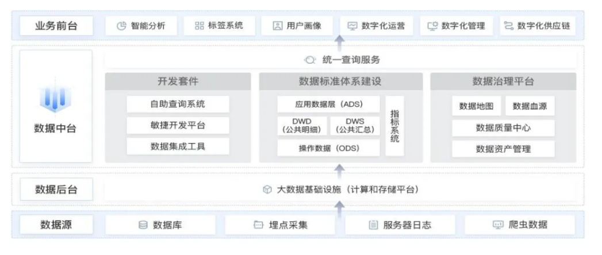
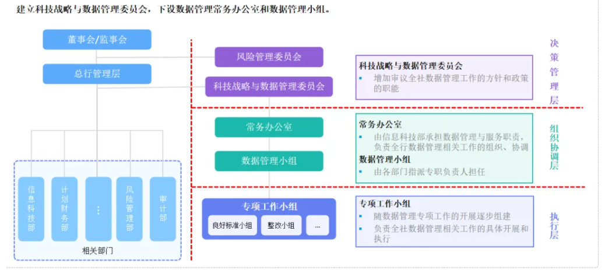
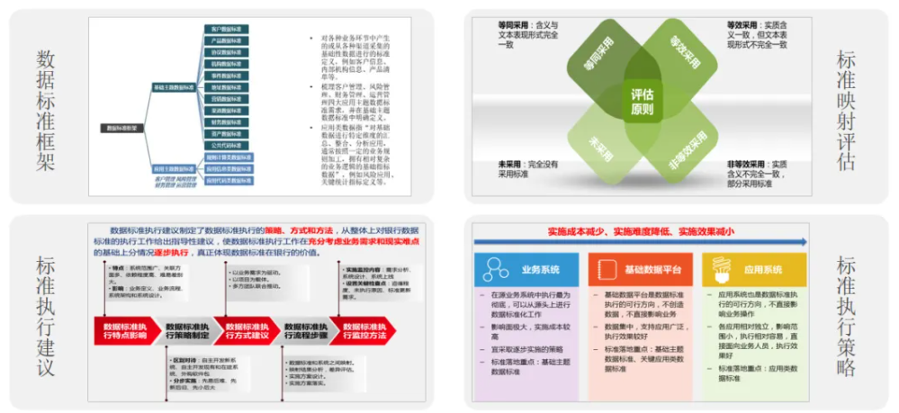
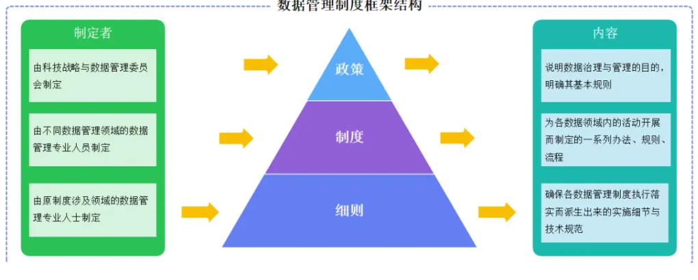

# 参考网址：https://mp.weixin.qq.com/s/rE6n-O-2T_-8IGEk9IyfDA
# 引言
在数字化转型浪潮中，“数据中台”曾被捧为万能解药。然而，无数企业投入千万级预算后却发现：数据依然散乱、口径不一、质量堪忧，业务部门依旧“不信数、不用数”。问题出在哪？答案直指核心——缺乏系统性、可落地的数据治理。

# 为什么数据中台必须以治理为先？
许多企业误以为“建了中台=有了数据能力”，实则大谬。数据中台若无治理支撑，不过是披着现代化外衣的数据沼泽（Data Swamp）。
- 同一指标在不同报表中数值相差30%；
- 用户画像标签更新延迟7天，营销活动失效；
- 数据血缘断裂，问题溯源需人工翻查10个系统；
- 合规审计时无法证明敏感数据处理合规。
**数据治理不是附加项，而是数据中台的“操作系统”。**
**没有它，再华丽的架构也只是空中楼阁**。

# 数据治理全流程：6步构建可信数据体系
## 步骤1：战略对齐与组织保障（最容易被忽视的起点）
**误区**：技术团队闭门造车，业务部门被动配合。
**正确做法**：
成立跨部门数据治理委员会（CDO牵头，IT+业务+风控+法务）；
明确治理目标与业务价值挂钩：如“提升会员复购率5%”而非“建1000个标签”；
制定《数据治理章程》，明确权责利（谁生产、谁负责、谁使用、谁审计）。

案例：该零售集团将“库存周转率”作为核心治理指标，由供应链总监直接负责，IT仅提供工具支持，确保治理动作与业务结果强绑定。

## 步骤2：元数据驱动的数据资产盘点
关键动作：
- 自动化采集全域元数据（结构、业务含义、技术属性）；
- 构建统一业务术语表（Business Glossary），例如：“活跃用户 = 近30天有购买行为”；
- 建立数据资产目录（Data Catalog），支持按主题域（客户、商品、交易）检索。

工具建议：Apache Atlas + 自研语义层，或商业产品如Alation、Collibra（国内可用阿里DataWorks、华为DataArts）。
**避坑**：避免“一次性盘点”。元数据需随系统迭代**持续更新**，否则迅速失效。
**数据资产目录**是企业数据**民主化的基石**，让数据从"技术人员的玩具"变成"业务人员的工具"。

## 步骤3：数据标准与模型分层治理
采用**三层模型架构**实现逻辑解耦：
|层级                 | 职责   |              治理重点|    
|-------              |--------|           --------|
ODS（操作数据层）       原始数据接入         保留源系统全量快照，不做清洗
CDM（公共维度模型层）    标准化整合         治理核心！ 统一口径、主数据、维度一致性
ADS（应用数据层）      面向场景             按需聚合，避免重复建设

**关键实践：**
- CDM层强制使用统一维度表（如客户维表包含唯一客户ID、等级、生命周期阶段）；
- 指标定义下沉至CDM，通过指标平台管理计算逻辑（如GMV = 支付成功订单金额 - 退款）。
- 优化点：引入**数据契约**（Data Contract） 机制——上游变更需通知下游，避免“悄悄改字段导致报表崩坏”。

**三层模型架构与传统Inmon/Kimball对比**
|维度	|传统分层	|ODS-CDM-ADS|	优势|
|-------|--------|--------|--------|
|灵活性	|范式建模严格|	兼顾范式与维度	|更适应变化|
|开发效率	|设计复杂	|职责清晰，并行开发	|交付更快|
|业务响应	|响应慢	|ADS层敏捷响应	|快速满足需求|
|治理成本|	后期治理难	|分层治理，重点明确	|治理更有效|

## 步骤4：数据质量闭环管控
**不要只做监控，要做干预！**
- **规则设计**
：覆盖完整性（非空率）、一致性（跨系统比对）、准确性（业务校验）、及时性（SLA）；
- **分级告警**
：P0级问题（如交易金额为负）自动阻断下游任务；
- **根因分析**
：结合血缘定位问题源头（是源系统BUG？还是ETL逻辑错误？）；
- **修复闭环**
：质量问题自动创建Jira工单，责任人48小时内处理。

## 步骤5：数据安全与合规落地
GDPR/《个人信息保护法》**不是选择题**！

- **敏感数据识别**
自动扫描身份证、手机号等字段，打标“PII”；
- **动态脱敏**
分析师查询时自动掩码，高管可申请临时明文权限；
- **访问审计**
记录谁在何时查了哪些数据，满足合规审计要求。
- **避坑**：
避免“一刀切加密”。应基于数据分级分类（公开/内部/机密）实施差异化策略。

## 步骤6：度量治理成效，持续运营
**用数据治理数据！**
建立治理健康度看板，监控核心指标：
- 数据标准覆盖率（CDM层达标率 > 95%）
- 关键指标一致性（同一指标跨报表差异 < 1%）
- 问题平均修复时长（< 24小时）
- 业务部门数据使用率（月活用户占比）

优化：将治理指标纳入部门KPI，例如“数据Owner需保证所辖表质量分 ≥ 90”。

# 三、血泪教训：5大高频踩坑点
**“重技术轻流程”**
→ 买了最贵的数据目录工具，但无人维护业务术语，沦为摆设。

**“治理与业务两张皮”**
→ IT团队定义“高价值客户”为消费TOP10%，业务却认为应是复购3次以上用户。

**“追求大而全，忽视速赢”**
→ 试图一次性治理全量数据，半年无产出，业务失去信心。
对策：聚焦1-2个高价值场景（如精准营销），3个月内见效。

**“血缘不准等于没有”**
→ 手工维护血缘，系统一升级就断裂。
对策：采用解析SQL/Spark日志的自动化血缘工具。

**“忽视数据文化”**
→ 业务人员仍习惯导出Excel手工处理。
对策：开展“数据诊所”，手把手教业务用自助分析工具。

# 结语：治理不是成本，而是信任的基石
数据中台的终极目标不是技术先进，而是让数据成为组织的通用语言。而数据治理，正是翻译这门语言的词典与语法。

真正的数据驱动，始于治理，成于信任。

当业务人员敢说“这个数我认”，当决策者敢用数据拍板，当合规审计不再提心吊胆——那一刻，你才真正拥有了数据中台。

