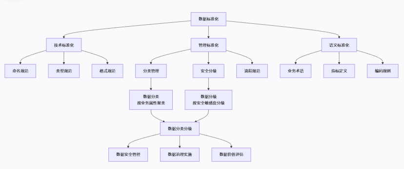
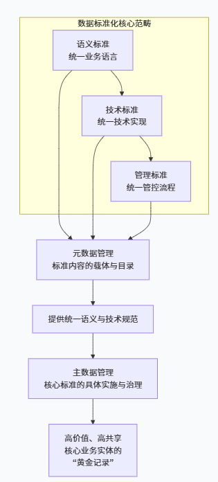

# 数据标准化不是“做不做”的问题，而是“早做还是晚做”、“主动做还是被迫做”的问题。

# 一、概念和体系

## 概念逻辑图

## 数据标准化的三层体系：
数据标准化
├── 技术标准化（字段名、类型、格式）
├── 管理标准化（分类、分级、流程）← 数据的分类分级在这里
└── 语义标准化（业务术语、指标定义）

# 二、国家规范与标准
## 1.基础系列：
- **GB/T 36073-2018**《数据管理能力成熟度评估模型》（DCMM）
  - 数据标准化的国家级方法论框架
  - 8个核心能力域，第3个就是“数据标准管理”
  - 提供了从1级到5级的成熟度路径

- **GB/T 38667-2020**《信息技术 数据资产 管理要求》
  - 明确数据资产化管理流程
  - 包含数据分类、命名、质量等标准要求

- **GB/T 37988-2019**《信息安全技术 数据安全能力成熟度模型》（DSMM）
  - 从安全角度要求数据分级分类

##  2.行业特定标准
### 金融行业：
- **JR/T 0171-2020**《个人金融信息保护技术规范》
- **JR/T 0197-2020**《金融数据安全 数据安全分级指南》

### 医疗健康：
- **WS/T 305-2023**《卫生健康信息数据元标准化规则》
- 疾病分类与代码（ICD-10国家标准版）

### 能源矿业：
- **GB/T ×××× 矿产资源数据元标准**（系列标准）
- **AQ/T ×××× 矿山安全生产数据规范**

### 政务数据：
- **GB/T 38664-2020**《信息技术 大数据 政务数据开放共享》
- GB/T 38667-2020《信息技术 数据资产 管理要求》
明确将“数据分类分级”作为数据标准化的核心要求
- 各地区政务数据资源目录规范

## 3. 最新法律要求
**《数据安全法》**第二十一条：明确要求建立数据分类分级保护制度

**《个人信息保护法》**第五十一条：要求个人信息处理者制定内部管理制度和操作规程

**各行业监管办法**：如银保监会、证监会的数据治理指引

## 4. DCMM 相关规范要求
DCMM能力等级：
二级（受管理级） → 要求开始数据分类
三级（稳健级）   → 要求建立数据分级
四级（量化级）   → 要求分类分级与业务流程融合
五级（优化级）   → 持续优化分类分级体系

# 三、 数据标准化的实际工作流
第1步：业务术语标准化（定义“客户”是什么意思）
第2步：数据分类（“客户信息”属于哪个主题域）
第3步：数据分级（客户手机号是敏感级）
第4步：技术标准化（手机号字段类型为VARCHAR(11)）
第5步：安全控制（敏感数据必须加密存储）

# 四、数据标准工作，核心内容理解
数据标准化不是一个单一工作，而是一个体系化工程。下图清晰地展示了它的核心范畴及其与元数据、主数据管理的交织关系

## 第一部分：数据标准的具体工作范畴（三层结构）
### 第一层：语义标准（解决“是什么”的问题）
这是最基础、最核心的一层，目标是统一业务语言。

#### 业务术语/数据字典
定义：对企业核心业务概念进行无歧义的定义。
示例：
术语：“客户”
定义：“与企业签订购买合同或发生实际交易的自然人、法人或组织。不包括潜在客户和代理商。”
别名：顾客、客户单位、购买方

特性：数据字典必须在线、版本化、有责任人。不要使用excel表来管理数据字典，否则最终一定会变成**坟场**。
数据字典的成功标志：口径不打架、起义变少、该了能追溯

#### 数据分类及编码
定义：根据数据的业务属性、内容或用途进行归类。
示例（煤矿行业）：
主题域：安全
业务对象：瓦斯监测数据
数据实体：传感器实时读数

#### 数据模型标准
定义：规定核心业务实体（如客户、设备、物料）应包含哪些属性及关系。
产出物：企业级概念模型、逻辑模型。

### 第二层：技术标准（解决“怎么存/传”的问题）
这是将语义标准落地的技术保障。

#### 命名规范

- 数据库对象：表名、字段名、索引名的命名规则（如：表名_业务含义_后缀）。

- 文件/接口：数据文件、API接口的命名规则。

#### 设计与存储规范

- 数据类型映射：业务中的“日期”在数据库中统一用 DATE 还是 DATETIME？

- 编码规则：制定各类编码的生成规则（如员工工号：部门代码(2位) + 入职年份(2位) + 序列号(4位)）。

- 格式规范：日期统一为 YYYY-MM-DD，金额单位统一为“元（人民币）”。

#### 集成与交换规范

- 接口规范：API的协议、报文结构、错误码。

- 数据交换格式：采用JSON、XML还是特定二进制格式。

### 第三层：管理标准（解决“怎么管/用”的问题）
这是确保标准被遵守的流程和规则。

#### 数据分级

定义：根据数据敏感度和泄露影响进行安全等级划分，是数据安全管控的基石。

示例（通常分4-5级）：
- 公开级：企业宣传资料。
- 内部级：一般业务数据。
- 敏感级：重要的业务经营数据。
- 机密级：核心技术数据、未公开的重大决策。

#### 数据质量规则
定义：衡量数据好坏的标准。

示例规则：
- 完整性：客户身份证号字段不能为空。
- 有效性：身份证号需符合校验规则。
- 一致性：同一客户在销售和财务系统的名称必须一致。

#### 生命周期管理规则
- 定义：数据从创建、使用、归档到销毁各阶段的管理要求。
- 示例：交易流水数据在线保存2年，2年后自动归档至低成本存储，7年后自动销毁。

## 第二部分：与元数据、主数据管理的核心逻辑关系
### 1. 元数据管理：是“标准的载体”和“治理的抓手”
#### 核心联系：
- **所有的数据标准，其本身和实例化后的结果，都是元数据。**
- 元数据是标准的“说明书”和“目录”：
  你定义的“业务术语”、“编码规则”、“质量规则”等，被记录在业务元数据和技术元数据中。
  数据资产目录（元数据管理的主要应用）其实就是一份 “企业数据标准黄页” ，告诉你有什么数据（资产）、按什么标准定义的（业务语义）、存储在哪里（技术信息）。

- 举例：
你制定了一个标准：“客户姓名 字段，类型为 VARCHAR(100)，属于个人敏感信息（安全3级）”。
元数据管理系统会采集并记录：表A.字段customer_name 符合这个标准，而 表B.字段name 也映射到这个标准。
作用：通过元数据，你能快速发现全公司有多少个地方存储了“客户姓名”，它们是否符合你的标准，从而进行治理。

**一句话：没有元数据管理，数据标准就是一本被锁在抽屉里的字典，无法被查询、应用和审计。**

### 2. 主数据管理：是“核心标准”的严格实施和持续治理
#### 核心联系：
主数据是企业内需要跨部门、跨系统共享的核心业务实体数据，是数据标准化要求最高、最严格的应用领域。

- 主数据是标准的“第一批示范田”和“高价值资产”：
数据标准通常会先在主数据上强制推行，因为其价值最高、影响最广。
例如，“客户”、“供应商”、“物料”、“设备”等主数据，必须首先完成统一的编码、属性、质量标准定义。

- MDM与标准化的协作流程：
标准制定：数据治理委员会制定《客户主数据标准》，定义客户必须有18位统一社会信用代码。
MDM平台实施：在主数据管理平台中，配置客户数据的数据模型、校验规则、清洗规则、分发流程。
元数据关联：元数据目录中注册这个“客户”主数据实体，并链接到其标准定义和MDM管理流程。
运营治理：当某个业务系统新建一个客户时，MDM平台会强制校验其信用代码格式（执行标准），并将清洗后的“黄金记录”分发给其他系统。

**一句话：主数据管理是在最关键的数据上，以最高规格执行数据标准化，并通过技术平台（MDM）确保其一致性和质量。**

## 第三部分：三者协同工作的全景图（以“设备”为例）
假设一个矿业集团要治理“采矿设备”数据：

### 数据标准工作（定规矩）：
- 语义：定义什么是“采矿设备”（与办公设备区别），制定设备分类（采掘、运输、通风...）。
- 技术：制定设备编码规则 MK-SB-类型(2)-矿区(3)-序列号(5)，规定“采购日期”字段格式。
- 管理：规定设备图纸为“机密级”，运行数据为“敏感级”。

### 元数据管理（建目录、贴标签）：
- 自动扫描发现：ERP里有 设备表，MES（生产系统）里有 装备表，物联网平台有 device_info。
- 在数据资产目录中，将这些物理资产关联到“采矿设备”这个业务概念上。
- 为这些表打上“设备主数据”、“安全等级：敏感”等标签。

### 主数据管理（管核心、保一致）：
- 确定“设备”是主数据，因为采购、资产、生产、维修都要用它。
- 建立MDM平台，定义唯一的“设备黄金记录”模型（包含编码、名称、型号、所属矿区等标准属性）。
- 从各个源系统抽取设备数据，在MDM中进行清洗、匹配、合并，生成权威版本，再分发回各个系统使用。

### 最终效果：
- 业务人员在数据资产目录里搜“设备”，能立刻找到所有相关信息，并且知道哪个是最权威的（来自MDM）。
- 开发人员新建一个设备相关功能时，能查到标准编码规则和API，直接复用。
- 安全人员能基于“设备图纸-机密级”的标准，自动对存储该数据的系统进行高级别审计。
- 数据分析师做跨矿区设备效率分析时，数据口径一致，结果可信。

# 四、企业实践中的常见误区
## 误区1：认为“分类分级=标准化全部”
错误：做了分类分级就觉得标准化完成了
正确：分类分级是基础，还需要：
      - 命名标准化（字段名、表名）
      - 格式标准化（日期格式、金额单位）
      - 代码标准化（性别用1/2而不是M/F）

## 误区2：技术部门独立完成
错误：IT部门自己制定分类分级标准
问题：业务部门不理解、不执行
正确：业务部门主导分类，安全部门主导分级，
      IT部门提供技术支持

# 五、成熟实施路径（四阶段模型）
第一阶段：启动准备（1-3个月）
  ├── 1. 成立数据治理委员会
  ├── 2. 现状评估（差距分析）
  ├── 3. 制定数据战略和路线图
  └── 4. 选择试点领域（高价值、高痛点）

第二阶段：标准建立（3-6个月）
  ├── 1. 制定企业数据模型（EDM）
  ├── 2. 制定数据标准（分类、命名、质量）
  ├── 3. 制定数据治理流程
  └── 4. 建立数据资产目录（最小可行版）

第三阶段：试点实施（6-12个月）
  ├── 1. 在试点领域落地标准
  ├── 2. 建立数据质量监控
  ├── 3. 培训与推广
  └── 4. 度量成效并优化

第四阶段：全面推广（12-36个月）
  ├── 1. 扩展到其他业务领域
  ├── 2. 与业务流程深度融合
  ├── 3. 建立持续改进机制
  └── 4. 实现数据驱动文化

# 六、如何利用数据中台，实现半路开始数据标准化
第一步：建设中台的数据标准层
  ├── 1. 建立企业数据模型（EDM）
  ├── 2. 制定数据标准规范
  ├── 3. 建立源系统-标准映射表
  └── 4. 开发数据标准稽核工具

第二步：数据接入与标准化
  ├── 1. 从各系统抽取数据（全量+增量）
  ├── 2. 在数据中台进行标准化转换：
  │     A系统.客户名称 → 标准.客户全名
  │     B系统.CUST_NAME → 标准.客户全名
  │     C系统.client → 标准.客户全名
  ├── 3. 数据质量清洗（去重、补全、纠错）
  └── 4. 生成标准化的数据资产

第三步：提供标准化服务
  ├── 1. 提供标准API供下游系统调用
  ├── 2. 建立数据资产目录
  ├── 3. 实现数据血缘追溯
  └── 4. 监控数据质量

第四步：渐进式源头改造
  ├── 1. 新系统开发：强制使用中台标准数据
  ├── 2. 老系统改造：在系统升级时对齐标准
  ├── 3. 建立激励机制：使用标准数据有奖励
  └── 4. 最终目标：源系统直接产生标准数据

