https://mp.weixin.qq.com/s/KnNjKJU5-jmmr_fF7KHyrQ
# 三问
## 你知道公司里最敏感的文件在哪里吗？
比如研发图纸？核心合同？投标方案？财务预测？
答案普遍是：**不知道**。
它们分散在网盘、共享盘、邮箱、IM、个人电脑……甚至可能被同步到私人云盘。

## 你知道这些文件现在被谁访问过、拷贝过、外发过吗？
答案：**不知道**。
绝大多数企业连"谁看过这份合同"这个问题都回答不了，更别提追溯完整的文件流转链路。

## 你知道你的企业级大模型"喂"的是什么数据吗？
这在AI时代更要命。
你无法把"绝密合同"和"公开宣传稿"混在一起投喂；无法把"源代码"和"用户指南"放在一个池子里；无法让模型自动"理解隐私边界"。
没有分类分级，就没有企业级AI。
喂给模型的，是知识，还是炸弹？

**如果这三个问题你一个都答不上来，那么恭喜你——你的企业大概率正在泄露。**
**AI时代的第一原则很简单**：如果你不知道你喂给AI的是什么，那你一定在泄露。

# 什么是非结构化数据治理
## 从一个定义开始
- 在AI浪潮席卷全球的今天，**非结构化数据治理**已成为驱动**企业数字化安全**与**AI落地**的**核心命题**。
- 是指对企业内所有**非结构化数据资产**（**文档**、**图片**、**音视频**、**代码**、**邮件**等）进行系统性管理的能力体系，其目标是确保这些数据资产在全生命周期内**可被发现**、**可被理解**、**可被裁决**、**可被执行**。
- 三个基本维度：
1. **对象（Object）**：治理的主体是什么？文档、PDF、图纸、代码、音视频、邮件附件……所有无法用关系型数据库字段直接描述的数据形态。
2. **语义（Semantics）**：治理需要回答什么问题？这份文件是什么？多敏感？属于谁？归哪个业务域？
3. **动作（Action）**：治理如何落地？通过权限控制、加密、DLP、归档、水印、审计等具体措施执行治理策略。
真正的非结构化数据治理，是**对象 + 语义 + 动作**的**闭环**。

- **补充知识**：DLP
**数据泄漏防护**是一组技术的集合组成的解决方案，其核心是能识别出数据中的内容并为之分类。
这些数据可以电子邮件、文件、数据包、应用程序或者数据存储等形式存在。
不论数据状态是仅被存储中，或者正在被使用的，亦或者在网络中传输，都能被检测。
DLP还应支持根据既定的策略对敏感信息的检测和使用情况提供日志、标记、加密、权限控制和阻断等操作。

##  它不是什么
-  **明确区分几个容易混淆的概念**
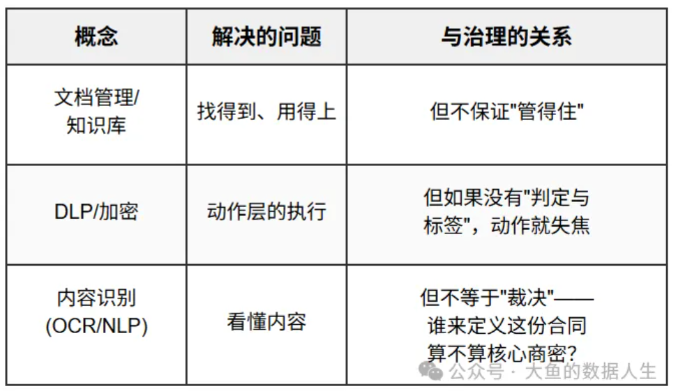
-  **认知决策层**
如果说OCR/NLP是"眼睛"，DLP/加密是"手脚"，那么认知决策层就是"大脑"。它负责读取特征、按业务规则判断、权威地裁决"这份文件是什么、多重要、属于谁"。
**90%的企业缺的正是这一层——没有它，AI做得再好也只是"看见但不会判"。**

## 一个类比：文件的"身份证系统"
我们可以用一个类比来**理解完整的非结构化数据治理体系**：
想象每一份文件都是一个"公民"，那么：
- **可见性层**：相当于"人口普查"——知道家里有多少人、在哪里
- **理解层**：相当于"身份识别"——知道每个人的特征
- **决策层**：相当于"户籍管理"——登记身份、确认归属、分配权限
- **执行层**：相当于"边检系统"——基于身份执行通行/拦截规则
没有户籍系统，边检就是一团乱麻；没有认知决策层，DLP就是盲人摸象。

# 为什么从可选变成必选
非结构化数据治理之所以从"有空再做"变成"必须现在做"，源于三条结构性的变化：
##  驱动力1：AI正在把企业知识资产"整体吞进去"
知识库、RAG、智能体、Copilot化——--AI大模型需要"吃"企业内部数据才能产生价值。

问题是：**你没有分类分级，AI就没有边界意识**。

绝密研发方案和公开宣传册，在向量数据库里长得一模一样。
当用户问"我们的核心技术是什么"，模型不知道哪些能说、哪些不能说。

## 驱动力2：监管从"软要求"变"硬红线"
过去的数据安全合规更像是"年检"——做做样子、应付检查。

现在的监管态势是：可审计、可追责、有处罚。

《数据安全法》《个人信息保护法》《网络安全法》三法叠加，加上行业监管趋严，"等出事再说"的心态不再可行。

## 驱动力3：工作方式发生结构性变化
远程办公、多端协同、云盘同步、IM传输——文件的复制/外发/协作链路比十年前长了十倍，边界比十年前模糊了十倍。

以前文件在内网服务器上"躺着"，现在文件在"飞"——从创建的那一刻起就在流动。

## 一个判断
非结构化数据治理，已经从合规项目升级为"企业认知基础设施"。

没有它，AI战略无从谈起。

没有它，合规审计必然翻车。

没有它，数据泄露只是时间问题。

# 行业真正的难点在哪里
行业最难的不是OCR/DLP，而是"权力问题"
## 技术不是瓶颈
很多公司谈起非结构化治理就想到：OCR、NLP、DLP、权限、加密……技术一大堆。

但残酷的真话是：

**非结构化数据治理的本质，不是技术问题，而是权力问题。**

## 场景1：业务不愿承认自己的文件是"敏感"
**研发说**："我们这份图纸其实没那么敏感。"
**法务说**："合同也没必要分级，上千份太麻烦。"

为什么？因为承认敏感，就意味着：

**权限要收紧**
**自己的工作要被更多约束**
**审计会找上门**
**谁愿意主动跳进这个麻烦里？**

这不是认知问题，是利益问题。

## 场景2：IT想做，但业务不配合
- 没有业务定义规则，AI再智能也无法自动判断：
- 这份合同是否算"核心商密"？这个图纸是否属于"关键技术"？
- 业务一句话："我不知道，你们技术自己搞。"
- 项目瞬间陷入僵局。
- 技术能看见内容，但只有业务能定义意义。

## 场景3：对准确率的荒诞要求
- 企业经常提出一个荒诞要求："AI识别分类要达到100%才允许上线。"
- 我只能说：那你永远也别做非结构化治理了。
- 世界上没有任何AI系统能做到100%准确——连人类专家都做不到。

## 正确的原则
- 机器自动处理80% + 人工审核20% = 100%治理闭环

- 不是追求机器完美，而是设计机器+人的协作流程。

- 机器负责"大规模初筛+标记置信度"，人负责"高风险抽检+边界案例裁决"。

这才是可持续的治理模式。

# 非结构化治理的终局应该长什么样
## 终局的定义
很多企业把"贴完标签"当终点，把"建好知识库"当成功。

这是错误的。

非结构化数据治理的终局，不是贴标签，不是建目录，而是——

让文件从出现的那一刻起，就自动进入它应有的"命运"。

什么叫"命运"？

一份绝密合同，上传的瞬间就被识别、被加密、被限制到核心人员
一份普通会议纪要，该共享就共享、该过期就过期
一份代码文件，能进内部Git但不能进公网、不能被截图
文件的命运由它的属性决定，而不是由人的记忆决定。

## 三个强调
第一，不是贴标签给人看，是标签触发动作。

标签本身没有价值，标签驱动的自动化执行才有价值。

第二，不是一次性清点，是持续运营。

文件每天都在产生、流转、变更、过期。治理是一个运营系统，不是一个项目。

第三，不是"查到了算成功"，而是"违规路径被系统性切断"。

治理的目标不是"事后追溯"，而是"事前拦截"。

# 又该如何从0到1落地--一套可落地的极简架构——四层能力模型
## 5.1 架构概述
你不需要几十个组件、几百个功能。

你需要的是一套极简但可持续的能力体系。

整个企业级非结构化治理，只依赖四层能力：

## 第1层：数据可见性层（回答"家里有什么"）
- 核心问题：数据在哪里？文件多大？谁创建？谁访问？
- 交付物：
资产扫描与发现
存储系统连接器
基础元数据采集（路径、大小、创建者、访问记录）
风险可视化热力图
一句话：没有可见性，就谈不上治理。

## 第2层：内容理解层（让机器"看懂"内容）
- 核心问题：文件里说了什么？
- 交付物：
文档解析引擎（Office/PDF/CAD/邮件）
OCR/ASR服务
NLP特征抽取（文本类型、实体、关键词、印章检测）
结构化特征输出
这是AI真正发挥作用的地方。
- 注意：这一层的目标不是"精准"，而是"尽最大可能把内容变成结构化信号"。

## 第3层：认知决策层（真正的"大脑"）
- 核心问题：这份文件是什么、多重要、属于谁？
- 交付物：
业务策略库（法务/研发/HR定义分类分级规则）
分类分级决策引擎
统一元数据目录
责任主体裁决
- 这是90%企业缺失的能力。
- 它的功能很简单：读取特征，按业务规则判断。
即：权威地判断文件是什么、多重要、属于谁。
- **如果企业没有这一层，那你的AI做得再好也是瞎子**。

## 第4层：治理执行层（把标签变成动作）
- 核心问题：有了标签，要做什么？
- 交付物：
IAM权限收敛
透明加密
DLP防泄漏
自动归档/保留/销毁
企业搜索/知识库/行业模型集成
- **没有第四层，前三层都只是"读数据"，毫无价值可言**。

## 四层能力模型图
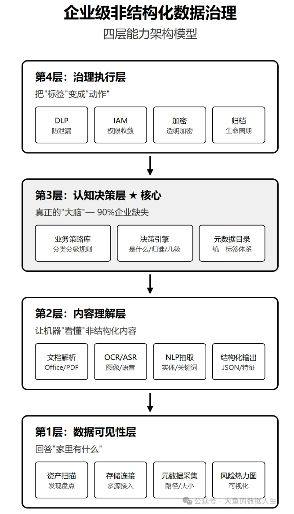

### 最小可用"文件数据模型"
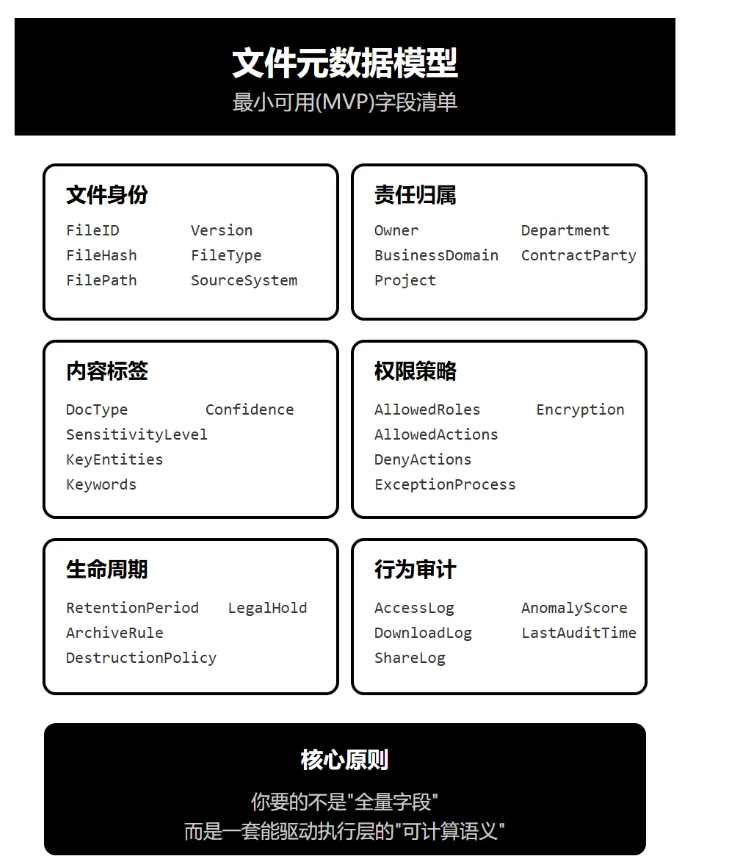
### 示例：
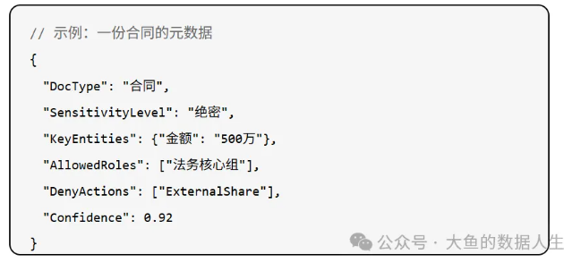

## 为什么需要数据模型
能力架构解决的是"系统怎么建"，数据模型解决的是"信息怎么存"。

没有统一的文件数据模型，各系统各说各话，治理链路无法打通。

## 文件元数据MVP清单
以下是一个"最小可用"的文件数据模型，你可以直接拿去做字段设计：
### 一、文件身份（File Identity）
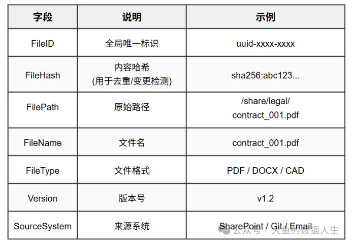

### 二、责任与归属（Ownership）
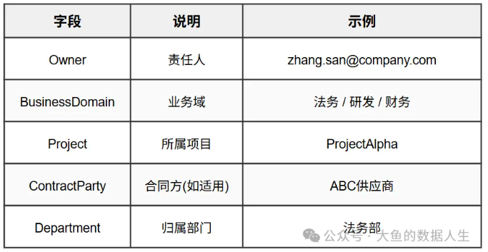

### 三、内容标签（Content Tags）
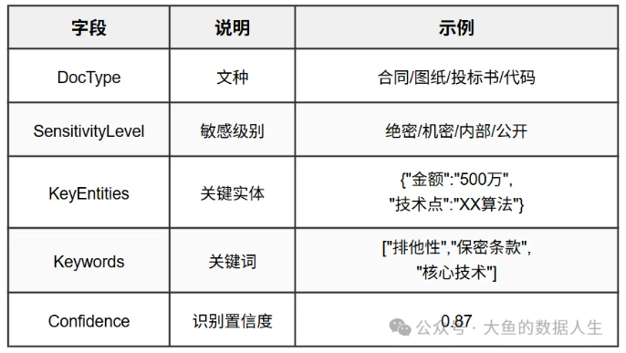

### 四、权限策略（Access Policy）
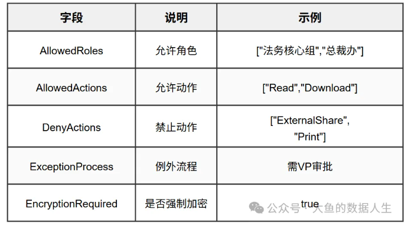

### 五、生命周期（Lifecycle）
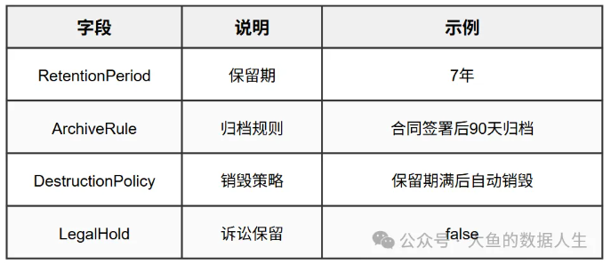

### 六、行为审计（Audit Trail）
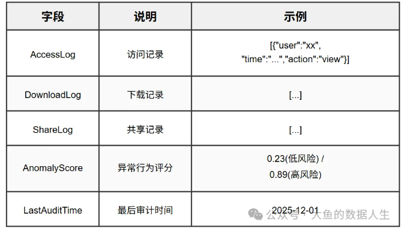

## 核心原则
你要的不是"全量字段"，而是一套能驱动执行层的"可计算语义"。

**什么叫"可计算语义"？**
- 不是人读的备注，而是机器能解析的结构化字段
- 不是静态的档案信息，而是能触发策略引擎的输入
- 不是"可能有用"的冗余字段，而是"能驱动决策"的最小必要集

# 从0到1的实施路线
##  一条正确的路线
- 不要从全公司开始。那注定无解。
- 正确路线只有一条：**从最痛且最能出事的地方开始**，换取组织授权。
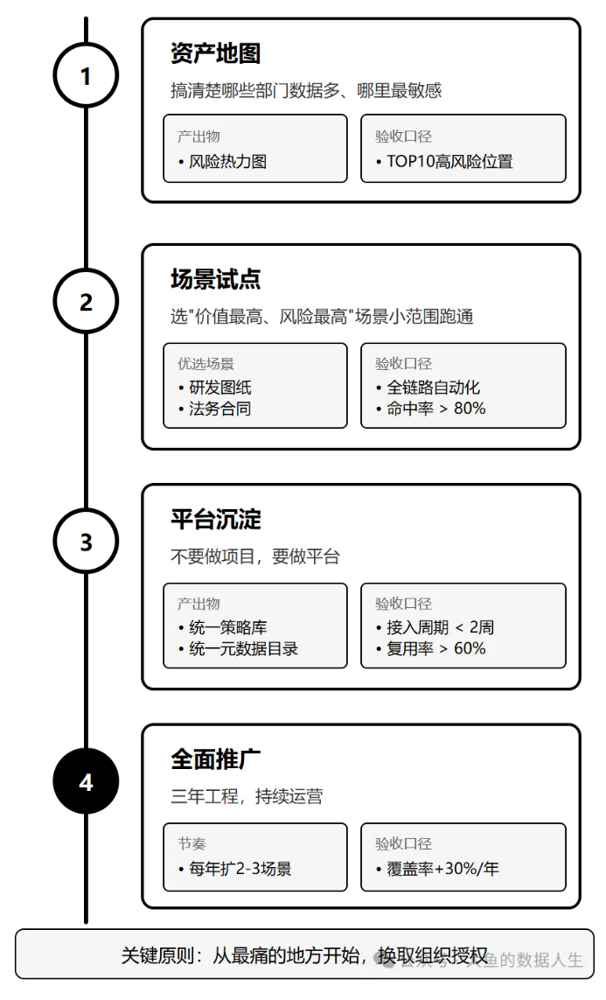

## 四步实施法
### Step 1：先做一张"非结构化数据资产地图"
目标：搞清楚哪些部门数据多、哪里最敏感。

产出物：

热力图 = 部门 × 存储 × 敏感度猜测
高风险区域清单
验收口径：

覆盖主要存储系统
识别TOP10高风险存储位置
这一步往往揭示惊悚事实：大部分企业90%的绝密文件，都在"公共共享盘"下面。

### Step 2：从一个"价值最高、风险最高"的场景做试点
目标：小范围跑通完整链路。

优选场景：

研发设计图纸
招投标文件
法务合同
产出物：

闭环跑通的端到端链路
单场景策略库
试点报告
验收口径：

解析 → 识别 → 决策 → 执行，全链路自动化
识别命中率 > 80%
关键路径拦截有效
这是你积累"组织共识"的地方。

### Step 3：将能力沉淀成平台
目标：不要做项目，要做平台。

产出物：

统一策略库
统一标签体系
统一元数据目录
统一审计面板
验收口径：

新场景接入周期 < 2周
策略复用率 > 60%
你才能撑得住全公司的规模。

### Step 4：全面推广（按年度推进）
目标：形成运营机制。

节奏：

不是"上线一次"，而是三年工程，持续运营
每年扩2-3个场景
产出物：

年度治理计划
运营报表
持续优化机制
验收口径：

年度覆盖率提升 > 30%
异常访问发现时延 < 24h

# 五类高价值场景库
8.1 场景选择原则
不是所有场景都值得优先做。

优先级矩阵：价值（泄露影响）× 风险（泄露概率）× 可行性（数据可得性）

## 8.2 五类高价值场景
### 场景1：法务合同
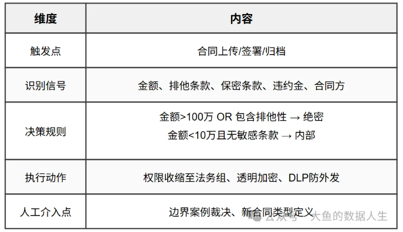
### 场景2：研发图纸/工艺文件
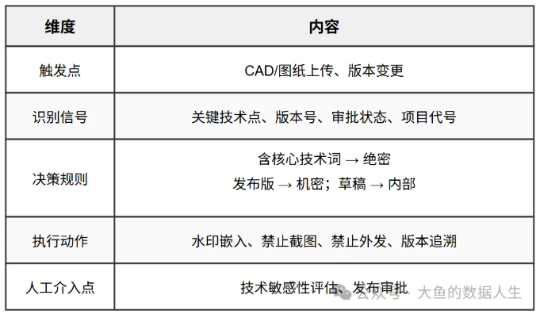
### 场景3：招投标文件
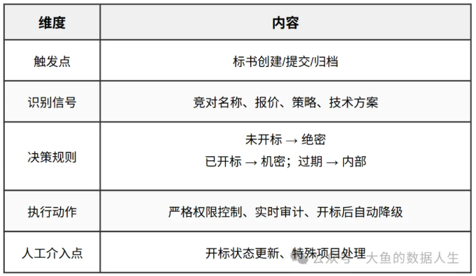
### 场景4：代码与脚本
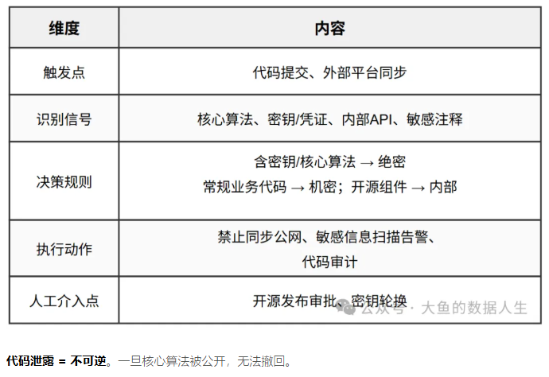
代码泄露 = 不可逆。一旦核心算法被公开，无法撤回。
### 场景5：音视频/会议纪要
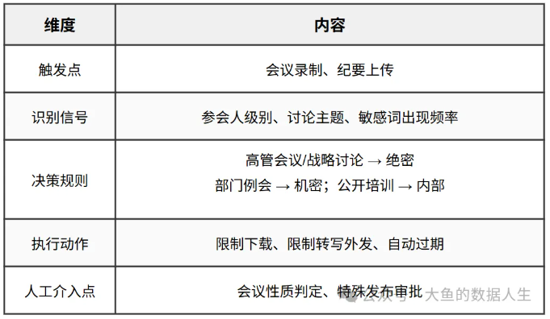
"口头绝密"最难管——会议上说的话，录下来就成了文件。

# 和AI的关系——RAG/训练/智能体接入时，治理如何变成"护栏"
## AI时代的治理新命题
当企业开始构建AI应用（知识库、RAG、智能体、Copilot）时，非结构化数据治理的角色发生了根本性变化：
从"合规项目"变成"AI护栏"。

## 三件必须做对的事
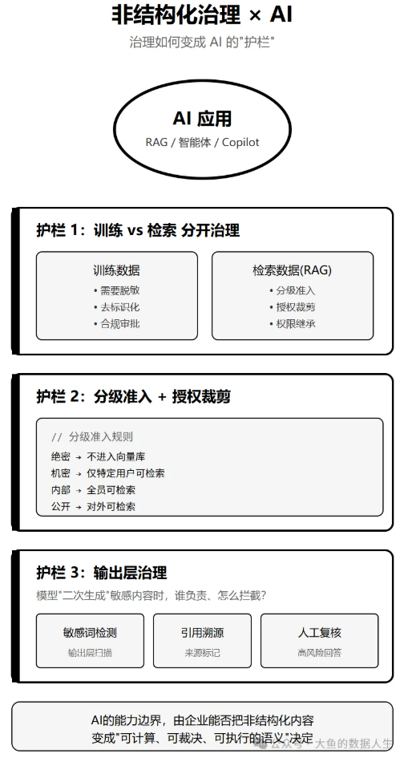

### 第一件事：训练数据与检索数据必须分开治理
数据用途                 治理要求
训练数据	      需要脱敏、去标识化、合规审批
检索数据（RAG）	    需要分级准入、授权裁剪

不是所有文件都能进训练集，不是所有文件都能进向量库。

### 第二件事：RAG/智能体接入前必须做"分级准入"和"授权裁剪"
**分级准入**：根据文件敏感级别决定能否被索引。
绝密→不进入向量库
机密→仅特定用户可检索
内部→全员可检索
公开→对外可检索

**授权裁剪**：根据查询者身份动态过滤检索结果。
if  user.role notin doc.allowed_roles:
    filter_out(doc)
否则就是"越权检索"——用户能通过AI问出他本来没权限看的内容。

### 第三件事：输出也要治理
模型把敏感内容"二次生成"时，谁负责、怎么拦截？

**典型风险：**
用户问"我们的核心技术是什么"，模型把绝密内容输出了
用户问"张三的薪资是多少"，模型把个人隐私泄露了

**解决方案：**
输出层敏感词检测
引用溯源标记
高风险回答人工复核

## 核心结论
- AI的能力边界，最终由企业能否把非结构化内容变成"可计算、可裁决、可执行的语义"决定。
- 没有治理，AI就是一个"不知轻重"的黑盒。
- 有了治理，AI才能成为"有边界意识"的助手。

# 一页清单——组织分工、制度产物、验收指标（建议收藏）
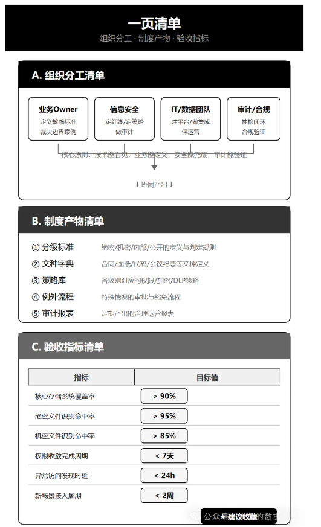
## 组织分工清单
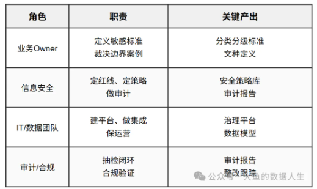
核心原则：技术能看见，业务能定义，安全能兜底，审计能验证。
## 制度产物清单
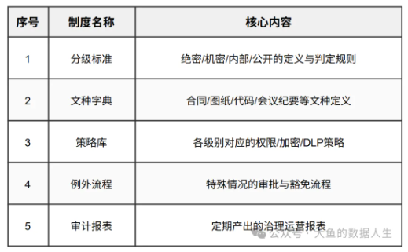
## 验收指标清单
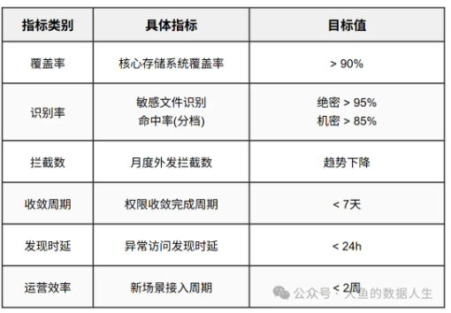

