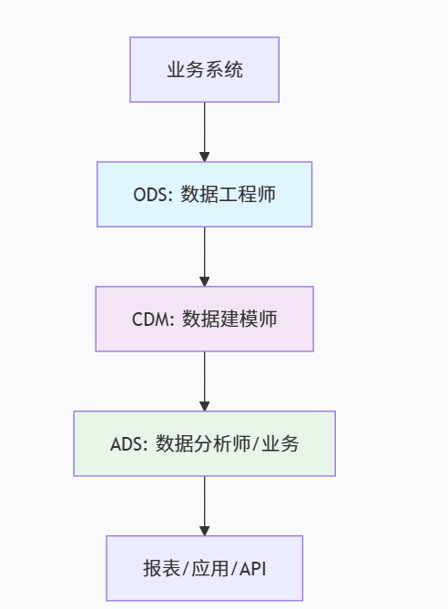

# 1. ODS层（贴源层/操作数据层）
sql
-- 设计原则：最大程度保留源系统原貌
CREATE TABLE ods_user_order_20240115 (
    order_id        STRING COMMENT '订单ID（源系统字段）',
    user_id         STRING COMMENT '用户ID（源系统字段）',
    order_amount    DECIMAL(10,2) COMMENT '订单金额（源系统字段）',
    create_time     TIMESTAMP COMMENT '创建时间（源系统字段）',
    update_time     TIMESTAMP COMMENT '更新时间（源系统字段）',
    dt              STRING COMMENT '分区字段：数据日期'
) PARTITIONED BY (dt STRING)
COMMENT '用户订单原始表，每日全量快照';

-- 关键特点：
-- 1. 字段名、类型尽量与源系统一致
-- 2. 全量/增量同步，保留历史快照
-- 3. 不做业务逻辑处理
-- 4. 分区按业务日期（通常是数据产生日期）
治理重点：

数据接入标准：统一的接入规范（SLA、质量监控）

数据保留策略：历史数据保留周期（如：ODS层保留180天）

敏感数据处理：识别PII数据，必要时脱敏

数据血缘起点：清晰记录数据来源

# 2. CDM层（公共维度模型层）—— 核心中的核心

-- 设计原则：One Truth，统一数据口径
-- 包含两个子层：DWD（明细层） + DWS（汇总层）

-- DWD：维度建模的明细事实表
CREATE TABLE dwd_user_order_fact (
    order_id        STRING COMMENT '订单ID（统一ID）',
    user_key        BIGINT COMMENT '用户代理键（关联dim_user）',
    product_key     INT COMMENT '商品代理键（关联dim_product）',
    order_date_key  INT COMMENT '日期键（YYYYMMDD）',
    order_amount    DECIMAL(10,2) COMMENT '订单金额（统一单位：元）',
    order_status    TINYINT COMMENT '订单状态（1-待支付，2-已支付...）',
    source_system   STRING COMMENT '来源系统标识',
    dw_create_time  TIMESTAMP COMMENT '数仓创建时间',
    dw_update_time  TIMESTAMP COMMENT '数仓更新时间'
) COMMENT '用户订单事实表（星型模型）';

-- DIM：统一的维度表
CREATE TABLE dim_user (
    user_key        BIGINT COMMENT '代理键',
    user_id         STRING COMMENT '业务ID',
    user_name       STRING COMMENT '用户姓名（脱敏）',
    age_group       STRING COMMENT '年龄段（标准化：18-25）',
    city_level      STRING COMMENT '城市等级（一线/二线...）',
    is_vip          BOOLEAN COMMENT '是否VIP会员',
    valid_from      DATE COMMENT '生效日期',
    valid_to        DATE COMMENT '失效日期',
    is_current      BOOLEAN COMMENT '是否当前版本'
) COMMENT '用户维度表（缓慢变化维SCD）';

-- DWS：公共汇总层
CREATE TABLE dws_user_daily_summary (
    user_key        BIGINT COMMENT '用户代理键',
    date_key        INT COMMENT '日期键',
    order_count     INT COMMENT '当日订单数',
    order_amount    DECIMAL(10,2) COMMENT '当日订单金额',
    avg_order_amount DECIMAL(10,2) COMMENT '笔均订单金额',
    first_order_time TIMESTAMP COMMENT '当日首单时间',
    last_order_time TIMESTAMP COMMENT '当日末单时间'
) COMMENT '用户日粒度汇总表';

## **治理重点（核心！）**：

**统一主数据**：用户、商品、组织等核心实体的唯一标识

**维度一致性**：跨业务线的统一维度定义

**数据标准化**：枚举值、计量单位、代码映射统一

**数据质量**：完整性、一致性、准确性规则

**血缘管理**：清晰的加工逻辑和数据流向

# 3. ADS层（应用数据层）
-- 设计原则：快速响应业务需求
-- 按需设计，不强求统一模型

-- 场景1：营销报表
CREATE TABLE ads_marketing_campaign_daily (
    campaign_id     STRING COMMENT '营销活动ID',
    report_date     DATE COMMENT '报告日期',
    exposure_count  BIGINT COMMENT '曝光人数',
    click_count     BIGINT COMMENT '点击人数',
    order_count     INT COMMENT '转化订单数',
    gmv             DECIMAL(15,2) COMMENT '活动GMV',
    roi             DECIMAL(5,4) COMMENT '投资回报率'
) COMMENT '营销活动日报表（宽表设计）';

-- 场景2：实时数据服务
CREATE TABLE ads_user_realtime_stats (
    user_id         STRING COMMENT '用户ID',
    last_active_time TIMESTAMP COMMENT '最后活跃时间',
    today_order_count INT COMMENT '今日订单数',
    today_order_amount DECIMAL(10,2) COMMENT '今日订单金额',
    favorite_category STRING COMMENT '偏好品类',
    dw_update_time  TIMESTAMP COMMENT '更新时间'
) COMMENT '用户实时统计表（支持API查询）';

-- 场景3：数据API层（视图封装）
CREATE VIEW api_sales_dashboard AS
SELECT 
    region, 
    product_category,
    SUM(sales_amount) as total_sales,
    COUNT(DISTINCT user_id) as customer_count
FROM ads_region_sales_daily
WHERE report_date >= DATE_SUB(CURRENT_DATE, 30)
GROUP BY region, product_category;

**治理重点：**

- 避免重复建设：相似场景复用已有ADS表
- 生命周期管理：及时下线过期的ADS表
- 性能优化：针对查询场景优化（分区、索引、物化视图）
- 访问控制：敏感数据的权限管控

# 为什么这个架构更流行？
1. **职责分离，专业分工**

2. **兼顾稳定与灵活**
- CDM稳定：核心模型变化少，保障数据一致性
- ADS灵活：快速响应业务变化，不影响核心模型
3. **适合现代数据栈**
现代数据架构：
  ODS层: Fivetran/Airbyte/CDC工具  # 快速接入
  CDM层: dbt + 数据建模工具        # 标准化建模
  ADS层: Superset/Metabase         # 敏捷分析
  API层: Data API服务             # 数据服务化

#   实施路线图
阶段1：搭建基础（1-2个月）
  - ODS层：接入核心系统（交易、用户）
  - CDM层：建设核心维度（用户、商品）
  - ADS层：支撑1-2个关键报表

阶段2：完善体系（3-6个月）
  - ODS层：接入所有重要系统
  - CDM层：完善数据模型，建立数据质量监控
  - ADS层：支持多业务线需求

阶段3：数据驱动（6个月+）
  - 数据服务化：API化输出
  - 数据产品化：打造数据产品
  - 数据智能化：结合AI/ML

#  关键成功因素
**CDM层要"重"**：投入足够资源做好统一建模

**ADS层要"轻"**：避免在ADS层做复杂逻辑

**治理要"早"**：从第一天开始考虑数据治理

**工具要"配"**：选择适合的现代化数据工具

#  与数据湖融合（Lakehouse）
原始数据 → 数据湖（Bronze层） → ODS（Silver层） → CDM（Gold层） → ADS
          （原始格式）        （结构化）        （模型化）      （服务化）

