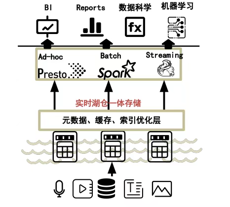
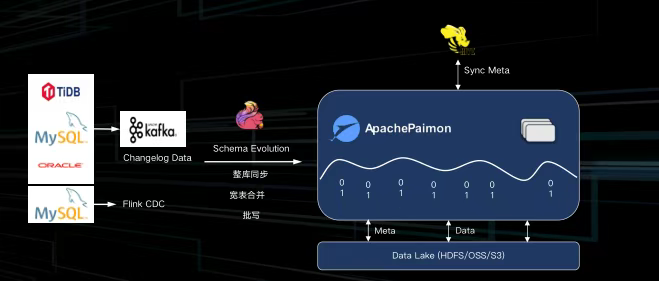

# https://mp.weixin.qq.com/s/IH-4g7Zy6wcmTfQwxFL5gw

# 整体架构：湖仓一体，分层协同
腾讯的数仓一体架构并非简单地将 HDFS 和 Hive 表拼接，而是以 统一元数据、统一计算引擎、统一治理策略 为三大支柱，形成“四层一湖一平台”的融合体系

## 1. 数据接入层（Ingestion Layer）

多源接入：支持日志、数据库 Binlog、消息队列（CKafka）、IoT 设备等；实时/离线双通道：实时：通过 TubeMQ / CKafka + Flink 流入 Paimon/Hudi 表；离线：通过 TDBank 批量同步至对象存储（COS）或 HDFS。Schema 自动推断与版本管理：避免“脏数据污染”。

## 2. 统一存储层（Unified Storage）
- **核心载体**：基于 Apache Iceberg / Apache Paimon 构建表格式（Table Format）；
- **关键能力**：ACID 事务支持（保证写入一致性）；时间旅行（Time Travel）与快照回溯；Schema 演进（新增字段不影响历史查询）；分区自动优化（Hidden Partitioning）。
- **存储介质分层**：热数据：SSD 缓存 + HDFS；温冷数据：自动归档至腾讯云 COS（兼容 S3 API）。
- 腾讯选择 Paimon（原 Flink Table Store）作为流批一体的核心存储，因其深度集成 Flink，天然支持实时更新与主键合并（UPSERT）。