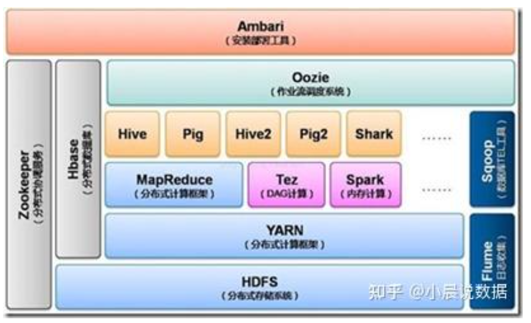
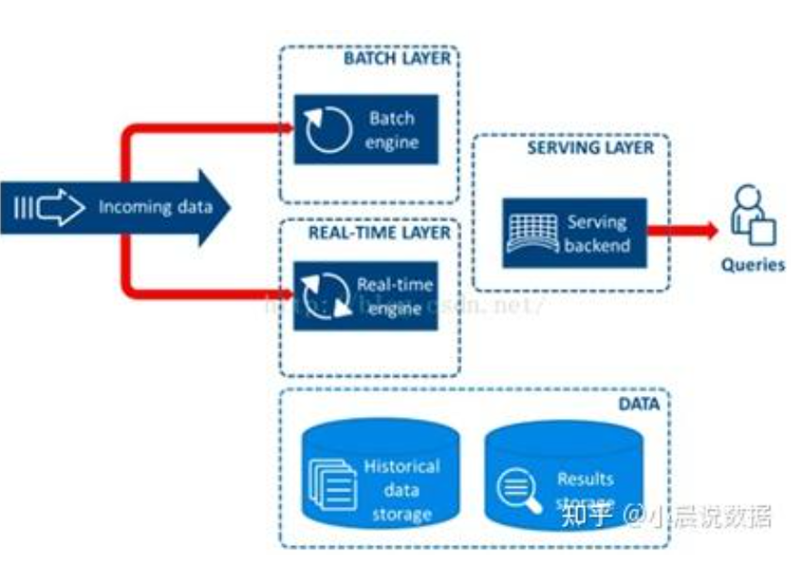
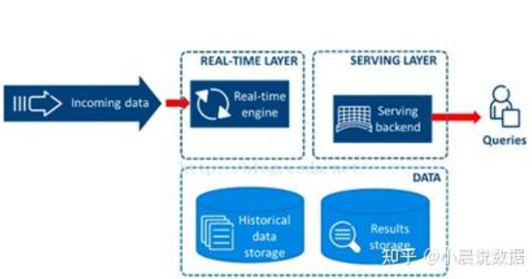
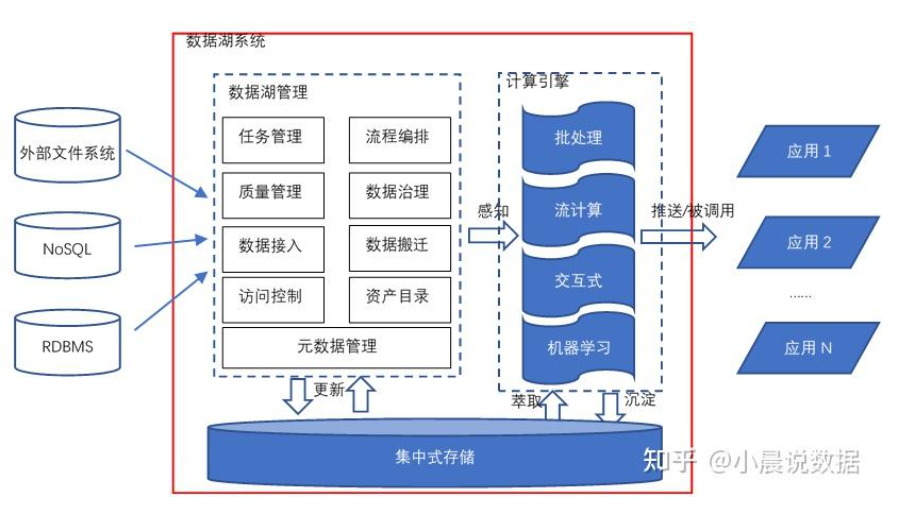
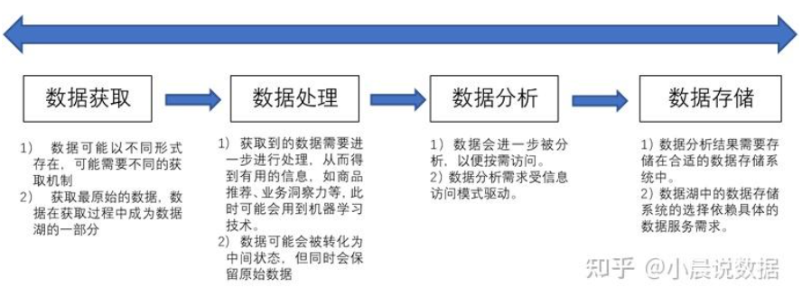
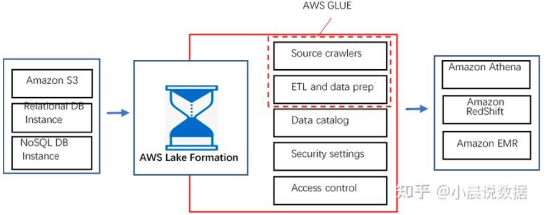
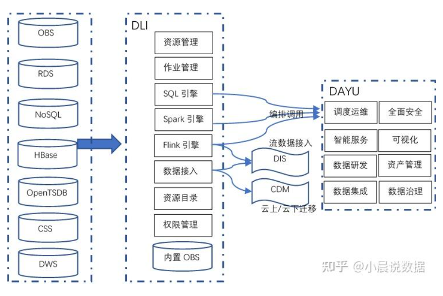

学习链接：https://zhuanlan.zhihu.com/p/451399159
# 一、什么是数据湖？
数据湖是一类存储数据自然/原始格式的系统或存储，通常是对象块或者文件。数据湖通常是企业中全量数据的单一存储。全量数据包括原始系统所产生的原始数据拷贝以及为了各类任务而产生的转换数据，各类任务包括报表、可视化、高级分析和机器学习。数据湖中包括来自于关系型数据库中的结构化数据（行和列）、半结构化数据（如CSV、日志、XML、JSON）、非结构化数据（如email、文档、PDF等）和二进制数据（如图像、音频、视频）。数据沼泽是一种退化的、缺乏管理的数据湖，数据沼泽对于用户来说要么是不可访问的要么就是无法提供足够的价值。

#  二、数据湖的基本特征
## 在数据方面：
- **保真性**：数据湖中对于业务系统中的数据都会存储一份“一模一样”的完整拷贝。与数据仓库不同的地方在于，数据湖中必须要保存一份原始数据，无论是数据格式、数据模式、数据内容都不应该被修改。在这方面，数据湖强调的是对于业务数据“原汁原味”的保存。同时，数据湖应该能够存储任意类型/格式的数据。
- **灵活性**：上表一个点是 “写入型schema” v.s.“读取型schema”，其实本质上来讲是数据schema的设计发生在哪个阶段的问题。对于任何数据应用来说，其实schema的设计都是必不可少的，即使是mongoDB等一些强调“无模式”的数据库，其最佳实践里依然建议记录尽量采用相同/相似的结构。“写入型schema”背后隐含的逻辑是数据在写入之前，就需要根据业务的访问方式确定数据的schema，然后按照既定schema，完成数据导入，带来的好处是数据与业务的良- 好适配；但是这也意味着数仓的前期拥有成本会比较高，特别是当业务模式不清晰、业务还处于探索阶段时，数仓的灵活性不够。数据湖强调的“读取型schema”，背后的潜在逻辑则是认为业务的不确定性是常态：我们无法预期业务的变化，那么我们就保持一定的灵活性，将设计去延后，让整个基础设施具备使数据“按需”贴合业务的能力。因此，个人认为“保真性”和“灵活性”是一脉相承的：既然没办法预估业务的变化，那么索性保持数据最为原始的状态，一旦需要时，可以根据需求对数据进行加工处理。因此，数据湖更加适合创新型企业、业务高速变化发展的企业。同时，数据湖的用户也相应的要求更高，数据科学家、业务分析师（配合一定的可视化工具）是数据湖的目标客户。
- **可管理**：数据湖应该提供完善的数据管理能力。既然数据要求“保真性”和“灵活性”，那么至少数据湖中会存在两类数据：原始数据和处理后的数据。数据湖中的数据会不断的积累、演化。因此，对于数据管理能力也会要求很高，至少应该包含以下数据管理能力：数据源、数据连接、数据格式、数据schema（库/表/列/行）。同时，数据湖是单个企业/组织中统一的数据存放场所，因此，还需要具有一定的权限管理能力。
- **可追溯**：数据湖是一个组织/企业中全量数据的存储场所，需要对数据的全生命周期进行管理，包括数据的定义、接入、存储、处理、分析、应用的全过程。一个强大的数据湖实现，需要能做到对其间的任意一条数据的接入、存储、处理、消费过程是可追溯的，能够清楚的重现数据完整的产生过程和流动过程。

- **丰富的计算引擎**。从批处理、流式计算、交互式分析到机器学习，各类计算引擎都属于数据湖应该囊括的范畴。一般情况下，数据的加载、转换、处理会使用批处理计算引擎；需要实时计算的部分，会使用流式计算引擎；对于一些探索式的分析场景，可能又需要引入交互式分析引擎。随着大数据技术与人工智能技术的结合越来越紧密，各类机器学习/深度学习算法也被不断引入，例如TensorFlow/PyTorch框架已经支持从HDFS/S3/OSS上读取样本数据进行训练。因此，对于一个合格的数据湖项目而言，计算引擎的可扩展/可插拔，应该是一类基础能力。
- **多模态的存储引擎**。理论上，数据湖本身应该内置多模态的存储引擎，以满足不同的应用对于数据访问需求（综合考虑响应时间/并发/访问频次/成本等因素）。但是，在实际的使用过程中，数据湖中的数据通常并不会被高频次的访问，而且相关的应用也多在进行探索式的数据应用，为了达到可接受的性价比，数据湖建设通常会选择相对便宜的存储引擎（如S3/OSS/HDFS/OBS），并且在需要时与外置存储引擎协同工作，满足多样化的应用需求。

# 三、数据湖基本架构
##  第一阶段：以Hadoop为代表的离线数据处理基础设施。

##  第二阶段：lambda架构。
随着数据处理能力和处理需求的不断变化，越来越多的用户发现，批处理模式无论如何提升性能，也无法满足一些实时性要求高的处理场景，流式计算引擎应运而生，例如Storm、Spark Streaming、Flink等。

## 第三阶段：Kappa架构。
Lambda架构解决了应用读取数据的一致性问题，但是“流批分离”的处理链路增大了研发的复杂性。因此，有人就提出能不能用一套系统来解决所有问题。目前比较流行的做法就是基于流计算来做。流计算天然的分布式特征，注定了他的扩展性更好。通过加大流计算的并发性，加大流式数据的“时间窗口”，来统一批处理与流式处理两种计算模式。

**然而，目前的大数据平台基础架构，都将视角锁定在了存储和计算，而忽略了对于数据的资产化管理，这恰恰是数据湖作为新一代的大数据基础设施所重点关注的方向之一**。

## **企业数据管理的需求**
在企业/组织内部，数据是一类重要资产已经成为了共识；为了更好的利用数据，企业/组织需要对数据资产：
- 进行长期的原样存储；
- 进行有效管理与集中治理；
- 提供多模式的计算能力满足处理需求；
- 以及面向业务，提供统一的数据视图、数据模型与数据处理结果；

## 数据湖需要包括一系列的数据管理组件，包括：
- **数据接入**
- **数据搬迁**
- **数据治理**
- **质量管理**
- **资产目录**
- **访问控制**
- **任务管理**
- **任务编排**
- **元数据管理等**

## 数据湖系统的参考架构

1、 **更强大的数据接入能力。**数据接入能力体现在对于各类外部异构数据源的定义管理能力，以及对于外部数据源相关数据的抽取迁移能力，抽取迁移的数据包括外部数据源的元数据与实际存储的数据。
2、**更强大的数据管理能力。**管理能力具体又可分为基本管理能力和扩展管理能力。基本管理能力包括对各类元数据的管理、数据访问控制、数据资产管理，是一个数据湖系统所必须的，后面我们会在“各厂商的数据湖解决方案”一节相信讨论各个厂商对于基本管理能力的支持方式。扩展管理能力包括任务管理、流程编排以及与数据质量、数据治理相关的能力。任务管理和流程编排主要用来管理、编排、调度、监测在数据湖系统中处理数据的各类任务，通常情况下，数据湖构建者会通过购买/研制定制的数据集成或数据开发子系统/模块来提供此类能力，定制的系统/模块可以通过读取数据湖的相关元数据，来实现与数据湖系统的融合。而数据质量和数据治理则是更为复杂的问题，一般情况下，数据湖系统不会直接提供相关功能，但是会开放各类接口或者元数据，供有能力的企业/组织与已有的数据治理软件集成或者做定制开发。
3、**可共享的元数据。**数据湖中的各类计算引擎会与数据湖中的数据深度融合，而融合的基础就是数据湖的元数据。好的数据湖系统，计算引擎在处理数据时，能从元数据中直接获取**数据存储位置、数据格式、数据模式、数据分布**等信息，然后直接进行数据处理，而**无需进行人工/编程干预**。更进一步，好的数据湖系统还可以对数据湖中的数据进行访问控制，控制的力度可以做到“库表列行”等不同级别。

## 数据湖的存储
数据湖的存储应该是一类可按需扩展的**分布式文件系统**，大多数数据湖实践中也是推荐采用S3/OSS/OBS/HDFS等分布式系统作为数据湖的统一存储。

## 数据湖中的数据生命周期

理论上，一个管理完善的数据湖中的数据会永久的保留原始数据，同时过程数据会不断的完善、演化，以满足业务的需要。

# 四、各厂商的数据湖解决方案

## 1、AWS数据湖解决方案

整个方案基于AWS Lake Formation构建，AWS Lake Formation本质上是一个管理性质的组件，它与其他AWS服务互相配合，来完成整个企业级数据湖构建功能。上图自左向右，体现了数据流入、数据沉淀、数据计算、数据应用四个步骤。我们进一步来看其关键点：
1） 数据流入。 数据流入是整个数据湖构建的起始，包括**元数据的流入**和**业务数据流入**两个部分。元数据流入包括数据源创建、元数据抓取两步，最终会形成数据资源目录，并生成对应的安全设置与访问控制策略。解决方案提供专门的组件，获取外部数据源的相关元信息，该组件能连接外部数据源、检测数据格式和模式（schema），并在对应的数据资源目录中创建属于数据湖的元数据。业务数据的流入是通过ETL来完成的。
在具体的产品形式上，元数据抓取、ETL和数据准备AWS将其单独抽象出来，形成了一个产品叫AWS GLUE。AWS GLUE与AWS Lake Formation共享同一个数据资源目录，在AWS GLUE官网文档上明确指出：“Each AWS account has one AWS Glue Data Catalog per AWS region”。
对于异构数据源的支持。AWS提供的数据湖解决方案，支持S3、AWS关系型数据库、AWS NoSQL数据库，AWS利用GLUE、EMR、Athena等组件支持数据的自由流动。
2） 数据沉淀。
采用Amazon S3作为整个数据湖的集中存储，按需扩展/按使用量付费。
3） 数据计算。
整个解决方案利用AWS GLUE来进行基本的数据处理。GLUE基本的计算形式是各类批处理模式的ETL任务，任务的出发方式分为手动触发、定时触发、事件触发三种。不得不说，AWS的各类服务在生态上实现的非常好，事件触发模式上，可以利用AWS Lambda进行扩展开发，同时触发一个或多个任务，极大的提升了任务触发的定制开发能力；同时，各类ETL任务，可以通过CloudWatch进行很好的监控。

4） 数据应用。
在提供基本的批处理计算模式之外，AWS通过各类外部计算引擎，来提供丰富的计算模式支持，例如通过Athena/Redshift来提供基于SQL的交互式批处理能力；通过EMR来提供各类基于Spark的计算能力，包括Spark能提供的流计算能力和机器学习能力。

5） 权限管理。
AWS的数据湖解决方案通过Lake Formation来提供相对完善的权限管理，粒度包括“库-表-列”。但是，有一点例外的是，GLUE访问Lake Formation时，粒度只有“库-表”两级；这也从另一个侧面说明，GLUE和Lake Formation的集成是更为紧密的，GLUE对于Lake Formation中的数据有更大的访问权限。

Lake Formation的权限进一步可以细分为数据资源目录访问权限和底层数据访问权限，分别对应元数据与实际存储的数据。实际存储数据的访问权限又进一步分为数据存取权限和数据存储访问权限。数据存取权限类似于数据库中对于库表的访问权限，数据存储权限则进一步细化了对于S3中具体目录的访问权限（分为显示和隐式两种）。如图8所示，用户A在只有数据存取的权限下，无法创建位于S3指定bucket下的表。

个人认为这进一步体现了数据湖需要支持各种不同的存储引擎，未来的数据湖可能不只S3/OSS/OBS/HDFS一类核心存储，可能根据应用的访问需求，纳入更多类型的存储引擎，例如，S3存储原始数据，NoSQL存储处理过后适合以“键值”模式访问的数据，OLAP引擎存储需要实时出各类报表/adhoc查询的数据。虽然当前各类材料都在强调数据湖与数据仓库的不同；但是，从本质上，数据湖更应该是一类融合的数据管理思想的具体实现，“湖仓一体化”也很可能是未来的一个发展趋势。

## 2、 华为数据湖解决方案

