# 一级市场和二级市场
## 一级市场（发行市场）
公司发行新股卖给投资者，钱从投资者流向上市公司
## 二级市场（流通市场）--期货只有二级市场
投资者之间买卖已发行的股票，钱在投资者之间流转
## 归母净利润
归母净利润就是“在合并报表的全部利润中，真正属于上市公司自己股东的那部分利润”。

# 一、 分时图
分时图 = 当天期货合约实时价格走势 + 均价走势，看日内实时强弱、涨跌、支撑压力最直观的图。

## 两条核心线
- 白色线：即时价格线
就是当下实时成交价格，一分钟一跳，跟着盘口买卖实时波动。
- 黄色线：日内平均价（均价线）
把当天所有成交价格加权平均算出来的线，代表全天市场平均成本。
## 简单看懂强弱
- 白线在黄线上方：当下价格强，多头占优，**偏涨**
- 白线在黄线下方：当下价格弱，空头占优，**偏跌**
- 白线反复围绕黄线缠绕：**震荡行情，没方向**

## 配套**分时图**的**量能指标区**
- 黄色柱线：成交量（CJL）
每一根柱子代表对应时间单位（1 分钟 / 1 笔）的成交手数，柱子越高，说明这段时间成交越活跃。
- 白色线：持仓量变化线
代表当天未平仓合约总数的变化，上涨说明资金在进场，下跌说明资金在离场。
核心作用：验证价格走势的真实性
价格上涨 + 成交量放大：上涨动能足，大概率延续
价格上涨 + 成交量萎缩：上涨是虚的，容易回落

## 专业词汇解释
- **仓位** = 你当前持有某一品种的**净头寸**（手数），按方向分开计算。
- 新仓	当前交易中 新开立 的头寸	你刚下的单，之前没有这个方向的持仓
- 老仓	本次交易之前 已经持有 的头寸	你之前开的仓，现在还拿着没平

- 多开：**新**开多头**仓位**
- 空开：**新**开空头**仓位**
- 多平：**老多头仓** 平多离场
- 空平：**老空头仓** 平空离场
- 双开：多空同时进场，增仓↑↑，**分歧加大，趋势容易延续**--**新多和新空***同时开仓***是双开**
- 双平：多空同时离场，减仓↓↓，**分歧缩小，行情可能进入震荡**--**老多和老空***同时平仓***是双平**
- 多换：老多头止盈/止损离场，新多头接盘，多头阵营内部换血，**趋势暂时稳定**
- 空换：老空头止盈/止损离场，新空头接盘，空头阵营内部换血，**趋势暂时稳定**
- 现手： 最近一笔成交的 手数。就是这一笔成交的 “规模”，帮你判断是散户小打小闹，还是大资金在主动进场 / 离场。

| 买方       | 卖方       | 结果       | 持仓变化      |
| -------- | -------- | -------- | --------- |
| 买开（多头开仓） | 卖开（空头开仓） | **双开**   | 持仓 **+1** |
| 买平（空头平仓） | 卖平（多头平仓） | **双平**   | 持仓 **-1** |
| 买开（多头开仓） | 卖平（多头平仓） | **多头换手** | 持仓 **不变** |
| 买平（空头平仓） | 卖开（空头开仓） | **空头换手** | 持仓 **不变** |

## 持仓量与价格的关系：四种核心组合
1. 价格上涨 + 持仓量增加 → 强势上涨，多头在主动进攻
2. 价格上涨 + 持仓量减少 → 弱势反弹，空头在撤退
3.  价格下跌 + 持仓量增加 → 强势下跌，空头在主动进攻
4.  价格下跌 + 持仓量减少 → 弱势下跌，多头在认输

## 期货做空的底层逻辑：
你开一张空单 → 在交易所系统里 生成一笔“你未来要卖出”的合约义务
交易所同时会找一个人 开多单 来和你配对
你没有从任何人那里“借”货，交易所也没有给你“借”
你只是在 承诺未来某个时间点按约定价格卖出
一句话：期货空头不是借货卖，而是签了一份未来卖出的合同。

## 盘口
 当前市场上 所有未成交的买卖申报 的价格和数量的实时展示。

外盘：买盘
内盘：卖盘

# 滑点
滑点 = 你下单时预期的成交价格，与实际成交价格之间的差价（通常是变差）。
你想在 A 价格买，但轮到你成交时，A 价已经没了，只能以更差的 B 价成交。
## 为什么会有滑点？
流动性不足：挂单太少，你单子大，吃掉好几档
行情波动快：刚看一眼价格，下一秒就变了
网络/系统延迟：你下单慢了一点点

# 二、模拟盘品种
玉米 大豆 豆粕 菜粕

# 三、均线分析
## 均线
均线就是移动平均线（Moving Average，简称MA）--也叫SMA(Simple Moving Average)
均线是**把一段时间内的收盘价加起来，再除以天数，得到的一个平均价格**。
30日均线为例来说明一下，将30日内的收盘价逐日相加，然后除以30，就得出30日的平均值，再将这些平均值依先后次序连接成一条线，这条线就叫30日移动平均
### 短期均线
MA5, MA10, MA20 ，MA30均线
### 中期均线
MA45（45日均线，大致含22个交易日，两个月）
,MA60（60日均线，**季度线**）
,MA90（ 中期均线和长期均线的分界线）
### 长期均线
MA120（120日均线，**半年线**）,MA250（250日均线，**年线**，**牛熊分界线**）
### 局限性
- 滞后：只用到历史价格，所以均线永远「慢半拍」，价格已经转头了它还没反应
- 权重均等：10天前的价格和昨天的价格，在 SMA 里权重一样——这合理吗？（下面的 EMA 来解决这个）

### "站上均线"
是交易中的常用术语，意思是K线（价格）从下方穿过均线，并收在均线之上；
- 之前：价格在均线下方运行
- 突破：某一天的收盘价高于均线
- 确认：后续几天价格维持在均线上方，不跌回去

### 均线的背离
- **均线的背离**：是指不同周期的均线在实际运行中，短期均线与中长期均线的运行方向相反，从而形背离的现象。
#### 顶背离 & 底背离
- 当价格处于阶段性的高位后，往往会开始向下整理，短期均线也将随之下行，但此时的中、长期均线可能还在上行的状态。
  --5日均线下行，60日均线上行
- 当短期均线向下突破中期均线时，短期均线运行方向与长期均线的运行方向相反，即形成顶背离。
  --5日均线上行，60均线下行

### 黄金交叉
黄金交叉出现在上涨初期，由2根均线组成，一根较短期的均线由下向上穿过一根较长期的均线，并且是较长期的均线是向上移动的。
#### 银山谷
出现在上涨初期，由3根均线交叉组成，形成一个尖头向上的不规则三角形。
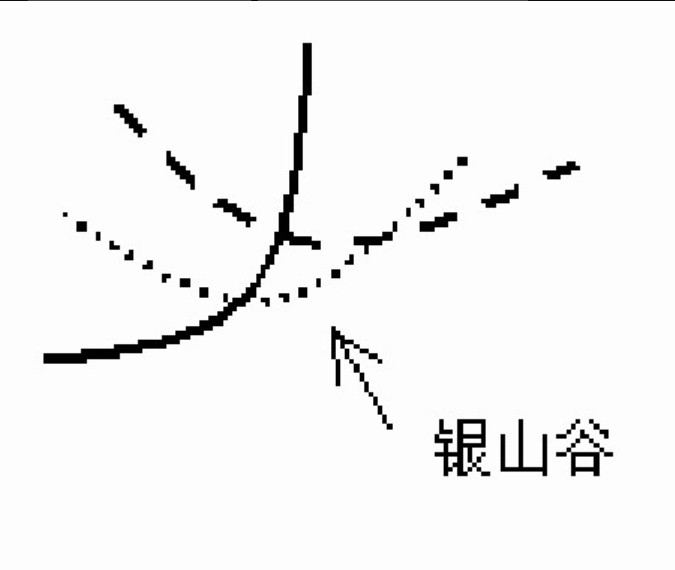
#### 多头排列和金山谷

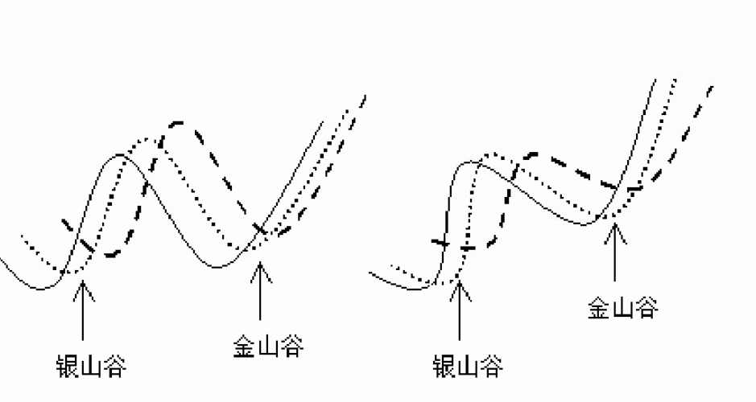

### 死亡交叉和死亡谷
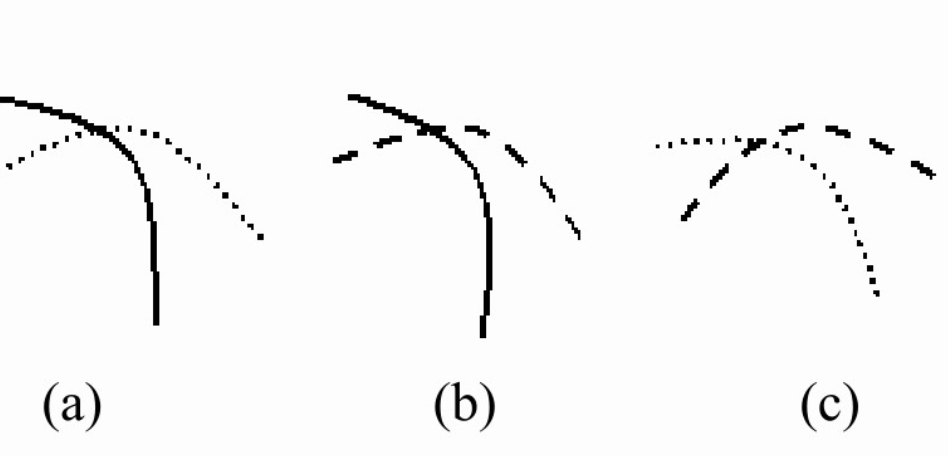

#### 空头排列
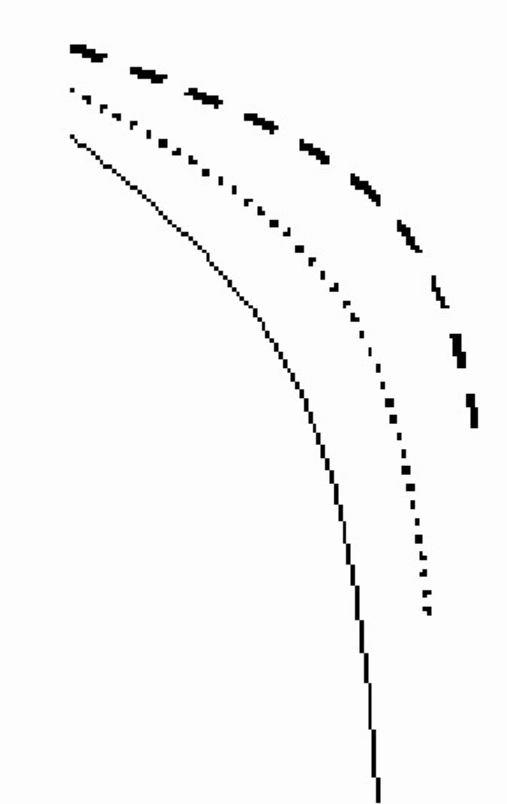

### 葛兰碧的均线买卖8大法则
#### 买入
**第一买入法则是**:均线从下降状态开始走平，同时价格从平均线下方突破平均线时，为买进信号；**20日均线为常见。**

**第二买入法则是**:价格下穿均线，而均线仍在上行，不久价格又回到均线之上时，为买进信号，

**第三买入法则是**:价格原在均线之上，现价格突然下跌，但未跌破均线又上升时，为买进信号；
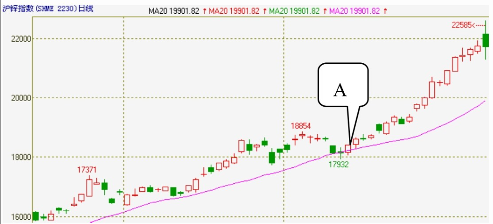

**第四买入法则**是:价格原在均线之下，突然暴跌从而远离均线，物极必反，是买进时机

#### 卖出法则
**第一卖出法则**是:均线从上升状态开始走平，同时价格从均线上方向下跌穿均线时，为卖出信号或做空信号，如图5.44所示。A处和B处都是不错的卖点或做空信号点。
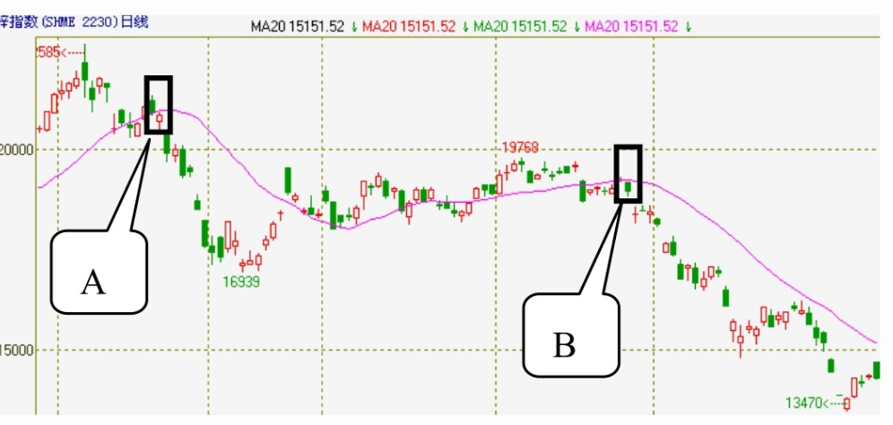
**第二卖出法则**是:价格上穿均线，而均线仍在下行，不久价格又回到均线之下时，为卖出信号或做空点，
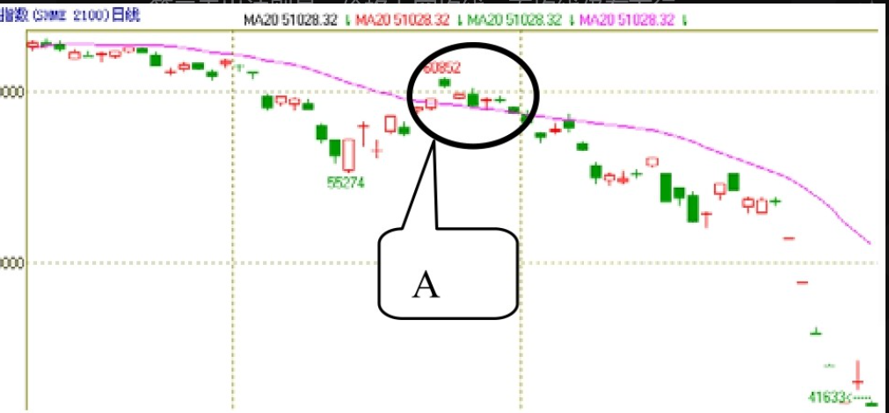
第三卖出法则是:价格原在均线之下，现价格突然上涨，但未涨到均线处又开始下跌时，为卖出信号或做空信号，如图5.46所示。
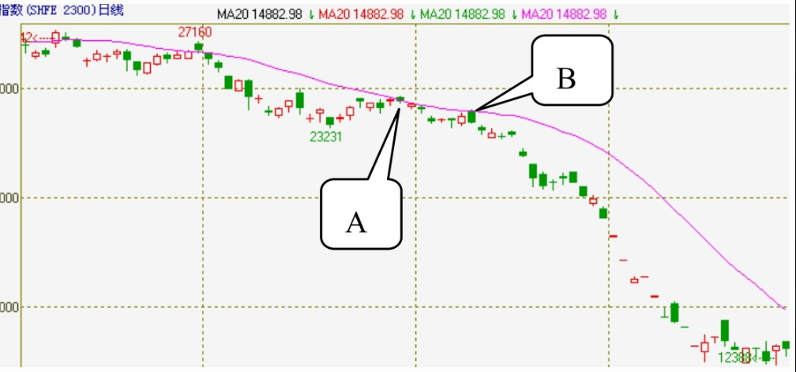
第四卖出法则是:价格原在均线之上，现突然暴涨而远离均线时，物极必反，是卖出信号或做空点，如图5.47所示。A处那根大阳线就是不错的卖点或做空点。
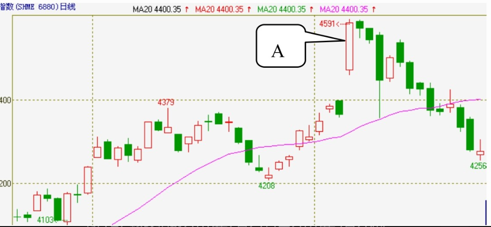

# 四、 K线相关
### 十字星
- 实体很短：开盘价和收盘价几乎相同
- 有上下影线：说明盘中既有上涨也有下跌
- 颜色不重要：因为实体太小，看起来就是"十字"形状
十字星的核心是多空双方力量均衡，**开盘价和收盘价几乎重合**，所以颜色淡到看不清，呈现"十字"状。

### 跳空高开
- 今天开盘价 > 昨天最高价
- 中间有价格区间没有任何成交
- 通常因为利好消息（政策、业绩、突发事件），买方急于进场，愿意以更高价格买入

### 跳空低开
- 今天开盘价 < 昨天最低价
- 中间有价格区间没有任何成交
- 通常因为利空消息，卖方恐慌抛售，愿意以更低价格卖出

### 各种阳线
- 小阳线：实体很小（1%-3%左右），买方略占优，但力量不强
- 中阳线：实体中等（3%-6%左右），买方力量较强，趋势明确
- 大阳线：实体很大（6%以上），买方力量极强，强势信号

### 强势K线
(1)**光头光脚阳线**:意味着极端强势上涨，后市看多。
(2)**光头光脚阴线**:意味着极端强势下跌，后市看空。
(3)**大阳线**:意味着强势上涨，后市看多。
(4)**大阴线**:意味着强势下跌，后市看空。

各种K线解读：https://book.qq.com/book-read/23911405/18

# 五、趋势线
### 趋势线的绘制
趋势线的绘制方法很简单，
#### 上升趋势
在**上升趋势中**，**将两个明显的反转低点连成一条直线**，就可以得到上升趋势线，上升趋势线起支撑作用;
#### 下降趋势
在**下降趋势中**，将**两个明显的反转高点连成一条直线**，就可以得到下降趋势线，下降趋势线起阻力作用。
### 趋势线的作用
趋势线简单、易学，但它对期货价格的中长期走势却有着相当重要的作用。趋势线对后市的价格起约束作用，上升趋势线可以支撑价格的上涨;下降趋势线对价格起压制作用。当趋势线被突破后，价格下一步的走势将沿新的趋势线运行，原有趋势线的作用会转换。

## 支撑线和压力线
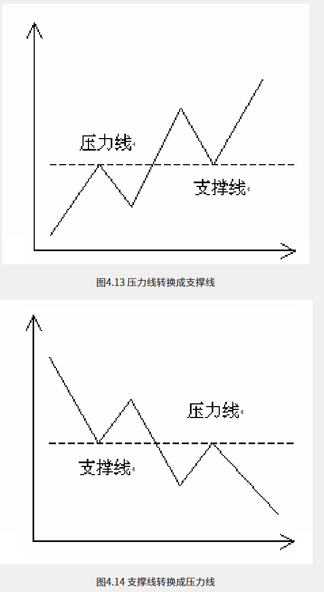

# 六、 期货/股票交易的技术指标分析
1)**趋向指标**
趋向指标是识别和追踪有趋势的图形类指标，其特点是不去试图猜顶和测底，如**均线、MACD指标、SAR指标**等。
2)**反趋向指标**
反趋向指标，又称震荡指标，是识别和追踪趋势运行的转折点的图形类指标，其特点是具有强烈的捕顶和捉底的意图，对市场转折点较敏感，如**随机指标KDJ，强弱指标RSI**等。
3)**量价指标**
量价指标就是通过成交量变动来分析捕捉价格未来走势的图形类指标，其特点是以“成交量是市场元气”为依据，揭示成交量与价格涨跌的关系，如**OBV指标**、**VOL指标**等。
4）**压力支撑指标**
压力支撑指标，又称通道指标，是通过顶部轨道线和底部轨道线，试图捕捉行情的顶部和底部的图形类指标，其特点是具有明显的压力线，也有明显的支撑线，如BOLL指标、XSTD指标。
- **提醒**:对于指标的应用，要记住经典图形的意义，然后根据大势和主力特征进行认真识别，因为有时很可能是主力发的假信号，即通过操纵价格绘制的“骗线”指标图形。

——————————————
## MACD（指数平滑异同移动平均线） -- 中长期指标
一个衡量趋势的强度和节奏变化的工具,**趋势的“仪表盘”**
### 核心构成：三个角色的分工
1.**DIF线**（快线）：它是12日EMA（快速均线）和26日EMA（慢速均线）的差值。它反映了短期价格相对于中长期价格的变动速度。
- EMA（指数移动平均数）:EMA就像调整了敏感度的仪表——对最近的价格变化响应更快。
**普通均线（MA）**：过去N天的价格加起来，除以N。每一天的权重都一样。比如10日均线，就是把过去10天的收盘价一视同仁地平均。
**指数均线（EMA）**：最新的价格权重最大，越久远的价格权重越小，呈指数衰减。 它不给所有价格同等的投票权，而是更“信任”最近发生的事。（Exponential Moving Average）， EMA 对价格变化反应更快。
- DIF = 12日EMA - 26日EMA
- DIF线上升，说明**涨势在加速**；**当差值变大**（**DIF线向上**），意味着短期成本正在快速甩开中长期成本，**买家正在积极追高**。
- DIF下降，则说明**跌势在加速**。**当差值变小**（**DIF线向下**），意味着短期成本正在向中长期成本靠拢，市场的追高意愿在衰退，或者抛售意愿在增强。
2.**DEA线**（慢线）：它是DIF线的9日移动平均线。你可以把它理解为DIF的平滑版，代表了趋势的惯性或平均速度。
3.**柱状线**（红绿柱）：它的长度等于“DIF - DEA”再乘以2。它最直观地反映了当前速度与平均速度的差值。
- 柱子变长，说明趋势在加速；
- 柱子缩短，说明趋势在减速。
- 如果DIFF线和DEA线运行在**0轴下方**，表示现在的市场是**空头市场**;
- 如果DIFF线和DEA线运行在**0轴上方**，表示现在的市场是**多头市场**。
### 最常用的两个信号模式
#### 信号一：**金叉与死叉**（趋势**转向**信号）
这是MACD最经典的用法，描述的是DIF线和DEA线的交叉。

- **金叉**：DIF线自下而上穿过DEA线。
这表示当前价格的上涨速度，已经开始超过其平均速度，趋势可能由弱转强，通常是看涨信号。
- **死叉**：DIF线自上而下穿过DEA线。
这表示当前价格的下跌速度，已经开始快于其平均速度，趋势可能由强转弱，通常是看跌信号。
**注意**：金叉死叉在震荡市中会频繁出现，导致假信号增多。它更适合在有明显趋势的行情中使用。

#### 信号二：**顶背离**与**底背离**（动能衰竭信号）
这被很多交易者认为是**MACD最有价值的功能**，它描述的是**价格与指标的异步关系。**
- **顶背离**：K线价格走出更高的高点，但对应的MACD的DIF线或红柱却走出了更低的高点。
含义：虽然价格还在惯性冲高，但内部的上涨动能（速度和力度）已经开始衰竭了。这常常是见顶回落的预警信号。
- **底背离**：K线价格走出更低的低点，但对应的MACD的DIF线或绿柱却走出了更高的低点。
含义：虽然价格还在惯性下跌，但内部的下跌动能已经开始放缓了。这常常是见底反弹的预警信号。
- **需要警惕的是**：背离信号并非绝对精准。在强劲的单边大行情中，可能会出现“顶背离”之后价格继续暴涨的情况。因此，不能仅凭这个单一信号就逆势操作。

——————————————————
## RSI -- 短中长期指标 （相对强弱指数，Relative Strength Index）
均值回归，波动市场相对有效，涨多了会跌，跌多了会涨回来。
***不能单独使用！ RSI 是辅助工具，要结合趋势判断使用***

**RSI 看的是「涨跌力气的比较」**RSI看的是“买卖双方谁更使劲”（力量的强弱）
通过比较一段时期内上涨和下跌的幅度，来评估价格走势的强弱，并判断市场是**否处于“超买”或“超卖”状态**。
**RSI 在 0 到 100 之间波动**。
RSI 在 30~70 之间 → 市场力量比较均衡，中性区间
通常参考，不是定律：
**高于70**：视为超买，价格可能涨得太猛，有回调风险。
**低于30**：视为超卖，价格可能跌得过度，有反弹可能。

### 计算方法与核心逻辑
RSI的计算公式基于平均涨幅和平均跌幅。
标准计算周期通常为**14天**。
计算日变动：算出每一天相比前一天的涨跌幅度。
计算平均涨幅和跌幅：分别计算**14天内所有上涨幅度的平均值（U）**和**所有下跌幅度的平均值（D，取正值）**。

- 计算相对强弱 (RS)：
RS = U/D
- 计算RSI：
RSI=100− 100/1+RS

**核心逻辑：**
当 U > D (平均涨幅大于平均跌幅) 时，RS > 1，RSI 会大于 50，并且数值向100靠近。
当 U = D 时，RS = 1，RSI = 50，表示多空均衡。
当 U < D 时，RS < 1，RSI < 50，数值向0靠近。

**RSI的典型用法**
判断超买/超卖（最基础）
RSI > 70：价格处于**超买区**，可能准备回调，考虑卖出或减仓。
RSI < 30：价格处于**超卖区**，可能准备反弹，考虑买入或观望。
注意：在强劲的牛市或熊市中，RSI 可能长时间停留在80以上或20以下。因此，背离信号比单纯的超买超卖更可靠。

**寻找背离（高胜率信号）**
当 价格走势 与 RSI走势 不一致时，这是最重要的交易信号：
顶背离 (看跌信号)：价格创出新高，但RSI未能创出新高（反而一顶比一顶低）。暗示上涨动能减弱，可能下跌。
底背离 (看涨信号)：价格创出新低，但RSI未能创出新低（反而一底比一底高）。暗示下跌动能衰竭，可能上涨。

**观察RSI形态和交叉**
形态分析：可以像分析K线一样分析RSI图，例如 RSI 形成的“头肩顶”或“W底” 都是有效的信号。
中心线交叉：
RSI 上穿50：表示平均涨幅开始超过跌幅，可能由弱转强，是买入参考。
RSI 下穿50：表示由强转弱，是卖出参考。

————————————————————
## KDJ指标 -- **短期指标**
Stochastic Oscillator (KDJ) 随机震荡
KDJ看的是“价格在当前区间里跑得有多极端”（速度与位置）。
- **举个例子**：过去 9 天，苹果的最低价是 150 美元，最高价是 180 美元。
如果今天收盘在 179 美元 → 非常接近高点 → K 值接近 100 → 可能超买
如果今天收盘在 151 美元 → 非常接近低点 → K 值接近 0 → 可能超卖
这个「相对位置」的概念，叫做 RSV（Raw Stochastic Value，原始随机值）。

当市场进入了无趋势阶段时，价格通常在一个区间内上下波动，在这种情况下，绝大多数跟随趋势的分析系统都不能正常工作，而随机指标却独树一帜。因此，对技术型投资者来说，随机指标对症下药，使他们能够从经常出现的无趋势市场环境中获利。
KDJ指标是由乔治·蓝恩博士(GeorgeLane)最早提出的，是一种相当新颖、实用的技术分析指标，它起先用于期货市场的分析，后被广泛用于股市的中短期趋势分析，是期货和股票市场上最常用的技术分析工具。
KDJ指标是以**最高价、最低价及收盘价为基本数据进行计算的**，得出的**K值、D值和J值**分别在指标的坐标系上形成的一个点，连接无数个这样的属于同一类的点，就形成一个完整的、能反映价格波动趋势的KDJ指标。
KDJ的K、D、J三条曲线都通常波动于0~100之间，
- **K线（快线）**：像水银柱。反应最快，市场一有风吹草动它就动。
- **D线（慢线）**：像体温计外壳。反应慢一点，比较稳重。它是K线的“小弟”，跟着K线走。
- **J线（最敏感线）**：像报警器。反应最最最灵敏，喜欢上蹿下跳。它一尖叫（***冲上100或掉下0***），说明病情很重。
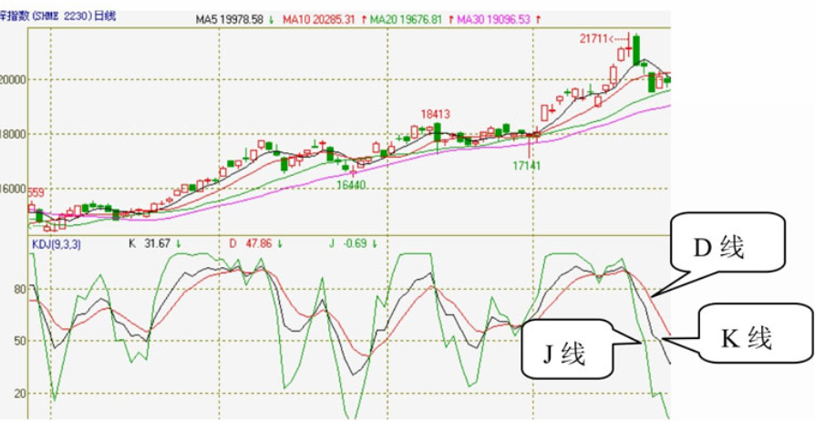
### J 线超过 100 → **极度超买**；
### J 线低于 0 → **极度超卖**（J 线最敏感，也最容易出假信号）
### 超买区（发烧/过热）：当K、D、J线超过80。
意思：市场太亢奋了，买的人太多了，像体温烧到40度。
操作感觉：该卖/该平仓了。别追高，小心主力拉高出货。
### 超卖区（发冷/过冷）：当K、D、J线低于20。
意思：市场太恐慌了，卖的人太多了，像体温掉到35度以下。
操作感觉：该买/该抄底了。别割肉，可能马上就要反弹。
### 最重要的一个信号：“金叉”和“死叉”
这是KDJ最直观、最常用的用法，不用看数值，只用看两条线谁在上谁在下。

#### 情况一：金叉（买入信号）
画面：K线本来在D线下面，然后向上穿过D线（就像剪刀咔嚓一下）。
含义：行情要涨了！ 新鲜力量进场。
操作：找机会买入。

#### 情况二：死叉（卖出信号）
画面：K线本来在D线上面，然后向下穿过D线。
含义：行情要跌了！ 上涨力量衰竭。
操作：找机会卖出或平仓。

————————————————————
## 一个好用的组合思路：

**用RSI判断大方向**：如果RSI > 50，说明买方占优，尽量只考虑做多。

**用KDJ找具体时机**：在RSI确认的多头环境下，等KDJ金叉（或从低位往上）作为入场信号。
简单记：**RSI是“力量计”**，**KDJ是“位置&速度表”**。
两者可以互补，别只用其中一个就行。
————————————————————
## 动量指标 (Momentum) --**短期指标**
有一个非常简单的市场观察：涨势中的股票，往往继续涨；跌势中的股票，往往继续跌。 
这种现象叫做「动量效应」（Momentum Effect），是被学术界和实践者广泛验证的规律之一。
动量效应（Momentum Effect）：
过去 312 个月涨幅最高的资产，未来 13 个月往往继续跑赢市场。
**动量指标就是直接量化这个现象的**：
- **动量为正** → 今天比 N 天前贵，说明最近 N 天**整体在涨**
- **动量为负** → 今天比 N 天前便宜，说明最近 N 天**整体在跌**
- **动量从负转正** → 可能是趋势的转折点
这个就是我们熟悉的**pct_change(n)，超级简单**。
### 详细解释：
- 它首先是收益率：pct_change(n) 的标准定义就是“过去 n 期的收益率”。这个没错。
- 把它称为“动量”是一种应用场景：在量化金融中，动量策略的核心逻辑是“过去涨得好的，未来大概率继续涨”。为了量化“过去涨得好不好”，最直接的指标就是“过去 n 期的收益率”。
所以，当你 把 pct_change(20) 这个指标，**拿去预测未来价格走势 时**，你就不再仅仅把它看作一个历史数据，**而是把它当成了一个动量因子**。
### 用两个不同周期？
- 短期动量（20日）：反应灵敏，抓短期趋势，但噪声多
- 长期动量（60日）：反应迟钝，但趋势信号更可靠
- 两者同向 → 趋势确立；反向 → 可能是短期波动或趋势转折

——————————————————————
## 布林通道线BOLL -- **默认窗口是20天（约1个月），是短周期指标** -- 波动率指标1
### 前置概念
- 方差：算出每个数据与平均值的差，然后把这些“差”的平方全部加起来，然后平均一下。
- 标准差：标准差 = 方差的平方根。
### 基本概念
布林通道线是根据统计学中的标准差原理设计出来的一种相对比较实用的技术指标。
参考布林线进行买卖，不仅能指示支撑位、压力位，显示超买、超卖区域，进而指示运行趋势，还能有效规避主力惯用的技术陷阱，即诱多或诱空。**该技术手段特别适用于波段操作。**
布林通道线**由上、中、下三条轨道线组成**，多数情况下，价格总是在这个带状区间中运行，并且随价格的变化自动调整轨道的位置，而带状的宽度可以看出**价格的变动幅度，越宽则表示价格变化越大**。

### 布林通道线的使用要领具体如下:
(1)价格在中轨上方运行时，多单属比较安全状态，短线可持有观望。
(2)价格在中轨下方运行时，多单属比较危险状态，短线应趁反弹接近中轨线时离场。
(3)价格突破上轨线后，回探时又不跌破中轨线，显示后市看涨，多单可持仓或加仓。
(4)价格跌破下轨线后，反弹时不站回中轨线以上，则后市看跌，多单要果断卖出，并建立空单。
(5)通道突然呈急剧变窄收拢形状时，显示价格方向将会发生重大转折，这时应结合其他指数技术进行行情判断。

用SMA的标准差做波动范围的上边界和下边界，用SMA20做中线。

————————————————————————————————
## ATR-- 真实波动幅度均值 (Average True Range) -- 波动率指标2
想象你是一个骑手，骑马走在山路上。
- 平坦的路 → 步伐很稳，每步走 1 米
- 崎岖的山路 → 步伐不稳，每步可能走 3~5 米
- ***ATR 就是量化「路有多崎岖」——价格每天平均波动多少钱。***
**这有什么用？止损设置！**
如果苹果每天的正常波动是 2 美元，你把止损设在入场价下 0.5 美元，那一天之内就可能被正常波动触发止损——这不是你真的判断错了，而是止损设得太近。
- 经验法则：止损放在 1.5 × ATR 处——超出日常正常波动范围，只有真正走坏了才会触发。
- 公式
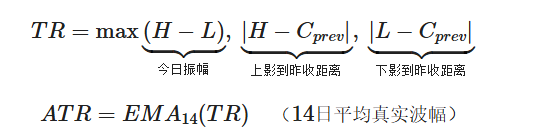
**ATR 仓位管理**：假设你的账户是 100,000 元，每笔最大亏损是总资金的 1%（即 1000 元）。如果 ATR = 2 美元，止损设 1.5×ATR，你能买多少股？（答：1000 / (1.5×2) = 333 股）

## VIX--市场恐慌指数
- **股票**：反映的是现状和过去的信息。
- **期货**：反映的是商品供需的预期。
- **期权**：反映的是资产价格变动的幅度（方差/波动率），这是衡量“不确定性”的唯一标尺。

yfinance 有vix数据，国内目前没有，可以去看看

如果你在A股市场，情况略有不同。
**A股有上证50ETF期权和沪深300ETF期权**，已经可以构建中国的VIX指数（通常叫iVIX或中国波指）。
逻辑完全一样：通过期权价格反推恐慌程度。
区别：A股散户多，非理性程度高，期权的隐含波动率往往比美股更“极端”。
————————————————————————————
## 止损转向 SAR
止损转向，又称抛物转向，其英文缩写为"SAR”。
SAR指标主要的作用在于**为投资者提供了一个止损价位**。
SAR指标可以指示出合理的买入价位，它认为当价格波动到某种情况，就必须买入或卖出，不应该期待更低或更高的价格。
SAR指标是用**圆点**表示的。
### 指标要领
(1)价格突破SAR指标时，是买卖的信号。当价格向下突破支撑位时，是卖出信号;当价格向上突破压力位时，是买入信号。
(2)**当价格趋势比较明显时，SAR指标的使用效果非常好**，**但趋势处于盘整时，SAR指标很容易失灵**。
————————————————————————————
## 能量潮指标OBV
OBV是能量潮指标的英文缩写，其理论基础是市场价格的有效变动必须有成交量的配合，成交量的多少是市场人气兴衰的代表，也是价格的动能，故成交量是价格变化的先行指标，即"先见量后见价”.
能量潮指标的计算方法是：**今日OBV值=昨日OBV值+日成交量**。若今日收盘价高于昨日收盘价，则相加；若今日收盘价低于昨日收盘价，则相减；OBV的初始值可自行确定，一般用第一日的成交量作为OBV初始值。

————————————————————————————
# 七、重要股票财务指标概念
## PB
PB（**市净率**） 是股票估值最核心的指标之一，全称是 Price-to-Book Ratio（市净率）。
PB = 每股股价/每股净资产（BPS）  **看资产值多少钱**

PB范围	                   市场含义	                            常见行业
PB < 1	破净，市场极度悲观，认为公司资产在贬值或经营有问题	 银行、钢铁、地产（经济低迷期）
PB ≈ 1	股价接近清算价值，相对合理（前提是资产真实没水分）	 成熟稳定型企业
PB = 1~3	市场给予一定溢价，认可公司的盈利能力和成长性	    制造业、消费龙头
PB > 5	市场极度看好，愿意为品牌、技术、前景付极高溢价	    科技股、生物医药（轻资产、高增长）

**PB 更适用于资产重、稳定性强、账面价值可信的行业**：
行业                 适用理由
银行       银行净资产 = 核心资本，PB 反映风险和资本结构
保险       资产庞大且以债券为主，PB 能较好衡量价值
房地产     土地+房产等重资产，净资产价值真实可变现
钢煤有色   资产重、波动大，用 PB 看周期底部价值更准
公用事业   如电网、自来水，盈利稳定，资产重

## PE
Price-to-Earnings Ratio 的缩写，中文叫 **市盈率**。
PE = 每股股价/每股净利润（EPS）= 总市值/归母净利润
通俗理解：PE 衡量的是“回本需要多少年” --PE：简单粗暴地告诉你 “按现在的利润，几年能回本”。看未来赚多少钱

PE水平                 	含义	              常见原因
低 PE（如 < 10）	  可能被低估	     市场不看好、行业夕阳、周期顶部、或真便宜
中等 PE（10～25）	  相对合理	       稳定增长的白马股、成熟行业
高 PE（如 > 30）	  可能被高估	     高成长预期、题材炒作、泡沫

**但这里有一个大坑**：PE 的高低不能跨行业直接比较。
- 银行股 PE 常年 5～8 倍 → 正常
- 科技股 PE 30～50 倍 → 也可能正常（因为高增长预期）
- 所以 PE 通常要和 同行业、历史分位 比较才有意义

类型	            计算公式	                           含义	                      价值投资用途
静态 PE	         当前股价 / 去年年报 EPS	           映历史	                      看过去，滞后
滚动 PE（PE-TTM）  	当前股价 / 最近12个月 EPS	    反映最近一年真实盈利	     最常用，兼顾时效性和真实性
动态 PE	         当前股价 / 预测未来一年 EPS	         反映预期	             依赖预测准确度，容易失真

**PE 更适合轻资产、盈利能力强、成长性大的公司**：
行业                   特点
互联网              资产轻，靠流量/平台变现
医药、生物科技       靠创新药品，成长性驱动估值
消费品（高端品牌）   利润率高，资产不多
软件、游戏          轻资产、高利润，主要靠持续盈利

## 实战思维 
- PE 高 + PB 高：高成长型公司（如科技股），市场预期它未来赚大钱
- PE 高 + PB 低：可能现在没赚钱但账面值还在，比如周期底部、资产未重估
- PE 低 + PB 高：利润不错，但资产不多，常见于轻资产服务行业（如软件、教育）
- PE 低 + PB 低：重点关注！可能是极度低估，或者市场对未来极度悲观（双杀）

## ROE-- 筛选"高质量企业"的核心指标
ROE 是 Return on Equity 的缩写，中文叫 **净资产收益率**（或 股权回报率）。
ROE=净利润（归母净利润）/ 净资产（股东权益）×100%
股东每投入 1 元钱，公司一年能帮股东赚回多少钱。
ROE衡量的是公司"用股东的钱"赚了多少钱。
它是价值投资中最重要、最核心的财务指标之一，
ROE越高，说明公司赚钱能力越强、资本利用效率越高
**巴菲特曾多次强调：“如果只能用一个指标来选公司，我会用ROE。”**
所以很多量化策略将ROE作为质量因子（Quality Factor）的代表。
### 举例：
你投资100万开了一家奶茶店（这就是净资产）
一年下来，扣除所有成本、税费后，净赚20万（净利润）
ROE = 20万 / 100万 = 20%

ROE水平	          含义	         价值投资视角
大于 15%	      非常优秀	 公司有极强的护城河、品牌溢价或技术壁垒、公司资本回报率高
10% ~ 15%	      良好	       经营稳健，值得关注，是较多优秀公司的区间
< 10%		      一般	      要么经营不善，要么是非常重资产的行业
< 5%或负	       较差	    可能存在亏损或财务风险较大
**巴菲特选股标准之一**：长期 ROE > 20%，且 连续5-10年稳定，不是靠高负债或一次性收益堆出来的。

# 回本年限
**PE**：简单粗暴地告诉你 “按现在的利润，几年能回本”。
**PB÷ROE**：详细拆解“你花多少钱买了多少净资产，这些净资产每年能赚多少钱”，不仅告诉你几年回本，还告诉你“回本的质量和确定性”。
- 实战建议：两个公式得出的数字完全相同，但在分析时，一定要看ROE。ROE越高，说明公司越有可能“持续”地创造利润，回本的时间越有保障。如果ROE很低，即使PE很低，也要慎重。

# ROA
全称是Return on Assets，中文叫**总资产收益率**。
ROA = 净利润(TTM) ÷ 总资产(TTM)   -Trailing Twelve Month ---TTM
净利润(TTM): 过去 12 个月滚动净利，能平滑季节性。
总资产(TTM):通常取期初与期末总资产的平均；更严谨可用季度滚动平均。

# 杜邦分解是什么？
这是财务分析里最经典的一个分解工具，用来把 ROE 或 ROA 拆开，看到底是哪里起作用。
## ROE 杜邦分解（三因素版）：
ROE = 净利润/净资产=净利润/销售收入 * 销售收入/总资产 * 总资产/净资产
**即：**净利率（盈利能力）× 资产周转率（效率）× 权益乘数（杠杆）
## ROA 杜邦分解（常见两因素版）:
ROA = 净利润/销售收入 * 销售收入/总资产
**即：**净利率（赚得多不多）× 资产周转率（转得快不快）

***所以 ROA 可以理解成"不靠杠杆的纯内生效率"；而 ROE 可能高，但可能是杠杆堆上去的。***

# 折现率
 = 贴现率 = 把未来的钱，折算成今天的钱，所使用的“打折比例”。

现值 = 未来的现金流 / (1 + r)^n
其中：
r = 折现率（Discount Rate）
n = 年数（未来第几年）未来现金流 = 到那一年预计能赚的钱

假设你最好的朋友跟你说：
选项A：今天立刻给你 100万。
选项B：一年后给你 110万。
你选哪个？
如果按10%的折现率/贴现率来计算：
一年后的110万，折算到今天，价值 = 110万 ÷ (1 + 10%) = 100万。
这意味着，对你来说，今天的100万，和一年后的110万，价值完全相等。

## 举例
你打算投资某公司，预计它未来三年每年都赚 100 万。 你认为这个公司的风险不小、行业波动大，**你要的年化收益是 12%，也就是你选的折现率 r = 12%**：现值 = 100/(1+0.12)^1 + 100/(1+0.12)^2 + 100/(1+0.12)^3 = 89.29 + 79.73 + 71.19 ≈ 240.21 万所以你认为今天这家公司最多值 240 万，如果它要价 300 万，你觉得"不值"。

# 利率
利率是"资产价格之锚"。
国债收益率，就是整个金融市场折现率的“锚”。
资产类别          影响机制
债券       直接决定价格（折现未来现金流）
股票       利率↑ → DCF估值↓ → 股价承压
房地产     贷款成本↑ → 房价↓
大宗商品   通常反向相关：利率↑ → 商品价格↓（因持仓成本↑）
————————————————————————————————————————————————————
利率越高，未来现金流现值越低，资产估值越保守。
2022年美联储加息周期，科技成长股和美债价格同步下跌，黄金等无息资产阶段性上涨。
实战提示：关注利率变化，是资产配置和风险管理的核心。
#  经济术语
## **MLF操作**
全称“中期借贷便利”（Medium-term Lending Facility），是央行向银行体系“批发”中期资金的一种核心工具。因为它的简称“MLF”读起来像“麻辣粉”；
可以把它理解为央行向商业银行发放的一种有质押、有期限的特殊贷款，目的主要是调节市场里的中期资金量，并引导贷款利息走向。
- 补充“弹药”：银行日常需要大量资金来应对贷款、投资等业务。通过MLF，央行可以直接、批量地向银行注入中长期的稳定资金，帮助银行撑过资金紧张的时候，或者支持它们在特定时期（比如政府债券集中发行时）的融资需求
- “精准滴灌”：央行可以通过MLF，引导银行把借到的钱更多地投向国家支持的重点领域，比如“三农”（农业、农村、农民）和小微企业

## **7天期逆回购操作利率**
**央行为商业银行提供短期(7天)资金时收取的利息。它是目前中国货币政策最重要的官方基准利率。**
- 本质：央行借钱给商业银行（并约定7天后收回）的“资金价格”。
- 地位：它是中国新的核心政策利率。央行通过调整它，来直接影响整个市场的利率水平（比如你买理财、贷款或债券的利率）。
- 影响：
降息（利率下调） → 货币政策宽松 → 利好股市、债市、商品期货。
加息（利率上调） → 货币政策收紧 → 利空。
- 一句话总结：它是观察中国货币政策风向最直接、最重要的一个数字。
## **票据直贴利率**
企业A：手里有一张银行承兑汇票（比如6个月后才能拿到100万），但现在急需用钱。
银行：愿意收下这张票，提前把钱给企业。
- 什么是贴现？
企业A把没到期的票据卖给银行，提前换成现金。银行扣除从贴现日到票据到期日的利息后，把剩余的钱给企业。
- 什么是直贴利率？
银行在办理这个“买入票据”业务时，所使用的利率。它就是**企业短期融资的成本**。
- **MLF操作**，会让该**利率，下降**。“净投放”往往伴随着**“票据直贴利率”的下降**。

# Ⅰ基本面分析
## 一、供给对期货商品价格的影响
### 库存量
1. 生产供应这存货；
2. 经营商存货；
3. 政府储备；
### 本期产量
### 本期进口量
## 二、需求对期货商品价格的影响
1.国内消费量；
2.国际市场需求分析；
3.期末结存量；
## 三、利率和汇率的影响
1.利率：对金融衍生品交易影响大，对商品期货的影响小；
2.汇率：比如，巴西出口大豆给中国，谁的货币升值或贬值，对进出口影响更大
巴西雷亚尔贬值对中国进口商有利（直接降价）；人民币升值同样对中国有利（倒逼巴西降价），但会挤压巴西农民的利润。
## 四、经济波动周期的影响
经济波动周期一般由**衰退**、**萧条**、**复苏**和**繁荣**四个阶段构成。
1. **通胀（通货膨胀）**：物价持续上涨，钱不值钱了。通常伴随经济过热，会产生大量泡沫。
2. **滞涨（停滞性通货膨胀）**：物价上涨（通胀）与经济停滞（失业高、增长停）同时发生，很难治理。
3. **通缩（通货紧缩）**：物价持续下跌，钱更值钱了。但企业利润缩水、减产裁员，大家更不敢花钱，容易形成恶性循环。
## 五、政治因素影响

# Ⅱ、技术分析
分析期货价格行情的历史走势。
1.**市场行为包容消化一切**；
2.**价格以趋势方式演变**；
3.**历史会重演**；
## 技术分析的类型
1. K线分析技术；--有利：短线
2. 形态分析技术；--有利：长线
3. 趋势分析技术；--有利：长线   
  趋势线、通道线、支撑线、压力线、黄金分割线
4. 指标分析技术；--有利：短线
5. 理论分析技术；

# 产业方强，主力控盘的期货品种
**1、红枣**：没有之一，红枣整个产业链上下游都在套保，直接把盘子都套崩了，不给多头留一点余地。

**2、多晶硅**：本身就是垄断行业，交割又是品牌交割，在加上限仓，妥妥的行业控盘，想涨就涨，想跌就跌，完全就是产业说了算。

**3、生猪**：现在都是集团化养殖，龙头企业不仅控制现货，还控制期货，大幅盘面套保，金融资金跟产业协同作战，收割散户。

**4、纸浆**：纸浆曾经发生过逼仓，早期上市的时候，企业想交货，结果没有交割库，眼睁睁的看涨高价格无法套保，后来交易所增加交割库，产业联合起来，最终逆风翻盘，金融资金再也不敢逼仓了。

**5、镍**：有色是国际化品种，但是有些金属资源我们控制的很牢，镍矿就是其中之一，尽管在国外，我们也能说了算，当年逼仓就是冲着国内某大企业来的，镍产业还算强势。

**6、花生**：花生基本是油厂说了算，盘子小，很容易控盘，交割走过场，疯狂割散户，多少抄底花生的多头都被收割了，而且一茬一茬收，很多人把食用花生当作油料花生去做期货，损失惨重。

**7、豆粕**：总体上我感觉大豆还是国家队，尤其是粮叔说了算，经常是外资跟粮叔打太极，外资加仓拉涨，粮叔就套保加仓，外资撤离减仓，粮叔就解套撤退，配合极其默契，一来一回，点位还是那点位，散户钱没了。

**8、PVC**：pvc算是化工里产业力量比较强的，中财长期做套保，妥妥的产业主力，长期盘踞在龙虎榜多头榜首席位，不管寒来暑往，始终不离不弃，只做移仓换月。

**9、纯碱玻璃**：严格说起来，玻璃纯碱的产业不是很强，主要是期现商会倒腾，经常把现货拿来做仓单，实际上也反映现货比较强，只不过是间接的。

**10、尿素**：尿素这玩意就是政策市，很多企业用期货做套保业务，做点对冲，但是本身盘子压得很低，套保也就是保个本，不好大赚。

化工里，**苯乙烯**，**PTA**，**乙二醇**，**液化气**，产业也是比较强的，**白糖**，**橡胶**，**钢材**，产业也相对强势一些。
还有一些品种，产业看似很厉害，但是实际上非常弱鸡，比如**碳酸锂**、**苹果**、**鸡蛋**、**豆油**、**菜油**、**棕榈油**、**棉花**、**合金**这些，完全就是被资本带着走，没啥自主意识，反而是产业看盘面去决定方向。

- **产业强，则套保能力强**，
- **产业弱，则逼仓能力强**，散户投机参与的话，一定要警惕，千万别站错队伍。
  

# 与国际接轨的期货商品
## 贵金属类
品种	国内合约	对应外盘	接盘程度
黄金	AU（上期所）	COMEX黄金	⭐⭐⭐⭐⭐ 全球夜盘联动
白银	AG（上期所）	COMEX白银	⭐⭐⭐⭐⭐
## 农产品类
大豆（豆一/豆二）	A/B（大商所）	CBOT大豆	⭐⭐⭐⭐
豆粕	M（大商所）	CBOT大豆→豆粕	⭐⭐⭐
豆油	Y（大商所）	CBOT豆油	⭐⭐⭐
棕榈油	P（大商所）	BMD马棕油	⭐⭐⭐⭐ 马来西亚定价
白糖	SR（郑商所）	ICE原糖	⭐⭐⭐
棉花	CF（郑商所）	ICE美棉	⭐⭐⭐
## 有色金属
品种	国内合约	对应外盘	接盘程度
铜	CU（上期所）	LME铜	⭐⭐⭐⭐⭐ 全球定价基准
国际铜	BC（能源中心）	LME铜	⭐⭐⭐⭐⭐ 专为境外投资者设计
镍	NI（上期所）	LME镍	⭐⭐⭐⭐ 2022年逼仓事件后规则趋严
铝	AL（上期所）	LME铝	⭐⭐⭐⭐ 国际联动
## 能源化工
品种	国内合约	对应外盘	接盘程度
原油	SC（上海国际能源中心）	WTI、Brent	⭐⭐⭐⭐⭐ 全球联动，国内绝对跟随
低硫燃料油	LU	新加坡燃料油、Brent	⭐⭐⭐⭐ 已开放境外投资者
20号胶	NR	新加坡TSR20、日胶	⭐⭐⭐⭐ 天然橡胶国际定价锚

# 黄金---操盘举例

