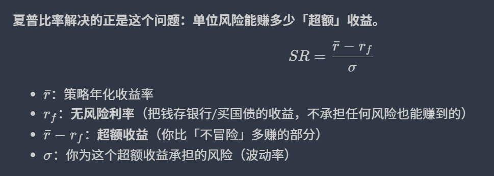

懂均值、标准差、相关系数、假设检验，有助理解因子有效性。

# 均值mean

# 对数
对数就是**求指数**，100的平方是10000，对数就是2

## 苹果股票从 100 涨到 110，再跌回 100
### 普通收益率(也叫‘简单收益率’Simple Return)
第一天: (110 - 100) / 100 = +10%
第二天: (100 - 110) / 110 = -9.09%
两天的收益率加起来 = +10% + (-9.09%) = +0.91%
**但股价明明回到了原点，收益率却显示赚了 ***0.91%***，这就是普通收益的毛病——涨跌不对称，***不能直接加***。**

***正确做法：***
总收益率=(1+r1​)(1+r2)−1
= (1+0.10)×(1−0.0909)−1 
≈ 0
### 对数收益率
python
第一天: ln(110/100) = ln(1.1) = +0.0953 = +9.53%
第二天: ln(100/110) = ln(0.909) = -0.0953 = -9.53%
两天的对数收益率加起来 = +9.53% + (-9.53%) = 0

**股价回到原点，总收益就是零，完美对称，可以直接加。**

## e 
在量化交易里，我们用的底数几乎永远是数学常数 e ≈ 2.718。
e 就是利滚利的极限——不是一年滚一次，不是一天滚一次，而是每一瞬间都在滚。
以 e 为底的对数，叫做自然对数，记作 ln。
- ln(100)≈ 4.605 就是在问：“e 要乘以自己多少次，才能等于 100？” 
- ln(110/100) =ln(1.1) ≈ 0.0953         --110/100 = 1.1
就是再问：一笔钱，以 100% 年利率，连续不停地利滚利，需要多久才能变成原来的 1.1 倍？
答案是约 0.0953 年。

# 正态分布
正态分布就是**大部分数据集中在平均值附近**，越往两端数据越少的分布形态。

# 均匀分布
正态分布是“中间多，两边少”。
均匀分布是每个值出现的概率完全一样。

# 方差variance  /ˈveəriəns/
## 方差，就是衡量一组数据“有多散”的数字。
方差怎么算？（看一眼就行，不用记）
- 先算平均值
- 看每个数和平均值差多少
- 把差值平方（消除正负号），再取平均

# 标准差standard deviation
标准差 = 方差的平方根。

[ 0.01018006  0.00974238 -0.01630153 -0.0133248  -0.00164692]
这是一组等权组合收益率，定量随机数模拟
这一组数得方差和标准差，衡量的正是组合收益率的波动风险。
- 组合平均日收益: -0.2270%
- 标准差 (1.1125%)：代表“**日常波动的典型幅度**”
它最直观。它告诉我们，这 5 天里，等权组合的每日收益率，平均来看偏离均值大约 1.11%。这意味着这个组合每天波动 1% 多一点是常态。
- 方差 (0.012376%)：代表“波动剧烈程度的平方”
它更偏数学定义（标准差的平方），虽然数值本身不直观，但它是计算过程中的关键一环（比如在后面的协方差矩阵、PCA分析里，用的都是方差）。
- 结合之前算出的 组合平均日收益 (-0.2270%) 来看，这个结果很不理想：
收益与风险不匹配：平均日收益是负的 (-0.23%)，但日波动风险却有 1.11%。相当于承担了不小的波动，但最终没赚到钱反而微亏。

这是随机模拟的正常表现：因为股票和天数都是随机生成的，短期出现负收益是正常的。这正好说明，这套从收益率矩阵计算组合风险和收益的**逻辑完全跑通了**。

# 相关系数

# 假设检验

# 协方差
就是用来衡量两个东西（比如两只股票）是“同进同退”，还是“你进我退”的一个数字。

- 情况一：正协方差（同涨同跌）
日期	    A	     B
第1天	   +1%	  +1%
第2天	   0%	    0%
第3天    -1%	  -1%
A涨B就涨，A跌B就跌，完全同步。
→ 协方差是个正数（0.67） 

- 情况二：负协方差（你涨我跌）
日期	    A	     C
第1天	   +1%	  -1%
第2天	    0%	   0%
第3天	   -1%	   +1%
A涨C就跌，A跌C就涨，完全反向。
→ 协方差是个负数（-0.67）

- 情况三：零协方差（没关系）
日期	   A	     D
第1天	  +1%	    +1%
第2天	  0%	    -2%
第3天	  -1%	    +3%
A的涨跌和D的涨跌，看不出任何规律，各走各的。
→ 协方差接近 0

- 总结：
| 协方差的值 | 意思 | 量化应用 |
|:---|:---|:---|
| **正数** | 同涨同跌 | 组合风险高，跌一起跌 |
| **负数** | 一个涨一个跌 | 可以做**对冲**，降低风险 |
| **接近0** | 各走各的 | 可以**分散投资**，鸡蛋放不同篮子 |

**协方差矩阵**，就是把所有股票两两之间的协方差，放进一张表格里。就这么简单。

## 观察协方差矩阵得方法
【3×3协方差矩阵】:
           AAPL      MSFT     GOOGL
AAPL   0.012829 -0.002300 -0.012787
MSFT  -0.002300  0.037082  0.004655
GOOGL -0.012787  0.004655  0.051983

- 1. 看对角线：谁波动大？
AAPL   0.0128   ← 最小
MSFT   0.0371   ← 中等
GOOGL  0.0520   ← 最大，波动最剧烈
对角线 = 方差 = 自己的波动大小。

- 2. 看非对角线：谁跟谁是一伙的？
关系	        值	       符号	            意思
AAPL - MSFT	-0.0023	   负，接近0	       几乎没关系
AAPL - GOOGL	-0.0128	  明显负	        你涨我跌
MSFT - GOOGL	+0.0047	  正，不大	       微弱同向

# PCA实现得逻辑
概念：（主成分分析，Principal Component Analysis）

1、一个组合得收益率数据；
2、做成协方差矩阵（描述关系）：把两两之间的同涨同跌程度，浓缩到一张表里。
3、特征分解（找出独立的力量）：组合中得品种或者股票，不是完全独立的，它们的波动可以分解成几个互不相关的独立力量。
- 就像把一杯混合果汁，分离成"橙汁成分 + 苹果汁成分 + 水成分"。分离出来之后，你才知道哪个成分占比最大。
4、特征值（量化每个力量的强度）
特征值越大 = 这个力量影响越大，能解释的波动越多
方差比例 = 这个力量的"贡献率"；
5、特征向量（解释每个力量由哪些股票构成）
特征向量里的数值，就是每只股票在这个力量里的"权重"。

# 市场因子寻找 
第一主成分解释了多少总方差
    
如果比例高（例如 > 50%）：
    “大盘/板块力量很强，个股跟着一起走”
    → 应用：风险分解、市场中性对冲
    ↓
如果比例低（例如 < 30%）：
    “个股各走各的，板块效应弱”
    → 应用：分散投资、选股策略，或预示着市场风格转变

# 波动率
数学上就是收益率的**标准差（Standard Deviation）**

# sharpe 

**夏普比率的解读（经验参考）：**
| 夏普比率 | 解读 |
|---------|------|
| < 0 | 还不如存银行 |
| 0 ~ 0.5 | 勉强 |
| 0.5 ~ 1 | 可以接受 |
| 1 ~ 2 | 良好 |
| > 2 | 优秀（大型基金能做到 1 就已经不错了） |

# 最大回撤
从历史某个高点出发，跌到最深的那个谷底，跌了多少百分比？

- 最大回撤 < 10%：非常稳健（大型对冲基金的目标）
- 最大回撤 20%~50%：个人可以接受，但要有心理准备
- 最大回撤 > 50%：除非你铁石心肠，否则很难拿住到反弹

# 贝叶斯
贝叶斯不是"概率的概率"，而是用概率分布来表示不确定性：
from scipy.stats import beta
Beta分布是贝叶斯分析中处理"概率参数"的工具，"概率的概率"是它的应用场景，但贝叶斯远不止于此。

# 数据清洗
1. 空值处理：前向填充，线性插值
2. 异常值处理：
如果在原始价格上算标准差，高股价时的波动会显著大于低股价时，**这叫“异方差性”**。
在检测异常值前，先取对数。对数收益率的分布通常比百分比收益率更接近对称，更容易识别出真正的离群点。
3-sigma 法则：识别出偏离平均值 3 个标准差以外的点
3. 复权：把股价因分红、送股、拆股等除权行为造成的价格缺口，人工修复成连续的价格曲线，让你看到真实的收益情况。
注：**tickflow 的数据**，经过测试，需要使用**前复权**的方式，获取股票数据。

# 机器学习
从 OHLCV 原始数据到能喂给机器学习模型的特征矩阵，是关键的"炼金术"。
**核心原则**：用**收益率**而非价格（平稳性），用**滚动标准化**而非全局缩放（防止未来泄露）。
## 严谨性：掌握平稳性检验（ADF Test）处理非平稳价格序列
## 防御性：理解滚动标准化（Rolling Scaling）防止未来泄露
大多数**量化模型要求输入数据是平稳的 (Stationary)**。平稳意味着数据的均值和方差不会随着时间发生巨大漂移。
**价格是不平稳的**（今天 100 元，明年可能 200 元），直接用价格训练模型会导致“伪回归”。
我们需要使用**收益率**或**价格差分**。

## 举例1--**构造基础特征矩阵**
### 收益率特征
df['ret_1d'] = df['Close'].pct_change() #日收益率
df['ret_5d'] = df['Close'].pct_change(5) #5日收益率

### 波动与动量--波动率和均线偏离度
df['vol_20d'] = df['ret_1d'].rolling(20).std()
-- 用日收益率序列，创建一个20天的“滑动窗口”，计算窗口内收益率的标准差
-- 每天计算过去20天的收益率标准差，标准差越大 → 股价上蹿下跳越厉害 → 波动率越高 → 风险越大
-- 标准差越小 → 股价越平稳 → 波动率越低
df['ma_ratio'] = df['Close'] / df['Close'].rolling(20).mean() - 1

### 价格形态特征
-- 这两行代码是在计算K线（蜡烛图）的上影线和下影线相对于收盘价的长度比例。这是量化分析中常见的一种技术特征工程，用于**捕捉日内多空博弈的信息**。
-- 上影线长度 ÷ 收盘价，表示上影线相对于价格水平的比例。
-- 下影线长度 ÷ 收盘价，表示下影线相对于价格水平的比例。
-- upper_shadow = (最高价 - 实体顶部) / 收盘价 → 上方抛压强度
-- lower_shadow = (实体底部 - 最低价) / 收盘价 → 下方支撑强度
df['upper_shadow'] = (df['High'] - np.maximum(df['Close'], df['Open'])) / df['Close']
df['lower_shadow'] = (np.minimum(df['Close'], df['Open']) - df['Low']) / df['Close']
print("特征构建完成")

## 防御性特征工程：**滚动标准化**
用 StandardScaler().fit(X) 处理整个数据集。**这会产生 Look-ahead Bias**
Look-ahead Bias（向前看偏差）：在金融分析中，一种使用未来信息来预测过去事件的错误，可能导致投资策略的过度优化和误导性结果。
在计算第 100 天的特征时，你实际上参考了第 500 天的数据（因为模型计算了全局均值）。
**对策**：***滚动标准化 (Rolling Scaling)***
只使用过去 N 天的数据来计算当天的均值和方差进行缩放。

## 趋势类指标

