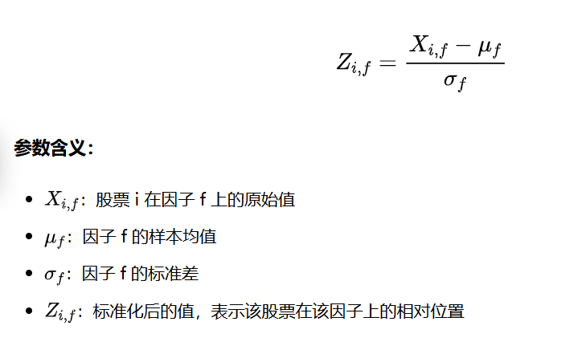

# 定量交易的优缺点
像任何交易策略一样，定量分析既有优点也有缺点。

## 优点
- 冷静：在量化交易中，模式和数字才是最重要的。这是一种有效的买卖纪律，因为它可以持续执行，不受理财决策常伴随的情绪影响。
- 成本效益：依赖量化策略的公司无需雇佣大量分析师和投资组合经理团队，也无需出差评估潜在投资。他们使用计算机分析数据并执行交易。
## 缺点
- 易受数据操控：量化分析涉及对海量数据的筛选。选择正确的数据绝非保证，就像那些看似预示某些结果的交易模式可能完美无缺，直到事实并非如此。即使某个模式看起来有效，验证这些模式也可能是一个挑战。
- 定性因素很重要：像2008-09年股市下跌这样的拐点对这些策略来说可能很艰难，因为模式可能突然变化。人类可以看到丑闻或管理层变动的过程，而纯数学方法未必能做到这一点。
- 广泛使用：随着越来越多的投资者尝试采用该策略，策略的效果会减弱。有效的模式会随着越来越多的投资者试图从中获利而变得不那么有效。

# 什么是量化金融？
量化金融，全称为量化金融，利用大量数据集和数学模型来分析金融市场的模式。交易者用它来预测市场的表现，然后根据这些预测买卖证券。

# 什么是量化分析师？
量化分析员或量化交易员是指利用定量分析分析金融市场并做出交易决策的交易者。

# 定量分析和定性分析有什么区别？
- 定量分析利用统计模型仅基于可测量的因素做出预测或得出结论。
- 定性分析利用主观、非数值数据，如观点、态度或经验，进行预测。

# 基本面分析
基本面分析是一种通过衡量股票内在价值来评估证券的方法。基本面分析师研究从整体经济和行业状况到公司的财务状况和管理等方方面面。
盈利、支出、资产和负债等报告都是基本面分析的重要特征，帮助分析师确定企业的公允价值。

# 技术分析
技术分析与基本面分析的不同之处在于，股票的价格和成交量是唯一的输入。
主要观点是所有已知的基本面都已反映在价格中，因此不会被仔细审视。
技术分析师并不试图衡量证券的内在价值，而是利用股票图表识别预测未来股价走势的模式和趋势。

# 基本面分析和技术分析有什么区别？
基本面分析是一种通过衡量股票内在价值来评估证券的方法。而技术分析的核心假设是，所有已知的基本面都被纳入价格;因此，无需过于关注它们。技术分析师并不试图衡量证券的内在价值，而是利用股票图表识别可能暗示未来价格走势的模式和趋势。

# deepseek给得一些前置概念，觉得有用，保留下来
## 1. 为什么“量化”常被认为更适合短线、高频？

处理海量实时数据：量化模型可以毫秒级分析tick级数据、订单流、盘口变化等，捕捉人工无法感知的瞬时定价偏差。
高频套利与做市：通过抢速度在多个市场间套利，或通过提供双边流动性赚取微小价差，这些确实依赖量化系统。
回测优势：短线策略在历史数据上的回测结果与实盘偏差相对可控（滑点和冲击成本仍是难题），比长线策略更容易验证。

## 2. 为什么“长线投资也用得上量化”？
长线投资不需要量化，是常见的误解。实际上，量化在长线场景中同样有用，只是形式不同：
**系统化选股（因子投资）**：用价值、动量、质量、低波等因子，通过量化模型筛选一篮子股票，避免主观偏见和情绪干扰。经典如“AQR”“桥水”的某些策略，持仓周期数月到数年，但背后全是量化模型。
**风险管理与仓位控制**：量化模型计算组合的VaR（风险价值）、极端情景损失、行业暴露、杠杆率等，用来指导长期仓位调整。
**宏观配置与再平衡：**基于量化信号（如估值分位数、利率周期、资金流）做股债商比例调整，这属于长线战术或战略配置。
避免行为陷阱：纪律性执行卖出或买入规则（比如“单季度ROE下降超20%且估值高于历史80%分位时减持”），防止情绪化的追涨杀跌。

## 3. 一个更本质的视角
量化不等于高频。量化的核心是用数学模型和统计方法做决策，而不是交易频率。
**决策来源**：长线投资如果靠“我觉得公司好”“我看好赛道”，那就是主观定性；但如果用财务数据、估值、宏观指标建立评分模型并严格按规则执行，这就是量化。
**现实中**：很多长线私募（包括一部分价值型对冲基金）内部都有量化研究团队，用模型做初筛、风险控制、行业轮动信号，基金经理再结合深度研究做最终决策。
**短线高频**：量化是生存门槛，因为人工无法竞争。
**长线投资**：量化不是必需的，但它能帮助更系统、更纪律、更可回测地执行长线策略。对于个人长线投资者，简单规则（比如“市盈率低于15倍且股息率高于4%时定投买入”）就已经是简易量化了。
**误区来源**：媒体常把“量化”与“高频交易”捆绑，导致很多人认为量化就是每秒几百次买卖。但实际上，**低频量化**（**日频甚至周频调仓**）在机构中非常普遍。
所以，回到你的原话：“长线投资用不着量化”——不依赖量化，完全可以做长线；但引入量化（哪怕很简单的模型），往往能帮你做得更稳、更理性、更可复制。

# 量化类型？？？？先不看
当下主流量化策略分为四类：
**一、多因子选股**，也是最常见的指数增强玩法，依托财务、资金数据选股，持仓分散，适配中长期投资；
**二、均值回归**，利用价格涨跌回归中枢的规律套利，适配震荡行情；
**三、趋势动量跟踪**，跟随市场涨跌顺势交易，单边行情收益可观，震荡行情容易亏损；
**四、是高频交易**，依托高速设备抓取毫秒差价，门槛极高，监管管控严格，普通投资者无法参与。
**五、统计套利**：利用历史统计规律和概率论，捕捉资产价格之间的短期偏离
**六、事件驱动**：基于公司事件（财报、回购、并购）或宏观事件（政策、经济数据发布）的预测性交易
**七、机器学习策略**：利用深度学习、随机森林等算法挖掘非线性关系或另类数据

## 典型策略类型
1. RSI 均值回归策略（超卖买入）
2. 布林带突破策略（价格突破通道）
3. 双均线 + RSI 组合策略（趋势 + 过滤）
4. 价格动量策略（买强卖弱）

## 以下指标，都是**买卖股票的择时**，就是股票的：**买卖时机**
**趋势指标**：macd（ema）、 均线（sma）
**动量指标**：RSI,KDJ，Momentum
**波动率指标**：布林带，ATR,VIX

## 补充知识
### 单只股票/股票组合   的  beta
单只股票的 Beta —— “随大流”的程度
核心理解： 当大盘（比如沪深300指数）涨跌1%时，这只股票平均会跟着涨跌百分之几？
计算公式： 通过历史数据（比如过去1年的日收益率）进行线性回归。
- 自变量 X： 大盘每日收益率
- 因变量 Y： 股票每日收益率
回归得到的斜率 (slope) 就是 Beta。
 Beta 值	        股票性格	                       举例
**β = 1**	      和大盘同步	                    大盘涨1%，它也平均涨1%。
**β > 1**     进攻型/高波动	      β=1.5，大盘涨1%，它倾向于涨1.5%（牛市涨更多）；大盘跌1%，它跌1.5%（熊市跌更惨）。券商股、科技股通常Beta较高。
**0 < β < 1**  防御型/低波动	      β=0.5，大盘涨1%，它只涨0.5%（涨得慢）；大盘跌1%，它只跌0.5%（跌得少）。公用事业股（电力、水务）、必需消费品通常Beta较低。
**β = 0**	      与大盘无关	极少见。           长期横盘或无规律的股票可能接近0。
**β < 0**	反向指标	极其罕见。大盘涨它反跌。           一些黄金股或特殊情境下的股票可能出现。
***关键点***： **单只股票的Beta不是固定不变的**  它会随市场环境、公司基本面、投资者情绪的变化而改变。因此计算时需要选择合理的回溯窗口（比如1年或3年）。

### 股票/组合的alpha
股票的 Alpha —— “自身实力”的超额收益，**量化追求的就是alpha的效果是否满意**
这是理解上的关键点，需要和基金的Alpha区分开！
基金的Alpha： 基金经理主动管理带来的超额收益，是我们追求的“好”东西。
股票的Alpha： 在数学回归模型里，它指的是股票实际收益中，无法被大盘（Beta）解释的那一部分“残差”的平均水平。这个Alpha可能是正，也可能是负。
股票收益率 = **Alpha + Beta × 大盘收益率 + 误差项**
Alpha（截距，intercept）： 回归直线与Y轴的交点。它衡量的是：当大盘收益率为0%时，这只股票平均的收益率是多少？
Alpha值	                含义	               通俗理解
**α > 0**   这只股票长期跑赢了大盘。         即使大盘不涨不跌，它自身也有超越市场平均水平的动力（比如业绩持续高增长、独特护城河）。	这只股票“自带光环”，有“自身实力”。
**α = 0**	  这只股票的涨跌完全由大盘解释。    它就是个“跟随者”，没有自身额外的动力或拖累。	随波逐流，没有个性。
**α < 0**	  这只股票长期跑输大盘。           即使大盘不涨不跌，它自身也有拖累（比如基本面恶化、行业不景气）。	这只股票“自身有坑”，跑得比大盘还慢。

## 因子相关
Alpha 是衡量"你的策略比大盘多赚了多少"
因子（factor）是给"每只股票未来涨多少"做预测评分
因子 = 给股票打分的规则。得分高的，预期未来涨得多。

因子类型	              打分逻辑	                 例子
价值因子（Value）	     越便宜得分越高	         PE 低、PB 低、股息率高、EBITDA 就是“企业赚到的现金流水（在扣除财务包装和资产折旧之前）”
动量因子（Momentum）	 近期涨得越猛得分越高	  过去 12 个月涨幅          **对应--动量指标和趋势指标**
质量因子（Quality）	   公司越健康得分越高	    ROE 高、负债率低、利润稳定
规模因子（Size）	     市值越小得分越高	    小盘股长期跑赢大盘股
波动率因子（Volatility）波动越小得分越高	      低波动股票长期风险调整后收益更好  **对应--波动率指标**
成长因子	             增长越快得分越高	     营收增速、利润增速

因子是选股的"打分标准"，来自公开数据。
你用因子选出高分股，如果这些股平均表现比大盘好，你就有了 Alpha（你的选股方法有效）。

## 完整选股流程
第1步：股票池筛选（Universe Selection）
  从全市场 5000 只股票中，剔除不能买的
  → 剔除成交量太小的（买了卖不出去）
  → 剔除市值太小的（信息不透明）
  → 剔除 ST、停牌、新股等
  → 剩下 500 只"可以买的股票" = 股票池

第2步：因子选股（Factor Analysis）
  在 500 只股票中，用因子打分
  → 得分高的 50 只：买入
  → 得分低的 50 只：卖空或不买

第3步：构建策略（Strategy Design）
  决定怎么买：等权？按因子得分加权？按风险平价？ --05章1，2节的内容
  决定怎么卖：定期调仓？触发止损？

第4步：回测（Backtesting）
  用历史数据跑一遍，看策略过去的表现

第5步：绩效评估（Performance Evaluation）
  年化收益、夏普、最大回撤、Alpha、Beta...

第6步：归因分析（CAPM/APT → 赚的钱从哪来的） 
先搞清楚"钱从哪来的"（归因）
→ 再决定"怎么调更好"（优化）
比如归因发现：Alpha 是负的，全靠 Beta 赚钱
→ 优化方向：换因子、加新因子、调参数

第7步：优化/调参（Optimization）
  调参数、换因子、加风控 → 再回测 → 再评估
  反复循环，直到满意

第7步：实盘（Live Trading）
  用小资金验证 → 确认和回测一致 → 逐步加大资金

# 逻辑与流 -- 学习
## 第六章（新的知识，硬核金融知识，不好理解，先放一放，不作为重点，只作为常识补充认知）
  --该章中的一些曲线数据，使用来做量化宏观层面的信号判别的
曲线类型            数据来源            主要用途            获取难度
国债收益率曲线    国债二级市场价格    无风险基准、资产定价      容易
OIS曲线          隔夜指数互换利率    货币政策预期             中等
利率互换曲线      IRS市场报价        银行资金成本、衍生品定价    难  
信用债曲线       企业债/公司债价格     信用风险定价            中等

### 新手快速上手建议
1.先从免费数据开始：FRED、央行官网、财经网站
2.重点关注关键期限：3M、2Y、5Y、10Y、30Y
3.学会基础计算：斜率(10Y-2Y)、曲率、利差
4.理解不同曲线差异：国债vs OIS vs 互换曲线
5.结合宏观事件分析：加息、QE、经济数据对曲线的影响

### 意义：为什么它是重要的宏观信号？
1.政策预期：从 OIS/国债曲线抽前几次"隐含加息/降息路径"，评估货币政策方向与节奏
2.增长/通胀线索：长端名义利率 ≈ 实际利率 + 通胀补偿（再叠加期限溢价）。长端变化对"长期增长与通胀锚"很敏感
3.金融条件：曲线陡峭化改善银行净息差（NIM），倒挂挤压息差。金融周期与信用扩张会受影响
4.企业与财政：融资期限选择、负债久期管理、再融资成本与债务可持续性
5.资产定价折现率：权益、房产、基础设施等长期资产的估值都对长端利率/期限溢价高度敏感

### 量化与交易层面的"怎么用"？
1) 常用指标（信号口径）
- 斜率（Slope）：S10Y-2Y =y10-y2;或10Y-3M、5Y-2Y 
- 曲率
- 远期利差
- 期限溢价估计

# 期望收益（Expected Value）
假设某股票未来一年有三种可能：
涨 20%，概率 30%
涨 5%，概率 50%
跌 10%，概率 20%
期望收益 = 20% × 0.3 + 5% × 0.5 + (-10%) × 0.2 = 6% + 2.5% - 2% = 6.5%

# 策略--ROE
PE + ROE：挑选性价比最好的公司

ROE/PE（类似于盈利收益率回报效率）

策略思路：PE低说明便宜，ROE高说明赚钱能力强，ROE/PE越高越划算，像"打折的好公司"这类似于"盈利性价比因子"，在A股策略中非常常见。

指标组合                        解读：
高ROE + 高负债 + 低ROA     风险高，公司"靠借钱赚钱"
高ROE + 低负债 + 高ROA     高质量公司，真正能赚钱

建议在行业内排序ROE，再选高ROE股，可以控制行业偏差
可用ROE的同比/环比增长率或者三年平均ROE增速作为"动态ROE因子"

##  实战技巧汇总
技巧                     说明
单因子         ROE排名 + 行业中性化，选前10~20%
多因子组合     ROE + PE/PB + 盈利增速，构成"质量+价值"复合模型
排除异常       剔除ST、低市值、负ROE、极高负债股票
行业中性       每个行业内选高ROE，更稳定  
趋势追踪       用ROE变化趋势构建"ROE Momentum"因子

## ROA在量化中的典型应用
### 1）横截面选股（质量/盈利能力因子）
- 直观做法：每月/每季行业内按 ROA 排名，做分位或 Z 分数，买高 ROA、卖低 ROA（或只做多前 20%）。
- 常与"价值、动量、规模、波动率"因子组合，提升信息比。
- 评估：看 IC / Rank IC、分位收益、信息比、收益曲线稳定性等。

### 2）趋势与变化率（ΔROA）
- **仅看"高不高"不如看"变好没有"**。
构造 ΔROA     -- Δ（读作“德尔塔”，Delta）在财务分析中，代表“变化量”或“变动幅度”。
ΔROA = 本期的ROA - 上一期（或去年同期）的ROA
（QoQ/YoY/TTM 的变动）或加速度（Δ 的变化），常可捕捉改善拐点。
- 策略：行业内先筛改善幅度，再叠加绝对水平，兼顾"好公司 + 变更好"。

### 3）质量组合（Quality）
- 与毛利率、资产周转率、低杠杆、低应计（低应收/存货扩张）等合成质量分。
- 文献与业界经验表明：高盈利 + 低应计的组合更稳健。

### 4）估值/盈利联动（Profitability–Valuation Matrix）
- 将 ROA 与 PE/EV 等估值结合：优先"高 ROA 且不贵"。
- 进一步可用近似 EVA 思想：
关注 
ROA - 资本成本 **（难点在于 WACC 估计，可用行业常数近似）**。

### 5）风险诊断与杠杆拆解
- 若 ROE 上升但 ROA 横盘/下滑，多半是杠杆推升，潜在回撤风险增大。
- 在资本开支周期中，极高 ROA 往往均值回归（竞争进入）；更看好从较低水平持续改善的公司。

### 6）行业差异与中性化
资本密集行业天然 ROA 低，资产轻行业天然 ROA 高。***必须行业内比较或做行业/市值中性化，避免风格暴露误判。***

# 什么是"数据口径"？为什么总提这个？
- "口径"就是到底用哪个定义、哪个版本的财务指标。
- 在量化里，口径很关键，因为一旦没统一，回测和实盘会完全不一致。
几个例子：
- 利润口径：净利润 / EBIT / NOPAT，算出来的 ROA 差别很大。
- 资产口径：用总资产，还是剔除商誉的有形资产？
- 时间口径：用单季、用年报、还是 TTM？公告口径：按财报期末日生效，还是按实际披露日滞后？
- 行业口径：不同数据库行业分类不一样，你要不要行业内标准化？
**总提"数据口径"**，是因为**量化里细节=生死**。
比如：
- 你如果用未来财报数据来算当期 ROA（没考虑披露延迟），就是 前视偏差，回测会虚高。
- 你如果不剔除异常值（比如资产太小的公司，ROA 爆表），信号就会失真。
- ***所以做因子研究时，口径对齐是第一步。***

# 1. Z-score 加权求和法（标准化加权法）
在多因子模型中，我们面临一个核心问题：各因子的数值尺度完全不同
。尺度差异问题：
- PE（市盈率）：通常在 5-50 之间
- PB（市净率）：通常在 0.5-10 之间
- 动量因子（收益率）：通常在 -20% 到 +20% 之间
- 波动率：通常在 10%-50% 之间如果直接
对这些不同尺度的因子进行加权求和，会产生严重的不公平影响：数值大的因子（如 PE=30）会主导结果数值小的因子（如动量=5%）几乎被忽略最终评分完全失真，无法反映真实的因子贡献Z-score 的- 解决方案：Z-score 标准化将所有因子转换到同一尺度（均值=0，标准差=1），让每个因子都能公平参与评分。
## 1.2 Z-score 
公式详解标准化公式：

### Z-score 的实际意义：
- 大小代表偏离程度：Z=2 表示比平均水平高 2 个标准差；Z=-1 表示比平均水平低 1 个标准差
- 正负代表方向：Z>0 表示在平均水平之上；Z<0 表示在平均水平之下
- 可跨领域比较：不同量纲的因子经过 Z 转换后，都变成了"标准差单位"，可以公平比较
