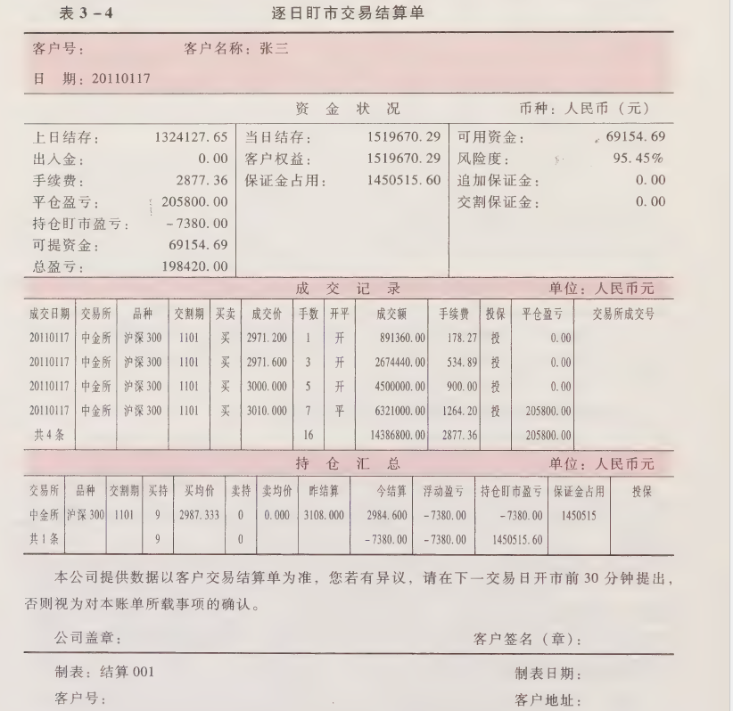
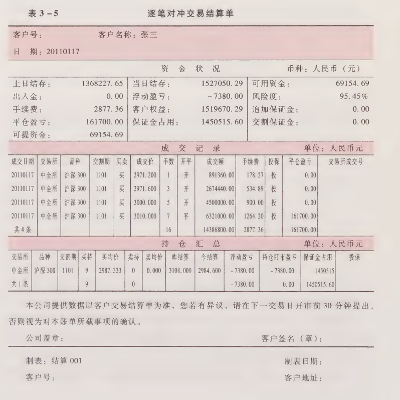

***不赌，不急，不贪***
人性自带的肮脏：
**贪婪、恐惧、侥幸、执念**
**重仓、扛单、追涨杀跌、频繁出手**
**自己骗自己、乱改策略、失控交易**
**市场本身的逼仓、流动性抽干、极端跳空**
这些不是别人害你，
是你自己内心的黑暗在杀你。
所以**期货公平，但绝不温情**。
2010年起，中国的商品期货市场，已经成为全球最大的商品期货市场。
国际交易中心：芝加哥，纽约，伦敦，法兰克福等
期货交易的主要功能：**规避风险和发现价格**。

***衍生品标的物：***
**衍生品** = 价值 “依附” 于别的东西的**金融合约**，价值衍生于一个或多个标的资产的业务或合约。
**衍生品**包含**三大类**：
- 期货
- 期权（期货考试必考，也是衍生品）
- 远期、互换（场外为主）
**衍生品的标的物种类：**
股票，债券等在内的传统基础证券；
外汇，黄金，白银；
小麦，玉米，大豆，棉花等农产品；
石油，钢材，
天气，污染指数等无形物。

- **标准合约**、**保证金制度**、**对冲机制**和**统一结算**的实施，标志着**现代期货市场**的诞生。

***期货交易的价值***
- 提供充沛流动性，让所有人都能方便买卖、转移风险，这就是它的核心价值。
- 企业来：把价格风险转移出去
- 投机者来：承担风险，赚风险溢价
- 所有人都能随时开仓、随时平仓
- 这就是市场创造的**流动性价值**、**风险管理价值**、**价格发现价值**
- 期货市场的功能：
   **规避风险的功能**：套期保值实现；只有套保者的市场，流动性很差；必须有相应的交易者作为对手；投机者在获取投机利润的同时，也承担了相应的价格波动的风险，是期货市场的风险承担者；生产经营者的风险转移给投机者。
   **价格发现的功能**：预期未来现货价格的变动，是现货价格的晴雨表；
   原因：参与者众多，专业知识丰富，交易透明；
   特点：预期性，连续性，公开性，权威性
   **资产配置的功能**：为现货对冲风险，现货保值，投资组合价值。

**        **‘期货市场/衍生品市场’在宏观经济中的作用**
- 提供分散、转移价格风险的工具，有助于稳定国民经济；
- 为政府制定宏观经济政策提供参考依据；
- 促进本国经济的国际化；
- 有助于市场经济体系的完善；
**        **‘期货市场/衍生品市场’在微观经济中的作用**
- 锁定生产成本，实现预期利润（**套期保值的功能**）
- 利用期货价格信号，组织安排现货生产；
- 期货市场拓宽现货销售和采购渠道；

**期货市场是弱式有效市场：**
只包含：历史交易价格，成交量，分时、K线

# 一、上海期货交易所（上期所）投资者教育网（期货规则）
http://edu.shfe.com.cn/

- 交易日期：买家与卖家达成交易内容的日期；
- 交割日期：兑现交易内容的日期；
- 到期交割：指交割期内到期的交易，交割期间不接受任何新的交易；
- 对冲了结：交割日期前，如果交易物涨价了，买家可以把交易物卖出，赚取**价差**。

##  商品期货
标的物为实物商品的期货合约
**农产品期货**，**金属期货**，**能源化工期货**

## 金融期货
外汇期货，利率期货，股指期货，股票期货

## 开仓、持仓、平仓、买卖的基本概念
- **开仓**：又称建仓，是指期货交易者新建期货头寸的行为，可分为买入开仓和卖出开仓。
- **持仓**：是指交易者开仓之后手中持有头寸的行为。交易者买入开仓，构成买入
(多头)持仓;反之，就形成卖出(空头)持仓。
- **平仓**：是指交易者了结持仓的交易行为，其方式是针对持仓方向做相反的对冲买卖。持仓合约又称为未平仓合约。
平仓：其实就是通过对冲了结方式，免除履约责任，从而让投机变得可行、低成本、高效率，也提供了流动性。

## 假设存在一个“演唱会门票期货市场”，小张作为投机者参与其中：
1.开仓（1月1日） Open a Position：
动作：小张判断门票会涨，于是买入1张1月5日到期的“门票期货合约”。合约面值300元，他只需支付10%的**保证金（30元）**。
本质：他拥有了一个“在未来以300元买入门票”的权利和义务（**多头头寸**）。
2.持仓（1月1日-1月5日）：
市场波动，门票期货价格涨到了350元。
3.对冲了结（演唱会开始前）Offset：
动作：小张卖出1张同样的期货合约（平仓）。
结算：交易所结算价差：350元（卖出价） - 300元（买入价） = 50元利润。
结果：小张赚到50元，保证金退回。他从未真正拥有过门票，也无需去收票或付全款。

## 期货中的套期保值
未来要买卖现货，才是关键
**演唱会主办方（手里有票，怕跌）**：
现货：主办方手上有100张票待售。
期货：主办方在市场上卖出100张门票期货合约。
效果：无论票价涨跌，主办方最终都按锁定的价格回收资金。
总结：在期货中理解套期保值，**请记住这个公式：现货风险 + 反向期货操作 = 价格锁定**。
它是实体企业对抗市场波动的“保险”，而非散户的“赌具”。

### 但是--套保也可能**亏损**，并不是稳赚不赔
**（1）方向做反**
工厂要买原料，怕涨价 → 应该做多期货
结果手一抖做空了
→ 原料涨价，现货贵了，期货还亏
→ 两边一起亏，直接爆亏
**（2）数量不匹配（套保比例错）**
现货 1 万吨，期货只做了 1000 吨
→ 价格暴跌，期货赚的根本盖不住现货亏
→ 等于没锁住
**（3）把套保做成投机**
本来是锁价，结果觉得 “行情要涨，我多拿会儿”
→ 开始加减仓、赌方向
→ 套保变炒期货，亏起来比不套保还惨
**（4）期现价差走偏（基差风险）**
期货和现货价格不同步
→ 期货没怎么跌，现货暴跌
→ 期货赚的不够补现货亏
→ 锁价失败，还是亏
套期保值能对冲整体涨跌，
但对冲不了期货和现货涨跌幅度不一样。
只要两者涨跌幅度不一样，
就会出现 “一边亏得多、一边赚得少”，
最终还是亏。
这就叫 基差风险。

##  期货的发展
1. **保证金制度**
解决不能按时交货/付款的问题
2. **标准化合约**
降低谈判成本
3.**市场监督机制**
保证交易公开公正公平
4.能作为**期货品种的大宗商品**，具有以下共性：
耐存储，易流通，易于标准化，价格易波动

## 期货的实物交割

为什么普通人（散户）不这么干？
**交割门槛极高**：个人投资者通常没有交割资质，且无法处理增值税专用发票。
**接货是“噩梦”**：如果你买的是原油期货，到期后你拿到的可能是几万桶原油，你既没有油库存储，也没有炼油厂消化。
**流动性靠“平仓”**：期货市场的流动性来自于“开仓”和“平仓”的对手盘。如果大家都去交割，市场就死了。投机者和套保者，都是创造期货流动性的。

## 期货价格波动的本质
是市场对**未来现货价格预期的博弈**。它不取决于单一因素，而是**宏观、产业、资金、情绪**四股力量交织的结果。

### 1.宏观因素（定方向）
- 利率与货币政策：降息通常利好商品（资金成本低，刺激投资），加息则压制价格。
- 经济数据：GDP、PMI（采购经理指数）超预期，预示工业需求旺盛，推高工业品（如铜、螺纹钢）。
- 汇率：人民币贬值，利于国内商品出口，可能支撑内盘价格。
### 2.产业基本面（定价值）
这是期货独有的“锚”，也是与股票最大的区别。
- 供需关系：最根本的法则。库存低、供应紧（如矿产减产、恶劣天气），价格易涨。
- 成本支撑：原油价格决定了化工品成本，铁矿价格决定了钢材成本。成本线通常是价格的强支撑位。
### 3.资金博弈（定波动）
**期货是零和游戏**，资金是价格的直接推手。
- 持仓量（OI）：持仓量大幅增加，说明多空分歧加大，往往伴随大行情。
- 主力动向：机构大单的集中买入或卖出，会引发价格的短期剧烈波动。
### 4.市场情绪与预期（定节奏）
期货交易的是“未来”，预期比现实更重要。
预期差：市场原本预期减产10%，结果只减了5%（不及预期），价格可能反而下跌，尽管供应确实减少了。
恐慌与贪婪：地缘政治事件（如战争）会引发供应中断恐慌，即使实际影响尚未发生，价格也会先行暴涨。

### 期货独有的“特殊规则”影响
除了上述因素，期货本身的制度也会加剧波动：
1. **杠杆效应**：10%的保证金意味着10倍杠杆。现货涨1%，期货多头就能赚10%，反之亦然。杠杆放大了所有因素的波动率。
2. **交割月效应**：临近交割月，价格必须向现货价格回归（收敛），此时若多空双方都不平仓，容易引发“逼仓”行情（资金博弈白热化）。

____________________________________________________________
# 二、流动性 market liquidity
## 流动性的源头：多空分歧
期货是零和博弈，每一张多单的诞生，必然对应一张空单。流动性的产生不依赖于单边看涨或看跌，而是依赖于双方对价格预期的差异。
做多者（买方）：认为未来价格会涨，现在买入是为了将来高价卖出。
做空者（卖方）：认为未来价格会跌，现在卖出是为了将来低价买回。
流动性公式：流动性 = 做多意愿 × 做空意愿。如果市场只有看涨的人，没有看跌的人，价格会直接涨停，但没有成交，流动性枯竭。
## 流动性的三种产生场景
流动性并非只在开仓时产生，平仓同样是流动性的重要来源。以下是三种具体的产生机制：
**1. 开仓阶段**：多空“新入场”博弈（增量流动性）
这是最直观的流动性来源。新资金入场，多空双方建立新的对立头寸。
场景：A认为铜会涨，买入开仓1手；B认为铜会跌，卖出开仓1手。
结果：A和B成交，市场持仓量增加，流动性被创造出来。
**2. 平仓阶段**：多空“换手”接力（存量流动性）
你之前问到的“平仓”正是流动性的关键环节。平仓者需要对手盘来接手他的头寸。
**场景 1**：多头平仓（A 离场）
A：持有多单 → 卖出平仓
对手盘必须是买单：
D：新多头 → 买入开仓
或
B：持有空单 → 买入平仓
正确：A 卖平 ←→ D 买开 / B 买平
————————————————————————————————————————
**场景 2**：空头平仓（B 离场）
B：持有空单 → 买入平仓
对手盘必须是卖单：
C：新空头 → 卖出开仓
或
A：持有多单 → 卖出平仓
正确：B 买平 ←→ C 卖开 / A 卖平

**3. 换月移仓**：主力合约的流动性大迁徙
这是期货特有的流动性现象。临近交割月，玩家集体将头寸从“05合约”移到“09合约”。
操作：在05合约上平仓，同时在09合约上开仓。
结果：两个合约的成交量同时放大，形成了**巨大的流动性潮汐**。

## 流动性对谁最有益？（优先级排序）
**1. 交易所与期货公司（最大赢家）**
流动性是它们直接变现的资产。交易越活跃，手续费收入越高。没有流动性的品种，交易所会直接退市。它们是流动性的“收租方”。
**2. 投机者与短线交易员（生存氧气）**
流动性决定了他们能否“活着出来”。
高流动性：可以随时在理想价格平仓，滑点小。
低流动性：想卖时没人接盘，只能挂低价“割肉”，甚至爆仓。
**3. 套期保值者（现货商）**
他们是流动性的使用者而非创造者。他们需要流动性来确保在关键时刻（如担心价格下跌时）能顺利开出空单，锁定利润。如果市场死水一潭，他们的风险就无处对冲。
**4. 做市商（特殊角色）**
他们是流动性的“职业供应商”。在流动性差的市场，他们赚取巨大的买卖价差（Bid-Ask Spread）；在流动性好的市场，他们靠薄利多销和交易所返佣赚钱。

## 流动性的“阴暗面”：对谁有害？
流动性是一把双刃剑，并非越高越好：
**对长线价值投资者**：过度的流动性（高频交易）会导致价格噪音增加，干扰基本面判断。
**对风控薄弱者**：高流动性意味着波动可能被瞬间放大，更容易在情绪驱动下做出追涨杀跌的错误决策。
————————————————————————————————————————————
# 三、衍生品市场：远期，互换，期权，期货的概念
## 远期/远期合约：
**场外非标准化合同，商品没有限制，一对一谈判，合同自拟，无担保，到期直接交割**
指一种交易双方约定在未来的某一确定时间，以确定的价格买卖一定数量的某种标的资产的合
约。远期交易最早是作为一种套期保值的工具。
在远期合约中，同意在将来某一时刻以约定价格买入资产的一方被称为**多头**，而同意在将来某一时刻以约定价格卖出资产的一方被称为**空头**。
**远期合约在到期日交割**。空头持有者支付标的资产给多头的持有者，多头按远期合约的协议价格，支付现金给空头。
**远期交易**再本质上属于**现货交易，实物交割**，
***场外的非标准期货合约，没有交易所担保，没有保证金，不能随便转手给他人。***
1.远期交易属于场外交易；
2.远期合约通常是一种非标准化的合约；
3.远期交易的违约风险相对较高；
4.远期交易的流动性差；
5.远期交易通常采用以交割方式了结持仓；
6.远期交易通常不实行逐日盯市的结算制度；

### 远期交易（现金交割）--差价结算
远期交易结算金额=（远期交易结算价格-远期交割价格）* 商品数量
- **结果为正时**：则由卖方向买方支付该金额。
- **结果为负时**：则由买方支付该金额。
- 0时：则交易双方之间，无需支付。

### 远期交易（实物交割）
到期严格按合约约定的交割价：
买方：按合同价付钱
卖方：按合同价交货
一手交钱、一手交货
✅ 完全不管到期现货市场价涨了还是跌了
✅ 不算差价、不补钱、不互相转账

### 远期交易的方式：
实时交易，挂单交易，询价实时交易

远期利率协议FRA的卖方：***就是放贷人/出借人***，**怕利率跌**
远期利率协议FRA的买方：***就是借款人***，**怕利率涨**
远期利率的交易主体为：**报告交易商**，**其他金融机构**，**非金融机构**，**高净值个人投资者**

### 远期利率 FRA
远期利率协议是场外交易的衍生工具，双方约定在**未来某个时间（结算日）开始**、为期一段时间的固定利率（协议利率），**到期时只现金结算利息差额**，不实际借贷本金。

#### 要素
要素	含义	示例数字
名义本金	计算利息的虚拟金额	                            1000万元
协议利率	双方约定的固定利率	                              5.0%
参考利率	结算日当天的市场利率（通常为LIBOR、SHIBOR等）	结算日当天为5.5%
合约期	从交易日到结算日的时间	                           3个月
协议期	名义借贷的持续时间	                               6个月
交易日	签订合约的日子	                                   1月1日
结算日	现金结算的日子（协议期起点）	                      4月1日
到期日	协议期结束的日子	                                 10月1日

#### 解释
"3×9 FRA"
3是合约期：从交易日到结算日的月数；
9是：：从交易日到 ‘到期日’的月数；
9-3=6：这是协议期

#### 举例
- 背景： 公司A预计3个月后需要借款1000万元，借期6个月，担心利率上涨。
- 操作：
1.交易日（1月1日）：A买入"3×9"FRA，协议利率=5%
2.结算日（4月1日）：市场6个月利率=6% > 协议利率5%
卖方（银行）支付A利息差额
金额 ≈ 1000万 × 1% × 0.5年 = 5万元（折现后略少）
折现后： 50000/ (1+ 6%*183/360)=48520
3.结果：A虽按市场利率6%借款，但FRA补偿了1%差价，实际成本锁定在5%
远期利率协议 = 给未来的借款或存款买一份"利率保险"，**只用现金补差价，不动本金。**

### 外汇远期

### 远期全价
**远期全价** = 现在的现货价（**即期价格**） + 远期点（利息 / 持有成本），就是未来交割时你实际要付的总价。

### 期货：**场内标准化，交保证金，必须履约**
**期货交易**是在**现货交易，远期交易的基础上**发展起来的。
期货，保证金，是押金，平仓和交割后，会被退回。
1.合约标准化；
2.场内集中竞价交易；
3.保证金交易；
4.双向交易；
5.当日无负债结算（**逐日盯市**）；
6.对冲了结。

## 远期合约
### 外汇掉期(Foreign Exchange Swaps，FX Swaps) -- 两笔、双向、捆绑一体
外汇掉期(Foreign Exchange Swap，FES)又称为汇率掉期，指交易双
方在交易日约定，在前后两个不同的交割日即起息日(ValueDate，货币
收款或付款执行生效日)以约定的汇率进行方向相反的两次货币交换。具
体而言，在第一次货币交换中，一方按照约定的汇率用A货币交换B货
币;在第二次货币互换中，双方在按照另一约定的汇率，反向交割货币，
用货币B交换货币A。本质上是两笔不同交割期限的外汇交易的组合，

### 单笔、单向
1. 商品远期
2. 金融远期：股票，股指期货，利率，外汇
————————————————————————————————————————————

## 互换：--利率、货币、商品、权益
金融领域的互换是指两个或两个以上的当事人按照商定条件，在约定时间内**交换一系列现金流**的合约，它是一种场外衍生品。
通常，互换协议要确定支付现金流的日期以及现金流的计算方法。
互换的每一次现金流交换都可以视为类型不同、头寸相反的两份远期合约的轧差，如到期时间相同的一份浮动利率远期合约空头和一份固定利率远期合约多头的轧差。所以，**互换可以说是一系列远期合约的组合。**
### 货币掉期/货币互换(Currency Swaps) 
外汇市场上的互换称为货币互换或货币掉期 
是交易双方对**不同货币或利息**(或二者同时)进行交换的交易，它**有实质性合约**，是一种重要的金融衍生工具。**已经形成了自身专门的交易市场。** 

#### 货币互换
-- 主要用于管理：**汇率风险**
 交易双方约定，在期初交换两种不同货币的本金，**期间定期交换各自货币的利息**，期末再按约定汇率换回原本金的场外衍生品交易。
货币互换中，在协议生效日和终止日实际**交换两种货币的本金。**
货币互换中，本金互换所有约定的汇率，**期初和期末是哦也能够的汇率，相同**
### 利率互换（考最多）
最主流：本金和规模相同
固定利率 ↔ 浮动利率：固定换浮动，浮动换浮动，固定换固定
举例：
我付固定利息、收浮动利息；对手反过来。
**不用交换本金**，**只交换利息**，未来现金流是交易双方利息的交换。

#### 利率互换时，我国银行间市场交易系统提供
1. 公开报价；
2. 双向报价；
3. 对话报价；
4. 分散报价

### 三、商品互换
以大宗商品为标的：
固定商品价格 ↔ 浮动现货 / 期货价格
### 四、权益互换（股票 / 股指互换/总收益互换）--**也称股权互换**
一方付固定 / 浮动利息/另一只股票或股票指数的收益，
另一方付 股票 / 指数收益率
### 五、信用互换（CDS 信用违约互换）
用来转移信用风险、防违约

## 互换套利
包括：**信用套利，税收套利，规避管制套利**

## 场内市场和场外市场
### 场内市场
又称为交易所市场(Exchange -Traded Derivatives，ETD)，
是指所有的供需方集中在固定的场所(交易所)进行竞价交易。
- 期货市场，期权市场（有一部分是场外市场）；

### 场外市场
也称为柜台交易市场(Over-the Counter,OTC),
指交易者通过私下直接议价的交易方式进行交易的场所，与交易所的集中交易方式相区别。

——————————————————————————————————————————————
# 四、期货市场组织结构 
### 五位一体：
- 中国证券监督管理委员会（证监会）；
- 中国证监会地方派出所机构；
- 期货交易所；
- 中国期货市场监控中心；
- 中国期货业协会
  
## 1.期货交易所
### 性质与职能
1.提供交易的场所、设施和服务
2.设计合约、安排合约上市
3.制定并实施期货市场制度与交易规则
4.组织并监督期货交易，监控市场风险
5.发布市场信息
### 组织结构
（一）会员制期货交易所
会员大会，理事会，专业委员会，经营管理层和业务管理部分；
（二）公司制期货交易所
股东大会，董事会，监事会及高级管理人员；
（三）会员制和公司制期货交易所的主要区别
1.是否以营利为目标
**会员制**期货交易所通常**不以营利为目标**;
**公司制**期货交易所通常**以营利为目标**，追求交易所利润最大化。
2.适用法律不同
**会员制**期货交易所一般适用**民法**的有关规定;
**公司制**期货交易所首先适用**公司法**的规定，只有在公司法未作规定的情况下，才适用民法的一般规定。
3.决策机构不同
会员制期货交易所的权力机构是**会员大会**，公司制期货交易所的权力机构是**股东大会**。
会员制期货交易所权力机构的常设机构是**理事会**，公司制期货交易所权力机构的常设机构是**董事会**。
### 期货交易所
我国境内现有**郑州商品交易所**、**大连商品交易所**、**上海期货交易所**、
**中国金融期货交易所**、**广州期货交易所**，***五家***期货交易所。
***中金、广期是公司制***，其余是会员制。
**但均不以盈利为目标。**
- 境内期货**交易所会员**应当是在中华人民共和国境内登记注册的**企业法人**或者其他**经济组织**。取得期货交易所会员资格，应当经期货交易所批准。
- 期货交易所对**会员实行总数控制**。只有成为交易所的会员，才能取得场内交易席位，在期货交易所进行交易非会员则必须通过期货公司代理交易。

## 2.期货结算机构
### 性质与职能
期货结算机构是负责交易所期货交易的**统一结算**、**保证金管理**和**结算风险控制**的机构，其主要职能包括：
- 担保交易履约；
- 结算交易盈亏
- 控制市场风险。
### 期货结算机构的形式
第一，**结算机构**是**某一交易所的内部机构**，仅为该交易所提供结算服务。
第二，结算机构是独立的结算公司，可以一家或多家期货交易所提供结算服务。
### 期货结算制度
- 第一个层次
是由结算机构对结算会员进行结算，结算会员是交易所会员中资金雄厚、
信誉良好的期货公司或金融机构;
- 第二个层次
是结算会员与非结算会员或者结算会员与结算会员对其所代理客户之间的结算;
- 第三个层次
是结算会员对非结算会员所代理客户的结算。
### 我国境内期货结算机构与结算制度
（一） **全员结算制度**
- 是指期货交易所会员均具有与期货交易所进行结算的资格，期货交易所的会员均**既是交易会员**，**也是结算会员**，没有结算会员与非结算会员之分。
- 在全员结算制度下，**期货交易所对会员进行结算，会员对其受托的客户结算**。
**郑州商品交易所、大连商品交易所、上海期货交易所和广州期货交易所**实行****全员结算制度***。
（二）**会员分级结算制度**
在会员分级结算制度下，期货交易所将交易所会员区分为**结算会员**与**非结算会员**
结算会员与非结算会员是根据会员能否直接与期货交易所进行结算来划分的。
结算会员具有与交易所进行结算的资格;
非结算会员不具有与期货交易所进行结算的资格。
在会员分级结算制度下，期货交易所对结算会员结算，**结算会员对非结算会员结算**，
非结算会员对其所代理客户的结算。
**在中国金融期货交易所--会员分级结算制度**：
按照业务范围，会员分为：
- 交易会员、交易结算会员、全面结算会员和特别结算会员四种类型。
- 其中，交易会员不具有与交易所进行结算的资格，它属于非结算会员。
- 交易结算会员、全面结算会员和特别结算会员均属于结算会员。
- 结算会员具有与交易所进行结算的

**结算担保金制度**
根据《期货交易管理条例》，**实行会员分级结算制度的期货交易所应当配套建立结算担保金制度**。结算会员通过缴纳结算担保金实行风险共担。结算担保金，是指由结算会员依交易所规定缴存的，用于应对结算会员违约风险的共同担保资金。结算担保金由结算会员以自有资金向期货交易所缴纳，属于结算会员所有，用于应对结算会员违约风险。当市场出现重大风险时，所有结算会员都有义务共同承担市场风险，确保市场能够正常运行。结算担保金包括基础结算担保金和变动结算担保金。

## 3.期货公司与服务机构
期货公司，**非银行金融机构**；
是指代理客户进行期货交易并收取交易佣金的**中介组织**
期货公司的业务类型
- 一、**期货经纪业务**：代理客户进行期货交易并收取交易佣金的业务；
- 二、**期货投资咨询业务**；基于客户委托，期货公司及其从业人员向客户提供**风险管理顾问**、**研究分析**、**交易咨询**等服务。
- **期货公司从事期货投资咨询业务**，应当与客户签订服务合同，明确约定服务内容、收费标准及九分处理方式等事项；
- 三、**资产管理业务**：期货公司可以接受客户委托，根据《期货公司监督管理办法》、《私募投资基金监督管理暂行办法》规定和合同约定，运用客户资产进行投资，并按照合同约定收取费用或者报仇的业务活动。可以依法为**单一客户办理资产管理业务**，也可以为特定**多个客户办理资产管理业务**。
 **资产管理业务包括：**1.期货、期权及其他金融衍生品；2.股票、债券、证券投资基金、集合资产管理计划、央行票据、短期融资券、资产支持证券等；3.中国证监会认可的其他投资品种。
- 四、**风险管理公司**：为商业实体，金融机构和投资机构等法人或组织以及高净值自然人客户，**提供**，适当**风险管理服务和产品**的业务模式。
- 五、期货公司的功能与作用
第一：期货公司作为衔接期货交易者与期货交易所之间的桥梁和纽带，降低了期货市场的交易成本。
第二：期货公司可以降低期货交易中的信息不对称程度。
第三：期货公司可以高效率地实现转移风险的职能，并通过结算环节防范系统性风险的发生。
第四：期货公司可以通过专业服务，实现资产管理的职能。
- 六、期货公司的风险管理制度与相关要求
(1)期货公司独立性的要求。期货公司与控股股东、实际控制人之间
保持经营独立、管理独立和服务独立。
(2)设定股东及实际控制人与期货公司之间出现重大事项时的通知义务
（3）设计董事会和监事会或监事
(4)设立首席风险官
- 七、建立有效的期货公司风险管理制度
(1)期货公司应建立与风险监管指标相适应的**内控制度**；
(2)期货公司应严格执行**保证金制度**；
(3)期货公司应当建立独立的**风险管理系统**，

###四统一
期货公司，对营业部实行的“四统一：”
- 统一结算、
- 统一风险管理、
- 统一资金调拨、
- 统一财务管理和会计核算
### 介绍经纪商--**居间人**
#### Itroducing Broker 简称IB
 为期货公司提供中间介绍业务的证券公司就是介绍经纪商，即**券商IB**.
 期货公司因此向证券公司支付一定的佣金。
**券商IB**的服务内容：1.协助办理开户手续；2.提供期货行情信息和交易设施；3.中国证监会规定的其他服务。
**不得**：代理客户进行期货交易、结算或交割，不得代期货公司、客户，收付期货保证金，不得利用证券资金账户为客户存取、划转期货保证金。
#### 开展居间服务的自然人
期货公司与合格的自然人类型的居间人合作，他们之间没有隶属关系。
合格标准：
- 要求年满18周岁，具有完全民事行为能力;
- 品行端正，具有良好的职业道德;
- 承诺遵守法律法规及《期货公司居间人管理办法(试行)》等的规定;
- 取得期货从业人员资格考试成绩合格证;
- 已完成中国期货业协会(以下简称“协会”)要求的培训课程以及协会规定的其他条件。
- 居间人可以同时与不超过三家期货公司签订居间合同。

### 中国期货市场监控中心
中国期货市场监控中心承担如下服务职能:
- 期货市场统一开户、
- 为期货投资者提供交易结算信息查询、
- 商品及其他指数的编制和发布、
- 为监管机构和期货交易所等提供信息服务、宏观和产业分析研究。
此外，中国期货市场监控中心还负有：
- 期货保证金安全监控、
- 期货市场运行监测监控、
- 期货中介机构监测监控、
- 期货市场调查、
- 协助风险公司处置、
- 代管期货投资者保障基金等其他职能。

### 期货保证金存管银行
由交易所指定，协助交易所办理期货交易**结算业务的银行**，属于**期货服务机构**。
我国五家期货交易所存在**全员结算制度**和**会员分级结算制度**两种制度。
期货保证金存管银行的设计，是锅内期货市场保证金封闭运行的必要环节，也是保障投资者资金安全的重要组织机构。
### 交割仓库
  交割仓库是期货品种，进入实物交割环节，提供交割服务和生成标准仓单必经的**期货服务机构**。
### 中证商品指数公司
上期，郑商，大商，中金四家成立的商品指数变质运营服务平台。
### 期货信息技术服务机构
提供气功行情软件，交易系统及相关信息技术服务。

## 4. 期货交易者
### 金融期货-个人投资者
- 个人投资者在申请开立**金融期货交易编码**前，需先由期货公司会员对投资者的基础知识、财务
状况、期货投资经历和诚信状况等方面进行综合评估。具体条件如下
1、申请开户时，保证金账户可用资金余额不低于人民币50万元
2、具备金融期货基础知识，通过相关测试；
3、具有累计10个交易日，20笔以上的金融期货仿真交易成交记录；
4、不存在严重不良诚信记录；不存在法律、行政法规、规章和交易所业务规则禁止或者限制从事金融期货交易的情形。
### 期权-个人投资者
个人投资者参与**期权交易**，应满足资金、交易经历、风险承受能力、诚信状况等条件。
具体应当符合下列条件:
(1)申请开户时托管在其委托的期货公司的上一交易日日终的证券市值与资金可用余额，合计不低于人民币50万元;
(2)在期货公司开立期货保证金账户(6个月以上，并具备金融期货交易经历;
(3)具备期权基础知识，通过交易所认可的相关测试;
(4)具有交易所认可的期权模拟交易经历;
(5)具有相应的风险承受能力;
(6)不存在严重不良诚信记录，不存在法律、法规、规章和交易所
业务规则禁止或者限制从事期权交易的情形;
(7)上海证券交易所规定的其他条件。
个人投资者参与期权交易，应当通过期权经营机构组织的期权投资者适当性综合评估。

### 期货-机构投资者
- 特殊单位客户：证券公司，基金管理公司，信托公司，银行，社保类公司，境外投资机构；
- 一般单位客户：除特殊单位客户外的机构投资者。
### 股票期权-市场中的机构投资者
- 专业机构投资者：商业银行，期权经营机构，保险机构，信托公司，基金管理i公司，财务公司，合格境外机构投资者
- 普通机构投资者：除专业机构投资者外的机构投资者。
### 对冲基金和商品投资基金-机构投资者
- 商品投资基金：投资对象主要是在交易所交易的**期货和期权**；
商品投资基金(Commodity Pool，CP)，是指广大投资者将资金集中起来委托给专业的投资机构，并通过商品交易顾问(CTA)进行期货和期权交易，投资者承担风险并享受投资收益的一种集合投资方式。
**商品基金经理CPO**,**商品交易顾问CTA**，**交易经理TM**,**期货佣金商FCM**，
- 对冲基金--私募基金
“对冲基金是一种私人投资基金，目标往往是从市场短暂快速的波动中获取高水平的回报，常进行高杠杆比率的操作，运用如卖空、互换、金融衍生工具、程序交易和套利等交易手段。因最低投资额往往很高，对冲基金的投资者通常限于金融机构和富人。”

### 做市商
**做市商**是指经交易所认可，为指定品种的期货、期权合约提供双边报价等服务的法人或者非法人组织。期货做市商一般由具备一定实力和信誉的期货经营法人作为特许交易商，不断地向公众投资者报出某些特定期货的交易价格，并在该价位上接受公众投资者的买卖要求，以其自有资金和期货投资者进行期货交易。
通过做市商这种不断买卖来维持市场的流动性，满足公众投资者的投资需求。
**做市商制度**，就是以做市商报价形成交易价格驱动交易发展的期货交易方式。
- 做市商 ≈ 合法、有规则、有义务的 “官方托”，让合约池子有流动性，或者他来创造流动性
- 核心作用就是：**没人交易的时候它顶上，创造流动性、维持盘面能买卖。**
1.没人买没人卖的时候，**它必须站出来报价**
不然合约就变成 “有价格没成交” 的死盘。
2.它**双边挂单**，让你随时能买能卖
你想卖，它接；你想买，它给。
3.赚的是买卖差价，不是靠拉盘割韭菜
这是它和 “黑庄”“野托” 最大区别。

## 期货市场的监管体制
中国期货业协会是期货业的自律性组织，发挥政府与期货业见的桥梁和纽带作用，为会员服务，维护会员的合法权益。

_____________________________________________
# 五、期货合约和期货交易制度
## 期货合约概念：
是指由期货交易所统一制定的，规定在将来某一特定的时间和地点，交割一定数量和质量标的物的标准化合约；
期货合约是期货交易的对象，期货投资者参与期货交易，是通过在期货交易所买卖期货合约，**转移现货经营的价格风险**或**获取期货交易的风险收益**。
## 期货合约标的的选择：
1.规格和质量易于量化和评级；
2.价格波动大幅度大且频繁；
3.供应量大，不易为少数人控制和垄断；
## 期货合约的主要条款：
1.合约名称：上市交易所名称+品种名称；
2.交易单位/合约价值：报价单位*交易单位;
3.报价单位；
4.最小变动价位：在期货交易所的公开竞价过程中，对合约每计量单位报价的最小变动数值；
- 较小的最小变动价位：保证适度的流动性，但增加交易协商成本；
- 较大的最小变动价位：减少交易量，降低流动性；
5.每日价格最大波动限制；
每日价格最大波动限制又称为**涨跌停板**，规定了期货合约在一个交易日中的交易价格波动不得高于或者低于规定的涨跌幅度。每日价格最大波动限制一般是以合约**上一交易日的结算价为基准确定**的。
- 每日价格最大波动限制的确定主要取决于**该种标的市场价格波动的频繁程度和波幅的大小**。一般来说，标的价格波动越频繁，越剧烈，该商品期货合约允许的每日价格最大波动幅度就应设置得大一些。
- 在我国期货市场，每日价格最大波动限制设定为合约上一交易日结算价的一定百分比。
6.合约交割月份/合约月份；
7.交易时间；8.最后交易日；9.交割日期；10.交割等级；
- 是指由期货交易所统一规定的、允许在期货交易所上市交易的合约标的物的质量等级。在进行期货交易时，交易双方无须对标的物的质量等级进行协商，发生实物交割时按交易所期货合约规定的质量等级进行交割。
- 允许用与标准品有一定等级差别的商品作替代交割品。
- 代替标准品进行实物交割时，收货人不能举手。
- 用替代品进行实物交割时，需要对价格进行升贴水处理。交易所根据市场情况统一规定和适时调
整替代品与标准品之间的升贴水标准。
11.交割地点；
- 是指由期货交易所统一规定的进行实物交割的指定地点。
- 金融期货交易，不需要交割仓库，但期货交易会制定交割银行。
12.交易手续费；
- 可以起到抑制过度投机的作用。
13.交割方式；
- 实物交割：股票，商品，外汇，中长期利率 等期货 ，实物交割
- 现金交割：指数类，短期利率等期货，现金交割
14.交易代码；15.最低交易保证金
## 概念
1.涨停板：期货合约上一交易日的结算价，加上允许的最大波动限制的上限值，叫做涨停板价。
2.跌停板：期货合约上一交易日的结算价，减去允许的最大波动限制的下限值，叫做跌停板价。
3.交割地点：由期货交易所统一规定的进行实物交割的制定地点。
4.交割方式：实物交割和现金交割；
**实物交割**：商品期货，股票期货，外汇期货，中长期利率期货通常采取实物交割方式；
**现金交割**：***股票指数期货***，***短期利率期货***，通常采取现金交割方式。
5.**交易手续费**：指期货交易所按合约成交金额的一定比例，或按合约成交手数，收取的费用。
6.交易代码：交易所，对**每一个期货品种**都规定了**交易代码**。
7.**最低交易保证金**：期货交易中，**交易者（买方和卖方）**必须按其所买卖期货合约价值的一定比例（5%-15%）缴纳资金，作为其履行期货合约的财力担保。
8.**实物交割必不可少的环节**：
- 交易所对交割月份持仓合约进行交割配对；
- 买卖双方通过交易所进行标准仓单与货款交换；
- 增值税发票流转；

————————————————————————————————————————————————
# 六、期货市场基本制度
## 1.保证金制度
在期货交易中，交易者必须按其所买卖期货合约价值的一定比例（5%-15%）缴纳资金，作为其履行期货合约的财力担保。保证金的作用好象杠杆，让我们可以用少量资金做大生意。另外，由于保证金节约了投入成本，期货交易的投资回报率也相应的被放大了。
在我国，期货交易者交纳的保证金，可以是资金，也可以是价值稳定、流动性强的标准仓单或者国债等有价证券。
- 保证金的收取分级进行。一般而言，交易所或结算机构只向其会员收取保证金，作为会员的期货公司则向其客户收取保证金，两者分别称为**会员保证金**和**客户保证金**。保证金的分级收取与管理，对于期货市场的风险进行分层次分担与管理具有重要意义。
- 第一，商品期货一般对期货合约上市运行的不同阶段规定不同的交易保证金比例。保证金比例会随着 交割期的临近而提高。
- 第二，随着合约持仓量的增大，交易所将逐步提高该合约交易保证金比例。
- 第三，当某期货合约出现连续涨跌停板时，交易保证金比例相应提高。
## 2.每日无负债结算制度
由期货结算机构对期货交易保证金账户当天的盈亏状况进行结算，并根据结算结果进行资金划转。当交易发生亏损，进而导致保证金账户资金不足时，则要求必须在结算机构规定的时间内向账户中追加保证金，以做
到“**当日无负债**”。
## 3.涨跌停板制度
制度又称**每日价格最大波动限制**制度，即期货合约在一个交易日中的交易价格波动不得高于或者低于规定的涨跌幅度（以上一交易日的结算价为基准），超过该涨跌幅度的报价将被视为**无效报价**，**不能成交**。
- 第一，**新上市的品种和新上市的期货合约**，其涨跌停板幅度一般为合约规定涨跌停板幅度的**两倍或三倍**。如合约有成交，则于下一交易日恢复到合约规定的涨跌停板幅度;如合约无成交，则下一交易日继续执行前一交易日涨跌停板幅度。
- 第二，在某一期货合约的交易过程中，当合约价格在同方向上连续现涨跌停板，遇国家法定长假，交易所认为市场风险明显变化时，交易所可以根据市场风险调整其涨跌停板幅度。
- 第三，对同时适用交易所规定的两种或两种以上涨跌停板情形的，其涨跌停板按照规定涨跌停板中的最高值确定。
### 爆仓
爆仓 = 你账户里的钱亏光了，不够保证金了，期货公司强行把你仓位平掉。
**举个最简单的例子**：
- 你账户里有 10000 元
- 你买了一手期货，占用保证金 8000 元
- 这时你可用的钱只剩 2000 元
- 然后行情反向走，开始亏：
- 先亏你那 2000 元可用资金
- 可用资金亏成 0 了
- 继续亏，就开始侵蚀你的 保证金
- 保证金快保不住合约了 → 风险来了
这时候：
- 期货公司会提醒你：加钱！
- 你不加
- 行情继续亏
- 账户权益已经低于交易所要求的最低保证金
→ 系统自动、强制把你的仓位平掉
**这就叫：爆仓**

### 涨跌停板情形下，交易所采取的风险控制措施--**优先成交逻辑**
当某个期货合约已经**涨到涨停**、或**跌到跌停**的时候，大家在这个价格上排队交易，**交易所是这么安排顺序的**：
1.先让 “要平仓的人” 优先成交
也就是：之前已经持有仓位、现在想离场的人，优先成交。
简单说：想逃命的人先走。
2.同样都是平仓的，谁挂单早谁先成交
这就叫时间优先。
3.但是有一个例外：
如果你这个仓位是今天刚开的，现在马上又要平掉；
→ 这种当天开、当天平的，不享受优先待遇，
只能按普通单子、按挂单时间排队。

### 单边市情况下的风险控制措施--**当某合约连续出现涨(跌)停板单边无连续报价时，实行强制减仓。**
连续涨跌停：第一天跌停，第二天继续跌停，甚至第三天还跌停

#### **单边市**定义
通常是指某一期货合约在某一交易日收盘前5分钟内出现只有停板价位的买入(卖出)申报、没有停板价位的卖出(买入)申报，或者一有卖出(买人)申报就成交但未打开停板价位的情况。
#### 单边无连续报价（ 封死了，打不开）
以跌停举例：
- 价格已经跌到当天最低限
- 市场上全是想卖的，几乎没人想买
- 偶尔有人买一点，立刻被卖单吞掉
- 价格一动不动，死死封在跌停价
这种状态就叫：
- 单边无连续报价 = 堵死了，没人接盘
合在一起就是：
- 连续几天死死封在涨跌停，想跑都跑不掉。

**交易所直接动手**，强行让 “赚大钱的人” 和 “亏大钱的人” 互相成交，
**不用你同意**，系统自动撮合成交，把堵死的单子拆掉一部分。

**涨停封死** = 抢着买，没人肯卖。
**跌停封死** = 抢着卖，没人敢买。

## 4.大户报告制度&持仓限额制度
- **大户报告制度**：当会员或客户对某品种某合约的持仓达到交易所规定的持仓报告标准时，会员或客户影响交易所报告。。
- **持仓限额制度**：是指交易所规定会员或客户可以持有的、按单边计算的某一合约投机头寸的最大数额。期货交易所对会员及客户的持仓数量进行限制，为了防范操纵市场价格的行为和防止期货市场风险过度集中于少数投资者。 
- 通过实施持仓限额及大户报告制度，可以使交易所对持仓量较大的会员或客户进行**重点监控**，了解其持仓动向及意图，有效**防范操纵市场价格**的行为;同时，也可以**防范**期货市场**风险过度集中于少数投资者**。
- 当会员或客户的某品种持仓合约的投机头寸达到交易所对其规定的**投机头寸持仓限量80%以上(含本数)时**，会员或客户应向交易所报告其资金情况、头寸情况等，客户须通过期货公司会员报告。
- 持仓限额，一般月份，**设置高**，临近交割，**设置低**
——————————————————————————————————————————————————————————————————————
## 5.强行平仓制度
### 概念
强行平仓，是指按照有关规定对会员或客户的持仓强制实行平仓的一种措施。
其**目的是控制期货交易风险**。
### 类型
强行平仓包括两种情况:
1)交易所对会员持仓实行的强行平仓;
2)期货公司对其客户持仓实行的强行平仓。
### 强行平仓适用的情形
1)**因账户交易保证金不足而实行强行平仓**。当价格发生不利变动，当日结算后出现保证金账户资金不足以维持现有头寸的情况，而会员(客户)又未能按照期货交易所(期货公司)通知及时追加保证金或者主动减仓，且市场行情仍朝其持仓不利的方向发展时，期货交易所(期货公司)会强行平掉会员(客户)部分或者全部头寸，将所得资金填补保证金缺口。
2)**因会员(客户)违反持仓限额制度而实行强行平仓**。当会员(客户)的持仓超过了规定的持仓限额，且未在期货交易所(期货公司)规定的期限内自行减仓，其超出持仓限额的部分头寸将会被强行平仓。
### 强行平仓的作用
强行平仓制度是一种有效的风险控制措施，有利于会员(客户)避免账户损失扩大，
通过控制个别账户的风险，可有力地防止风险扩散。
### 强行平仓执行
在我国，期货公司有专门的风险控制人员实时监督客户的持仓风险。当客户除保证金外的可用资金为负值时，期货公司会通知客户追加保证金或自行平仓;如果客户没有自己处理，而价格又朝不利于持仓的方向继续变化，各期货公司均会根据具体的强行平仓标准，对客户的持仓进行强行平仓

## 实物交割制度
当期货合约到期时，交易双方将期货合约所载商品的所有权按规定进行转移，了结未平仓。
## 6.信息披露制度
交易所要披露的信息：:(1)即时行情;(2)持仓量、成交量排名情况;(3)期货交易所交易规则及其实施细则规定的其他信息。
期货交易涉及商品实物交割的，期货交易所还应当发布标准仓单数量和可用库容情况。
期货交易所应当编制**交易情况周报表**、**月报表和年报表**，并及时公布。
期货交易所对**期货交易、结算、交割资料的保存**期限应当不少于**20年**。

# 七、期货交易流程
开户、下单、竞价、结算、交割。
## 1.开户
普通投资者在进入期货市场交易之前，应首先选择一个具备合法代理资格、信誉好、资金安全、运作规范和收费比较合理的期货公司。
由中国期货市场**监控中心**有限责任公司负责客户**开户管理**的具体实施工作。
- 开立账户实质上是确立投资者(委托人)与期货公司(代理人)之间的一种法律关系。(代理关系)；
- **个人客户**应当由本人亲自办理开户手续，签署开户资料，不得委托代理人代为办理开户手续。
- **单位客户**应当出具单位的授权委托书、代理人的身份证和其他开户证件。
### 步骤
0）申请开户
1）阅读“期货交易风险说明书”并签字确认；
2）签署“期货经纪合同书”；
3）申请交易编码并确认资金账号：
当日分配的客户交易编码，期货交易所应当于下一交易日允许客户使用。
交易编码由12位数字构成，**前4位为会员号**，**后8位为客户号**；
## 2.下单
**客户在按规定足额缴纳开户保证金后**，即可开始委托下单，进行期货交易。
下单，是指客户在每笔交易前向期货公司业务人员下达交易指令，说明拟买卖合约的种类、数量、价格等的行为。
### 常用的交易指令
- ***市价指令***
市价指令是期货交易中**常用的指令之一**。
它是指**按当时市场价格即刻成交的指令**。
客户在下达这种指令时不需指明具体的价位，而是要求以当时市场上可执行的最好价格达成交易。
这种指令的特点是**成交速度快**，一旦指令下达后不可更改或撤销。
——————————
- ***限价指令***：直接排队等设定价格，***平时开仓、止盈都用它***--想 **“挑价格”** 的时候，用限价，**不着急成交**。
是指执行时，**必须按限定价格或更好的价格成交的指令**。下达限价指令时，客户必须指明具体的价位。
可以按客户的预期价格成交，但**成交速度相对较慢**，有时无法成交。
**例子：**
核心：限定价格，优于此价才成交
**买**：≤ 你挂的价 才成交
**卖**：≥ 你挂的价 才成交
特点：控制成本、无滑点，但不一定成交
适用：挂单低买、高卖、被动止盈、回调接仓
————————————
- ***停止限价指令***：先等触发，触发了再排队等好价。触发前，不进盘口。
是指当市场价格达到客户预先设定的触发价格时，**即变**为**限价指令**予以执行的一种指令。
它的特点是可以将损失或利润锁定在预期的范围，但成交速度较止损指令慢，有时甚至无法成交。
***止损 + 控制成交价***适用场景：既要止损，又不想成交价格太烂，但愿意承担 “可能不成交” 的风险
**例子（做多止损）：**
现价：4000
你下：触发价 3950，限价 3940
逻辑：
价格没到 3950 → 单一直藏着，不进盘口
价格跌破 3950 → 触发
触发后，系统自动帮你下：卖出限价 3940
必须 ≥3940 才卖，不到不成交
特点：
先触发，再变限价单
能控制最低成交价
但可能触发了也排不上队，不成交

- ***触价指令***：触价指令是指在市场价格达到指定价位时，系统自动将该指令激活，并按用户预先设定的委托方式（如市价、对手价、限价等） 向交易所发出委托。
- ***限时指令***
- ***长效指令***
- ***套利指令***
- ***取消指令***：就是撤单

——————————
**对手价**
不指定具体数字，系统自动帮你取“当前盘口对手方的最优价格”来报单。
- **核心**：报出的依然是**限价单**，但这个价格是系统帮你抓取的。
你怎么理解：你卖出时，你的“对手方”是买方。盘口买一挂的是2360。你下对手价卖单，系统就会自动帮你报出一笔2360的卖出单。这个2360是系统自动填的，但它本质上还是限价单。
特点：追求排队序列的第一名。你能马上排在队伍最前面，大概率能很快成交。但如果行情瞬间变动或排队的人撤单了，也有没成交的可能。

# 六、竞价
**公开喊价方式**和**计算机撮合成交**--两种方式
**国内**期货交易所普遍**采用计算机撮合成交方式**。
计算机交易系统一般将买卖申报单以价格优先、时间优先的原则进行排序。
买入价：bp
卖出价：sp
成交价：cp
## 集合竞价
- 时间：开盘前 5 分钟，前 4 分钟挂单和撤单，最后 1 分钟撮合且不能撤单，夜盘开了日盘不竞价
- 核心：开盘价选「能成交最多手数」的价格
- 成交：高价买单、低价卖单全成交，等于开盘价的按少的一方成交
- 排序：买单价高优先，卖单价低优先，同价时间早优先

系统先把买单、卖单按优先级排好队
从最优先的开始配对，直到配不动为止
最后一笔如果全成交，取买卖价的平均；如果只成交一部分，直接用这个价格当开盘价

高于开盘价的买单，按开盘价成交，你省的钱就是你赚的。
低于开盘价的卖单，按开盘价成交，你多赚的钱就是你赚的。

### 规则层面的核心奥妙
1. 「最大成交量原则」是开盘价的灵魂
开盘价不是 “平均价”，也不是 “最后一笔价”，而是全市场挂单中，能撮合出最大成交手数的价格。
本质：**用一个价格，让最多的人成交，平衡买卖双方的博弈，是市场共识的体现。**
实战意义：你可以通过盘口挂单，预判最大成交量的价格，提前挂单卡位，避免踏空 / 被套。

**盘口** = 市场当前所有没成交的排队单子，24 小时都在，只是开盘时才能成交。开盘前有，开盘后一直有，收盘了还有。
——————————————————————————
2. 「一刀切成交价」的公平与红利
所有成交单统一按开盘价结算，和你挂单价格无关：
高于开盘价的买单：按开盘价成交，你省了钱（赚了差价）
低于开盘价的卖单：按开盘价成交，你多赚了钱（赚了差价）
奥妙：只要你挂单方向对、价格够极端，开盘瞬间就能吃到 “免费差价”，这是集合竞价独有的福利。

3. 「平仓优先 + 时间优先」的隐形优先级
涨跌停板时，老仓平仓单 > 新开仓单 > 当日新开仓平仓单，是交易所给 “被套者” 的逃命通道。
实战意义：
想抢涨跌停的开盘成交，必须提前挂老仓单，当日新开仓根本排不上队；
极端行情下，集合竞价是唯一能逃命的窗口，晚一步就封死。

4. 「5 分钟时间窗」的攻防逻辑
前 4 分钟（申报期）：可挂单、可撤单，是博弈期；最后 1 分钟（撮合期）：禁止挂单 / 撤单，是定局期。
**奥妙：**
主力会在最后 1 分钟前撤单，制造虚假挂单，误导散户判断；
散户想抢开盘，必须在申报期第一时间挂单，最后 1 分钟挂单无效。
夜盘规则：夜盘做了集合竞价，日盘不再集合竞价，夜盘开盘价就是全天的起点，夜盘博弈直接决定全天走势。
## 连续竞价
进行连续竞价时，计算机交易系统，一般将买卖申报单，以价格优先，时间有限的原则进行排序。

# 七、结算
## 概念
结算是：指根据期货交易所公布的结算价格对交易双方的交易结果进行的资金清算和划转。
在我国，会员(客户)的保证金可以分为**结算准备金**和**交易保证金**。
其中，
- **结算准备金**是未被合约占用的保证金，是交易所会员(客户)为了交易结算在交易所(期货公司)专用结算账户预先准备的资金;
- **交易保证金是**已被合约占用的保证金，是会员(客户)在交易所(期货公司)专用结算账户中确保合约履行的资金。
————————————————————————————
## 期货结算价
- 结算价(Settlement Price)，是指当天交易结束后，对未平仓合约进行
当日交易保证金及当日盈亏结算的基准价。
- 我国郑州商品交易所、大连商品交易所和上海期货交易所规定，当日结算价取某一期货合约当日成交价格按照成交量的加权平均价;
- **当日无成交价格**的，以**上一交易日的结算价**作为当日结算价；
中国金融期货交易所规定，当日结算价是指某一期货合约最后一小时成交价格按照成交量的加权平均价。

## 结算流程
### 1.交易所对会员（期货公司）的结算
当日结算准备金余额，当日盈亏，当日交易保证金；
- 结算时，应先计算“当日交易保证金”和“当日盈亏”，才能计算出“当日结算准备金余额(可用资金)”
**案例1**：会员
- 4月1日  买入  大豆期货合约 40手 ，每手10吨，成交价4000元/吨，当日结算价4040元/吨，
- 4月1日  卖出  大豆期货合约 20手，成交价4030元/吨，
- 上一交易日结算准备金余额：1100000元，且未持有任何期货合约，计算当日盈亏和结算准备金余额。
- 计算：
4月1日当日盈亏：
40*10*4000=1600000元，  --买入的花费
20*10*4030=806000元， --卖出的总价值
20*10*4040=808000元， --持仓总价值
盈利：1614000-1600000=14000元
       ——————————
4月1日结算准备金余额：
20*10*4040*5%=40400元  -- 持仓的保证金
1100000-40400=1059600元  
1059600+14000=1073600元  --结算准备金余额
**案例2**： 接上例
- 4月2日 买入 8手大豆合约，每手10吨，成交价4030元/吨，当日结算价4060元/吨，
- 计算：
4月2日当日盈亏： 
8*10*30=2400元    --当日买入持仓的盈利
20*10*20=4000元  -- 老持仓的盈利
当日总盈利：6400元
       ——————————
4月2日结算准备金余额：
28*10*4060*5%=56840元  -- 今日持仓的保证金
1073600+40400=1114000元         -- 先释放昨日持仓保证金
1114000-56840=1057160元         -- 减去今日持仓保证金
1057160+6400=1063560元          -- 结算准备金余额
**案例3**：接上例
- 4月3日 28手大豆，全部平仓，成交价4070元/吨，当日结算价4050元/吨
- 计算：
4月3日当日盈亏：
28*10*10=2800元   --当日盈利
       ——————
4月3日结算准备金余额：
28*10*4060*5%=56840元      -- 今日持仓的保证金，需要释放。不按照今日结算价计算，因为已经清仓
1063560+2800+56840=1,123,200 元       -- 释放持仓保证金

### 2.期货公司对客户的结算
**逐日盯市**和**逐笔对冲**--两种结算方式。
中国期货保证金监控中心 & 期货公司软件，同时提供两种账单格式：
- **逐日盯市结算单**（默认、风控用）
- **逐笔对冲结算单**（给你对账、看累计盈亏用）
(1)期货公司每一交易日交易结束后，对每一客户的**盈亏**、**交易手续费**、**交易保证金**等款项进行结算。其中，期货公司会员向客户收取的交易保证金不得低于交易所向会员收取的交易保证金。
(2)期货公司将其客户的结算单及时传送给中国期货市场监控中心，**期货投资者可以到中国期货市场监控中心查询相关的期货交易结算信息**。
结算单一般应记载下列事项:**账号及户名**、**成交日期**、**成交品种**、**合约月份**、
**成交数量及价格**、**买人或者卖出**、**开仓或者平仓**、**当日结算价**、**保证金占用额**、**当日结保证金占用额存**、**客户权益**、**可用资金**、**交易手续费**及**其他费用**等。
(3)当每日结算后客户保证金低于期货公司规定的交易保证金水平时，期货公司便会按照期货经纪合同约定的方式通知客户追加保证金。
### 举例
（螺纹钢：10 吨 / 手）
前提：
昨结算：4000 元 / 吨
今结算：4050 元 / 吨
合约单位：10 吨 / 手
**情况 1**：持有老多单 1 手（未平仓）
持仓盈亏 = (4050 − 4000) × 1 × 10 = 500 元（盈）
**情况 2**：今天开多 1 手（4020），今天平（4080）
平仓盈亏 = (4080 − 4020) × 1 × 10 = 600 元（盈）
**情况 3**：今天开空 1 手（4060），未平
持仓盈亏 = (4060 − 4050) × 1 × 10 = 100 元（盈）
当日总盈亏 = 500 + 600 + 100 = 1200 元（未扣手续费）

### 举例--逐日盯市结算单

国内所有期货交易所（上期所、郑商所、大商所、中金所、广期所）只实行「逐日盯市 / 当日无负债结算」。
**交易所对期货公司**、**期货公司对交易所**，资金清算、保证金、风险度、强平线，**全按逐日盯市算**。
**客户权益** = 上日结存 + 入金 - 出金 + 平仓盈亏 + 持仓盈亏 - 手续费

（4）**期货公司对客户的结算**方式：
逐日盯市和逐笔对冲；
逐日盯市就是上面的例子，逐笔对冲就是从开仓以来当目前的盈亏统计
### 举例--逐笔对冲结算单

## 风险度
风险度=保证金占用/客户权益X100%。
该风险度越接近100%，风险越大;等于100%，则表明客户的可用资金为0。
由于客户的可用资金不能为负，即期货公司不允许客户风险度大于100%，当风险
度大于100%时，客户便会收到期货公司“追加保证金通知书”。

# 八、交割
**实物交割**和**现金交割**
## 实物交割方式
(1)集中交割，又称一次性交割，是指所有到期合约在交割月份最后交易日过后一次性集中交割的交割方式。-- **上海期货交易所是集中交割**；
(2)滚动交割，是指在合约进人交割月以后，在交割月第一个交易日至交割月
最后交易日前一交易日之间进行交割的交割方式。-- **郑商所是滚动交割和集中交割相结合**，大连商品交易所黄大豆1，黄大豆2，豆粕，豆油，玉米合约采用滚动交割和集中交割相结合的方式；对综桐油、线形低密度聚乙烯和聚氯乙烯合约采用集中交割方式。
## 现金交割方式
股指期货和短期利率期货
股指期货交割结算价为最后交易日标的指数最后2小时的算术平均价。
## 期转现
期货转现货交易(以下简称“期转现交易”)，是指持有方向相反的同一品种同一月份合约的会员(客户)协商一致并向交易所提出申请，获得交易所批准后，分别将各自持有的合约按双方**商定的期货价格（***协议平仓价***）**(该价格一般应在交易所规定的价格波动范围内)**由交易所代为平仓**，同时**按双方协议价格（***交收价***）**与期货合约标的物数量相当、品种相同、方向相同的仓单进行**交换**的行为。

### 交收价格确认逻辑
买方：开仓价 ＜ 交收价 ＜ 协议平仓价
卖方：交收价 ＞ 协议平仓价−交割成本

**可以是标准仓单，也可以是非标准仓单。**
# 九、套期保值
**套期保值**--又称‘避险、风险对冲’
本质上是一种**转移风险**的方式，是由**企业通过买卖衍生工具**将风险转移到其他交易者的方式。
***价格风险--企业经营中最常见风险***：商品价格风险、利率风险、汇率风险、股票价格风险等。
## 风险对冲的实现
(一)在套期保值数量选择上，要使期货与现货市场的价值变动大体相当；--**交叉套期保值**
用一种商品的期货，给另一种相关但不同的现货做套保，就叫交叉套期保值。
现货的价值与期货的价值要相当；
现货的品种与期货的品种要一致，至少也是可替代物；
(二)在期货头寸方向的选择上，**应与现货头寸相反**或作为现货未来交易的替代物
1.现货头寸可以分为多头(Long)和空头(Short)两种情况。
- 当企业持有实物商品或资产，或者已按固定价格约定在未来购买某商品或资产时，**该企业处于现货的多头。**
- 当企业已按某固定价格约定在未来出售某商品或资产，但尚未持有实物商品或资产时，**该企业处于现货的空头**
2.***不过***，有时企业在现货市场**既不是多头**，**也不是空头**，
而是**计划****在未来买入或卖出某商品或资产**。
这种情形也可以进行套期保值，在期货市场建立的头寸是作为现货市场未来要进行的交易的替代物
此时，**期货市场建立的头寸方向**与未来要进行的现货交易的方向**是相同的**
(三)期货头寸持有时间段与现货承担风险的时间段对应
一般期货合约月份要等于或者远于现货交易的时间段
## 套期保值的种类
### 卖出套期保值 -- **空头套期保值** --两种买多，一种看空
**第一**，持有某种商品或资产(此时持有现货多头头寸)，担心市场价
格下跌，使其持有的商品或资产的市场价值下降，或者其销售收益下降。
**第二**，已经按固定价格买入未来交收的商品或资产(此时持有现货多
头头寸)，担心市场价格下跌，使其商品或资产市场价值下降或其销售收益下降。
**第三**，预计在未来要卖出某种商品或资产，但卖出价格尚未确定，或者尚未持有实物商品或者资产，担
心市场价格下跌，使其销售收益下降。
### 买入套期保值 -- **多头套期保值** --一种卖空，一种是看多
第一，目前尚未持有某种商品或资产，但已按固定价格将该商品或资产卖出(此时处于现货空头头寸)，担心市场价格上涨，影响其销售收益或者采购成本。
第二，预计未来要购买某种商品或资产，购买价格尚未确定时，担心市场价格上涨，使其购入成本提高。

# 九、基差
基差是指某一特定地点某种商品或资产的现货价格与相同商品或资产的某一特定期货合约价格间的价差。
其用公式可表示为:**基差=现货价格 — 期货价格**。
基差绝对值 = | 现货 − 期货 |，只表示两者相差多少元
***基差 = 判断行情真假、决定能不能拿住单子的核心依据***
## 基差走强-- **行情稳、能拿住**
常见的情形有:1现货价格涨幅**大于**期货价格涨幅;2现货价格跌幅**小于**期货价格跌幅。
## 基差走弱--  **虚涨，容易暴跌**
情形有:1现货价格涨幅**小于**期货价格涨幅;2现货价格跌幅**大于**期货价格跌幅。
格表现而言，现货价格走势相对较弱。
## 期现关联（极简）
期货价格 = 市场对未来现货价格的预期 + 持仓成本
到期必须收敛：期货交割日，期货价≈现货价
价差叫基差，期货贵叫**升水**，现货贵叫**贴水**
套利会让两者不会长期离谱偏离

## 个人总结
现货比期货：长多，跌少 ： **看多**
现货比期货：长少，跌多：**看空**
- 基差负值时，基差绝对值越来越小，**基差走强**趋势
- 基差负值时，基差绝对值越来越大，**基差走弱**趋势
- 基差正值时，基差绝对值越来越小，**基差走弱**趋势
- 基差正值时，基差绝对值越来越大，**基差走强**趋势
## 基差的影响
### 卖出套期保值--卖 强 盈   卖弱亏
1.基差不变----完全套期保值，两个市场盈亏刚好完全相抵    
2.基差走强----不完全套期保值，两个市场盈亏相抵后存在净盈利    
3.基差走弱----不完全套期保值，两个市场盈亏相抵后存在净亏损    
### 买入套期保值-- 买 强 亏  买弱盈
1.基差不变----完全套期保值，两个市场盈亏刚好完全相抵    
2.基差走强----不完全套期保值，两个市场盈亏相抵后存在净亏损    
3.基差走弱----不完全套期保值，两个市场盈亏相抵后存在净盈利    

## 影响基差的因素
**持仓成本（持仓费）**：是指为拥有或保留某种商品，资产等而支付的仓储费，保险费和利息等费用总和；
持仓费=仓储费+保险费+利息
持仓费高低与距**期货合约到期时间长短有关**，拒交割时间越近，持仓费越低。
### 正向市场（正常市场） 此时基差为负
期货价格 ＞ 现货价格
或者：远月期货合约价格 ＞ 近月期货合约价格
- 原因：
持有现货要花钱（仓储、资金利息、保险），所以未来的价格更贵。
**大部分商品平时都是正向市场**。
### 反向市场（逆转市场）  此时基差为正
现货价格 ＞ 期货价格  
或者：近月期货合约价格 ＞远月期货合约价格
- 原因：
**现货非常紧缺、抢货**，大家愿意高价买当下的货，不在乎远期。
**多见于供不应求、逼仓、库存极低的时候**。

## 国债基差
国债基差 = 可交割国债现货净价 - 国债期货价格*转换因子

**国债基差的买卖逻辑**与上面的商品基差的买卖逻辑，**相反**

# 价差套利
## 跨期套利（价差套利）
价差 = 远月 − 近月
基于**正向市场**，
### 空近月 + 多远月 = 赌  **价差变大**  --- 熊市套利 --卖出价差套利
近月跌的多了，或者远月涨的多了，价差变大，就能盈利
远月−近月 = 100 → 变成 150
### 多近月 + 空远月 = 赌  **价差变小**  --- 牛市套利 --买入价差套利
空月跌的多了，或者近月涨的多了，价差变小，就能盈利
远月−近月 = 150 → 变成 100
——————————
如果时**反向市场**则**价差得逻辑*****相反***
## 蝶式套利
蝶式套利 = 三组同品种、不同到期月份合约组合
**两头同向**、**中间反向**，本质是套利远近月价差 + 中间月价差的相对变化，只赚「价差结构变动」的钱，不赌单边涨跌，风险远小于普通跨期套利。

标准结构（固定配比）
以同一商品为例：
- 买入1 手近月合约
- 卖出2 手中间月合约
- 买入1 手远月合约
**反向蝶式**：卖近月、买 2 手中月、卖远月

## 跨市套利

## 跨品种套利

## **大豆提油**套利
1.现实生意
榨油厂：买大豆 → 榨出 豆油 + 豆粕
利润 = 豆油 + 豆粕卖出价 − 大豆成本
**赌压榨利润变大**
2. 商品期货套利方式
原料大豆**怕涨**，买入大豆期货，**正常套期保值**；
豆油和豆粕**怕跌**，卖出豆油、豆粕期货，**正常套期保值**；

## 反向**大豆提油**套利 
**赌压榨利润会变小、甚至亏损**
就是：**大豆涨、油粕跌** 得预期
需要反向操作，卖出大豆，买入豆油豆粕；

## 期现套利
**哪边贵卖哪边，哪边便宜买哪边，坐等期货和现货价格走到一起，赚中间差价。**
价差 = 期货价格 − 现货价格；
持仓费：把现货买过来，放到交割月得总成本
- 正常情况下：持仓费≈价差
- 如果期货比现货贵太多，远远超过合理得持仓费用，或者现货比期货贵太多
- **这就叫偏差过大**，**出现套利机会**。
### 期现套利最简例子
假设：
现货铜价格：50000 元 / 吨
期货铜价格：51000 元 / 吨
**期货比现货贵 1000 元，价差很大。**
操作（无风险赚钱）
现货市场：买入铜（50000）
期货市场：卖出铜期货（51000）
等到交割/价差回归
不管价格怎么涨跌，
期货和现货最后一定会价格接近。
比如最后都变成 50500：
现货：50000 → 50500，赚 500
期货：51000 → 50500，赚 500
合计：稳稳赚 1000 元

### 跨市套利
也称市场间套利，
是指，在某个交易所**买入**（或卖出）某1交割月份的某种商品合约的同时；
在另1个交易所**卖出**（或买入）同一交割月份的同种商品合约，以期在有利时机
分别在两个交易所同时对冲所持有的合约而获利。

## 点价交易--用于规避基差
点价交易(Pricing)，是指以某月份的期货价格为计价基础，以期货价格加上或减去双方协商同意的**升贴水**来确定双方买卖现货商品价格的定价方式。
点价交易从本质上看是**一种为现货贸易定价的方式**，交易双方并**不需要参与期货交易**。
目前，在一些大宗商品贸易中，如大豆、铜、石油等贸易，点价交易已经得到了普遍应用。

# 算法交易
被动型算法交易；
主动型算法交易；
综合型算法交易；

# 套期保值
## 合作套保
现货企业，与期货本公司合作，实现套保。

## 点价+套期保值
在点价交易的情况下，买卖双方还可以同时在期货市场进行套期保值操作。
可以有效降低套期保值中的基差变动风险，这被称为**基差交易**
### 还可以申请期转现
**就是把套期保值的这个头寸，以实物交割，价格确定到所点的价位上**

## 保险+期货
“保险+期货”的基本流程是:
1、农业经营者或涉农企业向保险公司购买价格或收人保险产品，
2、保险公司向期货公司风险子公司购买场外期权，
期货公司风险子公司利用期货市场进行风险对冲，从而形成风险的逐级转移。
### 价格保护型模式
农户向保险公司买入看跌期权，将所面临的风险转移给期货公司。

### 收入保障型模式

# 投机与套利
期货市场里，真正的对手从来不是散户 vs 机构，而是：套保者 ↔ 投机者，套利者是中间的裁判和润滑剂。

## 第一节  期货投机交易
期货投机是指交易者通过预测期货合约未来价格变化，以在期货市场
上**获取价差收益为目的**的**期货交易行为**。
投机者是**价格风险偏好者**，套保者是**价格风险厌恶者**。
### 投机者类型
机构投机者，个人投机者--交易主体划分
多头投机者，空头投机者--头寸方向划分

### 期货投机的作用
承担价格风险，促进价格发现，减缓价格波动、提高市场流动性。

### 投机操作方法
#### 开仓阶段
**1.入市时机选择**
- 基本面分析法，判断上涨还是下跌；
- 权衡风险和获利前景；
- 决定入市的具体时间；
**建仓时应注意，**只有在市场趋势已明确上涨时，才适宜买入期货合约;在市场趋势已明确下跌时，才适宜卖出期货合约。如果趋势不明朗或不能判定市场发展趋势，不要匆忙建仓。
**2.金字塔建仓**--***加轻仓，稳健，安全***
金字塔式建仓是一种**增加合约仓位的方法**，即如果建仓后市场行情**走势与预期相同**并已使投机者获利，**可增加持仓**。
增仓应遵循以下两个原则:
(1)只有在现有持仓已盈利的情况下，才能增仓;
(2)每次加仓数量渐次递减，让持仓的 **平均成本始终保持在相对较低（做多）/ 较高（做空）** 的安全水平。。
**3.倒金字塔建仓**--***加重仓，贪心，易崩盘***  ***不要用***
如果建仓后，市场价格变动对自己有利，但投机者增加仓位不按金字塔式行事，而是**每次买人或卖出的合约份数总是大于前一次的合约份数**，即采用倒金字塔式建仓，合约的平均价就会接近最新成交价，则只要价格稍有下降或上升，便会吞食所有利润，甚至亏损，因而**不建议采用倒金字塔式的方法**进行买人或卖出
4.合约交割月份的选择-- **选哪个到期日的合约来交易**
成交量最大、持仓量最大、最活跃的那个月份合约，就叫 **主力合约**。
- 正向市场
**多头投机者应买入近月合约；**
**空头投机者应卖出远月合约。**
- 反向市场
**多头投机者应买入远月合约；**
**空头投机者应卖出近月合约。**

#### 平仓阶段
**投机者**在交易出现**损失**，并且损失已经达到事先确定的数额时，应立即对冲平仓了结，认输离场。赌博心理过重，只会造成更大损失。
在行情变动**有利时**，不必急于平仓获利，而应尽量延长持仓时间，充分获取市场有利变动产生的利润。这就要求投机者能够灵活运用止损指令，实现限制损失、累积盈利。

1.止损指令
即可以在下跌中，设定**止损价格**。也可以在上涨中的回调中，设定**止损价格**。
一旦市价到达止损价格，立即执行平仓。

#### 资金和风险管理
资金管理是指交易者**对资金**的**配置和运用**问题。
它包括:投资组合的设计、投资资金在各个市场上的分配、止损点的设计、报偿与风险比的权衡、在经历了成功阶段或挫折阶段之后采取何种措施，以及选择保守稳健的交易方式还是积极大胆的交易方式等方面。
资金账户的大小、投资组合的搭配以及在每笔交易中的金额配置等，都能影响到最终的交易效果。
1.一般性的资金管理要领
(1)投资额应限定在全部资本的1/3至1/2为宜。这就是说，交易者投人市场的资金不宜超过其总资本的一半。剩下的一半做备用，以应付交易中的亏损或临时性的支出。
(2)根据资金量的不同，投资者在**单个品种**上的最大交易资金应控制在**总资本的10%一20%**。这一措施可以防止交易者在同一市场上注入过多的本金，从而将风险过度集中在这个市场上。
(3)在单个市场中的最大总**亏损金额**宜限制在总资本的**5%**以内。5%是指交易者在交易失败的情况下，愿意承受的最大亏损。
(4)在任何一个**市场群中**所投人的保证金总额宜限制在总资本的
**20%一30%**。这是为了防止交易者在某一市场群中投入过多的本金。同一市场群，往往价格变动趋势比较一致。例如，黄金和白银是贵金属市场群中的两个成员，它们通常处于相似的趋势下。如果我们把全部资金头寸都注入同一市场群的各个品种，就违背了多样化的风险分散原则。因此，我们应当控制投人同一市场群的资金总额。

- 假定一个投机者有总资本10万元，按照10%的比例，那么他可以投入每笔交易的资金为1万元。假设每手玉米合约的保证金要求大致为2000元。那么1万元除以2000元得5，即
投机者可以持有5手玉米合约的头寸

2.分散投资与集中投资
期货投资主张纵向投资：
选择少数几个熟悉的品种，在不同阶段，分散资金投入。

## 第二节  期货套利交易
- 套利在本质上是期货市场上的一种投机，但与普通期货投机交易相比，风险较低。
- 因为套利正是利用期货市场中有关价格失真的机会，并预测该价格失真会最终消失，从中获取套利利润。
- 套利交易在客观上有助于使扭曲的期货市场价格重新恢复到正常水平，
- 因此，它的存在对期货市场的健康发展起到了非常重要的作用。
- 主要表现在两个方面:
第一，套利行为有助于**期货价格与现货价格**、**不同期货合约价格之间**的**合理价差关系**的形成。**套利交易的获利来自对不合理价差的发现和利用**，套利者会时刻注意市场动向，如果发现价差存在异常，则会通过套利交易以获取利润。而他们的套利行为，客观上会对相关价格产生影响，**促使价差趋于合理**。
第二，**套利行为有助于市场流动性的提高**。套利行为的存在增大了期货市场的交易量，承担了价格变动的风险，提高了期货交易的活跃程度，有助于交易者的正常进出和套期保值操作的顺利实现，有效地降低了市场风险，促进交易的流畅化和价格的理性化，因而起到了市场**润滑剂和减震剂**的作用。
——————————————————————————————————
根据套利是否涉及现货市场，期货套利可分为**价差套利(Spread)**和**期现套利(Arbitrage)**。
- 价差套利，是指利用期货市场上不同合约之间的价差进行的套利交易。价差套利包括**跨期套利**、**跨品种套利**和**跨市套利**。
- 期现套利，是指利用期货市场与现货市场之间的不合理价差，通过在两个市场上进行反向交易，待价差趋于合理从而获利的交易。

### 期货价差的定义
期货价差套利的交易者要同时在**相关合约上**进行方向**相反的交易**，即
**同时建立一个多头头寸**和**一个空头头寸**，这是套利交易的基本原则，如果
缺少了多头头寸或空头头寸，就像一个人缺了一条腿无法正常走路。

大多数期货价差套利活动都是由买入和卖出两个相关期货合约构成，因而套利交易通常具有两条“腿”。但也有例外，例如跨品种套利中，如果涉及的相关商品不止两种，比如在大豆、豆粕和豆油三个期货合约间进行的套利活动，可能包含了一个多头、两个空头或者一个空头、两个多头，在这种情况下，套利交易可能会有三条“腿”。
## 第三节  期货套利的基本策略
先不学习
## 第四节  期货价差套利指令
先不学习

————————————————————————————————————
# 利率期货
利率期货(Interest Rate Futures)是指以**利率和债券类产品为合约标的**期货品种。
根据利率期货合约标的期限不同，利率期货分为**短期利率期货**和**中长期利率期货**两类。
短期利率期货的交易标的主要是期限在 ***1年内（含1年）*** 的**短期利率**，
中长期利率期货的交易标的主要是期限在1年以上的**中长期国债**
中金所：上市了2年期，5年期和10年期  三个国债期货品种。

## 本质
对冲利率风险
套保主体：银行、金融机构、持有债券/要借贷的企业

## 利率期货的报价与交割
LIBOR（伦敦银行同业拆借利率）= 国际大银行之间互相借钱的 “市场参考价”，曾是全球短期美元利率的基准。
### (一)短期利率期货的报价与交割
#### 一、先搞懂：利率期货的报价为什么这么怪？
它的报价是个 **“反向指数”**，核心公式就一句：
报价 = 100 - 利率（不带百分号）
举个例子，你就全懂了：
如果 3 个月 Libor 利率是 2.5%，报价就是 100 - 2.5 = 97.5
如果利率涨到 3%，报价就是 100 - 3 = 97
如果利率跌到 2%，报价就是 100 - 2 = 98
结论：***利率涨 → 报价跌***；***利率跌 → 报价涨***。
这是所有利率期货（欧洲美元、欧元利率期货）的通用规则，考试直接套就行。

### **欧洲美元期货合约标的**,是基于**100万美元****大额存单**的欧洲美元**3个月期**的伦敦银行同业拆放利率（Libor）
- **标的**：3 个月美元 Libor（就是银行之间借美元的短期利率）
- **报价**：100 - 3个月Libor，和上面的公式一样，
**例如**欧洲美元报价为99.805，隐含的是美元3个月Libor为100,00-99.805=0.195，即美元3个月Libor为0.195%
- 最小变动：报价变动 0.01 点，对应利率变动 1 个基点（0.01%），合约价值变动 25 美元
为什么是 25？ 合约标的是 100 万美元，3 个月就是 1/4 年：
100万 × 0.01% × (3/12) = 25美元，考试记结果就行
- **套保**：
1）若担心未来美元利率上行，借款成本上升，投资者可以利用欧洲美元**期货空头套期保值对冲利率风险**。
当未来利率上升时，欧洲美元期货价格会下降，期货空头的盈利可以全部或部分对冲借款成本上升的风险。
2）相反，担心未来美元利率下行，资金和贷款收益损失，投资者可以利用欧洲
美元**期货多头套期保值对冲利率风险**。
- **交割**：欧洲美元期货合约到期采用**现金交割**，不用真的存美元，交割结算价格是由最后1个交易日的美元3个月Libor决定。合约到期时，买卖双方并不进
行欧洲美元银行间存款的实际交付，而是按照交割结算价与到期日交易价格或上一交易日结算价的差额进行**现金划转**。

# 中长期国债期货
以主权国家发行的国债为期货合约标的的期货品种。
国债期货 = 给持有债券 / 要借钱的机构，对冲利率风险用的。
## 谁在用？
银行、保险公司、基金、券商资管；财务公司、大型企业
**散户基本不做套保，只投机**。
它们对冲什么？
**就两件事：**
1）手里持有大量国债、债券
怕利率上涨 → 债券价格下跌 → 亏钱
→ 用做空国债期货对冲
2）未来要发债、要贷款
怕利率上涨 → 融资成本变高
→ 也用做空国债期货对冲

## 报价
1.中国
99.335  -- 意味着面值为100元的国债期货价格为99.335元；
2.美国
120'222 -- （120+ 22/32 + 2/320） * 1000 = 
（120+0.6875+0.00625） * 1000 =120.69375 * 1000 = 120693.75 
​小数位是32进制。

3. 国债现货报价
在银行间市场或交易所市场，国债现货的报价有两种：
全价（Dirty Price）
= 净价 + 应计利息
全价是实际交割时买方应付给卖方的金额。
净价（Clean Price）
= 全价 − 应计利息
日常行情软件显示的通常都是净价，因为剔除利息后更能反映债券本身价格的波动。

现货交易中，报价通常是净价，结算按全价。

## 交割
中长期国债期货品种一般采用实物交割。
合约到期时，合约卖方需要用合约要求的可交割**国债去履约**，买方出具对应交割货款(含国债持有期间应记利息得可交割国债全价）

## 利率期货价格影响因素
政策因素，经济因素，全球主要经济体利率水平，其他因素

### （一）合约标的和可交割国债--198页

### （二）转换因子
一个国债期货合约，**不是对应某一只国债，而是对应一大群符合条件的国债。**
- 作用：**让不同国债能公平交割，统一折算成标准券价格。**
国债期货实行一篮子可交割国债的多券种交割方式，当合约到期进行实物交割时，可交割国债为一系列符合条件的不同剩余期限、不同票面利率和不同付息频率的国债品种。这种多券种交割方式必须确定各种可交割国债价格与期货合约标的名义标准国债价格之间的转换比例，这个转换比例就是**转换因子(Conversion Factor，CF)。**

- 可交割国债票面利率高于国债期货合约标的票面利率，转换因子大于1;
- 可交割国债票面利率等干国债期货合约标的票面利率，转换因子等于1;
- 可交割国债票面利率低于国债期货合约标的票面利率，转换因子小于1。
当然，可交割国债的剩余期限和付息频率也会在一定程度上影响转换因子的大小。

### 涨跌逻辑
**利率涨，债价跌；利率跌，债价涨。**
**现货期货一个样。**

- 用可交割国债的转换因子乘以期货交割结算价可得到转换后该国债的交割价格(净价)，
- 用国债交割净价加上持有国债期间的应计利息收入即可得到国债期货交割时卖方出让可交割国债时应得到的实际现金价格(全价)，该价格为可交割国债的出让价格，即国债交割全价，也称为**发票价格**(Invoice Price)。
- 其计算公式如下:
发票价格(国债交割全价)=国债期货交割结算价x交割国债转换因子+应计利息
- 中金所规定，国债期货交割时，应计利息的日计数基准为“实际持有天数/实际计息天数”，每100元可交割国债的应计利息计算公式如下:
应计利息=可交割国债票面利率x100/每年付息次数 * 第二交割日-上一付息日/当前付息周期实际天数

## 修正久期
利率每变动 1%，债券价格大约变动百分之几。
数值越大，债券对利率越敏感，波动越大。

# 外汇期货
## 外汇定义
外汇是指，以外币表示的可以用作国际清偿的支付手段和资产。
外汇是国际贸易的产物。
外汇分为**自由兑换外汇**、**有限自由兑换外汇**和**记账外汇**。
**rmb是有限自由兑换外汇**，不能自由兑换成其他货币或对第三国进行支付的外汇。
### 记账外汇
又叫**清算外汇或者双边外汇**，是指在双方指定银行账户记账的外汇，
不能兑换成其他货币，也不能对第三国进行支付。

### 汇率
与外汇相关的一个重要概念是汇率。汇率也称为外汇行市或者汇价，是某一个国家的货币兑换成另外一个国家货币的比率，即用一种货币表示另外一种货币的价值。
汇率使得一国货币与他国货币的正常兑换有了依据。
#### 现钞
是指国内居民手持的外汇钞票。
#### 现汇
现汇是一种**外汇结算凭证**，银行可以通
过电子结算直接入账，它包括从国外银行汇到国内的外汇存款，以及外币汇票、本票、旅行支票等。
————————
由于银行**买进外币现钞相对于买进现汇有利息损失**，
故在银行的外汇报价中，**现钞买入价一般低于现汇买人价**。而对于
现钞卖出与现汇卖出来说，银行没有利息损失，因此，**现钞卖出价与现汇卖出价是一致的**。

### 汇率标价
- **直接标价法**：100美元/人民币701.19 --以本币表示外币的价格，以一定单位（1，100，1000）的外币作为标准；  --国内使用得方式--
- **间接标价法**：100人民币/美元14.26147  --以外币表示本币的价格，以一定单位（1，100，1000）的本币作为标准；--外币在国际市场使用得方式--

### 汇率上升-汇率涨--本币跌，外币涨--汇率上涨
人民币贬值，美元升值 
原来：1 美元 = 7.0 人民币
现在：1 美元 = 7.2 人民币

### 汇率下降-汇率跌--本币涨，外币跌--汇率下跌
人民币升值，美元贬值
原来：1 美元 = 7.0 人民币
现在：1 美元 = 6.8 人民币

## 汇率的影响因素
- 国际收支状况；
顺差，外币贬值；逆差 ，外币升值
- 两国通货膨胀程度的对比；
- 两国利率差异
- 市场预期的心理影响
- 政府政策的影响和中央银行的直接干预

## 期货定义及套保
### 定义
外汇期货是交易双方以约定的币种、金额及汇率，在未来某一约定时间交割的标准化合约。
外汇期货交易不仅为避险者提供了有效的套期保值的方式，而且也为套利者和投机者提供了获利机会。

### 卖出套期保值--怕跌
1. 持有外汇资产者，担心未来汇率下跌；
2. 出口商和从事国际业务的银行，预计未来某一段时间会得到一笔外汇，为了避免外汇汇率下跌，造成损失。

## 买入套期保值--怕涨
1.外汇短期负债者担心未来货币升值；
- 举例：你欠国外100 万美元，约定 3 个月后还。
如果这 3 个月里美元大涨、人民币贬值，你换美元要花更多人民币，成本变高。
所以做买入外汇套期保值，锁定汇率，**怕美元涨**。

2.国际贸易中的进口商，担心付汇时外汇汇率上升造成损失。
- 举例：你从国外买货，3 个月后要付美元货款。
如果到时美元升值，同样的货款要花更多人民币，成本增加、利润变少。
→ 买入外汇期货锁价，**怕汇率涨。**

## 交割
在外汇期货合约中，实物交割和现金交割各分天下。
其中，主要的外汇期货交易所芝加哥商业交易所的大部分合约采取**实物交割方式**，只有小部分合约采取**现金交割方式**，如芝加哥商业交易所(CME)中的巴西货币雷亚尔(Brazilian Real)期货合约和纽交所伦敦国际金融期货交易所(NYSE-Liffe)的欧元期货合约就采取了现金交割制度，而芝加哥商业交
易所中的欧元、日元、澳元的外汇期货合约都是采用实物交割方式。

# 股指期货
## β 系数
衡量一只股票 / 投资组合，跟着大盘涨跌的幅度。
β = 1：和大盘涨跌幅一样
β > 1：比大盘猛，涨得多、跌得多（激进）
β < 1：比大盘稳，涨得少、跌得少（稳健）
β 负：大盘涨它跌，大盘跌它涨（反向）
做题就记：
绝对值越大，波动越大、风险越高。

**股票组合得β系数**=w1β1+w2β2+⋯+wnβn
​wi：第 i只股票的权重（占组合的比例）
βi：第 i只股票的 β 系数

买进股指期货合约数量=（β*现货总价）/（期货指数点*每点乘数）

## 股指期货**统计套利**
利用历史数据统计规律，发现**股指现货** 和 **股指期货**短期价格偏离正常区间。
赌两者长期一定会回归，赚修复价差的钱，不靠预判涨跌，只靠概率收敛。
- **哪边贵卖哪边、哪边便宜买哪边**

## 交割
沪深300股指期货合约，到期时进行**现金**交割；
和短期利率一样，都是**现金**交割；

## 股指期货理论价格
F=S+S*[(r−d)×(t/360)]
符号说明：
F：期货理论价格
S：现货指数价格
r：市场无风险利率（年利率）
d：年指数股息率
t：期货合约剩余持有天数

## 差价公式????? **先不管暂时废弃**
F2−F1=S⋅(r−d)⋅T2−T1/360
​
S：股指现货当前价格
r：无风险年化利率
d：指数年化股息率
r−d：净持有成本率
T1：近月合约到期天数
T2：远月合约到期天数
T2−T1：两个期货合约的间隔天数

# 期权
期权(Options)，也称为**选择权**，
是指期权的买方有权在约定的期限内，按照事先确定的价格，**买入或卖出**一定数量标的资产的权利。
## 期权类型
欧式期权：只能在到期日当天行权
美式期权：到期日前任意交易日 + 到期日，随时可以行权
中国是「**金融期权欧式**、**商品期权美式**」
## 期权价格的内涵
期权价格又称为**权利金**、**期权费**、**保险费**(Premium)
是期权买方(卖方)买进(出售)权利的价格，即期权买方为获得按约定价格购买
或出售标的资产的权利而支付给卖方的费用。
**权利金 = 成本，不退。**
## 期权的多空
### 期权多头--**期权多头，再怎么亏，也只亏权利金，不会爆仓。**
**期权多头**：付了权利金，拥有 “要不要行权” 的选择权；
**期权空头**：收了权利金，必须履行对方行权的义务；
--所以--：
**看涨期权多头** = 付了钱，拥有「按约定价买入标的」的权利
**看跌期权多头** = 付了钱，拥有「按约定价卖出标的」的权利
--举例--：
假设：你买 看涨期权
权利金成本：5 元
行权价：100 元
**情况 A**：标的大涨到 110
行权：你 100 买，市价 110 → 赚 10 元差价
最终盈亏：10 - 5 = 赚 5 元
**情况A2**：标的大涨到120
平仓：你100买，市价120  权利金涨价到15元
最终盈亏：15-5=赚 10 元
**情况 B**：标的小跌到 98
行权会亏，不行权
平仓：权利金还值 1 元
→ 盈亏：1 - 5 = 亏 4 元
放弃：
→ 盈亏：亏 5 元
**情况 C**：标的大跌到 90
权利金几乎归零
平仓：只能拿回 0.1 元
→ 亏 4.9
放弃：直接亏 5
→ 差别很小，怎么方便怎么来
--总结--
- 平仓：赚 / 亏权利金差价
- 放弃：亏掉全部权利金
- 行权：赚标的物差价，再减去权利金成本

## 期权的空头
看涨期权空头：你收了买方 5 元权利金，承诺 “如果对方行权，你必须按 100 元卖给他股票”
看跌期权空头：你收了买方 5 元权利金，承诺 “如果对方行权，你必须按 100 元从他手里买股票”

**一句话终极记忆**
多头：赚无限、亏有限，有选择权
空头：赚有限、亏无限，只有义务

买卖双方都能在市场上随时平仓退出，
但只有买方拥有“行权”或“放弃”这个最终的选择权——因为买方付了钱买这个权利，卖方收了钱承担这个义务。

**期权空头平仓**，不是去买卖标的物，
而是把 “义务” 买回来注销掉。
就是原本卖出开仓的人，再买入同一张期权，把卖出的合约买回来，从而将义务归零。
1. 多头看涨 **买入** 支付2权利金 --》 空头看涨 **卖出** 收入2权利金
2. 标的物下跌，权利金变为1  --》 空头判断正确，平仓，支付1权利金，赚1权利金差价
**期权的多头平仓**，实际上是将期权筹码，卖给了第三个接手人，原有的空头不变

**简便记忆**
- 买认购 → 看涨 赚大涨
- 卖认购 → 看跌 / 不涨 赚权利金
- 买认沽 → 看跌 赚大跌
- 卖认沽 → 看涨 / 不跌 赚权利金

## 重要逻辑
- **只要是期权场景下， 买方不行权和放弃，双方平仓是随时发生的，行权和放弃，就表示多空双方的对手盘了结了。**
- 空方在平仓和被履约的情况下，都能获得（已经获得了）头寸建立时的权利金。
- 
## 计算
**内在价值**+**时间价值**=**期权价格**
### 内在价值
也成为**内涵价值**；
~~**S**为标的资产的**即期价格**，**K**为期权的**执行价格**。~~
看涨期权内在价值=Max(S-K，0)
看跌期权内在价值=Max(K-S，0)
#### 实值期权：实值状态
- 看涨 s-k > 0
- 看跌 k-s > 0
#### 深度实值期权：
- 看涨 s 远远大于 k
- 看跌 k 远远大于 s 
#### 虚值期权：虚值状态
与实值期权相反
#### 深度虚值期权：
与深度实值期权相反
#### 平值期权：平值状态
s=k

### 时间价值
也称为**外涵价值**；
是指：期权的权利金超出内在价值的部分。
**时间价值 = 权利金-内在价值**
**所以**，如果内在价值等于零，期权价格即为时间价值。因此，虚值期权和平
值期权的价格等于期权的时间价值。

## 价差期权
同时买、卖两份同类型的期权，用它们的权利金差价，赚一个固定的 “差价收益”，同时把风险也锁死。
### 牛市差价期权
**看涨期权**最简搭法：
买入：低行权价看涨期权（成本高、价值高）
卖出：高行权价看涨期权（收权利金，对冲成本）
举例：
标的现价 100
买行权价100看涨，付出权利金 8 元
卖行权价110看涨，收回权利金 3 元
净成本：5 元
✅ 标的涨，组合赚钱；
❌ 标的跌，组合亏钱。

#### 举例：期权多空双方套利策略 --牛市期权价差套利
净权利金=买权支付−卖权收入
盈亏平衡点=低执行价+净权利金

### 熊市差价期权
-- **看跌期权**最简搭法：
买入：高行权价看跌期权
卖出：低行权价看跌期权
举例：
标的现价 100
买 行权价100看跌，付出权利金 7 元
卖 行权价90看跌，收回权利金 2 元
净成本：5 元
✅ 标的跌，组合赚钱；
❌ 标的涨，组合亏钱。

**用看涨期权构建**
标的现价：100
买入：行权价 100 看涨期权，权利金付出：6
卖出：行权价 110 看涨期权，权利金收入：2
组合净成本：4
-- 三种行情结果
1. 标的下跌 90
两张看涨都作废，最大亏损锁定：只亏净成本 4
2. 标的横盘 100
期权不赚钱，依旧亏固定成本
3. 标的大涨 115
低位看涨巨赚、高位看涨亏损，上限被锁死，整体大亏

#### 举例：期权多空双方套利策略 --熊市期权价差套利
净权利金=买权支付权利金−卖权收入权利金
盈亏平衡点=高执行价 - 净权利金

***牛市价差→标的上涨获利 熊市价差→标的下跌获利***
**和用看涨、看跌哪种期权搭建，没有任何关系。**

### **多头**期权得损益点
看跌期权得损益平衡点 = 执行价格 - 权利金
看跌期权行权的损益 = 执行价格 - 标的资产价格 - 权利金
看涨期权的损益平衡点 = 执行价格 + 权利金
看涨期权行权的损益 = 标的资产价格 - 执行价格 - 权利金

## 非标准化期权--奇异期权
**标准化期权**：交易所上市、固定合约条款（行权价、到期日、合约单位）
**非标准化期权** = **奇异期权**：场外定制、条款灵活、非标准化。
1. 障碍期权（最常考）--**极值依赖型期权**
内设价格「障碍阈值」，触碰 / 不触碰才生效或失效
常见：
触碰生效期权；
触碰失效期权；
2.二元期权（两点期权）
收益只有两种固定结果：
要么固定盈利，要么亏掉权利金，非 0 即 1。
3. 打包期权
把多个常规期权组合打包成一个非标产品，比如看涨 + 看跌组合定制。
4. 回溯期权 --**时间依赖性期权**
到期后，可以回看存续期内最优价格来结算，对买方极友好。
**选择性期权和远期开始期权**，也是**时间依赖性期权**
5. 平均期权（**亚式期权**）--**路径依赖性期权**
结算价不用单日价格，用一段时期标的平均价格计算，平滑波动。
***呼叫期权，阶梯形期权，棘轮期权**也是**路径依赖性期权***
6. 多资产期权 --**多因素期权**
挂钩两个及以上标的资产，收益由多资产联动决定。
7.**组合期权**：
- 跨式期权；
- Strips期权；
- Straps期权；
- 宽跨式期权；

### 亚式期权
典型得路径依赖期权，又称为**平均价格期权**。
在到期日确定期权收益时，不是采用标的资产当时的市场价格，
而是**期权合同期内某段时间标的资产价格的平均值**。
最早由美国银行家信托公司在日本东京推出；
是当今金融衍生品市场上交易最为活跃的奇异期权之一。

# 风险
1. 牛市（多头趋势）
标的物：中长期持续上涨
低点不断抬高、高点不断抬高
整体多头主导，重心上移
2. 熊市（空头趋势）
标的物：中长期持续下跌
高点不断降低、低点不断降低

## 风险特征
1.风险存在的客观性；
2.风险因素的放大型；
3.风险与机会的共生性；

## 风险识别

## 风险测度
风险的测度包含：预测和度量
### 预测
预测包含：概率和强度，两个方面
-概率：通过资料积累和观察，发现造成损失的规律性；
-强度：假设风险发生，导致的直接损失和间接损失；
### 度量

## 风险监控
交易所的监控制度、措施，是风险控制的必要条件，但不是决定因素。

### 净资本
是期货公司风险监管指标体系的核心指标，是在期货公司净资产的基础上，
按照变现能力对各资产负债项目进行风险调整后得出的衡量期货公司抗风险能力的综合性风险监管指标。
## 风险防范措施
1.充分了解和认识期货交易的基本特点；
2.制定正确投资战略；
3.规范自身行为，增强风险意识和心理承受能力；

# 波动
按道氏理论的分类，市场波动的趋势分为：
1.主要趋势；
2.次要趋势；
3.短暂趋势；

## 旗形

燃料油 1手 10吨
黄金   1手 1000 克