# 一、如何理解“数据分类”这项工作？
## 数据分类是从多个维度对数据进行划分和贴标签，目的是为了后续实施差异化的管理策略。

### 核心分类维度通常包括：

#### 基于数据性质与作用（最常见）：

**主数据**：描述业务核心实体的、相对稳定且共享的关键数据（如客户、供应商、物料、员工）。需要最高级别的质量管理和一致性控制。

**交易数据**：记录业务操作过程的数据（如订单、发票、生产记录）。其生命周期管理（保留、归档、销毁）至关重要。

**参考数据**：用于对数据进行分类或限定的、相对静态的代码表（如国家代码、产品类型、状态码）。是保证数据一致性的“约束字典”。

**分析/报表数据**：由原始数据加工衍生，用于支持决策的数据（如数据仓库中的多维模型、BI报表）。

**元数据**：描述数据的数据（如数据结构、业务含义、血缘关系、管理责任）。是治理的“治理对象”。

#### 基于数据安全与合规要求（至关重要）：

公开数据、内部数据、敏感数据、机密数据。

这个分类直接决定数据的访问权限、加密要求、脱敏策略和存储位置。例如，个人身份信息（PII）和财务数据通常被分类为“敏感”或“机密”，受到更严格的保护。

#### 基于数据生命周期：

创建期、使用期、归档期、销毁期的数据。不同阶段对应不同的存储成本、访问频率和管理策略。

简单理解： 分类就是给数据“贴标签、划圈子”，告诉我们“这数据是谁（业务归属）、是什么（业务本质）、有多重要/多敏感（管理等级）”。

# 二、如何理解“数据编码”这项工作？
数据编码是为**数据对象（尤其是核心实体）**创建一套统一的、标准的识别体系。它不仅仅是“编号”，而是一个包含规则和标准的系统。

## 它的核心要素包括：

- 唯一性：**一个编码只对应一个实体**，这是最基本的要求，避免重复和混淆。
- 稳定性：编码一旦分配，在其生命周期内不应改变，即使实体某些属性发生变化。

## 可读性与含义性：

- 无含义码：纯粹的顺序号或随机码（如UUID）。优点是简单、唯一性强；缺点是无法直观理解。
- 有含义码：编码的特定位置代表了某种分类信息（如第1-2位代表产品大类，3-4位代表产地）。优点是便于人工识别和分类统计；缺点是规则复杂，一旦分类变化可能影响编码体系。
- **实践中常采用 “段码”或组合码，部分有含义，部分无含义，以平衡灵活性和可读性。**
- 标准化与可扩展性：编码规则必须全企业统一，并且为未来新增实体留有空间。

## 经典例子：物料编码

一个简单的物料编码规则可能是：P-ELC-001-2023

P： 代表“产品”（Product）

ELC： 代表“电子类”（Electronics）

001： 该类下的顺序号

2023： 创建的年份

这个编码唯一地标识了一个物料，同时承载了其分类信息，便于仓储、采购、生产等所有环节准确无误地指代它。

## 分类和编码是相辅相成的：

分类是“道”，决定了管理的逻辑和策略。

编码是“术”，是策略落地的具体技术手段。

## 举例说明协同流程：

- 分类：我们确定“客户信息”属于 “核心主数据”，且因其包含个人身份证号，安全级别为 “敏感数据”。

- 编码：为此类数据设计统一的客户编码规则（如CUST-[地区码]-[行业码]-[序列号]）。

- 治理动作：

因其是 “核心主数据”，所以必须由中央主数据管理系统统一管理，保证全公司一致性。

因其是 “敏感数据”，所以必须加密存储，访问需严格授权，并在非生产环境中脱敏。

因其有 “统一编码”，所以所有系统在调用、存储该客户时，都使用这个唯一码，确保了数据的互联互通和准确关联。

# 一些补充和提示：企业在信息系统建设过程中，如何做最初的数据治理
对于一个组织，可以这样推进：

**第一步**：立规矩（设计期强制）
任何新项目立项，在技术方案中必须包含 **《数据设计专项》** ，明确：
- 本项目将创建或使用哪些**核心数据实体**？
- 这些实体的编码规则是什么？（遵循企业标准或提出草案）
- 它们属于**哪个分类主题域**？
- 不通过此评审，项目不能进入开发。 这是最低成本、最高收益的控制点。

**第二步**：抓关键（**主数据先行**）
**识别出跨系统的、最关键的实体**（通常是人员、组织、客户、物料），优先为其建立企业级的主数据标准和模型。
新建系统凡涉及这些核心实体，必须从**主数据系统**获取或注册，禁止自行创建和管理。

**第三步**：促融合（集成时对齐）

当两个系统需要集成时，强制要求以企业数据标准作为交换语言的字典。集成成本由不遵守标准的系统承担，以此倒逼历史系统改造和新系统遵守规范。

# 井工矿数据分类
IDEF0:集成化计算机辅助制造的定义方法-功能建模（IntegratedComputerAidedManufacturingDefinitionMethod-FunctionModeling）
UML:统一建模语言（UnifiedModelingLanguage）
## **主题域**分类：
1、基础类 -A
2、生产类 -B
3、安全类 -C
4、管理类 -D
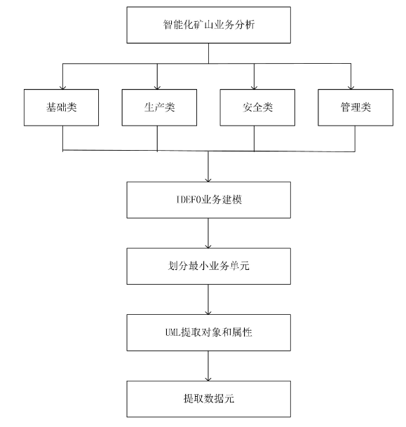

## 分类层次结构
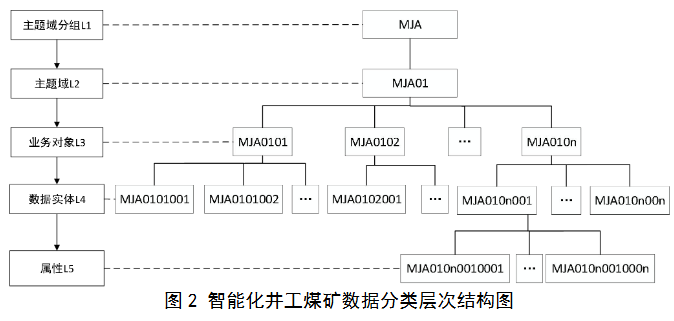
a）L1主题域分组：**描述数据管理的最高层级分类**。智能化井工煤矿数据根据主题域分组可划分为基础类数据、安全类数据、生产类数据、管理类数据。
b）L2主题域：**互不重叠数据的高层级分类**，用于管理下一级的业务对象。以生产类主题域分组为例，生产类主题域分组的主题域按照各个生产业务模块划分为采煤、掘进、供配电、提升等。
c）L3业务对象：**业务对象中承载了业务运作和管理的重要信息**。以生产主题域分组下采煤主题域为例，其下属的业务对象可以为分为采煤机、支架系统、供液系统、供电系统、运输系统、集控中心。
d）L4数据实体：描述业务对象某些业务特征的、具有一定逻辑关系的属性集合。以生产类数据采煤主题下的采煤机业务对象为例，其数据实体包括采煤机截割部、摇臂、采煤机电控部、采煤机牵引部、采煤机液控系统、采煤机惯导系统。
e）L5属性：描述业务对象在某方面的性质和特征。以采煤机截割部、摇臂为例，其属性包括截割运行时间、截割部电压监测、截割部电流监测等。

## 数据编码的基本原则
数据编码应遵循唯一性、匹配性、可扩充性、简洁性、实用性、可维护性等基本原则。

# 智能化井工煤矿数据编码方法
a）L1主题域分组：代码用三位英文大写字母表示。第一位表示矿山类别，M表示煤矿；第二位表示开采方式类别，J表示井工开采（L表示露天开采）；第三位表示主题域分组类别，A表示基础主题域分组，B表示生产主题域分组，C表示安全主题域分组，D表示管理主题域分组，如遇主题域分组扩充可按顺序赋码；
b）L2主题域：代码用两位阿拉伯数字表示，从01开始按顺序编码；
c）L3业务对象：代码用两位阿拉伯数字表示，从01开始按顺序编码；
d）L4数据实体：代码用三位阿拉伯数字表示，从001开始按顺序编码；
e）L5属性/数据元：代码用四位阿拉伯数字表示，从0001开始按顺序编码。

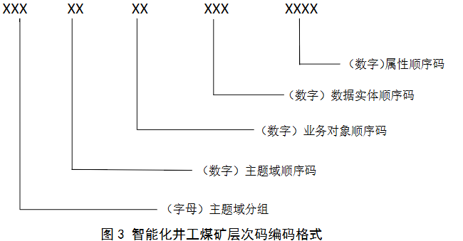

以生产类中的采煤主题域为例，生产类编码为MJB，采煤编码为01，采煤机编码为02，采煤机牵引部编码为003，牵引部电压监测编码为0001，如图4所示。

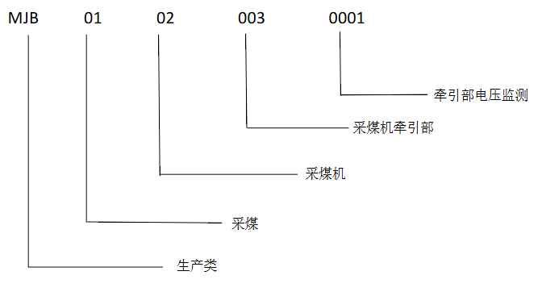

## 数据分类与编码实施
### 数据分类与编码管理组织建立
a）数据分类与编码管理组应根据不同的数据主题域建立多个数据管理小组，每个主题域数据管理小组负责本主题域内数据分类与编码管理工作。
### 数据标准发布与应用制度
a）相关部门应将数据分类与编码标准应用到相关的应用系统中，并将应用过程中出现的问题及时反馈。
b）管理组应组织、推动煤炭公司数据标准管理工作的具体实施，包括**数据分类与编码标准的发布、执行、反馈等相关工作，并建立高效的数据分类与编码标准的管理流程**，及时、有效地解决公司的数据标准管理相关问题。

## 智能化井工煤矿数据分类与编码主题域分组及主题域
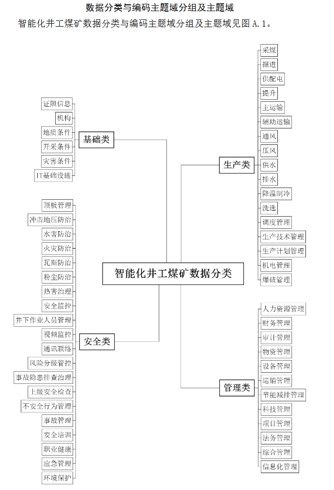

## 分类编码举例
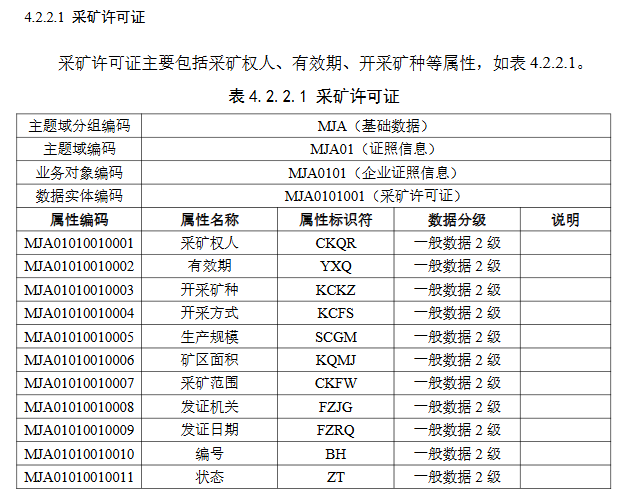

# 指标数据
indexdata指标数据是智能化矿山在战略发展、业务运营和管理支持等各领域业务分析过程中衡量某一个目标或事物的数据。
指标数据反映数量特征的概念和数值，包括**指标数据标准**和**指标数据值**两部分。

## 指标数据分类和指标数据标准属性
**指标数据定义框架**规范了指标数据分类和指标数据标准属性。
###  指标分为：**基本类指标**和**派生类指标**
其中**基本类指标**又分为**基础项指标**和**复合项指标**。
### 指标数据标准属性
规定了指标数据标准的**业务属性**、**技术属性**和**管理属性**，可应用在智能化矿山**数据资产管理**的相关领域。
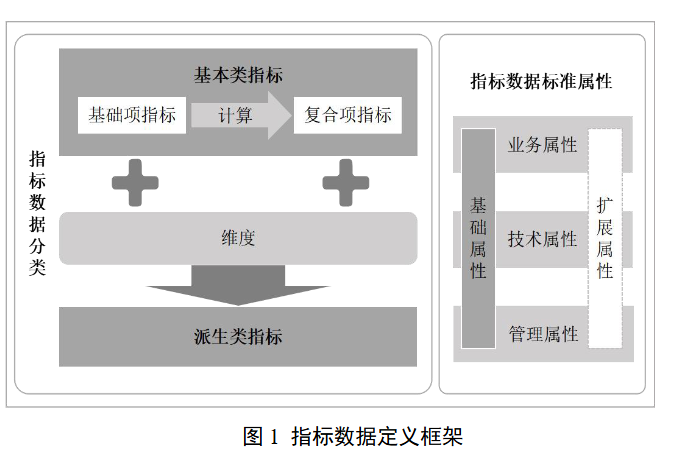

#### 基础项指标
基础项指标是表达业务实体原子量化属性的概念集合，是可以直接对单一变量的明细数据进行简单计算得到的不可进一步拆解的指标。如“调运量”、“销售量”等。具有如下特征：
1、指标计算规则中仅包含一个变量；
2、其稳定性高，业务定义、计算公式和统计口径不易随业务管理视角频繁变化。

#### 复合项指标
复合项指标是建立在基础项指标之上，由若干个基础项指标通过一定运算规则计算形成，在业务角度无法拆解，如“签约率”、“利润率”。
具有如下三种类型：
1、由基础项指标计算得到；
2、由基础项指标和复合项指标计算得到；
3、由复合项指标计算得到。

#### 派生类指标
派生类指标是**基本类指标**（即基础项指标或复合项指标）**与一个或多个维度值相结合产生的指标**。
如“月计划调运量”、“月日均销售量”等。
具有如下两种类型：
1、由基础项指标和维度组合得到；
2、由复合项指标和维度组合得到。

### 指标数据标准属性定义
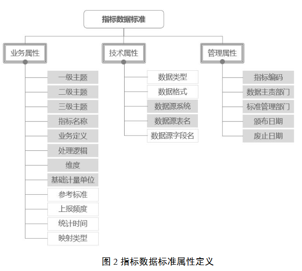
说明：
1）基本类指标数据标准（即基础项指标和复合项指标）属性包含标记为灰色背景部分的属性；
2）派生类指标数据标准属性包含全部属性。

# 主数据
**组织中需要跨系统、跨部门进行共享的核心业务实体数据。**
## 辨识原则
主数据的辨识需要遵循如下辨识原则。
a)**价值性原则**：应具有最核心的业务特性。
b)**共享性原则**：为跨部门、跨系统、跨业务域的共享基础数据。
c)**实体性原则**：为不可拆分的数据实体，是业务描述的基础。
d)**稳定性原则**：变动频率较低，变动后对业务影响较大。
e)**长期性原则**：长期有效，需要长期使用。

## 主数据辨识流程
a)针对智能化矿山**核心业务域**进行划分。
b)确定智能化矿山核心业务域的各关键业务环节。
c)提炼出智能矿山核心业务域的各关键业务环节中使用的信息数据对象实体。
d)从信息数据对象实体中，辨识出具有业务价值、共享价值、实体价值、影响价值、有效价值的核心主数据实体。

- 示例：
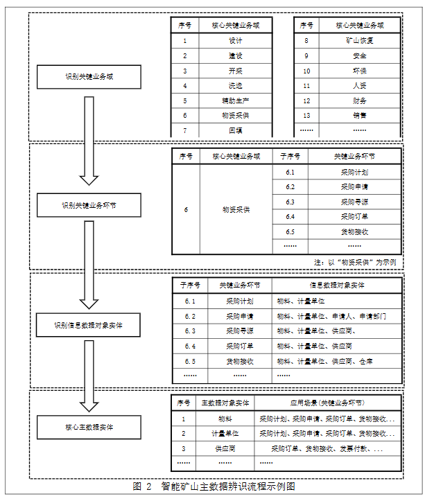

## 主数据模型
主数据模型由序号、中文名称、数据类型、值域构成。其中：
a)**序号**：由十进制数字构成，用于区分每一指标项；
b)**中文名称**：也是模型属性名称，反应属性的显著特征，应准确、简洁、明了，包括必要属性名称和非必要属性名称，非必要属性可根据企业实际需要进行补充；
c)**数据类型**：
d)**值域**：将一种代码应用于编码集中的所有元素所产生的结果。

## 主数据准入要求
主数据准入原则
- **优先考虑**企业信息化建设的刚性需求，对已建/在建各信息化系统、各系统模块亟需共享的主数据优先进行准入，优先建设。
- **其次考虑**企业信息化规划即将建设的需求，对待建各信息化系统、各系统模块需要共享的主数据进行准入，并行建设。
- **最后考虑**企业长期战略发展的业务需求，对未来远景规划的各信息化系统需要共享的主数据进行准入，纳入企业主数据体系，等待建设。

## 主数据模型要求
智能化矿山主数据包括基础类、设备类、安全类、环境类、物料类、单位类、人力资源类等，企业应根据实际业务情况根据主数据辨识模型进行主数据建设。
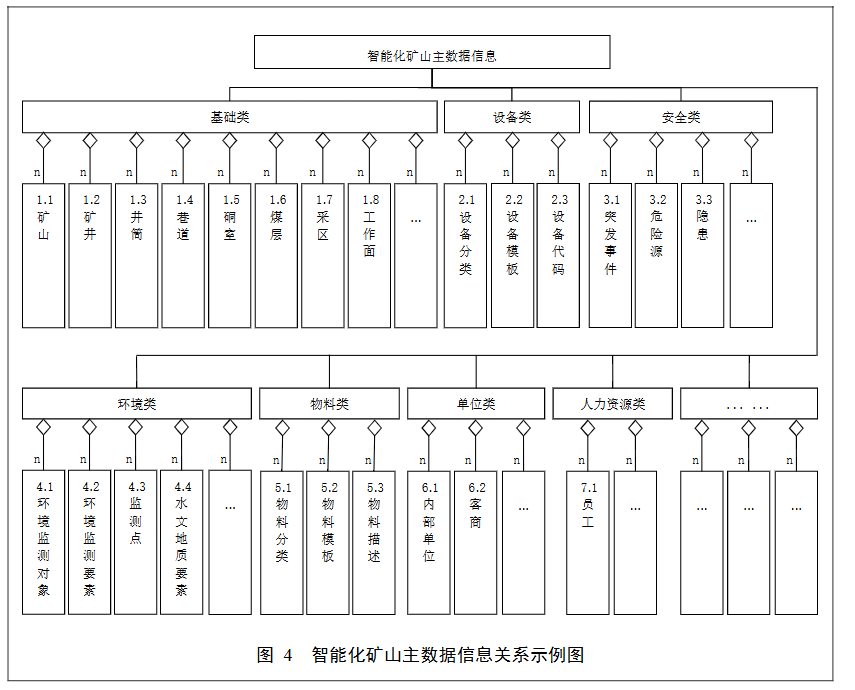

## 主数据模型构成
主数据模型由：
**序号**、**参考编码**、**中文名称**、**数据类型**、**值域范围**

### 主数据模型必要属性
主数据必要属性名称    说明
——————————————————————————
**主数据编码**        在一个系统，一个平台甚至一个企业范围内同一主数据编码应具有唯一的识别标志，用以明确区分业务对象，业务范围和业务的具体细节。
**主数据描述**        描述应准确无误的描述对应其指标项信息，能和主数据编码形成呼应。
**所属信息**          用于描述不同主数据信息之间的关联关系，包括所属单位、所属位置等能和其他主数据相关的信息。
**业务信息**         用于描述主数据独特的业务信息，未与其他主数据信息重合的部分。
**创建及修改信息**    包括创建人、创建时间、修改人、修改信息等，是每条数据生成的操作信息，可记录每条数据的全生命周期。

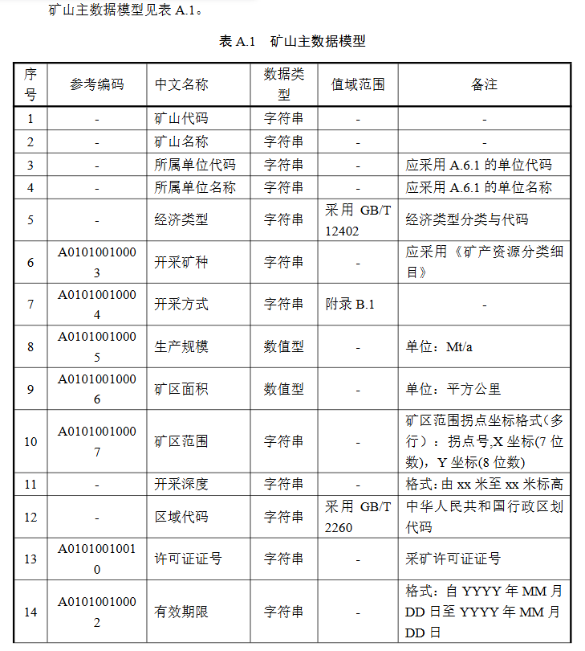

### 数据类型说明
**字符串**       表示文本，由数字、字母、下划线组成的一串字符。
**数值型**       表示数值，分为整数型和小数型。
**日期型**       表示日期时间，在本规范中应使用[YYYY-MM-DD]或[YYYY-MM-DDHH:MM:SS]的格式。
**布尔型**       表示真或假（T/F），本文件中应使用[是]（True）或[否]（False）表示。
**二进制流**     表示图像、音频、视频、文本等二进制流文件格式。 

# 数据质量
## 智能化矿山数据质量包含以下六个方面的基本要求：
a)**完整性**：数据在创建、传递过程中应无缺失和遗漏，包括实体完整、属性完整、记录完整和字段值完整四个方面。示例：掘进进度统计中，全部统计有效进尺数据。
b)**及时性**：应及时记录和传递相关数据，满足业务对信息获取的时间要求，数据交付要及时，采集要及时，应用要及时。
KSSJ/ZL13-20234示例：例如某矿的产量、进尺数据及时上报。
c)**准确性**：应真实、准确地记录原始数据，无虚假数据及信息，数据要准确反映其所建模的“真实世界”实体，数据记录信息与业务实际相符。示例：掘进进度统计中，生产进尺数据与生产实际一致。d)**一致性**：应遵循统一的数据标准记录和传递数据信息，主要体现在数据记录应规范，数据应符合逻辑。示例1：班组上报的产量与皮带秤采集的产量数据一致。示例2：财务统计的年度采购总金额和各单位每月上报的采购金额汇总值一致。
e)**唯一性**：同一数据应有唯一的标识符。各数据源系统在给其他系统提供数据时，应保证主键和联合主键具有唯一性，并且根据业务逻辑应具有唯一性的字段，在发布前应进行全量校验，确保唯一性的要求。示例：某类物料在主数据系统已经有编码，物料使用单位不用申请新编码，直接使用主数据系统存在的编码，确保一物一码。
f)**有效性**：数据的值、格式和展现形式应符合数据定义和业务定义的要求。各数据源单位在提供数据时，应在发布前对其字段进行分析，保证字段值具有有效格式，并且其值在有效范围之内和符合逻辑要求。示例：冲击地压计量单位为MPa，某煤矿测量数据按照MPa单位计算。

## 智能化矿山数据质量管理工作应遵循以下原则开展：
a)**过程受控**：数据质量的管理工作应对数据的全生命周期过程进行管控，包括数据的产生、存储、传递、使用和失效销毁等，应对每个阶段进行全面的过程质量管理；
b)**标准管理**：数据质量管理应在矿山企业统一的数据质量管理框架内进行，统一制定和发布数据质量标准、数据质量管理策略及管理规范；
c)**多方参与**：数据质量管理是系统性的工作，需要多方的共同参与。各级业务部门和信息化部门应参与到数据质量管理的工作中，提升数据质量；
d)**逐步推进、持续改善**：矿山企业应对已发现的数据质量问题逐步改进，应把数据质量管理列为长期工作持续改善，建立常态化的工作支撑。

# 数据架构
## 数据架构组件
### **一、数据资产目录**
数据资产目录宜分为五层，分别为主题域分组、主题域、业务对象、逻辑数据实体、业务属性，可根据每个企业情况自行定义。
a)**主题域分组**是描述矿山企业数据管理的最高层级，采用业务管理边界划分的方式，与业务流程架构第一层保持一致主题域是互不重叠的数据分类，用于管理一组密切相关的业务对象
b)**主题域**是互不重叠的数据分类，用于管理一组密切相关的业务对象;
c)**业务对象**是数据架构的核心层，用于定义矿山业务领域中某种具有连续性和标识的人、事、物的对象，用来统一矿山企业重要的业务概念逻辑数据实体是描述业务对象的众多属性的归类；
d)**逻辑数据实体**是描述业务对象的众多属性的归类;
e)**业务属性**是数据架构的最小颗粒，用于客观描述所属业务对象在某方面的性质和特征。
#### 数据资产目录设计
- **主题域分组设计**
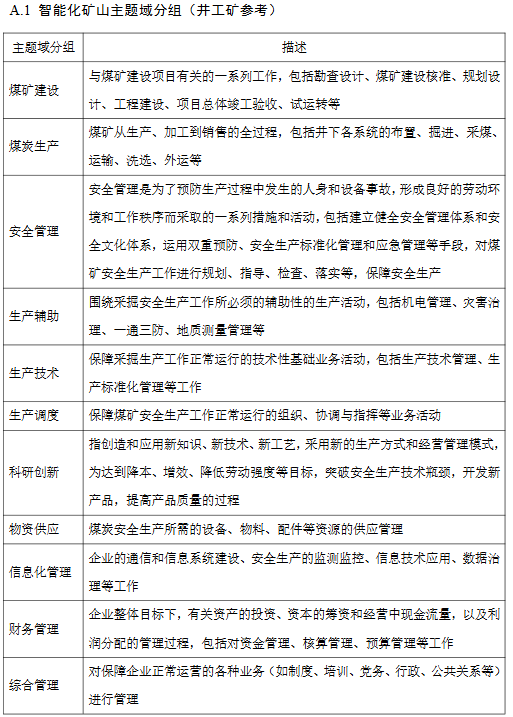
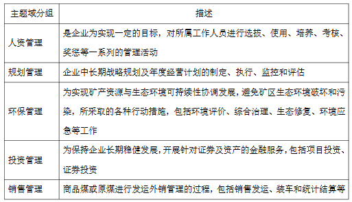

- **主题域设计-举例**
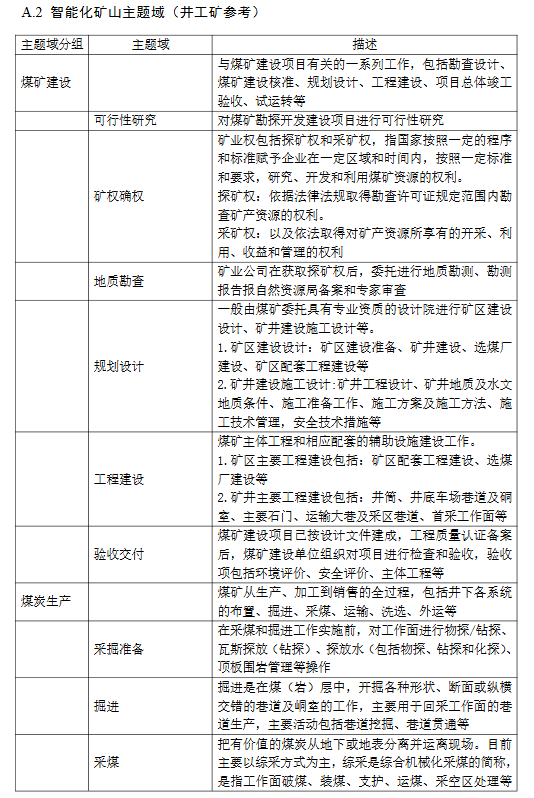

- **业务对象设计**
a)业务对象应是矿山企业日常运作和管理中不可缺少的重要人、事、物信息。应基于矿山业务活动产生的“表、证、单、书”识别业务对象，并和业务能力匹配；
b)业务对象应有唯一身份标识信息，用于区分不同业务对象；
c)业务对象相对独立并有属性描述。每个业务对象需要有描述自己某方面特征的属性；
d)业务对象可实例化。

- **逻辑数据实体设计**
a)逻辑数据实体不能脱离业务对象独立存在，不能归属于多个业务对象，**业务对象与逻辑数据实体的关系是1:1或1:N，不允许N:1的情况出现**。
b)逻辑数据实体设计要遵循三范式；
c)两个业务对象间的关系逻辑数据实体，归属于业务发生时间先后顺序中，后出现的业务对象；
d)逻辑数据实体设计时不考虑水平（横向）拆分，水平拆分在物理表设计中考虑；
e)描述业务对象不同业务特征的属性集合，可以单独设计为逻辑数据实体；
f)矿山业务中需要管理的变更历史信息，可以设计为逻辑数据实体。

- **业务属性设计**
a)含义相同的属性应设计一致的名称、定义、类型、长度、取值范围等；
b)引用其它逻辑数据实体的属性，若属性值在本逻辑数据实体中可以更改，应作为本逻辑数据实体的属性；
c)引用其它逻辑数据实体的属性，若属性值取自引用时点数值且后续不变更，应作为本逻辑数据实体的属性。

### **二、数据标准**
数据标准是用于描述矿山企业组织层面**需共同遵守的属性层数据含义和业务规则**。
其描述了矿山企业组织层面对某个数据的共同理解，应作为企业层面的标准在矿山企业内被共同遵守。
#### 数据标准设计原则
a)责任明确所有的数据标准都要有明确的业务规则责任主体、数据维护责任主体和数据监控责任主体，即归属于确定的业务部门管理。
b)数据资产标准化数据资产目录中的属性，除了少数无明确业务规则、或规则清晰不会产生歧义的属性外，都要定义或引用相应的数据标准。
c)唯一性数据标准之间必须做区分，在企业内部数据标准不允许重名。即不能对同一数据制定多种数据标准。
d)精简化以最少数量的数据标准支撑更多的属性。对于业务性质相同的数据，需要共用数据标准。
e)整合新建一个属性需要同时引用多个数据标准时，对该属性重新设计数据标准。

#### 数据标准分项定义
制定数据标准，应围绕**业务类分项**、**技术类分项**、**管理类分项**进行展开。
a)业务类分项用于描述数据含义和业务规则，包括但不限于：数据标准中文名称、数据标准编码、业务定义及用途、业务规则、允许值列表、是否必填、数据示例。
b)技术类分项用于描述数据与信息技术实现相关联的特性，包括但不限于：数据类型、数据长度。
c)管理类分项用于明确组织在数据标准管理方面应当承担的责任，包括但不限于：业务规则责任主体、数据维护责任主体、数据监控责任主体。

#### 各类型数据标准
对于不同数据类型的数据，在制定数据标准时有所不同。
a)**编码类数据标准**用于身份标识，目的是保证编码规则和业务定义的描述准确性。
b)**度量类数据标准**度量是指衡量某一事物的数字，如，金额、数量、率、时长等，度量类数据标准的侧重点是业务定义以及数据精度、计数单位、计量单位的描述准确性。
c)**时间类数据标准**时间类数据标准的侧重点是业务定义的描述准确性，可细分为日期类、日期时间类、时间戳类。
d)**描述类数据标准**描述是指使用文字对事物进行的描写叙述，例如，名称、地址、描述、概要、
KSSJ/ZL11-20238内容等，描述类数据标准的侧重点是业务定义的描述准确性。

#### 数据标准命名规范
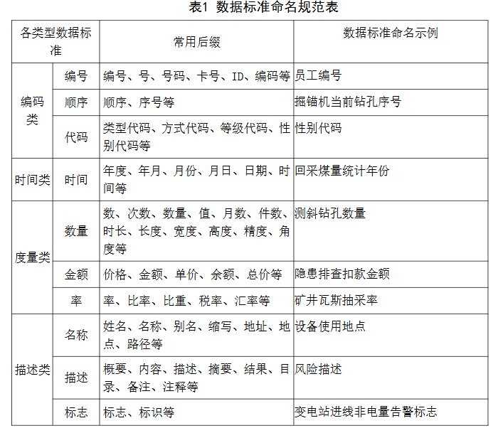

### **三、数据模型**
数据模型是从数据视角对现实世界特征的模拟和抽象，根据矿山业务需求抽取信息的主要特征，反映业务对象之间的关联关系。数据模型包括**概念数据模型**、**逻辑数据模型**和**物理数据模型**。

#### 概念数据模型
概念数据模型是通过业务对象及业务对象之间的关系，从宏观角度分析和设计的矿山企业核心数据结构。概念数据模型是主题中主要的数据构成要素，通过概念数据模型可以有效避免数据架构重复设计现象的出现。同时为逻辑数据模型、物理数据模型设计提供范围及指导性方向。

#### 逻辑数据模型
逻辑数据模型是利用逻辑实体及相互之间的关系，准确描述业务规则的实体关系图。逻辑数据模型要保证业务所需数据结构的正确性及一致性，使用一系列标准的规则将各种对象的特征体现出来，并对各实体之间的关系进行准确定义。逻辑数据模型为构建物理数据模型提供有力的参考依据。

#### 物理数据模型
物理数据模型是指按照一定规则和方法，将逻辑数据模型中所定义的实体、属性、属性约束、关系等要素转换为数据库软件所能够识别的表关系图的一种物理描述。

### **四、数据分布**
数据分布描绘数据在矿山企业分布的全景，梳理血缘关系，拉通矿山业务流，消除信息孤岛。
数据分布包括**信息链**和**数据流**。
- **信息链**描述流程活动间数据被创建、读取、更新、删除的过程。
- **数据流**描述某一数据在应用系统中被创建、读取、更新、删除的过程。

# 矿山数据湖
基于矿山丰富的产业数据资源，建立共建共创共享的管理机制，最终形成以生产能力为核心的产业数字化平台，需要寄托于数据湖和湖仓一体技术，实现资源平台结构化数据和非/半结构化数据的入湖和治理。数据湖应具备如下功能：
a)应支持结构化数据、半结构化数据、非结构化数据、二进制数据的采集、存储功能。
b)应支持弹性扩展能力。
c)宜支持多模式计算引擎。
d)应支持数据集成、发布、共享。

# 数据共享相关
## 数据共享目录datasharingcatalog
对矿山企业数据资源分类后，按照一定的次序编排而成的数据资源列表，便于数据资源共享的检索、定位与发现。

## 数据共享交换平台datasharingandexchangingplatform
汇聚矿山企业各部门或业务系统的数据资源，按照统一标准进行集成、整合后形成企业级统一的共享数据中心，为矿山企业业务开展提供共享数据服务的信息系统或平台。

## 共享数据类别
- 矿山企业共享数据从业务层面划分，包含了**基础类数据**、**安全类数据**、**生产类数据**和**管理类数据**
- 矿山企业共享数据按照数据结构的不同，可分为结构化数据、非结构化数据和地理空间数据。
- 矿山企业常见的结构化数据为关系型数据库和时序数据库中存储的数据，例如：人员管理、物资管理、销售管理、设备管理、安全管理等应用系统一般使用**关系型数据库**，常见的有MySQL、Oracle、Gbase、OceanBase、openGauss、SQLserver、DB2、PostgreSQL等。
- 矿山生产（如开采、运输、提升、填充等）、设备设施（如供电、通风、排水、压风、变配电、溜破等）、安全监测（如有毒有害气体监测、压力监测、微震监测）等自动化系统一般使用**时序数据库**，常见的有InfluxDB、TimescaleDB、DolphinDB、TDengine、OpenTSDB、IoTDB等。
- 矿山企业常见的非结构化数据包括矿山地质勘查、矿山设计、矿山开采、安全管理、环境治理等活动积累的设计类、报告类、监测监控类的文本、图片、音频、视频等数据，一般存储在**非关系型数据库**中，常见的有Hbase、Cassandra、Redis、MongoDB、Couchbase、Neo4j等。
- 矿山企业常见的地理空间数据包括矿区地表模型、矿体实体模型、品位分布模型、采空区模型、地质地形图、井上下对照图、采掘工程平面图、矿体剖面图、运输线路图、避灾路线图、排水线路图、井下控制点分布图、断层分布图等，常见的数据类型有矢量数据、栅格数据、地图瓦片、三维数据等。

## 共享数据要求
应提供共享数据的相关描述信息，要求如下：
a)中文名称（必选）：共享数据应具有相应的中文名称；
b)英文名称（可选）：共享数据应具有相应的英文名称；
c)数据类型（必选）：共享数据应具有数据类型的描述，如结构化数据的数据类型一般有字符型、数值型、日期型和日期时间型，非结构化数据的数据类型一般有文本、图片、音频、视频等，地理空间数据的数据类型一般有矢量数据、栅格数据、地图瓦片、三维数据、表格数据等。
d)数据格式（必选）：共享数据应具有数据格式的描述；
e)数据值域（可选）：共享数据应具有该数据的取值范围的描述；
f)计量单位（可选）：共享数据应具有数据计量单位的描述，数值型数据的计量单位为必选项；
g)数据来源（必选）：共享数据应具有数据源描述信息，包括来源机构、来源系统等；
h)数据产生方式（必选）：应按照数据的产生方式对数据进行分类，包括人工采集数据、信息系统产生数据、感知设备产生数据等；
i)数据产生时间（可选）：共享数据应具有产生数据的时间信息；
j)数据安全级别（必选）：共享数据应对该数据的安全级别进行描述，以确定该数据能够被何种权限等级的用户或系统访问；
k)数据关联度（可选）：共享数据宜具有数据关联关系的描述。

## 数据共享流程
矿山企业数据共享流程描述了数据共享服务中各参与方之间如何协作的过程，主要分为数据汇聚、数据申请、数据授权、数据提供、问题反馈五个环节。
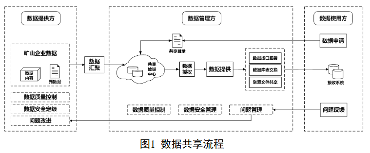

# 数据中台
对矿山企业相关数据进行规范化、资产化、服务化的过程集合以及数字化运营管控活动的集合。
## 数据中台架构
### 概述
数据中台是智能化矿山建设的数据底座，是矿山数据智能应用的基础，同时也是数据采集、存储、建模、分析、应用的统一平台。
a)应实现矿山各类感知数据、业务数据、管理数据、文本数据、空间数据的统一汇聚与管理；
b)应基于行业数据标准实现数据统一治理，围绕业务场景实现数管控、数据开发、数据服务及数据运营等数据价值化挖掘；
c)应提供跨层级、跨区域、跨业务数据互联互通，助力智能化矿山的建设。

### 总体架构
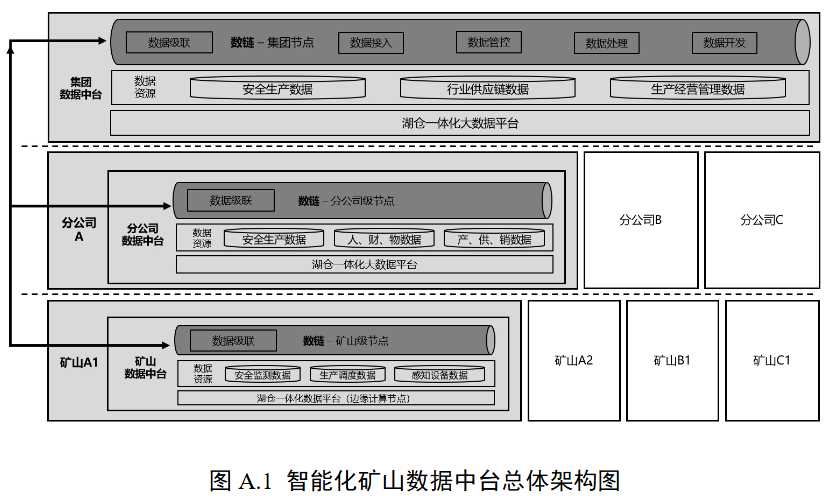

### 功能架构
**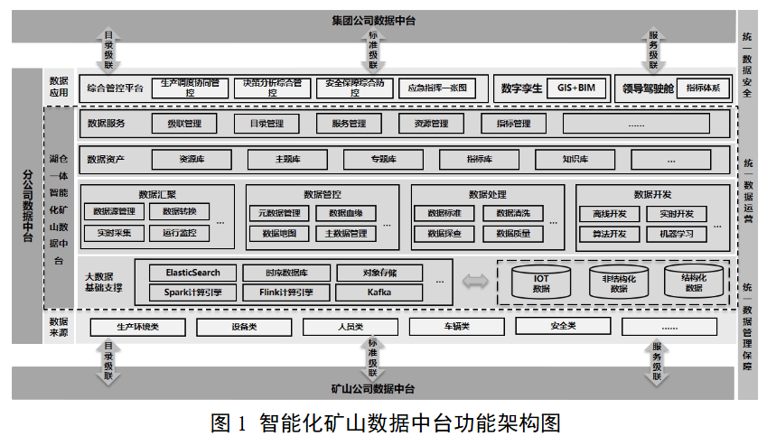**

### 数据架构
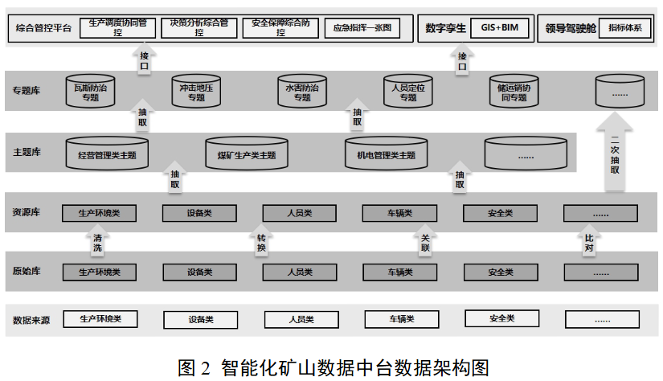

第二部分 综合地质保障系统
   一张图
第三部分  智能掘进
  SLAM及截割断面扫描数据处理软件
第四部分 智能综采
  第十一项 泵站智能化控制恒压供液部分：泵站智能数据采集软件
  第十五项  三机动力部监测系统部分：三机数据监测系统软件
  第十六项 煤流监测系统：AI+矿井主运输煤量识别分析软件
  第十七项  工作面视频系统：**无视频分析**
  第十九项 工作面人员定位系统
  第二十五项 视频识别预警系统：视频分析服务器，煤矿安全生产AI视频分析系统V1.0
  第二十六项 人员防误入系统
  第二十七项 工作面设备三维数字孪生系统
  第二十八项 智能综采管控平台
  第二十九项 智能规划开采系统
第五部分 主运输系统
第六部分 辅助运输系统
第七部分 综合保障系统
  第一项 智能通风系统
  第二项  空压机智能化无人值守系统
  第三项  智能供电系统
  第四项  排水智能化控制系统
第八部分 安全管控
  第一项  灾害综合防治系统：数据中台
  第二项  智能探放水系统
  第三项  防灭火系统
  第四项  顶板矿压监测系统
第九部分 生产经营管理
  第一项  智慧园区
  第二项 生产经营管理
  第三项 设备生命周期管理系统
  第四项 运维数据生成系统

**项目核心结论**：项目开始阶段需采用 “数据治理先行 + 硬件与子系统并行建设” 的策略，数据分类编码、元数据建模、主数据建模同步启动，机房 / 数据中心硬件建设与前端智能硬件安装、子系统调试并行推进，确保数据与硬件、系统的协同适配。

**项目建设目标**：东庄煤业智能综合管控平台以通过国家初级智能化矿山验收（得分≥90%）为目标，通过数据中台实现多系统标准化接入与国产化软硬件（SCADA、数据库）集成，部署AI管理平台支持全流程智能监测与联动控制，统一整合安全、生产等子系统并基于三维GIS可视化展示，具备实时预警、多部门协同指挥及移动端应用能力，同时预留扩展接口并满足《煤矿智能化建设评定管理办法》要求。

根据煤矿智能化建设条件分类结果，分别采用对应的分级评价指标体系：
- 智能化建设条件I类煤矿评价指标体系
- 智能化建设条件II类煤矿评价指标体系
- 智能化建设条件III类煤矿评价指标体系
进行评价打分，每类评价结果分为：
- **高级智能化**（综合评分值≥90分）
- **中级智能化**（综合评分值75～90分，不含90分）
- **初级智能化**（综合评分值60～75分，不含75分）。
煤矿智能化各系统综合评价指标分为必备指标、评分指标、加分指标，必备指标不具备的不予评定。

