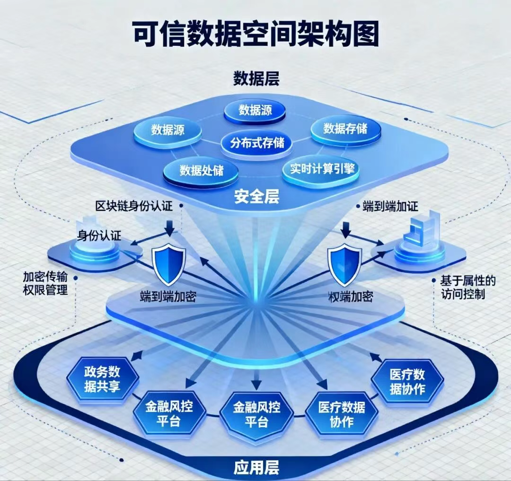

https://mp.weixin.qq.com/s/6BJM0Rpv90dsSXdsqd94lQ
# 一、可信数据空间的诞生背景和逻辑
1. 数据正式作为第五生产要素，那么其他生产要素（土地 资金 劳动力 技术）有的特性，数据也得有。
2. 过去企业在数字化转型中搭建了**数据中台**，建立了企业或集团内部的**数据共享**，将数据价值在企业内部得到释放。**数据**正式成为了**企业的资产**。
3. 未来，如何让**数据资产进一步价值释放**，像其他生产要素那样，为企业和整个经济带来飞跃式地增长，**可信数据空间概念诞生了**。
4. 很多**人工智能开发者**，在入门时，都会找一些**公共数据集用于练手**，比如像鸢尾花 波士顿房价，红酒分类等。这类数据不涉及安全和隐私，为整个社会带来了巨大的价值。不敢想象，让更多的数据像其他生产要素一样充分释放价值会带来怎样的生产力发展。
5. 哪些**障碍阻挡**住了**数据价值释放**？过去但凡开发者入门后，想要开发更好的模型，往往只能走灰产了，比如爬别人的或上咸鱼之类的。
**可信数据空间**正是带着让**跨组织之间的数据共享合规化**的使命而诞生的。
6. 为了让这整个流程合规化，**涉及到的技术栈**，是目前我接触到的**单个平台的最多的**。数据中台和AI中台产品经理，这两个平台本身的技术栈就多，而要实现可信数据空间完整的生态链。这两个也只能作为它的子集。

# 二、数据到了流通环节，到底是怎么“给”出去的？
在可信数据空间里，根据数据类型和安全等级的不同，共享方式（也就是价值释放的方式）主要有以下几种尺度：
## 1. 统计级共享：只要结论，不要清单
这是最常见的一种，跟企业内部的 BI 报表或各类数据报告类似。
其实很多数据中台都具备这类功能，那为什么要扩展成“可信数据空间”呢？主要就是**为了解决跨组织的权限问题和利益分配问题**。
我在与客户交流时就遇到过这种需求：某地政府想把气象局的预测报告分享给施工企业，比如提醒未来一周有哪些天风力超标，不适合户外高空作业。
**数据位置**： 原始数据还在气象局。
**交付方式**： 施工方拿到的只是聚合后的结论。这种方式最稳，因为敏感的底层数据压根没出门。

## 2. 脱敏级共享：抹掉隐私，保留特征
一些公开数据集（如心脏病数据集），原始数据可能包含患者姓名、身份证等隐私。但在数据空间里，我们会进行**静态脱敏**。
这种方式既不影响算法模型的训练效果，又保护了个人隐私，是数据价值释放的典型案例。
通常成熟的数据中台都具备动态或静态脱敏能力，这也是空间协作的基础。

## 3. 算法级共享：数据不动，程序动
这是目前 AI 训练中最硬核的需求。
比如自动驾驶公司需要交管局的监控视频来练模型，这种原始视频数据量大且极其敏感，物理拷贝是不现实的。
- **交付方式**： 搭建一个**受控沙箱**。**数据不出域**，而是让对方把算法（代码镜像）送进来，在受监控的计算环境里跑。
- **结果**： 对方最后带走的只是练好的模型权重参数，原始数据一帧也带不走。这就是所谓的“**进场加工**”。

## 4. 服务化共享：模型即服务（MaaS）
有时候，不仅**数据是资产**，连**训练好的模型也是核心资产**。
比如某保险公司开发了一个极其精准的理赔预测模型，他们怕别人通过频繁调用接口，反向把模型的逻辑给“偷”走了。
- **交付方式**： 这种共享看起来像 API，但本质不同。它在空间里是透明受控的。
- **区别**： 传统 API 是个“黑盒”，你不知道里面数据真假，对方也不知道你会不会把结果存下来二次转卖。而空间服务通过**可信执行环境（TEE）**，保证了模型运行的真实性，同时能限制你调用的次数和方式，防止算法资产泄露。

## 5. 联合计算共享：背靠背对暗号
- 最典型的场景是“塑料兄弟”合作。比如银行有资产数据，运营商有位置数据，两家想联合判断一个人是不是“高净值商旅客户”，但谁也不想把数据给对方。
- **交付方式**： **隐私计算（MPC）**。大家的数据都在各自本地，通过一套加密协议，在谁也看不见对方明文的情况下，算出那个重叠的交集。
- 

# 三、现实中存在三种合法、可落地的架构形态，各自适用不不同的场景。
|模式    |                 场景|                  优点|        缺点|
|----------|--------------------|---------------------|-----------|
|中立平台模式  |政府或行业协会牵头的公共数据开放|中立易监管|建设成本高需要公信力|
|链主主导型|    头部平台和生态伙伴。|改造成本低快速落地|中立性不足|
|各自对等平台|  大企业或机构之间  |各自主权完整技术对等|  标准要求高实现复杂成本最高|

## 2026年初，可信数据空间行业，所处阶段相关分析
**通常大部分项目都可以从模式二开始**，主要原因
- 这些企业基本是在之前数字化转型中已经有了一些像数据中台这样的基础设施，那这个阶段启动项目，不用等别人，不用等标准，不用等联盟，因为目前可能很多都是探索试行阶段的，连标准都是一些讨论稿阶段。等各方能力成熟后，可以升级到模式三，或接入联盟平台。
- 注意的是无论哪种模式，其实都不会把数据集中到某个平台下，至少原则上是不持有非本主体的原始业务数据的。
- 像模式一第三方平台，可能有的数据是：元数据、资产描述、模型参数、统计结果等。但不会存用户明细、交易流水、原始样本等数据。
- 同样模式二生态小伙伴B也不需要把自己的数据给到链主平台A，B需要做的不是“交数据”，而是部署一个受控执行节点，节点只接受训练任务、统计任务之类的操作。只返回操作的结果或参数，并且不允许数据外发，或运行过程中分发。

## 设计底线
- 作为B方（数据提供方）永远不适配“对方的建模方式”，只需要暴露自己定义好的、可控的计算能力集合即可。
- 如果试图去支持任意SQL、任意Python、任意模型，最终得到的一定是安全不可控、合规不可控、工程不可维护。
- 所有成功的联合建模系统，都是能力驱动，而不是需求驱动。
- 正确的做法应该是算子化+能力产品化。比如不要接任意模型，可以接算子，或是认可的模型；把联合建模需求拆成有限的能力类型，如联合统计类的，联合训练类，联合推理类。平台对外暴露的也只是能力目录，而不是自由接口。最后将这些能力拆成“标准执行模板”，无论外部要接入的是谁，都智能用这个模板。

# 四、可信数据空间--重要概念
- 可信数据空间是基于共识规则联接多方主体，实现数据资源共享共用的数据流通利用基础设施，也是数据要素价值共创的应用生态，更是支撑全国一体化数据市场构建的重要载体 。
- 可信数据空间空间是一个**基于共识规则的数字化基础设施**，旨在实现数据在不同主体间的**安全**、**可信流动**。
与企业的数据湖对比，它不是一个巨大的中央数据库。它并不改变数据的所有权归属，只**提供流通的管道、协议和安检机制**。
- 实现可信不是靠感觉，而是要实现**4件事情的工程化闭环**：
## 01权属可信
- 责任主体是明确的，这个对有公信力的第三方就特别有优势，可基于数字证书技术（PKI），确保每个动作都能定位到具体的企业或人。像政府平台认证的企业或组织、微信平台认证的主体等。
- 数据资产有标识，给数据包打上唯一指纹（Hash/DID），防止篡改。确保给张三和给李四的都是一模一样的数据。张三和李四也可以自己校验。这个类似网盘的唯一文件校验，还有安装包下载的文件校验，确保下载到的不是被人篡改过的。
- 数据来源可追溯，这个和现在的食品溯源之类的类似，为了证明我的数据权属可信，对于数据中台来说，通常都具备全链路血缘相关能力。

## 02 授权可信
授权可信就是你被允许用这份数据做什么，通常看到的数字合约，就跟这个有关系了。授权不单指是线上或线下的合同，而是在平台上跟数据包绑定的代码规则，可用ODRL（Open Digital Rights Language）表达：
Count: 	只能使用 5 次。
Time: 	只能在 2026-12-31 前使用。
Purpose: 	只能用于“AI模型训练”，不能用于“营销画像”。
Location: 	数据不得离开 TEE 环境。

## 03 使用可信
使用可信可能是数据中台与可信数据空间这2个平台的最大差异点了。可信数据空间不只管“给不给”，而是管“怎么用”。
- 在可信数据空间，数据不出域意味着数据留在本地，只传计算结果（比如联邦学习）；
- 数据在受控环境（沙箱）中，阅后即焚，无法导出明文，也无法在计算过程中分发出去；
- 可以移动算法而非移动数据，最大化保证数据安全。像数据供应方可以定义允许某类的模型进行训练，训练后可以把模型拿走。

## 04 责任可信
责任可信这块主要是为了审计，数据中台通常也具备这类能力，像全链路留痕，即是谁在什么时候请求了什么数据，用来做了什么计算，都会记录在日志中，这在同个组织内通常没啥问题，而在跨组织场景下，可能就需要用到不可篡改技术，通常会基于区块链或可信日志技术，防止事后抵赖。
所以日志在用常规方式保存后通常还会**上链**，可以一键导出日志，为监管机构或审计部门提供“无罪证据”用于自证清白。

## 可信数据空间架构图

# 以下链接，阐明了可信数据空间的必要性和未来趋势
https://mp.weixin.qq.com/s/48O5D0FJp5AeXBFBrmFyuw?scene=1&click_id=27