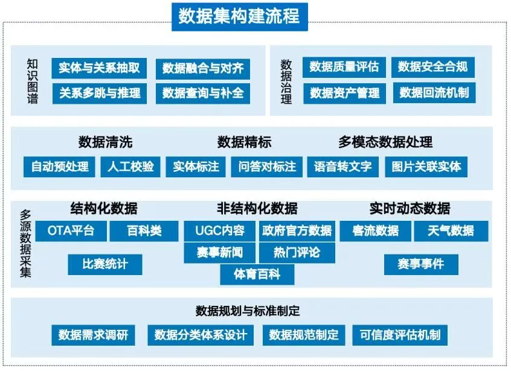

# 面向大宗物流经营的可信数据空间
http://www.tynews.com.cn/system/2025/09/23/030933073.shtml

日前，国家数据局公布“全国数据基础设施建设典型案例”，**长河信息**助力**华远陆港集团山西国际物流有限公司**申报**的 “面向大宗物流经营的可信数据空间”项目成功入围**。该项目是今年“**全国数据基础设施建设典型案例**”交通物流领域的唯一代表，也是我省唯一入选的地方样本，为数据基础设施在重点行业落地应用提供了可复制、可推广的“山西经验”。

“面向大宗物流经营的可信数据空间”的优势在于以“场站通”数字场站、“业财通”及“数据汇聚底座”三大平台为核心，**整合12类关键数据，形成8大领域800余个高质量数据集**，建立安全可信的数据共享机制，构建全链条可信数据服务体系；
创新运用“可信数据空间+大模型”融合技术，通过门户、认证中心、连接器等多模块协同，推动数据规模化可信流通；
依托多方共识建立数据分类分级体系与跨主体协同机制，接入16类智能终端，运输效率提升10%、物流成本降低30%、仓储利用率提高18%。
同时，**以2.9%的授信利率获批山西省首笔百万级大宗供应链数据资产授信**，为山西大宗商品供应链数据要素市场价值显性化提供了可借鉴的实践范例。 

# 高质量数据集
## 数据集构建流程

