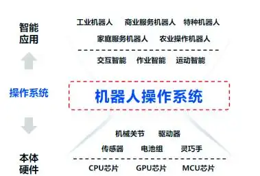

# 智元灵渠 OS
1、 灵渠OS构建了一个独特的生态架构，即“南向适配具身硬件、北向支撑智能应用”。
2、在底层，它依托智元已开源的高性能中间件AimRT，提供了诸如分布式群体实时通信、硬件抽象等基础服务框架。
3、在上层，则开放了智能体服务框架，支持交互、作业、运动等智能基座模型的标准化对接，从而降低了应用开发的门槛。
4、提供了丰富的工具链，覆盖了开发调试、仿真验证、部署管理、数据录制等全方位能力。

# 当前具身智能领域面临的核心挑战
包括操作系统的碎片化、高昂的适配成本，及智能体服务的协同难题。
这些问题不仅阻碍了具身智能的进一步发展，也使得机器人往往只能局限于特定的应用场景。

# 行业首个面向真实世界双臂机器人的世界模型开源平台
GenieEnvisioner（简称GE）
该平台融合了预测、控制、评测三大核心能力，为机器人提供了从“看见”到“行动”的端到端、一体化解决方案。
姚卯青指出，当前具身智能领域在建模能力上存在瓶颈，尤其是在应对流体、多体等复杂混沌问题时。
而GE平台的推出，将有效解决机器人在复杂环境中自主决策与精准操作的关键难题。

# 灵创平台

# 灵心平台