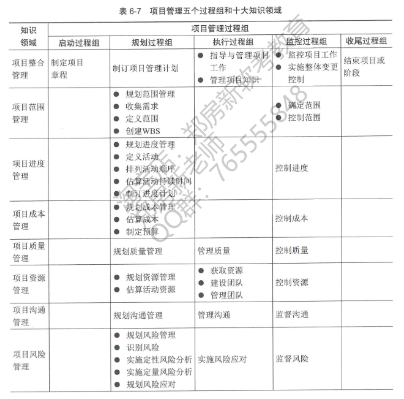

系统项目管理师教程
    1、信息化发展
        信息与信息化
        现代基础设施
        现代化创新发展
        数字中国
        数字化转型与元宇宙
    2、信息技术发展
        信息技术及其发展
        新一代信息技术及其应用
    3、信息系统治理
        IT治理
        IT审计
    4、信息系统管理
        信息系统管理四大领域：规划和组织，设计和实施，运维和服务，优化和持续改进
        管理要点 : 数据管理、运维管理、信息安全管理
    5、信息系统工程
        软件工程：架构设计、需求分析、软件设计、软件实现：（软件配置管理、软件编码、软件测试）  部署交付、过程管理
        数据工程：数据建模、数据标准化、数据运维、数据开发利用、数据库安全
        系统集成：网络集成、数据集成、软件集成、应用集成
        安全工程
    24、法律法规与标准规范
        法律法规
            民法典（合同编）
            招标投标法
            政府采购法
            专利法
            著作权法
            商标法
            网络安全法
            数据安全法
        标准规范
            系统与软件工程标准
            新一代信息技术标准
            信息技术服务标准
    6、项目管理概论
        PMBOK的发展
        项目基本要素
        项目经理的角色
        价值驱动的项目管理知识体系
      
    7、项目立项管理
        项目建议与立项申请
        项目可行性研究
        项目评估与决策
    8、项目整合管理
        管理基础
        项目整合管理过程
        制定项目章程
        制订项目管理计划
        指导与管理项目工作
        管理项目知识
        监控项目工作
        实施整体变更控制
        结束项目或阶段
    9、项目范围管理
        管理基础
        项目范围管理过程
        规划范围管理
        收集需求
        定义范围
        创建WBS
        确认范围
        控制范围
    10、项目进度管理
        管理基础
        项目进度管理过程
        规划进度管理
        定义活动
        排列活动顺序
        估算活动持续时间
        制定进度计划
        控制进度
    11、项目成本管理
        管理基础
        项目成本管理过程
        规划成本管理
        估算成本
        制定预算
        控制成本
    12、项目质量管理
        管理基础
        项目质量管理过程
        规划质量管理
        管理质量
        控制质量
    13、项目资源管理
        管理基础
        项目资源管理过程
        规划资源管理
        估算活动资源
        获取资源
        建设团队
        管理团队
        控制资源
    14、项目沟通管理
        管理基础
        项目沟通管理过程
        规划沟通管理
        管理沟通
        监督沟通
    15、项目风险管理
        管理基础
        项目风险管理过程
        规划风险管理
        识别风险
        实施定性风险分析
        实施定量风险分析
        规划风险应对
        实施风险应对
        监督风险
    16、项目采购管理
        管理基础
        项目采购管理过程
        规划采购管理
        实施采购
        控制采购
        项目合同管理
    17、项目干系人管理
        管理基础
        项目干系人管理过程
        识别干系人
        规划干系人参与
        管理干系人参与
        监督干系人参与
    18、项目绩效域
        干系人绩效域
        团队绩效域
        开发方法和生命周期绩效域
        规划绩效域
        项目工作绩效域
        交付绩效域
        度量绩效域
        不确定性绩效域
    19、配置与变更管理
        配置管理
        变更管理
        项目文档管理
    20、高级项目管理
        项目集管理
        项目组合管理
        组织级项目管理
        量化项目管理
        项目管理实践模型
    21、项目管理科学基础
        工程经济学
            资金的时间价值与等值计算
            项目经济评价
        运筹学
            线性规划
            运输问题
            指派问题
            动态规划
            图与网络
            博弈论
            决策分析
    22、组织通用治理
        组织战略
        绩效考核
        转型升级
    23、组织通用管理
        人力资源管理
        流程管理
        知识管理

# 信息系统管理覆盖四大领域：
●规划和组织：针对信息系统的整体组织、战略和支持活动。
●设计和实施：针对信息系统解决方案的定义、采购和实施，以及他们与业务流程的整合。
●运维和服务：针对信息系统服务的运行交付和支持，包括安全。
●优化和持续改进：针对信息系统的性能监控及其于内部性能目标、内部控制目标和外部要求的一致性管理。

# 概述
沟资整范进，质成人风采
需求、配置、变更、合同

# 项目立项
## 项目建议书
应该包含的核心内容：
1、项目的必要性；
2、项目的市场预测；
3、项目预期成果的市场预测；
4、项目建设必需的条件；
## 可行性研究
信息系统项目进行可行性研究包括:**技术可行性分析**、**经济可行性分析**、**社会效益可行性分析**、**运行环境可行性分析**以及其他方面的可行性分析等。