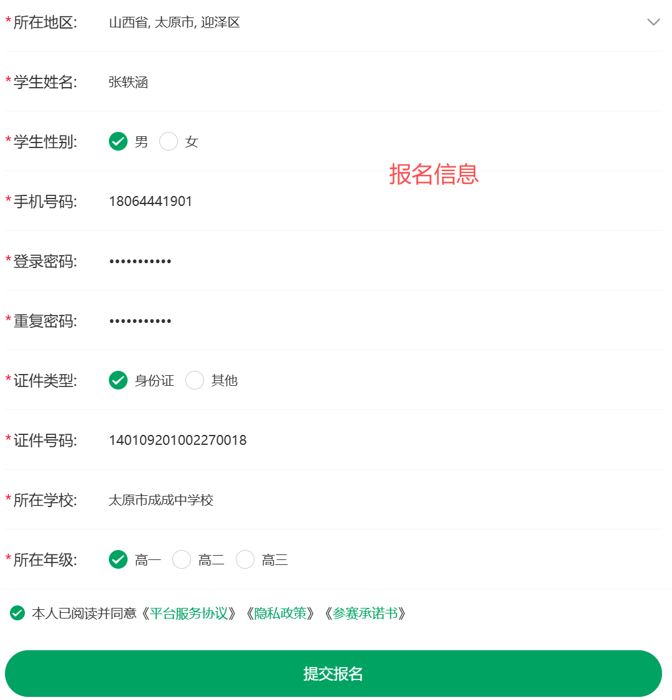

# 大赛宗旨
大赛以贯彻落实党中央、国务院生态文明建设有关精神，根据《全国环境宣传教育行动纲要》的有关要求，坚持环境教育从娃娃抓起，以“小手拉大手”的方式，通过加强对中小学生的环境宣传教育，**提高青少年的环境保护意识和可持续发展观念**，**实现“教育一个孩子、带动一个家庭、影响整个社会”的目的**，推动全民参与环境保护，为提高生态文明水平营造良好的舆论氛围和社会环境。

鼓励学生关注思考“人与自然、人与社会、人与人”之间的关系，学习观察自然、社会，审视自我，通过写作去认识生命、认识地球、培养具有社会责任感和健全人格的当代中学生。

**大赛宗旨：**弘扬生态文明理念、倡导绿色化生活方式，培养学生环境意识和环境责任。

# 大赛主题
“美丽中国，双碳有我”
实现双碳目标，离不开每个人的努力。广大青少年可围绕大赛主题，结合身边的所见、所闻、所感、所思，以身作则坚定维护与践行绿水青山、建设美丽中国的初心和使命，助力实现“碳达峰、碳中和”的宏伟目标。

zhf@4933807

